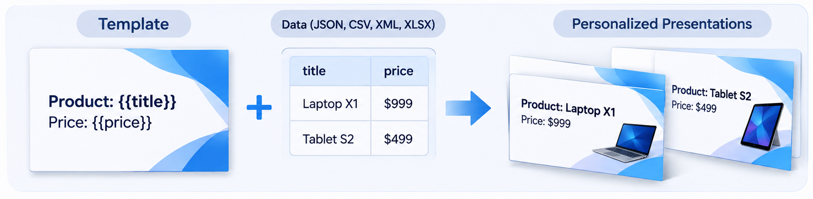

# Mail Merge trong Bài Thuyết Trình PowerPoint

Aspose.Slides for .NET cho phép bạn tự động tạo các bài thuyết trình PowerPoint bằng cách sử dụng mẫu và nguồn dữ liệu. Mail Merge điền các placeholder trong mẫu bằng dữ liệu và tạo ra hoặc một bài thuyết trình duy nhất chứa các slide mẫu được lặp lại cho mỗi bộ dữ liệu, hoặc một bài thuyết trình riêng biệt cho mỗi bộ dữ liệu.

Chức năng này hữu ích cho việc tạo danh mục sản phẩm, bài thuyết trình cá nhân hoá, báo cáo, chứng chỉ, đề xuất, bảng giá và các tài liệu khác mà cấu trúc bài thuyết trình vẫn giữ nguyên trong khi nội dung thay đổi.


## Cách Mail Merge Hoạt Động

Mail Merge sử dụng một bài thuyết trình PowerPoint làm mẫu và thay thế các placeholder bằng giá trị từ nguồn dữ liệu.



Một placeholder là tên trường được bao quanh bởi cặp dấu ngoặc nhọn kép, chẳng hạn `{{title}}` hoặc `{{price}}`. Placeholder có thể được đặt trong văn bản của hình dạng, ô bảng, nhóm hình dạng và ghi chú người thuyết trình.

Ví dụ, một slide mẫu có thể chứa các văn bản sau:

- `Product: {{title}}`
- `Price: {{price}}`
- `Description: {{description}}`

Khi nguồn dữ liệu chứa các giá trị sau:

| Trường | Giá trị |
|---|---|
| title | Laptop X1 |
| price | $999 |
| description | Màn hình 14‑inch, RAM 16 GB |

Mail Merge thay thế các placeholder bằng các giá trị tương ứng, tạo ra một slide với thông tin sản phẩm thực tế.

Tên trường không phân biệt chữ hoa/chữ thường, vì vậy `{{title}}` và `{{Title}}` đề cập tới cùng một trường.

Các quy tắc sau áp dụng khi thay thế placeholder:

- Placeholder được thay thế trên các slide, bao gồm các nhóm hình dạng và ô bảng, và trong ghi chú người thuyết trình.
- Placeholder trên master slide và layout slide không được thay thế.
- Placeholder mà trường không tồn tại trong bộ dữ liệu sẽ giữ nguyên.
- Giá trị trường trống sẽ thay thế placeholder bằng chuỗi rỗng.
- Văn bản được chèn thừa hưởng định dạng của ký tự đầu tiên của placeholder.
- Giá trị không được chứa văn bản placeholder, vì văn bản chèn có thể được xử lý lại và bị thay thế bởi một trường khác.

Bản mẫu bài thuyết trình gốc không bị sửa đổi trong quá trình merge và phải chứa ít nhất một slide.

## Các Nguồn Dữ Liệu Được Hỗ Trợ

Mail Merge hỗ trợ hai cách cung cấp dữ liệu:

- Tạo nguồn dữ liệu bằng mã bằng cách sử dụng `IMailMergeDataSource`.
- Đọc dữ liệu từ tệp hoặc luồng CSV, XLSX, JSON hoặc XML.

Định dạng dữ liệu được phát hiện dựa trên nội dung, không dựa trên phần mở rộng tệp. Các luồng không hỗ trợ seek cũng được hỗ trợ.

Nguồn dữ liệu phải chứa ít nhất một bộ dữ liệu. Mỗi bộ dữ liệu đại diện cho một bản sao của mẫu sẽ được điền giá trị.

Nếu nội dung dữ liệu không nhận dạng được là định dạng hỗ trợ, sẽ ném `NotSupportedException`. Nếu nội dung được nhận dạng nhưng không đáp ứng yêu cầu định dạng, sẽ ném `InvalidDataException`. Thông điệp ngoại lệ chứa vị trí lỗi trong dữ liệu.

### JSON

Nguồn dữ liệu JSON phải có một đối tượng gốc chứa mảng `sets`. Mỗi phần tử của mảng đại diện cho một bộ dữ liệu và phải chứa mảng `fields`. Mỗi trường phải có chuỗi `name` và `value`.

Thuộc tính tùy chọn `version` phải là `"1.0"`, và thuộc tính tùy chọn `type` của một trường phải là `"text"`. Tên thuộc tính phân biệt chữ hoa/chữ thường. Các thuộc tính không xác định sẽ bị bỏ qua.

Dữ liệu JSON được đọc dưới dạng UTF‑8, hoặc UTF‑16 khi dữ liệu bắt đầu bằng dấu chỉ thứ tự byte (BOM).

Ví dụ dưới đây chứa hai bộ dữ liệu:

```json
{
  "version": "1.0",
  "sets": [
    {
      "fields": [
        { "name": "title", "value": "Laptop X1" },
        { "name": "price", "value": "$999" }
      ]
    },
    {
      "fields": [
        { "name": "title", "value": "Tablet S2" },
        { "name": "price", "value": "$499" }
      ]
    }
  ]
}
```

### XML

Nguồn dữ liệu XML phải có phần tử gốc `template` chứa phần tử `sets`. Mỗi phần tử `set` chứa các phần tử `field`, và mỗi `field` phải chứa các phần tử `name` và `value`.

Phần tử `value` rỗng được xem như một chuỗi rỗng. Tên phần tử phân biệt chữ hoa/chữ thường. Các phần tử và chú thích không xác định sẽ bị bỏ qua. Mã hoá được xác định bởi khai báo XML. Định nghĩa kiểu tài liệu (DTD) không được cho phép.

```xml
<?xml version="1.0" encoding="utf-8"?>
<template>
  <sets>
    <set>
      <field>
        <name>title</name>
        <value>Laptop X1</value>
      </field>
      <field>
        <name>price</name>
        <value>$999</value>
      </field>
    </set>
    <set>
      <field>
        <name>title</name>
        <value>Tablet S2</value>
      </field>
      <field>
        <name>price</name>
        <value>$499</value>
      </field>
    </set>
  </sets>
</template>
```

### CSV

Dữ liệu CSV sử dụng dấu chấm phẩy làm dấu phân cách giá trị.

Dòng đầu tiên chứa tên trường và kết thúc tại tên trường đầu tiên rỗng. Mỗi dòng tiếp theo đại diện cho một bộ dữ liệu. Dữ liệu kết thúc tại dòng trống đầu tiên.

Các quy tắc sau áp dụng:

- Các giá trị thiếu ở cuối dòng được xem như chuỗi rỗng.
- Các giá trị vượt quá danh sách tên trường được bỏ qua.
- Giá trị chứa dấu chấm phẩy, dấu ngoặc kép hoặc ngắt dòng phải được đặt trong dấu ngoặc kép.
- Dấu ngoặc kép bên trong một giá trị đã được bao quanh phải được gấp đôi.
- Dữ liệu được đọc dưới dạng UTF‑8, hoặc UTF‑16 khi bắt đầu bằng BOM.

Ví dụ:

```csv
title;price;description
Laptop X1;$999;"14"" display; 16 GB RAM"
Tablet S2;$499;
```

### XLSX

Dữ liệu XLSX được đọc từ bảng tính đầu tiên.

Bảng tính tuân theo các quy tắc giống như CSV:

- Dòng đầu tiên chứa tên trường và kết thúc tại ô đầu tiên rỗng.
- Mỗi dòng tiếp theo đại diện cho một bộ dữ liệu.
- Dữ liệu kết thúc tại dòng trống đầu tiên.
- Các ô trống được xem như chuỗi rỗng.
- Các giá trị số được chuyển sang văn bản bằng cách sử dụng invariant culture.

## Tạo Một Bài Thuyết Trình Đơn

Phương thức `MergeToSinglePresentation` tạo một bài thuyết trình chứa một bản sao của các slide mẫu cho mọi bộ dữ liệu. Mỗi bản sao được điền giá trị tương ứng.

Thứ tự của các bộ dữ liệu quyết định thứ tự của các nhóm slide trong bài thuyết trình kết quả.

### Merge Dữ Liệu Từ Tệp

Ví dụ dưới đây tải một mẫu và một tệp dữ liệu JSON, tạo một bài thuyết trình đơn chứa các slide cho tất cả các bộ dữ liệu, và lưu kết quả.

```csharp
using Aspose.Slides;
using Aspose.Slides.MailMerge;

MailMergeProcessor mailMerge = new MailMergeProcessor();

using (Presentation template = new Presentation("template.pptx"))
using (IPresentation result = mailMerge.MergeToSinglePresentation(template, "products.json"))
{
    result.Save("catalog.pptx", SaveFormat.Pptx);
}
```

Dữ liệu cũng có thể được đọc từ luồng. Luồng được đọc bắt đầu từ vị trí hiện tại và không bị đóng bởi thao tác Mail Merge.

```csharp
using Aspose.Slides;
using Aspose.Slides.MailMerge;
using System.IO;

MailMergeProcessor mailMerge = new MailMergeProcessor();

using (Stream data = File.OpenRead("products.xml"))
using (Presentation template = new Presentation("template.pptx"))
using (IPresentation result = mailMerge.MergeToSinglePresentation(template, data))
{
    result.Save("catalog.pptx", SaveFormat.Pptx);
}
```

### Tạo Nguồn Dữ Liệu Bằng Mã

Bạn có thể xây dựng nguồn dữ liệu bằng mã bằng cách sử dụng `MailMergeDataSource` và `MailMergeDataSet`. Thêm một bộ dữ liệu cho mỗi bản ghi và định nghĩa các trường của nó bằng phương thức `AddText`.

```csharp
using Aspose.Slides;
using Aspose.Slides.MailMerge;

MailMergeDataSource source = new MailMergeDataSource();

IMailMergeDataSet laptop = source.AddDataSet();
laptop.AddText("title", "Laptop X1");
laptop.AddText("price", "$999");

IMailMergeDataSet tablet = source.AddDataSet();
tablet.AddText("title", "Tablet S2");
tablet.AddText("price", "$499");

MailMergeProcessor mailMerge = new MailMergeProcessor();

using (Presentation template = new Presentation("template.pptx"))
using (IPresentation result = mailMerge.MergeToSinglePresentation(template, source))
{
    result.Save("catalog.pptx", SaveFormat.Pptx);
}
```

Trong ví dụ này, các slide mẫu được lặp lại hai lần: một cho laptop và một cho tablet. Các placeholder được điền bằng các giá trị đã định nghĩa trong mỗi bộ dữ liệu.

## Tạo Nhiều Bài Thuyết Trình

Nếu bạn cần một bài thuyết trình riêng cho mỗi bộ dữ liệu, hãy sử dụng phương thức `MergeToMultiplePresentations`.

Phương thức này xử lý các bộ dữ liệu từng cái một, tạo một bài thuyết trình từ mẫu, điền dữ liệu hiện tại, và truyền bài thuyết trình kết quả cho một handler.

Handler được gọi một lần cho mỗi bộ dữ liệu, theo thứ tự dữ liệu gốc.

### Lưu Mỗi Bài Thuyết Trình

Ví dụ dưới đây đọc dữ liệu từ tệp CSV và lưu mỗi bài thuyết trình được tạo ra dưới dạng tệp riêng.

```csharp
using Aspose.Slides;
using Aspose.Slides.MailMerge;

MailMergeProcessor mailMerge = new MailMergeProcessor();

using (Presentation template = new Presentation("template.pptx"))
{
    mailMerge.MergeToMultiplePresentations(
        template,
        "products.csv",
        (presentation, args) =>
        {
            presentation.Save(
                "product_" + (args.Index + 1) + ".pptx",
                SaveFormat.Pptx);
        });
}
```

Thuộc tính `args.Index` cung cấp chỉ mục bắt đầu từ 0 của bộ dữ liệu hiện tại. Trong ví dụ, nó được dùng để tạo tên tệp tuần tự bắt đầu từ `product_1.pptx`.

Dữ liệu cũng có thể được đọc từ luồng:

```csharp
using Aspose.Slides;
using Aspose.Slides.MailMerge;
using System.IO;

MailMergeProcessor mailMerge = new MailMergeProcessor();

using (Stream data = File.OpenRead("products.xlsx"))
using (Presentation template = new Presentation("template.pptx"))
{
    mailMerge.MergeToMultiplePresentations(
        template,
        data,
        (presentation, args) =>
        {
            presentation.Save(
                "product_" + (args.Index + 1) + ".pptx",
                SaveFormat.Pptx);
        });
}
```

### Sử Dụng Giá Trị Bộ Dữ Liệu Để Đặt Tên Tệp

Handler nhận cả bài thuyết trình đã tạo và thông tin về bộ dữ liệu được dùng để tạo nó. Bạn có thể dùng các giá trị bộ dữ liệu để xây dựng tên tệp có ý nghĩa.

Ví dụ, đoạn mã dưới đây lưu mỗi bài thuyết trình bằng tiêu đề sản phẩm:

```csharp
using Aspose.Slides;
using Aspose.Slides.MailMerge;

MailMergeProcessor mailMerge = new MailMergeProcessor();

using (Presentation template = new Presentation("template.pptx"))
{
    mailMerge.MergeToMultiplePresentations(
        template,
        "products.json",
        (presentation, args) =>
        {
            string title = args.DataSet.GetText("title");
            string fileName = title != null
                ? title
                : "product_" + (args.Index + 1);

            presentation.Save(fileName + ".pptx", SaveFormat.Pptx);
        });
}
```

Thuộc tính `DataSet` trả về bộ dữ liệu được dùng để điền bài thuyết trình hiện tại. Phương thức `GetText` lấy giá trị của trường được chỉ định, hoặc `null` nếu trường không tồn tại.

Điều này cho phép bạn sử dụng giá trị dữ liệu để đặt tên tệp, tổ chức đầu ra, hoặc áp dụng xử lý bổ sung trong handler.

## Xử Lý Các Bài Thuyết Trình Được Tạo

`MergeToMultiplePresentations` sử dụng delegate `MailMergedPresentationHandler` để xử lý mỗi bài thuyết trình đã tạo.

Handler nhận hai đối số:

- `presentation` — bài thuyết trình được tạo từ mẫu và đã được điền bộ dữ liệu hiện tại.
- `args` — thông tin về bài thuyết trình đã tạo, bao gồm chỉ mục bộ dữ liệu và chính bộ dữ liệu.

Bài thuyết trình được tạo ra thuộc quyền sở hữu của thao tác Mail Merge và sẽ bị giải phóng ngay sau khi handler trả về. Do đó, bạn phải lưu nó hoặc sao chép bất kỳ dữ liệu cần thiết nào bên trong handler. Không giữ tham chiếu tới nó sau khi handler trả về và không tự giải phóng nó.

Handler được thực thi trên luồng gọi, một bài thuyết trình một lúc, theo thứ tự của các bộ dữ liệu. Chỉ một bài thuyết trình được giữ trong bộ nhớ tại một thời điểm, khiến cách tiếp cận này phù hợp để xử lý nguồn dữ liệu lớn mà không cần giữ tất cả các bài thuyết trình trong bộ nhớ đồng thời.

Nếu handler ném ngoại lệ, thao tác Mail Merge dừng lại và ngoại lệ được truyền lên caller mà không thay đổi. Các bài thuyết trình đã được xử lý không bị ảnh hưởng, và các bộ dữ liệu còn lại sẽ không được xử lý.

Ví dụ dưới đây lưu các bài thuyết trình đã tạo vào một thư mục riêng:

```csharp
using Aspose.Slides;
using Aspose.Slides.MailMerge;
using System.IO;

string outputFolder = "output";
Directory.CreateDirectory(outputFolder);

MailMergeProcessor mailMerge = new MailMergeProcessor();

using (Presentation template = new Presentation("template.pptx"))
{
    mailMerge.MergeToMultiplePresentations(
        template,
        "products.json",
        (presentation, args) =>
        {
            string path = Path.Combine(
                outputFolder,
                "product_" + (args.Index + 1) + ".pptx");

            presentation.Save(path, SaveFormat.Pptx);
        });
}
```

## Làm Việc Với Dữ Liệu Mail Merge

Lớp `MailMergeDataSource` đại diện cho một tập hợp có thứ tự của các bộ dữ liệu. Nó có thể được dùng để tạo dữ liệu trong code, kiểm tra số lượng bộ dữ liệu, và truy cập các bộ dữ liệu riêng lẻ theo chỉ mục.

### Lấy Số Lượng Bộ Dữ Liệu

Thuộc tính `Count` trả về số lượng bộ dữ liệu trong nguồn.

```csharp
MailMergeDataSource source = new MailMergeDataSource();

source.AddDataSet().AddText("title", "Laptop X1");
source.AddDataSet().AddText("title", "Tablet S2");

Console.WriteLine("Presentations to create: " + source.Count);
```

### Truy Cập Bộ Dữ Liệu Theo Chỉ Mục

Thuộc tính `Item(int)` cung cấp quyền truy cập tới bộ dữ liệu tại chỉ mục bắt đầu từ 0 được chỉ định.

```csharp
MailMergeDataSource source = new MailMergeDataSource();

source.AddDataSet().AddText("title", "Laptop X1");
source.AddDataSet().AddText("title", "Tablet S2");

Console.WriteLine(source[1].GetText("title"));
```

Ví dụ này lấy tiêu đề của bộ dữ liệu thứ hai.

### Thêm Trường Văn Bản

Phương thức `AddText` thêm một trường văn bản có tên vào bộ dữ liệu. Giá trị trường sẽ thay thế tất cả các placeholder khớp trong mẫu.

```csharp
MailMergeDataSource source = new MailMergeDataSource();

IMailMergeDataSet dataSet = source.AddDataSet();
dataSet.AddText("title", "Laptop X1");
dataSet.AddText("subtitle", string.Empty);
```

Giá trị rỗng sẽ loại bỏ placeholder tương ứng khỏi văn bản kết quả. Nếu trường không được thêm vào bộ dữ liệu, placeholder sẽ giữ nguyên.

### Đọc Trường Văn Bản

Phương thức `GetText` lấy giá trị của một trường theo tên. Tên trường không phân biệt chữ hoa/chữ thường.

```csharp
IMailMergeDataSet dataSet = source[0];

string title = dataSet.GetText("title");
string price = dataSet.GetText("price");
```

Nếu trường không tồn tại hoặc tên trường truyền vào là `null`, `GetText` trả về `null`.

## Tóm Tắt

Mail Merge trong Aspose.Slides for .NET cung cấp cách thuận tiện để tạo các bài thuyết trình dựa trên dữ liệu từ một mẫu có thể tái sử dụng.

Bạn có thể dùng nó để:

- Điền các mẫu bài thuyết trình bằng giá trị từ nguồn dữ liệu.
- Tạo một bài thuyết trình duy nhất chứa các slide mẫu lặp lại cho nhiều bộ dữ liệu.
- Tạo một bài thuyết trình riêng cho mỗi bộ dữ liệu.
- Đọc dữ liệu từ các tệp hoặc luồng CSV, XLSX, JSON và XML.
- Xây dựng nguồn dữ liệu trực tiếp trong code.
- Xử lý và lưu các bài thuyết trình đã tạo một cách tuần tự bằng một handler.

Bằng cách kết hợp các mẫu có thể tái sử dụng với dữ liệu có cấu trúc, bạn có thể tự động hoá việc tạo ra số lượng lớn bài thuyết trình đồng thời giữ riêng biệt thiết kế mẫu và logic xử lý dữ liệu.

## Câu Hỏi Thường Gặp

### Tôi có thể sử dụng cùng một placeholder nhiều lần trong một mẫu không?

Có. Mọi lần xuất hiện của một placeholder có tên trường trùng khớp sẽ được thay thế bằng giá trị tương ứng từ bộ dữ liệu hiện tại.

### Tên trường có phân biệt chữ hoa/chữ thường không?

Không. Tên placeholder và tên trường dữ liệu không phân biệt chữ hoa/chữ thường. Ví dụ, `{{title}}`, `{{Title}}` và `{{TITLE}}` đều đề cập tới cùng một trường.

### Điều gì xảy ra nếu một trường bị thiếu trong bộ dữ liệu?

Nếu bộ dữ liệu không chứa trường được placeholder tham chiếu, placeholder đó sẽ giữ nguyên trong bài thuyết trình đã tạo.

### Điều gì xảy ra nếu một trường có giá trị rỗng?

Giá trị trường rỗng sẽ thay thế placeholder bằng chuỗi rỗng. Văn bản placeholder bị xóa, không còn văn bản nào ở vị trí đó.

### Tôi có thể giữ định dạng của placeholder khi thay thế không?

Văn bản thay thế thừa hưởng định dạng của ký tự đầu tiên của placeholder. Hãy áp dụng định dạng mong muốn cho văn bản placeholder trong mẫu trước khi thực hiện merge.

### Mail Merge có thay thế placeholder trên master slide hoặc layout slide không?

Không. Mail Merge chỉ thay thế placeholder trong nội dung được hỗ trợ trên các slide bài thuyết trình, bao gồm các hình dạng, nhóm hình dạng, ô bảng và ghi chú người thuyết trình. Placeholder trên master và layout slide không được thay thế.

### Mẫu bài thuyết trình có bị sửa đổi trong quá trình merge không?

Không. Mẫu gốc không bị sửa đổi bởi thao tác merge. Bạn có thể tái sử dụng nó để tạo các bài thuyết trình từ cùng một hoặc các nguồn dữ liệu khác nhau.

### Tôi có thể tạo một bài thuyết trình riêng cho mỗi bộ dữ liệu không?

Có. Hãy sử dụng `MergeToMultiplePresentations` và lưu mỗi bài thuyết trình đã tạo bên trong handler. Handler sẽ được gọi tuần tự cho mỗi bộ dữ liệu.

### Tôi có thể hợp nhất tất cả các bộ dữ liệu vào một bài thuyết trình không?

Có. Sử dụng `MergeToSinglePresentation`. Nó tạo một bài thuyết trình đầu ra duy nhất chứa một bản sao của các slide mẫu cho mỗi bộ dữ liệu, theo thứ tự của nguồn dữ liệu.

### Tôi có thể sử dụng nguồn dữ liệu mà không lưu vào tệp không?

Có. Bạn có thể tạo một `MailMergeDataSource` trong code, thêm các bộ dữ liệu và điền các trường bằng `AddText`. Điều này hữu ích khi dữ liệu đã có trong ứng dụng của bạn.

### Mail Merge có phát hiện định dạng dữ liệu dựa trên phần mở rộng tệp không?

Không. Định dạng dữ liệu được phát hiện dựa trên nội dung, vì vậy nguồn dữ liệu hỗ trợ không bắt buộc phải có phần mở rộng cụ thể.

### Tôi có thể đọc dữ liệu từ một luồng không hỗ trợ seek không?

Có. Mail Merge hỗ trợ các luồng không thể seek.

### Điều gì xảy ra nếu nguồn dữ liệu rỗng hoặc không chứa bộ dữ liệu nào?

Nguồn dữ liệu phải chứa ít nhất một bộ dữ liệu. Hãy đảm bảo nó có ít nhất một bản ghi trước khi bắt đầu thao tác merge.

### Điều gì xảy ra nếu nguồn dữ liệu có định dạng không hợp lệ?

Nếu nội dung không được nhận dạng là một trong các định dạng dữ liệu hỗ trợ, sẽ ném `NotSupportedException`. Nếu nội dung được nhận dạng nhưng không đúng định dạng, sẽ ném `InvalidDataException`. Thông điệp ngoại lệ bao gồm thông tin về vị trí lỗi.

### Tôi có thể sử dụng bài thuyết trình đã tạo sau khi handler trả về không?

Bài thuyết trình được truyền cho handler của `MergeToMultiplePresentations` thuộc quyền sở hữu của Mail Merge và sẽ bị giải phóng sau khi handler trả về. Hãy lưu nó hoặc sao chép nội dung cần thiết bên trong handler và không giữ hoặc tự giải phóng bài thuyết trình đó.

### Handler có được gọi song song không?

Không. Các bài thuyết trình được tạo ra được xử lý tuần tự, trên luồng gọi. Chỉ một bài thuyết trình được giữ trong bộ nhớ tại một thời điểm bởi thao tác này.

### Điều gì xảy ra nếu có ngoại lệ xảy ra bên trong handler?

Thao tác merge dừng lại và ngoại lệ được truyền lên caller mà không thay đổi. Các bài thuyết trình đã được xử lý không bị ảnh hưởng, và các bộ dữ liệu còn lại sẽ không được xử lý.

### Tôi có thể sử dụng giá trị trường để tạo tên tệp đầu ra không?

Có. Handler cung cấp bộ dữ liệu hiện tại qua các đối số của nó. Hãy dùng `GetText` để lấy các trường và xây dựng tên tệp cho mỗi bài thuyết trình đã tạo. Đảm bảo các giá trị hợp lệ cho tên tệp trong môi trường mục tiêu của bạn.