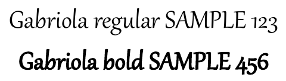

## **Tổng quan**

Việc chuyển đổi các bản trình bày PowerPoint (PPT, PPTX, ODP, v.v.) sang định dạng PDF trong C# mang lại nhiều lợi ích, bao gồm khả năng tương thích trên các thiết bị khác nhau và giữ nguyên bố cục cũng như định dạng của bản trình bày. Hướng dẫn này trình bày cách chuyển đổi bản trình bày sang tài liệu PDF, sử dụng các tùy chọn khác nhau để kiểm soát chất lượng hình ảnh, bao gồm các slide ẩn, bảo vệ PDF bằng mật khẩu, phát hiện thay thế phông chữ, chọn các slide cụ thể để chuyển đổi và áp dụng các tiêu chuẩn tuân thủ cho tài liệu đầu ra.

## **Chuyển đổi PowerPoint sang PDF**

Sử dụng Aspose.Slides, bạn có thể chuyển đổi các bản trình bày ở các định dạng sau sang PDF:

* **PPT**
* **PPTX**
* **ODP**

Để chuyển đổi một bản trình bày sang PDF, truyền tên tệp làm đối số cho lớp [Presentation](https://reference.aspose.com/slides/net/aspose.slides/presentation/) và sau đó lưu bản trình bày dưới dạng PDF bằng phương thức [Save](https://reference.aspose.com/slides/net/aspose.slides/presentation/save/). Lớp [Presentation](https://reference.aspose.com/slides/net/aspose.slides/presentation/) cung cấp phương thức [Save](https://reference.aspose.com/slides/net/aspose.slides/presentation/save/) thường được sử dụng để chuyển đổi bản trình bày sang PDF.

{}
Aspose.Slides cho .NET chèn thông tin API và số phiên bản của nó vào tài liệu đầu ra. Ví dụ, khi chuyển đổi một bản trình bày sang PDF, Aspose.Slides điền trường Application bằng "*Aspose.Slides*" và trường PDF Producer bằng giá trị dạng "*Aspose.Slides v XX.XX*". **Lưu ý** rằng bạn không thể yêu cầu Aspose.Slides thay đổi hoặc loại bỏ thông tin này khỏi tài liệu đầu ra.
{}

Aspose.Slides cho phép bạn chuyển đổi:

* Toàn bộ bản trình bày sang PDF
* Các slide cụ thể từ bản trình bày sang PDF

Aspose.Slides xuất bản trình bày sang PDF, đảm bảo các PDF tạo ra gần giống với bản trình bày gốc. Các yếu tố và thuộc tính được hiển thị chính xác trong quá trình chuyển đổi, bao gồm:

* Hình ảnh
* Hộp văn bản và hình dạng
* Định dạng văn bản
* Định dạng đoạn văn
* Liên kết
* Đầu trang và chân trang
* Dấu đầu dòng
* Bảng

## **Chuyển đổi PowerPoint sang PDF**

Quá trình chuyển đổi PowerPoint sang PDF tiêu chuẩn sử dụng các tùy chọn mặc định. Trong trường hợp này, Aspose.Slides cố gắng chuyển đổi bản trình bày đã cung cấp sang PDF bằng các cài đặt tối ưu ở mức chất lượng tối đa.

Ví dụ sau tải một bản trình bày và lưu tất cả các slide hiển thị sang PDF bằng các cài đặt xuất mặc định.

```csharp
using Aspose.Slides;
using Aspose.Slides.Export;

using var presentation = new Presentation("PowerPoint.ppt");
presentation.Save("PDF-result.pdf", SaveFormat.Pdf);
```

{}
Aspose cung cấp một công cụ chuyển đổi PowerPoint sang PDF trực tuyến miễn phí [**PowerPoint to PDF converter**](https://products.aspose.app/slides/conversion/ppt-to-pdf) minh họa quy trình chuyển đổi bản trình bày sang PDF. Bạn có thể thực hiện thử nghiệm với công cụ này để triển khai thực tế quy trình được mô tả ở đây.
{}

## **Chuyển đổi PowerPoint sang PDF với Các tùy chọn**

Aspose.Slides cung cấp các tùy chọn tùy chỉnh—các thuộc tính dưới lớp [PdfOptions](https://reference.aspose.com/slides/net/aspose.slides.export/pdfoptions/)—cho phép bạn tùy chỉnh PDF đầu ra, khóa PDF bằng mật khẩu, hoặc chỉ định cách quy trình chuyển đổi sẽ tiến hành.

### **Chuyển đổi PowerPoint sang PDF với Các tùy chọn Tùy chỉnh**

Bằng cách sử dụng các tùy chọn chuyển đổi tùy chỉnh, bạn có thể xác định cài đặt chất lượng mong muốn cho hình ảnh raster, chỉ định cách xử lý metafile, đặt mức nén cho văn bản, cấu hình DPI cho hình ảnh và hơn thế nữa.

Ví dụ sau xuất một bản trình bày sang PDF 1.5 với chất lượng JPEG được đặt là 90, độ phân giải hình ảnh là 300 DPI, metafile được lưu dưới dạng PNG và nén văn bản Flate.

```csharp
using Aspose.Slides;
using Aspose.Slides.Export;

var pdfOptions = new PdfOptions
{
    JpegQuality = 90,
    SufficientResolution = 300,
    SaveMetafilesAsPng = true,
    TextCompression = PdfTextCompression.Flate,
    Compliance = PdfCompliance.Pdf15
};

using var presentation = new Presentation("PowerPoint.pptx");
presentation.Save("PowerPoint-to-PDF.pdf", SaveFormat.Pdf, pdfOptions);
```

> **Lưu ý:** Bạn có thể cải thiện chất lượng hiển thị của bóng và hiệu ứng phản chiếu của văn bản khi chuyển đổi sang PDF bằng cách đặt `PdfOptions.SufficientResolution` thành giá trị cao hơn (ví dụ, `300`). Điều này tạo ra đầu ra PDF gần hơn với giao diện trong Microsoft PowerPoint.

### **Tự động Chọn Nén Hình ảnh**

Khi một bản trình bày chứa nhiều ảnh chụp hoặc ảnh chụp màn hình, việc giảm kích thước PDF xuất ra có thể giúp việc gửi email hoặc tải xuống dễ dàng hơn. Đặt [PdfOptions.BestImagesCompressionRatio](https://reference.aspose.com/slides/net/aspose.slides.export/pdfoptions/bestimagescompressionratio/) thành `true` để tự động chọn thuật toán nén phù hợp nhất cho mỗi hình ảnh trong quá trình xuất PDF.

Ví dụ sau tải một bản trình bày hiện có, bật tính năng tự động chọn nén ảnh và lưu nó dưới dạng tài liệu PDF. Tất cả các cài đặt xuất PDF khác giữ nguyên giá trị mặc định.

```csharp
using Aspose.Slides;
using Aspose.Slides.Export;

var pdfOptions = new PdfOptions { BestImagesCompressionRatio = true };

using var presentation = new Presentation("image-heavy.pptx");
presentation.Save("image-heavy.pdf", SaveFormat.Pdf, pdfOptions);
```

Tuỳ chọn này chọn một thuật toán nén cho mỗi hình ảnh. Giảm [JpegQuality](https://reference.aspose.com/slides/net/aspose.slides.export/pdfoptions/jpegquality/) sẽ làm giảm chất lượng hình JPEG, trong khi giảm [SufficientResolution](https://reference.aspose.com/slides/net/aspose.slides.export/pdfoptions/sufficientresolution/) cho phép hình ảnh được giảm mẫu xuống độ phân giải thấp hơn, có thể làm giảm chi tiết. Kích hoạt tính năng tự động chọn nén không tự động giảm bất kỳ cài đặt nào trong số này.

Chọn thuật toán nén ảnh yêu cầu thời gian xử lý và bộ nhớ bổ sung. Việc giảm kích thước phụ thuộc vào hình ảnh và cài đặt xuất của bản trình bày; không có mức giảm cố định cho mọi bản trình bày.

### **Giữ lại các tệp OLE nhúng dưới dạng tệp đính kèm PDF**

Nếu một bản trình bày chứa một workbook Excel được nhúng, bạn có thể muốn người nhận PDF truy cập dữ liệu workbook đồng thời xem các slide. Đặt [PdfOptions.IncludeOleData](https://reference.aspose.com/slides/net/aspose.slides.export/pdfoptions/includeoledata/) thành `true` để giữ lại các tệp OLE nhúng dưới dạng tệp đính kèm trong PDF kết quả.

Giá trị mặc định là `false`: hình ảnh hoặc biểu tượng xem trước của đối tượng OLE được hiển thị trên trang PDF, nhưng tệp nhúng không được đưa vào dưới dạng tệp đính kèm. Khi đặt tùy chọn thành `true` thì dữ liệu tệp cũng được bao gồm. Bản xem trước vẫn là một hình ảnh; tệp đính kèm cho phép người nhận mở hoặc lưu tệp nhúng riêng biệt. Đối tượng OLE không trở thành một worksheet Excel tương tác trên trang PDF.

Ví dụ sau tải một bản trình bày đã chứa một workbook Excel được nhúng và xuất nó sang PDF với workbook được đính kèm.

```csharp
using Aspose.Slides;
using Aspose.Slides.Export;

var pdfOptions = new PdfOptions { IncludeOleData = true };

using var presentation = new Presentation("presentation.pptx");
presentation.Save("presentation.pdf", SaveFormat.Pdf, pdfOptions);
```

Để kiểm tra kết quả:

1. Mở PDF đã xuất trong trình xem hỗ trợ tệp đính kèm, chẳng hạn Adobe Acrobat Reader.
2. Mở bảng điều khiển **Attachments** của trình xem và tìm workbook được nhúng.
3. Lưu tệp đính kèm và mở nó trong Excel để kiểm tra dữ liệu, hoặc mở trực tiếp nếu trình xem cho phép. Bản xem trước trên trang PDF tách biệt với tệp đính kèm.

{}
Các tiêu chuẩn PDF/A áp đặt các hạn chế đối với tệp đính kèm: PDF/A-1 cấm tệp nhúng, PDF/A-2 chỉ cho phép tệp đính kèm PDF/A, và PDF/A-3 cho phép các loại tệp khác, bao gồm workbook Excel. Đây là yêu cầu của tiêu chuẩn, không phải là hạn chế riêng của Aspose.Slides. Ví dụ này sử dụng cài đặt tuân thủ PDF mặc định và không minh họa xuất PDF/A.
{}

### **Chuyển đổi PowerPoint sang PDF với các Slide ẩn**

Nếu một bản trình bày chứa các slide ẩn, bạn có thể dùng thuộc tính [ShowHiddenSlides](https://reference.aspose.com/slides/net/aspose.slides.export/pdfoptions/showhiddenslides/) từ lớp [PdfOptions](https://reference.aspose.com/slides/net/aspose.slides.export/pdfoptions/) để bao gồm các slide ẩn như các trang trong PDF kết quả.

Ví dụ sau xuất một bản trình bày sang PDF, bao gồm bất kỳ slide ẩn nào.

```csharp
using Aspose.Slides;
using Aspose.Slides.Export;

var pdfOptions = new PdfOptions();
pdfOptions.ShowHiddenSlides = true;

using var presentation = new Presentation("PowerPoint.pptx");
presentation.Save("PowerPoint-to-PDF.pdf", SaveFormat.Pdf, pdfOptions);
```

### **Chuyển đổi PowerPoint sang PDF được bảo vệ bằng mật khẩu**

Ví dụ sau xuất một bản trình bày sang PDF yêu cầu mật khẩu `password` để mở. Các quyền truy cập cho phép in, bao gồm in chất lượng cao.

```csharp
using Aspose.Slides;
using Aspose.Slides.Export;

var pdfOptions = new PdfOptions();
pdfOptions.Password = "password";
pdfOptions.AccessPermissions = PdfAccessPermissions.PrintDocument | PdfAccessPermissions.HighQualityPrint;

using var presentation = new Presentation("PowerPoint.pptx");
presentation.Save("PPTX-to-PDF.pdf", SaveFormat.Pdf, pdfOptions);
```

### **Phát hiện Thay thế Phông chữ**

Aspose.Slides cung cấp thuộc tính [WarningCallback](https://reference.aspose.com/slides/net/aspose.slides.export/saveoptions/warningcallback/) dưới lớp [PdfOptions](https://reference.aspose.com/slides/net/aspose.slides.export/pdfoptions/), cho phép bạn phát hiện các trường hợp thay thế phông chữ trong quá trình chuyển đổi bản trình bày sang PDF.

Ví dụ sau xuất một bản trình bày sang PDF và in các cảnh báo thay thế phông chữ ra console. Cảnh báo chỉ được in khi một phông chữ không có sẵn được thay thế trong quá trình xuất.

```csharp
using Aspose.Slides;
using Aspose.Slides.Export;
using Aspose.Slides.Warnings;
using System;

var pdfOptions = new PdfOptions();
pdfOptions.WarningCallback = new FontSubstitutionHandler();

using var presentation = new Presentation("sample.pptx");
presentation.Save("output.pdf", SaveFormat.Pdf, pdfOptions);

class FontSubstitutionHandler : IWarningCallback
{
    public ReturnAction Warning(IWarningInfo warning)
    {
        if (warning.WarningType == WarningType.DataLoss && warning.Description.StartsWith("Font will be substituted"))
        {
            Console.WriteLine($"Font substitution warning: {warning.Description}");
        }

        return ReturnAction.Continue;
    }
}
```

{}
Để biết thêm thông tin về thay thế phông chữ, xem bài viết [Font Substitution](/slides/vi/net/font-substitution/).
{} 

### **Xử lý phông chữ không có kiểu chữ đậm riêng**

Một bản trình bày có thể áp dụng định dạng đậm cho văn bản ngay cả khi phông chữ không có kiểu chữ đậm riêng. Văn bản vẫn có thể hiển thị đậm thông qua synthetic bolding, tức là làm dày các glyph thường. Khi văn bản trông quá nặng hoặc khác với mong muốn trong PDF, hãy thử đặt [PdfOptions.RasterizeUnsupportedFontStyles](https://reference.aspose.com/slides/net/aspose.slides.export/pdfoptions/rasterizeunsupportedfontstyles/) thành `true`. Tùy chọn này sẽ raster hóa (biến thành bitmap) văn bản bị ảnh hưởng trong quá trình xuất PDF và có thể cải thiện hiển thị đối với một số phông chữ. Giá trị mặc định là `false`.

Bản trình bày mẫu chứa hai hộp văn bản: một với văn bản thường và một với định dạng đậm áp dụng cho cùng một phông chữ, phông chữ này không có kiểu đậm riêng. Ví dụ sau tải bản trình bày, bật rasterization cho các kiểu phông chữ không được hỗ trợ và xuất nó sang PDF:

```csharp
using Aspose.Slides;
using Aspose.Slides.Export;

var pdfOptions = new PdfOptions
{
    RasterizeUnsupportedFontStyles = true
};

using var presentation = new Presentation("unsupported-bold.pptx");
presentation.Save("rasterized.pdf", SaveFormat.Pdf, pdfOptions);
```

Các preview sau đây cho thấy đầu ra khi tùy chọn bị tắt và khi bật. Trong ví dụ này, văn bản đậm có nét dày hơn khi tùy chọn tắt. Khi bật, nét của nó nhẹ hơn; văn bản thường không thay đổi. So sánh kết quả trước khi chọn cài đặt cho bản trình bày của bạn.

| Option disabled (`false`, the default) | Option enabled (`true`) |
|---|---|
|  |  |

Trong ví dụ này, bật tùy chọn chỉ biến văn bản đậm thành bitmap: nó không thể được chọn, sao chép, hoặc tìm kiếm dưới dạng văn bản nếu không có OCR, và các cạnh của nó trông mềm hơn ở mức thu phóng 800%. Văn bản thường vẫn có thể tìm kiếm được. Khi tùy chọn tắt, cả hai chuỗi đều vẫn là văn bản.

Tùy chọn này raster hóa văn bản được định dạng là đậm khi phông chữ không có kiểu đậm riêng. [Font substitution](/slides/vi/net/font-substitution/) thay vào đó sẽ chọn một phông chữ khác khi phông chữ gốc không khả dụng.

## **Chuyển đổi các Slide đã chọn từ PowerPoint sang PDF**

Ví dụ sau xuất các slide 1 và 3 từ một bản trình bày sang PDF. Các số slide trong mảng này bắt đầu từ 1, và bản trình bày đầu vào phải có ít nhất ba slide.

```csharp
using Aspose.Slides;
using Aspose.Slides.Export;

using var presentation = new Presentation("PowerPoint.pptx");
var slides = new[] { 1, 3 };
presentation.Save("PPTX-to-PDF.pdf", slides, SaveFormat.Pdf);
```

## **Chuyển đổi PowerPoint sang PDF với Kích thước Slide Tùy chỉnh**

Ví dụ sau sao chép slide đầu tiên từ một bản trình bày vào một bản trình bày mới với kích thước slide là 612 × 792 điểm (8.5 × 11 inch). Nó co giãn nội dung slide để vừa và xuất slide duy nhất này sang PDF.

```csharp
using Aspose.Slides;
using Aspose.Slides.Export;

var slideWidth = 612;
var slideHeight = 792;

using var presentation = new Presentation("SelectedSlides.pptx");
using var resizedPresentation = new Presentation();

resizedPresentation.SlideSize.SetSize(slideWidth, slideHeight, SlideSizeScaleType.EnsureFit);
var slide = presentation.Slides[0];
resizedPresentation.Slides.InsertClone(0, slide);

// Remove the blank slide that the new presentation was created with.
resizedPresentation.Slides.RemoveAt(1);
resizedPresentation.Save("PDF_with_custom_slide_size.pdf", SaveFormat.Pdf);
```

## **Chuyển đổi PowerPoint sang PDF trong Chế độ Xem Ghi chú Slide**

Ví dụ sau xuất một bản trình bày sang PDF, đặt ghi chú diễn giả của mỗi slide dưới slide. Hãy sử dụng một bản trình bày có ghi chú diễn giả để xem kết quả.

```csharp
using Aspose.Slides;
using Aspose.Slides.Export;

var pdfOptions = new PdfOptions
{
    SlidesLayoutOptions = new NotesCommentsLayoutingOptions
    {
        NotesPosition = NotesPositions.BottomFull
    }
};

using var presentation = new Presentation("NotesFile.pptx");
presentation.Save("PDF_with_notes.pdf", SaveFormat.Pdf, pdfOptions);
```

## **Tiêu chuẩn Truy cập và Tuân thủ cho PDF**

Aspose.Slides cho phép bạn sử dụng quy trình chuyển đổi tuân thủ các [Web Content Accessibility Guidelines (**WCAG**)](https://www.w3.org/TR/WCAG-TECHS/pdf.html). Bạn có thể xuất một tài liệu PowerPoint sang PDF bằng bất kỳ tiêu chuẩn tuân thủ nào sau: **PDF/A1a**, **PDF/A1b**, và **PDF/UA**.

Mã C# này minh họa quy trình chuyển đổi PowerPoint sang PDF tạo ra nhiều PDF dựa trên các tiêu chuẩn tuân thủ khác nhau:

```csharp
using Aspose.Slides;
using Aspose.Slides.Export;

using var presentation = new Presentation("pres.pptx");

presentation.Save("pres-a1a-compliance.pdf", SaveFormat.Pdf, new PdfOptions
{
    Compliance = PdfCompliance.PdfA1a
});

presentation.Save("pres-a1b-compliance.pdf", SaveFormat.Pdf, new PdfOptions
{
    Compliance = PdfCompliance.PdfA1b
});

presentation.Save("pres-ua-compliance.pdf", SaveFormat.Pdf, new PdfOptions
{
    Compliance = PdfCompliance.PdfUa
});
```

{}
Aspose.Slides hỗ trợ các thao tác chuyển đổi PDF, cho phép bạn chuyển đổi các tệp PDF sang các định dạng phổ biến. Bạn có thể thực hiện các chuyển đổi [PDF to HTML](https://products.aspose.com/slides/net/conversion/pdf-to-html/), [PDF to image](https://products.aspose.com/slides/net/conversion/pdf-to-image/), [PDF to JPG](https://products.aspose.com/slides/net/conversion/pdf-to-jpg/), và [PDF to PNG](https://products.aspose.com/slides/net/conversion/pdf-to-png/). Các thao tác chuyển đổi PDF sang các định dạng chuyên biệt khác—[PDF to SVG](https://products.aspose.com/slides/net/conversion/pdf-to-svg/), [PDF to TIFF](https://products.aspose.com/slides/net/conversion/pdf-to-tiff/), và [PDF to XML](https://products.aspose.com/slides/net/conversion/pdf-to-xml/)—cũng được hỗ trợ.
{}

> **Lưu ý:** Khi xuất sang PDF/UA, Aspose.Slides xử lý các đồ họa phức tạp như SmartArt, biểu đồ và công thức như một hình duy nhất. Các phần tử đường dẫn riêng lẻ không được giữ lại như nội dung riêng và có thể được đánh dấu là artifact; chỉ có văn bản thay thế cho toàn bộ hình.

## **Câu hỏi thường gặp**

**Có thể chuyển đổi nhiều tệp PowerPoint sang PDF hàng loạt không?**

Có, Aspose.Slides hỗ trợ chuyển đổi hàng loạt nhiều tệp PPT hoặc PPTX sang PDF. Bạn có thể lặp qua các tệp và áp dụng quy trình chuyển đổi bằng mã.

**Có thể bảo vệ PDF đã chuyển đổi bằng mật khẩu không?**

Có. Sử dụng lớp [PdfOptions](https://reference.aspose.com/slides/net/aspose.slides.export/pdfoptions/) để đặt mật khẩu và xác định các quyền truy cập trong quá trình chuyển đổi.

**Làm sao để bao gồm các slide ẩn trong PDF?**

Đặt thuộc tính [ShowHiddenSlides](https://reference.aspose.com/slides/net/aspose.slides.export/pdfoptions/showhiddenslides/) trong lớp [PdfOptions](https://reference.aspose.com/slides/net/aspose.slides.export/pdfoptions/) thành `true` để bao gồm các slide ẩn trong PDF kết quả.

**Aspose.Slides có thể duy trì chất lượng hình ảnh cao trong PDF không?**

Có, bạn có thể kiểm soát chất lượng hình ảnh bằng cách đặt các thuộc tính như [JpegQuality](https://reference.aspose.com/slides/net/aspose.slides.export/pdfoptions/jpegquality/) và [SufficientResolution](https://reference.aspose.com/slides/net/aspose.slides.export/pdfoptions/sufficientresolution/) trong lớp [PdfOptions](https://reference.aspose.com/slides/net/aspose.slides.export/pdfoptions/) để đảm bảo hình ảnh chất lượng cao trong PDF của bạn.

**Aspose.Slides có hỗ trợ các tiêu chuẩn tuân thủ PDF/A không?**

Có, Aspose.Slides cho phép bạn xuất PDF tuân thủ các tiêu chuẩn khác nhau, bao gồm PDF/A1a, PDF/A1b và PDF/UA, đảm bảo tài liệu của bạn đáp ứng các yêu cầu truy cập và lưu trữ.

## **Tài nguyên bổ sung**

- [Aspose.Slides for .NET Documentation](/slides/vi/net/)
- [Aspose.Slides for .NET API Reference](https://reference.aspose.com/slides/net/)
- [Aspose Free Online Converters](https://products.aspose.app/slides/conversion)

Related feature: [Export presentations to PDF](/slides/vi/features/pdf-export/).