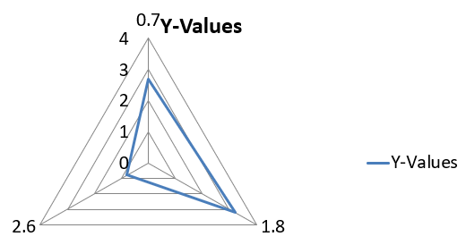

## **Tổng quan**

Bài viết này cung cấp hướng dẫn toàn diện về cách tạo và tùy chỉnh biểu đồ bằng Aspose.Slides cho .NET. Bạn sẽ học cách thêm biểu đồ vào một slide bằng mã, điền dữ liệu và áp dụng các tùy chọn định dạng khác nhau để đáp ứng yêu cầu thiết kế cụ thể của mình. Trong suốt bài viết, các ví dụ mã chi tiết minh họa từng bước, từ khởi tạo đối tượng Presentation và Chart đến cấu hình series, trục và legend. Khi thực hiện theo hướng dẫn này, bạn sẽ nắm vững cách tích hợp việc tạo biểu đồ động vào các ứng dụng .NET của mình, giúp đơn giản hoá quy trình tạo bản trình bày dựa trên dữ liệu.

## **Tạo biểu đồ**

Biểu đồ giúp người dùng nhanh chóng hình dung dữ liệu và rút ra các insight mà có thể không ngay lập tức hiển thị trong bảng hoặc bảng tính.

**Tại sao nên tạo biểu đồ?**

* tổng hợp, rút gọn hoặc tóm tắt một lượng lớn dữ liệu trên một slide trong bản trình bày;
* phát hiện các mẫu và xu hướng trong dữ liệu;
* suy ra hướng và động lực của dữ liệu theo thời gian hoặc theo một đơn vị đo lường cụ thể;
* phát hiện các giá trị ngoại lệ, sai lệch, lỗi và dữ liệu vô nghĩa;
* truyền đạt hoặc trình bày dữ liệu phức tạp.

Trong PowerPoint, bạn có thể tạo biểu đồ thông qua chức năng *Insert*, cung cấp các mẫu để thiết kế nhiều loại biểu đồ. Sử dụng Aspose.Slides, bạn có thể tạo cả biểu đồ thường (dựa trên các loại biểu đồ phổ biến) và biểu đồ tùy chỉnh.

{}
Sử dụng enumeration [ChartType](https://reference.aspose.com/slides/net/aspose.slides.charts/charttype/) trong namespace [Aspose.Slides.Charts](https://reference.aspose.com/slides/net/aspose.slides.charts/). Các giá trị trong enumeration này tương ứng với các loại biểu đồ khác nhau.
{}

### **Tạo biểu đồ Cột Nhóm**

Ví dụ này sử dụng [AddChart](https://reference.aspose.com/slides/net/aspose.slides/ishapecollection/addchart/) để tạo một biểu đồ Cột Nhóm so sánh hai series qua ba danh mục. Các series sử dụng màu nền đỏ và xanh lá, và các nhãn riêng lẻ hiển thị tên danh mục, tên series và giá trị. Chỉ mục worksheet 0 chỉ tới sheet đầu tiên trong workbook biểu đồ nhúng.

```csharp
using System.Drawing;
using Aspose.Slides;
using Aspose.Slides.Charts;
using Aspose.Slides.Export;

using var presentation = new Presentation();
var slide = presentation.Slides[0];

var chart = slide.Shapes.AddChart(ChartType.ClusteredColumn, 20, 20, 500, 300);

chart.ChartTitle.AddTextFrameForOverriding("Sample Title");
chart.ChartTitle.TextFrameForOverriding.TextFrameFormat.CenterText = NullableBool.True;
chart.ChartTitle.Height = 20;
chart.HasTitle = true;

var workbook = chart.ChartData.ChartDataWorkbook;
var worksheetIndex = 0;

chart.ChartData.Series.Clear();
chart.ChartData.Categories.Clear();

var seriesNameCell = workbook.GetCell(worksheetIndex, 0, 1, "Series 1");
chart.ChartData.Series.Add(seriesNameCell, chart.Type);
seriesNameCell = workbook.GetCell(worksheetIndex, 0, 2, "Series 2");
chart.ChartData.Series.Add(seriesNameCell, chart.Type);

var categoryCell = workbook.GetCell(worksheetIndex, 1, 0, "Category 1");
chart.ChartData.Categories.Add(categoryCell);
categoryCell = workbook.GetCell(worksheetIndex, 2, 0, "Category 2");
chart.ChartData.Categories.Add(categoryCell);
categoryCell = workbook.GetCell(worksheetIndex, 3, 0, "Category 3");
chart.ChartData.Categories.Add(categoryCell);

var series = chart.ChartData.Series[0];

var valueCell = workbook.GetCell(worksheetIndex, 1, 1, 20);
series.DataPoints.AddDataPointForBarSeries(valueCell);
valueCell = workbook.GetCell(worksheetIndex, 2, 1, 50);
series.DataPoints.AddDataPointForBarSeries(valueCell);
valueCell = workbook.GetCell(worksheetIndex, 3, 1, 30);
series.DataPoints.AddDataPointForBarSeries(valueCell);

series.Format.Fill.FillType = FillType.Solid;
series.Format.Fill.SolidFillColor.Color = Color.Red;

series = chart.ChartData.Series[1];

valueCell = workbook.GetCell(worksheetIndex, 1, 2, 30);
series.DataPoints.AddDataPointForBarSeries(valueCell);
valueCell = workbook.GetCell(worksheetIndex, 2, 2, 10);
series.DataPoints.AddDataPointForBarSeries(valueCell);
valueCell = workbook.GetCell(worksheetIndex, 3, 2, 60);
series.DataPoints.AddDataPointForBarSeries(valueCell);

series.Format.Fill.FillType = FillType.Solid;
series.Format.Fill.SolidFillColor.Color = Color.Green;

var label = series.DataPoints[0].Label;
label.DataLabelFormat.ShowCategoryName = true;

label = series.DataPoints[1].Label;
label.DataLabelFormat.ShowSeriesName = true;

label = series.DataPoints[2].Label;
label.DataLabelFormat.ShowValue = true;
label.DataLabelFormat.ShowSeriesName = true;
label.DataLabelFormat.Separator = "/";

presentation.Save("AsposeChart.pptx", SaveFormat.Pptx);
```

Kết quả:


### **Tạo biểu đồ phân tán**

Biểu đồ phân tán (còn gọi là scatter plot hoặc đồ thị x-y) thường được dùng để kiểm tra các mẫu hoặc minh họa mối tương quan giữa hai biến.

Sử dụng biểu đồ phân tán khi:

* Bạn có dữ liệu số cặp đôi.
* Bạn có hai biến kết hợp tốt với nhau.
* Bạn muốn xác định liệu hai biến có liên quan hay không.
* Bạn có một biến độc lập có nhiều giá trị cho một biến phụ thuộc.

Ví dụ này vẽ hai tập giá trị x-y. Series đầu tiên dùng đường thẳng với ký hiệu sao, trong khi series thứ hai dùng đường mượt với ký hiệu vòng tròn; cả hai đều có [Size](https://reference.aspose.com/slides/net/aspose.slides.charts/imarker/size/) là 10. Thuộc tính [Symbol](https://reference.aspose.com/slides/net/aspose.slides.charts/imarker/symbol/) điều khiển hình dạng ký hiệu.

```csharp
using Aspose.Slides;
using Aspose.Slides.Charts;
using Aspose.Slides.Export;

using var presentation = new Presentation();
var slide = presentation.Slides[0];

var chart = slide.Shapes.AddChart(ChartType.ScatterWithSmoothLines, 20, 20, 500, 300);

var workbook = chart.ChartData.ChartDataWorkbook;
var worksheetIndex = 0;

chart.ChartData.Series.Clear();

var seriesNameCell = workbook.GetCell(worksheetIndex, 1, 1, "Series 1");
chart.ChartData.Series.Add(seriesNameCell, chart.Type);
seriesNameCell = workbook.GetCell(worksheetIndex, 1, 3, "Series 2");
chart.ChartData.Series.Add(seriesNameCell, chart.Type);

var series = chart.ChartData.Series[0];

var xValueCell = workbook.GetCell(worksheetIndex, 2, 1, 1);
var yValueCell = workbook.GetCell(worksheetIndex, 2, 2, 3);
series.DataPoints.AddDataPointForScatterSeries(xValueCell, yValueCell);

xValueCell = workbook.GetCell(worksheetIndex, 3, 1, 2);
yValueCell = workbook.GetCell(worksheetIndex, 3, 2, 10);
series.DataPoints.AddDataPointForScatterSeries(xValueCell, yValueCell);

series.Type = ChartType.ScatterWithStraightLinesAndMarkers;

series.Marker.Size = 10;
series.Marker.Symbol = MarkerStyleType.Star;

series = chart.ChartData.Series[1];

xValueCell = workbook.GetCell(worksheetIndex, 2, 3, 5);
yValueCell = workbook.GetCell(worksheetIndex, 2, 4, 2);
series.DataPoints.AddDataPointForScatterSeries(xValueCell, yValueCell);

xValueCell = workbook.GetCell(worksheetIndex, 3, 3, 3);
yValueCell = workbook.GetCell(worksheetIndex, 3, 4, 1);
series.DataPoints.AddDataPointForScatterSeries(xValueCell, yValueCell);

xValueCell = workbook.GetCell(worksheetIndex, 4, 3, 2);
yValueCell = workbook.GetCell(worksheetIndex, 4, 4, 2);
series.DataPoints.AddDataPointForScatterSeries(xValueCell, yValueCell);

xValueCell = workbook.GetCell(worksheetIndex, 5, 3, 5);
yValueCell = workbook.GetCell(worksheetIndex, 5, 4, 1);
series.DataPoints.AddDataPointForScatterSeries(xValueCell, yValueCell);

series.Marker.Size = 10;
series.Marker.Symbol = MarkerStyleType.Circle;

presentation.Save("AsposeChart.pptx", SaveFormat.Pptx);
```

Kết quả:


### **Tạo biểu đồ Tròn**

Biểu đồ Tròn thích hợp để hiển thị mối quan hệ phần‑với‑toàn trong dữ liệu, đặc biệt khi dữ liệu chứa các nhãn phân loại với giá trị số. Tuy nhiên, nếu dữ liệu của bạn có quá nhiều phần hoặc nhãn, bạn có thể cân nhắc sử dụng biểu đồ cột thay thế.

Ví dụ này tạo một biểu đồ Tròn với ba giá trị quý. Mỗi lát có màu nền và viền tùy chỉnh, và các nhãn hiển thị các kết hợp khác nhau của giá trị, phần trăm và thông tin series. Thuộc tính [FirstSliceAngle](https://reference.aspose.com/slides/net/aspose.slides.charts/ichartseriesgroup/firstsliceangle/) đặt lát đầu tiên bắt đầu ở 180 độ.

```csharp
using System.Drawing;
using Aspose.Slides;
using Aspose.Slides.Charts;
using Aspose.Slides.Export;

using var presentation = new Presentation();
var slide = presentation.Slides[0];

var chart = slide.Shapes.AddChart(ChartType.Pie, 20, 20, 500, 300);

chart.ChartTitle.AddTextFrameForOverriding("Sample Title");
chart.ChartTitle.TextFrameForOverriding.TextFrameFormat.CenterText = NullableBool.True;
chart.ChartTitle.Height = 20;
chart.HasTitle = true;

chart.ChartData.Series[0].Labels.DefaultDataLabelFormat.ShowValue = true;

var workbook = chart.ChartData.ChartDataWorkbook;
var worksheetIndex = 0;

chart.ChartData.Series.Clear();
chart.ChartData.Categories.Clear();

var categoryCell = workbook.GetCell(0, 1, 0, "1st Qtr");
chart.ChartData.Categories.Add(categoryCell);
categoryCell = workbook.GetCell(0, 2, 0, "2nd Qtr");
chart.ChartData.Categories.Add(categoryCell);
categoryCell = workbook.GetCell(0, 3, 0, "3rd Qtr");
chart.ChartData.Categories.Add(categoryCell);

var seriesNameCell = workbook.GetCell(0, 0, 1, "Series 1");
var series = chart.ChartData.Series.Add(seriesNameCell, chart.Type);

var valueCell = workbook.GetCell(worksheetIndex, 1, 1, 20);
series.DataPoints.AddDataPointForPieSeries(valueCell);
valueCell = workbook.GetCell(worksheetIndex, 2, 1, 50);
series.DataPoints.AddDataPointForPieSeries(valueCell);
valueCell = workbook.GetCell(worksheetIndex, 3, 1, 30);
series.DataPoints.AddDataPointForPieSeries(valueCell);

chart.ChartData.SeriesGroups[0].IsColorVaried = true;

var firstSlice = series.DataPoints[0];
firstSlice.Format.Fill.FillType = FillType.Solid;
firstSlice.Format.Fill.SolidFillColor.Color = Color.Cyan;

firstSlice.Format.Line.FillFormat.FillType = FillType.Solid;
firstSlice.Format.Line.FillFormat.SolidFillColor.Color = Color.Gray;
firstSlice.Format.Line.Width = 3.0;
firstSlice.Format.Line.Style = LineStyle.ThinThick;
firstSlice.Format.Line.DashStyle = LineDashStyle.LargeDash;

var secondSlice = series.DataPoints[1];
secondSlice.Format.Fill.FillType = FillType.Solid;
secondSlice.Format.Fill.SolidFillColor.Color = Color.Brown;

secondSlice.Format.Line.FillFormat.FillType = FillType.Solid;
secondSlice.Format.Line.FillFormat.SolidFillColor.Color = Color.Blue;
secondSlice.Format.Line.Width = 3.0;
secondSlice.Format.Line.Style = LineStyle.Single;
secondSlice.Format.Line.DashStyle = LineDashStyle.LargeDashDot;

var thirdSlice = series.DataPoints[2];
thirdSlice.Format.Fill.FillType = FillType.Solid;
thirdSlice.Format.Fill.SolidFillColor.Color = Color.Coral;

thirdSlice.Format.Line.FillFormat.FillType = FillType.Solid;
thirdSlice.Format.Line.FillFormat.SolidFillColor.Color = Color.Red;
thirdSlice.Format.Line.Width = 2.0;
thirdSlice.Format.Line.Style = LineStyle.ThinThin;
thirdSlice.Format.Line.DashStyle = LineDashStyle.LargeDashDotDot;

var firstLabel = series.DataPoints[0].Label;
firstLabel.DataLabelFormat.ShowValue = true;

var secondLabel = series.DataPoints[1].Label;
secondLabel.DataLabelFormat.ShowValue = true;
secondLabel.DataLabelFormat.ShowLegendKey = true;
secondLabel.DataLabelFormat.ShowPercentage = true;

var thirdLabel = series.DataPoints[2].Label;
thirdLabel.DataLabelFormat.ShowSeriesName = true;
thirdLabel.DataLabelFormat.ShowPercentage = true;

series.Labels.DefaultDataLabelFormat.ShowLeaderLines = true;

chart.ChartData.SeriesGroups[0].FirstSliceAngle = 180;

presentation.Save("PieChart.pptx", SaveFormat.Pptx);
```

Kết quả:


Để cải thiện khả năng đọc của các nhãn ngoài biểu đồ tròn, xem [Format Leader Lines](/slides/vi/net/chart-data-label/#format-leader-lines) để biết ví dụ về cách định vị nhãn và tùy chỉnh màu, độ rộng, độ trong suốt và kiểu gạch của các đường dẫn.

### **Tạo biểu đồ Đường**

Biểu đồ Đường (còn gọi là line graph) thích hợp trong các tình huống bạn muốn minh họa sự thay đổi giá trị theo thời gian. Với biểu đồ Đường, bạn có thể so sánh một lượng lớn dữ liệu cùng lúc, theo dõi các thay đổi và xu hướng theo thời gian, làm nổi bật các ngoại lệ trong series dữ liệu, và nhiều hơn nữa.

Ví dụ này sử dụng [AddChart](https://reference.aspose.com/slides/net/aspose.slides/ishapecollection/addchart/) để tạo một biểu đồ Đường với series và danh mục mặc định, sau đó lưu bản trình bày dưới dạng PPTX.

```csharp
using Aspose.Slides;
using Aspose.Slides.Charts;
using Aspose.Slides.Export;

using var presentation = new Presentation();
var slide = presentation.Slides[0];

var lineChart = slide.Shapes.AddChart(ChartType.Line, 20, 20, 500, 300);

presentation.Save("lineChart.pptx", SaveFormat.Pptx);
```

Mặc định, các điểm trên biểu đồ Đường được nối bằng các đoạn thẳng liên tục. Nếu bạn muốn các điểm được nối bằng các đoạn gạch, hãy đặt [DashStyle](https://reference.aspose.com/slides/net/aspose.slides/ilineformat/dashstyle/) thành một giá trị từ [LineDashStyle](https://reference.aspose.com/slides/net/aspose.slides/linedashstyle/):

```csharp
using Aspose.Slides;
using Aspose.Slides.Charts;

using var presentation = new Presentation();
var slide = presentation.Slides[0];

var lineChart = slide.Shapes.AddChart(ChartType.Line, 20, 20, 500, 300);

foreach (var series in lineChart.ChartData.Series)
{
    series.Format.Line.DashStyle = LineDashStyle.Dash;
}
```

Kết quả:


### **Tạo biểu đồ Tree Map**

Biểu đồ Tree Map thích hợp cho dữ liệu bán hàng khi bạn muốn hiển thị kích thước tương đối của các danh mục dữ liệu và nhanh chóng thu hút sự chú ý đến các mục đóng góp lớn trong mỗi danh mục.

Ví dụ này tạo một biểu đồ Tree Map với tám lá được nhóm thành bốn nhánh và hai nhánh phụ. Phương thức [SetGroupingItem](https://reference.aspose.com/slides/net/aspose.slides.charts/ichartcategorylevelsmanager/setgroupingitem/) gán các nhánh ở mức nhóm 1 và các nhánh phụ ở mức 2. Các giá trị xác định kích thước hình chữ nhật tương đối, trong khi các nhãn danh mục và nhãn cha chồng lên nhau xác định thứ tự phân cấp.

```csharp
using Aspose.Slides;
using Aspose.Slides.Charts;
using Aspose.Slides.Export;

using var presentation = new Presentation();
var slide = presentation.Slides[0];

var chart = slide.Shapes.AddChart(ChartType.Treemap, 20, 20, 500, 300);

chart.ChartData.Categories.Clear();
chart.ChartData.Series.Clear();

var workbook = chart.ChartData.ChartDataWorkbook;
workbook.Clear(0);

// Nhánh 1
var categoryCell = workbook.GetCell(0, "C1", "Leaf1");
var leaf = chart.ChartData.Categories.Add(categoryCell);
leaf.GroupingLevels.SetGroupingItem(1, "Stem1");
leaf.GroupingLevels.SetGroupingItem(2, "Branch1");

categoryCell = workbook.GetCell(0, "C2", "Leaf2");
chart.ChartData.Categories.Add(categoryCell);

categoryCell = workbook.GetCell(0, "C3", "Leaf3");
leaf = chart.ChartData.Categories.Add(categoryCell);
leaf.GroupingLevels.SetGroupingItem(1, "Stem2");

categoryCell = workbook.GetCell(0, "C4", "Leaf4");
chart.ChartData.Categories.Add(categoryCell);

// Nhánh 2
categoryCell = workbook.GetCell(0, "C5", "Leaf5");
leaf = chart.ChartData.Categories.Add(categoryCell);
leaf.GroupingLevels.SetGroupingItem(1, "Stem3");
leaf.GroupingLevels.SetGroupingItem(2, "Branch2");

categoryCell = workbook.GetCell(0, "C6", "Leaf6");
chart.ChartData.Categories.Add(categoryCell);

categoryCell = workbook.GetCell(0, "C7", "Leaf7");
leaf = chart.ChartData.Categories.Add(categoryCell);
leaf.GroupingLevels.SetGroupingItem(1, "Stem4");

categoryCell = workbook.GetCell(0, "C8", "Leaf8");
chart.ChartData.Categories.Add(categoryCell);

var series = chart.ChartData.Series.Add(ChartType.Treemap);
series.Labels.DefaultDataLabelFormat.ShowCategoryName = true;
var valueCell = workbook.GetCell(0, "D1", 4);
series.DataPoints.AddDataPointForTreemapSeries(valueCell);
valueCell = workbook.GetCell(0, "D2", 5);
series.DataPoints.AddDataPointForTreemapSeries(valueCell);
valueCell = workbook.GetCell(0, "D3", 3);
series.DataPoints.AddDataPointForTreemapSeries(valueCell);
valueCell = workbook.GetCell(0, "D4", 6);
series.DataPoints.AddDataPointForTreemapSeries(valueCell);
valueCell = workbook.GetCell(0, "D5", 9);
series.DataPoints.AddDataPointForTreemapSeries(valueCell);
valueCell = workbook.GetCell(0, "D6", 9);
series.DataPoints.AddDataPointForTreemapSeries(valueCell);
valueCell = workbook.GetCell(0, "D7", 4);
series.DataPoints.AddDataPointForTreemapSeries(valueCell);
valueCell = workbook.GetCell(0, "D8", 3);
series.DataPoints.AddDataPointForTreemapSeries(valueCell);

series.ParentLabelLayout = ParentLabelLayoutType.Overlapping;

presentation.Save("Treemap.pptx", SaveFormat.Pptx);
```

Kết quả:


### **Tạo biểu đồ Waterfall**

Biểu đồ Waterfall cho thấy cách các thay đổi dương và âm đóng góp vào giá trị cuối cùng. Ví dụ, một phân tích lợi nhuận có thể bắt đầu bằng doanh thu, trừ chi phí, và cộng thu nhập khác. Các cột thay đổi nổi lên giữa giá trị chạy trước và giá trị chạy mới, trong khi các cột tổng mở rộng từ 0 đến giá trị tích lũy.

Bảng sau sử dụng các khoản tiền tính bằng nghìn đô la Mỹ:

| Danh mục | Giá trị trong Workbook | Loại cột |
| --- | ---: | --- |
| Revenue | 1000 | Increase |
| Cost of sales | -400 | Decrease |
| Gross profit | 600 | Intermediate total |
| Operating expenses | -200 | Decrease |
| Other income | 50 | Increase |
| Net profit | 450 | Final total |

Để đánh dấu một điểm là tổng trung gian hoặc tổng cuối cùng, đặt thuộc tính [SetAsTotal](https://reference.aspose.com/slides/net/aspose.slides.charts/chartdatapoint/setastotal/) của nó thành `true`. Cung cấp số tiền tích lũy thực tế trong ô workbook của điểm đó: `600` cho lợi nhuận gộp (`1000 - 400`) và `450` cho lợi nhuận ròng (`600 - 200 + 50`). Thuộc tính này chỉ đánh dấu cột là tổng; nó không tính toán hay điền giá trị ô. Không sử dụng 0 làm chỗ trống hoặc cung cấp thay đổi khác cho điểm tổng. Một cột tổng sẽ hiển thị giá trị tích lũy mà không cộng lại vào giá trị chạy.

Ví dụ C# đầy đủ này tạo một biểu đồ bằng thành viên `Waterfall` của [ChartType](https://reference.aspose.com/slides/net/aspose.slides.charts/charttype/), xóa dữ liệu mặc định và điền workbook nhúng. Chỉ mục worksheet `0` chọn sheet đầu tiên; cột A chứa tên danh mục và cột B chứa giá trị. Mỗi ô giá trị được thêm bằng [AddDataPointForWaterfallSeries](https://reference.aspose.com/slides/net/aspose.slides.charts/ichartdatapointcollection/adddatapointforwaterfallseries/). Các chỉ mục điểm dựa trên 0 `2` và `5` xác định tổng trung gian và tổng cuối cùng. Bật [ShowValue](https://reference.aspose.com/slides/net/aspose.slides.charts/idatalabelformat/showvalue/) để hiển thị số tiền trên các cột. Không yêu cầu bản trình bày hoặc workbook đầu vào.

```csharp
using Aspose.Slides;
using Aspose.Slides.Charts;
using Aspose.Slides.Export;

using var presentation = new Presentation();
var slide = presentation.Slides[0];

var chart = slide.Shapes.AddChart(ChartType.Waterfall, 20, 20, 680, 200);

chart.HasTitle = true;
chart.ChartTitle.AddTextFrameForOverriding("Profit breakdown (USD thousands)");
chart.ChartTitle.Overlay = false;
chart.HasLegend = false;

chart.ChartData.Series.Clear();
chart.ChartData.Categories.Clear();

var workbook = chart.ChartData.ChartDataWorkbook;
var worksheetIndex = 0;

workbook.Clear(worksheetIndex);

var seriesNameCell = workbook.GetCell(worksheetIndex, 0, 1, "Profit");
var series = chart.ChartData.Series.Add(seriesNameCell, ChartType.Waterfall);
var categories = new[] { "Revenue", "Cost of sales", "Gross profit", "Operating expenses", "Other income", "Net profit" };
var values = new double[] { 1000, -400, 600, -200, 50, 450 };

for (var i = 0; i < categories.Length; i++)
{
    var categoryCell = workbook.GetCell(worksheetIndex, i + 1, 0, categories[i]);
    chart.ChartData.Categories.Add(categoryCell);
    var valueCell = workbook.GetCell(worksheetIndex, i + 1, 1, values[i]);
    series.DataPoints.AddDataPointForWaterfallSeries(valueCell);
}

// Các điểm thứ ba và thứ sáu đại diện cho tổng, không phải các thay đổi bổ sung.
series.DataPoints[2].SetAsTotal = true;
series.DataPoints[5].SetAsTotal = true;
series.ShowConnectorLines = true;
series.Labels.DefaultDataLabelFormat.ShowValue = true;

presentation.Save("WaterfallChart.pptx", SaveFormat.Pptx);
```

Đặt thuộc tính cấp series [ShowConnectorLines](https://reference.aspose.com/slides/net/aspose.slides.charts/chartseries/showconnectorlines/) thành `true` để hiển thị các đường nối các cột liên tiếp và làm cho giá trị chạy dễ theo dõi hơn. Để ẩn các đường này, thay thế phép gán trong ví dụ bằng `series.ShowConnectorLines = false;` trước khi lưu. Thao tác này chỉ thay đổi khả năng hiển thị đường, không ảnh hưởng tới dữ liệu hay tổng.


### **Tạo biểu đồ Stock**

Biểu đồ Stock được dùng để hiển thị dữ liệu tài chính như giá mở cửa, cao nhất, thấp nhất và đóng cửa, hỗ trợ phân tích xu hướng thị trường và biến động. Chúng cung cấp những hiểu biết quan trọng về hiệu suất cổ phiếu, hỗ trợ nhà đầu tư và nhà phân tích đưa ra quyết định thông minh.

Ví dụ này tạo một biểu đồ Open‑High‑Low‑Close với bốn series theo thứ tự đó và ba danh mục. Thuộc tính [HasUpDownBars](https://reference.aspose.com/slides/net/aspose.slides.charts/iupdownbarsmanager/hasupdownbars/) bật thanh lên/xuống, và [HiLowLinesFormat](https://reference.aspose.com/slides/net/aspose.slides.charts/ichartseriesgroup/hilowlinesformat/) điều khiển các đường cao‑thấp hiển thị phạm vi giá, trong khi các đường series riêng và các đường lưới ngang phụ được ẩn.

Trình quản lý [UpDownBars](https://reference.aspose.com/slides/net/aspose.slides.charts/ichartseriesgroup/updownbars/) cung cấp các đối tượng [UpBarsFormat](https://reference.aspose.com/slides/net/aspose.slides.charts/iupdownbarsmanager/upbarsformat/) và [DownBarsFormat](https://reference.aspose.com/slides/net/aspose.slides.charts/iupdownbarsmanager/downbarsformat/) riêng biệt. Sử dụng thuộc tính [Fill](https://reference.aspose.com/slides/net/aspose.slides.charts/iformat/fill/) và [Line](https://reference.aspose.com/slides/net/aspose.slides.charts/iformat/line/) của mỗi đối tượng để đặt màu nền và viền độc lập. Ví dụ này dùng thanh màu xanh lá với viền xanh đậm cho các khoảng tăng và thanh màu cam‑đỏ với viền đỏ đậm cho các khoảng giảm.

Cung cấp các giá trị số cho cả bốn series ở mỗi danh mục, với Giá Cao và Giá Thấp bao quanh Giá Mở và Giá Đóng. Các thanh so sánh Giá Đóng với Giá Mở **trong cùng một danh mục**, không phải với danh mục trước: A giảm từ 72 xuống 25, trong khi B tăng từ 25 lên 38 và C tăng từ 38 lên 50. Khi Giá Mở và Giá Đóng bằng nhau, không có khoảng màu nào hiển thị. Thanh lên/xuống bao phủ khoảng Open‑Close; đường cao‑thấp bao phủ khoảng Low‑High. Các thanh này thuộc nhóm series và không phải là series biểu đồ cột thông thường.

Định dạng này cũng hoạt động với các biểu đồ [Line and LineWithMarkers](https://reference.aspose.com/slides/net/aspose.slides.charts/charttype/) có ít nhất hai series trong cùng một nhóm và các giá trị số tương ứng cho mỗi danh mục. Đối với các biểu đồ đường không xếp chồng này, thanh lên/xuống so sánh series đầu và cuối: giá trị cuối cao hơn tạo thanh lên, giá trị cuối thấp hơn tạo thanh xuống. Đảo ngược các series sẽ đảo ngược phân loại. Ví dụ dưới sử dụng [OpenHighLowClose](https://reference.aspose.com/slides/net/aspose.slides.charts/charttype/); đừng suy đoán rằng các biến thể stock, stacked‑line, hoặc 3D khác sẽ dùng cùng cách bố trí dữ liệu hoặc diễn giải khoảng.

```csharp
using System.Drawing;
using Aspose.Slides;
using Aspose.Slides.Charts;
using Aspose.Slides.Export;

using var presentation = new Presentation();
var slide = presentation.Slides[0];

var chart = slide.Shapes.AddChart(ChartType.OpenHighLowClose, 20, 20, 500, 150, false);

var workbook = chart.ChartData.ChartDataWorkbook;

var categoryCell = workbook.GetCell(0, 1, 0, "A");
chart.ChartData.Categories.Add(categoryCell);
categoryCell = workbook.GetCell(0, 2, 0, "B");
chart.ChartData.Categories.Add(categoryCell);
categoryCell = workbook.GetCell(0, 3, 0, "C");
chart.ChartData.Categories.Add(categoryCell);

var seriesNameCell = workbook.GetCell(0, 0, 1, "Open");
chart.ChartData.Series.Add(seriesNameCell, ChartType.OpenHighLowClose);
seriesNameCell = workbook.GetCell(0, 0, 2, "High");
chart.ChartData.Series.Add(seriesNameCell, ChartType.OpenHighLowClose);
seriesNameCell = workbook.GetCell(0, 0, 3, "Low");
chart.ChartData.Series.Add(seriesNameCell, ChartType.OpenHighLowClose);
seriesNameCell = workbook.GetCell(0, 0, 4, "Close");
chart.ChartData.Series.Add(seriesNameCell, ChartType.OpenHighLowClose);

var series = chart.ChartData.Series[0];
var valueCell = workbook.GetCell(0, 1, 1, 72);
series.DataPoints.AddDataPointForStockSeries(valueCell);
valueCell = workbook.GetCell(0, 2, 1, 25);
series.DataPoints.AddDataPointForStockSeries(valueCell);
valueCell = workbook.GetCell(0, 3, 1, 38);
series.DataPoints.AddDataPointForStockSeries(valueCell);

series = chart.ChartData.Series[1];
valueCell = workbook.GetCell(0, 1, 2, 172);
series.DataPoints.AddDataPointForStockSeries(valueCell);
valueCell = workbook.GetCell(0, 2, 2, 57);
series.DataPoints.AddDataPointForStockSeries(valueCell);
valueCell = workbook.GetCell(0, 3, 2, 57);
series.DataPoints.AddDataPointForStockSeries(valueCell);

series = chart.ChartData.Series[2];
valueCell = workbook.GetCell(0, 1, 3, 12);
series.DataPoints.AddDataPointForStockSeries(valueCell);
valueCell = workbook.GetCell(0, 2, 3, 12);
series.DataPoints.AddDataPointForStockSeries(valueCell);
valueCell = workbook.GetCell(0, 3, 3, 13);
series.DataPoints.AddDataPointForStockSeries(valueCell);

series = chart.ChartData.Series[3];
valueCell = workbook.GetCell(0, 1, 4, 25);
series.DataPoints.AddDataPointForStockSeries(valueCell);
valueCell = workbook.GetCell(0, 2, 4, 38);
series.DataPoints.AddDataPointForStockSeries(valueCell);
valueCell = workbook.GetCell(0, 3, 4, 50);
series.DataPoints.AddDataPointForStockSeries(valueCell);

var upDownBars = chart.ChartData.SeriesGroups[0].UpDownBars;
upDownBars.HasUpDownBars = true;

upDownBars.UpBarsFormat.Fill.FillType = FillType.Solid;
upDownBars.UpBarsFormat.Fill.SolidFillColor.Color = Color.LimeGreen;
upDownBars.UpBarsFormat.Line.FillFormat.FillType = FillType.Solid;
upDownBars.UpBarsFormat.Line.FillFormat.SolidFillColor.Color = Color.DarkGreen;
upDownBars.UpBarsFormat.Line.Width = 2;

upDownBars.DownBarsFormat.Fill.FillType = FillType.Solid;
upDownBars.DownBarsFormat.Fill.SolidFillColor.Color = Color.OrangeRed;
upDownBars.DownBarsFormat.Line.FillFormat.FillType = FillType.Solid;
upDownBars.DownBarsFormat.Line.FillFormat.SolidFillColor.Color = Color.DarkRed;
upDownBars.DownBarsFormat.Line.Width = 2;

chart.ChartData.SeriesGroups[0].HiLowLinesFormat.Line.FillFormat.FillType = FillType.Solid;

foreach (var stockSeries in chart.ChartData.Series)
{
    stockSeries.Format.Line.FillFormat.FillType = FillType.NoFill;
}

chart.Axes.VerticalAxis.MinorGridLinesFormat.Line.FillFormat.FillType = FillType.NoFill;

presentation.Save("Stock-chart.pptx", SaveFormat.Pptx);
```

Kết quả, xuất từ PowerPoint:


### **Tạo biểu đồ Box và Whisker**

Biểu đồ Box và Whisker được dùng để hiển thị phân bố dữ liệu bằng cách tóm tắt các chỉ số thống kê chính như trung vị, các phần tư và các ngoại lệ tiềm năng. Chúng đặc biệt hữu ích trong phân tích dữ liệu khám phá và các nghiên cứu thống kê để nhanh chóng hiểu biến thiên dữ liệu và xác định bất thường.

Ví dụ này tạo một biểu đồ Box và Whisker từ sáu giá trị. Thuộc tính [QuartileMethod](https://reference.aspose.com/slides/net/aspose.slides.charts/ichartseries/quartilemethod/) chọn cách tính phần tư độc lập. Ví dụ cũng bật các đường trung bình, ký hiệu trung bình, các điểm nội bộ và các điểm ngoại lệ.

```csharp
using Aspose.Slides;
using Aspose.Slides.Charts;
using Aspose.Slides.Export;

using var presentation = new Presentation();
var slide = presentation.Slides[0];

var chart = slide.Shapes.AddChart(ChartType.BoxAndWhisker, 20, 20, 500, 300);

chart.ChartData.Categories.Clear();
chart.ChartData.Series.Clear();

var workbook = chart.ChartData.ChartDataWorkbook;
workbook.Clear(0);

var categoryCell = workbook.GetCell(0, "A1", "Category 1");
chart.ChartData.Categories.Add(categoryCell);
categoryCell = workbook.GetCell(0, "A2", "Category 2");
chart.ChartData.Categories.Add(categoryCell);
categoryCell = workbook.GetCell(0, "A3", "Category 3");
chart.ChartData.Categories.Add(categoryCell);
categoryCell = workbook.GetCell(0, "A4", "Category 4");
chart.ChartData.Categories.Add(categoryCell);
categoryCell = workbook.GetCell(0, "A5", "Category 5");
chart.ChartData.Categories.Add(categoryCell);
categoryCell = workbook.GetCell(0, "A6", "Category 6");
chart.ChartData.Categories.Add(categoryCell);

var series = chart.ChartData.Series.Add(ChartType.BoxAndWhisker);

series.QuartileMethod = QuartileMethodType.Exclusive;
series.ShowMeanLine = true;
series.ShowMeanMarkers = true;
series.ShowInnerPoints = true;
series.ShowOutlierPoints = true;

var valueCell = workbook.GetCell(0, "B1", 15);
series.DataPoints.AddDataPointForBoxAndWhiskerSeries(valueCell);
valueCell = workbook.GetCell(0, "B2", 41);
series.DataPoints.AddDataPointForBoxAndWhiskerSeries(valueCell);
valueCell = workbook.GetCell(0, "B3", 16);
series.DataPoints.AddDataPointForBoxAndWhiskerSeries(valueCell);
valueCell = workbook.GetCell(0, "B4", 10);
series.DataPoints.AddDataPointForBoxAndWhiskerSeries(valueCell);
valueCell = workbook.GetCell(0, "B5", 23);
series.DataPoints.AddDataPointForBoxAndWhiskerSeries(valueCell);
valueCell = workbook.GetCell(0, "B6", 16);
series.DataPoints.AddDataPointForBoxAndWhiskerSeries(valueCell);

presentation.Save("BoxAndWhisker.pptx", SaveFormat.Pptx);
```

### **Tạo biểu đồ Funnel**

Biểu đồ Funnel được dùng để trực quan hoá các quy trình có các giai đoạn liên tiếp, trong đó khối lượng dữ liệu giảm dần khi tiến từ bước này sang bước kế tiếp. Chúng đặc biệt hữu ích để phân tích tỷ lệ chuyển đổi, xác định các nút thắt và theo dõi hiệu quả của quy trình bán hàng hoặc tiếp thị.

Ví dụ này sử dụng [AddChart](https://reference.aspose.com/slides/net/aspose.slides/ishapecollection/addchart/) để thêm một biểu đồ Funnel vào slide đầu tiên của một bản trình bày hiện có. Nó thay thế dữ liệu mặc định bằng sáu danh mục và giá trị từ 50 đến 500, sau đó lưu bản trình bày đã cập nhật. Bản trình bày đầu vào phải chứa ít nhất một slide.

```csharp
using Aspose.Slides;
using Aspose.Slides.Charts;
using Aspose.Slides.Export;

using var presentation = new Presentation("test.pptx");
var slide = presentation.Slides[0];

var chart = slide.Shapes.AddChart(ChartType.Funnel, 50, 50, 500, 400);

chart.ChartData.Categories.Clear();
chart.ChartData.Series.Clear();

var workbook = chart.ChartData.ChartDataWorkbook;
workbook.Clear(0);

var categoryCell = workbook.GetCell(0, "A1", "Category 1");
chart.ChartData.Categories.Add(categoryCell);
categoryCell = workbook.GetCell(0, "A2", "Category 2");
chart.ChartData.Categories.Add(categoryCell);
categoryCell = workbook.GetCell(0, "A3", "Category 3");
chart.ChartData.Categories.Add(categoryCell);
categoryCell = workbook.GetCell(0, "A4", "Category 4");
chart.ChartData.Categories.Add(categoryCell);
categoryCell = workbook.GetCell(0, "A5", "Category 5");
chart.ChartData.Categories.Add(categoryCell);
categoryCell = workbook.GetCell(0, "A6", "Category 6");
chart.ChartData.Categories.Add(categoryCell);

var series = chart.ChartData.Series.Add(ChartType.Funnel);

var valueCell = workbook.GetCell(0, "B1", 50);
series.DataPoints.AddDataPointForFunnelSeries(valueCell);
valueCell = workbook.GetCell(0, "B2", 100);
series.DataPoints.AddDataPointForFunnelSeries(valueCell);
valueCell = workbook.GetCell(0, "B3", 200);
series.DataPoints.AddDataPointForFunnelSeries(valueCell);
valueCell = workbook.GetCell(0, "B4", 300);
series.DataPoints.AddDataPointForFunnelSeries(valueCell);
valueCell = workbook.GetCell(0, "B5", 400);
series.DataPoints.AddDataPointForFunnelSeries(valueCell);
valueCell = workbook.GetCell(0, "B6", 500);
series.DataPoints.AddDataPointForFunnelSeries(valueCell);

presentation.Save("Funnel.pptx", SaveFormat.Pptx);
```

Kết quả:


### **Tạo biểu đồ Sunburst**

Biểu đồ Sunburst được dùng để trực quan hoá dữ liệu phân cấp, hiển thị các cấp độ dưới dạng các vòng đồng tâm. Chúng giúp minh họa mối quan hệ phần‑với‑toàn và lý tưởng cho việc biểu diễn các danh mục và danh mục con lồng nhau một cách rõ ràng, gọn gàng.

Ví dụ này tạo một biểu đồ Sunburst với tám lá được nhóm thành bốn nhánh và hai nhánh phụ. Phương thức [SetGroupingItem](https://reference.aspose.com/slides/net/aspose.slides.charts/ichartcategorylevelsmanager/setgroupingitem/) gán các nhánh ở mức nhóm 1 và các nhánh phụ ở mức 2. Các nhãn danh mục xác định các đoạn, và các giá trị quyết định kích thước tương đối của chúng.

```csharp
using Aspose.Slides;
using Aspose.Slides.Charts;
using Aspose.Slides.Export;

using var presentation = new Presentation();
var slide = presentation.Slides[0];

var chart = slide.Shapes.AddChart(ChartType.Sunburst, 20, 20, 500, 300);

chart.ChartData.Categories.Clear();
chart.ChartData.Series.Clear();

var workbook = chart.ChartData.ChartDataWorkbook;
workbook.Clear(0);

// Nhánh 1
var categoryCell = workbook.GetCell(0, "C1", "Leaf1");
var leaf = chart.ChartData.Categories.Add(categoryCell);
leaf.GroupingLevels.SetGroupingItem(1, "Stem1");
leaf.GroupingLevels.SetGroupingItem(2, "Branch1");

categoryCell = workbook.GetCell(0, "C2", "Leaf2");
chart.ChartData.Categories.Add(categoryCell);

categoryCell = workbook.GetCell(0, "C3", "Leaf3");
leaf = chart.ChartData.Categories.Add(categoryCell);
leaf.GroupingLevels.SetGroupingItem(1, "Stem2");

categoryCell = workbook.GetCell(0, "C4", "Leaf4");
chart.ChartData.Categories.Add(categoryCell);

// Nhánh 2
categoryCell = workbook.GetCell(0, "C5", "Leaf5");
leaf = chart.ChartData.Categories.Add(categoryCell);
leaf.GroupingLevels.SetGroupingItem(1, "Stem3");
leaf.GroupingLevels.SetGroupingItem(2, "Branch2");

categoryCell = workbook.GetCell(0, "C6", "Leaf6");
chart.ChartData.Categories.Add(categoryCell);

categoryCell = workbook.GetCell(0, "C7", "Leaf7");
leaf = chart.ChartData.Categories.Add(categoryCell);
leaf.GroupingLevels.SetGroupingItem(1, "Stem4");

categoryCell = workbook.GetCell(0, "C8", "Leaf8");
chart.ChartData.Categories.Add(categoryCell);

var series = chart.ChartData.Series.Add(ChartType.Sunburst);
series.Labels.DefaultDataLabelFormat.ShowCategoryName = true;
var valueCell = workbook.GetCell(0, "D1", 4);
series.DataPoints.AddDataPointForSunburstSeries(valueCell);
valueCell = workbook.GetCell(0, "D2", 5);
series.DataPoints.AddDataPointForSunburstSeries(valueCell);
valueCell = workbook.GetCell(0, "D3", 3);
series.DataPoints.AddDataPointForSunburstSeries(valueCell);
valueCell = workbook.GetCell(0, "D4", 6);
series.DataPoints.AddDataPointForSunburstSeries(valueCell);
valueCell = workbook.GetCell(0, "D5", 9);
series.DataPoints.AddDataPointForSunburstSeries(valueCell);
valueCell = workbook.GetCell(0, "D6", 9);
series.DataPoints.AddDataPointForSunburstSeries(valueCell);
valueCell = workbook.GetCell(0, "D7", 4);
series.DataPoints.AddDataPointForSunburstSeries(valueCell);
valueCell = workbook.GetCell(0, "D8", 3);
series.DataPoints.AddDataPointForSunburstSeries(valueCell);

presentation.Save("Sunburst.pptx", SaveFormat.Pptx);
```

Kết quả:


### **Tạo biểu đồ Histogram**

Biểu đồ Histogram cho thấy cách các giá trị số được phân bố qua các khoảng (bins). Đối với các báo cáo tháng về thời gian xử lý đơn hàng, hãy sử dụng cùng một độ rộng bin và các ngưỡng để giữ cho các khoảng nhất quán và dễ so sánh phân bố.

Đặt trục ngang [AggregationType](https://reference.aspose.com/slides/net/aspose.slides.charts/axis/aggregationtype/) thành một chế độ từ [AxisAggregationType](https://reference.aspose.com/slides/net/aspose.slides.charts/axisaggregationtype/). [BinWidth](https://reference.aspose.com/slides/net/aspose.slides.charts/axis/binwidth/) chỉ áp dụng cho `ByBinWidth`; [NumberOfBins](https://reference.aspose.com/slides/net/aspose.slides.charts/axis/numberofbins/) chỉ áp dụng cho `ByNumberOfBins`. Sử dụng `Automatic` để để biểu đồ tự chọn các bin.

#### **Sử dụng độ rộng bin cố định**

Ví dụ này nhóm thời gian xử lý thành các khoảng 10 phút, với các bin riêng cho thời gian ≤ 10 phút và > 40 phút. Bật các bin này bằng [IsUnderflowBin](https://reference.aspose.com/slides/net/aspose.slides.charts/axis/isunderflowbin/) và [IsOverflowBin](https://reference.aspose.com/slides/net/aspose.slides.charts/axis/isoverflowbin/). Khi cung cấp các ngưỡng [UnderflowBin](https://reference.aspose.com/slides/net/aspose.slides.charts/axis/underflowbin/) và [OverflowBin](https://reference.aspose.com/slides/net/aspose.slides.charts/axis/overflowbin/) cụ thể, đặt [IsAutomaticUnderflowBin](https://reference.aspose.com/slides/net/aspose.slides.charts/axis/isautomaticunderflowbin/) và [IsAutomaticOverflowBin](https://reference.aspose.com/slides/net/aspose.slides.charts/axis/isautomaticoverflowbin/) thành `false`.

```csharp
using Aspose.Slides;
using Aspose.Slides.Charts;
using Aspose.Slides.Export;

using var presentation = new Presentation();
var slide = presentation.Slides[0];

var chart = slide.Shapes.AddChart(ChartType.Histogram, 20, 20, 680, 200);

chart.HasLegend = false;
chart.HasTitle = false;

chart.ChartData.Categories.Clear();
chart.ChartData.Series.Clear();

var workbook = chart.ChartData.ChartDataWorkbook;
workbook.Clear(0);

var series = chart.ChartData.Series.Add(ChartType.Histogram);
double[] values = { 5, 10, 10, 11, 15, 20, 20, 21, 25, 30, 30, 31, 35, 40, 40, 41, 50 };
for (var i = 0; i < values.Length; i++)
{
    var valueCell = workbook.GetCell(0, i, 0, values[i]);
    series.DataPoints.AddDataPointForHistogramSeries(valueCell);
}

var axis = chart.Axes.HorizontalAxis;
axis.AggregationType = AxisAggregationType.ByBinWidth;
axis.BinWidth = 10;
axis.IsUnderflowBin = true;
axis.IsAutomaticUnderflowBin = false;
axis.UnderflowBin = 10;
axis.IsOverflowBin = true;
axis.IsAutomaticOverflowBin = false;
axis.OverflowBin = 40;

presentation.Save("Histogram-bin-width.pptx", SaveFormat.Pptx);
```

Bản trình bày trong PowerPoint hiển thị số lượng trong các bin là **3, 4, 4, 4 và 2**. Bin dưới (underflow) bao gồm `5, 10, 10`, do đó ngưỡng bao gồm. Bin trên (overflow) chỉ bao gồm `41, 50`, vì ngưỡng không bao gồm; các giá trị bằng `40` vẫn nằm trong khoảng trước. Các bin nội chứa các giá trị lớn hơn ranh giới dưới và nhỏ hơn hoặc bằng ranh giới trên.


#### **Chỉ định số lượng bin**

Để có mức chi tiết cố định thay vì các khoảng cố định, yêu cầu năm bin cho cùng dữ liệu. Ví dụ này để bin underflow và overflow bị tắt. Biểu đồ xác định độ rộng dựa trên phạm vi dữ liệu, vì vậy các ranh giới có thể thay đổi giữa các báo cáo.

```csharp
using Aspose.Slides;
using Aspose.Slides.Charts;
using Aspose.Slides.Export;

using var presentation = new Presentation();
var slide = presentation.Slides[0];

var chart = slide.Shapes.AddChart(ChartType.Histogram, 20, 20, 680, 200);

chart.HasLegend = false;
chart.HasTitle = false;

chart.ChartData.Categories.Clear();
chart.ChartData.Series.Clear();

var workbook = chart.ChartData.ChartDataWorkbook;
workbook.Clear(0);

var series = chart.ChartData.Series.Add(ChartType.Histogram);
double[] values = { 5, 10, 10, 11, 15, 20, 20, 21, 25, 30, 30, 31, 35, 40, 40, 41, 50 };
for (var i = 0; i < values.Length; i++)
{
    var valueCell = workbook.GetCell(0, i, 0, values[i]);
    series.DataPoints.AddDataPointForHistogramSeries(valueCell);
}

var axis = chart.Axes.HorizontalAxis;
axis.AggregationType = AxisAggregationType.ByNumberOfBins;
axis.NumberOfBins = 5;

presentation.Save("Histogram-bin-count.pptx", SaveFormat.Pptx);
```

Năm bin có số lượng **4, 4, 4, 4 và 1**. So sánh phân bố này với kết quả độ rộng cố định ở trên: các giá trị đầu vào giống nhau, nhưng các ranh giới khác nhau.


### **Tạo biểu đồ Radar**

Biểu đồ Radar được dùng để hiển thị dữ liệu đa biến trong định dạng hai chiều, cho phép so sánh dễ dàng nhiều biến cùng lúc. Chúng đặc biệt hữu ích để nhận diện các mẫu, điểm mạnh và điểm yếu qua nhiều chỉ tiêu hoặc thuộc tính hiệu suất.

Ví dụ này sử dụng [AddChart](https://reference.aspose.com/slides/net/aspose.slides/ishapecollection/addchart/) để tạo một biểu đồ Radar với series và danh mục mặc định, sau đó lưu bản trình bày dưới dạng PPTX.

```csharp
using Aspose.Slides;
using Aspose.Slides.Charts;
using Aspose.Slides.Export;

using var presentation = new Presentation();
var slide = presentation.Slides[0];

slide.Shapes.AddChart(ChartType.Radar, 20, 20, 500, 300);

presentation.Save("Radar-chart.pptx", SaveFormat.Pptx);
```

Kết quả:



### **Tạo biểu đồ Đa danh mục**

Biểu đồ Đa danh mục được dùng để hiển thị dữ liệu có nhiều nhóm phân loại, cho phép bạn so sánh giá trị qua nhiều chiều cùng lúc. Chúng đặc biệt hữu ích khi cần phân tích xu hướng và mối quan hệ trong các tập dữ liệu phức tạp, đa lớp.

Ví dụ này tạo một biểu đồ Cột Nhóm với tám danh mục được sắp xếp thành bốn cặp. Phương thức [SetGroupingItem](https://reference.aspose.com/slides/net/aspose.slides.charts/ichartcategorylevelsmanager/setgroupingitem/) gán mỗi cặp một nhãn chung ở mức nhóm 1, tạo trục danh mục có cả nhãn riêng lẻ và nhãn nhóm.

```csharp
using Aspose.Slides;
using Aspose.Slides.Charts;
using Aspose.Slides.Export;

using var presentation = new Presentation();
var slide = presentation.Slides[0];

var chart = slide.Shapes.AddChart(ChartType.ClusteredColumn, 20, 20, 500, 300);

chart.ChartData.Series.Clear();
chart.ChartData.Categories.Clear();

var workbook = chart.ChartData.ChartDataWorkbook;
workbook.Clear(0);

var worksheetIndex = 0;

var categoryCell = workbook.GetCell(0, "c2", "A");
var category = chart.ChartData.Categories.Add(categoryCell);
category.GroupingLevels.SetGroupingItem(1, "Group1");
categoryCell = workbook.GetCell(0, "c3", "B");
category = chart.ChartData.Categories.Add(categoryCell);

categoryCell = workbook.GetCell(0, "c4", "C");
category = chart.ChartData.Categories.Add(categoryCell);
category.GroupingLevels.SetGroupingItem(1, "Group2");
categoryCell = workbook.GetCell(0, "c5", "D");
category = chart.ChartData.Categories.Add(categoryCell);

categoryCell = workbook.GetCell(0, "c6", "E");
category = chart.ChartData.Categories.Add(categoryCell);
category.GroupingLevels.SetGroupingItem(1, "Group3");
categoryCell = workbook.GetCell(0, "c7", "F");
category = chart.ChartData.Categories.Add(categoryCell);

categoryCell = workbook.GetCell(0, "c8", "G");
category = chart.ChartData.Categories.Add(categoryCell);
category.GroupingLevels.SetGroupingItem(1, "Group4");
categoryCell = workbook.GetCell(0, "c9", "H");
category = chart.ChartData.Categories.Add(categoryCell);

var seriesNameCell = workbook.GetCell(0, "D1", "Series 1");
var series = chart.ChartData.Series.Add(seriesNameCell, ChartType.ClusteredColumn);

var valueCell = workbook.GetCell(worksheetIndex, "D2", 10);
series.DataPoints.AddDataPointForBarSeries(valueCell);
valueCell = workbook.GetCell(worksheetIndex, "D3", 20);
series.DataPoints.AddDataPointForBarSeries(valueCell);
valueCell = workbook.GetCell(worksheetIndex, "D4", 30);
series.DataPoints.AddDataPointForBarSeries(valueCell);
valueCell = workbook.GetCell(worksheetIndex, "D5", 40);
series.DataPoints.AddDataPointForBarSeries(valueCell);
valueCell = workbook.GetCell(worksheetIndex, "D6", 50);
series.DataPoints.AddDataPointForBarSeries(valueCell);
valueCell = workbook.GetCell(worksheetIndex, "D7", 60);
series.DataPoints.AddDataPointForBarSeries(valueCell);
valueCell = workbook.GetCell(worksheetIndex, "D8", 70);
series.DataPoints.AddDataPointForBarSeries(valueCell);
valueCell = workbook.GetCell(worksheetIndex, "D9", 80);
series.DataPoints.AddDataPointForBarSeries(valueCell);

presentation.Save("AsposeChart.pptx", SaveFormat.Pptx);
```

Kết quả:


#### **Xóa nhãn Quý**

Tải về [quarters.pptx](quarters.pptx) và đặt nó trong thư mục làm việc. Biểu đồ trong file này hiển thị chín tháng và một series bán hàng với các giá trị từ 10 đến 18. Trục danh mục có ba nhãn quý: Q1 bao phủ Jan–Mar, Q2 bao phủ Apr‑Jun, và Q3 bao phủ Jul‑Sep.

Tháng April là danh mục thứ tư và là nơi Q2 được đặt rõ ràng. Gọi [DeleteGroupingItem](https://reference.aspose.com/slides/net/aspose.slides.charts/ichartcategorylevelsmanager/deletegroupingitem/) trên bộ sưu tập [GroupingLevels](https://reference.aspose.com/slides/net/aspose.slides.charts/ichartcategory/groupinglevels/) của April. Mức này tương đối với April: mức 1 là quý của nó, mức 0 là tháng itself. Phương thức không thể xóa danh mục lá ở mức 0.

```csharp
using System;
using System.Linq;
using Aspose.Slides;
using Aspose.Slides.Charts;
using Aspose.Slides.Export;

using (var presentation = new Presentation("quarters.pptx"))
{
    var chart = (IChart)presentation.Slides[0].Shapes[0];
    var april = chart.ChartData.Categories[3];
    april.GroupingLevels.DeleteGroupingItem(1);

    presentation.Save("quarters-updated.pptx", SaveFormat.Pptx);
}

using var reopened = new Presentation("quarters-updated.pptx");
var updatedChart = (IChart)reopened.Slides[0].Shapes[0];
var data = updatedChart.ChartData;

Console.WriteLine(string.Join(", ", data.Categories.Select(month => month.AsCell.Value)));
Console.WriteLine(string.Join(", ", data.Series[0].DataPoints.Select(point => point.Value.Data)));
```

Biểu đồ mở lại in ra các tháng gốc (`Jan, Feb, Mar, Apr, May, Jun, Jul, Aug, Sep`) và các giá trị bán hàng (`10, 11, 12, 13, 14, 15, 16, 17, 18`) theo cùng thứ tự. Mở `quarters-updated.pptx` trong PowerPoint để so sánh các nhãn trục. Nhãn Q2 và ranh giới nhóm trước April biến mất, vì vậy Q1 mở rộng từ January đến June. Q3 vẫn bắt đầu từ July.


### **Tạo biểu đồ Bản đồ**

Biểu đồ Bản đồ được dùng để trực quan hoá dữ liệu địa lý bằng cách gán thông tin vào các vị trí cụ thể như quốc gia, tiểu bang hoặc thành phố. Chúng đặc biệt hữu ích cho việc phân tích xu hướng vùng, dữ liệu nhân khẩu và phân bố không gian một cách rõ ràng, hấp dẫn.

Ví dụ này sử dụng [AddChart](https://reference.aspose.com/slides/net/aspose.slides/ishapecollection/addchart/) để tạo một biểu đồ Bản đồ với dữ liệu địa lý mặc định và lưu nó để xem trong PowerPoint.

```csharp
using Aspose.Slides;
using Aspose.Slides.Charts;
using Aspose.Slides.Export;

using var presentation = new Presentation();
var slide = presentation.Slides[0];

var chart = slide.Shapes.AddChart(ChartType.Map, 20, 20, 500, 300);

presentation.Save("mapChart.pptx", SaveFormat.Pptx);
```

Kết quả:


{}
Hình ảnh trên cho thấy bản trình bày đã lưu được mở trong PowerPoint. Aspose.Slides ghi biểu đồ bản đồ và dữ liệu của nó một cách chính xác, nhưng không tự vẽ biểu đồ bản đồ: khi một slide chứa biểu đồ này được render thành hình ảnh hoặc chuyển đổi sang PDF hoặc SVG, khu vực biểu đồ sẽ trống. Các hình dạng khác trên cùng slide không bị ảnh hưởng.
{}

### **Tạo biểu đồ Kết hợp**

Biểu đồ Kết hợp (hoặc combo chart) kết hợp hai hoặc nhiều loại biểu đồ trong một đồ thị. Biểu đồ này cho phép bạn làm nổi bật, so sánh hoặc kiểm tra sự khác biệt giữa hai hoặc nhiều bộ dữ liệu, giúp xác định mối quan hệ giữa chúng.


Ví dụ này kết hợp hai series Cột Nhóm với một series Đường qua bốn danh mục. Các cột sử dụng trục tung chính, trong khi [PlotOnSecondAxis](https://reference.aspose.com/slides/net/aspose.slides.charts/ichartseries/plotonsecondaxis/) đặt đường trên trục tung phụ ở phía bên phải. Các hàm trợ giúp cấu hình tiêu đề, legend, nhãn trục và lưới.

```csharp
using System.Drawing;
using Aspose.Slides;
using Aspose.Slides.Charts;
using Aspose.Slides.Export;

CreateComboChart();

static void CreateComboChart()
{
    using var presentation = new Presentation();
    var chart = CreateChartWithFirstSeries(presentation.Slides[0]);

    AddSecondSeriesToChart(chart);
    AddThirdSeriesToChart(chart);

    SetPrimaryAxesFormat(chart);
    SetSecondaryAxesFormat(chart);

    presentation.Save("combo-chart.pptx", SaveFormat.Pptx);
}

static IChart CreateChartWithFirstSeries(ISlide slide)
{
    var chart = slide.Shapes.AddChart(ChartType.ClusteredColumn, 50, 50, 600, 400);

    chart.HasTitle = true;
    chart.ChartTitle.AddTextFrameForOverriding("Chart Title");
    chart.ChartTitle.Overlay = false;
    var portionFormat = chart.ChartTitle.TextFrameForOverriding.Paragraphs[0].ParagraphFormat.DefaultPortionFormat;
    portionFormat.FontBold = NullableBool.False;
    portionFormat.FontHeight = 18f;

    chart.Legend.Position = LegendPositionType.Bottom;
    chart.Legend.TextFormat.PortionFormat.FontHeight = 12f;

    chart.ChartData.Series.Clear();
    chart.ChartData.Categories.Clear();

    var workbook = chart.ChartData.ChartDataWorkbook;
    var worksheetIndex = 0;

    var categoryCell = workbook.GetCell(worksheetIndex, 1, 0, "Category 1");
    chart.ChartData.Categories.Add(categoryCell);
    categoryCell = workbook.GetCell(worksheetIndex, 2, 0, "Category 2");
    chart.ChartData.Categories.Add(categoryCell);
    categoryCell = workbook.GetCell(worksheetIndex, 3, 0, "Category 3");
    chart.ChartData.Categories.Add(categoryCell);
    categoryCell = workbook.GetCell(worksheetIndex, 4, 0, "Category 4");
    chart.ChartData.Categories.Add(categoryCell);

    var seriesNameCell = workbook.GetCell(worksheetIndex, 0, 1, "Series 1");
    var series = chart.ChartData.Series.Add(seriesNameCell, chart.Type);

    series.ParentSeriesGroup.Overlap = -25;
    series.ParentSeriesGroup.GapWidth = 220;

    var valueCell = workbook.GetCell(worksheetIndex, 1, 1, 4.3);
    series.DataPoints.AddDataPointForBarSeries(valueCell);
    valueCell = workbook.GetCell(worksheetIndex, 2, 1, 2.5);
    series.DataPoints.AddDataPointForBarSeries(valueCell);
    valueCell = workbook.GetCell(worksheetIndex, 3, 1, 3.5);
    series.DataPoints.AddDataPointForBarSeries(valueCell);
    valueCell = workbook.GetCell(worksheetIndex, 4, 1, 4.5);
    series.DataPoints.AddDataPointForBarSeries(valueCell);

    return chart;
}

static void AddSecondSeriesToChart(IChart chart)
{
    var workbook = chart.ChartData.ChartDataWorkbook;
    const int worksheetIndex = 0;

    var seriesNameCell = workbook.GetCell(worksheetIndex, 0, 2, "Series 2");
    var series = chart.ChartData.Series.Add(seriesNameCell, ChartType.ClusteredColumn);

    series.ParentSeriesGroup.Overlap = -25;
    series.ParentSeriesGroup.GapWidth = 220;

    var valueCell = workbook.GetCell(worksheetIndex, 1, 2, 2.4);
    series.DataPoints.AddDataPointForBarSeries(valueCell);
    valueCell = workbook.GetCell(worksheetIndex, 2, 2, 4.4);
    series.DataPoints.AddDataPointForBarSeries(valueCell);
    valueCell = workbook.GetCell(worksheetIndex, 3, 2, 1.8);
    series.DataPoints.AddDataPointForBarSeries(valueCell);
    valueCell = workbook.GetCell(worksheetIndex, 4, 2, 2.8);
    series.DataPoints.AddDataPointForBarSeries(valueCell);
}

static void AddThirdSeriesToChart(IChart chart)
{
    var workbook = chart.ChartData.ChartDataWorkbook;
    const int worksheetIndex = 0;

    var seriesNameCell = workbook.GetCell(worksheetIndex, 0, 3, "Series 3");
    var series = chart.ChartData.Series.Add(seriesNameCell, ChartType.Line);

    var valueCell = workbook.GetCell(worksheetIndex, 1, 3, 2.0);
    series.DataPoints.AddDataPointForLineSeries(valueCell);
    valueCell = workbook.GetCell(worksheetIndex, 2, 3, 2.0);
    series.DataPoints.AddDataPointForLineSeries(valueCell);
    valueCell = workbook.GetCell(worksheetIndex, 3, 3, 3.0);
    series.DataPoints.AddDataPointForLineSeries(valueCell);
    valueCell = workbook.GetCell(worksheetIndex, 4, 3, 5.0);
    series.DataPoints.AddDataPointForLineSeries(valueCell);

    series.PlotOnSecondAxis = true;
}

static void SetPrimaryAxesFormat(IChart chart)
{
    var horizontalAxis = chart.Axes.HorizontalAxis;
    horizontalAxis.TextFormat.PortionFormat.FontHeight = 12f;
    horizontalAxis.Format.Line.FillFormat.FillType = FillType.NoFill;

    SetAxisTitle(horizontalAxis, "X Axis");

    var verticalAxis = chart.Axes.VerticalAxis;
    verticalAxis.TextFormat.PortionFormat.FontHeight = 12f;
    verticalAxis.Format.Line.FillFormat.FillType = FillType.NoFill;

    SetAxisTitle(verticalAxis, "Y Axis 1");

    var majorGridLinesFormat = verticalAxis.MajorGridLinesFormat.Line.FillFormat;
    majorGridLinesFormat.FillType = FillType.Solid;
    majorGridLinesFormat.SolidFillColor.Color = Color.FromArgb(217, 217, 217);
}

static void SetSecondaryAxesFormat(IChart chart)
{
    var secondaryHorizontalAxis = chart.Axes.SecondaryHorizontalAxis;
    secondaryHorizontalAxis.Position = AxisPositionType.Bottom;
    secondaryHorizontalAxis.CrossType = CrossesType.Maximum;
    secondaryHorizontalAxis.IsVisible = false;
    secondaryHorizontalAxis.MajorGridLinesFormat.Line.FillFormat.FillType = FillType.NoFill;
    secondaryHorizontalAxis.MinorGridLinesFormat.Line.FillFormat.FillType = FillType.NoFill;

    var secondaryVerticalAxis = chart.Axes.SecondaryVerticalAxis;
    secondaryVerticalAxis.Position = AxisPositionType.Right;
    secondaryVerticalAxis.TextFormat.PortionFormat.FontHeight = 12f;
    secondaryVerticalAxis.Format.Line.FillFormat.FillType = FillType.NoFill;
    secondaryVerticalAxis.MajorGridLinesFormat.Line.FillFormat.FillType = FillType.NoFill;
    secondaryVerticalAxis.MinorGridLinesFormat.Line.FillFormat.FillType = FillType.NoFill;

    SetAxisTitle(secondaryVerticalAxis, "Y Axis 2");
}

static void SetAxisTitle(IAxis axis, string axisTitle)
{
    axis.HasTitle = true;
    axis.Title.Overlay = false;
    var titlePortionFormat = axis.Title.AddTextFrameForOverriding(axisTitle).Paragraphs[0].ParagraphFormat.DefaultPortionFormat;
    titlePortionFormat.FontBold = NullableBool.False;
    titlePortionFormat.FontHeight = 12f;
}
```

## **Cập nhật biểu đồ**

Aspose.Slides cho .NET cho phép bạn cập nhật các biểu đồ PowerPoint bằng cách sửa đổi dữ liệu biểu đồ, định dạng và kiểu dáng. Tính năng này đơn giản hoá quá trình duy trì các bản trình bày luôn cập nhật với nội dung động và đảm bảo biểu đồ phản ánh chính xác dữ liệu hiện tại và tiêu chuẩn hình ảnh.

Ví dụ này cập nhật biểu đồ có tên "My chart" trên slide đầu tiên của một bản trình bày hiện có. Nó yêu cầu hai series cột với ba điểm dữ liệu mỗi series, với các nhãn danh mục ở cột A và tên series ở hàng đầu tiên của sheet đầu tiên. Ví dụ sử dụng [GetCell](https://reference.aspose.com/slides/net/aspose.slides.charts/ichartdataworkbook/getcell/) để thay đổi các ô workbook, cập nhật giá trị series, thêm một series thứ ba và đổi loại biểu đồ thành hình trụ nhóm bằng [Type](https://reference.aspose.com/slides/net/aspose.slides.charts/ichart/type/).

```csharp
using Aspose.Slides;
using Aspose.Slides.Charts;
using Aspose.Slides.Export;

const string chartName = "My chart";

using var presentation = new Presentation("ExistingChart.pptx");
var slide = presentation.Slides[0];

foreach (IShape shape in slide.Shapes)
{
    if (shape is IChart chart && chart.Name == chartName)
    {
        var worksheetIndex = 0;

        var workbook = chart.ChartData.ChartDataWorkbook;

        workbook.GetCell(worksheetIndex, 1, 0, "Modified Category 1");
        workbook.GetCell(worksheetIndex, 2, 0, "Modified Category 2");

        var series = chart.ChartData.Series[0];

        workbook.GetCell(worksheetIndex, 0, 1, "New_Series 1");
        series.DataPoints[0].Value.Data = 90;
        series.DataPoints[1].Value.Data = 123;
        series.DataPoints[2].Value.Data = 44;

        series = chart.ChartData.Series[1];

        workbook.GetCell(worksheetIndex, 0, 2, "New_Series 2");
        series.DataPoints[0].Value.Data = 23;
        series.DataPoints[1].Value.Data = 67;
        series.DataPoints[2].Value.Data = 99;

        var seriesNameCell = workbook.GetCell(worksheetIndex, 0, 3, "Series 3");
        series = chart.ChartData.Series.Add(seriesNameCell, chart.Type);

        var valueCell = workbook.GetCell(worksheetIndex, 1, 3, 20);
        series.DataPoints.AddDataPointForBarSeries(valueCell);
        valueCell = workbook.GetCell(worksheetIndex, 2, 3, 50);
        series.DataPoints.AddDataPointForBarSeries(valueCell);
        valueCell = workbook.GetCell(worksheetIndex, 3, 3, 30);
        series.DataPoints.AddDataPointForBarSeries(valueCell);

        chart.Type = ChartType.ClusteredCylinder;
    }
}

presentation.Save("AsposeChartModified.pptx", SaveFormat.Pptx);
```

## **Đặt phạm vi dữ liệu cho biểu đồ**

Để kiểm tra phạm vi đã được biểu đồ hiện có sử dụng, xem [Retrieve a Chart's Data Range](/slides/vi/net/chart-workbook/#retrieve-a-charts-data-range).

Aspose.Slides cho .NET cung cấp khả năng linh hoạt để xác định một phạm vi dữ liệu cụ thể từ worksheet làm nguồn cho dữ liệu biểu đồ. Điều này có nghĩa là bạn có thể trực tiếp ánh xạ một phần của worksheet tới biểu đồ, cho phép kiểm soát các ô nào đóng góp vào series và danh mục của biểu đồ. Kết quả, bạn có thể dễ dàng cập nhật và đồng bộ biểu đồ với các thay đổi dữ liệu mới nhất trong worksheet, đảm bảo các bản trình bày PowerPoint của bạn luôn phản ánh thông tin hiện tại và chính xác.

Ví dụ này sử dụng [SetRange](https://reference.aspose.com/slides/net/aspose.slides.charts/ichartdata/setrange/) để đặt nguồn dữ liệu của biểu đồ có tên "My chart" trên slide đầu tiên của một bản trình bày hiện có thành `Sheet1!A1:B4`. Workbook biểu đồ phải chứa sheet đó và một phạm vi đã được điền với tiêu đề series ở hàng đầu, nhãn danh mục ở cột A và ba giá trị ở cột B.

```csharp
using Aspose.Slides;
using Aspose.Slides.Charts;
using Aspose.Slides.Export;

const string chartName = "My chart";

using var presentation = new Presentation("ExistingChart.pptx");
var slide = presentation.Slides[0];

foreach (IShape shape in slide.Shapes)
{
    if (shape is IChart chart && chart.Name == chartName)
    {
        chart.ChartData.SetRange("Sheet1!A1:B4");
    }
}

presentation.Save("SetDataRange.pptx", SaveFormat.Pptx);
```

## **Sử dụng marker mặc định trong biểu đồ**

Khi bạn sử dụng marker mặc định trong biểu đồ, mỗi series sẽ tự động nhận một ký hiệu marker mặc định khác nhau.

Ví dụ này sử dụng [AddChart](https://reference.aspose.com/slides/net/aspose.slides/ishapecollection/addchart/) để tạo một biểu đồ với hai series Đường và một legend. Cài đặt [Marker](https://reference.aspose.com/slides/net/aspose.slides.charts/ichartseries/marker/) giữ lại các ký hiệu marker được gán tự động. Series đầu tiên bao gồm một giá trị âm và một giá trị thiếu, được biểu diễn bằng `null`, trong khi series thứ hai có giá trị cho mọi danh mục.

```csharp
using Aspose.Slides;
using Aspose.Slides.Charts;
using Aspose.Slides.Export;

using var presentation = new Presentation();
var slide = presentation.Slides[0];

var chart = slide.Shapes.AddChart(ChartType.LineWithMarkers, 10, 10, 400, 400);

chart.ChartData.Series.Clear();
chart.ChartData.Categories.Clear();

var workbook = chart.ChartData.ChartDataWorkbook;

var seriesNameCell = workbook.GetCell(0, 0, 1, "Series 1");
var series = chart.ChartData.Series.Add(seriesNameCell, chart.Type);

var categoryCell = workbook.GetCell(0, 1, 0, "C1");
chart.ChartData.Categories.Add(categoryCell);
var valueCell = workbook.GetCell(0, 1, 1, 24);
series.DataPoints.AddDataPointForLineSeries(valueCell);

categoryCell = workbook.GetCell(0, 2, 0, "C2");
chart.ChartData.Categories.Add(categoryCell);
valueCell = workbook.GetCell(0, 2, 1, 23);
series.DataPoints.AddDataPointForLineSeries(valueCell);

categoryCell = workbook.GetCell(0, 3, 0, "C3");
chart.ChartData.Categories.Add(categoryCell);
valueCell = workbook.GetCell(0, 3, 1, -10);
series.DataPoints.AddDataPointForLineSeries(valueCell);

categoryCell = workbook.GetCell(0, 4, 0, "C4");
chart.ChartData.Categories.Add(categoryCell);
valueCell = workbook.GetCell(0, 4, 1, null);
series.DataPoints.AddDataPointForLineSeries(valueCell);

seriesNameCell = workbook.GetCell(0, 0, 2, "Series 2");
var secondSeries = chart.ChartData.Series.Add(seriesNameCell, chart.Type);

valueCell = workbook.GetCell(0, 1, 2, 30);
secondSeries.DataPoints.AddDataPointForLineSeries(valueCell);
valueCell = workbook.GetCell(0, 2, 2, 10);
secondSeries.DataPoints.AddDataPointForLineSeries(valueCell);
valueCell = workbook.GetCell(0, 3, 2, 60);
secondSeries.DataPoints.AddDataPointForLineSeries(valueCell);
valueCell = workbook.GetCell(0, 4, 2, 40);
secondSeries.DataPoints.AddDataPointForLineSeries(valueCell);

chart.HasLegend = true;
chart.Legend.Overlay = false;

presentation.Save("DefaultMarkersInChart.pptx", SaveFormat.Pptx);
```

## **Câu hỏi thường gặp**

**Các loại biểu đồ nào được hỗ trợ bởi Aspose.Slides cho .NET?**

Aspose.Slides cho .NET hỗ trợ một loạt các loại biểu đồ, bao gồm bar, line, pie, area, scatter, histogram, radar và nhiều loại khác. Tính linh hoạt này cho phép bạn chọn loại biểu đồ phù hợp nhất cho nhu cầu trực quan hoá dữ liệu của mình.

**Làm thế nào để thêm một biểu đồ mới vào slide?**

Để thêm một biểu đồ, trước tiên bạn tạo một thể hiện của lớp [Presentation](https://reference.aspose.com/slides/net/aspose.slides/presentation), lấy slide mong muốn bằng chỉ mục của nó, sau đó gọi phương thức để thêm biểu đồ, chỉ định loại biểu đồ và dữ liệu ban đầu. Quy trình này tích hợp biểu đồ trực tiếp vào bản trình bày của bạn.

**Làm sao tôi có thể cập nhật dữ liệu hiển thị trong biểu đồ?**

Bạn có thể cập nhật dữ liệu của biểu đồ bằng cách truy cập workbook dữ liệu của nó ([IChartDataWorkbook](https://reference.aspose.com/slides/net/aspose.slides.charts/ichartdataworkbook/)), xóa bất kỳ series và danh mục mặc định nào, rồi thêm dữ liệu tùy chỉnh của bạn. Điều này cho phép bạn làm mới biểu đồ một cách lập trình để phản ánh dữ liệu mới nhất.

**Có thể tùy chỉnh giao diện của biểu đồ không?**

Có, Aspose.Slides cho .NET cung cấp các tùy chọn tùy chỉnh phong phú. Bạn có thể thay đổi màu sắc, phông chữ, nhãn, legend và các yếu tố định dạng khác để điều chỉnh giao diện biểu đồ sao cho phù hợp với yêu cầu thiết kế cụ thể của mình.

Tính năng liên quan: [Create editable charts](/slides/vi/features/create-charts/).