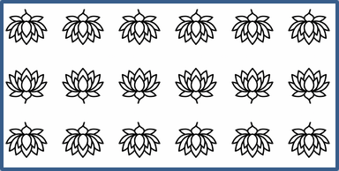

## **Giới thiệu**

Định dạng các hình dạng trong PowerPoint bằng cách điều chỉnh viền, màu nền và hiệu ứng của chúng. Aspose.Slides for Node.js qua Java cho phép bạn kiểm soát các thiết lập này bằng chương trình, bao gồm độ trong suốt, xoay và định dạng 3D.


Aspose.Slides for Node.js qua Java cung cấp các lớp và phương thức cho phép bạn định dạng hình dạng bằng các tùy chọn có sẵn trong PowerPoint.

## **Định dạng Đường**

Sử dụng [Shape.getLineFormat](https://reference.aspose.com/slides/nodejs-java/aspose.slides/shape/#getLineFormat) để điều khiển viền của một hình dạng. Ví dụ này tạo một hình chữ nhật không nền với viền xanh, dạng gạch đứt. [LineFormat.setStyle](https://reference.aspose.com/slides/nodejs-java/aspose.slides/lineformat/#setStyle) chọn một đường hợp chất dày‑mỏng, trong khi [LineFormat.setWidth](https://reference.aspose.com/slides/nodejs-java/aspose.slides/lineformat/#setWidth) đặt chiều rộng của nó thành 7 điểm và [LineFormat.setDashStyle](https://reference.aspose.com/slides/nodejs-java/aspose.slides/lineformat/#setDashStyle) chọn mẫu gạch.

```javascript
const aspose = { slides: require("aspose.slides.via.java") };
const java = require("java");

let presentation = new aspose.slides.Presentation();
try {
    let slide = presentation.getSlides().get_Item(0);

    let shape = slide.getShapes().addAutoShape(aspose.slides.ShapeType.Rectangle, 50, 50, 150, 75);
    shape.getFillFormat().setFillType(java.newByte(aspose.slides.FillType.NoFill));
    shape.getLineFormat().setStyle(java.newByte(aspose.slides.LineStyle.ThickThin));
    shape.getLineFormat().setWidth(7);
    shape.getLineFormat().setDashStyle(java.newByte(aspose.slides.LineDashStyle.Dash));
    shape.getLineFormat().getFillFormat().setFillType(java.newByte(aspose.slides.FillType.Solid));
    shape.getLineFormat().getFillFormat().getSolidFillColor().setColor(java.getStaticFieldValue("java.awt.Color", "BLUE"));

    presentation.save("formatted_lines.pptx", aspose.slides.SaveFormat.Pptx);
} finally {
    presentation.dispose();
}
```

Kết quả:


### **Thiết lập Mẫu Gạch Tùy chỉnh cho Đường**

Sử dụng [LineFormat.setCustomDashPattern](https://reference.aspose.com/slides/nodejs-java/aspose.slides/lineformat/#setCustomDashPattern) khi các kiểu đường đã định sẵn không đáp ứng được độ dài gạch và khoảng trống bạn cần, ví dụ cho các viền thương hiệu hoặc sơ đồ kỹ thuật. Gán một mẫu sẽ tự động đổi kiểu gạch của đường thành [LineDashStyle.Custom](https://reference.aspose.com/slides/nodejs-java/aspose.slides/linedashstyle/).

Các mục trong mảng xen kẽ giữa độ dài gạch và khoảng trống, bắt đầu bằng gạch. Mỗi giá trị là bội số của độ rộng đường: `[4, 2]` ở độ rộng 3 điểm tạo ra một gạch dài 12 điểm theo sau là khoảng trống 6 điểm. Sử dụng các cặp giá trị hữu hạn, không âm để định nghĩa các đoạn gạch‑khoảng trống hoàn chỉnh. Ví dụ sử dụng các giá trị dương để mọi gạch và khoảng trống đều hiển thị.

Ví dụ này tạo năm đường xanh có cùng độ dài và đầu thẳng. Ba đường đầu tiên so sánh các mẫu ở độ rộng 3 điểm. Đường thứ tư lặp lại mẫu đầu tiên với độ rộng gấp đôi, làm gấp đôi cả độ dài gạch và khoảng trống. Đường thứ năm chuyển từ mẫu tùy chỉnh sang đường liền.

```javascript
const aspose = { slides: require("aspose.slides.via.java") };
const java = require("java");

let presentation = new aspose.slides.Presentation();
try {
    presentation.getSlideSize().setSize(600, 300, aspose.slides.SlideSizeScaleType.DoNotScale);
    let slide = presentation.getSlides().get_Item(0);

    let patterns = [
        [4, 2],
        [1, 2],
        [6, 2, 1, 2],
        [4, 2],
        [4, 2]
    ];

    for (let i = 0; i < patterns.length; i++) {
        let line = slide.getShapes().addAutoShape(aspose.slides.ShapeType.Line, 50, 50 + i * 50, 500, 0);
        line.getLineFormat().setWidth(i == 3 ? 6 : 3);
        line.getLineFormat().getFillFormat().setFillType(java.newByte(aspose.slides.FillType.Solid));
        line.getLineFormat().getFillFormat().getSolidFillColor().setColor(java.newInstanceSync("java.awt.Color", 0, 0, 139));
        line.getLineFormat().setCapStyle(java.newByte(aspose.slides.LineCapStyle.Flat));
        line.getLineFormat().setBeginArrowheadStyle(java.newByte(aspose.slides.LineArrowheadStyle.None));
        line.getLineFormat().setEndArrowheadStyle(java.newByte(aspose.slides.LineArrowheadStyle.None));
        let pattern = java.newArray("float", patterns[i]);
        line.getLineFormat().setCustomDashPattern(pattern);
    }

    // Đặt đường cuối cùng về kiểu liền.
    slide.getShapes().get_Item(4).getLineFormat().setDashStyle(java.newByte(aspose.slides.LineDashStyle.Solid));

    presentation.save("custom_dash_patterns.pptx", aspose.slides.SaveFormat.Pptx);
} finally {
    presentation.dispose();
}
```

Để quay trở lại kiểu gạch đã định sẵn, truyền [LineDashStyle.Dash](https://reference.aspose.com/slides/nodejs-java/aspose.slides/linedashstyle/) vào [LineFormat.setDashStyle](https://reference.aspose.com/slides/nodejs-java/aspose.slides/lineformat/#setDashStyle). Kiểu được chọn sẽ kiểm soát vẻ ngoài của đường.

Kết quả trong PowerPoint, từ trên xuống: **{4, 2}, 3 pt**; **{1, 2}, 3 pt**; **{6, 2, 1, 2}, 3 pt**; **{4, 2}, 6 pt**; và **Solid, 3 pt**.


### **Thiết lập Đầu Đường**

Sử dụng [LineFormat.setCapStyle](https://reference.aspose.com/slides/nodejs-java/aspose.slides/lineformat/#setCapStyle) để đặt đầu của một đường mở. Lớp [LineCapStyle](https://reference.aspose.com/slides/nodejs-java/aspose.slides/linecapstyle/) cung cấp ba kiểu đầu rõ ràng:

- `Flat`: Đường dừng lại tại điểm cuối.
- `Round`: Đầu bán vòng mở rộng ra ngoài điểm cuối một nửa độ rộng đường.
- `Square`: Đầu hình vuông mở rộng ra ngoài điểm cuối một nửa độ rộng đường.

Lớp cũng bao gồm `NotDefined`, nghĩa là không có kiểu đầu nào được chỉ định rõ ràng.

Đầu khác với mũi tên, vốn thêm ký hiệu vào cuối đường, và các khớp nối, vốn kiểm soát các góc giữa các đoạn đường. Ví dụ này tắt mũi tên bằng [LineFormat.setBeginArrowheadStyle](https://reference.aspose.com/slides/nodejs-java/aspose.slides/lineformat/#setBeginArrowheadStyle) và [LineFormat.setEndArrowheadStyle](https://reference.aspose.com/slides/nodejs-java/aspose.slides/lineformat/#setEndArrowheadStyle) để chỉ so sánh các hình dạng đầu.

Ví dụ sau tạo ba đường ngang gần như giống hệt, rộng 20 điểm. Từ trên xuống, chúng sử dụng đầu `Flat`, `Round` và `Square`. Các điểm cuối có cùng tọa độ ngang; các đầu `Round` và `Square` mở rộng 10 điểm ra ngoài mỗi đầu.

```javascript
const aspose = { slides: require("aspose.slides.via.java") };
const java = require("java");

let presentation = new aspose.slides.Presentation();
try {
    presentation.getSlideSize().setSize(500, 240, aspose.slides.SlideSizeScaleType.DoNotScale);
    let slide = presentation.getSlides().get_Item(0);

    let capStyles = [aspose.slides.LineCapStyle.Flat, aspose.slides.LineCapStyle.Round, aspose.slides.LineCapStyle.Square];

    for (let i = 0; i < capStyles.length; i++) {
        let line = slide.getShapes().addAutoShape(aspose.slides.ShapeType.Line, 100, 50 + i * 70, 300, 0);
        line.getLineFormat().setWidth(20);
        line.getLineFormat().getFillFormat().setFillType(java.newByte(aspose.slides.FillType.Solid));
        line.getLineFormat().getFillFormat().getSolidFillColor().setColor(java.newInstanceSync("java.awt.Color", 0, 0, 139));
        line.getLineFormat().setDashStyle(java.newByte(aspose.slides.LineDashStyle.Solid));
        line.getLineFormat().setCapStyle(java.newByte(capStyles[i]));
        line.getLineFormat().setBeginArrowheadStyle(java.newByte(aspose.slides.LineArrowheadStyle.None));
        line.getLineFormat().setEndArrowheadStyle(java.newByte(aspose.slides.LineArrowheadStyle.None));
    }

    presentation.save("line_caps.pptx", aspose.slides.SaveFormat.Pptx);
} finally {
    presentation.dispose();
}
```

Kết quả trong PowerPoint, từ trên xuống: **Flat**, **Round**, và **Square**.


## **Áp dụng Hiệu ứng Phác họa cho Đường Hình**

Hiệu ứng phác họa làm cho đường của hình trông như được vẽ tay. Sử dụng [Shape.getLineFormat](https://reference.aspose.com/slides/nodejs-java/aspose.slides/shape/#getLineFormat) để truy cập cài đặt đường, [LineFormat.getSketchFormat](https://reference.aspose.com/slides/nodejs-java/aspose.slides/lineformat/#getSketchFormat) để truy cập cài đặt phác họa, và [SketchFormat.setSketchType](https://reference.aspose.com/slides/nodejs-java/aspose.slides/sketchformat/#setSketchType) để chọn một giá trị từ lớp [LineSketchType](https://reference.aspose.com/slides/nodejs-java/aspose.slides/linesketchtype/).

Đoạn mã JavaScript sau cho thấy cách áp dụng hiệu ứng [LineSketchType.Curved](https://reference.aspose.com/slides/nodejs-java/aspose.slides/linesketchtype/), đọc giá trị đã gán rõ ràng, và loại bỏ hiệu ứng bằng [LineSketchType.None](https://reference.aspose.com/slides/nodejs-java/aspose.slides/linesketchtype/):

```javascript
const aspose = { slides: require("aspose.slides.via.java") };

let presentation = new aspose.slides.Presentation();
try {
    let slide = presentation.getSlides().get_Item(0);

    let shape = slide.getShapes().addAutoShape(aspose.slides.ShapeType.Rectangle, 50, 50, 200, 100);

    let sketchFormat = shape.getLineFormat().getSketchFormat();
    sketchFormat.setSketchType(aspose.slides.LineSketchType.Curved);
    let explicitSketchType = sketchFormat.getSketchType();
    console.log("Explicit sketch type: " + explicitSketchType);
    sketchFormat.setSketchType(aspose.slides.LineSketchType.None);
} finally {
    presentation.dispose();
}
```

Giá trị trả về bởi [SketchFormat.getSketchType](https://reference.aspose.com/slides/nodejs-java/aspose.slides/sketchformat/#getSketchType) đại diện cho cài đặt được gán trực tiếp cho hình. Nếu định dạng đường có thể kế thừa từ chủ đề, slide mẫu hoặc slide bố cục, hãy sử dụng [LineFormat.getEffective](https://reference.aspose.com/slides/nodejs-java/aspose.slides/lineformat/#getEffective), gọi `getSketchFormat` trên đối tượng trả về, sau đó gọi phương thức `getSketchType` của nó. Giá trị hiệu quả phản ánh định dạng thực tế được áp dụng sau khi kế thừa được giải quyết. Ví dụ này yêu cầu một bản trình bày tồn tại với ít nhất một hình trên slide đầu tiên và in ra cả hai giá trị:

```javascript
const aspose = { slides: require("aspose.slides.via.java") };

let presentation = new aspose.slides.Presentation("presentation.pptx");
try {
    let shape = presentation.getSlides().get_Item(0).getShapes().get_Item(0);

    let lineFormat = shape.getLineFormat();
    let explicitSketchType = lineFormat.getSketchFormat().getSketchType();
    let effectiveLineFormat = lineFormat.getEffective();
    let effectiveSketchType = effectiveLineFormat.getSketchFormat().getSketchType();

    console.log("Explicit sketch type: " + explicitSketchType);
    console.log("Effective sketch type: " + effectiveSketchType);
} finally {
    presentation.dispose();
}
```

## **Định dạng Kiểu Nối**

Ba tùy chọn kiểu nối:

* Round
* Miter
* Bevel

Kiểu nối kiểm soát cách hai đoạn viền gặp nhau tại một góc. Sử dụng **Round** cho các góc tròn, **Miter** cho các góc nhọn, hoặc **Bevel** cho các góc dẹt.


Ví dụ này tạo ba hình chữ nhật đen với viền xanh rộng 15 điểm. Nó sử dụng [LineFormat.setJoinStyle](https://reference.aspose.com/slides/nodejs-java/aspose.slides/lineformat/#setJoinStyle) để áp dụng các giá trị miter, bevel và round của [LineJoinStyle](https://reference.aspose.com/slides/nodejs-java/aspose.slides/linejoinstyle/), tương ứng, để so sánh cách các góc được vẽ.

```javascript
const aspose = { slides: require("aspose.slides.via.java") };
const java = require("java");

let presentation = new aspose.slides.Presentation();
try {
    let slide = presentation.getSlides().get_Item(0);

    let miterShape = slide.getShapes().addAutoShape(aspose.slides.ShapeType.Rectangle, 20, 20, 150, 75);
    let bevelShape = slide.getShapes().addAutoShape(aspose.slides.ShapeType.Rectangle, 210, 20, 150, 75);
    let roundShape = slide.getShapes().addAutoShape(aspose.slides.ShapeType.Rectangle, 20, 135, 150, 75);

    miterShape.getFillFormat().setFillType(java.newByte(aspose.slides.FillType.Solid));
    miterShape.getFillFormat().getSolidFillColor().setColor(java.getStaticFieldValue("java.awt.Color", "BLACK"));
    bevelShape.getFillFormat().setFillType(java.newByte(aspose.slides.FillType.Solid));
    bevelShape.getFillFormat().getSolidFillColor().setColor(java.getStaticFieldValue("java.awt.Color", "BLACK"));
    roundShape.getFillFormat().setFillType(java.newByte(aspose.slides.FillType.Solid));
    roundShape.getFillFormat().getSolidFillColor().setColor(java.getStaticFieldValue("java.awt.Color", "BLACK"));

    miterShape.getLineFormat().setWidth(15);
    bevelShape.getLineFormat().setWidth(15);
    roundShape.getLineFormat().setWidth(15);

    miterShape.getLineFormat().getFillFormat().setFillType(java.newByte(aspose.slides.FillType.Solid));
    miterShape.getLineFormat().getFillFormat().getSolidFillColor().setColor(java.getStaticFieldValue("java.awt.Color", "BLUE"));
    bevelShape.getLineFormat().getFillFormat().setFillType(java.newByte(aspose.slides.FillType.Solid));
    bevelShape.getLineFormat().getFillFormat().getSolidFillColor().setColor(java.getStaticFieldValue("java.awt.Color", "BLUE"));
    roundShape.getLineFormat().getFillFormat().setFillType(java.newByte(aspose.slides.FillType.Solid));
    roundShape.getLineFormat().getFillFormat().getSolidFillColor().setColor(java.getStaticFieldValue("java.awt.Color", "BLUE"));

    miterShape.getLineFormat().setJoinStyle(java.newByte(aspose.slides.LineJoinStyle.Miter));
    bevelShape.getLineFormat().setJoinStyle(java.newByte(aspose.slides.LineJoinStyle.Bevel));
    roundShape.getLineFormat().setJoinStyle(java.newByte(aspose.slides.LineJoinStyle.Round));

    miterShape.getTextFrame().setText("Miter Join Style");
    bevelShape.getTextFrame().setText("Bevel Join Style");
    roundShape.getTextFrame().setText("Round Join Style");

    presentation.save("join_styles.pptx", aspose.slides.SaveFormat.Pptx);
} finally {
    presentation.dispose();
}
```

### **Giới hạn Nối Miter ở Các Góc Nhọn**

Sử dụng [LineFormat.setMiterLimit](https://reference.aspose.com/slides/nodejs-java/aspose.slides/lineformat/#setMiterLimit) cùng với [LineFormat.setJoinStyle](https://reference.aspose.com/slides/nodejs-java/aspose.slides/lineformat/#setJoinStyle) được đặt thành [LineJoinStyle.Miter](https://reference.aspose.com/slides/nodejs-java/aspose.slides/linejoinstyle/) để giới hạn độ dài của góc nhọn.

Giới hạn là tỉ lệ giữa khoảng cách giữa các góc trong và ngoài của nối so với độ rộng đường. Ví dụ, giá trị `8` cho phép độ dài miter lên tới tám lần độ rộng đường; nó không phải là đo bằng điểm. Nếu góc vượt quá giới hạn, PowerPoint sẽ sử dụng nối bevel tại góc đó. Giới hạn lớn hơn cho phép các điểm nhọn hơn. Cài đặt này chỉ ảnh hưởng đến nối miter và không có ảnh hưởng nhìn thấy khi góc vẫn nằm trong giới hạn.

Ví dụ này tạo hai tam giác không nền giống hệt, viền rộng 20 điểm. Tam giác bên trái sử dụng giới hạn `2`, còn bên phải sử dụng `8`. Mỗi tam giác rộng 80 điểm và cao 160 điểm, cho tỉ lệ độ dài miter‑so‑với‑độ‑rộng‑đường ở góc trên khoảng `4.12`. Do đó, PowerPoint bevel góc bên trái và giữ nguyên góc bên phải.

```javascript
const aspose = { slides: require("aspose.slides.via.java") };
const java = require("java");

let presentation = new aspose.slides.Presentation();
try {
    presentation.getSlideSize().setSize(500, 320, aspose.slides.SlideSizeScaleType.DoNotScale);
    let slide = presentation.getSlides().get_Item(0);

    let miterLimits = [2, 8];

    for (let i = 0; i < miterLimits.length; i++) {
        let triangle = slide.getShapes().addAutoShape(aspose.slides.ShapeType.Triangle, 90 + i * 240, 110, 80, 160);
        triangle.getFillFormat().setFillType(java.newByte(aspose.slides.FillType.NoFill));
        triangle.getLineFormat().setWidth(20);
        triangle.getLineFormat().getFillFormat().setFillType(java.newByte(aspose.slides.FillType.Solid));
        triangle.getLineFormat().getFillFormat().getSolidFillColor().setColor(java.newInstanceSync("java.awt.Color", 0, 0, 139));
        triangle.getLineFormat().setJoinStyle(java.newByte(aspose.slides.LineJoinStyle.Miter));
        triangle.getLineFormat().setMiterLimit(java.newFloat(miterLimits[i]));
    }

    presentation.save("miter_limits.pptx", aspose.slides.SaveFormat.Pptx);
} finally {
    presentation.dispose();
}
```

Kết quả trong PowerPoint: **Miter limit 2** ở bên trái và **miter limit 8** ở bên phải.


## **Đổ màu Gradient**

Gradient Fill pha trộn các màu trên một hình dạng. Ví dụ này đổ màu gradient tuyến tính vào một hình ellipse với góc 45 độ từ đỏ sang tím bằng [FillFormat.getGradientFormat](https://reference.aspose.com/slides/nodejs-java/aspose.slides/fillformat/#getGradientFormat). Phương thức [GradientStopCollection.addPresetColor](https://reference.aspose.com/slides/nodejs-java/aspose.slides/gradientstopcollection/#addPresetColor) đặt các điểm dừng màu ở vị trí 0 và 1, đầu và cuối gradient. Xóa các điểm dừng hiện có đảm bảo chỉ có hai màu này được sử dụng.

```javascript
const aspose = { slides: require("aspose.slides.via.java") };
const java = require("java");

let presentation = new aspose.slides.Presentation();
try {
    let slide = presentation.getSlides().get_Item(0);

    let shape = slide.getShapes().addAutoShape(aspose.slides.ShapeType.Ellipse, 50, 50, 150, 75);
    shape.getFillFormat().setFillType(java.newByte(aspose.slides.FillType.Gradient));
    shape.getFillFormat().getGradientFormat().setGradientShape(java.newByte(aspose.slides.GradientShape.Linear));
    shape.getFillFormat().getGradientFormat().setLinearGradientAngle(45);
    shape.getFillFormat().getGradientFormat().getGradientStops().clear();
    shape.getFillFormat().getGradientFormat().getGradientStops().addPresetColor(1.0, aspose.slides.PresetColor.Purple);
    shape.getFillFormat().getGradientFormat().getGradientStops().addPresetColor(0.0, aspose.slides.PresetColor.Red);

    presentation.save("gradient_fill.pptx", aspose.slides.SaveFormat.Pptx);
} finally {
    presentation.dispose();
}
```

Kết quả:


Nếu gradient trông khác trong ảnh xuất ra so với trong PowerPoint, xem mục [Choose a Gradient Rendering Style](/slides/vi/nodejs-java/convert-powerpoint-to-png/#choose-a-gradient-rendering-style). Bạn có thể chọn kiểu render mà không thay đổi gradient được lưu trong bản trình bày.

### **Đặt Góc Gradient Tuyến tính**

Sử dụng [GradientFormat.setLinearGradientAngle](https://reference.aspose.com/slides/nodejs-java/aspose.slides/gradientformat/#setLinearGradientAngle) để kiểm soát hướng của lớp [GradientShape.Linear](https://reference.aspose.com/slides/nodejs-java/aspose.slides/gradientshape/) . Góc đo bằng độ và tăng theo chiều kim đồng hồ: `0` chạy từ trái sang phải, `90` từ trên xuống dưới, `180` từ phải sang trái, và `270` từ dưới lên trên. Các góc phân số được hỗ trợ. Các góc hữu hạn ngoài khoảng `[0, 360)` sẽ được chuẩn hoá thành một vòng quay; ví dụ, `-45` trở thành `315` và `360` trở thành `0`.

Ví dụ này tạo sáu hình chữ nhật với các điểm dừng màu đỏ, xanh lá và xanh dương giống nhau tại vị trí `0`, `0.5` và `1`. Tính năng scaling bị tắt để góc có thể so sánh độc lập với tỷ lệ của các hình chữ nhật. Các góc, từ trái sang phải, là `0`, `45`, và `90` ở hàng trên, và `135`, `180`, và `270` ở hàng dưới.

```javascript
const aspose = { slides: require("aspose.slides.via.java") };
const java = require("java");

let presentation = new aspose.slides.Presentation();
try {
    presentation.getSlideSize().setSize(720, 400, aspose.slides.SlideSizeScaleType.DoNotScale);
    let slide = presentation.getSlides().get_Item(0);

    let angles = [0, 45, 90, 135, 180, 270];

    for (let i = 0; i < angles.length; i++) {
        let x = 30 + (i % 3) * 230;
        let y = 30 + Math.floor(i / 3) * 190;

        let shape = slide.getShapes().addAutoShape(aspose.slides.ShapeType.Rectangle, x, y, 200, 150);
        shape.getLineFormat().getFillFormat().setFillType(java.newByte(aspose.slides.FillType.NoFill));
        shape.getFillFormat().setFillType(java.newByte(aspose.slides.FillType.Gradient));

        let gradient = shape.getFillFormat().getGradientFormat();
        gradient.setGradientShape(java.newByte(aspose.slides.GradientShape.Linear));
        gradient.getGradientStops().clear();
        gradient.getGradientStops().add(0, java.getStaticFieldValue("java.awt.Color", "RED"));
        gradient.getGradientStops().add(java.newFloat(0.5), java.getStaticFieldValue("java.awt.Color", "GREEN"));
        gradient.getGradientStops().add(1, java.getStaticFieldValue("java.awt.Color", "BLUE"));
        gradient.setLinearGradientScaled(java.newByte(aspose.slides.NullableBool.False));
        gradient.setLinearGradientAngle(angles[i]);
    }

    presentation.save("linear_gradient_angles.pptx", aspose.slides.SaveFormat.Pptx);
} finally {
    presentation.dispose();
}
```

Kết quả trong PowerPoint:


### **Scale Gradient Tuyến tính theo Hình dạng**

[GradientFormat.setLinearGradientScaled](https://reference.aspose.com/slides/nodejs-java/aspose.slides/gradientformat/#setLinearGradientScaled) nhận một giá trị [NullableBool](https://reference.aspose.com/slides/nodejs-java/aspose.slides/nullablebool/). Đặt nó rõ ràng thành `False` để giữ góc gradient hình học khi tỷ lệ hình dạng thay đổi, hoặc thành `True` để scale gradient cùng với chiều rộng và chiều cao của hình. Khi scaling bật, góc nhìn thấy có thể khác với góc đã gán trên một hình không vuông.

Ví dụ sau sử dụng góc `45` độ và cùng các điểm dừng màu như phần so sánh góc. Cột trái dùng `False`; cột phải dùng `True`. Mỗi cột chứa một hình chữ nhật rộng ở trên và một hình chữ nhật cao ở dưới. Cả hai đều bắt đầu với cùng kích thước rộng; việc thay đổi chiều rộng và chiều cao của hình chữ nhật thứ hai cho thấy cách màu nền phản hồi khi thay đổi kích thước mà không thay đổi cài đặt gradient.

```javascript
const aspose = { slides: require("aspose.slides.via.java") };
const java = require("java");

let presentation = new aspose.slides.Presentation();
try {
    presentation.getSlideSize().setSize(720, 460, aspose.slides.SlideSizeScaleType.DoNotScale);
    let slide = presentation.getSlides().get_Item(0);

    let scalingOptions = [aspose.slides.NullableBool.False, aspose.slides.NullableBool.True];

    for (let column = 0; column < scalingOptions.length; column++) {
        for (let row = 0; row < 2; row++) {
            let x = 30 + column * 360;
            let y = row == 0 ? 30 : 150;

            let shape = slide.getShapes().addAutoShape(aspose.slides.ShapeType.Rectangle, x, y, 300, 90);
            shape.getLineFormat().getFillFormat().setFillType(java.newByte(aspose.slides.FillType.NoFill));
            shape.getFillFormat().setFillType(java.newByte(aspose.slides.FillType.Gradient));

            let gradient = shape.getFillFormat().getGradientFormat();
            gradient.setGradientShape(java.newByte(aspose.slides.GradientShape.Linear));
            gradient.getGradientStops().clear();
            gradient.getGradientStops().add(0, java.getStaticFieldValue("java.awt.Color", "RED"));
            gradient.getGradientStops().add(java.newFloat(0.5), java.getStaticFieldValue("java.awt.Color", "GREEN"));
            gradient.getGradientStops().add(1, java.getStaticFieldValue("java.awt.Color", "BLUE"));
            gradient.setLinearGradientAngle(45);
            gradient.setLinearGradientScaled(java.newByte(scalingOptions[column]));

            if (row == 1) {
                shape.setWidth(90);
                shape.setHeight(280);
            }
        }
    }

    presentation.save("linear_gradient_scaling.pptx", aspose.slides.SaveFormat.Pptx);
} finally {
    presentation.dispose();
}
```

Kết quả trong PowerPoint, với scaling tắt ở phía trái và bật ở phía phải:


Với scaling tắt, các dải màu chéo giữ cùng hướng trong cả hai hình. Với scaling bật, các dải kéo dài theo tỷ lệ của hình. Điều này giúp tái tạo gradient của mẫu khi điều chỉnh hình sang kích thước khác. Trên hình vuông, bật scaling không làm thay đổi diện mạo của gradient `45` độ này.

Cả góc và cài đặt scaling đều áp dụng cho gradient tuyến tính. Chúng không kiểm soát các lớp [GradientShape.Radial hoặc GradientShape.Rectangle](https://reference.aspose.com/slides/nodejs-java/aspose.slides/gradientshape/) .

### **Kết hợp Góc với Hướng Gradient**

[GradientFormat.setGradientDirection](https://reference.aspose.com/slides/nodejs-java/aspose.slides/gradientformat/#setGradientDirection) chọn một kiểu gradient từ lớp [GradientDirection](https://reference.aspose.com/slides/nodejs-java/aspose.slides/gradientdirection/) ; nó không phải là một thay thế cho góc số. Đối với gradient tuyến tính, các kiểu góc có thể thay đổi khu vực màu được phân bố mà không thay đổi góc đã gán qua [setLinearGradientAngle](https://reference.aspose.com/slides/nodejs-java/aspose.slides/gradientformat/#setLinearGradientAngle). Giữ nguyên hướng khi so sánh góc hoặc scaling.

Ví dụ sau áp dụng cùng cài đặt nhưng theo thứ tự ngược nhau. Hai hình chữ nhật có cùng kết quả: việc gán hướng trước hay sau góc không thay đổi kết quả.

```javascript
const aspose = { slides: require("aspose.slides.via.java") };
const java = require("java");

let presentation = new aspose.slides.Presentation();
try {
    let slide = presentation.getSlides().get_Item(0);

    for (let i = 0; i < 2; i++) {
        let shape = slide.getShapes().addAutoShape(aspose.slides.ShapeType.Rectangle, 30, 30 + i * 140, 320, 100);
        shape.getLineFormat().getFillFormat().setFillType(java.newByte(aspose.slides.FillType.NoFill));
        shape.getFillFormat().setFillType(java.newByte(aspose.slides.FillType.Gradient));

        let gradient = shape.getFillFormat().getGradientFormat();
        gradient.setGradientShape(java.newByte(aspose.slides.GradientShape.Linear));
        gradient.getGradientStops().clear();
        gradient.getGradientStops().add(0, java.getStaticFieldValue("java.awt.Color", "RED"));
        gradient.getGradientStops().add(java.newFloat(0.5), java.getStaticFieldValue("java.awt.Color", "GREEN"));
        gradient.getGradientStops().add(1, java.getStaticFieldValue("java.awt.Color", "BLUE"));
        gradient.setLinearGradientScaled(java.newByte(aspose.slides.NullableBool.True));

        if (i == 0) {
            gradient.setGradientDirection(aspose.slides.GradientDirection.FromCorner1);
            gradient.setLinearGradientAngle(30);
        } else {
            gradient.setLinearGradientAngle(30);
            gradient.setGradientDirection(aspose.slides.GradientDirection.FromCorner1);
        }
    }

    presentation.save("linear_gradient_direction.pptx", aspose.slides.SaveFormat.Pptx);
} finally {
    presentation.dispose();
}
```

## **Pattern Fill**

Pattern Fill áp dụng một thiết kế hai màu, chẳng hạn chấm, sọc hoặc caro. Ví dụ này sử dụng [PatternFormat.setPatternStyle](https://reference.aspose.com/slides/nodejs-java/aspose.slides/patternformat/#setPatternStyle) để chọn mẫu trellis. [PatternFormat.getBackColor](https://reference.aspose.com/slides/nodejs-java/aspose.slides/patternformat/#getBackColor) cung cấp màu nền xám nhạt, và [PatternFormat.getForeColor](https://reference.aspose.com/slides/nodejs-java/aspose.slides/patternformat/#getForeColor) cung cấp màu vàng cho mẫu.

```javascript
const aspose = { slides: require("aspose.slides.via.java") };
const java = require("java");

let presentation = new aspose.slides.Presentation();
try {
    let slide = presentation.getSlides().get_Item(0);

    let shape = slide.getShapes().addAutoShape(aspose.slides.ShapeType.Rectangle, 50, 50, 150, 75);
    shape.getFillFormat().setFillType(java.newByte(aspose.slides.FillType.Pattern));
    shape.getFillFormat().getPatternFormat().setPatternStyle(java.newByte(aspose.slides.PatternStyle.Trellis));
    shape.getFillFormat().getPatternFormat().getBackColor().setColor(java.getStaticFieldValue("java.awt.Color", "LIGHT_GRAY"));
    shape.getFillFormat().getPatternFormat().getForeColor().setColor(java.getStaticFieldValue("java.awt.Color", "YELLOW"));

    presentation.save("pattern_fill.pptx", aspose.slides.SaveFormat.Pptx);
} finally {
    presentation.dispose();
}
```

Kết quả:


## **Picture Fill**

Picture Fill sử dụng một hình ảnh bên trong một hình dạng. Ví dụ này yêu cầu một hình ảnh cục bộ và sử dụng [Images.fromFile](https://reference.aspose.com/slides/nodejs-java/aspose.slides/images/#fromFile) để tải nó vào bộ sưu tập hình ảnh của bản trình bày. Đặt [PictureFillFormat.setPictureFillMode](https://reference.aspose.com/slides/nodejs-java/aspose.slides/picturefillformat/#setPictureFillMode) ở chế độ lặp lại (tile) sẽ làm hình ảnh lặp lại trong hình chữ nhật. Hình ảnh nguồn được dùng ở đây được hiển thị bên dưới:


```javascript
const aspose = { slides: require("aspose.slides.via.java") };
const java = require("java");

let presentation = new aspose.slides.Presentation();
try {
    let slide = presentation.getSlides().get_Item(0);

    let shape = slide.getShapes().addAutoShape(aspose.slides.ShapeType.Rectangle, 50, 50, 255, 130);
    shape.getFillFormat().setFillType(java.newByte(aspose.slides.FillType.Picture));
    shape.getFillFormat().getPictureFillFormat().setPictureFillMode(aspose.slides.PictureFillMode.Tile);

    let image = aspose.slides.Images.fromFile("lotus.png");
    let picture;
    try {
        picture = presentation.getImages().addImage(image);
    } finally {
        image.dispose();
    }
    shape.getFillFormat().getPictureFillFormat().getPicture().setImage(picture);

    presentation.save("picture_fill.pptx", aspose.slides.SaveFormat.Pptx);
} finally {
    presentation.dispose();
}
```

Kết quả:


### **Tile Picture As Texture**

Nếu bạn muốn đặt hình ảnh lặp lại làm texture và tùy chỉnh hành vi lặp, bạn có thể sử dụng các phương thức sau của lớp [PictureFillFormat](https://reference.aspose.com/slides/nodejs-java/aspose.slides/picturefillformat/) :

- [setPictureFillMode](https://reference.aspose.com/slides/nodejs-java/aspose.slides/picturefillformat/#setPictureFillMode): Đặt chế độ picture fill — `Tile` hoặc `Stretch`.
- [setTileAlignment](https://reference.aspose.com/slides/nodejs-java/aspose.slides/picturefillformat/#setTileAlignment): Xác định căn chỉnh các tile trong hình dạng.
- [setTileFlip](https://reference.aspose.com/slides/nodejs-java/aspose.slides/picturefillformat/#setTileFlip): Kiểm soát việc lật tile ngang, dọc hoặc cả hai.
- [setTileOffsetX](https://reference.aspose.com/slides/nodejs-java/aspose.slides/picturefillformat/#setTileOffsetX): Đặt độ lệch ngang của tile (điểm) so với gốc của hình dạng.
- [setTileOffsetY](https://reference.aspose.com/slides/nodejs-java/aspose.slides/picturefillformat/#setTileOffsetY): Đặt độ lệch dọc của tile (điểm) so với gốc của hình dạng.
- [setTileScaleX](https://reference.aspose.com/slides/nodejs-java/aspose.slides/picturefillformat/#setTileScaleX): Xác định tỷ lệ ngang của tile dưới dạng phần trăm.
- [setTileScaleY](https://reference.aspose.com/slides/nodejs-java/aspose.slides/picturefillformat/#setTileScaleY): Xác định tỷ lệ dọc của tile dưới dạng phần trăm.

Ví dụ này yêu cầu một hình ảnh cục bộ và cấu hình [PictureFillFormat](https://reference.aspose.com/slides/nodejs-java/aspose.slides/picturefillformat/) để lặp lại nó ở 50% kích thước gốc. Độ lệch `−32` điểm dịch các tile ngang và dọc; căn chỉnh góc dưới‑phải và lật cả hai hướng xác định cách bố trí texture lặp.

```javascript
const aspose = { slides: require("aspose.slides.via.java") };
const java = require("java");

let presentation = new aspose.slides.Presentation();
try {
    let firstSlide = presentation.getSlides().get_Item(0);

    let shape = firstSlide.getShapes().addAutoShape(aspose.slides.ShapeType.Rectangle, 50, 50, 190, 95);
    shape.getFillFormat().setFillType(java.newByte(aspose.slides.FillType.Picture));

    let sourceImage = aspose.slides.Images.fromFile("lotus.png");
    let presentationImage;
    try {
        presentationImage = presentation.getImages().addImage(sourceImage);
    } finally {
        sourceImage.dispose();
    }

    let pictureFillFormat = shape.getFillFormat().getPictureFillFormat();
    pictureFillFormat.getPicture().setImage(presentationImage);
    pictureFillFormat.setPictureFillMode(aspose.slides.PictureFillMode.Tile);
    pictureFillFormat.setTileOffsetX(-32);
    pictureFillFormat.setTileOffsetY(-32);
    pictureFillFormat.setTileScaleX(50);
    pictureFillFormat.setTileScaleY(50);
    pictureFillFormat.setTileAlignment(java.newByte(aspose.slides.RectangleAlignment.BottomRight));
    pictureFillFormat.setTileFlip(aspose.slides.TileFlip.FlipBoth);

    presentation.save("tile.pptx", aspose.slides.SaveFormat.Pptx);
} finally {
    presentation.dispose();
}
```

Kết quả:



## **Solid Color Fill**

Solid Fill cung cấp cho hình dạng một màu duy nhất, đồng nhất. Ví dụ này sử dụng [FillFormat.setFillType](https://reference.aspose.com/slides/nodejs-java/aspose.slides/fillformat/#setFillType) để chọn chế độ solid fill và gán màu vàng qua [FillFormat.getSolidFillColor](https://reference.aspose.com/slides/nodejs-java/aspose.slides/fillformat/#getSolidFillColor), sau đó lưu hình chữ nhật vào bản trình bày.

```javascript
const aspose = { slides: require("aspose.slides.via.java") };
const java = require("java");

let presentation = new aspose.slides.Presentation();
try {
    let slide = presentation.getSlides().get_Item(0);

    let shape = slide.getShapes().addAutoShape(aspose.slides.ShapeType.Rectangle, 50, 50, 150, 75);
    shape.getFillFormat().setFillType(java.newByte(aspose.slides.FillType.Solid));
    shape.getFillFormat().getSolidFillColor().setColor(java.getStaticFieldValue("java.awt.Color", "YELLOW"));

    presentation.save("solid_color_fill.pptx", aspose.slides.SaveFormat.Pptx);
} finally {
    presentation.dispose();
}
```

Kết quả:


## **Sử dụng Nền Slide làm Fill cho Hình dạng**

Sử dụng [AutoShape.setUseBackgroundFill](https://reference.aspose.com/slides/nodejs-java/aspose.slides/autoshape/#setUseBackgroundFill) khi một hình dạng cần khớp với nền slide, chẳng hạn trong mẫu bản trình bày. Sử dụng [FillFormat.setFillType](https://reference.aspose.com/slides/nodejs-java/aspose.slides/fillformat/#setFillType) để chọn [FillType.NotDefined](https://reference.aspose.com/slides/nodejs-java/aspose.slides/filltype/) đầu tiên nhằm xóa bất kỳ fill nào được xác định rõ. Với sự kết hợp này, hình dạng sẽ sử dụng nền slide thay vì fill kiểu riêng. Chỉ bật cờ này không xóa một fill đã tồn tại.

Điều này khác với [FillType.NoFill](https://reference.aspose.com/slides/nodejs-java/aspose.slides/filltype/) : fill nền phủ các đối tượng phía sau hình dạng bằng vùng nền slide tương ứng, trong khi NoFill để các đối tượng đó vẫn hiển thị. Gradient vẫn được căn chỉnh với slide thay vì khởi động lại bên trong mỗi hình dạng.

Ví dụ sau tạo nền master được kế thừa bởi slide và đặt một dải màu magenta phía sau ba hình chữ nhật. Hình chữ nhật bên trái sử dụng nền, hình trung tâm không có fill, và hình bên phải chuyển từ fill nền sang fill cam rõ ràng.

```javascript
const aspose = { slides: require("aspose.slides.via.java") };
const java = require("java");

let presentation = new aspose.slides.Presentation();
try {
    presentation.getSlideSize().setSize(720, 400, aspose.slides.SlideSizeScaleType.DoNotScale);
    let slide = presentation.getSlides().get_Item(0);

    // Kế thừa gradient từ master.
    slide.getBackground().setType(java.newByte(aspose.slides.BackgroundType.NotDefined));
    slide.getLayoutSlide().getBackground().setType(java.newByte(aspose.slides.BackgroundType.NotDefined));
    let background = slide.getLayoutSlide().getMasterSlide().getBackground();
    background.setType(java.newByte(aspose.slides.BackgroundType.OwnBackground));
    background.getFillFormat().setFillType(java.newByte(aspose.slides.FillType.Gradient));
    let gradient = background.getFillFormat().getGradientFormat();
    gradient.setGradientShape(java.newByte(aspose.slides.GradientShape.Linear));
    gradient.setLinearGradientAngle(0);
    gradient.getGradientStops().clear();
    gradient.getGradientStops().add(0, java.newInstanceSync("java.awt.Color", 0, 0, 139));
    gradient.getGradientStops().add(1, java.newInstanceSync("java.awt.Color", 135, 206, 250));

    // Thêm đối tượng này đầu tiên để nó hiển thị phía sau các hình chữ nhật.
    let band = slide.getShapes().addAutoShape(aspose.slides.ShapeType.Rectangle, 25, 150, 670, 100);
    band.getFillFormat().setFillType(java.newByte(aspose.slides.FillType.Solid));
    band.getFillFormat().getSolidFillColor().setColor(java.getStaticFieldValue("java.awt.Color", "MAGENTA"));
    band.getLineFormat().getFillFormat().setFillType(java.newByte(aspose.slides.FillType.NoFill));

    let backgroundShape = slide.getShapes().addAutoShape(aspose.slides.ShapeType.Rectangle, 50, 100, 160, 200);
    backgroundShape.getFillFormat().setFillType(java.newByte(aspose.slides.FillType.NotDefined));
    backgroundShape.setUseBackgroundFill(true);

    let noFillShape = slide.getShapes().addAutoShape(aspose.slides.ShapeType.Rectangle, 280, 100, 160, 200);
    noFillShape.getFillFormat().setFillType(java.newByte(aspose.slides.FillType.NoFill));

    let explicitShape = slide.getShapes().addAutoShape(aspose.slides.ShapeType.Rectangle, 510, 100, 160, 200);
    explicitShape.getFillFormat().setFillType(java.newByte(aspose.slides.FillType.NotDefined));
    explicitShape.setUseBackgroundFill(true);

    // Tắt việc điền nền trước khi áp dụng một fill rõ ràng.
    explicitShape.setUseBackgroundFill(false);
    explicitShape.getFillFormat().setFillType(java.newByte(aspose.slides.FillType.Solid));
    explicitShape.getFillFormat().getSolidFillColor().setColor(java.newInstanceSync("java.awt.Color", 255, 165, 0));

    presentation.save("background_fill.pptx", aspose.slides.SaveFormat.Pptx);
} finally {
    presentation.dispose();
}
```

Kết quả, từ trái sang phải: **background fill**, **no fill**, và **explicit fill**. Dải magenta bị ẩn bởi hình trái và phải nhưng vẫn hiển thị qua hình giữa.


Hành vi tương tự áp dụng cho nền được định nghĩa trực tiếp trên slide hoặc kế thừa từ layout. Hình dạng sử dụng nền slide đã được phân giải; ví dụ để cả slide và layout không xác định nền, vì vậy master cung cấp nó.

## **Đặt Độ Trong Suốt**

Đối với solid fill, thành phần alpha của màu kiểm soát độ mờ : 0 là hoàn toàn trong suốt và 255 là hoàn toàn đục. Ví dụ này sử dụng giá trị alpha 128 cho một hình chữ nhật vàng, khiến nó khoảng 50 % trong suốt để hình chữ nhật phía dưới vẫn nhìn thấy. Màu được gán qua [FillFormat.getSolidFillColor](https://reference.aspose.com/slides/nodejs-java/aspose.slides/fillformat/#getSolidFillColor).

```javascript
const aspose = { slides: require("aspose.slides.via.java") };
const java = require("java");

let presentation = new aspose.slides.Presentation();
try {
    let slide = presentation.getSlides().get_Item(0);

    let solidShape = slide.getShapes().addAutoShape(aspose.slides.ShapeType.Rectangle, 50, 50, 150, 75);

    let transparentShape = slide.getShapes().addAutoShape(aspose.slides.ShapeType.Rectangle, 80, 80, 150, 75);
    transparentShape.getFillFormat().setFillType(java.newByte(aspose.slides.FillType.Solid));
    transparentShape.getFillFormat().getSolidFillColor().setColor(java.newInstanceSync("java.awt.Color", 255, 255, 0, 128));

    presentation.save("shape_transparency.pptx", aspose.slides.SaveFormat.Pptx);
} finally {
    presentation.dispose();
}
```

Kết quả:


## **Xoay Hình dạng**

Sử dụng [Shape.setRotation](https://reference.aspose.com/slides/nodejs-java/aspose.slides/shape/#setRotation) để xoay một hình dạng trong mặt phẳng slide. Góc đo bằng độ; ví dụ này xoay một hình chữ nhật 5 độ theo chiều kim đồng hồ và lưu bản trình bày.

```javascript
const aspose = { slides: require("aspose.slides.via.java") };

let presentation = new aspose.slides.Presentation();
try {
    let slide = presentation.getSlides().get_Item(0);

    let shape = slide.getShapes().addAutoShape(aspose.slides.ShapeType.Rectangle, 50, 50, 150, 75);
    shape.setRotation(5);

    presentation.save("shape_rotation.pptx", aspose.slides.SaveFormat.Pptx);
} finally {
    presentation.dispose();
}
```

Kết quả:


## **Thêm Hiệu ứng Bevel 3D**

Sử dụng [Shape.getThreeDFormat](https://reference.aspose.com/slides/nodejs-java/aspose.slides/shape/#getThreeDFormat) để cho hình dạng độ sâu và cạnh bevel. Ví dụ này tạo một ellipse màu xanh lá cây với viền màu cam, sử dụng [ThreeDFormat.setDepth](https://reference.aspose.com/slides/nodejs-java/aspose.slides/threedformat/#setDepth) để đặt độ sâu 4 điểm, và áp dụng bevel trên cùng hình tròn với chiều rộng và chiều cao 6 điểm qua [ThreeDFormat.getBevelTop](https://reference.aspose.com/slides/nodejs-java/aspose.slides/threedformat/#getBevelTop). Máy ảnh trực giao nhìn từ phía trước và ánh sáng ba‑điểm làm cho bevel hiển thị.

```javascript
const aspose = { slides: require("aspose.slides.via.java") };
const java = require("java");

let presentation = new aspose.slides.Presentation();
try {
    let slide = presentation.getSlides().get_Item(0);

    let shape = slide.getShapes().addAutoShape(aspose.slides.ShapeType.Ellipse, 50, 50, 100, 100);
    shape.getFillFormat().setFillType(java.newByte(aspose.slides.FillType.Solid));
    shape.getFillFormat().getSolidFillColor().setColor(java.newInstanceSync("java.awt.Color", 0, 128, 0));
    shape.getLineFormat().getFillFormat().setFillType(java.newByte(aspose.slides.FillType.Solid));
    shape.getLineFormat().getFillFormat().getSolidFillColor().setColor(java.newInstanceSync("java.awt.Color", 255, 165, 0));
    shape.getLineFormat().setWidth(2.0);
    shape.getThreeDFormat().setDepth(4);
    shape.getThreeDFormat().getBevelTop().setBevelType(aspose.slides.BevelPresetType.Circle);
    shape.getThreeDFormat().getBevelTop().setHeight(6);
    shape.getThreeDFormat().getBevelTop().setWidth(6);
    shape.getThreeDFormat().getCamera().setCameraType(aspose.slides.CameraPresetType.OrthographicFront);
    shape.getThreeDFormat().getLightRig().setLightType(aspose.slides.LightRigPresetType.ThreePt);
    shape.getThreeDFormat().getLightRig().setDirection(aspose.slides.LightingDirection.Top);

    presentation.save("3D_bevel_effect.pptx", aspose.slides.SaveFormat.Pptx);
} finally {
    presentation.dispose();
}
```

Kết quả:


## **Thêm Hiệu ứng Xoay 3D**

Góc nhìn 3D của một hình dạng được điều khiển bởi cài đặt máy ảnh. Ví dụ này sử dụng [Camera.setRotation](https://reference.aspose.com/slides/nodejs-java/aspose.slides/camera/#setRotation) với các góc vĩ độ, kinh độ và quay là 40, 35 và 20 độ tương ứng. Nó chọn máy ảnh isometric qua [Camera.setCameraType](https://reference.aspose.com/slides/nodejs-java/aspose.slides/camera/#setCameraType) và ánh sáng cân bằng qua [LightRig.setLightType](https://reference.aspose.com/slides/nodejs-java/aspose.slides/lightrig/#setLightType), sau đó lưu hình chữ nhật đã định dạng.

```javascript
const aspose = { slides: require("aspose.slides.via.java") };

let presentation = new aspose.slides.Presentation();
try {
    let slide = presentation.getSlides().get_Item(0);

    let autoShape = slide.getShapes().addAutoShape(aspose.slides.ShapeType.Rectangle, 50, 50, 150, 75);
    autoShape.getTextFrame().setText("Hello, Aspose!");
    autoShape.getThreeDFormat().getCamera().setCameraType(aspose.slides.CameraPresetType.IsometricLeftUp);
    autoShape.getThreeDFormat().getCamera().setRotation(40, 35, 20);
    autoShape.getThreeDFormat().getLightRig().setLightType(aspose.slides.LightRigPresetType.Balanced);

    presentation.save("3D_rotation_effect.pptx", aspose.slides.SaveFormat.Pptx);
} finally {
    presentation.dispose();
}
```

Kết quả:


## **Kiểm soát Render Đen‑Trắng cho Hình dạng**

Phương thức [Shape.setBlackWhiteMode](https://reference.aspose.com/slides/nodejs-java/aspose.slides/shape/#setBlackWhiteMode) chỉ định cách một hình dạng riêng lẻ được render khi bản trình bày được xem hoặc xử lý ở chế độ đen‑trắng. Nó không bật chế độ đen‑trắng tự động, và không thay đổi fill, line hoặc các định dạng khác của hình trong chế độ màu bình thường.

Sử dụng một giá trị từ lớp [BlackWhiteMode](https://reference.aspose.com/slides/nodejs-java/aspose.slides/blackwhitemode/) để chọn hành vi mong muốn. Ví dụ, `Automatic` để ứng dụng render chọn cách chuyển đổi, `Gray` và `LightGray` dùng màu xám, `BlackWhite` chỉ dùng đen và trắng, `Black` và `White` buộc một màu duy nhất, `Color` giữ màu bình thường, và `Hidden` bỏ qua hình trong chế độ đen‑trắng. `NotDefined` có nghĩa là không có chế độ cấp độ hình được gán.

Ví dụ này tạo một hình chữ nhật màu cam và sử dụng [Shape.setBlackWhiteMode](https://reference.aspose.com/slides/nodejs-java/aspose.slides/shape/#setBlackWhiteMode) để chọn màu xám. Hình đã lưu vẫn giữ màu nền cam cho hiển thị màu bình thường và yêu cầu màu xám từ các ứng dụng tôn trọng cài đặt hiển thị đen‑trắng:

```javascript
const aspose = { slides: require("aspose.slides.via.java") };
const java = require("java");

let presentation = new aspose.slides.Presentation();
try {
    let slide = presentation.getSlides().get_Item(0);

    let shape = slide.getShapes().addAutoShape(aspose.slides.ShapeType.Rectangle, 50, 50, 200, 100);
    shape.getFillFormat().setFillType(java.newByte(aspose.slides.FillType.Solid));
    shape.getFillFormat().getSolidFillColor().setColor(java.newInstanceSync("java.awt.Color", 255, 165, 0));
    shape.setBlackWhiteMode(java.newByte(aspose.slides.BlackWhiteMode.Gray));

    presentation.save("shape_black_white_mode.pptx", aspose.slides.SaveFormat.Pptx);
} finally {
    presentation.dispose();
}
```

Trong chế độ màu bình thường, hình chữ nhật giữ màu nền cam. Trong quy trình làm việc hiển thị đen‑trắng, nó sử dụng màu xám vì chế độ được đặt thành `Gray`. Điều này cho phép bạn giữ slide màu đầy đủ trong khi định nghĩa một diện mạo riêng cho việc in, xem trước hoặc các quy trình làm việc khác tôn trọng cài đặt hiển thị đen‑trắng của bản trình bày.

## **Đặt lại Định dạng**

Sử dụng [Slide.reset](https://reference.aspose.com/slides/nodejs-java/aspose.slides/slide/#reset) để khôi phục vị trí, kích thước và định dạng của các placeholder trên slide từ các placeholder tương ứng trên layout. Ví dụ này yêu cầu một bản trình bày hiện có với các placeholder liên kết layout và đặt lại mọi slide trước khi lưu. Các hình không có placeholder tương ứng trong layout sẽ không được đặt lại.

```javascript
const aspose = { slides: require("aspose.slides.via.java") };

let presentation = new aspose.slides.Presentation("sample.pptx");
try {
    for (let i = 0; i < presentation.getSlides().size(); i++) {
        let slide = presentation.getSlides().get_Item(i);
        slide.reset();
    }

    presentation.save("reset_formatting.pptx", aspose.slides.SaveFormat.Pptx);
} finally {
    presentation.dispose();
}
```

## **Câu hỏi thường gặp**

**Định dạng hình dạng có ảnh hưởng đến kích thước cuối cùng của tệp bản trình bày không?**

Màu sắc, kiểu đường và cài đặt hiệu ứng thường chỉ thêm ít dữ liệu so với hình ảnh và phương tiện nhúng. Fill hình ảnh có thể làm tăng kích thước tệp vì hình ảnh được lưu trong bản trình bày.

**Làm thế nào tôi có thể phát hiện các hình trên một slide có cùng định dạng để có thể nhóm chúng?**

So sánh các thuộc tính định dạng chính của mỗi hình — fill, line và effect. Nếu tất cả các giá trị tương ứng khớp nhau, coi kiểu của chúng là giống nhau và nhóm logic các hình đó, giúp đơn giản hoá việc quản lý kiểu sau này.

**Tôi có thể lưu một bộ các kiểu hình dạng tùy chỉnh vào một tệp riêng để tái sử dụng trong các bản trình bày khác không?**

Có. Lưu các hình mẫu với các kiểu mong muốn trong một slide deck mẫu hoặc tệp .POTX. Khi tạo bản trình bày mới, mở mẫu, sao chép các hình đã định dạng bạn cần, và áp dụng lại định dạng của chúng ở nơi cần.