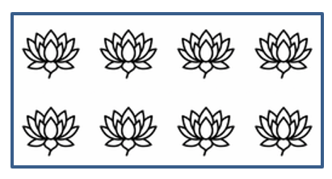

## **Giới thiệu**

Trong PowerPoint, bạn có thể thêm các hình dạng vào các slide. Vì các hình dạng được tạo thành từ các đường, bạn có thể định dạng chúng bằng cách chỉnh sửa hoặc áp dụng hiệu ứng cho viền của chúng. Ngoài ra, bạn có thể định dạng các hình dạng bằng cách chỉ định các cài đặt kiểm soát cách phần bên trong của chúng được tô màu.


Aspose.Slides for Node.js via Java cung cấp các lớp và phương thức cho phép bạn định dạng các hình dạng bằng các tùy chọn giống như trong PowerPoint.

## **Định dạng Đường**

Sử dụng Aspose.Slides, bạn có thể chỉ định kiểu đường tùy chỉnh cho một hình dạng. Các bước sau mô tả quy trình:

1. Tạo một thể hiện của lớp [Presentation](https://reference.aspose.com/slides/nodejs-java/aspose.slides/presentation/).
1. Lấy một tham chiếu tới một slide theo chỉ mục của nó.
1. Thêm một [AutoShape](https://reference.aspose.com/slides/nodejs-java/aspose.slides/autoshape/) vào slide.
1. Đặt [line style](https://reference.aspose.com/slides/nodejs-java/aspose.slides/linestyle/) cho hình dạng.
1. Đặt độ rộng đường.
1. Đặt [dash style](https://reference.aspose.com/slides/nodejs-java/aspose.slides/linedashstyle/) cho đường.
1. Đặt màu đường cho hình dạng.
1. Lưu bản trình bày đã chỉnh sửa dưới dạng tệp PPTX.

Mã sau đây minh họa cách định dạng một `AutoShape` hình chữ nhật:

```js
var aspose = aspose || {};
aspose.slides = require("aspose.slides.via.java");
const java = require("java");

// Tạo thể hiện lớp Presentation đại diện cho tệp trình chiếu.
let presentation = new aspose.slides.Presentation();
try {
    // Lấy slide đầu tiên.
    let slide = presentation.getSlides().get_Item(0);

    // Thêm một auto shape kiểu Rectangle.
    let shape = slide.getShapes().addAutoShape(aspose.slides.ShapeType.Rectangle, 50, 150, 150, 75);

    // Xóa phần tô màu khỏi hình dạng rectangle.
    shape.getFillFormat().setFillType(java.newByte(aspose.slides.FillType.NoFill));

    // Áp dụng định dạng cho các đường của rectangle.
    shape.getLineFormat().setStyle(java.newByte(aspose.slides.LineStyle.ThickThin));
    shape.getLineFormat().setWidth(7);
    shape.getLineFormat().setDashStyle(java.newByte(aspose.slides.LineDashStyle.Dash));

    // Đặt màu cho đường của rectangle.
    shape.getLineFormat().getFillFormat().setFillType(java.newByte(aspose.slides.FillType.Solid));
    shape.getLineFormat().getFillFormat().getSolidFillColor().setColor(java.getStaticFieldValue("java.awt.Color", "BLUE"));

    // Lưu tệp PPTX vào đĩa.
    presentation.save("formatted_lines.pptx", aspose.slides.SaveFormat.Pptx);
} finally {
    presentation.dispose();
}
```

Kết quả:


## **Áp dụng hiệu ứng Sketch cho Đường viền Hình dạng**

Hiệu ứng sketch làm cho đường viền của hình dạng trông như được vẽ tay. Sử dụng [Shape.getLineFormat](https://reference.aspose.com/slides/nodejs-java/aspose.slides/shape/) để truy cập các cài đặt đường, [LineFormat.getSketchFormat](https://reference.aspose.com/slides/nodejs-java/aspose.slides/lineformat/) để truy cập các cài đặt sketch, và [SketchFormat.setSketchType](https://reference.aspose.com/slides/nodejs-java/aspose.slides/sketchformat/) để chọn một giá trị từ liệt kê [LineSketchType](https://reference.aspose.com/slides/nodejs-java/aspose.slides/linesketchtype/).

Mã JavaScript sau đây cho thấy cách áp dụng hiệu ứng [LineSketchType.Curved](https://reference.aspose.com/slides/nodejs-java/aspose.slides/linesketchtype/) , đọc giá trị được chỉ định rõ ràng, và loại bỏ hiệu ứng bằng [LineSketchType.None](https://reference.aspose.com/slides/nodejs-java/aspose.slides/linesketchtype/):

```js
var aspose = aspose || {};
aspose.slides = require("aspose.slides.via.java");

let presentation = new aspose.slides.Presentation();
try {
    let slide = presentation.getSlides().get_Item(0);
    let shape = slide.getShapes().addAutoShape(aspose.slides.ShapeType.Rectangle, 50, 50, 200, 100);

    // Truy cập định dạng đường của hình dạng và định dạng sketch của nó.
    let sketchFormat = shape.getLineFormat().getSketchFormat();

    // Áp dụng hiệu ứng sketch.
    sketchFormat.setSketchType(aspose.slides.LineSketchType.Curved);

    // Đọc hiệu ứng sketch được gán trực tiếp cho hình dạng.
    let explicitSketchType = sketchFormat.getSketchType();
    console.log("Explicit sketch type: " + explicitSketchType);

    // Xóa bỏ hiệu ứng sketch.
    sketchFormat.setSketchType(aspose.slides.LineSketchType.None);
} finally {
    presentation.dispose();
}
```

Giá trị trả về bởi [SketchFormat.getSketchType](https://reference.aspose.com/slides/nodejs-java/aspose.slides/sketchformat/) đại diện cho cài đặt được gán trực tiếp cho hình dạng. Nếu định dạng đường có thể được kế thừa từ chủ đề, slide mẫu hoặc slide bố cục, sử dụng [LineFormat.getEffective](https://reference.aspose.com/slides/nodejs-java/aspose.slides/lineformat/), gọi `getSketchFormat` trên đối tượng trả về, và sau đó gọi phương thức `getSketchType` của nó. Giá trị effective phản ánh định dạng thực tế được áp dụng sau khi kế thừa được giải quyết:

```js
var aspose = aspose || {};
aspose.slides = require("aspose.slides.via.java");

let presentation = new aspose.slides.Presentation("presentation.pptx");
try {
    let shape = presentation.getSlides().get_Item(0).getShapes().get_Item(0);
    let lineFormat = shape.getLineFormat();

    let explicitSketchType = lineFormat.getSketchFormat().getSketchType();
    let effectiveLineFormat = lineFormat.getEffective();
    let effectiveSketchType = effectiveLineFormat.getSketchFormat().getSketchType();

    console.log("Explicit sketch type: " + explicitSketchType);
    console.log("Effective sketch type: " + effectiveSketchType);
} finally {
    presentation.dispose();
}
```

## **Định dạng Kiểu Nối**

Dưới đây là ba tùy chọn kiểu nối:

* Tròn
* Miter
* Vát

Mặc định, khi PowerPoint nối hai đường ở một góc (chẳng hạn ở góc của hình dạng), nó sử dụng cài đặt **Round**. Tuy nhiên, nếu bạn vẽ một hình dạng có các góc sắc, bạn có thể thích tùy chọn **Miter**.


Mã JavaScript sau đây minh họa cách ba hình chữ nhật (như trong hình trên) được tạo bằng các cài đặt kiểu nối Miter, Bevel và Round:

```js
var aspose = aspose || {};
aspose.slides = require("aspose.slides.via.java");
const java = require("java");

// Tạo thể hiện lớp Presentation đại diện cho tệp trình chiếu.
let presentation = new aspose.slides.Presentation();
try {
    // Lấy slide đầu tiên.
    let slide = presentation.getSlides().get_Item(0);

    // Thêm ba auto shape kiểu Rectangle.
    let shape1 = slide.getShapes().addAutoShape(aspose.slides.ShapeType.Rectangle, 20, 20, 150, 75);
    let shape2 = slide.getShapes().addAutoShape(aspose.slides.ShapeType.Rectangle, 210, 20, 150, 75);
    let shape3 = slide.getShapes().addAutoShape(aspose.slides.ShapeType.Rectangle, 20, 135, 150, 75);

    // Đặt màu nền cho mỗi hình chữ nhật.
    shape1.getFillFormat().setFillType(java.newByte(aspose.slides.FillType.Solid));
    shape1.getFillFormat().getSolidFillColor().setColor(java.getStaticFieldValue("java.awt.Color", "BLACK"));
    shape2.getFillFormat().setFillType(java.newByte(aspose.slides.FillType.Solid));
    shape2.getFillFormat().getSolidFillColor().setColor(java.getStaticFieldValue("java.awt.Color", "BLACK"));
    shape3.getFillFormat().setFillType(java.newByte(aspose.slides.FillType.Solid));
    shape3.getFillFormat().getSolidFillColor().setColor(java.getStaticFieldValue("java.awt.Color", "BLACK"));

    // Đặt độ rộng đường.
    shape1.getLineFormat().setWidth(15);
    shape2.getLineFormat().setWidth(15);
    shape3.getLineFormat().setWidth(15);

    // Đặt màu cho đường của mỗi hình chữ nhật.
    shape1.getLineFormat().getFillFormat().setFillType(java.newByte(aspose.slides.FillType.Solid));
    shape1.getLineFormat().getFillFormat().getSolidFillColor().setColor(java.getStaticFieldValue("java.awt.Color", "BLUE"));
    shape2.getLineFormat().getFillFormat().setFillType(java.newByte(aspose.slides.FillType.Solid));
    shape2.getLineFormat().getFillFormat().getSolidFillColor().setColor(java.getStaticFieldValue("java.awt.Color", "BLUE"));
    shape3.getLineFormat().getFillFormat().setFillType(java.newByte(aspose.slides.FillType.Solid));
    shape3.getLineFormat().getFillFormat().getSolidFillColor().setColor(java.getStaticFieldValue("java.awt.Color", "BLUE"));

    // Đặt kiểu nối.
    shape1.getLineFormat().setJoinStyle(java.newByte(aspose.slides.LineJoinStyle.Miter));
    shape2.getLineFormat().setJoinStyle(java.newByte(aspose.slides.LineJoinStyle.Bevel));
    shape3.getLineFormat().setJoinStyle(java.newByte(aspose.slides.LineJoinStyle.Round));

    // Thêm văn bản vào mỗi hình chữ nhật.
    shape1.getTextFrame().setText("Miter Join Style");
    shape2.getTextFrame().setText("Bevel Join Style");
    shape3.getTextFrame().setText("Round Join Style");

    // Lưu tệp PPTX vào đĩa.
    presentation.save("join_styles.pptx", aspose.slides.SaveFormat.Pptx);
} finally {
    presentation.dispose();
}
```

## **Đổ màu Gradient**

Trong PowerPoint, Gradient Fill là một tùy chọn định dạng cho phép bạn áp dụng một sự pha trộn liên tục của các màu vào một hình dạng. Ví dụ, bạn có thể áp dụng hai hoặc nhiều màu sao cho một màu dần dần hòa vào màu khác.

Dưới đây là cách áp dụng Gradient Fill cho một hình dạng bằng Aspose.Slides:

1. Tạo một thể hiện của lớp [Presentation](https://reference.aspose.com/slides/nodejs-java/aspose.slides/presentation/).
1. Lấy một tham chiếu tới một slide theo chỉ mục của nó.
1. Thêm một [AutoShape](https://reference.aspose.com/slides/nodejs-java/aspose.slides/autoshape/) vào slide.
1. Đặt [FillType](https://reference.aspose.com/slides/nodejs-java/aspose.slides/filltype/) của hình dạng thành `Gradient`.
1. Thêm hai màu ưa thích của bạn với vị trí xác định bằng các phương thức `add` của bộ sưu tập gradient stop được cung cấp bởi lớp [GradientFormat](https://reference.aspose.com/slides/nodejs-java/aspose.slides/gradientformat/).
1. Lưu bản trình bày đã chỉnh sửa dưới dạng tệp PPTX.

Mã JavaScript sau đây minh họa cách áp dụng hiệu ứng Gradient Fill cho một hình ellipse:

```js
var aspose = aspose || {};
aspose.slides = require("aspose.slides.via.java");
const java = require("java");

// Tạo thể hiện lớp Presentation đại diện cho tệp trình chiếu.
let presentation = new aspose.slides.Presentation();
try {
    // Lấy slide đầu tiên.
    let slide = presentation.getSlides().get_Item(0);

    // Thêm một auto shape kiểu Ellipse.
    let shape = slide.getShapes().addAutoShape(aspose.slides.ShapeType.Ellipse, 50, 50, 150, 75);

    // Áp dụng định dạng gradient cho ellipse.
    shape.getFillFormat().setFillType(java.newByte(aspose.slides.FillType.Gradient));
    shape.getFillFormat().getGradientFormat().setGradientShape(java.newByte(aspose.slides.GradientShape.Linear));

    // Đặt hướng của gradient.
    shape.getFillFormat().getGradientFormat().setGradientDirection(aspose.slides.GradientDirection.FromCorner2);

    // Thêm hai điểm dừng gradient.
    shape.getFillFormat().getGradientFormat().getGradientStops().addPresetColor(1.0, aspose.slides.PresetColor.Purple);
    shape.getFillFormat().getGradientFormat().getGradientStops().addPresetColor(0, aspose.slides.PresetColor.Red);

    // Lưu tệp PPTX vào đĩa.
    presentation.save("gradient_fill.pptx", aspose.slides.SaveFormat.Pptx);
} finally {
    presentation.dispose();
}
```

Kết quả:


Nếu Gradient trông khác trong hình ảnh xuất khẩu so với trong PowerPoint, xem [Choose a Gradient Rendering Style](/slides/vi/nodejs-java/convert-powerpoint-to-png/#choose-a-gradient-rendering-style). Bạn có thể chọn kiểu kết xuất mà không thay đổi Gradient Fill được lưu trong bản trình bày.

## **Đổ mẫu**

Trong PowerPoint, Pattern Fill là một tùy chọn định dạng cho phép bạn áp dụng một thiết kế hai màu—như chấm, sọc, chéo hoặc ô vuông—cho một hình dạng. Bạn có thể chọn màu tùy chỉnh cho nền trước và nền sau của mẫu.

Aspose.Slides cung cấp hơn 45 kiểu mẫu được định nghĩa sẵn mà bạn có thể áp dụng cho các hình dạng để tăng tính thẩm mỹ cho bài thuyết trình. Ngay cả sau khi chọn một mẫu đã định nghĩa sẵn, bạn vẫn có thể chỉ định chính xác các màu mà nó sẽ sử dụng.

Dưới đây là cách áp dụng Pattern Fill cho một hình dạng bằng Aspose.Slides:

1. Tạo một thể hiện của lớp [Presentation](https://reference.aspose.com/slides/nodejs-java/aspose.slides/presentation/).
1. Lấy một tham chiếu tới một slide theo chỉ mục của nó.
1. Thêm một [AutoShape](https://reference.aspose.com/slides/nodejs-java/aspose.slides/autoshape/) vào slide.
1. Đặt [FillType](https://reference.aspose.com/slides/nodejs-java/aspose.slides/filltype/) của hình dạng thành `Pattern`.
1. Chọn một kiểu mẫu từ các tùy chọn đã định nghĩa sẵn.
1. Đặt [Background Color](https://reference.aspose.com/slides/nodejs-java/aspose.slides/patternformat/#getBackColor--) cho mẫu.
1. Đặt [Foreground Color](https://reference.aspose.com/slides/nodejs-java/aspose.slides/patternformat/#getForeColor--) cho mẫu.
1. Lưu bản trình bày đã chỉnh sửa dưới dạng tệp PPTX.

Mã JavaScript sau đây minh họa cách áp dụng Pattern Fill cho một hình chữ nhật:

```js
var aspose = aspose || {};
aspose.slides = require("aspose.slides.via.java");
const java = require("java");

// Tạo thể hiện lớp Presentation đại diện cho tệp trình chiếu.
let presentation = new aspose.slides.Presentation();
try {
    // Lấy slide đầu tiên.
    let slide = presentation.getSlides().get_Item(0);

    // Thêm một auto shape kiểu Rectangle.
    let shape = slide.getShapes().addAutoShape(aspose.slides.ShapeType.Rectangle, 50, 50, 150, 75);

    // Đặt kiểu tô là Pattern.
    shape.getFillFormat().setFillType(java.newByte(aspose.slides.FillType.Pattern));

    // Đặt kiểu mẫu.
    shape.getFillFormat().getPatternFormat().setPatternStyle(java.newByte(aspose.slides.PatternStyle.Trellis));

    // Đặt màu nền và màu nền trước của mẫu.
    shape.getFillFormat().getPatternFormat().getBackColor().setColor(java.getStaticFieldValue("java.awt.Color", "LIGHT_GRAY"));
    shape.getFillFormat().getPatternFormat().getForeColor().setColor(java.getStaticFieldValue("java.awt.Color", "YELLOW"));

    // Lưu tệp PPTX vào đĩa.
    presentation.save("pattern_fill.pptx", aspose.slides.SaveFormat.Pptx);
} finally {
    presentation.dispose();
}
```

Kết quả:


## **Đổ Hình ảnh**

Trong PowerPoint, Picture Fill là một tùy chọn định dạng cho phép bạn chèn một hình ảnh bên trong một hình dạng—tức là sử dụng hình ảnh làm nền cho hình dạng.

Dưới đây là cách sử dụng Aspose.Slides để áp dụng Picture Fill cho một hình dạng:

1. Tạo một thể hiện của lớp [Presentation](https://reference.aspose.com/slides/nodejs-java/aspose.slides/presentation/).
1. Lấy một tham chiếu tới một slide theo chỉ mục của nó.
1. Thêm một [AutoShape](https://reference.aspose.com/slides/nodejs-java/aspose.slides/autoshape/) vào slide.
1. Đặt [FillType](https://reference.aspose.com/slides/nodejs-java/aspose.slides/filltype/) của hình dạng thành `Picture`.
1. Đặt chế độ Picture Fill là `Tile` (hoặc chế độ ưa thích khác).
1. Tạo một đối tượng [PPImage](https://reference.aspose.com/slides/nodejs-java/aspose.slides/ppimage/) từ hình ảnh bạn muốn sử dụng.
1. Truyền hình ảnh vào phương thức `ISlidesPicture.setImage`.
1. Lưu bản trình bày đã chỉnh sửa dưới dạng tệp PPTX.

Giả sử chúng ta có tệp "lotus.png" với hình ảnh sau:


Mã JavaScript sau đây minh họa cách đổ một hình dạng bằng hình ảnh:

```js
var aspose = aspose || {};
aspose.slides = require("aspose.slides.via.java");
const java = require("java");

// Tạo thể hiện lớp Presentation đại diện cho tệp trình chiếu.
let presentation = new aspose.slides.Presentation();
try {
    // Lấy slide đầu tiên.
    let slide = presentation.getSlides().get_Item(0);

    // Thêm một auto shape kiểu Rectangle.
    let shape = slide.getShapes().addAutoShape(aspose.slides.ShapeType.Rectangle, 50, 50, 255, 130);
    
    // Đặt kiểu tô là Picture.
    shape.getFillFormat().setFillType(java.newByte(aspose.slides.FillType.Picture));

    // Đặt chế độ đổ hình ảnh.
    shape.getFillFormat().getPictureFillFormat().setPictureFillMode(aspose.slides.PictureFillMode.Tile);

    // Tải hình ảnh và thêm nó vào tài nguyên của bản trình chiếu.
    let image = aspose.slides.Images.fromFile("lotus.png");
    let picture = presentation.getImages().addImage(image);
    image.dispose();

    // Đặt hình ảnh.
    shape.getFillFormat().getPictureFillFormat().getPicture().setImage(picture);

    // Lưu tệp PPTX vào đĩa.
    presentation.save("picture_fill.pptx", aspose.slides.SaveFormat.Pptx);
} finally {
    presentation.dispose();
}
```

Kết quả:



### **Đặt Hình ảnh Lát Như Kết Cấu**

Nếu bạn muốn đặt một hình ảnh lát làm kết cấu và tùy chỉnh hành vi lát, bạn có thể sử dụng các phương thức sau của lớp [PictureFillFormat](https://reference.aspose.com/slides/nodejs-java/aspose.slides/picturefillformat/):

- [setPictureFillMode](https://reference.aspose.com/slides/nodejs-java/aspose.slides/picturefillformat/#setPictureFillMode): Đặt chế độ đổ hình ảnh — either `Tile` hoặc `Stretch`.
- [setTileAlignment](https://reference.aspose.com/slides/nodejs-java/aspose.slides/picturefillformat/#setTileAlignment): Xác định căn chỉnh của các tile trong hình dạng.
- [setTileFlip](https://reference.aspose.com/slides/nodejs-java/aspose.slides/picturefillformat/#setTileFlip): Kiểm soát việc lật tile theo chiều ngang, chiều dọc hoặc cả hai.
- [setTileOffsetX](https://reference.aspose.com/slides/nodejs-java/aspose.slides/picturefillformat/#setTileOffsetX): Đặt độ lệch ngang của tile (theo điểm) so với gốc của hình dạng.
- [setTileOffsetY](https://reference.aspose.com/slides/nodejs-java/aspose.slides/picturefillformat/#setTileOffsetY): Đặt độ lệch dọc của tile (theo điểm) so với gốc của hình dạng.
- [setTileScaleX](https://reference.aspose.com/slides/nodejs-java/aspose.slides/picturefillformat/#setTileScaleX): Xác định tỷ lệ ngang của tile dưới dạng phần trăm.
- [setTileScaleY](https://reference.aspose.com/slides/nodejs-java/aspose.slides/picturefillformat/#setTileScaleY): Xác định tỷ lệ dọc của tile dưới dạng phần trăm.

Mã mẫu sau đây cho thấy cách thêm một hình chữ nhật với Picture Fill dạng lát và cấu hình các tùy chọn tile:

```js
var aspose = aspose || {};
aspose.slides = require("aspose.slides.via.java");
const java = require("java");

// Tạo thể hiện lớp Presentation đại diện cho tệp trình chiếu.
let presentation = new aspose.slides.Presentation();
try {
    // Lấy slide đầu tiên.
    let firstSlide = presentation.getSlides().get_Item(0);

    // Thêm một auto shape hình chữ nhật.
    let shape = firstSlide.getShapes().addAutoShape(aspose.slides.ShapeType.Rectangle, 50, 50, 190, 95);

    // Đặt kiểu tô của hình dạng thành Picture.
    shape.getFillFormat().setFillType(java.newByte(aspose.slides.FillType.Picture));

    // Tải hình ảnh và thêm nó vào tài nguyên của bản trình chiếu.
    let sourceImage = aspose.slides.Images.fromFile("lotus.png");
    let presentationImage = presentation.getImages().addImage(sourceImage);
    sourceImage.dispose();

    // Gán hình ảnh cho hình dạng.
    let pictureFillFormat = shape.getFillFormat().getPictureFillFormat();
    pictureFillFormat.getPicture().setImage(presentationImage);

    // Cấu hình chế độ đổ hình ảnh và các thuộc tính lát.
    pictureFillFormat.setPictureFillMode(aspose.slides.PictureFillMode.Tile);
    pictureFillFormat.setTileOffsetX(-32);
    pictureFillFormat.setTileOffsetY(-32);
    pictureFillFormat.setTileScaleX(50);
    pictureFillFormat.setTileScaleY(50);
    pictureFillFormat.setTileAlignment(java.newByte(aspose.slides.RectangleAlignment.BottomRight));
    pictureFillFormat.setTileFlip(aspose.slides.TileFlip.FlipBoth);

    // Lưu tệp PPTX vào đĩa.
    presentation.save("tile.pptx", aspose.slides.SaveFormat.Pptx);
} finally {
    presentation.dispose();
}
```

Kết quả:


## **Đổ Màu Đơn**

Trong PowerPoint, Solid Color Fill là một tùy chọn định dạng để tô một hình dạng bằng một màu duy nhất, đồng nhất. Màu nền đơn giản này được áp dụng mà không có gradient, kết cấu hay mẫu nào.

Để áp dụng Solid Color Fill cho một hình dạng bằng Aspose.Slides, thực hiện các bước sau:

1. Tạo một thể hiện của lớp [Presentation](https://reference.aspose.com/slides/nodejs-java/aspose.slides/presentation/).
1. Lấy một tham chiếu tới một slide theo chỉ mục của nó.
1. Thêm một [AutoShape](https://reference.aspose.com/slides/nodejs-java/aspose.slides/autoshape/) vào slide.
1. Đặt [FillType](https://reference.aspose.com/slides/nodejs-java/aspose.slides/filltype/) của hình dạng thành `Solid`.
1. Gán màu tô ưa thích của bạn cho hình dạng.
1. Lưu bản trình bày đã chỉnh sửa dưới dạng tệp PPTX.

Mã JavaScript sau đây minh họa cách áp dụng Solid Color Fill cho một hình chữ nhật trong slide PowerPoint:

```js
var aspose = aspose || {};
aspose.slides = require("aspose.slides.via.java");
const java = require("java");

// Tạo thể hiện lớp Presentation đại diện cho tệp trình chiếu.
let presentation = new aspose.slides.Presentation();
try {
    // Lấy slide đầu tiên.
    let slide = presentation.getSlides().get_Item(0);

    // Thêm một auto shape kiểu Rectangle.
    let shape = slide.getShapes().addAutoShape(aspose.slides.ShapeType.Rectangle, 50, 50, 150, 75);

    // Đặt kiểu tô thành Solid.
    shape.getFillFormat().setFillType(java.newByte(aspose.slides.FillType.Solid));

    // Đặt màu tô.
    shape.getFillFormat().getSolidFillColor().setColor(java.getStaticFieldValue("java.awt.Color", "YELLOW"));

    // Lưu tệp PPTX vào đĩa.
    presentation.save("solid_color_fill.pptx", aspose.slides.SaveFormat.Pptx);
} finally {
    presentation.dispose();
}
```

Kết quả:


## **Đặt Độ Trong Suốt**

Trong PowerPoint, khi bạn áp dụng màu đơn, gradient, hình ảnh hoặc kết cấu cho các hình dạng, bạn cũng có thể đặt mức độ trong suốt để kiểm soát độ mờ của lớp tô. Giá trị trong suốt cao hơn làm cho hình dạng trong suốt hơn, cho phép nền hoặc các đối tượng phía dưới hiện ra một phần.

Aspose.Slides cho phép bạn đặt mức độ trong suốt bằng cách điều chỉnh giá trị alpha trong màu được dùng để tô. Cách thực hiện như sau:

1. Tạo một thể hiện của lớp [Presentation](https://reference.aspose.com/slides/nodejs-java/aspose.slides/presentation/).
1. Lấy một tham chiếu tới một slide theo chỉ mục của nó.
1. Thêm một [AutoShape](https://reference.aspose.com/slides/nodejs-java/aspose.slides/autoshape/) vào slide.
1. Đặt [FillType](https://reference.aspose.com/slides/nodejs-java/aspose.slides/filltype/) thành `Solid`.
1. Sử dụng `Color` để định nghĩa một màu có độ trong suốt (thành phần `alpha` kiểm soát độ trong suốt).
1. Lưu bản trình bày.

Mã JavaScript sau đây minh họa cách áp dụng màu tô trong suốt cho một hình chữ nhật:

```js
var aspose = aspose || {};
aspose.slides = require("aspose.slides.via.java");
const java = require("java");

// Tạo thể hiện lớp Presentation đại diện cho tệp trình chiếu.
let presentation = new aspose.slides.Presentation();
try {
    // Lấy slide đầu tiên.
    let slide = presentation.getSlides().get_Item(0);

    // Thêm một auto shape hình chữ nhật đặc.
    let solidShape = slide.getShapes().addAutoShape(aspose.slides.ShapeType.Rectangle, 50, 50, 150, 75);

    // Thêm một auto shape hình chữ nhật trong suốt lên trên hình dạng đặc.
    let transparentShape = slide.getShapes().addAutoShape(aspose.slides.ShapeType.Rectangle, 80, 80, 150, 75);
    transparentShape.getFillFormat().setFillType(java.newByte(aspose.slides.FillType.Solid));
    transparentShape.getFillFormat().getSolidFillColor().setColor(java.newInstanceSync("java.awt.Color", 255, 255, 0, 204));

    // Lưu tệp PPTX vào đĩa.
    presentation.save("shape_transparency.pptx", aspose.slides.SaveFormat.Pptx);
} finally {
    presentation.dispose();
}
```

Kết quả:


## **Xoay Hình dạng**

Aspose.Slides cho phép bạn xoay các hình dạng trong bản trình bày PowerPoint. Điều này hữu ích khi đặt các yếu tố hình ảnh với yêu cầu căn chỉnh hoặc thiết kế cụ thể.

Để xoay một hình dạng trên slide, thực hiện các bước sau:

1. Tạo một thể hiện của lớp [Presentation](https://reference.aspose.com/slides/nodejs-java/aspose.slides/presentation/).
1. Lấy một tham chiếu tới một slide theo chỉ mục của nó.
1. Thêm một [AutoShape](https://reference.aspose.com/slides/nodejs-java/aspose.slides/autoshape/) vào slide.
1. Đặt thuộc tính xoay của hình dạng thành góc mong muốn.
1. Lưu bản trình bày.

Mã JavaScript sau đây minh họa cách xoay một hình dạng 5 độ:

```js
var aspose = aspose || {};
aspose.slides = require("aspose.slides.via.java");

// Tạo thể hiện lớp Presentation đại diện cho tệp trình chiếu.
let presentation = new aspose.slides.Presentation();
try {
    // Lấy slide đầu tiên.
    let slide = presentation.getSlides().get_Item(0);

    // Thêm một auto shape kiểu Rectangle.
    let shape = slide.getShapes().addAutoShape(aspose.slides.ShapeType.Rectangle, 50, 50, 150, 75);

    // Xoay hình dạng 5 độ.
    shape.setRotation(5);

    // Lưu tệp PPTX vào đĩa.
    presentation.save("shape_rotation.pptx", aspose.slides.SaveFormat.Pptx);
} finally {
    presentation.dispose();
}
```

Kết quả:


## **Thêm Hiệu Ứng Bevel 3D**

Aspose.Slides cho phép bạn áp dụng hiệu ứng bevel 3D cho các hình dạng bằng cách cấu hình các thuộc tính [ThreeDFormat](https://reference.aspose.com/slides/nodejs-java/aspose.slides/threedformat/) của chúng.

Để thêm hiệu ứng bevel 3D cho một hình dạng, thực hiện các bước sau:

1. Tạo một thể hiện của lớp [Presentation](https://reference.aspose.com/slides/nodejs-java/aspose.slides/presentation/).
1. Lấy một tham chiếu tới một slide theo chỉ mục của nó.
1. Thêm một [AutoShape](https://reference.aspose.com/slides/nodejs-java/aspose.slides/autoshape/) vào slide.
1. Cấu hình [ThreeDFormat](https://reference.aspose.com/slides/nodejs-java/aspose.slides/threedformat/) của hình dạng để xác định các cài đặt bevel.
1. Lưu bản trình bày.

Mã JavaScript sau đây cho thấy cách áp dụng hiệu ứng bevel 3D cho một hình dạng:

```js
var aspose = aspose || {};
aspose.slides = require("aspose.slides.via.java");
const java = require("java");

// Tạo một thể hiện của lớp Presentation.
let presentation = new aspose.slides.Presentation();
try {
    let slide = presentation.getSlides().get_Item(0);

    // Thêm một hình dạng vào slide.
    let shape = slide.getShapes().addAutoShape(aspose.slides.ShapeType.Ellipse, 50, 50, 100, 100);
    shape.getFillFormat().setFillType(java.newByte(aspose.slides.FillType.Solid));
    shape.getFillFormat().getSolidFillColor().setColor(java.getStaticFieldValue("java.awt.Color", "GREEN"));
    shape.getLineFormat().getFillFormat().setFillType(java.newByte(aspose.slides.FillType.Solid));
    shape.getLineFormat().getFillFormat().getSolidFillColor().setColor(java.getStaticFieldValue("java.awt.Color", "ORANGE"));
    shape.getLineFormat().setWidth(2.0);

    // Đặt các thuộc tính ThreeDFormat của hình dạng.
    shape.getThreeDFormat().setDepth(4);
    shape.getThreeDFormat().getBevelTop().setBevelType(aspose.slides.BevelPresetType.Circle);
    shape.getThreeDFormat().getBevelTop().setHeight(6);
    shape.getThreeDFormat().getBevelTop().setWidth(6);
    shape.getThreeDFormat().getCamera().setCameraType(aspose.slides.CameraPresetType.OrthographicFront);
    shape.getThreeDFormat().getLightRig().setLightType(aspose.slides.LightRigPresetType.ThreePt);
    shape.getThreeDFormat().getLightRig().setDirection(aspose.slides.LightingDirection.Top);

    // Lưu bản trình chiếu dưới dạng tệp PPTX.
    presentation.save("3D_bevel_effect.pptx", aspose.slides.SaveFormat.Pptx);
} finally {
    presentation.dispose();
}
```

Kết quả:


## **Thêm Hiệu Ứng Xoay 3D**

Aspose.Slides cho phép bạn áp dụng hiệu ứng xoay 3D cho các hình dạng bằng cách cấu hình các thuộc tính [ThreeDFormat](https://reference.aspose.com/slides/nodejs-java/aspose.slides/threedformat/) của chúng.

Để áp dụng xoay 3D cho một hình dạng:

1. Tạo một thể hiện của lớp [Presentation](https://reference.aspose.com/slides/nodejs-java/aspose.slides/presentation/).
1. Lấy một tham chiếu tới một slide theo chỉ mục của nó.
1. Thêm một [AutoShape](https://reference.aspose.com/slides/nodejs-java/aspose.slides/autoshape/) vào slide.
1. Sử dụng [setCameraType](https://reference.aspose.com/slides/nodejs-java/aspose.slides/camera/#setCameraType) và [setLightType](https://reference.aspose.com/slides/nodejs-java/aspose.slides/lightrig/#setLightType) để định nghĩa xoay 3D.
1. Lưu bản trình bày.

Mã JavaScript sau đây minh họa cách áp dụng hiệu ứng xoay 3D cho một hình dạng:

```js
var aspose = aspose || {};
aspose.slides = require("aspose.slides.via.java");

// Tạo một thể hiện của lớp Presentation.
let presentation = new aspose.slides.Presentation();
try {
    let slide = presentation.getSlides().get_Item(0);

    let autoShape = slide.getShapes().addAutoShape(aspose.slides.ShapeType.Rectangle, 50, 50, 150, 75);
    autoShape.getTextFrame().setText("Hello, Aspose!");

    autoShape.getThreeDFormat().setDepth(6);
    autoShape.getThreeDFormat().getCamera().setRotation(40, 35, 20);
    autoShape.getThreeDFormat().getCamera().setCameraType(aspose.slides.CameraPresetType.IsometricLeftUp);
    autoShape.getThreeDFormat().getLightRig().setLightType(aspose.slides.LightRigPresetType.Balanced);

    // Lưu bản trình chiếu dưới dạng tệp PPTX.
    presentation.save("3D_rotation_effect.pptx", aspose.slides.SaveFormat.Pptx);
} finally {
    presentation.dispose();
}
```

Kết quả:


## **Kiểm soát Kết Xuất Đen-Trắng cho Hình dạng**

Phương thức [Shape.setBlackWhiteMode](https://reference.aspose.com/slides/nodejs-java/aspose.slides/shape/#setBlackWhiteMode) xác định cách một hình dạng cá nhân được kết xuất khi bản trình bày được xem hoặc xử lý ở chế độ đen-trắng. Nó không kích hoạt hiển thị đen-trắng tự động và không thay đổi fill, line hoặc các định dạng khác trong chế độ màu bình thường.

Sử dụng một giá trị từ liệt kê [BlackWhiteMode](https://reference.aspose.com/slides/nodejs-java/aspose.slides/blackwhitemode/) để chọn hành vi mong muốn. Ví dụ, `Automatic` để ứng dụng kết xuất tự động, `Gray` và `LightGray` sử dụng màu xám, `BlackWhite` chỉ dùng đen và trắng, `Black` và `White` buộc một màu duy nhất, `Color` giữ nguyên màu bình thường, và `Hidden` ẩn hình dạng trong chế độ đen-trắng. `NotDefined` nghĩa là không có chế độ cấp độ hình dạng nào được gán.

Mã JavaScript sau tạo một hình dạng màu và làm cho nó hiển thị màu xám trong chế độ hiển thị đen-trắng:

```js
var aspose = aspose || {};
aspose.slides = require("aspose.slides.via.java");
const java = require("java");

let presentation = new aspose.slides.Presentation();
try {
    let slide = presentation.getSlides().get_Item(0);

    let shape = slide.getShapes().addAutoShape(aspose.slides.ShapeType.Rectangle, 50, 50, 200, 100);
    shape.getFillFormat().setFillType(java.newByte(aspose.slides.FillType.Solid));
    shape.getFillFormat().getSolidFillColor().setColor(java.getStaticFieldValue("java.awt.Color", "ORANGE"));

    // Giữ màu nền cam trong chế độ màu, nhưng hiển thị hình dạng với màu xám trong chế độ đen-trắng.
    shape.setBlackWhiteMode(java.newByte(aspose.slides.BlackWhiteMode.Gray));

    presentation.save("shape_black_white_mode.pptx", aspose.slides.SaveFormat.Pptx);
} finally {
    presentation.dispose();
}
```

Trong chế độ màu bình thường, hình chữ nhật giữ nguyên màu nền cam. Trong quy trình làm việc hiển thị đen-trắng, nó sử dụng màu xám vì chế độ đã được đặt thành `Gray`. Điều này cho phép bạn giữ slide đầy màu khi định nghĩa cách hiển thị riêng cho việc in ấn, xem trước hoặc các quy trình làm việc khác tôn trọng cài đặt hiển thị đen-trắng của bản trình bày.

## **Đặt Lại Định Dạng**

Mã JavaScript sau cho thấy cách đặt lại định dạng của một slide và khôi phục vị trí, kích thước và định dạng của tất cả các hình dạng có placeholder trên [LayoutSlide](https://reference.aspose.com/slides/nodejs-java/aspose.slides/layoutslide/) về cài đặt mặc định của chúng:

```js
var aspose = aspose || {};
aspose.slides = require("aspose.slides.via.java");

let presentation = new aspose.slides.Presentation("sample.pptx");
try {
    for (let i = 0; i < presentation.getSlides().size(); i++) {
        let slide = presentation.getSlides().get_Item(i);
        // Đặt lại mỗi hình dạng trên slide có placeholder trên layout.
        slide.reset();
    }
    presentation.save("reset_formatting.pptx", aspose.slides.SaveFormat.Pptx);
} finally {
    presentation.dispose();
}
```

## **FAQ**

**Việc định dạng hình dạng có ảnh hưởng đến kích thước cuối cùng của tệp bản trình bày không?**

Chỉ ảnh hưởng rất nhỏ. Các hình ảnh và phương tiện được nhúng chiếm phần lớn không gian tệp, trong khi các tham số hình dạng như màu, hiệu ứng và gradient được lưu dưới dạng siêu dữ liệu và không tăng đáng kể kích thước.

**Làm sao tôi có thể phát hiện các hình dạng trên một slide có định dạng giống nhau để có thể nhóm chúng lại?**

So sánh các thuộc tính định dạng chính của mỗi hình dạng—các cài đặt fill, line và effect. Nếu tất cả các giá trị tương ứng khớp nhau, coi chúng là cùng một kiểu và nhóm logic các hình dạng đó, giúp việc quản lý kiểu sau này dễ dàng hơn.

**Tôi có thể lưu một tập hợp các kiểu hình dạng tùy chỉnh vào một tệp riêng để tái sử dụng trong các bản trình bày khác không?**

Có. Lưu các hình mẫu có kiểu mong muốn trong một slide mẫu hoặc tệp mẫu .POTX. Khi tạo bản trình bày mới, mở mẫu, sao chép các hình dạng đã định dạng bạn cần, và áp dụng lại định dạng của chúng ở nơi cần thiết.