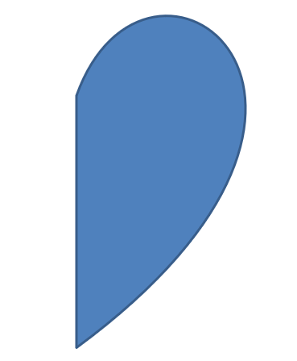
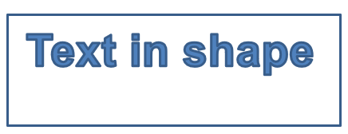

## **Tổng quan**

Bài viết này giải thích cách tùy chỉnh các hình dạng trong bài thuyết trình bằng Aspose.Slides bằng cách chỉnh sửa hình học của hình thông qua các điểm chỉnh sửa và đường dẫn hình học. Nó cho thấy cách làm việc với [GeometryPath](https://reference.aspose.com/slides/nodejs-java/aspose.slides/geometrypath/) để sửa đổi các hình hiện có, thực hiện các thao tác chỉnh sửa đường cơ bản, thêm hoặc xóa các điểm, và áp dụng hình học đã cập nhật trở lại cho một hình dạng.

Nó cũng trình bày cách tạo các hình dạng tùy chỉnh và hợp chất, xây dựng các hình dạng có các góc cong, xác định xem hình học của một hình dạng có đóng không, kiểm tra các phần tử hình dạng, và chuyển đổi các đường viền văn bản Java AWT thành các đường dẫn hình học.

## **Thay đổi một Hình Dạng bằng Điểm Chỉnh Sửa**

Trong PowerPoint, bạn có thể sử dụng **Điểm Chỉnh Sửa** để thay đổi một hình vuông:

* Di chuyển một góc vào trong hoặc ra ngoài.
* Điều chỉnh độ cong tại một điểm.
* Thêm các điểm mới.

Việc chỉnh sửa các điểm cho phép bạn thay đổi đường viền của một hình dạng hoặc sử dụng một hình dạng hiện có làm cơ sở cho một hình dạng mới.

## **Mẹo Chỉnh Sửa Hình Dạng**


Khi chỉnh sửa các hình dạng PowerPoint, hãy ghi nhớ các khái niệm sau:

* Một hình dạng (hoặc đường dẫn của nó) có thể là đóng hoặc mở.
* Đường dẫn của hình dạng bao gồm các điểm neo được nối bằng các đoạn.
* Một đoạn có thể thẳng hoặc cong. Các điểm neo và tay điều khiển xác định hình dạng của nó.
* Các điểm neo tồn tại dưới dạng điểm góc, điểm thẳng, hoặc điểm mượt:
  * Ở điểm góc, các đoạn liền kề có thể gặp nhau ở một góc.
  * Ở điểm mượt, hai tay điều khiển được căn chỉnh và cách đều điểm neo một khoảng bằng nhau.
  * Ở điểm thẳng, hai tay điều khiển cũng được căn chỉnh nhưng có thể có khoảng cách khác nhau so với điểm neo.
* Di chuyển các điểm neo hoặc điều chỉnh tay của chúng làm thay đổi đường viền của hình dạng.

Để chỉnh sửa các hình dạng PowerPoint thông qua điểm chỉnh sửa, **Aspose.Slides** cung cấp lớp [GeometryPath](https://reference.aspose.com/slides/nodejs-java/aspose.slides/geometrypath/).

* Một thực thể [GeometryPath](https://reference.aspose.com/slides/nodejs-java/aspose.slides/geometrypath/) đại diện cho đường dẫn hình học của đối tượng [GeometryShape](https://reference.aspose.com/slides/nodejs-java/aspose.slides/geometryshape/).
* Để lấy [GeometryPath](https://reference.aspose.com/slides/nodejs-java/aspose.slides/geometrypath/) từ thực thể [GeometryShape](https://reference.aspose.com/slides/nodejs-java/aspose.slides/geometryshape/), bạn có thể sử dụng phương thức [GeometryShape.getGeometryPaths](https://reference.aspose.com/slides/nodejs-java/aspose.slides/geometryshape/#getGeometryPaths).
* Để thiết lập [GeometryPath](https://reference.aspose.com/slides/nodejs-java/aspose.slides/geometrypath/) cho một hình dạng, bạn có thể dùng các phương thức: [GeometryShape.setGeometryPath](https://reference.aspose.com/slides/nodejs-java/aspose.slides/geometryshape/#setGeometryPath) cho các hình có một đường và [GeometryShape.setGeometryPaths](https://reference.aspose.com/slides/nodejs-java/aspose.slides/geometryshape/#setGeometryPaths) cho các hình có nhiều đường.
* Để thêm các đoạn, bạn có thể sử dụng các phương thức dưới [GeometryPath](https://reference.aspose.com/slides/nodejs-java/aspose.slides/geometrypath/).
* Bằng cách sử dụng các phương thức [GeometryPath.setStroke](https://reference.aspose.com/slides/nodejs-java/aspose.slides/geometrypath/#setStroke) và [GeometryPath.setFillMode](https://reference.aspose.com/slides/nodejs-java/aspose.slides/geometrypath/#setFillMode), bạn có thể đặt kiểu hiển thị cho một đường dẫn hình học.
* Bằng cách sử dụng phương thức [GeometryPath.getPathData](https://reference.aspose.com/slides/nodejs-java/aspose.slides/geometrypath/#getPathData), bạn có thể lấy đường dẫn hình học của một [GeometryShape](https://reference.aspose.com/slides/nodejs-java/aspose.slides/geometryshape/) dưới dạng một mảng các đoạn đường.
* Để truy cập các tùy chọn tùy chỉnh hình học bổ sung, bạn có thể đọc một [java.awt.Shape](https://docs.oracle.com/javase/8/docs/api/java/awt/Shape.html) thông qua [PathIterator](https://docs.oracle.com/javase/8/docs/api/java/awt/geom/PathIterator.html) và phát lại các đoạn trên một [GeometryPath](https://reference.aspose.com/slides/nodejs-java/aspose.slides/geometrypath/).

## **Các Thao Tác Chỉnh Sửa Cơ Bản**

Sử dụng các phương thức sau để chỉnh sửa một đường dẫn hình học. Các overload nhận chỉ số sẽ chèn một đoạn tại vị trí dựa trên chỉ số zero‑based trong mảng đoạn của đường dẫn.

| Thao tác | Phương thức |
| --- | --- |
| Thêm hoặc chèn một đường thẳng. | [GeometryPath.lineTo](https://reference.aspose.com/slides/nodejs-java/aspose.slides/geometrypath/#lineTo) |
| Thêm hoặc chèn một đường cong Bézier bậc ba với hai điểm điều khiển và một điểm cuối. | [GeometryPath.cubicBezierTo](https://reference.aspose.com/slides/nodejs-java/aspose.slides/geometrypath/#cubicBezierTo) |
| Thêm hoặc chèn một đường cong Bézier bậc hai với một điểm điều khiển và một điểm cuối. | [GeometryPath.quadraticBezierTo](https://reference.aspose.com/slides/nodejs-java/aspose.slides/geometrypath/#quadraticBezierTo) |
| Thêm một cung hình elip với các kích thước và góc đã chỉ định tính bằng độ. | [GeometryPath.arcTo](https://reference.aspose.com/slides/nodejs-java/aspose.slides/geometrypath/#arcTo) |
| Đóng hình hiện tại bằng cách nối điểm cuối của nó với điểm bắt đầu. | [GeometryPath.closeFigure](https://reference.aspose.com/slides/nodejs-java/aspose.slides/geometrypath/#closeFigure) |
| Đặt điểm bắt đầu của một hình. | [GeometryPath.moveTo](https://reference.aspose.com/slides/nodejs-java/aspose.slides/geometrypath/#moveTo) |
| Xóa một đoạn tại một chỉ số zero‑based. | [GeometryPath.removeAt](https://reference.aspose.com/slides/nodejs-java/aspose.slides/geometrypath/#removeAt) |

## **Thêm Các Điểm Tùy Chỉnh Vào Một Hình Dạng**

Ví dụ này chèn hai điểm vào một hình chữ nhật bằng cách sử dụng [GeometryPath.lineTo](https://reference.aspose.com/slides/nodejs-java/aspose.slides/geometrypath/#lineTo) và áp dụng đường dẫn đã chỉnh sửa với [GeometryShape.setGeometryPath](https://reference.aspose.com/slides/nodejs-java/aspose.slides/geometryshape/#setGeometryPath). Các tọa độ là cục bộ đối với hình: cả hai điểm mới đều nằm ở trung tâm, cách trái 100 điểm và cách trên 50 điểm. Các chỉ số đoạn 1 và 4 đặt chúng trên các cạnh trên và dưới, kéo các cạnh đó vào trong.

```javascript
const slides = require("aspose.slides.via.java");

const presentation = new slides.Presentation();
try {
    const slide = presentation.getSlides().get_Item(0);

    const shape = slide.getShapes().addAutoShape(slides.ShapeType.Rectangle, 100, 100, 200, 100);

    const geometryPath = shape.getGeometryPaths()[0];
    geometryPath.lineTo(100, 50, 1);
    geometryPath.lineTo(100, 50, 4);

    shape.setGeometryPath(geometryPath);
} finally {
    presentation.dispose();
}
```


## **Xóa Các Điểm Khỏi Một Hình Dạng**

Ví dụ này thay đổi đường viền hình trái tim bằng cách xóa đoạn tại chỉ số zero‑based 2 với [GeometryPath.removeAt](https://reference.aspose.com/slides/nodejs-java/aspose.slides/geometrypath/#removeAt). Áp dụng đường dẫn đã sửa đổi với [GeometryShape.setGeometryPath](https://reference.aspose.com/slides/nodejs-java/aspose.slides/geometryshape/#setGeometryPath) sẽ cập nhật đường viền của hình.

```javascript
const slides = require("aspose.slides.via.java");

const presentation = new slides.Presentation();
try {
    const slide = presentation.getSlides().get_Item(0);

    const shape = slide.getShapes().addAutoShape(slides.ShapeType.Heart, 100, 100, 300, 300);

    const path = shape.getGeometryPaths()[0];
    path.removeAt(2);

    shape.setGeometryPath(path);
} finally {
    presentation.dispose();
}
```


## **Tạo Một Hình Dạng Tùy Chỉnh**

Ví dụ này xây dựng một ngôi sao năm cánh bằng [GeometryPath](https://reference.aspose.com/slides/nodejs-java/aspose.slides/geometrypath/). Các bán kính ngoài và trong xen kẽ 100 và 50 điểm xác định các đầu nhọn và các rãnh; bước 72 độ tạo khoảng cách đều cho năm đầu. Đường dẫn được đóng bằng [GeometryPath.closeFigure](https://reference.aspose.com/slides/nodejs-java/aspose.slides/geometrypath/#closeFigure) và áp dụng cho một hình chữ nhật bằng [GeometryShape.setGeometryPath](https://reference.aspose.com/slides/nodejs-java/aspose.slides/geometryshape/#setGeometryPath), thay thế đường viền ban đầu.

```javascript
const slides = require("aspose.slides.via.java");
const java = require("java");

const points = [];
const outerRadius = 100;
const innerRadius = 50;
const angleStep = 72;

for (let angle = -90; angle < 270; angle += angleStep) {
    let radians = angle * Math.PI / 180;
    points.push({ x: outerRadius * Math.cos(radians) + outerRadius, y: outerRadius * Math.sin(radians) + outerRadius });
    radians = (angle + angleStep / 2) * Math.PI / 180;
    points.push({ x: innerRadius * Math.cos(radians) + outerRadius, y: innerRadius * Math.sin(radians) + outerRadius });
}

const starPath = new slides.GeometryPath();
starPath.moveTo(java.newFloat(points[0].x), java.newFloat(points[0].y));
for (let i = 1; i < points.length; i++) {
    starPath.lineTo(java.newFloat(points[i].x), java.newFloat(points[i].y));
}
starPath.closeFigure();

const presentation = new slides.Presentation();
try {
    const slide = presentation.getSlides().get_Item(0);

    const shape = slide.getShapes().addAutoShape(slides.ShapeType.Rectangle, 100, 100, outerRadius * 2, outerRadius * 2);
    shape.setGeometryPath(starPath);
} finally {
    presentation.dispose();
}
```


## **Tạo Một Hình Dạng Hợp Chất Tùy Chỉnh**

Ví dụ này định nghĩa hai [GeometryPath](https://reference.aspose.com/slides/nodejs-java/aspose.slides/geometrypath/) đóng cho phần trên và phần dưới của một hình. Áp dụng cả hai đường dẫn bằng [GeometryShape.setGeometryPaths](https://reference.aspose.com/slides/nodejs-java/aspose.slides/geometryshape/#setGeometryPaths) tạo ra một hình hợp chất duy nhất với một khoảng trống ở phần giữa.

```javascript
const slides = require("aspose.slides.via.java");
const java = require("java");

const presentation = new slides.Presentation();
try {
    const slide = presentation.getSlides().get_Item(0);

    const shape = slide.getShapes().addAutoShape(slides.ShapeType.Rectangle, 100, 100, 200, 100);

    const topPath = new slides.GeometryPath();
    topPath.moveTo(0, 0);
    topPath.lineTo(shape.getWidth(), 0);
    topPath.lineTo(shape.getWidth(), java.newFloat(shape.getHeight() / 3));
    topPath.lineTo(0, java.newFloat(shape.getHeight() / 3));
    topPath.closeFigure();

    const bottomPath = new slides.GeometryPath();
    bottomPath.moveTo(0, java.newFloat(shape.getHeight() / 3 * 2));
    bottomPath.lineTo(shape.getWidth(), java.newFloat(shape.getHeight() / 3 * 2));
    bottomPath.lineTo(shape.getWidth(), shape.getHeight());
    bottomPath.lineTo(0, shape.getHeight());
    bottomPath.closeFigure();

    const paths = java.newArray("com.aspose.slides.GeometryPath", [topPath, bottomPath]);
    shape.setGeometryPaths(paths);
} finally {
    presentation.dispose();
}
```


## **Tạo Một Hình Dạng Tùy Chỉnh Với Các Góc Cong**

Ví dụ này kết hợp các đoạn thẳng với [GeometryPath.arcTo](https://reference.aspose.com/slides/nodejs-java/aspose.slides/geometrypath/#arcTo) để tạo một hình có các góc cong vào trong. Mỗi kích thước góc xác định chiều rộng và chiều cao của cung tính bằng điểm, và góc quét -90 độ vẽ một phần tư elip ngược chiều kim đồng hồ. Đường dẫn hoàn chỉnh được áp dụng bằng [GeometryShape.setGeometryPath](https://reference.aspose.com/slides/nodejs-java/aspose.slides/geometryshape/#setGeometryPath), và bản trình bày được lưu dưới định dạng PPTX.

```javascript
const slides = require("aspose.slides.via.java");

const shapeX = 20;
const shapeY = 20;
const shapeWidth = 300;
const shapeHeight = 200;

const leftTopSize = 50;
const rightTopSize = 20;
const rightBottomSize = 40;
const leftBottomSize = 10;

const presentation = new slides.Presentation();
try {
    const slide = presentation.getSlides().get_Item(0);

    const shape = slide.getShapes().addAutoShape(slides.ShapeType.Custom, shapeX, shapeY, shapeWidth, shapeHeight);

    const geometryPath = new slides.GeometryPath();
    geometryPath.moveTo(leftTopSize, 0);
    geometryPath.lineTo(shapeWidth - rightTopSize, 0);
    geometryPath.arcTo(rightTopSize, rightTopSize, 180, -90);
    geometryPath.lineTo(shapeWidth, shapeHeight - rightBottomSize);
    geometryPath.arcTo(rightBottomSize, rightBottomSize, -90, -90);
    geometryPath.lineTo(leftBottomSize, shapeHeight);
    geometryPath.arcTo(leftBottomSize, leftBottomSize, 0, -90);
    geometryPath.lineTo(0, leftTopSize);
    geometryPath.arcTo(leftTopSize, leftTopSize, 90, -90);
    geometryPath.closeFigure();

    shape.setGeometryPath(geometryPath);

    presentation.save("output.pptx", slides.SaveFormat.Pptx);
} finally {
    presentation.dispose();
}
```

## **Xác Định Hình Học Của Một Hình Dạng Có Đóng Hay Không**

Trợ giúp dưới đây kiểm tra xem mỗi đường hình học không rỗng có kết thúc bằng một đoạn đóng hay không. Nó đọc [GeometryPath.getPathData](https://reference.aspose.com/slides/nodejs-java/aspose.slides/geometrypath/#getPathData) và so sánh lệnh cuối cùng của đoạn với [PathSegment.getPathCommand](https://reference.aspose.com/slides/nodejs-java/aspose.slides/pathsegment/#getPathCommand) so với [PathCommandType.Close](https://reference.aspose.com/slides/nodejs-java/aspose.slides/pathcommandtype/). Nó trả về false khi không có đường không rỗng. Kiểm tra này chỉ xem xét lệnh cuối cùng của mỗi đường; nó không duyệt qua mọi tiểu hình trong một đường. Ví dụ in ra `true` cho một hình chữ nhật.

```javascript
const slides = require("aspose.slides.via.java");

function isGeometryClosed(geometryShape) {
    let hasNonemptyPath = false;
    for (const geometryPath of geometryShape.getGeometryPaths()) {
        const segments = geometryPath.getPathData();
        if (segments.length === 0) {
            continue;
        }
        hasNonemptyPath = true;
        const lastSegment = segments[segments.length - 1];
        if (lastSegment.getPathCommand() !== slides.PathCommandType.Close) {
            return false;
        }
    }
    return hasNonemptyPath;
}

const presentation = new slides.Presentation();
try {
    const slide = presentation.getSlides().get_Item(0);

    const shape = slide.getShapes().addAutoShape(slides.ShapeType.Rectangle, 100, 100, 200, 100);

    const closed = isGeometryClosed(shape);
    console.log(closed);
} finally {
    presentation.dispose();
}
```

## **Kiểm Tra Các Lệnh Đường Hình Học**

Tải xuống [contour.pptx](contour.pptx) và đặt nó trong thư mục làm việc của ứng dụng. Hình đầu tiên trên slide đầu tiên có một cạnh trên thẳng, một đường cong Bézier bậc ba, và một cạnh đóng thẳng. Sử dụng [getGeometryPaths](https://reference.aspose.com/slides/nodejs-java/aspose.slides/geometryshape/#getGeometryPaths) để đọc các đường của hình và [getPathData](https://reference.aspose.com/slides/nodejs-java/aspose.slides/geometrypath/#getPathData) để đọc các đoạn của mỗi đường theo thứ tự vẽ. Đối với mỗi đoạn, [getPathCommand](https://reference.aspose.com/slides/nodejs-java/aspose.slides/pathsegment/#getPathCommand) xác định lệnh và quyết định cách diễn giải các giá trị trả về bởi [getSegmentData](https://reference.aspose.com/slides/nodejs-java/aspose.slides/pathsegment/#getSegmentData).

```javascript
const slides = require("aspose.slides.via.java");

const presentation = new slides.Presentation("contour.pptx");
try {
    const shape = presentation.getSlides().get_Item(0).getShapes().get_Item(0);
    const paths = shape.getGeometryPaths();
    for (const [i, path] of paths.entries()) {
        const segments = path.getPathData();
        for (const [j, segment] of segments.entries()) {
            const command = segment.getPathCommand();
            const data = segment.getSegmentData();
            let detail;
            switch (command) {
                case slides.PathCommandType.MoveTo:
                case slides.PathCommandType.LineTo:
                    const name = command === slides.PathCommandType.MoveTo ? "MoveTo" : "LineTo";
                    detail = `${name} destination=(${data[0]}, ${data[1]})`;
                    break;
                case slides.PathCommandType.CubicBezierTo:
                    detail = `CubicBezierTo control1=(${data[0]}, ${data[1]}) control2=(${data[2]}, ${data[3]}) end=(${data[4]}, ${data[5]})`;
                    break;
                case slides.PathCommandType.Close:
                    detail = "Close no coordinates";
                    break;
                default:
                    detail = `command=${command} raw=[${data.join(", ")}]`;
            }
            console.log(`Path ${i}, segment ${j}: ${detail}`);
        }
    }
} finally {
    presentation.dispose();
}
```

Hình nằm tại (200, 100) điểm trên slide. Các tọa độ được báo cáo là cục bộ đối với hình, với (0, 0) ở góc trên‑trái, x tăng sang phải, và y tăng xuống dưới. Đoạn đóng trả về điểm bắt đầu mà không có tọa độ bổ sung.

```text
Path 0, segment 0: MoveTo destination=(0, 0)
Path 0, segment 1: LineTo destination=(80, 0)
Path 0, segment 2: CubicBezierTo control1=(70, 15) control2=(30, 45) end=(0, 60)
Path 0, segment 3: Close no coordinates
```


## **Trích Xuất và Kiểm Tra Các Thành Phần Hình Dạng**

Sử dụng [GeometryShape.createShapeElements](https://reference.aspose.com/slides/nodejs-java/aspose.slides/geometryshape/#createShapeElements) để kiểm tra một hình hiện có dưới dạng các thành phần chứa các điểm đường và kiểu điểm. Dùng mỗi [ShapeElement](https://reference.aspose.com/slides/nodejs-java/aspose.slides/shapeelement/) trả về để lấy các mảng điểm và kiểu thông qua các phương thức [getPathPoints](https://reference.aspose.com/slides/nodejs-java/aspose.slides/shapeelement/#getPathPoints) và [getPathTypes](https://reference.aspose.com/slides/nodejs-java/aspose.slides/shapeelement/#getPathTypes). Đại diện này hữu ích cho việc phân tích đường viền hoặc truyền hình học cho các công cụ vẽ tùy chỉnh.

Ví dụ mở input.pptx, tìm hình geometry đầu tiên trực tiếp trên slide đầu tiên, và in ra các đoạn đường của nó. Sử dụng một bản trình bày chứa một hình có cả đoạn thẳng và đoạn cong để thấy cả hai loại đầu ra. Nó không tìm kiếm bên trong các nhóm.

```javascript
const slides = require("aspose.slides.via.java");
const java = require("java");

const presentation = new slides.Presentation("input.pptx");
try {
    const slide = presentation.getSlides().get_Item(0);

    let shape = null;
    for (let index = 0; index < slide.getShapes().size(); index++) {
        const candidate = slide.getShapes().get_Item(index);
        if (java.instanceOf(candidate, "com.aspose.slides.GeometryShape")) {
            shape = candidate;
            break;
        }
    }

    if (shape == null) {
        console.log("No geometry shape found on the first slide.");
    } else {
        for (const shapeElement of shape.createShapeElements()) {
            const points = shapeElement.getPathPoints();
            const types = shapeElement.getPathTypes();
            console.log("Shape element:");

            for (let i = 0; i < points.length; i++) {
                const pointType = types[i] & 0x07; // Giữ lại loại đoạn, loại trừ các cờ.
                switch (pointType) {
                    case 0:
                        console.log("Start figure at " + points[i]);
                        break;
                    case 1:
                        console.log("Line to " + points[i]);
                        break;
                    case 3:
                        console.log("Cubic Bezier: controls " + points[i] + ", " + points[i + 1] + "; end " + points[i + 2]);
                        i += 2; // Tiêu thụ cả hai điểm điều khiển và điểm cuối.
                        break;
                }

                if ((types[i] & 0x80) != 0) {
                    console.log("Close subpath back to its starting point.");
                }
            }
        }
    }
} finally {
    presentation.dispose();
}
```

Các mảng được liên kết theo chỉ số: `points[i]` là một điểm và `types[i]` mô tả vai trò của nó. Kiểu `0` bắt đầu một hình, và kiểu `1` vẽ một đường từ điểm trước tới điểm hiện tại. Một đoạn Bézier bậc ba bắt đầu ở điểm cuối trước và sử dụng ba mục kiểu `3` liên tiếp: hai điểm điều khiển và sau đó điểm cuối mới. Vòng lặp tiêu thụ ba mục này cùng nhau và kiểm tra điểm cuối để biết có đóng hay không.

Các kiểu điểm cũng chứa các cờ. Áp dụng mặt nạ `0x07` để xác định kiểu đoạn, và kiểm tra `0x80` riêng biệt để phát hiện một tiểu đường đóng. Ví dụ, `129` (`0x81`) nghĩa là một điểm cuối đường thẳng đóng một tiểu đường, và `131` (`0x83`) nghĩa là một điểm cuối Bézier đóng một tiểu đường. Java lưu các cờ này trong byte có dấu; việc áp dụng mặt nạ bảo toàn các giá trị bit mong muốn. So sánh giá trị thô chỉ với `1` hoặc `3` sẽ bỏ lỡ các trường hợp này. Các cờ khác, như gạch ngang (`0x10`) và dấu (`0x20`), không thay đổi kiểu đoạn cơ bản.

**Tọa độ và biến đổi.** Các điểm được đo bằng điểm (1/72 inch), với X tăng sang phải và Y tăng xuống dưới. Đối với một hình không nằm trong nhóm, các tọa độ đã được trích xuất đã bao gồm vị trí trả về bởi [getX](https://reference.aspose.com/slides/nodejs-java/aspose.slides/shape/#getX) và [getY](https://reference.aspose.com/slides/nodejs-java/aspose.slides/shape/#getY) và phản ánh chiều rộng và chiều cao hiện tại của nó. Ví dụ, một hình chữ nhật không xoay tại `(100, 200)` kích thước `120 × 80` có giới hạn đường viền `(100, 200)`–`(220, 280)`. Đừng cộng lại vị trí của hình một lần nữa. Trừ X và Y của nó để có được tọa độ tương đối với khung không xoay.

Các điểm đã trích xuất không áp dụng phép quay của hình, trả về bởi [getRotation](https://reference.aspose.com/slides/nodejs-java/aspose.slides/shape/#getRotation), hoặc các lật ngang/dọc. Để tái tạo đường viền hiển thị, hãy áp dụng các biến đổi này quanh trung tâm của hình. Đối với các hình trong nhóm, cũng phải tính đến việc ánh xạ và biến đổi tọa độ nhóm; đừng cho rằng các điểm đã trích xuất là tọa độ cuối cùng trên slide hoặc áp dụng dịch chuyển/thu phóng hai lần nếu chúng đã được phản ánh trong khung của phần tử con.

**Kiểm tra so với chỉnh sửa.** Các mảng đã trích xuất mô tả đường viền; việc thay đổi chúng không cập nhật hình gốc. Hãy chọn cách này khi phân tích hoặc mã vẽ của bạn cần các mảng điểm/kiểu. Sử dụng [getGeometryPaths](https://reference.aspose.com/slides/nodejs-java/aspose.slides/geometryshape/#getGeometryPaths) khi bạn cần các lệnh hình học trong hệ tọa độ cục bộ của hình hoặc muốn chỉnh sửa hình học. Áp dụng các đường đã chỉnh sửa thông qua [setGeometryPath](https://reference.aspose.com/slides/nodejs-java/aspose.slides/geometryshape/#setGeometryPath) hoặc [setGeometryPaths](https://reference.aspose.com/slides/nodejs-java/aspose.slides/geometryshape/#setGeometryPaths).

## **Chuyển Đổi Một Java AWT Shape Thành GeometryPath**

Ví dụ này kết hợp một đường viền hình chữ nhật với văn bản đã chuyển đổi thành hình học. Phương thức [setFillMode](https://reference.aspose.com/slides/nodejs-java/aspose.slides/geometrypath/#setFillMode) của đường viền tắt màu nền. Một [GlyphVector](https://docs.oracle.com/javase/8/docs/api/java/awt/font/GlyphVector.html) tạo đường viền văn bản trong một [java.awt.Shape](https://docs.oracle.com/javase/8/docs/api/java/awt/Shape.html). [PathIterator](https://docs.oracle.com/javase/8/docs/api/java/awt/geom/PathIterator.html) của nó cung cấp các đoạn di chuyển, đường thẳng, quadratic, cubic và đóng, mà ví dụ này phát lại trên một [GeometryPath](https://reference.aspose.com/slides/nodejs-java/aspose.slides/geometrypath/).

Cầu nối Java sử dụng các giá trị float và byte rõ ràng cho các tham số Java tương ứng. Trình lặp ghi tọa độ vào một mảng float Java; phản chiếu đọc lại các giá trị đã cập nhật vào JavaScript. Văn bản sử dụng phông Arial 40 điểm. Đường viền được dịch 20 điểm theo chiều ngang và đặt vị trí sao cho phần trên hiển thị cách cạnh trên của hình 10 điểm. Đường văn bản được tô đầy, trong khi hình chữ nhật gốc vẫn là một đường viền. Áp dụng cả hai đường bằng [GeometryShape.setGeometryPaths](https://reference.aspose.com/slides/nodejs-java/aspose.slides/geometryshape/#setGeometryPaths) tạo ra một hình duy nhất chứa hình chữ nhật và văn bản.

```javascript
const slides = require("aspose.slides.via.java");
const java = require("java");

const presentation = new slides.Presentation();
try {
    const slide = presentation.getSlides().get_Item(0);

    const shape = slide.getShapes().addAutoShape(slides.ShapeType.Rectangle, 100, 100, 300, 100);
    
    const originalPath = shape.getGeometryPaths()[0];
    originalPath.setFillMode(java.newByte(slides.PathFillModeType.None));

    const font = java.newInstanceSync("java.awt.Font", "Arial", java.getStaticFieldValue("java.awt.Font", "PLAIN"), 40);
    const image = java.newInstanceSync("java.awt.image.BufferedImage", 100, 100, java.getStaticFieldValue("java.awt.image.BufferedImage", "TYPE_INT_ARGB"));
    const graphics = image.createGraphics();
    let graphicsPath;
    try {
        const fontContext = graphics.getFontRenderContext();
        const glyphVector = font.createGlyphVector(fontContext, "Text in shape");
        const textBounds = glyphVector.getVisualBounds();
        const baseline = java.newFloat(-textBounds.getY() + 10);
        graphicsPath = glyphVector.getOutline(java.newFloat(20), baseline);
    } finally {
        graphics.dispose();
    }

    const textPath = new slides.GeometryPath();
    const pathIterator = graphicsPath.getPathIterator(null);
    const coordinates = java.newArray("float", [0, 0, 0, 0, 0, 0]);

    while (!pathIterator.isDone()) {
        const segmentType = pathIterator.currentSegment(coordinates);
        const points = [];
        for (let i = 0; i < 6; i++) {
            const coordinate = java.callStaticMethodSync("java.lang.reflect.Array", "getFloat", coordinates, i);
            points.push(java.newFloat(coordinate));
        }
        switch (segmentType) {
            case 0: // Di chuyển tới.
                textPath.moveTo(points[0], points[1]);
                break;
            case 1: // Đường thẳng tới.
                textPath.lineTo(points[0], points[1]);
                break;
            case 2: // Đường cong Bézier bậc hai.
                textPath.quadraticBezierTo(points[0], points[1], points[2], points[3]);
                break;
            case 3: // Đường cong Bézier bậc ba.
                textPath.cubicBezierTo(points[0], points[1], points[2], points[3], points[4], points[5]);
                break;
            case 4: // Đóng hình.
                textPath.closeFigure();
                break;
        }
        pathIterator.next();
    }
    textPath.setFillMode(java.newByte(slides.PathFillModeType.Normal));
    const paths = java.newArray("com.aspose.slides.GeometryPath", [originalPath, textPath]);
    shape.setGeometryPaths(paths);
} finally {
    presentation.dispose();
}
```


## **FAQ**

**Điều gì sẽ xảy ra với màu nền và đường viền sau khi thay thế hình học?**

Kiểu vẫn được giữ nguyên trên hình; chỉ đường viền thay đổi. Màu nền và đường viền được tự động áp dụng cho hình học mới.

**Làm sao để xoay đúng một hình tùy chỉnh cùng với hình học của nó?**

Sử dụng phương thức [setRotation](https://reference.aspose.com/slides/nodejs-java/aspose.slides/shape/#setRotation) của hình; hình học sẽ quay cùng với hình vì nó được gắn vào hệ tọa độ của hình.

**Tôi có thể chuyển đổi một hình tùy chỉnh thành ảnh để “khóa” kết quả không?**

Có. Xuất khu vực [slide](/slides/vi/nodejs-java/convert-powerpoint-to-png/) cần thiết hoặc chính [shape](/slides/vi/nodejs-java/create-shape-thumbnails/) ra định dạng raster; việc này đơn giản hoá công đoạn làm việc tiếp theo với các hình học phức tạp.