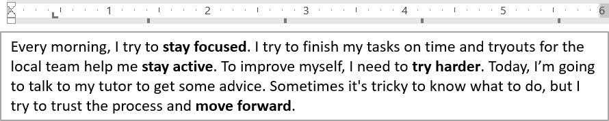

## **Tổng quan**

Bài viết này hướng dẫn cách định dạng văn bản trong các bài thuyết trình PowerPoint và OpenDocument bằng Aspose.Slides for PHP qua Java. Nội dung bao gồm màu nền, độ trong suốt, khoảng cách ký tự, thuộc tính phông chữ, xoay, khoảng cách đoạn, hành vi tự động vừa khít, neo văn bản, điểm dừng tab và cài đặt ngôn ngữ.

Trừ khi có ghi chú khác, các ví dụ sử dụng [sample.pptx](sample.pptx). Hình dạng đầu tiên trên slide đầu tiên là một hộp văn bản, và đoạn văn đầu tiên của nó chứa văn bản được hiển thị bên dưới. Cả chỉ mục slide và hình dạng đều bắt đầu từ 0. Các ví dụ chọn phần in đậm sử dụng định dạng có hiệu lực, bao gồm định dạng in đậm kế thừa:


Để tìm và làm nổi bật văn bản nguyên mẫu hoặc các kết quả khớp biểu thức chính quy, xem [Tìm kiếm và Thay thế Văn bản](/slides/vi/php-java/search-and-replace-text/).

## **Đặt Màu Nền Văn Bản**

Sử dụng [ParagraphFormat::getDefaultPortionFormat](https://reference.aspose.com/slides/php-java/aspose.slides/paragraphformat/#getDefaultPortionFormat) để đặt màu tô sáng mặc định cho một đoạn, hoặc sử dụng [BasePortionFormat::getHighlightColor](https://reference.aspose.com/slides/php-java/aspose.slides/baseportionformat/#getHighlightColor) cho các đoạn văn bản riêng lẻ.

Ví dụ sau đặt màu tô sáng xám nhạt làm mặc định cho đoạn văn đầu tiên. Màu tô sáng cụ thể trên các đoạn riêng lẻ sẽ ưu tiên hơn mặc định này:

```php
use aspose\slides\Presentation;
use aspose\slides\SaveFormat;

$presentation = new Presentation("sample.pptx");
try {
    $slide = $presentation->getSlides()->get_Item(0);

    $autoShape = $slide->getShapes()->get_Item(0);
    $paragraph = $autoShape->getTextFrame()->getParagraphs()->get_Item(0);
    $highlightColor = java("java.awt.Color")->LIGHT_GRAY;

    // Đặt màu tô sáng cho toàn bộ đoạn văn.
    $paragraph->getParagraphFormat()->getDefaultPortionFormat()->getHighlightColor()->setColor($highlightColor);

    $presentation->save("gray_paragraph.pptx", SaveFormat::Pptx);
} finally {
    $presentation->dispose();
}
```

Kết quả:


Ví dụ mã dưới đây minh họa cách đặt màu nền cho **các phần văn bản có phông chữ in đậm**:

```php
use aspose\slides\Presentation;
use aspose\slides\SaveFormat;

$presentation = new Presentation("sample.pptx");
try {
    $slide = $presentation->getSlides()->get_Item(0);

    $autoShape = $slide->getShapes()->get_Item(0);
    $paragraph = $autoShape->getTextFrame()->getParagraphs()->get_Item(0);
    $highlightColor = java("java.awt.Color")->LIGHT_GRAY;

    $portionCount = java_values($paragraph->getPortions()->getCount());
    for ($portionIndex = 0; $portionIndex < $portionCount; $portionIndex++) {
        $portion = $paragraph->getPortions()->get_Item($portionIndex);
        if (java_values($portion->getPortionFormat()->getEffective()->getFontBold())) {
            // Đặt màu tô sáng cho phần văn bản.
            $portion->getPortionFormat()->getHighlightColor()->setColor($highlightColor);
        }
    }

    $presentation->save("gray_text_portions.pptx", SaveFormat::Pptx);
} finally {
    $presentation->dispose();
}
```

Kết quả:


## **Căn Đoạn Văn Bản**

Sử dụng [ParagraphFormat::setAlignment](https://reference.aspose.com/slides/php-java/aspose.slides/paragraphformat/#setAlignment) để đặt căn chỉnh đoạn trong khung văn bản. Giá trị có thể là căn giữa, căn trái, căn phải, căn đều, v.v.

Mã dưới đây cho thấy cách căn đoạn văn **ở trung tâm**:

```php
use aspose\slides\Presentation;
use aspose\slides\SaveFormat;
use aspose\slides\TextAlignment;

$presentation = new Presentation("sample.pptx");
try {
    $slide = $presentation->getSlides()->get_Item(0);

    $autoShape = $slide->getShapes()->get_Item(0);
    $paragraph = $autoShape->getTextFrame()->getParagraphs()->get_Item(0);

    // Đặt căn chỉnh của đoạn văn thành trung tâm.
    $paragraph->getParagraphFormat()->setAlignment(TextAlignment::Center);

    $presentation->save("aligned_paragraph.pptx", SaveFormat::Pptx);
} finally {
    $presentation->dispose();
}
```

Kết quả:


## **Căn Phông Chữ Trong Một Dòng**

Sử dụng [ParagraphFormat::setFontAlignment](https://reference.aspose.com/slides/php-java/aspose.slides/paragraphformat/#setFontAlignment) để căn dọc các phần văn bản có kích thước phông khác nhau trong cùng một dòng. Cài đặt này áp dụng cho toàn bộ đoạn và kiểm soát căn chỉnh trong mỗi dòng của nó.

Ví dụ tự chứa dưới đây tạo bốn hộp văn bản có nhãn trên một slide. Mỗi đoạn chứa cùng một văn bản ở kích thước 18, 36 và 54 điểm, với căn phông chữ khác nhau. Nó dùng Arial, tắt tự động vừa khít và ngắt dòng, và giữ khung văn bản đủ lớn cho một dòng duy nhất.

```php
use aspose\slides\FillType;
use aspose\slides\FontAlignment;
use aspose\slides\FontData;
use aspose\slides\NullableBool;
use aspose\slides\Paragraph;
use aspose\slides\Portion;
use aspose\slides\Presentation;
use aspose\slides\SaveFormat;
use aspose\slides\ShapeType;
use aspose\slides\TextAlignment;
use aspose\slides\TextAnchorType;
use aspose\slides\TextAutofitType;

$presentation = new Presentation();
try {
    $slide = $presentation->getSlides()->get_Item(0);

    $alignments = [FontAlignment::Baseline, FontAlignment::Top, FontAlignment::Center, FontAlignment::Bottom];
    $alignmentNames = ["Baseline", "Top", "Center", "Bottom"];
    $fontSizes = [18, 36, 54];
    $font = new FontData("Arial");
    $gray = java("java.awt.Color")->GRAY;
    $black = java("java.awt.Color")->BLACK;

    for ($i = 0; $i < count($alignments); $i++) {
        $shape = $slide->getShapes()->addAutoShape(ShapeType::Rectangle, 30, 20 + $i * 130, 660, 120);
        $shape->getFillFormat()->setFillType(FillType::NoFill);
        $shape->getLineFormat()->getFillFormat()->setFillType(FillType::NoFill);

        $textFrame = $shape->getTextFrame();
        $textFrame->getTextFrameFormat()->setAnchoringType(TextAnchorType::Top);
        $textFrame->getTextFrameFormat()->setAutofitType(TextAutofitType::None);
        $textFrame->getTextFrameFormat()->setWrapText(NullableBool::False);

        $label = $textFrame->getParagraphs()->get_Item(0);
        $label->setText($alignmentNames[$i]);
        $label->getParagraphFormat()->setAlignment(TextAlignment::Left);
        $label->getParagraphFormat()->getDefaultPortionFormat()->setFontHeight(14);
        $label->getParagraphFormat()->getDefaultPortionFormat()->setLatinFont($font);
        $label->getParagraphFormat()->getDefaultPortionFormat()->getFillFormat()->setFillType(FillType::Solid);
        $label->getParagraphFormat()->getDefaultPortionFormat()->getFillFormat()->getSolidFillColor()->setColor($gray);

        $paragraph = new Paragraph();
        $paragraph->getParagraphFormat()->setFontAlignment($alignments[$i]);
        $paragraph->getParagraphFormat()->setAlignment(TextAlignment::Left);
        $paragraph->getParagraphFormat()->getDefaultPortionFormat()->setLatinFont($font);
        $paragraph->getParagraphFormat()->getDefaultPortionFormat()->getFillFormat()->setFillType(FillType::Solid);
        $paragraph->getParagraphFormat()->getDefaultPortionFormat()->getFillFormat()->getSolidFillColor()->setColor($black);

        foreach ($fontSizes as $fontSize) {
            $portion = new Portion("Ag ");
            $portion->getPortionFormat()->setFontHeight($fontSize);
            $paragraph->getPortions()->add($portion);
        }

        $textFrame->getParagraphs()->add($paragraph);
    }

    $presentation->save("font_alignment.pptx", SaveFormat::Pptx);
} finally {
    $presentation->dispose();
}
```

Kết quả:


Căn phông chữ dựa trên số liệu phông, vì vậy các cạnh nhìn thấy của các ký tự riêng lẻ không nhất thiết phải hoàn toàn thẳng hàng. Ví dụ bao gồm cả một ký tự in hoa và một ký tự có phần đáy xuống để minh họa sự khác nhau giữa căn baseline và bottom. Tính khả dụng và thay thế phông, ký tự được sử dụng, và sự khác nhau về kích thước phông sẽ ảnh hưởng đến kết quả. Kích thước khung, lề, khoảng cách dòng, ngắt dòng và tự động vừa khít cũng ảnh hưởng tới bố cục; hãy dùng cùng một phông và cùng các cài đặt bố cục khi so sánh các chế độ.

Cài đặt này khác với [ParagraphFormat::setAlignment](https://reference.aspose.com/slides/php-java/aspose.slides/paragraphformat/#setAlignment), kiểm soát căn chỉnh ngang của đoạn, và [TextFrameFormat::setAnchoringType](https://reference.aspose.com/slides/php-java/aspose.slides/textframeformat/#setAnchoringType), định vị khối văn bản theo chiều dọc trong hình dạng. Định dạng chỉ số trên [BasePortionFormat::setEscapement](https://reference.aspose.com/slides/php-java/aspose.slides/baseportionformat/#setEscapement) dịch các phần riêng lẻ so với baseline thay vì thiết lập căn phông cho các dòng của đoạn.

## **Đặt Độ Trong Suốt Cho Văn Bản**

Độ trong suốt văn bản được điều khiển qua thành phần alpha của màu được gán cho [BasePortionFormat::getFillFormat](https://reference.aspose.com/slides/php-java/aspose.slides/baseportionformat/#getFillFormat). Trong các ví dụ dưới đây, `alpha = 50` là giá trị kênh alpha ARGB trên thang 0–255, không phải là phần trăm trong suốt.

Ví dụ mã dưới đây cho thấy cách áp dụng độ trong suốt cho **toàn bộ đoạn văn**:

```php
use aspose\slides\FillType;
use aspose\slides\Presentation;
use aspose\slides\SaveFormat;

$alpha = 50;

$presentation = new Presentation("sample.pptx");
try {
    $slide = $presentation->getSlides()->get_Item(0);

    $autoShape = $slide->getShapes()->get_Item(0);
    $paragraph = $autoShape->getTextFrame()->getParagraphs()->get_Item(0);
    $fillFormat = $paragraph->getParagraphFormat()->getDefaultPortionFormat()->getFillFormat();

    // Đặt màu tô đầy của văn bản thành màu trong suốt.
    $fillFormat->setFillType(FillType::Solid);
    $transparentColor = new Java("java.awt.Color", 0, 0, 0, $alpha);
    $fillFormat->getSolidFillColor()->setColor($transparentColor);

    $presentation->save("transparent_paragraph.pptx", SaveFormat::Pptx);
} finally {
    $presentation->dispose();
}
```

Kết quả:


Ví dụ mã sau áp dụng độ trong suốt cho **các phần văn bản có phông chữ in đậm**:

```php
use aspose\slides\FillType;
use aspose\slides\Presentation;
use aspose\slides\SaveFormat;

$alpha = 50;

$presentation = new Presentation("sample.pptx");
try {
    $slide = $presentation->getSlides()->get_Item(0);

    $autoShape = $slide->getShapes()->get_Item(0);
    $paragraph = $autoShape->getTextFrame()->getParagraphs()->get_Item(0);
    $transparentColor = new Java("java.awt.Color", 0, 0, 0, $alpha);

    $portionCount = java_values($paragraph->getPortions()->getCount());
    for ($portionIndex = 0; $portionIndex < $portionCount; $portionIndex++) {
        $portion = $paragraph->getPortions()->get_Item($portionIndex);
        if (java_values($portion->getPortionFormat()->getEffective()->getFontBold())) {
            // Đặt độ trong suốt của phần văn bản.
            $fillFormat = $portion->getPortionFormat()->getFillFormat();
            $fillFormat->setFillType(FillType::Solid);
            $fillFormat->getSolidFillColor()->setColor($transparentColor);
        }
    }

    $presentation->save("transparent_text_portions.pptx", SaveFormat::Pptx);
} finally {
    $presentation->dispose();
}
```

Kết quả:


## **Đặt Khoảng Cách Ký Tự Cho Văn Bản**

Sử dụng [BasePortionFormat::setSpacing](https://reference.aspose.com/slides/php-java/aspose.slides/baseportionformat/#setSpacing) để mở rộng hoặc thu hẹp khoảng cách giữa các ký tự trong một hộp văn bản. Các ví dụ thêm 3 điểm khoảng cách; giá trị âm sẽ làm văn bản dồn lại.

Mã PHP sau cho thấy cách mở rộng khoảng cách ký tự trong **toàn bộ đoạn văn**:

```php
use aspose\slides\Presentation;
use aspose\slides\SaveFormat;

$presentation = new Presentation("sample.pptx");
try {
    $slide = $presentation->getSlides()->get_Item(0);

    $autoShape = $slide->getShapes()->get_Item(0);
    $paragraph = $autoShape->getTextFrame()->getParagraphs()->get_Item(0);

    // Lưu ý: Sử dụng giá trị âm để nén khoảng cách ký tự.
    $paragraph->getParagraphFormat()->getDefaultPortionFormat()->setSpacing(3); // Mở rộng khoảng cách ký tự.

    $presentation->save("character_spacing_in_paragraph.pptx", SaveFormat::Pptx);
} finally {
    $presentation->dispose();
}
```

Kết quả:


Ví dụ mã dưới đây mở rộng khoảng cách ký tự trong **các phần văn bản có phông chữ in đậm**:

```php
use aspose\slides\Presentation;
use aspose\slides\SaveFormat;

$presentation = new Presentation("sample.pptx");
try {
    $slide = $presentation->getSlides()->get_Item(0);

    $autoShape = $slide->getShapes()->get_Item(0);
    $paragraph = $autoShape->getTextFrame()->getParagraphs()->get_Item(0);

    $portionCount = java_values($paragraph->getPortions()->getCount());
    for ($portionIndex = 0; $portionIndex < $portionCount; $portionIndex++) {
        $portion = $paragraph->getPortions()->get_Item($portionIndex);
        if (java_values($portion->getPortionFormat()->getEffective()->getFontBold())) {
            // Lưu ý: Sử dụng giá trị âm để nén khoảng cách ký tự.
            $portion->getPortionFormat()->setSpacing(3); // Mở rộng khoảng cách ký tự.
        }
    }

    $presentation->save("character_spacing_in_text_portions.pptx", SaveFormat::Pptx);
} finally {
    $presentation->dispose();
}
```

Kết quả:


### **Tắt Kerning Cho Các Phông Cụ Thế Định**

Trong một số trường hợp, văn bản được render bởi Aspose.Slides có thể trông hơi chặt hơn so với cùng văn bản hiển thị trong PowerPoint. Điều này có thể xảy ra vì PowerPoint có thể bỏ qua dữ liệu kerning cho một số phông, ngay cả khi phông chứa thông tin kerning hợp lệ và kerning được bật trong cài đặt PowerPoint.

Để đưa kết quả render gần hơn với PowerPoint, bạn có thể tắt kerning cho các phần văn bản sử dụng phông bị ảnh hưởng. Đặt [BasePortionFormat::setKerningMinimalSize](https://reference.aspose.com/slides/php-java/aspose.slides/baseportionformat/#setKerningMinimalSize) thành giá trị lớn hơn kích thước phông thực tế. Ví dụ này yêu cầu “presentation.pptx” có một hộp văn bản là hình dạng đầu tiên trên slide đầu tiên. Nó kiểm tra tên phông hiệu lực, bao gồm các phông kế thừa, và đặt ngưỡng 100 điểm cho các phần sử dụng Roboto. Điều này tắt kerning cho các phần khớp có kích thước phông dưới 100 điểm:

```php
use aspose\slides\Presentation;
use aspose\slides\SaveFormat;

$presentation = new Presentation("presentation.pptx");
try {
    $slide = $presentation->getSlides()->get_Item(0);

    $autoShape = $slide->getShapes()->get_Item(0);
    $targetFont = "Roboto";

    $paragraphCount = java_values($autoShape->getTextFrame()->getParagraphs()->getCount());
    for ($paragraphIndex = 0; $paragraphIndex < $paragraphCount; $paragraphIndex++) {
        $paragraph = $autoShape->getTextFrame()->getParagraphs()->get_Item($paragraphIndex);
        $portionCount = java_values($paragraph->getPortions()->getCount());
        for ($portionIndex = 0; $portionIndex < $portionCount; $portionIndex++) {
            $portion = $paragraph->getPortions()->get_Item($portionIndex);
            $portionFormat = $portion->getPortionFormat()->getEffective();
            $latinFont = $portionFormat->getLatinFont();
            $eastAsianFont = $portionFormat->getEastAsianFont();
            $complexScriptFont = $portionFormat->getComplexScriptFont();

            if ((!java_is_null($latinFont) && $latinFont->getFontName() == $targetFont) ||
                (!java_is_null($eastAsianFont) && $eastAsianFont->getFontName() == $targetFont) ||
                (!java_is_null($complexScriptFont) && $complexScriptFont->getFontName() == $targetFont)) {
                $portion->getPortionFormat()->setKerningMinimalSize(100);
            }
        }
    }

    $presentation->save("output.pptx", SaveFormat::Pptx);
} finally {
    $presentation->dispose();
}
```

Đối với văn bản khớp dưới ngưỡng, cài đặt này ngăn kerning và có thể giúp đồng bộ việc render của Aspose.Slides với kết quả hiển thị của PowerPoint cho các phông bị ảnh hưởng bởi hành vi đặc thù này của PowerPoint.

## **Quản Lý Thuộc Tính Phông Chữ Văn Bản**

Thuộc tính phông chữ có thể được đặt ở mức đoạn qua [ParagraphFormat::getDefaultPortionFormat](https://reference.aspose.com/slides/php-java/aspose.slides/paragraphformat/#getDefaultPortionFormat) hoặc trên các phần riêng lẻ qua [PortionFormat](https://reference.aspose.com/slides/php-java/aspose.slides/portionformat/).

Ví dụ sau đặt phông mặc định cho đoạn đầu tiên là Times New Roman 12 điểm, in đậm, in nghiêng và gạch dưới chấm. Định dạng cụ thể trên các phần riêng lẻ sẽ ưu tiên hơn các giá trị mặc định này:

```php
use aspose\slides\FontData;
use aspose\slides\NullableBool;
use aspose\slides\Presentation;
use aspose\slides\SaveFormat;
use aspose\slides\TextUnderlineType;

$presentation = new Presentation("sample.pptx");
try {
    $slide = $presentation->getSlides()->get_Item(0);

    $autoShape = $slide->getShapes()->get_Item(0);
    $paragraph = $autoShape->getTextFrame()->getParagraphs()->get_Item(0);
    $defaultPortionFormat = $paragraph->getParagraphFormat()->getDefaultPortionFormat();
    $font = new FontData("Times New Roman");

    // Đặt các thuộc tính phông chữ cho đoạn văn.
    $defaultPortionFormat->setFontHeight(12);
    $defaultPortionFormat->setFontBold(NullableBool::True);
    $defaultPortionFormat->setFontItalic(NullableBool::True);
    $defaultPortionFormat->setFontUnderline(TextUnderlineType::Dotted);
    $defaultPortionFormat->setLatinFont($font);

    $presentation->save("font_properties_for_paragraph.pptx", SaveFormat::Pptx);
} finally {
    $presentation->dispose();
}
```

Kết quả:


Ví dụ sau áp dụng Times New Roman 13 điểm, in nghiêng và gạch dưới chấm cho các phần có định dạng hiệu lực là in đậm:

```php
use aspose\slides\FontData;
use aspose\slides\NullableBool;
use aspose\slides\Presentation;
use aspose\slides\SaveFormat;
use aspose\slides\TextUnderlineType;

$presentation = new Presentation("sample.pptx");
try {
    $slide = $presentation->getSlides()->get_Item(0);

    $autoShape = $slide->getShapes()->get_Item(0);
    $paragraph = $autoShape->getTextFrame()->getParagraphs()->get_Item(0);
    $font = new FontData("Times New Roman");

    $portionCount = java_values($paragraph->getPortions()->getCount());
    for ($portionIndex = 0; $portionIndex < $portionCount; $portionIndex++) {
        $portion = $paragraph->getPortions()->get_Item($portionIndex);
        if (java_values($portion->getPortionFormat()->getEffective()->getFontBold())) {
            // Đặt các thuộc tính phông chữ cho phần văn bản.
            $portionFormat = $portion->getPortionFormat();
            $portionFormat->setFontHeight(13);
            $portionFormat->setFontItalic(NullableBool::True);
            $portionFormat->setFontUnderline(TextUnderlineType::Dotted);
            $portionFormat->setLatinFont($font);
        }
    }

    $presentation->save("font_properties_for_text_portions.pptx", SaveFormat::Pptx);
} finally {
    $presentation->dispose();
}
```

Kết quả:


## **Kiểm Soát Chuẩn Hóa Chiều Cao Văn Bản**

Sử dụng [BasePortionFormat::setNormaliseHeight](https://reference.aspose.com/slides/php-java/aspose.slides/baseportionformat/#setNormaliseHeight) khi sao chép kiểu chữ mẫu hoặc khảo sát sự khác nhau về chiều cao ký tự. Trong PowerPoint, bật chuẩn hóa sẽ kéo hoặc nén các ký tự riêng lẻ theo chiều dọc để tạo ra chiều cao hiển thị đồng nhất trong phần văn bản. Nó không đảm bảo các đoạn văn bản có chiều cao bằng nhau giữa các phông khác nhau.

Đặt thuộc tính thành [NullableBool::True hoặc False](https://reference.aspose.com/slides/php-java/aspose.slides/nullablebool/) để bật hoặc tắt chuẩn hóa một cách rõ ràng. `NullableBool::NotDefined` để lại cài đặt cục bộ không được thiết lập, cho phép phần kế thừa giá trị, ví dụ, từ [getDefaultPortionFormat](https://reference.aspose.com/slides/php-java/aspose.slides/paragraphformat/#getDefaultPortionFormat) của đoạn. Nó không tương đương với `False`. Sử dụng [PortionFormat::getEffective](https://reference.aspose.com/slides/php-java/aspose.slides/portionformat/#getEffective) và đọc `getNormaliseHeight` trên dữ liệu định dạng hiệu lực trả về để lấy giá trị Boolean đã được giải quyết.

Ví dụ tự chứa dưới đây yêu cầu **Arial** đã được cài đặt. Nó tạo hai khối văn bản chứa cùng các chữ in hoa, chữ thường, ký tự có phần đáy và ký tự có dấu ở kích thước 54 điểm. Cả hai đoạn đều bật chuẩn hóa theo mặc định. Phần trên tắt chuẩn hóa một cách rõ ràng; phần dưới kế thừa nó. Kích thước khung, lề và khoảng cách đoạn đều giống nhau, với ngắt dòng và tự động vừa khít bị tắt để so sánh nhất quán. Ví dụ in `False: false` và `NotDefined: true`, sau đó lưu “text_height_normalization.pptx”.

```php
use aspose\slides\FillType;
use aspose\slides\FontData;
use aspose\slides\NullableBool;
use aspose\slides\Presentation;
use aspose\slides\SaveFormat;
use aspose\slides\ShapeType;
use aspose\slides\TextAlignment;
use aspose\slides\TextAnchorType;
use aspose\slides\TextAutofitType;

$presentation = new Presentation();
try {
    $slide = $presentation->getSlides()->get_Item(0);

    $settings = [NullableBool::False, NullableBool::NotDefined];
    $settingNames = ["False", "NotDefined"];

    for ($i = 0; $i < count($settings); $i++) {
        $shape = $slide->getShapes()->addAutoShape(ShapeType::Rectangle, 30, 60 + $i * 200, 660, 150);
        $shape->getFillFormat()->setFillType(FillType::NoFill);
        $shape->getLineFormat()->getFillFormat()->setFillType(FillType::NoFill);

        $textFrame = $shape->getTextFrame();
        $textFrame->setText("Hxgjpq ÅÉ 0123");
        $textFrame->getTextFrameFormat()->setAutofitType(TextAutofitType::None);
        $textFrame->getTextFrameFormat()->setWrapText(NullableBool::False);
        $textFrame->getTextFrameFormat()->setAnchoringType(TextAnchorType::Top);
        $textFrame->getTextFrameFormat()->setMarginTop(0);
        $textFrame->getTextFrameFormat()->setMarginLeft(0);

        $paragraph = $textFrame->getParagraphs()->get_Item(0);
        $paragraph->getParagraphFormat()->setAlignment(TextAlignment::Left);
        $paragraph->getParagraphFormat()->setSpaceBefore(0);
        $paragraph->getParagraphFormat()->setSpaceAfter(0);
        $paragraph->getParagraphFormat()->setSpaceWithin(100);
        $paragraph->getParagraphFormat()->getDefaultPortionFormat()->setNormaliseHeight(NullableBool::True);

        $portion = $paragraph->getPortions()->get_Item(0);
        $font = new FontData("Arial");
        $portion->getPortionFormat()->setLatinFont($font);
        $portion->getPortionFormat()->setFontHeight(54);
        $portion->getPortionFormat()->getFillFormat()->setFillType(FillType::Solid);
        $black = java("java.awt.Color")->BLACK;
        $portion->getPortionFormat()->getFillFormat()->getSolidFillColor()->setColor($black);
        $portion->getPortionFormat()->setNormaliseHeight($settings[$i]);

        $normaliseHeight = java_values($portion->getPortionFormat()->getEffective()->getNormaliseHeight());
        echo $settingNames[$i], ": ", $normaliseHeight ? "true" : "false", PHP_EOL;
    }

    $presentation->save("text_height_normalization.pptx", SaveFormat::Pptx);
} finally {
    $presentation->dispose();
}
```

So sánh dưới đây được xuất từ bản trình chiếu đã lưu. Dòng trên có chuẩn hóa tắt (`False`); dòng dưới kế thừa cài đặt bật (`NotDefined` → `True`). Giữ Arial được cài đặt để tái tạo giao diện này.


Chuẩn hóa thay đổi chiều cao ký tự mà không thay đổi giá trị [getFontHeight](https://reference.aspose.com/slides/php-java/aspose.slides/baseportionformat/#getFontHeight) đã gán, giá trị này xác định kích thước phông tính bằng điểm. [ParagraphFormat::setSpaceWithin](https://reference.aspose.com/slides/php-java/aspose.slides/paragraphformat/#setSpaceWithin) kiểm soát khoảng cách dòng, trong khi [TextFrameFormat::setAutofitType](https://reference.aspose.com/slides/php-java/aspose.slides/textframeformat/#setAutofitType) kiểm soát cách văn bản hoặc khung chứa điều chỉnh để vừa khít. Các cài đặt này phục vụ các mục đích khác nhau và có thể ảnh hưởng độc lập đến bố cục tổng thể. Để tìm hiểu thêm về định dạng đoạn và kế thừa, xem [Quản Lý Đoạn Văn](/slides/vi/php-java/manage-paragraph/).

## **Áp Dụng và Xóa Gạch Chéo**

Sử dụng [BasePortionFormat::setStrikethroughType](https://reference.aspose.com/slides/php-java/aspose.slides/baseportionformat/#setStrikethroughType) trên một phần văn bản để hiển thị các sửa đổi, thuật ngữ bị hủy, hoặc giá cũ mà không xóa văn bản gốc. Đặt thành [TextStrikethroughType::Single hoặc Double](https://reference.aspose.com/slides/php-java/aspose.slides/textstrikethroughtype/) để có một hoặc hai đường gạch qua văn bản.

Để xóa gạch chéo, truyền [TextStrikethroughType::None](https://reference.aspose.com/slides/php-java/aspose.slides/textstrikethroughtype/#None). Điều này tắt hiệu ứng một cách rõ ràng, ngay cả khi định dạng xung quanh chỉ định gạch chéo. Ngược lại, [TextStrikethroughType::NotDefined](https://reference.aspose.com/slides/php-java/aspose.slides/textstrikethroughtype/#NotDefined) để lại cài đặt cục bộ không xác định, cho phép phần kế thừa định dạng, ví dụ từ đoạn. Nó không đảm bảo gạch chéo bị xóa. Sử dụng [PortionFormat::getEffective](https://reference.aspose.com/slides/php-java/aspose.slides/portionformat/#getEffective) để đọc định dạng kết quả, bao gồm các giá trị kế thừa.

Ví dụ tự chứa dưới đây tạo ba so sánh giá. Mỗi đoạn có các phần riêng cho nhãn, giá cũ và giá hiện tại, vì vậy chỉ giá cũ bị ảnh hưởng. Dòng đầu áp dụng rồi xóa gạch chéo; các dòng còn lại giữ gạch chéo đơn và gạch chéo đôi. Thay đổi cài đặt này giữ nguyên văn bản và các định dạng khác, bao gồm giá cũ in đậm.

```php
use aspose\slides\FillType;
use aspose\slides\FontData;
use aspose\slides\NullableBool;
use aspose\slides\Paragraph;
use aspose\slides\Portion;
use aspose\slides\Presentation;
use aspose\slides\SaveFormat;
use aspose\slides\ShapeType;
use aspose\slides\TextAlignment;
use aspose\slides\TextStrikethroughType;

$presentation = new Presentation();
try {
    $slide = $presentation->getSlides()->get_Item(0);

    $shape = $slide->getShapes()->addAutoShape(ShapeType::Rectangle, 50, 50, 620, 220);
    $shape->getFillFormat()->setFillType(FillType::NoFill);
    $shape->getLineFormat()->getFillFormat()->setFillType(FillType::NoFill);
    $shape->getTextFrame()->getParagraphs()->clear();

    $labels = [ "None: ", "Single: ", "Double: " ];

    foreach ($labels as $label) {
        $paragraph = new Paragraph();
        $paragraph->getParagraphFormat()->setAlignment(TextAlignment::Left);
        $paragraph->getParagraphFormat()->setSpaceAfter(20);

        $format = $paragraph->getParagraphFormat()->getDefaultPortionFormat();
        $format->setFontHeight(28);
        $font = new FontData("Arial");
        $format->setLatinFont($font);
        $format->getFillFormat()->setFillType(FillType::Solid);
        $blackColor = java("java.awt.Color")->BLACK;
        $format->getFillFormat()->getSolidFillColor()->setColor($blackColor);

        $labelPortion = new Portion($label);
        $paragraph->getPortions()->add($labelPortion);

        $previousPrice = new Portion("$100");
        $previousPrice->getPortionFormat()->setFontBold(NullableBool::True);
        $paragraph->getPortions()->add($previousPrice);
        $currentPrice = new Portion(" → $80");
        $paragraph->getPortions()->add($currentPrice);

        $shape->getTextFrame()->getParagraphs()->add($paragraph);
    }

    $paragraphs = $shape->getTextFrame()->getParagraphs();

    // Áp dụng gạch chéo, sau đó loại bỏ một cách rõ ràng nó khỏi mức giá trước đầu tiên.
    $paragraphs->get_Item(0)->getPortions()->get_Item(1)->getPortionFormat()->setStrikethroughType(TextStrikethroughType::Single);
    $paragraphs->get_Item(0)->getPortions()->get_Item(1)->getPortionFormat()->setStrikethroughType(TextStrikethroughType::None);

    $paragraphs->get_Item(1)->getPortions()->get_Item(1)->getPortionFormat()->setStrikethroughType(TextStrikethroughType::Single);
    $paragraphs->get_Item(2)->getPortions()->get_Item(1)->getPortionFormat()->setStrikethroughType(TextStrikethroughType::Double);

    $presentation->save("strikethrough.pptx", SaveFormat::Pptx);
} finally {
    $presentation->dispose();
}
```

Kết quả, từ trên xuống dưới: không gạch chéo, gạch chéo đơn và gạch chéo đôi.


## **Đặt Xoay Văn Bản**

Sử dụng [TextFrameFormat::setTextVerticalType](https://reference.aspose.com/slides/php-java/aspose.slides/textframeformat/#setTextVerticalType) để đặt hướng văn bản định sẵn trong một hình dạng.

Ví dụ mã sau đặt hướng văn bản trong hình dạng thành [TextVerticalType::Vertical270](https://reference.aspose.com/slides/php-java/aspose.slides/textverticaltype/), xoay văn bản **90 độ ngược chiều kim đồng hồ**:

```php
use aspose\slides\Presentation;
use aspose\slides\SaveFormat;
use aspose\slides\TextVerticalType;

$presentation = new Presentation("sample.pptx");
try {
    $slide = $presentation->getSlides()->get_Item(0);

    $autoShape = $slide->getShapes()->get_Item(0);
    $autoShape->getTextFrame()->getTextFrameFormat()->setTextVerticalType(TextVerticalType::Vertical270);

    $presentation->save("text_rotation.pptx", SaveFormat::Pptx);
} finally {
    $presentation->dispose();
}
```

Kết quả:


## **Hiển Thị Các Chữ Số Bên Nhau Trong Văn Bản Dọc**

Để giữ hai chữ số của một số trong một nhãn tiếng Nhật dọc, đặt cả hai chữ số trong một phần văn bản và gọi [BasePortionFormat::setKumimoji](https://reference.aspose.com/slides/php-java/aspose.slides/baseportionformat/#setKumimoji) trên phần đó. Ví dụ sử dụng [TextVerticalType::EastAsianVertical](https://reference.aspose.com/slides/php-java/aspose.slides/textverticaltype/#EastAsianVertical) và MS Gothic 40 điểm cho cả hai nhãn. Giá trị [NullableBool](https://reference.aspose.com/slides/php-java/aspose.slides/nullablebool/) được truyền cho phần số khác nhau.

```php
use aspose\slides\FillType;
use aspose\slides\FontData;
use aspose\slides\NullableBool;
use aspose\slides\Portion;
use aspose\slides\Presentation;
use aspose\slides\SaveFormat;
use aspose\slides\ShapeType;
use aspose\slides\TextVerticalType;

$presentation = new Presentation();
try {
    $slide = $presentation->getSlides()->get_Item(0);
    $x = 120;

    foreach ([NullableBool::True, NullableBool::False] as $kumimoji) {
        $label = $slide->getShapes()->addAutoShape(ShapeType::Rectangle, $x, 48, 120, 420);
        $label->getFillFormat()->setFillType(FillType::NoFill);
        $label->getLineFormat()->getFillFormat()->setFillType(FillType::NoFill);

        $frame = $label->addTextFrame("");
        $frame->getTextFrameFormat()->setTextVerticalType(TextVerticalType::EastAsianVertical);

        $paragraph = $frame->getParagraphs()->get_Item(0);
        $format = $paragraph->getParagraphFormat()->getDefaultPortionFormat();
        $font = new FontData("MS Gothic");
        $format->setLatinFont($font);
        $format->setEastAsianFont($font);
        $format->setFontHeight(40);
        $format->getFillFormat()->setFillType(FillType::Solid);
        $black = java("java.awt.Color")->BLACK;
        $format->getFillFormat()->getSolidFillColor()->setColor($black);

        $digits = new Portion("12");
        $digits->getPortionFormat()->setKumimoji($kumimoji);

        $portions = $paragraph->getPortions();
        $portions->clear();
        $portions->add(new Portion("令和"));
        $portions->add($digits);
        $portions->add(new Portion("年"));

        $x += 240;
    }
    $presentation->save("vertical_date.pptx", SaveFormat::Pptx);
} finally {
    $presentation->dispose();
}
```

Trong PowerPoint, nhãn bên trái (`True`) hiển thị các chữ số thẳng đứng và nằm cạnh nhau giữa 和 và 年. Nhãn bên phải (`False`) quay cặp số 90 độ theo chiều kim đồng hồ. Các ký tự tiếng Nhật xung quanh vẫn thẳng đứng ở cả hai nhãn.


## **Đặt Xoay Tùy Chỉnh Cho Khung Văn Bản**

Sử dụng [TextFrameFormat::setRotationAngle](https://reference.aspose.com/slides/php-java/aspose.slides/textframeformat/#setRotationAngle) để đặt góc xoay tùy chỉnh cho một [TextFrame](https://reference.aspose.com/slides/php-java/aspose.slides/textframe/).

Mã dưới đây xoay khung văn bản 3 độ theo chiều kim đồng hồ trong hình dạng:

```php
use aspose\slides\Presentation;
use aspose\slides\SaveFormat;

$presentation = new Presentation("sample.pptx");
try {
    $slide = $presentation->getSlides()->get_Item(0);

    $autoShape = $slide->getShapes()->get_Item(0);
    $autoShape->getTextFrame()->getTextFrameFormat()->setRotationAngle(3);

    $presentation->save("custom_text_rotation.pptx", SaveFormat::Pptx);
} finally {
    $presentation->dispose();
}
```

Kết quả:


## **Đặt Khoảng Cách Dòng Của Đoạn Văn Bản**

Aspose.Slides cung cấp [ParagraphFormat::setSpaceAfter](https://reference.aspose.com/slides/php-java/aspose.slides/paragraphformat/#setSpaceAfter), [ParagraphFormat::setSpaceBefore](https://reference.aspose.com/slides/php-java/aspose.slides/paragraphformat/#setSpaceBefore) và [ParagraphFormat::setSpaceWithin](https://reference.aspose.com/slides/php-java/aspose.slides/paragraphformat/#setSpaceWithin) để kiểm soát khoảng cách đoạn. Các thuộc tính này được sử dụng như sau:

* Sử dụng giá trị dương để chỉ định khoảng cách dòng dưới dạng phần trăm của chiều cao dòng.
* Sử dụng giá trị âm để chỉ định khoảng cách dòng bằng điểm.

Ví dụ sau đặt khoảng cách trong đoạn đầu tiên là 200 % chiều cao dòng (độ cách dòng gấp đôi):

```php
use aspose\slides\Presentation;
use aspose\slides\SaveFormat;

$presentation = new Presentation("sample.pptx");
try {
    $slide = $presentation->getSlides()->get_Item(0);

    $autoShape = $slide->getShapes()->get_Item(0);

    $paragraph = $autoShape->getTextFrame()->getParagraphs()->get_Item(0);
    $paragraph->getParagraphFormat()->setSpaceWithin(200);

    $presentation->save("line_spacing.pptx", SaveFormat::Pptx);
} finally {
    $presentation->dispose();
}
```

Kết quả:


## **Kiểm Soát Ngắt Dòng**

Quy tắc ngắt dòng của đoạn hữu ích trong các khối văn bản hẹp và các bản thuyết trình hỗn hợp Latin và Đông Á. Các phương thức sau thuộc về [ParagraphFormat](https://reference.aspose.com/slides/php-java/aspose.slides/paragraphformat/), vì vậy chúng áp dụng cho toàn bộ đoạn:

- [setLatinLineBreak](https://reference.aspose.com/slides/php-java/aspose.slides/paragraphformat/#setLatinLineBreak) kiểm soát quy tắc ngắt dòng Latin. Trong văn bản hỗn hợp, thay đổi nó cũng có thể thay đổi vị trí ngắt dòng của văn bản và dấu câu Đông Á lân cận.
- [setEastAsianLineBreak](https://reference.aspose.com/slides/php-java/aspose.slides/paragraphformat/#setEastAsianLineBreak) kiểm soát quy tắc ngắt dòng Đông Á, bao gồm các hạn chế về ký tự ở đầu và cuối dòng.

Các quy tắc này không thay thế [TextFrameFormat::setWrapText](https://reference.aspose.com/slides/php-java/aspose.slides/textframeformat/#setWrapText), cho phép tự động ngắt dòng trong khung văn bản. Chúng ảnh hưởng đến bố cục khi ngắt dòng xảy ra; chúng không chèn ký tự ngắt dòng. Một ký tự ngắt dòng rõ ràng buộc một dòng mới trong đoạn, độc lập với độ rộng hiện có.

Ví dụ tự chứa dưới đây tạo một khối văn bản hẹp chứa tiếng Trung và Latin. Nó đặt cả hai tùy chọn ngắt dòng một cách rõ ràng và lưu “line_breaking.pptx”. Để thử nghiệm mỗi quy tắc, thay đổi giá trị tương ứng trong khi giữ các cài đặt còn lại cố định. Ví dụ dùng Arial 24 điểm và SimSun, khung rộng 160 điểm và lề ngang của khung văn bản bằng 0. [TextFrameFormat::setAutofitType](https://reference.aspose.com/slides/php-java/aspose.slides/textframeformat/#setAutofitType) được gọi với [TextAutofitType::None](https://reference.aspose.com/slides/php-java/aspose.slides/textautofittype/) để giữ kích thước văn bản và khung cố định.

```php
use aspose\slides\FillType;
use aspose\slides\FontData;
use aspose\slides\NullableBool;
use aspose\slides\Presentation;
use aspose\slides\SaveFormat;
use aspose\slides\ShapeType;
use aspose\slides\TextAlignment;
use aspose\slides\TextAutofitType;

$presentation = new Presentation();
try {
    $slide = $presentation->getSlides()->get_Item(0);

    $shape = $slide->getShapes()->addAutoShape(ShapeType::Rectangle, 50, 50, 160, 300);
    $shape->getFillFormat()->setFillType(FillType::NoFill);

    $textFrame = $shape->getTextFrame();
    $textFrame->getTextFrameFormat()->setWrapText(NullableBool::True);
    $textFrame->getTextFrameFormat()->setAutofitType(TextAutofitType::None);
    $textFrame->getTextFrameFormat()->setMarginLeft(0);
    $textFrame->getTextFrameFormat()->setMarginRight(0);

    $paragraph = $textFrame->getParagraphs()->get_Item(0);
    $paragraph->setText("中文排版测试，PowerPoint 中文演示。");

    $format = $paragraph->getParagraphFormat();
    $format->setAlignment(TextAlignment::Left);
    $format->getDefaultPortionFormat()->setFontHeight(24);
    $latinFont = new FontData("Arial");
    $format->getDefaultPortionFormat()->setLatinFont($latinFont);
    $eastAsianFont = new FontData("SimSun");
    $format->getDefaultPortionFormat()->setEastAsianFont($eastAsianFont);
    $format->getDefaultPortionFormat()->getFillFormat()->setFillType(FillType::Solid);
    $blackColor = java("java.awt.Color")->BLACK;
    $format->getDefaultPortionFormat()->getFillFormat()->getSolidFillColor()->setColor($blackColor);
    $format->setLatinLineBreak(NullableBool::False);
    $format->setEastAsianLineBreak(NullableBool::True);

    $presentation->save("line_breaking.pptx", SaveFormat::Pptx);
} finally {
    $presentation->dispose();
}
```

## **Kiểm Soát Dấu Câu Treo**

[ParagraphFormat::setHangingPunctuation](https://reference.aspose.com/slides/php-java/aspose.slides/paragraphformat/#setHangingPunctuation) cho phép các dấu câu đủ tiêu chuẩn mở rộng ra ngoài mép phải của dòng văn bản thay vì chiếm dòng tiếp theo. Nó áp dụng cho toàn bộ đoạn và khác với thụt lề treo.

Ví dụ tự chứa dưới đây bật dấu câu treo trong một khung văn bản rộng 100 điểm và lưu “hanging_punctuation.pptx”. Với Arial 24 điểm và lề ngang khung bằng 0, dấu chấm cuối cùng ở sau “sentence” và kéo ra ngoài mép phải. Đặt thuộc tính thành [NullableBool::False](https://reference.aspose.com/slides/php-java/aspose.slides/nullablebool/) để so sánh: với cài đặt này, dấu chấm chiếm một dòng riêng. Ngắt dòng được bật và tự động vừa khít bị tắt để giữ độ rộng khả dụng cố định.

```php
use aspose\slides\FillType;
use aspose\slides\FontData;
use aspose\slides\NullableBool;
use aspose\slides\Presentation;
use aspose\slides\SaveFormat;
use aspose\slides\ShapeType;
use aspose\slides\TextAlignment;
use aspose\slides\TextAutofitType;

$presentation = new Presentation();
try {
    $slide = $presentation->getSlides()->get_Item(0);

    $shape = $slide->getShapes()->addAutoShape(ShapeType::Rectangle, 50, 50, 100, 200);
    $shape->getFillFormat()->setFillType(FillType::NoFill);

    $textFrame = $shape->getTextFrame();
    $textFrame->getTextFrameFormat()->setWrapText(NullableBool::True);
    $textFrame->getTextFrameFormat()->setAutofitType(TextAutofitType::None);
    $textFrame->getTextFrameFormat()->setMarginLeft(0);
    $textFrame->getTextFrameFormat()->setMarginRight(0);

    $paragraph = $textFrame->getParagraphs()->get_Item(0);
    $paragraph->setText("Simple text, next sentence.");

    $format = $paragraph->getParagraphFormat();
    $format->setAlignment(TextAlignment::Left);
    $format->getDefaultPortionFormat()->setFontHeight(24);
    $latinFont = new FontData("Arial");
    $format->getDefaultPortionFormat()->setLatinFont($latinFont);
    $format->getDefaultPortionFormat()->getFillFormat()->setFillType(FillType::Solid);
    $blackColor = java("java.awt.Color")->BLACK;
    $format->getDefaultPortionFormat()->getFillFormat()->getSolidFillColor()->setColor($blackColor);
    $format->setHangingPunctuation(NullableBool::True);

    $presentation->save("hanging_punctuation.pptx", SaveFormat::Pptx);
} finally {
    $presentation->dispose();
}
```

Không phải mọi dấu câu đều có thể treo. Các [điều kiện phông và bố cục được mô tả ở trên](#control-line-breaking) cũng áp dụng cho so sánh này: thay đổi phông, độ rộng khả dụng, lề hoặc cài đặt tự động vừa khít có thể loại bỏ sự khác biệt hiển thị.

## **Đặt Loại Tự Động Vừa Khít Cho Khung Văn Bản**

[TextFrameFormat::setAutofitType](https://reference.aspose.com/slides/php-java/aspose.slides/textframeformat/#setAutofitType) xác định cách văn bản hành xử khi vượt quá giới hạn của vùng chứa. Sử dụng nó để kiểm soát việc văn bản thu nhỏ, tràn ra ngoài, hay tự động thay đổi kích thước hình dạng. Ví dụ sau cấu hình hình dạng để thay đổi kích thước nhằm vừa khít với văn bản và lưu kết quả thành “autofit_type.pptx”.

```php
use aspose\slides\Presentation;
use aspose\slides\SaveFormat;
use aspose\slides\TextAutofitType;

$presentation = new Presentation("sample.pptx");
try {
    $slide = $presentation->getSlides()->get_Item(0);

    $autoShape = $slide->getShapes()->get_Item(0);
    $autoShape->getTextFrame()->getTextFrameFormat()->setAutofitType(TextAutofitType::Shape);

    $presentation->save("autofit_type.pptx", SaveFormat::Pptx);
} finally {
    $presentation->dispose();
}
```

Để đếm số dòng sau khi tự động ngắt và xem cách thay đổi độ rộng văn bản hoặc hình dạng ảnh hưởng đến kết quả, xem [Đếm Dòng Đã Render](/slides/vi/php-java/manage-paragraph/). Số dòng chỉ đơn thuần không phản ánh việc văn bản có tràn ra ngoài vùng chứa hay không.

## **Đặt Neo Cho Khung Văn Bản**

[TextFrameFormat::setAnchoringType](https://reference.aspose.com/slides/php-java/aspose.slides/textframeformat/#setAnchoringType) xác định cách văn bản được định vị theo chiều dọc bên trong một hình dạng, ví dụ ở trên, giữa hoặc dưới. Ví dụ sau neo văn bản vào phía dưới của hình dạng đầu tiên và lưu kết quả thành “text_anchor.pptx”.

```php
use aspose\slides\Presentation;
use aspose\slides\SaveFormat;
use aspose\slides\TextAnchorType;

$presentation = new Presentation("sample.pptx");
try {
    $slide = $presentation->getSlides()->get_Item(0);

    $autoShape = $slide->getShapes()->get_Item(0);
    $autoShape->getTextFrame()->getTextFrameFormat()->setAnchoringType(TextAnchorType::Bottom);

    $presentation->save("text_anchor.pptx", SaveFormat::Pptx);
} finally {
    $presentation->dispose();
}
```

## **Đặt Tabulation Văn Bản**

Sử dụng [ParagraphFormat::setDefaultTabSize](https://reference.aspose.com/slides/php-java/aspose.slides/paragraphformat/#setDefaultTabSize) và [ParagraphFormat::getTabs](https://reference.aspose.com/slides/php-java/aspose.slides/paragraphformat/#getTabs) để cấu hình các điểm dừng tab trong một đoạn. Ví dụ sau đặt khoảng cách tab mặc định là 100 điểm và thêm một điểm dừng tab căn trái ở 30 điểm. Các cài đặt này ảnh hưởng đến văn bản có ký tự tab.

```php
use aspose\slides\Presentation;
use aspose\slides\SaveFormat;
use aspose\slides\TabAlignment;

$presentation = new Presentation("sample.pptx");
try {
    $slide = $presentation->getSlides()->get_Item(0);

    $autoShape = $slide->getShapes()->get_Item(0);

    $paragraph = $autoShape->getTextFrame()->getParagraphs()->get_Item(0);
    $paragraph->getParagraphFormat()->setDefaultTabSize(100);
    $paragraph->getParagraphFormat()->getTabs()->add(30, TabAlignment::Left);

    $presentation->save("paragraph_tabs.pptx", SaveFormat::Pptx);
} finally {
    $presentation->dispose();
}
```

Kết quả:



## **Đặt Ngôn Ngữ Kiểm Tra Chính Tả**

Aspose.Slides cung cấp [BasePortionFormat::setLanguageId](https://reference.aspose.com/slides/php-java/aspose.slides/baseportionformat/#setLanguageId), cho phép bạn đặt ngôn ngữ kiểm tra chính tả cho một phần văn bản. Ngôn ngữ này quyết định ngôn ngữ được dùng cho kiểm tra chính tả và ngữ pháp trong PowerPoint.

Ví dụ sau yêu cầu “presentation.pptx” có một hộp văn bản là hình dạng đầu tiên trên slide đầu tiên và ít nhất một đoạn. Nó thay thế nội dung của đoạn đầu tiên bằng “1。”, đặt phông SimSun và gán ngôn ngữ kiểm tra Simplified Chinese (`zh-CN`). Kết quả được lưu thành “proofing_language.pptx”:

```php
use aspose\slides\FontData;
use aspose\slides\Portion;
use aspose\slides\Presentation;
use aspose\slides\SaveFormat;

$presentation = new Presentation("presentation.pptx");
try {
    $slide = $presentation->getSlides()->get_Item(0);

    $autoShape = $slide->getShapes()->get_Item(0);

    $paragraph = $autoShape->getTextFrame()->getParagraphs()->get_Item(0);
    $paragraph->getPortions()->clear();

    $font = new FontData("SimSun");

    $textPortion = new Portion();
    $textPortion->getPortionFormat()->setComplexScriptFont($font);
    $textPortion->getPortionFormat()->setEastAsianFont($font);
    $textPortion->getPortionFormat()->setLatinFont($font);

    // Đặt Id cho ngôn ngữ kiểm tra chính tả.
    $textPortion->getPortionFormat()->setLanguageId("zh-CN");

    $textPortion->setText("1。");
    $paragraph->getPortions()->add($textPortion);

    $presentation->save("proofing_language.pptx", SaveFormat::Pptx);
} finally {
    $presentation->dispose();
}
```

### **Sao Chép Siêu Dữ Liệu Ngôn Ngữ**

Khi sao chép văn bản đa ngôn ngữ từ mẫu, bảo lưu cả [BasePortionFormat::getLanguageId](https://reference.aspose.com/slides/php-java/aspose.slides/baseportionformat/#getLanguageId) và [BasePortionFormat::getAlternativeLanguageId](https://reference.aspose.com/slides/php-java/aspose.slides/baseportionformat/#getAlternativeLanguageId). Ví dụ tự chứa dưới đây tạo một phần nguồn với tiếng Anh Mỹ làm ngôn ngữ và tiếng Pháp làm ngôn ngữ thay thế, sau đó sao chép văn bản và các định danh sang một phần trong bản trình chiếu mới.

```php
use aspose\slides\Portion;
use aspose\slides\Presentation;
use aspose\slides\SaveFormat;
use aspose\slides\ShapeType;

$source = new Portion("Hello! Bonjour!");
$source->getPortionFormat()->setLanguageId("en-US");
$source->getPortionFormat()->setAlternativeLanguageId("fr-FR");

$presentation = new Presentation();
try {
    $slide = $presentation->getSlides()->get_Item(0);

    $shape = $slide->getShapes()->addAutoShape(ShapeType::Rectangle, 20, 20, 400, 80);
    $paragraph = $shape->getTextFrame()->getParagraphs()->get_Item(0);
    $paragraph->getPortions()->clear();

    $destination = new Portion();
    $destination->setText($source->getText());
    $destination->getPortionFormat()->setLanguageId($source->getPortionFormat()->getLanguageId());
    // Nếu nguồn không có ngôn ngữ thay thế, null sẽ xóa giá trị đích.
    $destination->getPortionFormat()->setAlternativeLanguageId($source->getPortionFormat()->getAlternativeLanguageId());
    $paragraph->getPortions()->add($destination);

    $presentation->save("copied_language_metadata.pptx", SaveFormat::Pptx);
} finally {
    $presentation->dispose();
}
```

Để thử nghiệm nguồn không có ngôn ngữ thay thế, bỏ qua việc gán `"fr-FR"`. Khi đó định danh thay thế sẽ là `null`, và câu lệnh sao chép vẫn bảo lưu trạng thái không có giá trị đó mà không tạo giá trị mặc định, ngay cả khi đích trước đó đã có ngôn ngữ thay thế.

Các định danh này lưu siêu dữ liệu ngôn ngữ. Bảo lưu chúng không quyết định từ điển nào PowerPoint sẽ chọn để kiểm tra chính tả hoặc ngữ pháp.

## **Đặt Ngôn Ngữ Mặc Định**

Sử dụng [LoadOptions::setDefaultTextLanguage](https://reference.aspose.com/slides/php-java/aspose.slides/loadoptions/#setDefaultTextLanguage) để định nghĩa ngôn ngữ mặc định cho văn bản được tạo khi tải hoặc tạo bản trình chiếu. Ví dụ sau tạo một bản trình chiếu với tiếng Anh Mỹ làm ngôn ngữ văn bản mặc định, thêm một hộp văn bản và in `en-US` cho phần văn bản đầu tiên.

```php
use aspose\slides\LoadOptions;
use aspose\slides\Presentation;
use aspose\slides\ShapeType;

$loadOptions = new LoadOptions();
$loadOptions->setDefaultTextLanguage("en-US");

$presentation = new Presentation($loadOptions);
try {
    $slide = $presentation->getSlides()->get_Item(0);

    // Thêm một hình chữ nhật mới với văn bản.
    $shape = $slide->getShapes()->addAutoShape(ShapeType::Rectangle, 20, 20, 150, 50);
    $shape->getTextFrame()->setText("Sample text");

    // Kiểm tra ngôn ngữ của phần văn bản đầu tiên.
    $portion = $shape->getTextFrame()->getParagraphs()->get_Item(0)->getPortions()->get_Item(0);
    echo $portion->getPortionFormat()->getLanguageId();
} finally {
    $presentation->dispose();
}
```

## **Đặt Kiểu Văn Bản Mặc Định**

Để áp dụng định dạng văn bản mặc định ở mức bản trình chiếu, sử dụng [Presentation::getDefaultTextStyle](https://reference.aspose.com/slides/php-java/aspose.slides/presentation/#getDefaultTextStyle).

Ví dụ sau đặt phông chữ in đậm 14 điểm làm mặc định cho các đoạn văn cấp trên trong một bản trình chiếu mới và lưu thành “default_text_style.pptx”. Văn bản có thể kế thừa các mặc định này trừ khi có định dạng cụ thể hơn ghi đè.

```php
use aspose\slides\NullableBool;
use aspose\slides\Presentation;
use aspose\slides\SaveFormat;

$presentation = new Presentation();
try {
    // Lấy định dạng đoạn văn cấp cao nhất.
    $paragraphFormat = $presentation->getDefaultTextStyle()->getLevel(0);

    if (!java_is_null($paragraphFormat)) {
        $paragraphFormat->getDefaultPortionFormat()->setFontHeight(14);
        $paragraphFormat->getDefaultPortionFormat()->setFontBold(NullableBool::True);
    }

    $presentation->save("default_text_style.pptx", SaveFormat::Pptx);
} finally {
    $presentation->dispose();
}
```

## **Trích Xuất Văn Bản Với Hiệu Ứng All-Caps**

Trong PowerPoint, áp dụng hiệu ứng **All Caps** làm cho văn bản hiển thị ở dạng chữ hoa trên slide ngay cả khi nó được nhập bằng chữ thường. Khi bạn lấy phần văn bản như vậy với Aspose.Slides, thư viện sẽ trả về văn bản đúng như khi nhập. Để khớp với văn bản hiển thị, kiểm tra [TextCapType](https://reference.aspose.com/slides/php-java/aspose.slides/textcaptype/) và chuyển chuỗi trả về thành chữ hoa khi giá trị là `All`.

Ví dụ này yêu cầu “sample2.pptx” có một hộp văn bản là hình dạng đầu tiên trên slide đầu tiên. Phần đầu tiên của đoạn đầu tiên chứa “Hello, Aspose!” với hiệu ứng All Caps đã được áp dụng, như hình dưới.


Mã dưới đây cho thấy cách trích xuất văn bản với hiệu ứng **All Caps** đã áp dụng:

```php
use aspose\slides\Presentation;
use aspose\slides\TextCapType;

$presentation = new Presentation("sample2.pptx");
try {
    $slide = $presentation->getSlides()->get_Item(0);
    
    $autoShape = $slide->getShapes()->get_Item(0);
    $textPortion = $autoShape->getTextFrame()->getParagraphs()->get_Item(0)->getPortions()->get_Item(0);

    $originalText = $textPortion->getText();
    echo "Original text: ", $originalText, "\n";

    $textFormat = $textPortion->getPortionFormat()->getEffective();
    if (java_values($textFormat->getTextCapType()) === TextCapType::All) {
        $text = strtoupper($originalText);
        echo "All-Caps effect: ", $text, "\n";
    }
} finally {
    $presentation->dispose();
}
```

Kết quả:

```text
Original text: Hello, Aspose!
All-Caps effect: HELLO, ASPOSE!
```

## **FAQ**

**Làm thế nào để chỉnh sửa văn bản trong bảng trên một slide?**

Để chỉnh sửa văn bản trong bảng trên một slide, sử dụng [Table](https://reference.aspose.com/slides/php-java/aspose.slides/table/). Duyệt qua các ô và cập nhật từng ô thông qua [Cell::getTextFrame](https://reference.aspose.com/slides/php-java/aspose.slides/cell/#getTextFrame) và định dạng đoạn qua [Paragraph::getParagraphFormat](https://reference.aspose.com/slides/php-java/aspose.slides/paragraph/#getParagraphFormat).

**Làm thế nào để áp dụng màu gradient cho văn bản trên slide PowerPoint?**

Để áp dụng màu gradient cho văn bản, sử dụng [BasePortionFormat::getFillFormat](https://reference.aspose.com/slides/php-java/aspose.slides/baseportionformat/#getFillFormat). Đặt [FillFormat::setFillType](https://reference.aspose.com/slides/php-java/aspose.slides/fillformat/#setFillType) thành [FillType::Gradient](https://reference.aspose.com/slides/php-java/aspose.slides/filltype/) và cấu hình các điểm dừng gradient, hướng và độ trong suốt.