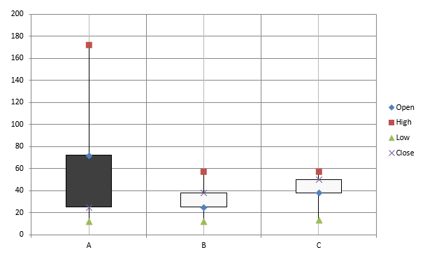

## **Tổng quan**

Bài viết này cung cấp hướng dẫn toàn diện về cách tạo và tùy chỉnh biểu đồ bằng Aspose.Slides for PHP via Java. Bạn sẽ học cách lập trình để thêm biểu đồ vào một slide, điền dữ liệu vào và áp dụng các tùy chọn định dạng khác nhau để phù hợp với yêu cầu thiết kế của mình. Trong suốt bài viết, các ví dụ mã chi tiết minh họa từng bước, từ khởi tạo đối tượng Presentation và Chart cho đến cấu hình series, trục và legend. Khi làm theo hướng dẫn này, bạn sẽ nắm vững cách tích hợp việc tạo biểu đồ động vào các ứng dụng PHP, giúp đơn giản hoá quá trình tạo bản trình bày dựa trên dữ liệu.

## **Tạo biểu đồ**

Biểu đồ giúp người dùng nhanh chóng hình dung dữ liệu và rút ra những hiểu biết mà có thể không ngay lập tức thấy được từ bảng hoặc bảng tính.

**Tại sao nên tạo biểu đồ?**

Sử dụng biểu đồ, bạn có thể:

* tổng hợp, thu gọn hoặc tóm tắt một lượng lớn dữ liệu trên một slide trong bản trình bày;
* phát hiện các mẫu và xu hướng trong dữ liệu;
* suy ra hướng và động lực của dữ liệu theo thời gian hoặc theo một đơn vị đo lường cụ thể;
* phát hiện các ngoại lệ, sai lệch, lỗi và dữ liệu vô lý;
* truyền đạt hoặc trình bày dữ liệu phức tạp.

Trong PowerPoint, bạn có thể tạo biểu đồ qua chức năng *Insert*, cung cấp các mẫu để thiết kế nhiều loại biểu đồ. Sử dụng Aspose.Slides, bạn có thể tạo cả biểu đồ thông thường (dựa trên các loại biểu đồ phổ biến) và biểu đồ tùy chỉnh.

{}
Sử dụng enumeration [ChartType](https://reference.aspose.com/slides/php-java/aspose.slides/charttype/) trong namespace [aspose\slides](https://reference.aspose.com/slides/php-java/aspose.slides/). Các giá trị trong enumeration này tương ứng với các loại biểu đồ khác nhau.
{}

### **Tạo biểu đồ Cột Nhóm**

Ví dụ này sử dụng [addChart](https://reference.aspose.com/slides/php-java/aspose.slides/shapecollection/addchart/) để tạo một biểu đồ cột nhóm so sánh hai series qua ba danh mục. Các series sử dụng màu nền đỏ và xanh lá, và các nhãn riêng lẻ hiển thị tên danh mục, tên series và giá trị. Chỉ số worksheet 0 đề cập đến sheet đầu tiên trong workbook biểu đồ nhúng.

```php
use aspose\slides\ChartType;
use aspose\slides\FillType;
use aspose\slides\NullableBool;
use aspose\slides\Presentation;
use aspose\slides\SaveFormat;

$presentation = new Presentation();
try
{
    $slide = $presentation->getSlides()->get_Item(0);

    $chart = $slide->getShapes()->addChart(ChartType::ClusteredColumn, 20, 20, 500, 300);

    $chart->getChartTitle()->addTextFrameForOverriding("Sample Title");
    $chart->getChartTitle()->getTextFrameForOverriding()->getTextFrameFormat()->setCenterText(NullableBool::True);
    $chart->getChartTitle()->setHeight(20);
    $chart->setTitle(true);

    $workbook = $chart->getChartData()->getChartDataWorkbook();
    $worksheetIndex = 0;

    $chart->getChartData()->getSeries()->clear();
    $chart->getChartData()->getCategories()->clear();

    $seriesNameCell = $workbook->getCell($worksheetIndex, 0, 1, "Series 1");
    $chart->getChartData()->getSeries()->add($seriesNameCell, $chart->getType());
    $seriesNameCell = $workbook->getCell($worksheetIndex, 0, 2, "Series 2");
    $chart->getChartData()->getSeries()->add($seriesNameCell, $chart->getType());

    $categoryCell = $workbook->getCell($worksheetIndex, 1, 0, "Category 1");
    $chart->getChartData()->getCategories()->add($categoryCell);
    $categoryCell = $workbook->getCell($worksheetIndex, 2, 0, "Category 2");
    $chart->getChartData()->getCategories()->add($categoryCell);
    $categoryCell = $workbook->getCell($worksheetIndex, 3, 0, "Category 3");
    $chart->getChartData()->getCategories()->add($categoryCell);

    $series = $chart->getChartData()->getSeries()->get_Item(0);

    $valueCell = $workbook->getCell($worksheetIndex, 1, 1, 20);
    $series->getDataPoints()->addDataPointForBarSeries($valueCell);
    $valueCell = $workbook->getCell($worksheetIndex, 2, 1, 50);
    $series->getDataPoints()->addDataPointForBarSeries($valueCell);
    $valueCell = $workbook->getCell($worksheetIndex, 3, 1, 30);
    $series->getDataPoints()->addDataPointForBarSeries($valueCell);

    $series->getFormat()->getFill()->setFillType(FillType::Solid);
    $color = new Java("java.awt.Color", 255, 0, 0);
    $series->getFormat()->getFill()->getSolidFillColor()->setColor($color);

    $series = $chart->getChartData()->getSeries()->get_Item(1);

    $valueCell = $workbook->getCell($worksheetIndex, 1, 2, 30);
    $series->getDataPoints()->addDataPointForBarSeries($valueCell);
    $valueCell = $workbook->getCell($worksheetIndex, 2, 2, 10);
    $series->getDataPoints()->addDataPointForBarSeries($valueCell);
    $valueCell = $workbook->getCell($worksheetIndex, 3, 2, 60);
    $series->getDataPoints()->addDataPointForBarSeries($valueCell);

    $series->getFormat()->getFill()->setFillType(FillType::Solid);
    $color = new Java("java.awt.Color", 0, 128, 0);
    $series->getFormat()->getFill()->getSolidFillColor()->setColor($color);

    $label = $series->getDataPoints()->get_Item(0)->getLabel();
    $label->getDataLabelFormat()->setShowCategoryName(true);

    $label = $series->getDataPoints()->get_Item(1)->getLabel();
    $label->getDataLabelFormat()->setShowSeriesName(true);

    $label = $series->getDataPoints()->get_Item(2)->getLabel();
    $label->getDataLabelFormat()->setShowValue(true);
    $label->getDataLabelFormat()->setShowSeriesName(true);
    $label->getDataLabelFormat()->setSeparator("/");

    $presentation->save("AsposeChart.pptx", SaveFormat::Pptx);
}
finally
{
    $presentation->dispose();
}
```

Kết quả:


### **Tạo biểu đồ Phân tán**

Biểu đồ phân tán (còn gọi là scatter plot hoặc đồ thị x‑y) thường được dùng để kiểm tra các mẫu hoặc chứng minh mối tương quan giữa hai biến.

Sử dụng biểu đồ phân tán khi:

* Bạn có dữ liệu số cặp đôi.
* Bạn có hai biến liên quan chặt chẽ với nhau.
* Bạn muốn xác định liệu hai biến có liên quan hay không.
* Bạn có một biến độc lập có nhiều giá trị cho một biến phụ thuộc.

Ví dụ này vẽ hai bộ giá trị x‑y. Series đầu tiên dùng đường thẳng với dấu sao, trong khi series thứ hai dùng đường mượt với dấu vòng; cả hai đều có kích thước dấu 10, được cấu hình bằng [setSize](https://reference.aspose.com/slides/php-java/aspose.slides/marker/setsize/). Phương thức [setSymbol](https://reference.aspose.com/slides/php-java/aspose.slides/marker/setsymbol/) kiểm soát hình dạng dấu.

```php
use aspose\slides\ChartType;
use aspose\slides\MarkerStyleType;
use aspose\slides\Presentation;
use aspose\slides\SaveFormat;

$presentation = new Presentation();
try
{
    $slide = $presentation->getSlides()->get_Item(0);

    $chart = $slide->getShapes()->addChart(ChartType::ScatterWithSmoothLines, 20, 20, 500, 300);

    $workbook = $chart->getChartData()->getChartDataWorkbook();
    $worksheetIndex = 0;

    $chart->getChartData()->getSeries()->clear();

    $seriesNameCell = $workbook->getCell($worksheetIndex, 1, 1, "Series 1");
    $chart->getChartData()->getSeries()->add($seriesNameCell, $chart->getType());
    $seriesNameCell = $workbook->getCell($worksheetIndex, 1, 3, "Series 2");
    $chart->getChartData()->getSeries()->add($seriesNameCell, $chart->getType());

    $series = $chart->getChartData()->getSeries()->get_Item(0);

    $xValueCell = $workbook->getCell($worksheetIndex, 2, 1, 1);
    $yValueCell = $workbook->getCell($worksheetIndex, 2, 2, 3);
    $series->getDataPoints()->addDataPointForScatterSeries($xValueCell, $yValueCell);

    $xValueCell = $workbook->getCell($worksheetIndex, 3, 1, 2);
    $yValueCell = $workbook->getCell($worksheetIndex, 3, 2, 10);
    $series->getDataPoints()->addDataPointForScatterSeries($xValueCell, $yValueCell);

    $series->setType(ChartType::ScatterWithStraightLinesAndMarkers);

    $series->getMarker()->setSize(10);
    $series->getMarker()->setSymbol(MarkerStyleType::Star);

    $series = $chart->getChartData()->getSeries()->get_Item(1);

    $xValueCell = $workbook->getCell($worksheetIndex, 2, 3, 5);
    $yValueCell = $workbook->getCell($worksheetIndex, 2, 4, 2);
    $series->getDataPoints()->addDataPointForScatterSeries($xValueCell, $yValueCell);

    $xValueCell = $workbook->getCell($worksheetIndex, 3, 3, 3);
    $yValueCell = $workbook->getCell($worksheetIndex, 3, 4, 1);
    $series->getDataPoints()->addDataPointForScatterSeries($xValueCell, $yValueCell);

    $xValueCell = $workbook->getCell($worksheetIndex, 4, 3, 2);
    $yValueCell = $workbook->getCell($worksheetIndex, 4, 4, 2);
    $series->getDataPoints()->addDataPointForScatterSeries($xValueCell, $yValueCell);

    $xValueCell = $workbook->getCell($worksheetIndex, 5, 3, 5);
    $yValueCell = $workbook->getCell($worksheetIndex, 5, 4, 1);
    $series->getDataPoints()->addDataPointForScatterSeries($xValueCell, $yValueCell);

    $series->getMarker()->setSize(10);
    $series->getMarker()->setSymbol(MarkerStyleType::Circle);

    $presentation->save("AsposeChart.pptx", SaveFormat::Pptx);
}
finally
{
    $presentation->dispose();
}
```

Kết quả:


### **Tạo biểu đồ Tròn**

Biểu đồ tròn thích hợp để hiển thị mối quan hệ phần‑so‑toàn trong dữ liệu, đặc biệt khi dữ liệu chứa các nhãn phân loại kèm giá trị số. Tuy nhiên, nếu dữ liệu của bạn có quá nhiều phần hoặc nhãn, bạn có thể cân nhắc sử dụng biểu đồ cột thay vì.

Ví dụ này tạo một biểu đồ tròn với ba giá trị theo quý. Mỗi miếng có nền và viền tùy chỉnh, và các nhãn hiển thị các kết hợp khác nhau của giá trị, phần trăm và thông tin series. Phương thức [setFirstSliceAngle](https://reference.aspose.com/slides/php-java/aspose.slides/chartseriesgroup/setfirstsliceangle/) đặt góc bắt đầu cho miếng đầu tiên là 180 độ.

```php
use aspose\slides\ChartType;
use aspose\slides\FillType;
use aspose\slides\LineDashStyle;
use aspose\slides\LineStyle;
use aspose\slides\NullableBool;
use aspose\slides\Presentation;
use aspose\slides\SaveFormat;

$presentation = new Presentation();
try
{
    $slide = $presentation->getSlides()->get_Item(0);

    $chart = $slide->getShapes()->addChart(ChartType::Pie, 20, 20, 500, 300);

    $chart->getChartTitle()->addTextFrameForOverriding("Sample Title");
    $chart->getChartTitle()->getTextFrameForOverriding()->getTextFrameFormat()->setCenterText(NullableBool::True);
    $chart->getChartTitle()->setHeight(20);
    $chart->setTitle(true);

    $chart->getChartData()->getSeries()->get_Item(0)->getLabels()->getDefaultDataLabelFormat()->setShowValue(true);

    $workbook = $chart->getChartData()->getChartDataWorkbook();
    $worksheetIndex = 0;

    $chart->getChartData()->getSeries()->clear();
    $chart->getChartData()->getCategories()->clear();

    $categoryCell = $workbook->getCell(0, 1, 0, "1st Qtr");
    $chart->getChartData()->getCategories()->add($categoryCell);
    $categoryCell = $workbook->getCell(0, 2, 0, "2nd Qtr");
    $chart->getChartData()->getCategories()->add($categoryCell);
    $categoryCell = $workbook->getCell(0, 3, 0, "3rd Qtr");
    $chart->getChartData()->getCategories()->add($categoryCell);

    $seriesNameCell = $workbook->getCell(0, 0, 1, "Series 1");
    $series = $chart->getChartData()->getSeries()->add($seriesNameCell, $chart->getType());

    $valueCell = $workbook->getCell($worksheetIndex, 1, 1, 20);
    $series->getDataPoints()->addDataPointForPieSeries($valueCell);
    $valueCell = $workbook->getCell($worksheetIndex, 2, 1, 50);
    $series->getDataPoints()->addDataPointForPieSeries($valueCell);
    $valueCell = $workbook->getCell($worksheetIndex, 3, 1, 30);
    $series->getDataPoints()->addDataPointForPieSeries($valueCell);

    $chart->getChartData()->getSeriesGroups()->get_Item(0)->setColorVaried(true);

    $firstSlice = $series->getDataPoints()->get_Item(0);
    $firstSlice->getFormat()->getFill()->setFillType(FillType::Solid);
    $color = new Java("java.awt.Color", 0, 255, 255);
    $firstSlice->getFormat()->getFill()->getSolidFillColor()->setColor($color);

    $firstSlice->getFormat()->getLine()->getFillFormat()->setFillType(FillType::Solid);
    $color = new Java("java.awt.Color", 128, 128, 128);
    $firstSlice->getFormat()->getLine()->getFillFormat()->getSolidFillColor()->setColor($color);
    $firstSlice->getFormat()->getLine()->setWidth(3.0);
    $firstSlice->getFormat()->getLine()->setStyle(LineStyle::ThinThick);
    $firstSlice->getFormat()->getLine()->setDashStyle(LineDashStyle::LargeDash);

    $secondSlice = $series->getDataPoints()->get_Item(1);
    $secondSlice->getFormat()->getFill()->setFillType(FillType::Solid);
    $color = new Java("java.awt.Color", 165, 42, 42);
    $secondSlice->getFormat()->getFill()->getSolidFillColor()->setColor($color);

    $secondSlice->getFormat()->getLine()->getFillFormat()->setFillType(FillType::Solid);
    $color = new Java("java.awt.Color", 0, 0, 255);
    $secondSlice->getFormat()->getLine()->getFillFormat()->getSolidFillColor()->setColor($color);
    $secondSlice->getFormat()->getLine()->setWidth(3.0);
    $secondSlice->getFormat()->getLine()->setStyle(LineStyle::Single);
    $secondSlice->getFormat()->getLine()->setDashStyle(LineDashStyle::LargeDashDot);

    $thirdSlice = $series->getDataPoints()->get_Item(2);
    $thirdSlice->getFormat()->getFill()->setFillType(FillType::Solid);
    $color = new Java("java.awt.Color", 255, 127, 80);
    $thirdSlice->getFormat()->getFill()->getSolidFillColor()->setColor($color);

    $thirdSlice->getFormat()->getLine()->getFillFormat()->setFillType(FillType::Solid);
    $color = new Java("java.awt.Color", 255, 0, 0);
    $thirdSlice->getFormat()->getLine()->getFillFormat()->getSolidFillColor()->setColor($color);
    $thirdSlice->getFormat()->getLine()->setWidth(2.0);
    $thirdSlice->getFormat()->getLine()->setStyle(LineStyle::ThinThin);
    $thirdSlice->getFormat()->getLine()->setDashStyle(LineDashStyle::LargeDashDotDot);

    $firstLabel = $series->getDataPoints()->get_Item(0)->getLabel();
    $firstLabel->getDataLabelFormat()->setShowValue(true);

    $secondLabel = $series->getDataPoints()->get_Item(1)->getLabel();
    $secondLabel->getDataLabelFormat()->setShowValue(true);
    $secondLabel->getDataLabelFormat()->setShowLegendKey(true);
    $secondLabel->getDataLabelFormat()->setShowPercentage(true);

    $thirdLabel = $series->getDataPoints()->get_Item(2)->getLabel();
    $thirdLabel->getDataLabelFormat()->setShowSeriesName(true);
    $thirdLabel->getDataLabelFormat()->setShowPercentage(true);

    $series->getLabels()->getDefaultDataLabelFormat()->setShowLeaderLines(true);

    $chart->getChartData()->getSeriesGroups()->get_Item(0)->setFirstSliceAngle(180);

    $presentation->save("PieChart.pptx", SaveFormat::Pptx);
}
finally
{
    $presentation->dispose();
}
```

Kết quả:


### **Tạo biểu đồ Đường**

Biểu đồ đường (còn gọi là line graph) thích hợp trong các trường hợp bạn muốn thể hiện sự thay đổi giá trị theo thời gian. Sử dụng biểu đồ đường, bạn có thể so sánh một lượng lớn dữ liệu cùng lúc, theo dõi sự thay đổi và xu hướng theo thời gian, làm nổi bật các bất thường trong series dữ liệu, và nhiều hơn nữa.

Ví dụ này sử dụng [addChart](https://reference.aspose.com/slides/php-java/aspose.slides/shapecollection/addchart/) để tạo một biểu đồ đường với series và danh mục mặc định, sau đó lưu bản trình bày dưới dạng PPTX.

```php
use aspose\slides\ChartType;
use aspose\slides\Presentation;
use aspose\slides\SaveFormat;

$presentation = new Presentation();
try
{
    $slide = $presentation->getSlides()->get_Item(0);

    $lineChart = $slide->getShapes()->addChart(ChartType::Line, 20, 20, 500, 300);

    $presentation->save("lineChart.pptx", SaveFormat::Pptx);
}
finally
{
    $presentation->dispose();
}
```

Mặc định, các điểm trên biểu đồ đường được nối bằng các đường thẳng liên tục. Nếu bạn muốn các điểm được nối bằng dấu gạch ngang, hãy gọi [setDashStyle](https://reference.aspose.com/slides/php-java/aspose.slides/lineformat/setdashstyle/) với giá trị từ [LineDashStyle](https://reference.aspose.com/slides/php-java/aspose.slides/linedashstyle/):

```php
use aspose\slides\ChartType;
use aspose\slides\LineDashStyle;
use aspose\slides\Presentation;

$presentation = new Presentation();
try
{
    $slide = $presentation->getSlides()->get_Item(0);

    $lineChart = $slide->getShapes()->addChart(ChartType::Line, 20, 20, 500, 300);

    for ($i = 0; $i < java_values($lineChart->getChartData()->getSeries()->size()); $i++)
    {
        $series = $lineChart->getChartData()->getSeries()->get_Item($i);
        $series->getFormat()->getLine()->setDashStyle(LineDashStyle::Dash);
    }
}
finally
{
    $presentation->dispose();
}
```

Kết quả:


### **Tạo biểu đồ Cây (Tree Map)**

Biểu đồ cây phù hợp với dữ liệu bán hàng khi bạn muốn hiển thị kích thước tương đối của các danh mục dữ liệu và nhanh chóng thu hút sự chú ý tới những mục đóng góp lớn trong mỗi danh mục.

Ví dụ này tạo một cây với tám lá được nhóm thành bốn thân và hai nhánh. Phương thức [setGroupingItem](https://reference.aspose.com/slides/php-java/aspose.slides/chartcategorylevelsmanager/setgroupingitem/) gán các thân ở mức nhóm 1 và các nhánh ở mức 2. Giá trị xác định kích thước hình chữ nhật tương đối, trong khi nhãn danh mục và nhãn cha chồng chéo xác định cây phân cấp.

```php
use aspose\slides\ChartType;
use aspose\slides\ParentLabelLayoutType;
use aspose\slides\Presentation;
use aspose\slides\SaveFormat;

$presentation = new Presentation();
try
{
    $slide = $presentation->getSlides()->get_Item(0);

    $chart = $slide->getShapes()->addChart(ChartType::Treemap, 20, 20, 500, 300);

    $chart->getChartData()->getCategories()->clear();
    $chart->getChartData()->getSeries()->clear();

    $workbook = $chart->getChartData()->getChartDataWorkbook();
    $workbook->clear(0);

    // Nhánh 1
    $categoryCell = $workbook->getCell(0, "C1", "Leaf1");
    $leaf = $chart->getChartData()->getCategories()->add($categoryCell);
    $leaf->getGroupingLevels()->setGroupingItem(1, "Stem1");
    $leaf->getGroupingLevels()->setGroupingItem(2, "Branch1");

    $categoryCell = $workbook->getCell(0, "C2", "Leaf2");
    $chart->getChartData()->getCategories()->add($categoryCell);

    $categoryCell = $workbook->getCell(0, "C3", "Leaf3");
    $leaf = $chart->getChartData()->getCategories()->add($categoryCell);
    $leaf->getGroupingLevels()->setGroupingItem(1, "Stem2");

    $categoryCell = $workbook->getCell(0, "C4", "Leaf4");
    $chart->getChartData()->getCategories()->add($categoryCell);

    // Nhánh 2
    $categoryCell = $workbook->getCell(0, "C5", "Leaf5");
    $leaf = $chart->getChartData()->getCategories()->add($categoryCell);
    $leaf->getGroupingLevels()->setGroupingItem(1, "Stem3");
    $leaf->getGroupingLevels()->setGroupingItem(2, "Branch2");

    $categoryCell = $workbook->getCell(0, "C6", "Leaf6");
    $chart->getChartData()->getCategories()->add($categoryCell);

    $categoryCell = $workbook->getCell(0, "C7", "Leaf7");
    $leaf = $chart->getChartData()->getCategories()->add($categoryCell);
    $leaf->getGroupingLevels()->setGroupingItem(1, "Stem4");

    $categoryCell = $workbook->getCell(0, "C8", "Leaf8");
    $chart->getChartData()->getCategories()->add($categoryCell);

    $series = $chart->getChartData()->getSeries()->add(ChartType::Treemap);
    $series->getLabels()->getDefaultDataLabelFormat()->setShowCategoryName(true);
    $valueCell = $workbook->getCell(0, "D1", 4);
    $series->getDataPoints()->addDataPointForTreemapSeries($valueCell);
    $valueCell = $workbook->getCell(0, "D2", 5);
    $series->getDataPoints()->addDataPointForTreemapSeries($valueCell);
    $valueCell = $workbook->getCell(0, "D3", 3);
    $series->getDataPoints()->addDataPointForTreemapSeries($valueCell);
    $valueCell = $workbook->getCell(0, "D4", 6);
    $series->getDataPoints()->addDataPointForTreemapSeries($valueCell);
    $valueCell = $workbook->getCell(0, "D5", 9);
    $series->getDataPoints()->addDataPointForTreemapSeries($valueCell);
    $valueCell = $workbook->getCell(0, "D6", 9);
    $series->getDataPoints()->addDataPointForTreemapSeries($valueCell);
    $valueCell = $workbook->getCell(0, "D7", 4);
    $series->getDataPoints()->addDataPointForTreemapSeries($valueCell);
    $valueCell = $workbook->getCell(0, "D8", 3);
    $series->getDataPoints()->addDataPointForTreemapSeries($valueCell);

    $series->setParentLabelLayout(ParentLabelLayoutType::Overlapping);

    $presentation->save("Treemap.pptx", SaveFormat::Pptx);
}
finally
{
    $presentation->dispose();
}
```

Kết quả:


### **Tạo biểu đồ Thác nước (Waterfall)**

Biểu đồ thác nước cho thấy cách các thay đổi dương và âm đóng góp vào giá trị cuối cùng. Ví dụ, một bản phân tích lợi nhuận có thể bắt đầu từ doanh thu, trừ chi phí, và cộng thêm các khoản thu khác. Các cột thay đổi nổi giữa các giá trị chạy trước và sau, trong khi cột tổng mở rộng từ 0 đến giá trị tích lũy.

Ví dụ sau sử dụng các khoản tiền tính bằng hàng ngàn USD:

| Danh mục | Giá trị trong Workbook | Loại cột |
| --- | ---: | --- |
| Doanh thu | 1000 | Tăng |
| Giá vốn bán hàng | -400 | Giảm |
| Lợi nhuận gộp | 600 | Tổng trung gian |
| Chi phí vận hành | -200 | Giảm |
| Thu nhập khác | 50 | Tăng |
| Lợi nhuận ròng | 450 | Tổng cuối cùng |

Để đánh dấu một điểm là tổng trung gian hoặc tổng cuối cùng, gọi phương thức [setSetAsTotal](https://reference.aspose.com/slides/php-java/aspose.slides/chartdatapoint/setsetastotal/) với `true`. Cung cấp giá trị tích lũy thực tế trong ô workbook của điểm đó: `600` cho lợi nhuận gộp (`1000 - 400`) và `450` cho lợi nhuận ròng (`600 - 200 + 50`). Phương thức này chỉ đánh dấu cột là tổng; nó không tính toán hay điền giá trị ô. Không sử dụng 0 làm chỗ giữ chỗ hay cung cấp thay đổi khác cho điểm tổng. Cột tổng hiển thị giá trị tích lũy mà không cộng lại vào giá trị chạy.

Ví dụ PHP đầy đủ này tạo biểu đồ bằng thành viên `Waterfall` của [ChartType](https://reference.aspose.com/slides/php-java/aspose.slides/charttype/), xóa dữ liệu mặc định và điền workbook nhúng. Chỉ số worksheet `0` chọn sheet đầu tiên; cột A chứa tên danh mục và cột B chứa giá trị. Mỗi ô giá trị được thêm bằng [addDataPointForWaterfallSeries](https://reference.aspose.com/slides/php-java/aspose.slides/chartdatapointcollection/adddatapointforwaterfallseries/). Các chỉ mục điểm không dựa trên zero `2` và `5` xác định tổng trung gian và tổng cuối cùng. Gọi [setShowValue](https://reference.aspose.com/slides/php-java/aspose.slides/datalabelformat/setshowvalue/) với `true` để hiển thị số tiền trên cột. Không cần bản trình bày hoặc workbook đầu vào.

```php
use aspose\slides\ChartType;
use aspose\slides\Presentation;
use aspose\slides\SaveFormat;

$presentation = new Presentation();
try
{
    $slide = $presentation->getSlides()->get_Item(0);

    $chart = $slide->getShapes()->addChart(ChartType::Waterfall, 20, 20, 680, 200);

    $chart->setTitle(true);
    $chart->getChartTitle()->addTextFrameForOverriding("Profit breakdown (USD thousands)");
    $chart->getChartTitle()->setOverlay(false);
    $chart->setLegend(false);

    $chart->getChartData()->getSeries()->clear();
    $chart->getChartData()->getCategories()->clear();

    $workbook = $chart->getChartData()->getChartDataWorkbook();
    $worksheetIndex = 0;

    $workbook->clear($worksheetIndex);

    $seriesNameCell = $workbook->getCell($worksheetIndex, 0, 1, "Profit");
    $series = $chart->getChartData()->getSeries()->add($seriesNameCell, ChartType::Waterfall);
    $categories = [ "Revenue", "Cost of sales", "Gross profit", "Operating expenses", "Other income", "Net profit" ];
    $values = [ 1000, -400, 600, -200, 50, 450 ];

    for ($i = 0; $i < count($categories); $i++)
    {
        $categoryCell = $workbook->getCell($worksheetIndex, $i + 1, 0, $categories[$i]);
        $chart->getChartData()->getCategories()->add($categoryCell);
        $valueCell = $workbook->getCell($worksheetIndex, $i + 1, 1, $values[$i]);
        $series->getDataPoints()->addDataPointForWaterfallSeries($valueCell);
    }

    // Các điểm thứ ba và thứ sáu đại diện cho tổng, không phải các thay đổi bổ sung.
    $series->getDataPoints()->get_Item(2)->setSetAsTotal(true);
    $series->getDataPoints()->get_Item(5)->setSetAsTotal(true);
    $series->setShowConnectorLines(true);
    $series->getLabels()->getDefaultDataLabelFormat()->setShowValue(true);

    $presentation->save("WaterfallChart.pptx", SaveFormat::Pptx);
}
finally
{
    $presentation->dispose();
}
```

Gọi phương thức cấp series [setShowConnectorLines](https://reference.aspose.com/slides/php-java/aspose.slides/chartseries/setshowconnectorlines/) với `true` để hiển thị các đường nối các cột liên tiếp và giúp giá trị chạy dễ theo dõi hơn. Để ẩn các đường này, thay thế lời gọi phương thức trong ví dụ bằng `$series->setShowConnectorLines(false);` trước khi lưu. Thay đổi này chỉ ảnh hưởng tới hiển thị đường, không thay đổi dữ liệu hay tổng.

Bản trình bày đã lưu hiển thị lợi nhuận gộp 600 và lợi nhuận ròng 450, cả hai tổng đều bắt đầu từ 0:


### **Tạo biểu đồ Cổ phiếu (Stock)**

Biểu đồ cổ phiếu được dùng để hiển thị dữ liệu tài chính như giá mở cửa, cao nhất, thấp nhất và đóng cửa, giúp phân tích xu hướng thị trường và độ biến động. Chúng cung cấp những hiểu biết quan trọng về hiệu suất cổ phiếu, hỗ trợ nhà đầu tư và nhà phân tích đưa ra quyết định sáng suốt.

Ví dụ này tạo một biểu đồ OHLC (open‑high‑low‑close) với bốn series theo thứ tự đó và ba danh mục. Phương thức [setUpDownBars](https://reference.aspose.com/slides/php-java/aspose.slides/updownbarsmanager/setupdownbars/) bật thanh lên/xuống, và [getHiLowLinesFormat](https://reference.aspose.com/slides/php-java/aspose.slides/chartseriesgroup/gethilowlinesformat/) điều khiển các đường cao‑thấp hiển thị phạm vi giá, trong khi các đường series riêng lẻ và các đường lưới ngang phụ được ẩn.

```php
use aspose\slides\ChartType;
use aspose\slides\FillType;
use aspose\slides\Presentation;
use aspose\slides\SaveFormat;

$presentation = new Presentation();
try
{
    $slide = $presentation->getSlides()->get_Item(0);

    $chart = $slide->getShapes()->addChart(ChartType::OpenHighLowClose, 20, 20, 500, 300, false);

    $workbook = $chart->getChartData()->getChartDataWorkbook();

    $categoryCell = $workbook->getCell(0, 1, 0, "A");
    $chart->getChartData()->getCategories()->add($categoryCell);
    $categoryCell = $workbook->getCell(0, 2, 0, "B");
    $chart->getChartData()->getCategories()->add($categoryCell);
    $categoryCell = $workbook->getCell(0, 3, 0, "C");
    $chart->getChartData()->getCategories()->add($categoryCell);

    $seriesNameCell = $workbook->getCell(0, 0, 1, "Open");
    $chart->getChartData()->getSeries()->add($seriesNameCell, ChartType::OpenHighLowClose);
    $seriesNameCell = $workbook->getCell(0, 0, 2, "High");
    $chart->getChartData()->getSeries()->add($seriesNameCell, ChartType::OpenHighLowClose);
    $seriesNameCell = $workbook->getCell(0, 0, 3, "Low");
    $chart->getChartData()->getSeries()->add($seriesNameCell, ChartType::OpenHighLowClose);
    $seriesNameCell = $workbook->getCell(0, 0, 4, "Close");
    $chart->getChartData()->getSeries()->add($seriesNameCell, ChartType::OpenHighLowClose);

    $series = $chart->getChartData()->getSeries()->get_Item(0);
    $valueCell = $workbook->getCell(0, 1, 1, 72);
    $series->getDataPoints()->addDataPointForStockSeries($valueCell);
    $valueCell = $workbook->getCell(0, 2, 1, 25);
    $series->getDataPoints()->addDataPointForStockSeries($valueCell);
    $valueCell = $workbook->getCell(0, 3, 1, 38);
    $series->getDataPoints()->addDataPointForStockSeries($valueCell);

    $series = $chart->getChartData()->getSeries()->get_Item(1);
    $valueCell = $workbook->getCell(0, 1, 2, 172);
    $series->getDataPoints()->addDataPointForStockSeries($valueCell);
    $valueCell = $workbook->getCell(0, 2, 2, 57);
    $series->getDataPoints()->addDataPointForStockSeries($valueCell);
    $valueCell = $workbook->getCell(0, 3, 2, 57);
    $series->getDataPoints()->addDataPointForStockSeries($valueCell);

    $series = $chart->getChartData()->getSeries()->get_Item(2);
    $valueCell = $workbook->getCell(0, 1, 3, 12);
    $series->getDataPoints()->addDataPointForStockSeries($valueCell);
    $valueCell = $workbook->getCell(0, 2, 3, 12);
    $series->getDataPoints()->addDataPointForStockSeries($valueCell);
    $valueCell = $workbook->getCell(0, 3, 3, 13);
    $series->getDataPoints()->addDataPointForStockSeries($valueCell);

    $series = $chart->getChartData()->getSeries()->get_Item(3);
    $valueCell = $workbook->getCell(0, 1, 4, 25);
    $series->getDataPoints()->addDataPointForStockSeries($valueCell);
    $valueCell = $workbook->getCell(0, 2, 4, 38);
    $series->getDataPoints()->addDataPointForStockSeries($valueCell);
    $valueCell = $workbook->getCell(0, 3, 4, 50);
    $series->getDataPoints()->addDataPointForStockSeries($valueCell);

    $chart->getChartData()->getSeriesGroups()->get_Item(0)->getUpDownBars()->setUpDownBars(true);
    $chart->getChartData()->getSeriesGroups()->get_Item(0)->getHiLowLinesFormat()->getLine()->getFillFormat()->setFillType(FillType::Solid);

    for ($i = 0; $i < java_values($chart->getChartData()->getSeries()->size()); $i++)
    {
        $stockSeries = $chart->getChartData()->getSeries()->get_Item($i);
        $stockSeries->getFormat()->getLine()->getFillFormat()->setFillType(FillType::NoFill);
    }

    $chart->getAxes()->getVerticalAxis()->getMinorGridLinesFormat()->getLine()->getFillFormat()->setFillType(FillType::NoFill);

    $presentation->save("Stock-chart.pptx", SaveFormat::Pptx);
}
finally
{
    $presentation->dispose();
}
```

Kết quả:



### **Tạo biểu đồ Hộp và Râu (Box and Whisker)**

Biểu đồ hộp và râu được dùng để hiển thị phân bố dữ liệu bằng cách tóm tắt các chỉ số thống kê chính, chẳng hạn như trung vị, các phần tư và các ngoại lệ tiềm năng. Chúng đặc biệt hữu ích trong phân tích dữ liệu khám phá và các nghiên cứu thống kê để nhanh chóng hiểu biến đổi dữ liệu và xác định bất thường.

Ví dụ này tạo một biểu đồ hộp và râu từ sáu giá trị. Phương thức [setQuartileMethod](https://reference.aspose.com/slides/php-java/aspose.slides/chartseries/setquartilemethod/) chọn cách tính phần tư riêng (exclusive). Ví dụ cũng bật các đường trung bình, dấu trung bình, các điểm nội bộ và các điểm ngoại lệ.

```php
use aspose\slides\ChartType;
use aspose\slides\Presentation;
use aspose\slides\QuartileMethodType;
use aspose\slides\SaveFormat;

$presentation = new Presentation();
try
{
    $slide = $presentation->getSlides()->get_Item(0);

    $chart = $slide->getShapes()->addChart(ChartType::BoxAndWhisker, 20, 20, 500, 300);

    $chart->getChartData()->getCategories()->clear();
    $chart->getChartData()->getSeries()->clear();

    $workbook = $chart->getChartData()->getChartDataWorkbook();
    $workbook->clear(0);

    $categoryCell = $workbook->getCell(0, "A1", "Category 1");
    $chart->getChartData()->getCategories()->add($categoryCell);
    $categoryCell = $workbook->getCell(0, "A2", "Category 2");
    $chart->getChartData()->getCategories()->add($categoryCell);
    $categoryCell = $workbook->getCell(0, "A3", "Category 3");
    $chart->getChartData()->getCategories()->add($categoryCell);
    $categoryCell = $workbook->getCell(0, "A4", "Category 4");
    $chart->getChartData()->getCategories()->add($categoryCell);
    $categoryCell = $workbook->getCell(0, "A5", "Category 5");
    $chart->getChartData()->getCategories()->add($categoryCell);
    $categoryCell = $workbook->getCell(0, "A6", "Category 6");
    $chart->getChartData()->getCategories()->add($categoryCell);

    $series = $chart->getChartData()->getSeries()->add(ChartType::BoxAndWhisker);

    $series->setQuartileMethod(QuartileMethodType::Exclusive);
    $series->setShowMeanLine(true);
    $series->setShowMeanMarkers(true);
    $series->setShowInnerPoints(true);
    $series->setShowOutlierPoints(true);

    $valueCell = $workbook->getCell(0, "B1", 15);
    $series->getDataPoints()->addDataPointForBoxAndWhiskerSeries($valueCell);
    $valueCell = $workbook->getCell(0, "B2", 41);
    $series->getDataPoints()->addDataPointForBoxAndWhiskerSeries($valueCell);
    $valueCell = $workbook->getCell(0, "B3", 16);
    $series->getDataPoints()->addDataPointForBoxAndWhiskerSeries($valueCell);
    $valueCell = $workbook->getCell(0, "B4", 10);
    $series->getDataPoints()->addDataPointForBoxAndWhiskerSeries($valueCell);
    $valueCell = $workbook->getCell(0, "B5", 23);
    $series->getDataPoints()->addDataPointForBoxAndWhiskerSeries($valueCell);
    $valueCell = $workbook->getCell(0, "B6", 16);
    $series->getDataPoints()->addDataPointForBoxAndWhiskerSeries($valueCell);

    $presentation->save("BoxAndWhisker.pptx", SaveFormat::Pptx);
}
finally
{
    $presentation->dispose();
}
```

### **Tạo biểu đồ Phễu (Funnel)**

Biểu đồ phễu được dùng để trực quan hoá các quy trình gồm nhiều giai đoạn liên tiếp, trong đó khối lượng dữ liệu giảm dần khi tiến từ bước này sang bước tiếp theo. Chúng đặc biệt hữu ích để phân tích tỷ lệ chuyển đổi, xác định các nút thắt và theo dõi hiệu quả của quy trình bán hàng hoặc tiếp thị.

Ví dụ này sử dụng [addChart](https://reference.aspose.com/slides/php-java/aspose.slides/shapecollection/addchart/) để thêm một biểu đồ phễu vào slide đầu tiên của bản trình bày hiện có. Nó thay thế dữ liệu mặc định bằng sáu danh mục và các giá trị từ 50 đến 500, sau đó lưu bản trình bày đã cập nhật. Bản trình bày đầu vào phải chứa ít nhất một slide.

```php
use aspose\slides\ChartType;
use aspose\slides\Presentation;
use aspose\slides\SaveFormat;

$presentation = new Presentation("test.pptx");
try
{
    $slide = $presentation->getSlides()->get_Item(0);

    $chart = $slide->getShapes()->addChart(ChartType::Funnel, 50, 50, 500, 400);

    $chart->getChartData()->getCategories()->clear();
    $chart->getChartData()->getSeries()->clear();

    $workbook = $chart->getChartData()->getChartDataWorkbook();
    $workbook->clear(0);

    $categoryCell = $workbook->getCell(0, "A1", "Category 1");
    $chart->getChartData()->getCategories()->add($categoryCell);
    $categoryCell = $workbook->getCell(0, "A2", "Category 2");
    $chart->getChartData()->getCategories()->add($categoryCell);
    $categoryCell = $workbook->getCell(0, "A3", "Category 3");
    $chart->getChartData()->getCategories()->add($categoryCell);
    $categoryCell = $workbook->getCell(0, "A4", "Category 4");
    $chart->getChartData()->getCategories()->add($categoryCell);
    $categoryCell = $workbook->getCell(0, "A5", "Category 5");
    $chart->getChartData()->getCategories()->add($categoryCell);
    $categoryCell = $workbook->getCell(0, "A6", "Category 6");
    $chart->getChartData()->getCategories()->add($categoryCell);

    $series = $chart->getChartData()->getSeries()->add(ChartType::Funnel);

    $valueCell = $workbook->getCell(0, "B1", 50);
    $series->getDataPoints()->addDataPointForFunnelSeries($valueCell);
    $valueCell = $workbook->getCell(0, "B2", 100);
    $series->getDataPoints()->addDataPointForFunnelSeries($valueCell);
    $valueCell = $workbook->getCell(0, "B3", 200);
    $series->getDataPoints()->addDataPointForFunnelSeries($valueCell);
    $valueCell = $workbook->getCell(0, "B4", 300);
    $series->getDataPoints()->addDataPointForFunnelSeries($valueCell);
    $valueCell = $workbook->getCell(0, "B5", 400);
    $series->getDataPoints()->addDataPointForFunnelSeries($valueCell);
    $valueCell = $workbook->getCell(0, "B6", 500);
    $series->getDataPoints()->addDataPointForFunnelSeries($valueCell);

    $presentation->save("Funnel.pptx", SaveFormat::Pptx);
}
finally
{
    $presentation->dispose();
}
```

Kết quả:


### **Tạo biểu đồ Mặt trăng (Sunburst)**

Biểu đồ mặt trăng được dùng để trực quan hoá dữ liệu phân cấp, hiển thị các mức độ dưới dạng các vòng đồng tâm. Chúng giúp minh họa mối quan hệ phần‑so‑toàn và là lựa chọn lý tưởng cho việc biểu diễn các danh mục lồng nhau và các danh mục con trong một định dạng rõ ràng, gọn gàng.

Ví dụ này tạo một biểu đồ mặt trăng với tám lá được nhóm thành bốn thân và hai nhánh. Phương thức [setGroupingItem](https://reference.aspose.com/slides/php-java/aspose.slides/chartcategorylevelsmanager/setgroupingitem/) gán các thân ở mức nhóm 1 và các nhánh ở mức 2. Nhãn danh mục xác định các phân đoạn, và các giá trị quyết định kích thước tương đối của chúng.

```php
use aspose\slides\ChartType;
use aspose\slides\Presentation;
use aspose\slides\SaveFormat;

$presentation = new Presentation();
try
{
    $slide = $presentation->getSlides()->get_Item(0);

    $chart = $slide->getShapes()->addChart(ChartType::Sunburst, 20, 20, 500, 300);

    $chart->getChartData()->getCategories()->clear();
    $chart->getChartData()->getSeries()->clear();

    $workbook = $chart->getChartData()->getChartDataWorkbook();
    $workbook->clear(0);

    // Nhánh 1
    $categoryCell = $workbook->getCell(0, "C1", "Leaf1");
    $leaf = $chart->getChartData()->getCategories()->add($categoryCell);
    $leaf->getGroupingLevels()->setGroupingItem(1, "Stem1");
    $leaf->getGroupingLevels()->setGroupingItem(2, "Branch1");

    $categoryCell = $workbook->getCell(0, "C2", "Leaf2");
    $chart->getChartData()->getCategories()->add($categoryCell);

    $categoryCell = $workbook->getCell(0, "C3", "Leaf3");
    $leaf = $chart->getChartData()->getCategories()->add($categoryCell);
    $leaf->getGroupingLevels()->setGroupingItem(1, "Stem2");

    $categoryCell = $workbook->getCell(0, "C4", "Leaf4");
    $chart->getChartData()->getCategories()->add($categoryCell);

    // Nhánh 2
    $categoryCell = $workbook->getCell(0, "C5", "Leaf5");
    $leaf = $chart->getChartData()->getCategories()->add($categoryCell);
    $leaf->getGroupingLevels()->setGroupingItem(1, "Stem3");
    $leaf->getGroupingLevels()->setGroupingItem(2, "Branch2");

    $categoryCell = $workbook->getCell(0, "C6", "Leaf6");
    $chart->getChartData()->getCategories()->add($categoryCell);

    $categoryCell = $workbook->getCell(0, "C7", "Leaf7");
    $leaf = $chart->getChartData()->getCategories()->add($categoryCell);
    $leaf->getGroupingLevels()->setGroupingItem(1, "Stem4");

    $categoryCell = $workbook->getCell(0, "C8", "Leaf8");
    $chart->getChartData()->getCategories()->add($categoryCell);

    $series = $chart->getChartData()->getSeries()->add(ChartType::Sunburst);
    $series->getLabels()->getDefaultDataLabelFormat()->setShowCategoryName(true);
    $valueCell = $workbook->getCell(0, "D1", 4);
    $series->getDataPoints()->addDataPointForSunburstSeries($valueCell);
    $valueCell = $workbook->getCell(0, "D2", 5);
    $series->getDataPoints()->addDataPointForSunburstSeries($valueCell);
    $valueCell = $workbook->getCell(0, "D3", 3);
    $series->getDataPoints()->addDataPointForSunburstSeries($valueCell);
    $valueCell = $workbook->getCell(0, "D4", 6);
    $series->getDataPoints()->addDataPointForSunburstSeries($valueCell);
    $valueCell = $workbook->getCell(0, "D5", 9);
    $series->getDataPoints()->addDataPointForSunburstSeries($valueCell);
    $valueCell = $workbook->getCell(0, "D6", 9);
    $series->getDataPoints()->addDataPointForSunburstSeries($valueCell);
    $valueCell = $workbook->getCell(0, "D7", 4);
    $series->getDataPoints()->addDataPointForSunburstSeries($valueCell);
    $valueCell = $workbook->getCell(0, "D8", 3);
    $series->getDataPoints()->addDataPointForSunburstSeries($valueCell);

    $presentation->save("Sunburst.pptx", SaveFormat::Pptx);
}
finally
{
    $presentation->dispose();
}
```

Kết quả:


### **Tạo biểu đồ Histogram**

Biểu đồ histogram hiển thị cách các giá trị số được phân bố qua các khoảng (bins). Đối với báo cáo hàng tháng về thời gian xử lý đơn hàng, hãy sử dụng cùng một độ rộng bin và các ngưỡng để duy trì tính nhất quán và giúp so sánh các phân bố dễ dàng hơn.

Gọi [setAggregationType](https://reference.aspose.com/slides/php-java/aspose.slides/axis/setaggregationtype/) trên trục ngang với một chế độ từ [AxisAggregationType](https://reference.aspose.com/slides/php-java/aspose.slides/axisaggregationtype/). [setBinWidth](https://reference.aspose.com/slides/php-java/aspose.slides/axis/setbinwidth/) chỉ áp dụng khi dùng `ByBinWidth`; [setNumberOfBins](https://reference.aspose.com/slides/php-java/aspose.slides/axis/setnumberofbins/) chỉ áp dụng khi dùng `ByNumberOfBins`. Dùng `Automatic` để để biểu đồ tự chọn các bin.

#### **Sử dụng độ rộng bin cố định**

Ví dụ này nhóm thời gian xử lý thành các khoảng 10 phút, với bin riêng cho thời gian ≤ 10 phút và > 40 phút. Kích hoạt các bin này bằng [setUnderflowBin](https://reference.aspose.com/slides/php-java/aspose.slides/axis/setunderflowbin/) và [setOverflowBin](https://reference.aspose.com/slides/php-java/aspose.slides/axis/setoverflowbin/). Khi cung cấp ngưỡng rõ ràng qua [setUnderflowBin](https://reference.aspose.com/slides/php-java/aspose.slides/axis/setunderflowbin/) và [setOverflowBin](https://reference.aspose.com/slides/php-java/aspose.slides/axis/setoverflowbin/), hãy gọi [setAutomaticUnderflowBin](https://reference.aspose.com/slides/php-java/aspose.slides/axis/setautomaticunderflowbin/) và [setAutomaticOverflowBin](https://reference.aspose.com/slides/php-java/aspose.slides/axis/setautomaticoverflowbin/) với `false`.

```php
use aspose\slides\AxisAggregationType;
use aspose\slides\ChartType;
use aspose\slides\Presentation;
use aspose\slides\SaveFormat;

$presentation = new Presentation();
try
{
    $slide = $presentation->getSlides()->get_Item(0);

    $chart = $slide->getShapes()->addChart(ChartType::Histogram, 20, 20, 680, 200);

    $chart->setLegend(false);
    $chart->setTitle(false);

    $chart->getChartData()->getCategories()->clear();
    $chart->getChartData()->getSeries()->clear();

    $workbook = $chart->getChartData()->getChartDataWorkbook();
    $workbook->clear(0);

    $series = $chart->getChartData()->getSeries()->add(ChartType::Histogram);
    $values = [ 5, 10, 10, 11, 15, 20, 20, 21, 25, 30, 30, 31, 35, 40, 40, 41, 50 ];
    for ($i = 0; $i < count($values); $i++)
    {
        $valueCell = $workbook->getCell(0, $i, 0, $values[$i]);
        $series->getDataPoints()->addDataPointForHistogramSeries($valueCell);
    }

    $axis = $chart->getAxes()->getHorizontalAxis();
    $axis->setAggregationType(AxisAggregationType::ByBinWidth);
    $axis->setBinWidth(10);
    $axis->setUnderflowBin(true);
    $axis->setAutomaticUnderflowBin(false);
    $axis->setUnderflowBin(10);
    $axis->setOverflowBin(true);
    $axis->setAutomaticOverflowBin(false);
    $axis->setOverflowBin(40);

    $presentation->save("Histogram-bin-width.pptx", SaveFormat::Pptx);
}
finally
{
    $presentation->dispose();
}
```

Bản trình bày trong PowerPoint hiển thị số lượng trong các bin là **3, 4, 4, 4, và 2**. Bin underflow bao gồm `5, 10, 10`, vì vậy ngưỡng của nó là bao gồm. Bin overflow chỉ bao gồm `41, 50`, vì vậy ngưỡng của nó là loại trừ; các giá trị bằng `40` vẫn nằm trong khoảng trước. Các bin trung gian chứa các giá trị lớn hơn giới hạn dưới và nhỏ hơn hoặc bằng giới hạn trên.


#### **Xác định số lượng bin**

Đối với mức chi tiết cố định thay vì khoảng cố định, yêu cầu năm bin cho cùng bộ dữ liệu. Ví dụ này để bin underflow và overflow tắt. Biểu đồ xác định độ rộng dựa trên phạm vi dữ liệu, do đó các ranh giới có thể thay đổi giữa các báo cáo.

```php
use aspose\slides\AxisAggregationType;
use aspose\slides\ChartType;
use aspose\slides\Presentation;
use aspose\slides\SaveFormat;

$presentation = new Presentation();
try
{
    $slide = $presentation->getSlides()->get_Item(0);

    $chart = $slide->getShapes()->addChart(ChartType::Histogram, 20, 20, 680, 200);

    $chart->setLegend(false);
    $chart->setTitle(false);

    $chart->getChartData()->getCategories()->clear();
    $chart->getChartData()->getSeries()->clear();

    $workbook = $chart->getChartData()->getChartDataWorkbook();
    $workbook->clear(0);

    $series = $chart->getChartData()->getSeries()->add(ChartType::Histogram);
    $values = [ 5, 10, 10, 11, 15, 20, 20, 21, 25, 30, 30, 31, 35, 40, 40, 41, 50 ];
    for ($i = 0; $i < count($values); $i++)
    {
        $valueCell = $workbook->getCell(0, $i, 0, $values[$i]);
        $series->getDataPoints()->addDataPointForHistogramSeries($valueCell);
    }

    $axis = $chart->getAxes()->getHorizontalAxis();
    $axis->setAggregationType(AxisAggregationType::ByNumberOfBins);
    $axis->setNumberOfBins(5);

    $presentation->save("Histogram-bin-count.pptx", SaveFormat::Pptx);
}
finally
{
    $presentation->dispose();
}
```

Năm bin có số lượng **4, 4, 4, 4, và 1**. So sánh phân bố này với kết quả độ rộng cố định ở trên: các giá trị đầu vào giống nhau, nhưng các ranh giới khác nhau.


### **Tạo biểu đồ Radar**

Biểu đồ radar được dùng để hiển thị dữ liệu đa biến trong một định dạng hai chiều, cho phép so sánh dễ dàng nhiều biến cùng một lúc. Chúng đặc biệt hữu ích để xác định mẫu, điểm mạnh và điểm yếu trên nhiều chỉ số hiệu suất hoặc thuộc tính.

Ví dụ này sử dụng [addChart](https://reference.aspose.com/slides/php-java/aspose.slides/shapecollection/addchart/) để tạo một biểu đồ radar với series và danh mục mặc định, sau đó lưu bản trình bày dưới dạng PPTX.

```php
use aspose\slides\ChartType;
use aspose\slides\Presentation;
use aspose\slides\SaveFormat;

$presentation = new Presentation();
try
{
    $slide = $presentation->getSlides()->get_Item(0);

    $slide->getShapes()->addChart(ChartType::Radar, 20, 20, 500, 300);

    $presentation->save("Radar-chart.pptx", SaveFormat::Pptx);
}
finally
{
    $presentation->dispose();
}
```

Kết quả:


### **Tạo biểu đồ Đa‑danh mục (Multi‑Category)**

Biểu đồ đa‑danh mục được dùng để hiển thị dữ liệu có hơn một nhóm phân loại, cho phép bạn so sánh các giá trị qua nhiều chiều đồng thời. Chúng đặc biệt hữu ích khi cần phân tích xu hướng và mối quan hệ trong các tập dữ liệu phức tạp, nhiều lớp.

Ví dụ này tạo một biểu đồ cột nhóm với tám danh mục được sắp thành bốn cặp. Phương thức [setGroupingItem](https://reference.aspose.com/slides/php-java/aspose.slides/chartcategorylevelsmanager/setgroupingitem/) cung cấp cho mỗi cặp một nhãn chung ở mức nhóm 1, tạo ra trục danh mục có cả nhãn riêng lẻ và nhãn nhóm.

```php
use aspose\slides\ChartType;
use aspose\slides\Presentation;
use aspose\slides\SaveFormat;

$presentation = new Presentation();
try
{
    $slide = $presentation->getSlides()->get_Item(0);

    $chart = $slide->getShapes()->addChart(ChartType::ClusteredColumn, 20, 20, 500, 300);

    $chart->getChartData()->getSeries()->clear();
    $chart->getChartData()->getCategories()->clear();

    $workbook = $chart->getChartData()->getChartDataWorkbook();
    $workbook->clear(0);

    $worksheetIndex = 0;

    $categoryCell = $workbook->getCell(0, "c2", "A");
    $category = $chart->getChartData()->getCategories()->add($categoryCell);
    $category->getGroupingLevels()->setGroupingItem(1, "Group1");
    $categoryCell = $workbook->getCell(0, "c3", "B");
    $category = $chart->getChartData()->getCategories()->add($categoryCell);

    $categoryCell = $workbook->getCell(0, "c4", "C");
    $category = $chart->getChartData()->getCategories()->add($categoryCell);
    $category->getGroupingLevels()->setGroupingItem(1, "Group2");
    $categoryCell = $workbook->getCell(0, "c5", "D");
    $category = $chart->getChartData()->getCategories()->add($categoryCell);

    $categoryCell = $workbook->getCell(0, "c6", "E");
    $category = $chart->getChartData()->getCategories()->add($categoryCell);
    $category->getGroupingLevels()->setGroupingItem(1, "Group3");
    $categoryCell = $workbook->getCell(0, "c7", "F");
    $category = $chart->getChartData()->getCategories()->add($categoryCell);

    $categoryCell = $workbook->getCell(0, "c8", "G");
    $category = $chart->getChartData()->getCategories()->add($categoryCell);
    $category->getGroupingLevels()->setGroupingItem(1, "Group4");
    $categoryCell = $workbook->getCell(0, "c9", "H");
    $category = $chart->getChartData()->getCategories()->add($categoryCell);

    $seriesNameCell = $workbook->getCell(0, "D1", "Series 1");
    $series = $chart->getChartData()->getSeries()->add($seriesNameCell, ChartType::ClusteredColumn);

    $valueCell = $workbook->getCell($worksheetIndex, "D2", 10);
    $series->getDataPoints()->addDataPointForBarSeries($valueCell);
    $valueCell = $workbook->getCell($worksheetIndex, "D3", 20);
    $series->getDataPoints()->addDataPointForBarSeries($valueCell);
    $valueCell = $workbook->getCell($worksheetIndex, "D4", 30);
    $series->getDataPoints()->addDataPointForBarSeries($valueCell);
    $valueCell = $workbook->getCell($worksheetIndex, "D5", 40);
    $series->getDataPoints()->addDataPointForBarSeries($valueCell);
    $valueCell = $workbook->getCell($worksheetIndex, "D6", 50);
    $series->getDataPoints()->addDataPointForBarSeries($valueCell);
    $valueCell = $workbook->getCell($worksheetIndex, "D7", 60);
    $series->getDataPoints()->addDataPointForBarSeries($valueCell);
    $valueCell = $workbook->getCell($worksheetIndex, "D8", 70);
    $series->getDataPoints()->addDataPointForBarSeries($valueCell);
    $valueCell = $workbook->getCell($worksheetIndex, "D9", 80);
    $series->getDataPoints()->addDataPointForBarSeries($valueCell);

    $presentation->save("AsposeChart.pptx", SaveFormat::Pptx);
}
finally
{
    $presentation->dispose();
}
```

Kết quả:


### **Tạo biểu đồ Bản đồ (Map)**

Biểu đồ bản đồ được dùng để trực quan hoá dữ liệu địa lý bằng cách gắn thông tin vào các vị trí cụ thể như quốc gia, bang hoặc thành phố. Chúng rất hữu ích để phân tích xu hướng khu vực, dữ liệu dân số và sự phân bố không gian một cách rõ ràng, hấp dẫn.

Ví dụ này sử dụng [addChart](https://reference.aspose.com/slides/php-java/aspose.slides/shapecollection/addchart/) để tạo một biểu đồ bản đồ với dữ liệu địa lý mặc định và lưu lại để xem trong PowerPoint.

```php
use aspose\slides\ChartType;
use aspose\slides\Presentation;
use aspose\slides\SaveFormat;

$presentation = new Presentation();
try
{
    $slide = $presentation->getSlides()->get_Item(0);

    $chart = $slide->getShapes()->addChart(ChartType::Map, 20, 20, 500, 300);

    $presentation->save("mapChart.pptx", SaveFormat::Pptx);
}
finally
{
    $presentation->dispose();
}
```

Kết quả:


{}
Hình trên cho thấy bản trình bày đã lưu được mở trong PowerPoint. Aspose.Slides ghi đúng biểu đồ bản đồ và dữ liệu của nó, nhưng nó không tự vẽ biểu đồ bản đồ: khi một slide chứa biểu đồ này được render thành ảnh hoặc chuyển đổi thành PDF hay SVG, khu vực biểu đồ sẽ xuất hiện trống. Các hình dạng khác trên cùng slide không bị ảnh hưởng.
{}

### **Tạo biểu đồ Kết hợp (Combination)**

Biểu đồ kết hợp (hoặc combo chart) kết hợp hai hoặc nhiều loại biểu đồ trong một đồ thị. Biểu đồ này cho phép bạn làm nổi bật, so sánh hoặc kiểm tra sự khác biệt giữa hai hoặc nhiều tập dữ liệu, giúp xác định mối quan hệ giữa chúng.


Ví dụ này kết hợp hai series cột nhóm với một series đường qua bốn danh mục. Các cột dùng trục dọc chính, trong khi [setPlotOnSecondAxis](https://reference.aspose.com/slides/php-java/aspose.slides/chartseries/setplotonsecondaxis/) đặt đường trên trục dọc phụ ở phía bên phải. Các hàm trợ giúp cấu hình tiêu đề, legend, nhãn trục và lưới.

```php
use aspose\slides\AxisPositionType;
use aspose\slides\ChartType;
use aspose\slides\CrossesType;
use aspose\slides\FillType;
use aspose\slides\LegendPositionType;
use aspose\slides\NullableBool;
use aspose\slides\Presentation;
use aspose\slides\SaveFormat;

function createComboChart()
{
    $presentation = new Presentation();
    try
    {
        $chart = createChartWithFirstSeries($presentation->getSlides()->get_Item(0));

        addSecondSeriesToChart($chart);
        addThirdSeriesToChart($chart);

        setPrimaryAxesFormat($chart);
        setSecondaryAxesFormat($chart);

        $presentation->save("combo-chart.pptx", SaveFormat::Pptx);
    }
    finally
    {
        $presentation->dispose();
    }
}

function createChartWithFirstSeries($slide)
{
    $chart = $slide->getShapes()->addChart(ChartType::ClusteredColumn, 50, 50, 600, 400);

    $chart->setTitle(true);
    $chart->getChartTitle()->addTextFrameForOverriding("Chart Title");
    $chart->getChartTitle()->setOverlay(false);
    $portionFormat = $chart->getChartTitle()->getTextFrameForOverriding()->getParagraphs()->get_Item(0)->getParagraphFormat()->getDefaultPortionFormat();
    $portionFormat->setFontBold(NullableBool::False);
    $portionFormat->setFontHeight(18);

    $chart->getLegend()->setPosition(LegendPositionType::Bottom);
    $chart->getLegend()->getTextFormat()->getPortionFormat()->setFontHeight(12);

    $chart->getChartData()->getSeries()->clear();
    $chart->getChartData()->getCategories()->clear();

    $workbook = $chart->getChartData()->getChartDataWorkbook();
    $worksheetIndex = 0;

    $categoryCell = $workbook->getCell($worksheetIndex, 1, 0, "Category 1");
    $chart->getChartData()->getCategories()->add($categoryCell);
    $categoryCell = $workbook->getCell($worksheetIndex, 2, 0, "Category 2");
    $chart->getChartData()->getCategories()->add($categoryCell);
    $categoryCell = $workbook->getCell($worksheetIndex, 3, 0, "Category 3");
    $chart->getChartData()->getCategories()->add($categoryCell);
    $categoryCell = $workbook->getCell($worksheetIndex, 4, 0, "Category 4");
    $chart->getChartData()->getCategories()->add($categoryCell);

    $seriesNameCell = $workbook->getCell($worksheetIndex, 0, 1, "Series 1");
    $series = $chart->getChartData()->getSeries()->add($seriesNameCell, $chart->getType());

    $series->getParentSeriesGroup()->setOverlap(-25);
    $series->getParentSeriesGroup()->setGapWidth(220);

    $valueCell = $workbook->getCell($worksheetIndex, 1, 1, 4.3);
    $series->getDataPoints()->addDataPointForBarSeries($valueCell);
    $valueCell = $workbook->getCell($worksheetIndex, 2, 1, 2.5);
    $series->getDataPoints()->addDataPointForBarSeries($valueCell);
    $valueCell = $workbook->getCell($worksheetIndex, 3, 1, 3.5);
    $series->getDataPoints()->addDataPointForBarSeries($valueCell);
    $valueCell = $workbook->getCell($worksheetIndex, 4, 1, 4.5);
    $series->getDataPoints()->addDataPointForBarSeries($valueCell);

    return $chart;
}

function addSecondSeriesToChart($chart)
{
    $workbook = $chart->getChartData()->getChartDataWorkbook();
    $worksheetIndex = 0;

    $seriesNameCell = $workbook->getCell($worksheetIndex, 0, 2, "Series 2");
    $series = $chart->getChartData()->getSeries()->add($seriesNameCell, ChartType::ClusteredColumn);

    $series->getParentSeriesGroup()->setOverlap(-25);
    $series->getParentSeriesGroup()->setGapWidth(220);

    $valueCell = $workbook->getCell($worksheetIndex, 1, 2, 2.4);
    $series->getDataPoints()->addDataPointForBarSeries($valueCell);
    $valueCell = $workbook->getCell($worksheetIndex, 2, 2, 4.4);
    $series->getDataPoints()->addDataPointForBarSeries($valueCell);
    $valueCell = $workbook->getCell($worksheetIndex, 3, 2, 1.8);
    $series->getDataPoints()->addDataPointForBarSeries($valueCell);
    $valueCell = $workbook->getCell($worksheetIndex, 4, 2, 2.8);
    $series->getDataPoints()->addDataPointForBarSeries($valueCell);
}

function addThirdSeriesToChart($chart)
{
    $workbook = $chart->getChartData()->getChartDataWorkbook();
    $worksheetIndex = 0;

    $seriesNameCell = $workbook->getCell($worksheetIndex, 0, 3, "Series 3");
    $series = $chart->getChartData()->getSeries()->add($seriesNameCell, ChartType::Line);

    $valueCell = $workbook->getCell($worksheetIndex, 1, 3, 2.0);
    $series->getDataPoints()->addDataPointForLineSeries($valueCell);
    $valueCell = $workbook->getCell($worksheetIndex, 2, 3, 2.0);
    $series->getDataPoints()->addDataPointForLineSeries($valueCell);
    $valueCell = $workbook->getCell($worksheetIndex, 3, 3, 3.0);
    $series->getDataPoints()->addDataPointForLineSeries($valueCell);
    $valueCell = $workbook->getCell($worksheetIndex, 4, 3, 5.0);
    $series->getDataPoints()->addDataPointForLineSeries($valueCell);

    $series->setPlotOnSecondAxis(true);
}

function setPrimaryAxesFormat($chart)
{
    $horizontalAxis = $chart->getAxes()->getHorizontalAxis();
    $horizontalAxis->getTextFormat()->getPortionFormat()->setFontHeight(12);
    $horizontalAxis->getFormat()->getLine()->getFillFormat()->setFillType(FillType::NoFill);

    setAxisTitle($horizontalAxis, "X Axis");

    $verticalAxis = $chart->getAxes()->getVerticalAxis();
    $verticalAxis->getTextFormat()->getPortionFormat()->setFontHeight(12);
    $verticalAxis->getFormat()->getLine()->getFillFormat()->setFillType(FillType::NoFill);

    setAxisTitle($verticalAxis, "Y Axis 1");

    $majorGridLinesFormat = $verticalAxis->getMajorGridLinesFormat()->getLine()->getFillFormat();
    $majorGridLinesFormat->setFillType(FillType::Solid);
    $color = new Java("java.awt.Color", 217, 217, 217);
    $majorGridLinesFormat->getSolidFillColor()->setColor($color);
}

function setSecondaryAxesFormat($chart)
{
    $secondaryHorizontalAxis = $chart->getAxes()->getSecondaryHorizontalAxis();
    $secondaryHorizontalAxis->setPosition(AxisPositionType::Bottom);
    $secondaryHorizontalAxis->setCrossType(CrossesType::Maximum);
    $secondaryHorizontalAxis->setVisible(false);
    $secondaryHorizontalAxis->getMajorGridLinesFormat()->getLine()->getFillFormat()->setFillType(FillType::NoFill);
    $secondaryHorizontalAxis->getMinorGridLinesFormat()->getLine()->getFillFormat()->setFillType(FillType::NoFill);

    $secondaryVerticalAxis = $chart->getAxes()->getSecondaryVerticalAxis();
    $secondaryVerticalAxis->setPosition(AxisPositionType::Right);
    $secondaryVerticalAxis->getTextFormat()->getPortionFormat()->setFontHeight(12);
    $secondaryVerticalAxis->getFormat()->getLine()->getFillFormat()->setFillType(FillType::NoFill);
    $secondaryVerticalAxis->getMajorGridLinesFormat()->getLine()->getFillFormat()->setFillType(FillType::NoFill);
    $secondaryVerticalAxis->getMinorGridLinesFormat()->getLine()->getFillFormat()->setFillType(FillType::NoFill);

    setAxisTitle($secondaryVerticalAxis, "Y Axis 2");
}

function setAxisTitle($axis, $axisTitle)
{
    $axis->setTitle(true);
    $axis->getTitle()->setOverlay(false);
    $titlePortionFormat = $axis->getTitle()->addTextFrameForOverriding($axisTitle)->getParagraphs()->get_Item(0)->getParagraphFormat()->getDefaultPortionFormat();
    $titlePortionFormat->setFontBold(NullableBool::False);
    $titlePortionFormat->setFontHeight(12);
}

createComboChart();
```

## **Cập nhật biểu đồ**

Aspose.Slides for PHP via Java cho phép bạn cập nhật các biểu đồ PowerPoint bằng cách sửa đổi dữ liệu, định dạng và kiểu dáng biểu đồ. Tính năng này đơn giản hoá quá trình duy trì các bản trình bày luôn đồng bộ với nội dung động và đảm bảo biểu đồ phản ánh chính xác dữ liệu hiện tại và tiêu chuẩn hình ảnh.

Ví dụ này cập nhật biểu đồ có tên "My chart" trên slide đầu tiên của một bản trình bày hiện có. Nó yêu cầu hai series cột với ba điểm dữ liệu mỗi series, với nhãn danh mục ở cột A và tên series ở hàng đầu tiên của worksheet đầu tiên. Ví dụ sử dụng [getCell](https://reference.aspose.com/slides/php-java/aspose.slides/chartdataworkbook/getcell/) để thay đổi các ô workbook, cập nhật giá trị series, thêm một series thứ ba, và thay đổi loại biểu đồ thành clustered cylinders qua [setType](https://reference.aspose.com/slides/php-java/aspose.slides/chart/settype/).

```php
use aspose\slides\ChartType;
use aspose\slides\Presentation;
use aspose\slides\SaveFormat;

$chartName = "My chart";
$chartClass = new JavaClass("com.aspose.slides.IChart");

$presentation = new Presentation("ExistingChart.pptx");
try
{
    $slide = $presentation->getSlides()->get_Item(0);

    for ($i = 0; $i < java_values($slide->getShapes()->size()); $i++)
    {
        $shape = $slide->getShapes()->get_Item($i);
        if (java_instanceof($shape, $chartClass) && $chartName === java_values($shape->getName()))
        {
            $chart = $shape;
            $worksheetIndex = 0;

            $workbook = $chart->getChartData()->getChartDataWorkbook();

            $workbook->getCell($worksheetIndex, 1, 0, "Modified Category 1");
            $workbook->getCell($worksheetIndex, 2, 0, "Modified Category 2");

            $series = $chart->getChartData()->getSeries()->get_Item(0);

            $workbook->getCell($worksheetIndex, 0, 1, "New_Series 1");
            $series->getDataPoints()->get_Item(0)->getValue()->setData(90);
            $series->getDataPoints()->get_Item(1)->getValue()->setData(123);
            $series->getDataPoints()->get_Item(2)->getValue()->setData(44);

            $series = $chart->getChartData()->getSeries()->get_Item(1);

            $workbook->getCell($worksheetIndex, 0, 2, "New_Series 2");
            $series->getDataPoints()->get_Item(0)->getValue()->setData(23);
            $series->getDataPoints()->get_Item(1)->getValue()->setData(67);
            $series->getDataPoints()->get_Item(2)->getValue()->setData(99);

            $seriesNameCell = $workbook->getCell($worksheetIndex, 0, 3, "Series 3");
            $series = $chart->getChartData()->getSeries()->add($seriesNameCell, $chart->getType());

            $valueCell = $workbook->getCell($worksheetIndex, 1, 3, 20);
            $series->getDataPoints()->addDataPointForBarSeries($valueCell);
            $valueCell = $workbook->getCell($worksheetIndex, 2, 3, 50);
            $series->getDataPoints()->addDataPointForBarSeries($valueCell);
            $valueCell = $workbook->getCell($worksheetIndex, 3, 3, 30);
            $series->getDataPoints()->addDataPointForBarSeries($valueCell);

            $chart->setType(ChartType::ClusteredCylinder);
        }
    }

    $presentation->save("AsposeChartModified.pptx", SaveFormat::Pptx);
}
finally
{
    $presentation->dispose();
}
```

## **Đặt phạm vi dữ liệu cho biểu đồ**

Để kiểm tra phạm vi đã được sử dụng bởi một biểu đồ hiện có, xem mục [Retrieve a Chart's Data Range](/slides/vi/php-java/chart-workbook/#retrieve-a-charts-data-range).

Aspose.Slides for PHP via Java cung cấp khả năng linh hoạt để xác định một phạm vi dữ liệu cụ thể từ worksheet làm nguồn cho dữ liệu biểu đồ của bạn. Điều này cho phép bạn ánh xạ trực tiếp một phần worksheet vào biểu đồ, kiểm soát các ô nào sẽ đóng góp vào series và danh mục của biểu đồ. Kết quả, bạn có thể dễ dàng cập nhật và đồng bộ biểu đồ với những thay đổi dữ liệu mới nhất trong worksheet, đảm bảo bản trình bày PowerPoint luôn phản ánh thông tin hiện tại và chính xác.

Ví dụ này sử dụng [setRange](https://reference.aspose.com/slides/php-java/aspose.slides/chartdata/setrange/) để đặt nguồn dữ liệu cho biểu đồ có tên "My chart" trên slide đầu tiên của một bản trình bày hiện có thành `Sheet1!A1:B4`. Workbook của biểu đồ phải chứa worksheet đó và một phạm vi đã được điền với tiêu đề series ở hàng đầu, nhãn danh mục ở cột A và ba giá trị ở cột B.

```php
use aspose\slides\Presentation;
use aspose\slides\SaveFormat;

$chartName = "My chart";
$chartClass = new JavaClass("com.aspose.slides.IChart");

$presentation = new Presentation("ExistingChart.pptx");
try
{
    $slide = $presentation->getSlides()->get_Item(0);

    for ($i = 0; $i < java_values($slide->getShapes()->size()); $i++)
    {
        $shape = $slide->getShapes()->get_Item($i);
        if (java_instanceof($shape, $chartClass) && $chartName === java_values($shape->getName()))
        {
            $chart = $shape;
            $chart->getChartData()->setRange("Sheet1!A1:B4");
        }
    }

    $presentation->save("SetDataRange.pptx", SaveFormat::Pptx);
}
finally
{
    $presentation->dispose();
}
```

## **Sử dụng các dấu mặc định trong biểu đồ**

Khi bạn sử dụng các dấu mặc định trong biểu đồ, mỗi series sẽ tự động nhận một ký hiệu dấu khác nhau.

Ví dụ này sử dụng [addChart](https://reference.aspose.com/slides/php-java/aspose.slides/shapecollection/addchart/) để tạo một biểu đồ với hai series đường và một legend. Cài đặt dấu truy cập qua [getMarker](https://reference.aspose.com/slides/php-java/aspose.slides/chartseries/getmarker/) giữ lại các ký hiệu dấu được gán tự động. Series đầu tiên bao gồm một giá trị âm và một giá trị thiếu, được biểu thị bằng `null`, trong khi series thứ hai có giá trị cho mỗi danh mục.

```php
use aspose\slides\ChartType;
use aspose\slides\Presentation;
use aspose\slides\SaveFormat;

$presentation = new Presentation();
try
{
    $slide = $presentation->getSlides()->get_Item(0);

    $chart = $slide->getShapes()->addChart(ChartType::LineWithMarkers, 10, 10, 400, 400);

    $chart->getChartData()->getSeries()->clear();
    $chart->getChartData()->getCategories()->clear();

    $workbook = $chart->getChartData()->getChartDataWorkbook();

    $seriesNameCell = $workbook->getCell(0, 0, 1, "Series 1");
    $series = $chart->getChartData()->getSeries()->add($seriesNameCell, $chart->getType());

    $categoryCell = $workbook->getCell(0, 1, 0, "C1");
    $chart->getChartData()->getCategories()->add($categoryCell);
    $valueCell = $workbook->getCell(0, 1, 1, 24);
    $series->getDataPoints()->addDataPointForLineSeries($valueCell);

    $categoryCell = $workbook->getCell(0, 2, 0, "C2");
    $chart->getChartData()->getCategories()->add($categoryCell);
    $valueCell = $workbook->getCell(0, 2, 1, 23);
    $series->getDataPoints()->addDataPointForLineSeries($valueCell);

    $categoryCell = $workbook->getCell(0, 3, 0, "C3");
    $chart->getChartData()->getCategories()->add($categoryCell);
    $valueCell = $workbook->getCell(0, 3, 1, -10);
    $series->getDataPoints()->addDataPointForLineSeries($valueCell);

    $categoryCell = $workbook->getCell(0, 4, 0, "C4");
    $chart->getChartData()->getCategories()->add($categoryCell);
    $valueCell = $workbook->getCell(0, 4, 1, null);
    $series->getDataPoints()->addDataPointForLineSeries($valueCell);

    $seriesNameCell = $workbook->getCell(0, 0, 2, "Series 2");
    $secondSeries = $chart->getChartData()->getSeries()->add($seriesNameCell, $chart->getType());

    $valueCell = $workbook->getCell(0, 1, 2, 30);
    $secondSeries->getDataPoints()->addDataPointForLineSeries($valueCell);
    $valueCell = $workbook->getCell(0, 2, 2, 10);
    $secondSeries->getDataPoints()->addDataPointForLineSeries($valueCell);
    $valueCell = $workbook->getCell(0, 3, 2, 60);
    $secondSeries->getDataPoints()->addDataPointForLineSeries($valueCell);
    $valueCell = $workbook->getCell(0, 4, 2, 40);
    $secondSeries->getDataPoints()->addDataPointForLineSeries($valueCell);

    $chart->setLegend(true);
    $chart->getLegend()->setOverlay(false);

    $presentation->save("DefaultMarkersInChart.pptx", SaveFormat::Pptx);
}
finally
{
    $presentation->dispose();
}
```

## **Câu hỏi thường gặp**

**Các loại biểu đồ nào được Aspose.Slides for PHP via Java hỗ trợ?**

Aspose.Slides for PHP via Java hỗ trợ một loạt các loại biểu đồ, bao gồm bar, line, pie, area, scatter, histogram, radar và nhiều loại khác. Sự linh hoạt này cho phép bạn chọn loại biểu đồ phù hợp nhất cho nhu cầu trực quan hoá dữ liệu của mình.

**Làm thế nào để thêm một biểu đồ mới vào slide?**

Để thêm biểu đồ, trước tiên tạo một instance của lớp [Presentation](https://reference.aspose.com/slides/php-java/aspose.slides/presentation/), lấy slide mong muốn bằng chỉ số của nó, sau đó gọi phương thức thêm biểu đồ, chỉ định loại biểu đồ và dữ liệu khởi tạo. Quá trình này tích hợp biểu đồ trực tiếp vào bản trình bày.

**Làm sao tôi có thể cập nhật dữ liệu hiển thị trong một biểu đồ?**

Bạn có thể cập nhật dữ liệu của biểu đồ bằng cách truy cập workbook dữ liệu của nó ([ChartDataWorkbook](https://reference.aspose.com/slides/php-java/aspose.slides/chartdataworkbook/)), xóa bất kỳ series và danh mục mặc định nào, sau đó thêm dữ liệu tùy chỉnh của bạn. Điều này cho phép bạn lập trình làm mới biểu đồ để phản ánh dữ liệu mới nhất.

**Có thể tùy chỉnh giao diện của biểu đồ không?**

Có, Aspose.Slides for PHP via Java cung cấp các tùy chọn tùy chỉnh phong phú. Bạn có thể thay đổi màu sắc, phông chữ, nhãn, legend và các yếu tố định dạng khác để điều chỉnh giao diện biểu đồ theo yêu cầu thiết kế cụ thể của mình.