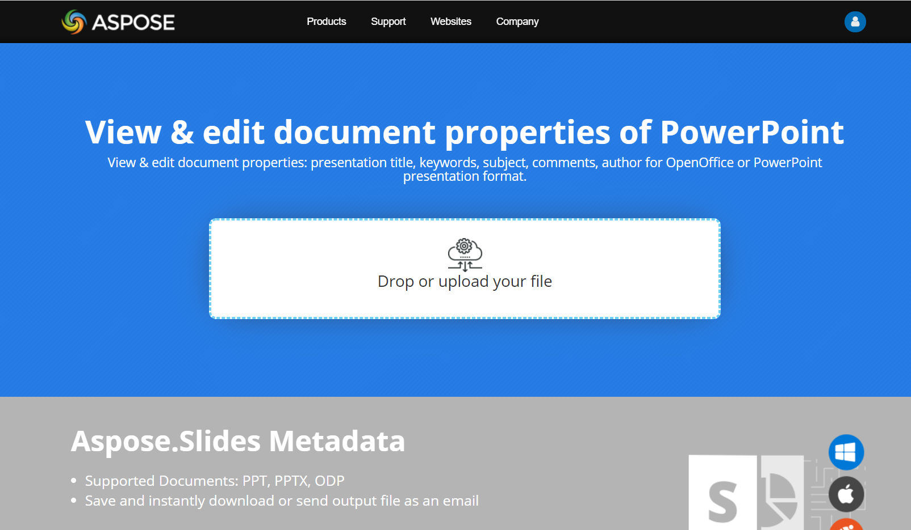

## **Giới thiệu**

Aspose.Slides for PHP via Java hỗ trợ các thuộc tính tài liệu **built-in** và **custom**. Sử dụng các thuộc tính này để đọc và cập nhật siêu dữ liệu của bản trình chiếu, chẳng hạn như tác giả, tiêu đề và các giá trị do người dùng định nghĩa.

Aspose.Slides cho phép bạn làm việc với các thuộc tính tài liệu của bản trình chiếu thông qua lớp [DocumentProperties](https://reference.aspose.com/slides/php-java/aspose.slides/documentproperties/) . Một thể hiện của lớp này được trả về bởi [Presentation::getDocumentProperties](https://reference.aspose.com/slides/php-java/aspose.slides/presentation/getdocumentproperties/). Các ví dụ sau cho thấy cách đọc, sửa đổi và quản lý các thuộc tính này. Chúng giả định rằng PHP/Java Bridge và trình bao bọc Aspose.Slides PHP đã được khởi tạo.

{}
Aspose.Slides quản lý siêu dữ liệu ứng dụng và nhà sản xuất khi lưu bản trình chiếu; các trường này xác định phần mềm đã tạo ra kết quả.
{}

## **Quản lý Thuộc tính Bản trình chiếu**

Các thuộc tính tài liệu lưu trữ thông tin mô tả cùng với nội dung bản trình chiếu. Chúng chia thành hai loại:

- Thuộc tính **Built-in** chứa siêu dữ liệu tiêu chuẩn, chẳng hạn như tiêu đề, tác giả và thống kê tài liệu.
- Thuộc tính **Custom** lưu trữ các cặp tên/giá trị được người dùng định nghĩa.

Aspose.Slides for PHP via Java cung cấp quyền truy cập vào cả hai loại. Trong PowerPoint, chọn **File → Info → Properties → Advanced Properties** để kiểm tra siêu dữ liệu tài liệu. Hộp thoại nhóm thông tin thành các tab như **Summary**, **Statistics**, **Contents**, và **Custom**. Sử dụng tab **Custom** để quản lý các thuộc tính do người dùng định nghĩa.

## **Đọc Thuộc tính Công khai từ Một Bản trình chiếu Được Mã hoá**

Mật khẩu mở thường bảo vệ cả nội dung bản trình chiếu và các thuộc tính tài liệu. Khi một bản trình chiếu được mã hoá sau khi gọi [ProtectionManager::setEncryptDocumentProperties](https://reference.aspose.com/slides/php-java/aspose.slides/protectionmanager/setencryptdocumentproperties/) với `false`, các thuộc tính tài liệu của nó vẫn công khai. Ứng dụng sau đó có thể gọi [LoadOptions::setOnlyLoadDocumentProperties](https://reference.aspose.com/slides/php-java/aspose.slides/loadoptions/setonlyloaddocumentproperties/) với `true` và đọc siêu dữ liệu công khai mà không cung cấp mật khẩu mở.

[LoadOptions::setOnlyLoadDocumentProperties](https://reference.aspose.com/slides/php-java/aspose.slides/loadoptions/setonlyloaddocumentproperties/) kiểm soát những gì Aspose.Slides tải; nó không giải mã bất kỳ thứ gì. Nếu các thuộc tính đã được bao gồm trong quá trình mã hoá, việc tải chúng mà không có mật khẩu sẽ bị thất bại. Nếu bản trình chiếu không được mã hoá, tùy chọn sẽ bị bỏ qua và toàn bộ bản trình chiếu sẽ được tải.

Ví dụ yêu cầu một bản trình chiếu đã được mã hoá mà các thuộc tính tài liệu của nó được để công khai. Nó xác minh chế độ tải thông qua [ProtectionManager::isOnlyDocumentPropertiesLoaded](https://reference.aspose.com/slides/php-java/aspose.slides/protectionmanager/isonlydocumentpropertiesloaded/) và sau đó đọc các thuộc tính built‑in thông qua [Presentation::getDocumentProperties](https://reference.aspose.com/slides/php-java/aspose.slides/presentation/getdocumentproperties/) :

```php
use aspose\slides\LoadOptions;
use aspose\slides\Presentation;

$loadOptions = new LoadOptions();
$loadOptions->setOnlyLoadDocumentProperties(true);

$presentation = new Presentation("public-properties-encrypted.pptx", $loadOptions);
try {
    if (java_values($presentation->getProtectionManager()->isOnlyDocumentPropertiesLoaded())) {
        $documentProperties = $presentation->getDocumentProperties();

        echo("Author: " . $documentProperties->getAuthor() . "\n");
        echo("Title: " . $documentProperties->getTitle() . "\n");
        echo("Keywords: " . $documentProperties->getKeywords() . "\n");
    } else {
        echo("The presentation was not loaded in document-properties-only mode." . "\n");
    }
} finally {
    $presentation->dispose();
}
```

Trong chế độ này, nội dung slide không được tải. Slides, masters, layouts, shapes, media và các đối tượng khác của bản trình chiếu không khả dụng. Ứng dụng luôn nên kiểm tra [ProtectionManager::isOnlyDocumentPropertiesLoaded](https://reference.aspose.com/slides/php-java/aspose.slides/protectionmanager/isonlydocumentpropertiesloaded/) trước khi thực hiện thao tác yêu cầu mô hình đối tượng bản trình chiếu đầy đủ.

{}
Siêu dữ liệu công khai có thể lộ tên tác giả, tiêu đề, chủ đề, từ khóa, thông tin công ty, nhận xét và các giá trị tùy chỉnh. Hãy mã hoá các thuộc tính nhạy cảm cùng với bản trình chiếu. Chỉ để chúng công khai khi hệ thống đánh chỉ mục, phân loại, tìm kiếm hoặc quản lý tài liệu có yêu cầu cụ thể để truy cập mà không cần mật khẩu.
{}

## **Cập nhật Thuộc tính của Một Bản trình chiếu Được Mã hoá**

Đối với tệp PPTX đã được mã hoá, một bản trình chiếu được tải sau khi gọi [LoadOptions::setOnlyLoadDocumentProperties](https://reference.aspose.com/slides/php-java/aspose.slides/loadoptions/setonlyloaddocumentproperties/) với `true` nhằm mục đích đọc siêu dữ liệu công khai. Aspose.Slides không thể lưu các thuộc tính đã thay đổi từ đối tượng chỉ‑metadata này vì các thuộc tính công khai phải luôn nhất quán với dữ liệu tương ứng bên trong bản trình chiếu đã mã hoá. Do đó, việc cập nhật chúng yêu cầu mật khẩu mở đúng và một lần tải đầy đủ.

Ví dụ yêu cầu một bản trình chiếu PPTX đã được mã hoá với các thuộc tính tài liệu công khai và một mật khẩu mở đã biết. Nó mở toàn bộ bản trình chiếu với [LoadOptions::setPassword](https://reference.aspose.com/slides/php-java/aspose.slides/loadoptions/setpassword/), cập nhật các thuộc tính built‑in công khai, và lưu kết quả. Sau đó sử dụng [PresentationInfo::isEncrypted](https://reference.aspose.com/slides/php-java/aspose.slides/presentationinfo/isencrypted/) để xác minh rằng mã hoá vẫn được giữ và mở lại siêu dữ liệu công khai mà không cần mật khẩu để kiểm tra các giá trị mới:

```php
use aspose\slides\LoadOptions;
use aspose\slides\Presentation;
use aspose\slides\PresentationFactory;
use aspose\slides\SaveFormat;

$inputPath = "public-properties-encrypted.pptx";
$outputPath = "updated-public-properties-encrypted.pptx";

$loadOptions = new LoadOptions();
$loadOptions->setPassword("open_password");

$presentation = new Presentation($inputPath, $loadOptions);
try {
    $documentProperties = $presentation->getDocumentProperties();
    $documentProperties->setTitle("Updated Product Roadmap");
    $documentProperties->setKeywords("roadmap, planning, indexed");
    
    $presentation->save($outputPath, SaveFormat::Pptx);
} finally {
    $presentation->dispose();
}

$presentationInfo = PresentationFactory::getInstance()->getPresentationInfo($outputPath);
echo("The presentation is encrypted: " . (java_values($presentationInfo->isEncrypted()) ? "true" : "false") . "\n");

$metadataLoadOptions = new LoadOptions();
$metadataLoadOptions->setOnlyLoadDocumentProperties(true);

$metadataPresentation = new Presentation($outputPath, $metadataLoadOptions);
try {
    if (java_values($metadataPresentation->getProtectionManager()->isOnlyDocumentPropertiesLoaded())) {
        echo("Title: " . $metadataPresentation->getDocumentProperties()->getTitle() . "\n");
        echo("Keywords: " . $metadataPresentation->getDocumentProperties()->getKeywords() . "\n");
    } else {
        echo("The presentation was not loaded in document-properties-only mode." . "\n");
    }
} finally {
    $metadataPresentation->dispose();
}
```

Nếu một ứng dụng không được phép giải mã hoặc tải nội dung bản trình chiếu, nó phải xử lý các thuộc tính công khai của tệp PPTX đã mã hoá như là chỉ‑đọc.

## **Truy cập Thuộc tính Built‑in**

Lớp [DocumentProperties](https://reference.aspose.com/slides/php-java/aspose.slides/documentproperties/) cung cấp siêu dữ liệu built‑in thông qua các phương thức getter, bao gồm [getAuthor](https://reference.aspose.com/slides/php-java/aspose.slides/documentproperties/getauthor/), [getTitle](https://reference.aspose.com/slides/php-java/aspose.slides/documentproperties/gettitle/), và [getCreatedTime](https://reference.aspose.com/slides/php-java/aspose.slides/documentproperties/getcreatedtime/). Ví dụ này mở một bản trình chiếu hiện có và in siêu dữ liệu đã lưu ra console. Các giá trị phụ thuộc vào bản trình chiếu đầu vào; một số trường có thể rỗng.

```php
use aspose\slides\Presentation;

$presentation = new Presentation("AccessBuiltInProperties.pptx");
try {
    $documentProperties = $presentation->getDocumentProperties();

    echo("Category: " . $documentProperties->getCategory() . "\n");
    echo("Content status: " . $documentProperties->getContentStatus() . "\n");
    echo("Creation date: " . $documentProperties->getCreatedTime() . "\n");
    echo("Author: " . $documentProperties->getAuthor() . "\n");
    echo("Comments: " . $documentProperties->getComments() . "\n");
    echo("Keywords: " . $documentProperties->getKeywords() . "\n");
    echo("Last modified by: " . $documentProperties->getLastSavedBy() . "\n");
    echo("Manager: " . $documentProperties->getManager() . "\n");
    echo("Modified date: " . $documentProperties->getLastSavedTime() . "\n");
    echo("Presentation format: " . $documentProperties->getPresentationFormat() . "\n");
    echo("Last print date: " . $documentProperties->getLastPrinted() . "\n");
    echo("Is shared between producers: " . (java_values($documentProperties->getSharedDoc()) ? "true" : "false") . "\n");
    echo("Subject: " . $documentProperties->getSubject() . "\n");
    echo("Title: " . $documentProperties->getTitle() . "\n");
} finally {
    $presentation->dispose();
}
```

## **Sửa đổi Thuộc tính Built‑in**

Để cập nhật siêu dữ liệu built‑in, sử dụng các phương thức setter trên đối tượng trả về bởi [Presentation::getDocumentProperties](https://reference.aspose.com/slides/php-java/aspose.slides/presentation/getdocumentproperties/). Ví dụ này mở một bản trình chiếu hiện có, gọi [setAuthor](https://reference.aspose.com/slides/php-java/aspose.slides/documentproperties/setauthor/), [setTitle](https://reference.aspose.com/slides/php-java/aspose.slides/documentproperties/settitle/), [setSubject](https://reference.aspose.com/slides/php-java/aspose.slides/documentproperties/setsubject/), [setComments](https://reference.aspose.com/slides/php-java/aspose.slides/documentproperties/setcomments/), và [setManager](https://reference.aspose.com/slides/php-java/aspose.slides/documentproperties/setmanager/), sau đó lưu bản trình chiếu đã cập nhật bằng [Presentation::save](https://reference.aspose.com/slides/php-java/aspose.slides/presentation/save/). Tệp PPTX đã lưu sẽ chứa siêu dữ liệu mới.

```php
use aspose\slides\Presentation;
use aspose\slides\SaveFormat;

$presentation = new Presentation("ModifyBuiltInProperties.pptx");
try {
    $documentProperties = $presentation->getDocumentProperties();

    $documentProperties->setAuthor("Aspose.Slides for PHP via Java");
    $documentProperties->setTitle("Manage PowerPoint Presentation Properties");
    $documentProperties->setSubject("Modify Built-in Properties");
    $documentProperties->setComments("Aspose description");
    $documentProperties->setManager("Aspose manager");

    $presentation->save("DocumentProperties_output.pptx", SaveFormat::Pptx);
} finally {
    $presentation->dispose();
}
```

## **Quản lý Cơ sở Siêu liên kết**

[DocumentProperties::getHyperlinkBase](https://reference.aspose.com/slides/php-java/aspose.slides/documentproperties/gethyperlinkbase/) trả về cơ sở cấp tài liệu cho các siêu liên kết tương đối. Sử dụng [DocumentProperties::setHyperlinkBase](https://reference.aspose.com/slides/php-java/aspose.slides/documentproperties/sethyperlinkbase/) để thay đổi hoặc xóa nó. Điều này hữu ích khi di chuyển một bản trình chiếu và các tệp liên kết sang vị trí khác. Nó tách biệt với [Hyperlink::getExternalUrl](https://reference.aspose.com/slides/php-java/aspose.slides/hyperlink/getexternalurl/) của từng siêu liên kết: việc thay đổi cơ sở không ghi lại lại địa chỉ liên kết đã lưu hoặc thay đổi đích tuyệt đối.

Ví dụ yêu cầu một bản trình chiếu chứa cả liên kết tương đối, chẳng hạn `target.html`, và một liên kết tuyệt đối, chẳng hạn `https://example.org/absolute.html`. Nó đọc cơ sở hiện có, gán một địa chỉ cơ sở mới, và lưu và mở lại bản trình chiếu để kiểm tra giá trị. Sau đó xóa cơ sở bằng một chuỗi rỗng và xác minh giá trị rỗng trong một tệp đã lưu riêng. Thay địa chỉ cơ sở mẫu bằng vị trí của các tệp liên kết của bạn.

```php
use aspose\slides\Presentation;
use aspose\slides\SaveFormat;

$presentation = new Presentation("hyperlinks.pptx");
try {
    echo("Original base: " . $presentation->getDocumentProperties()->getHyperlinkBase() . "\n");

    $newBase = "https://example.com/new/";
    $presentation->getDocumentProperties()->setHyperlinkBase($newBase);
    $presentation->save("hyperlinks-updated.pptx", SaveFormat::Pptx);

    $updatedPresentation = new Presentation("hyperlinks-updated.pptx");
    try {
        echo("Base preserved: " . ((string) $updatedPresentation->getDocumentProperties()->getHyperlinkBase() === $newBase ? "true" : "false") . "\n");

        $updatedPresentation->getDocumentProperties()->setHyperlinkBase("");
        $updatedPresentation->save("hyperlinks-cleared.pptx", SaveFormat::Pptx);

        $clearedPresentation = new Presentation("hyperlinks-cleared.pptx");
        try {
            echo("Base cleared: " . ((string) $clearedPresentation->getDocumentProperties()->getHyperlinkBase() === "" ? "true" : "false") . "\n");
        } finally {
            $clearedPresentation->dispose();
        }
    } finally {
        $updatedPresentation->dispose();
    }
} finally {
    $presentation->dispose();
}
```

Hai thông báo xác nhận nên in ra `true`. Xóa cơ sở không làm thay đổi các địa chỉ siêu liên kết riêng lẻ.

Một liên kết tương đối tới `target.pptx` đã mở `old/target.pptx` khi cơ sở trỏ tới thư mục `old`. Sau khi thay đổi cơ sở thành thư mục `new`, lưu và mở lại bản trình chiếu, cùng một liên kết đã mở `new/target.pptx`. Một liên kết tuyệt đối vẫn mở cùng tệp. Hãy kiểm tra các liên kết tương đối của bạn trong PowerPoint trước và sau khi di chuyển bản trình chiếu hoặc thay đổi cơ sở của nó.

## **Thêm Thuộc tính Tùy chỉnh cho Bản trình chiếu**

Các thuộc tính tùy chỉnh lưu trữ siêu dữ liệu không có trường built‑in tương ứng. Phương thức [DocumentProperties::set_Item](https://reference.aspose.com/slides/php-java/aspose.slides/documentproperties/set_item/) cho phép bạn gán một giá trị theo tên thuộc tính. Ví dụ này tạo một bản trình chiếu, thêm hai giá trị văn bản và một giá trị phiên bản kiểu số nguyên, và lưu bản trình chiếu bằng [Presentation::save](https://reference.aspose.com/slides/php-java/aspose.slides/presentation/save/). Gán một giá trị cho một tên đã tồn tại sẽ thay thế giá trị của thuộc tính đó.

```php
use aspose\slides\Presentation;
use aspose\slides\SaveFormat;

$presentation = new Presentation();
try {
    $documentProperties = $presentation->getDocumentProperties();

    $documentProperties->set_Item("Reviewed by", "John Smith");
    $documentProperties->set_Item("Confidentiality level", "Internal");
    $documentProperties->set_Item("Document version", 2);

    $presentation->save("CustomDocumentProperties_output.pptx", SaveFormat::Pptx);
} finally {
    $presentation->dispose();
}
```

## **Truy cập và Sửa đổi Thuộc tính Tùy chỉnh**

Ví dụ này mở một bản trình chiếu chứa các thuộc tính tùy chỉnh và sử dụng [getCountOfCustomProperties](https://reference.aspose.com/slides/php-java/aspose.slides/documentproperties/getcountofcustomproperties/) để lặp qua chúng. [getCustomPropertyName](https://reference.aspose.com/slides/php-java/aspose.slides/documentproperties/getcustompropertyname/) nhận một chỉ mục bắt đầu từ 0 và trả về tên được dùng bởi [DocumentProperties::set_Item](https://reference.aspose.com/slides/php-java/aspose.slides/documentproperties/set_item/). Ví dụ in mỗi tên và giá trị gốc, thay thế mọi giá trị bằng một chuỗi đánh số bất kể kiểu gốc, và lưu các thay đổi. Nếu không có thuộc tính tùy chỉnh nào, vòng lặp sẽ không thực hiện thay đổi nào.

```php
use aspose\slides\Presentation;
use aspose\slides\SaveFormat;

$presentation = new Presentation("AccessAndModifyProperties.pptx");
try {
    $documentProperties = $presentation->getDocumentProperties();

    for ($i = 0; $i < java_values($documentProperties->getCountOfCustomProperties()); $i++) {
        $propertyName = $documentProperties->getCustomPropertyName($i);
        $propertyValue = $documentProperties->get_Item($propertyName);

        echo("Custom property name: " . $propertyName . "\n");
        echo("Custom property value: " . $propertyValue . "\n");

        $documentProperties->set_Item($propertyName, "New Value " . ($i + 1));
    }

    $presentation->save("CustomProperties_output.pptx", SaveFormat::Pptx);
} finally {
    $presentation->dispose();
}
```

## **Ví dụ Trực tiếp**

Hãy thử ứng dụng trực tuyến [**View & Edit PowerPoint Metadata**](https://products.aspose.app/slides/metadata) để xem cách làm việc với các thuộc tính tài liệu bằng API Aspose.Slides:

[](https://products.aspose.app/slides/metadata)

## **Câu hỏi thường gặp**

**Làm thế nào để xóa một thuộc tính built-in khỏi bản trình chiếu?**

Các thuộc tính built-in là một phần không thể tách rời của bản trình chiếu và không thể được xóa hoàn toàn. Tuy nhiên, bạn có thể thay đổi giá trị của chúng hoặc đặt chúng thành rỗng nếu thuộc tính cụ thể cho phép.

**Điều gì xảy ra nếu tôi thêm một thuộc tính tùy chỉnh đã tồn tại?**

Nếu bạn thêm một thuộc tính tùy chỉnh đã tồn tại, giá trị hiện có sẽ bị ghi đè bằng giá trị mới. Bạn không cần phải xóa hoặc kiểm tra thuộc tính trước, vì Aspose.Slides sẽ tự động cập nhật giá trị của thuộc tính.

**Có thể truy cập thuộc tính bản trình chiếu mà không tải toàn bộ bản trình chiếu không?**

Có. Sử dụng [PresentationFactory::getPresentationInfo](https://reference.aspose.com/slides/php-java/aspose.slides/presentationfactory/getpresentationinfo/) và sau đó [PresentationInfo::readDocumentProperties](https://reference.aspose.com/slides/php-java/aspose.slides/presentationinfo/readdocumentproperties/) để đọc siêu dữ liệu tài liệu được lưu trữ mà không tạo một đối tượng [Presentation](https://reference.aspose.com/slides/php-java/aspose.slides/presentation/) . Xem [Xây dựng Kiểm kê Bản trình chiếu Nhẹ](/slides/vi/php-java/examine-presentation/) để biết ví dụ báo cáo đầy đủ và các giới hạn theo định dạng.

**Có thể đọc các thuộc tính công khai của một bản trình chiếu đã mã hoá mà không có mật khẩu mở không?**

Có. Bản trình chiếu phải đã được mã hoá sau khi gọi [ProtectionManager::setEncryptDocumentProperties](https://reference.aspose.com/slides/php-java/aspose.slides/protectionmanager/setencryptdocumentproperties/) với `false`, và phải được tải sau khi gọi [LoadOptions::setOnlyLoadDocumentProperties](https://reference.aspose.com/slides/php-java/aspose.slides/loadoptions/setonlyloaddocumentproperties/) với `true`.

**Có thể cập nhật một tệp PPTX đã mã hoá trong chế độ chỉ‑tải‑thuộc‑tính‑tài‑liệu không?**

Không. Dữ liệu thuộc tính công khai và đã mã hoá phải luôn nhất quán, vì vậy việc cập nhật một tệp PPTX đã mã hoá yêu cầu tải toàn bộ bản trình chiếu với mật khẩu mở đúng.