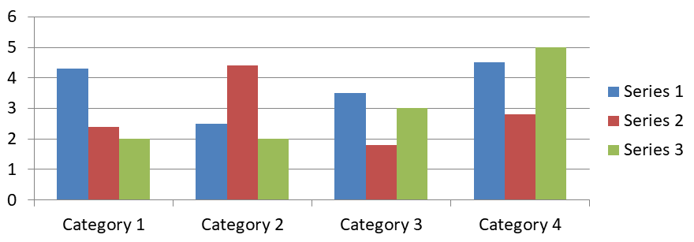

## **Tổng quan**

Bài viết này giải thích cách tùy chỉnh trục biểu đồ với Aspose.Slides for Python via Java. Nó bao gồm các giá trị trục được tính, chuyển đổi hàng và cột biểu đồ, hiển thị trục, khoảng cách nhãn danh mục và dấu tick, danh mục ngày và định dạng, xoay tiêu đề, vị trí trục, đơn vị hiển thị và tỷ lệ logarit.

## **Lấy Giá Trị Tối Đa Trên Trục Dọc Của Biểu Đồ**

Tạo một [Presentation](https://reference.aspose.com/slides/python-java/aspose.slides/presentation/) và thêm một biểu đồ khu vực với dữ liệu mặc định. Gọi [validateChartLayout](https://reference.aspose.com/slides/python-java/aspose.slides/chart/#validateChartLayout) trước khi đọc các giá trị trục đã tính để bố cục biểu đồ được cập nhật.

Đọc [getActualMaxValue](https://reference.aspose.com/slides/python-java/aspose.slides/axis/#getActualMaxValue) và [getActualMinValue](https://reference.aspose.com/slides/python-java/aspose.slides/axis/#getActualMinValue) để lấy giới hạn trục, và [getActualMajorUnit](https://reference.aspose.com/slides/python-java/aspose.slides/axis/#getActualMajorUnit) và [getActualMinorUnit](https://reference.aspose.com/slides/python-java/aspose.slides/axis/#getActualMinorUnit) để lấy khoảng cách dấu tick. [getActualMajorUnitScale](https://reference.aspose.com/slides/python-java/aspose.slides/axis/#getActualMajorUnitScale) và [getActualMinorUnitScale](https://reference.aspose.com/slides/python-java/aspose.slides/axis/#getActualMinorUnitScale) cung cấp thang thời gian, liên quan đến các trục ngày. Ví dụ lưu các giá trị này vào biến cục bộ và lưu biểu đồ.

```python
import jpype
import asposeslides

if not jpype.isJVMStarted():
    jpype.startJVM()

from asposeslides.api import Presentation, ChartType, SaveFormat

presentation = Presentation()
try:
    slide = presentation.getSlides().get_Item(0)

    chart = slide.getShapes().addChart(ChartType.Area, 100, 100, 500, 350)
    chart.validateChartLayout()

    max_value = chart.getAxes().getVerticalAxis().getActualMaxValue()
    min_value = chart.getAxes().getVerticalAxis().getActualMinValue()

    major_unit = chart.getAxes().getVerticalAxis().getActualMajorUnit()
    minor_unit = chart.getAxes().getVerticalAxis().getActualMinorUnit()

    major_unit_scale = chart.getAxes().getVerticalAxis().getActualMajorUnitScale()
    minor_unit_scale = chart.getAxes().getVerticalAxis().getActualMinorUnitScale()

    presentation.save("AxisValues_out.pptx", SaveFormat.Pptx)
finally:
    presentation.dispose()
```

## **Hoán Đổi Dữ Liệu Giữa Các Trục**

Sử dụng [switchRowColumn](https://reference.aspose.com/slides/python-java/aspose.slides/chartdata/#switchRowColumn) để đổi vai trò của series và category trong dữ liệu biểu đồ. Mỗi category cũ trở thành một series, và mỗi series cũ trở thành một category. Thao tác này thay đổi cách dữ liệu được nhóm; nó không đổi chỗ các trục ngang và dọc. Ví dụ sử dụng [setRange](https://reference.aspose.com/slides/python-java/aspose.slides/chartdata/#setRange) để liên kết dữ liệu mặc định tới `Sheet1!A1:D5`, bao gồm hàng tiêu đề và cột category, trước khi hoán đổi hàng và cột. Nó lưu một biểu đồ với bốn series và ba category.

```python
import jpype
import asposeslides

if not jpype.isJVMStarted():
    jpype.startJVM()

from asposeslides.api import Presentation, ChartType, SaveFormat

presentation = Presentation()
try:
    slide = presentation.getSlides().get_Item(0)

    chart = slide.getShapes().addChart(ChartType.ClusteredColumn, 100, 100, 400, 300)
    chart.getChartData().setRange("Sheet1!A1:D5")
    chart.getChartData().switchRowColumn()

    presentation.save("SwitchChartRowColumns_out.pptx", SaveFormat.Pptx)
finally:
    presentation.dispose()
```

## **Đảo Ngược Thứ Tự Vẽ Của Một Trục**

Sử dụng [setPlotOrderReversed](https://reference.aspose.com/slides/python-java/aspose.slides/axis/#setPlotOrderReversed) để đảo ngược một trục category hoặc value. Ví dụ, một biểu đồ thanh ngang có thể hiển thị các giai đoạn dự án từ trên xuống dưới theo cùng thứ tự như trong bảng tính: Planning, Development, Testing. Đảo ngược trục thay đổi hướng vẽ; nó không sắp xếp lại hoặc thay đổi dữ liệu trong workbook. Ngược lại, [switchRowColumn](https://reference.aspose.com/slides/python-java/aspose.slides/chartdata/#switchRowColumn) đổi vai trò của series và category.

Ví dụ sau tạo một biểu đồ thanh ngang với ba giai đoạn và một series. Nó lưu một bản trình bày với ba slide: thứ tự bình thường, category đảo ngược, và value đảo ngược. Mỗi bản sao sử dụng cùng một bộ dữ liệu, và chỉ một trục được đảo ngược trong mỗi bản sao.

```python
import jpype
import asposeslides

if not jpype.isJVMStarted():
    jpype.startJVM()

from asposeslides.api import Presentation, ChartType, CrossesType, SaveFormat

presentation = Presentation()
try:
    slide = presentation.getSlides().get_Item(0)

    chart = slide.getShapes().addChart(ChartType.ClusteredBar, 50, 40, 620, 320)
    chart.setLegend(False)

    chart.getChartData().getCategories().clear()
    chart.getChartData().getSeries().clear()

    workbook = chart.getChartData().getChartDataWorkbook()
    workbook.clear(0)

    series = chart.getChartData().getSeries().add(ChartType.ClusteredBar)
    stages = ["Planning", "Development", "Testing"]
    values = [10, 30, 20]
    for i, stage in enumerate(stages):
        category_cell = workbook.getCell(0, i + 1, 0, stage)
        chart.getChartData().getCategories().add(category_cell)
        value_cell = workbook.getCell(0, i + 1, 1, float(values[i]))
        series.getDataPoints().addDataPointForBarSeries(value_cell)

    # Slide 2: hiển thị danh mục đầu tiên ở trên cùng.
    category_slide = presentation.getSlides().addClone(slide)
    category_chart = category_slide.getShapes().get_Item(0)
    category_chart.getAxes().getVerticalAxis().setPlotOrderReversed(True)
    # Giữ trục giá trị ngang ở phía dưới.
    category_chart.getAxes().getVerticalAxis().setCrossType(CrossesType.Maximum)

    # Slide 3: đảo ngược chỉ thang số ngang.
    value_slide = presentation.getSlides().addClone(slide)
    value_chart = value_slide.getShapes().get_Item(0)
    value_chart.getAxes().getHorizontalAxis().setPlotOrderReversed(True)

    presentation.save("ReversedAxes.pptx", SaveFormat.Pptx)
finally:
    presentation.dispose()
```

Đảo ngược một trục cũng có thể di chuyển trục vuông góc sang phía đối diện của biểu đồ. [setCrossType](https://reference.aspose.com/slides/python-java/aspose.slides/axis/#setCrossType) kiểm soát nơi trục còn lại cắt qua trục đang cấu hình. Trong slide 2, gọi nó với [CrossesType.Maximum](https://reference.aspose.com/slides/python-java/aspose.slides/crossestype/#Maximum) trên trục category đã đảo ngược giữ trục value ngang ở phía dưới. Đối với một điểm cắt cụ thể, sử dụng [setCrossAt](https://reference.aspose.com/slides/python-java/aspose.slides/axis/#setCrossAt). Kiểm tra các cài đặt cắt khi thay đổi hướng, đặc biệt nếu biểu đồ đã có một điểm cắt tùy chỉnh. Gọi [setPlotOrderReversed](https://reference.aspose.com/slides/python-java/aspose.slides/axis/#setPlotOrderReversed) với `False` để khôi phục hướng vẽ bình thường; các cài đặt cắt là riêng biệt.

| Thứ tự bình thường (slide 1) | Danh mục đảo ngược (slide 2) | Giá trị đảo ngược (slide 3) |
| --- | --- | --- |
|  |  |  |
| Các danh mục chạy từ dưới lên trên; giá trị tăng từ trái sang phải. | Lập kế hoạch, Phát triển và Kiểm thử chạy từ trên xuống dưới. Giá trị và thứ tự hàng trong workbook không thay đổi. | Các danh mục giữ thứ tự bình thường; giá trị tăng từ phải sang trái. Trục danh mục cắt tại số 0 ở bên phải. |

## **Vô Hiệu Hóa Trục Dọc Cho Biểu Đồ Đường**

Gọi [setVisible](https://reference.aspose.com/slides/python-java/aspose.slides/axis/#setVisible) với `False` trên trục dọc để ẩn nó. Ví dụ tạo một biểu đồ đường với dữ liệu mặc định và lưu lại với trục dọc bị ẩn.

```python
import jpype
import asposeslides

if not jpype.isJVMStarted():
    jpype.startJVM()

from asposeslides.api import Presentation, ChartType, SaveFormat

presentation = Presentation()
try:
    slide = presentation.getSlides().get_Item(0)

    chart = slide.getShapes().addChart(ChartType.Line, 100, 100, 400, 300)
    chart.getAxes().getVerticalAxis().setVisible(False)

    presentation.save("HiddenVerticalAxis.pptx", SaveFormat.Pptx)
finally:
    presentation.dispose()
```

## **Vô Hiệu Hóa Trục Ngang Cho Biểu Đồ Đường**

Gọi [setVisible](https://reference.aspose.com/slides/python-java/aspose.slides/axis/#setVisible) với `False` trên trục ngang để ẩn nó. Ví dụ tạo một biểu đồ đường với dữ liệu mặc định và lưu lại với trục ngang bị ẩn.

```python
import jpype
import asposeslides

if not jpype.isJVMStarted():
    jpype.startJVM()

from asposeslides.api import Presentation, ChartType, SaveFormat

presentation = Presentation()
try:
    slide = presentation.getSlides().get_Item(0)

    chart = slide.getShapes().addChart(ChartType.Line, 100, 100, 400, 300)
    chart.getAxes().getHorizontalAxis().setVisible(False)

    presentation.save("HiddenHorizontalAxis.pptx", SaveFormat.Pptx)
finally:
    presentation.dispose()
```

## **Hiển Thị Hoặc Ẩn Đường Lưới Biểu Đồ**

Gọi [getShowMajorGridLines](https://reference.aspose.com/slides/python-java/aspose.slides/axis/#getShowMajorGridLines) và [getShowMinorGridLines](https://reference.aspose.com/slides/python-java/aspose.slides/axis/#getShowMinorGridLines) để kiểm tra trục nào hiển thị đường lưới. Để hiển thị đường lưới phụ, sử dụng [getMinorGridLinesFormat](https://reference.aspose.com/slides/python-java/aspose.slides/axis/#getMinorGridLinesFormat) và đặt màu nét là màu đặc, có thể nhìn thấy. Để ẩn chúng, đặt fill thành [FillType.NoFill](https://reference.aspose.com/slides/python-java/aspose.slides/filltype/#NoFill). Sử dụng [getMajorGridLinesFormat](https://reference.aspose.com/slides/python-java/aspose.slides/axis/#getMajorGridLinesFormat) để thay đổi màu nét cho đường lưới chính theo cách tương tự. Thay đổi fill giữ nguyên hiển thị trục và dấu tick.

Trục dọc của biểu đồ cột nhóm này ban đầu chỉ hiển thị đường lưới chính. Ví dụ hiển thị đường lưới phụ màu cam đậm, sau đó lại ẩn chúng trước khi lưu bản trình bày. Nó in ra trạng thái hiển thị đường lưới ở mỗi bước.

```python
import jpype
import asposeslides

if not jpype.isJVMStarted():
    jpype.startJVM()

from asposeslides.api import ChartType, FillType, Presentation, SaveFormat

Color = jpype.JClass("java.awt.Color")

presentation = Presentation()
try:
    slide = presentation.getSlides().get_Item(0)

    chart = slide.getShapes().addChart(ChartType.ClusteredColumn, 30, 30, 660, 230)
    axis = chart.getAxes().getVerticalAxis()
    print(f"Initial: major={axis.getShowMajorGridLines()}, minor={axis.getShowMinorGridLines()}")

    minor_fill = axis.getMinorGridLinesFormat().getLine().getFillFormat()
    minor_fill.setFillType(FillType.Solid)
    minor_fill.getSolidFillColor().setColor(Color(255, 140, 0))
    print(f"Enabled: minor={axis.getShowMinorGridLines()}")

    minor_fill.setFillType(FillType.NoFill)
    print(f"Hidden: major={axis.getShowMajorGridLines()}, minor={axis.getShowMinorGridLines()}")

    presentation.save("ChartGridlines.pptx", SaveFormat.Pptx)
finally:
    presentation.dispose()
```

| Đường lưới phụ được bật | Đường lưới phụ bị ẩn |
| --- | --- |
|  |  |

## **Thay Đổi Trục Danh Mục**

Sử dụng [setCategoryAxisType](https://reference.aspose.com/slides/python-java/aspose.slides/axis/#setCategoryAxisType) để chọn trục danh mục kiểu ngày hoặc văn bản. Ví dụ này yêu cầu `ExistingChart.pptx`, với một biểu đồ là đối tượng hình đầu tiên trên slide đầu và các ô category chứa giá trị ngày Excel dạng số. Nó thay đổi trục ngang thành trục ngày. Gọi [setAutomaticMajorUnit](https://reference.aspose.com/slides/python-java/aspose.slides/axis/#setAutomaticMajorUnit) với `False`, [setMajorUnit](https://reference.aspose.com/slides/python-java/aspose.slides/axis/#setMajorUnit) với `1`, và [setMajorUnitScale](https://reference.aspose.com/slides/python-java/aspose.slides/axis/#setMajorUnitScale) với [TimeUnitType.Months](https://reference.aspose.com/slides/python-java/aspose.slides/timeunittype/#Months) để đặt các tick chính cách nhau một tháng.

```python
import jpype
import asposeslides

if not jpype.isJVMStarted():
    jpype.startJVM()

from asposeslides.api import Presentation, SaveFormat, CategoryAxisType, TimeUnitType

presentation = Presentation("ExistingChart.pptx")
try:
    slide = presentation.getSlides().get_Item(0)

    chart = slide.getShapes().get_Item(0)
    chart.getAxes().getHorizontalAxis().setCategoryAxisType(CategoryAxisType.Date)
    chart.getAxes().getHorizontalAxis().setAutomaticMajorUnit(False)
    chart.getAxes().getHorizontalAxis().setMajorUnit(1)
    chart.getAxes().getHorizontalAxis().setMajorUnitScale(TimeUnitType.Months)

    presentation.save("ChangeChartCategoryAxis_out.pptx", SaveFormat.Pptx)
finally:
    presentation.dispose()
```

### **Xác Định Loại Trục Danh Mục Từ Dữ Liệu**

Gọi [setCategoryAxisTypeAutomatically](https://reference.aspose.com/slides/python-java/aspose.slides/axis/#setCategoryAxisTypeAutomatically) sau khi đã điền các category, sau đó đọc [getCategoryAxisType](https://reference.aspose.com/slides/python-java/aspose.slides/axis/#getCategoryAxisType) để kiểm tra lựa chọn. Điều này hữu ích khi cùng một biểu đồ có thể nhận nhãn văn bản hoặc giá trị ngày dạng số. Phương thức xác định loại khi được gọi; nó không bật chế độ persistant để đánh giá lại các thay đổi dữ liệu sau này. Gọi lại sau khi thay đổi các category.

Ví dụ sau tạo một biểu đồ với category dạng văn bản và in ra `True` khi loại đã chọn là [CategoryAxisType.Text](https://reference.aspose.com/slides/python-java/aspose.slides/categoryaxistype/#Text). Sau đó thay thế các giá trị ô category bằng ngày và gọi lại phương thức, in ra `True` khi loại đã chọn là [CategoryAxisType.Date](https://reference.aspose.com/slides/python-java/aspose.slides/categoryaxistype/#Date). Ngày được lưu dưới dạng giá trị số OLE Automation, được tính là số ngày tính từ 30‑12‑1899, không phải chuỗi ngày. [setCustomNumberFormat](https://reference.aspose.com/slides/python-java/aspose.slides/chartdatacell/#setCustomNumberFormat) kiểm soát cách hiển thị các giá trị này; nó không chuyển đổi văn bản thành ngày số. Để biết thêm về các ô category, xem [Chart Workbook](/slides/vi/python-java/chart-workbook/).

Sử dụng xác định tự động khi đầu vào chứa các category dạng văn bản hoặc ngày số, như trong ví dụ này. Đối với các nhãn số thông thường, category hỗn hợp hoặc dữ liệu rỗng, hãy gọi rõ ràng [setCategoryAxisType](https://reference.aspose.com/slides/python-java/aspose.slides/axis/#setCategoryAxisType) để phù hợp với ý nghĩa mong muốn. Các giá trị số đơn lẻ không tự động xác định rằng các category đại diện cho ngày.

```python
from datetime import date

import jpype
import asposeslides

if not jpype.isJVMStarted():
    jpype.startJVM()

from asposeslides.api import Presentation, ChartType, CategoryAxisType, SaveFormat

presentation = Presentation()
try:
    slide = presentation.getSlides().get_Item(0)

    chart = slide.getShapes().addChart(ChartType.ClusteredColumn, 30, 40, 660, 320)

    chart.getChartData().getCategories().clear()
    chart.getChartData().getSeries().clear()

    workbook = chart.getChartData().getChartDataWorkbook()
    workbook.clear(0)

    series_name = workbook.getCell(0, 0, 1, "Sales")
    series = chart.getChartData().getSeries().add(series_name, chart.getType())
    labels = ["First", "Second", "Third"]

    for i, label in enumerate(labels):
        category_cell = workbook.getCell(0, i + 1, 0, label)
        chart.getChartData().getCategories().add(category_cell)

        value_cell = workbook.getCell(0, i + 1, 1, float((i + 1) * 10))
        series.getDataPoints().addDataPointForBarSeries(value_cell)

    axis = chart.getAxes().getHorizontalAxis()
    axis.setCategoryAxisTypeAutomatically()
    print(axis.getCategoryAxisType() == CategoryAxisType.Text)  # Đúng

    base_date = date(1899, 12, 30)
    dates = [date(2026, 1, 1), date(2026, 1, 2), date(2026, 2, 1)]

    for i, category_date in enumerate(dates):
        category_cell = workbook.getCell(0, i + 1, 0)
        category_cell.setValue(float((category_date - base_date).days))
        category_cell.setCustomNumberFormat("yyyy-mm-dd")

    axis.setCategoryAxisTypeAutomatically()
    print(axis.getCategoryAxisType() == CategoryAxisType.Date)  # Đúng

    presentation.save("AutomaticCategoryAxis.pptx", SaveFormat.Pptx)
finally:
    presentation.dispose()
```

## **Kiểm Soát Khoảng Cách Nhãn Trục Danh Mục**

Khi biểu đồ có nhiều category, giảm số lượng nhãn trục hiển thị mà không loại bỏ các category hay điểm dữ liệu. Gọi [setAutomaticTickLabelSpacing](https://reference.aspose.com/slides/python-java/aspose.slides/axis/#setAutomaticTickLabelSpacing) với `False`, sau đó truyền khoảng cách category mong muốn vào [setTickLabelSpacing](https://reference.aspose.com/slides/python-java/aspose.slides/axis/#setTickLabelSpacing). Đối với category dạng văn bản trong thứ tự bình thường, việc đếm bắt đầu từ category đầu tiên:

| Khoảng cách | Nhãn hiển thị trong ví dụ |
| --- | --- |
| `1` | Danh mục 1, Danh mục 2, Danh mục 3, ... Danh mục 24 |
| `2` | Danh mục 1, Danh mục 3, Danh mục 5, ... Danh mục 23 |
| `3` | Danh mục 1, Danh mục 4, Danh mục 7, ... Danh mục 22 |

Khoảng cách `3` hiển thị mỗi nhãn thứ ba, để hai nhãn ẩn giữa các nhãn hiển thị. Nó không loại bỏ các cột tương ứng. Khoảng cách tự động chọn một khoảng dựa trên không gian khả dụng; nó không nhất thiết hiển thị mọi nhãn.

Dấu tick có các điều khiển riêng. Gọi [setAutomaticTickMarksSpacing](https://reference.aspose.com/slides/python-java/aspose.slides/axis/#setAutomaticTickMarksSpacing) với `False` và sử dụng [setTickMarksSpacing](https://reference.aspose.com/slides/python-java/aspose.slides/axis/#setTickMarksSpacing) để đặt khoảng cách của chúng. Ví dụ, `1` giữ một dấu tick ở mỗi khoảng category trong khi nhãn chỉ xuất hiện mỗi ba category. Sử dụng [setMajorTickMark](https://reference.aspose.com/slides/python-java/aspose.slides/axis/#setMajorTickMark) với một kiểu hiển thị để bạn có thể thấy kết quả. Gọi lại bất kỳ bộ thiết lập khoảng cách tự động nào với `True` để biểu đồ tự chọn lại khoảng cách.

Ví dụ tự chứa sau tạo 24 category và một series, sau đó lưu ba slide trong `CategoryAxisIntervals.pptx`: khoảng cách tự động, khoảng cách nhãn thủ công với các dấu tick độc lập, và khôi phục khoảng cách tự động. Hai bản sao giữ nguyên dữ liệu biểu đồ gốc. Không cần bản trình bày đầu vào. Văn bản nhãn ngang làm cho sự khác biệt về mật độ dễ nhận thấy.

```python
import jpype
import asposeslides

if not jpype.isJVMStarted():
    jpype.startJVM()

from asposeslides.api import Presentation, ChartType, SaveFormat, CategoryAxisType, TickMarkType

presentation = Presentation()
try:
    slide = presentation.getSlides().get_Item(0)

    chart = slide.getShapes().addChart(ChartType.ClusteredColumn, 30, 40, 660, 320)

    chart.setLegend(False)
    chart.getChartData().getCategories().clear()
    chart.getChartData().getSeries().clear()

    workbook = chart.getChartData().getChartDataWorkbook()
    workbook.clear(0)

    series = chart.getChartData().getSeries().add(ChartType.ClusteredColumn)
    for i in range(24):
        category_cell = workbook.getCell(0, i + 1, 0, f"Category {i + 1}")
        chart.getChartData().getCategories().add(category_cell)
        value_cell = workbook.getCell(0, i + 1, 1, float(10 + i % 6 * 5))
        series.getDataPoints().addDataPointForBarSeries(value_cell)

    axis = chart.getAxes().getHorizontalAxis()
    axis.setCategoryAxisType(CategoryAxisType.Text)
    axis.getTextFormat().getTextBlockFormat().setRotationAngle(0)
    axis.getTextFormat().getPortionFormat().setFontHeight(12)
    axis.setMajorTickMark(TickMarkType.Outside)
    axis.setAutomaticTickLabelSpacing(True)
    axis.setAutomaticTickMarksSpacing(True)

    # Slide 2: hiển thị mỗi nhãn thứ ba, nhưng giữ dấu tick cho mỗi danh mục.
    manual_slide = presentation.getSlides().addClone(slide)
    manual_chart = manual_slide.getShapes().get_Item(0)
    manual_axis = manual_chart.getAxes().getHorizontalAxis()
    manual_axis.setAutomaticTickLabelSpacing(False)
    manual_axis.setTickLabelSpacing(3)
    manual_axis.setAutomaticTickMarksSpacing(False)
    manual_axis.setTickMarksSpacing(1)

    # Slide 3: cho biểu đồ chọn lại cả hai khoảng cách.
    restored_slide = presentation.getSlides().addClone(manual_slide)
    restored_chart = restored_slide.getShapes().get_Item(0)
    restored_chart.getAxes().getHorizontalAxis().setAutomaticTickLabelSpacing(True)
    restored_chart.getAxes().getHorizontalAxis().setAutomaticTickMarksSpacing(True)

    presentation.save("CategoryAxisIntervals.pptx", SaveFormat.Pptx)
finally:
    presentation.dispose()
```

**Khoảng cách tự động (slide 1):** Trong hình này, mỗi nhãn category thứ hai được hiển thị và xuống dòng. Kết quả tự động có thể thay đổi tùy thuộc vào kích thước biểu đồ, phông chữ và bộ render.


**Khoảng cách thủ công (slide 2):** Mỗi nhãn thứ ba được hiển thị trên một dòng, trong khi các dấu tick vẫn ở mỗi khoảng category. Tất cả 24 cột, kể cả những cột không có nhãn, vẫn hiển thị với cùng các giá trị. Slide 3 khôi phục lại dạng tự động như trên.


### **Chọn Trục và Khoảng Cách Phù Hợp**

Sử dụng khoảng cách này cho trục category dạng văn bản, chẳng hạn trục category của biểu đồ cột, đường, khu vực hoặc thanh. Trong biểu đồ cột, nó là trục ngang. Trong biểu đồ thanh ngang, trục category là trục dọc, vì vậy áp dụng các cài đặt này cho trục trả về bởi [getVerticalAxis](https://reference.aspose.com/slides/python-java/aspose.slides/axesmanager/#getVerticalAxis). Khoảng cách dấu tick cũng áp dụng cho trục series trong các biểu đồ có trục series.

Không sử dụng khoảng cách nhãn category để đặt thang số cho trục value. Trên trục value, [setMajorUnit](https://reference.aspose.com/slides/python-java/aspose.slides/axis/#setMajorUnit) chỉ ra sự khác biệt về giá trị: ví dụ, một unit chính `10` tạo các tick tại 0, 10, 20, … khi trục bắt đầu từ zero. Một khoảng cách nhãn category `3` thay vào đó đếm vị trí category, bất kể giá trị dữ liệu của chúng. Các biểu đồ scatter và bubble sử dụng trục value thay vì trục category dạng văn bản. Đối với trục ngày, sử dụng các unit và thang thời gian như mô tả trong [Thay Đổi Trục Danh Mục](#thay-đổi-trục-danh-mục).

## **Đặt Định Dạng Ngày Cho Giá Trị Trục Danh Mục**

Ví dụ thay thế dữ liệu biểu đồ mặc định bằng bốn giá trị hàng năm. Ngày được lưu dưới dạng số OLE Automation trong worksheet đầu tiên (chỉ số `0`), tính là số ngày tính từ 30‑12‑1899 cho các ngày này. Sử dụng [setCategoryAxisType](https://reference.aspose.com/slides/python-java/aspose.slides/axis/#setCategoryAxisType) với [CategoryAxisType.Date](https://reference.aspose.com/slides/python-java/aspose.slides/categoryaxistype/#Date), gọi [setNumberFormatLinkedToSource](https://reference.aspose.com/slides/python-java/aspose.slides/axis/#setNumberFormatLinkedToSource) với `False`, và truyền `yyyy` vào [setNumberFormat](https://reference.aspose.com/slides/python-java/aspose.slides/axis/#setNumberFormat) để các nhãn category hiển thị năm bốn chữ số độc lập với định dạng ô.

```python
from datetime import date

import jpype
import asposeslides

if not jpype.isJVMStarted():
    jpype.startJVM()

from asposeslides.api import Presentation, ChartType, SaveFormat, CategoryAxisType

presentation = Presentation()
try:
    slide = presentation.getSlides().get_Item(0)

    chart = slide.getShapes().addChart(ChartType.Line, 50, 50, 450, 300)

    chart.getChartData().getCategories().clear()
    chart.getChartData().getSeries().clear()

    workbook = chart.getChartData().getChartDataWorkbook()
    workbook.clear(0)

    base_date = date(1899, 12, 30)

    series = chart.getChartData().getSeries().add(ChartType.Line)
    for i in range(4):
        category_date = date(2015 + i, 1, 1)
        category_value = float((category_date - base_date).days)
        category_cell = workbook.getCell(0, i + 1, 0, category_value)
        chart.getChartData().getCategories().add(category_cell)

        value_cell = workbook.getCell(0, i + 1, 1, float(i + 1))
        series.getDataPoints().addDataPointForLineSeries(value_cell)

    chart.getAxes().getHorizontalAxis().setCategoryAxisType(CategoryAxisType.Date)
    chart.getAxes().getHorizontalAxis().setNumberFormatLinkedToSource(False)
    chart.getAxes().getHorizontalAxis().setNumberFormat("yyyy")

    presentation.save("DateAxisFormat.pptx", SaveFormat.Pptx)
finally:
    presentation.dispose()
```

## **Đặt Góc Xoay Cho Tiêu Đề Trục Biểu Đồ**

Gọi [setTitle](https://reference.aspose.com/slides/python-java/aspose.slides/axis/#setTitle) với `True` trên trục dọc, cung cấp văn bản tiêu đề, và đặt góc xoay trong định dạng khối văn bản tiêu đề. Góc được đo bằng độ; ví dụ này lưu một biểu đồ cột với tiêu đề trục giá trị xoay 90 độ.

```python
import jpype
import asposeslides

if not jpype.isJVMStarted():
    jpype.startJVM()

from asposeslides.api import Presentation, ChartType, SaveFormat

presentation = Presentation()
try:
    slide = presentation.getSlides().get_Item(0)

    chart = slide.getShapes().addChart(ChartType.ClusteredColumn, 50, 50, 450, 300)
    chart.getAxes().getVerticalAxis().setTitle(True)
    chart.getAxes().getVerticalAxis().getTitle().addTextFrameForOverriding("Value")
    chart.getAxes().getVerticalAxis().getTitle().getTextFormat().getTextBlockFormat().setRotationAngle(90)

    presentation.save("RotatedAxisTitle.pptx", SaveFormat.Pptx)
finally:
    presentation.dispose()
```

## **Đặt Vị Trí Trục Trên Trục Danh Mục Hoặc Trục Giá Trị**

Sử dụng [setAxisBetweenCategories](https://reference.aspose.com/slides/python-java/aspose.slides/axis/#setAxisBetweenCategories) để kiểm soát việc trục giá trị cắt trục category giữa các category hoặc tại các dấu tick category. Cài đặt này áp dụng cho các trục category. Ví dụ đặt nó thành `True` trên trục category ngang của biểu đồ cột và lưu kết quả.

```python
import jpype
import asposeslides

if not jpype.isJVMStarted():
    jpype.startJVM()

from asposeslides.api import Presentation, ChartType, SaveFormat

presentation = Presentation()
try:
    slide = presentation.getSlides().get_Item(0)

    chart = slide.getShapes().addChart(ChartType.ClusteredColumn, 50, 50, 450, 300)
    chart.getAxes().getHorizontalAxis().setAxisBetweenCategories(True)

    presentation.save("AxisBetweenCategories.pptx", SaveFormat.Pptx)
finally:
    presentation.dispose()
```

## **Đặt Đơn Vị Hiển Thị Trên Trục Giá Trị Của Biểu Đồ**

Sử dụng [setDisplayUnit](https://reference.aspose.com/slides/python-java/aspose.slides/axis/#setDisplayUnit) để thu phóng các nhãn trên trục giá trị mà không thay đổi dữ liệu gốc. Với [DisplayUnitType](https://reference.aspose.com/slides/python-java/aspose.slides/displayunittype/) đặt thành `Millions`, giá trị 60,000,000 sẽ hiển thị là 60. Ví dụ tạo một biểu đồ cột và áp dụng đơn vị hiển thị hàng triệu cho trục dọc của nó.

```python
import jpype
import asposeslides

if not jpype.isJVMStarted():
    jpype.startJVM()

from asposeslides.api import Presentation, ChartType, SaveFormat, DisplayUnitType

presentation = Presentation()
try:
    slide = presentation.getSlides().get_Item(0)

    chart = slide.getShapes().addChart(ChartType.ClusteredColumn, 50, 50, 450, 300)
    chart.getAxes().getVerticalAxis().setDisplayUnit(DisplayUnitType.Millions)

    presentation.save("Result.pptx", SaveFormat.Pptx)
finally:
    presentation.dispose()
```

## **Cấu Hình Trục Giá Trị Logarit**

Một trục giá trị logarit hữu ích khi các giá trị dương trải dài qua nhiều bậc độ. Ví dụ, một dịch vụ có thể nhận 10, 100, 1,000, 10,000 và 100,000 yêu cầu trong năm kỳ. Trên thang tuyến tính, các giá trị nhỏ hơn xuất hiện gần nhau ở gần zero. Thang logarit làm cho việc so sánh mức tăng tương đối dễ dàng hơn: khoảng cách bằng nhau đại diện cho tỉ lệ bằng nhau chứ không phải chênh lệch bằng nhau.

Gọi [setLogarithmic](https://reference.aspose.com/slides/python-java/aspose.slides/axis/#setLogarithmic) với `True` trên trục giá trị và sử dụng [setLogBase](https://reference.aspose.com/slides/python-java/aspose.slides/axis/#setLogBase) để chọn cơ số. Thao tác này thay đổi cách các giá trị hiện tại được hiển thị; nó không thay đổi dữ liệu hay thêm đường xu hướng logarit. Đường xu hướng là một tính năng riêng biệt thể hiện mối quan hệ khớp với dữ liệu.

### **Chọn Trục Giá Trị Và Cơ Số**

Đối với biểu đồ đường hoặc cột, trục giá trị được trả về bởi [getVerticalAxis](https://reference.aspose.com/slides/python-java/aspose.slides/axesmanager/#getVerticalAxis). Đối với biểu đồ thanh ngang, nó được trả về bởi [getHorizontalAxis](https://reference.aspose.com/slides/python-java/aspose.slides/axesmanager/#getHorizontalAxis). Các biểu đồ scatter và bubble có hai trục giá trị, vì vậy chọn trục ngang cho giá trị X, trục dọc cho giá trị Y, hoặc cả hai. Không áp dụng tỷ lệ logarit cho trục category.

Cơ số logarit mặc định là `10`. Đối với biểu đồ PPTX, sử dụng cơ số từ `2` đến `1000`, bao gồm; các cơ số phân số như `2.5` cũng được hỗ trợ. Với cơ số `10`, các lũy thừa liên tiếp như 10, 100, 1,000 và 10,000 cách đều nhau.

### **So Sánh Tỷ Lệ Tuyến Tính và Logarit**

Ví dụ tự chứa sau tạo một biểu đồ đường với năm số lượng yêu cầu trên slide đầu, sau đó sao chép slide này và bật trục giá trị logarit cơ số‑10 trên slide thứ hai. Cả hai slide giữ nguyên dữ liệu.

```python
import jpype
import asposeslides

if not jpype.isJVMStarted():
    jpype.startJVM()

from asposeslides.api import Presentation, ChartType, SaveFormat

presentation = Presentation()
try:
    slide = presentation.getSlides().get_Item(0)

    chart = slide.getShapes().addChart(ChartType.Line, 30, 40, 660, 200)

    chart.setLegend(False)

    chart.getChartData().getCategories().clear()
    chart.getChartData().getSeries().clear()

    workbook = chart.getChartData().getChartDataWorkbook()
    workbook.clear(0)

    series = chart.getChartData().getSeries().add(ChartType.Line)
    values = [10, 100, 1000, 10000, 100000]

    for i, value in enumerate(values):
        category_cell = workbook.getCell(0, i + 1, 0, f"Period {i + 1}")
        chart.getChartData().getCategories().add(category_cell)

        value_cell = workbook.getCell(0, i + 1, 1, float(value))
        series.getDataPoints().addDataPointForLineSeries(value_cell)

    # Giữ slide đầu tiên ở dạng tuyến tính và chỉ thay đổi thang trục giá trị của bản sao.
    logarithmic_slide = presentation.getSlides().addClone(slide)
    logarithmic_chart = logarithmic_slide.getShapes().get_Item(0)
    value_axis = logarithmic_chart.getAxes().getVerticalAxis()
    value_axis.setLogarithmic(True)
    value_axis.setLogBase(10)

    presentation.save("LogarithmicAxis.pptx", SaveFormat.Pptx)
finally:
    presentation.dispose()
```

**Tỷ lệ tuyến tính (slide 1):** Khoảng cách dọc bằng nhau đại diện cho sự chênh lệch giá trị yêu cầu bằng nhau. Giá trị lớn nhất chiếm ưu thế trên biểu đồ, khiến các giá trị nhỏ hơn khó phân biệt.


**Tỷ lệ logarit (slide 2):** Khoảng cách dọc bằng nhau đại diện cho tỉ lệ bằng nhau. Mỗi kỳ có số yêu cầu gấp mười lần kỳ trước, vì vậy các điểm tạo thành một đường thẳng tăng trên thang cơ số‑10. Các nhãn trục vẫn hiển thị các số lượng yêu cầu gốc.


### **Xử Lý Giá Trị Zero và Âm**

Thang logarit chỉ hiển thị các giá trị dương tuyệt đối. Kiểm tra dữ liệu trước khi bật nó. Nếu zero hoặc giá trị âm có ý nghĩa, hãy giữ thang tuyến tính hoặc hiển thị chúng riêng biệt. Nếu việc loại bỏ các giá trị đó phù hợp với phân tích, hãy giải thích lý do bỏ qua. Không nên thay thế âm thầm bằng các số dương nhỏ, vì điều này thay đổi ý nghĩa dữ liệu. Bất kỳ giá trị minimum hoặc maximum được cấu hình thủ công cho trục logarit cũng phải là dương.

## **Câu Hỏi Thường Gặp**

**Làm thế nào để đặt giá trị mà một trục cắt qua trục kia (cắt trục)?**

Sử dụng [setCrossType](https://reference.aspose.com/slides/python-java/aspose.slides/axis/#setCrossType) để chọn hành vi cắt. Để chỉ định một giá trị cắt số, sử dụng [setCrossAt](https://reference.aspose.com/slides/python-java/aspose.slides/axis/#setCrossAt). Các cài đặt này cho phép bạn di chuyển điểm cắt trục tới một mức nền phù hợp.

**Làm sao để định vị nhãn dấu tick so với trục?**

Gọi [setTickLabelPosition](https://reference.aspose.com/slides/python-java/aspose.slides/axis/#setTickLabelPosition) với [TickLabelPositionType](https://reference.aspose.com/slides/python-java/aspose.slides/ticklabelpositiontype/): `Low`, `High`, `NextTo`, hoặc `None`. Để kiểm soát các dấu tick, sử dụng [setMajorTickMark](https://reference.aspose.com/slides/python-java/aspose.slides/axis/#setMajorTickMark) hoặc [setMinorTickMark](https://reference.aspose.com/slides/python-java/aspose.slides/axis/#setMinorTickMark); chúng riêng biệt với vị trí nhãn.