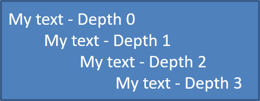

## **Tổng quan**

Aspose.Slides for Python via .NET cho phép bạn tạo và định dạng danh sách dấu đầu dòng và danh sách đánh số trong các bản trình bày PowerPoint và OpenDocument. Một mục danh sách là một đoạn văn mà các cài đặt dấu đầu dòng được kiểm soát thông qua định dạng đoạn văn của nó.

Sử dụng thuộc tính [Paragraph.paragraph_format](https://reference.aspose.com/slides/python-net/aspose.slides/paragraph/paragraph_format/) để truy cập các cài đặt danh sách ở mức đoạn. Điểm vào chính là [ParagraphFormat.bullet](https://reference.aspose.com/slides/python-net/aspose.slides/paragraphformat/bullet/), trả về một đối tượng [BulletFormat](https://reference.aspose.com/slides/python-net/aspose.slides/bulletformat/). Với đối tượng này, bạn có thể đặt loại dấu đầu dòng, ký hiệu, hình ảnh, màu, kích thước, kiểu đánh số và số bắt đầu.

Bài viết này mô tả cách:

- tạo danh sách dấu đầu dòng với ký hiệu tùy chỉnh
- tạo dấu đầu dòng hình ảnh
- tạo danh sách đa cấp bằng cách đặt độ sâu đoạn
- tạo danh sách đánh số
- kiểm tra và thay đổi định dạng danh sách trong một bản trình bày hiện có
- đọc các ký hiệu danh sách thực tế và số thứ tự cùng với văn bản đoạn

## **Tạo danh sách dấu đầu dòng**

Để tạo danh sách dấu đầu dòng, thêm các đối tượng [Paragraph](https://reference.aspose.com/slides/python-net/aspose.slides/paragraph/) vào một [TextFrame](https://reference.aspose.com/slides/python-net/aspose.slides/textframe/) và đặt [BulletFormat.type](https://reference.aspose.com/slides/python-net/aspose.slides/bulletformat/type/) thành [BulletType.SYMBOL](https://reference.aspose.com/slides/python-net/aspose.slides/bullettype/). Sau đó bạn có thể đặt [BulletFormat.char](https://reference.aspose.com/slides/python-net/aspose.slides/bulletformat/char/), [BulletFormat.color](https://reference.aspose.com/slides/python-net/aspose.slides/bulletformat/color/), và [BulletFormat.height](https://reference.aspose.com/slides/python-net/aspose.slides/bulletformat/height/) để kiểm soát giao diện của dấu đầu dòng.

Đoạn mã Python sau minh họa cách tạo danh sách dấu đầu dòng trong một slide:

```py
import aspose.slides as slides

def create_paragraph(text):
    paragraph = slides.Paragraph()
    paragraph.paragraph_format.bullet.type = slides.BulletType.SYMBOL
    paragraph.paragraph_format.bullet.char = '*'
    paragraph.paragraph_format.indent = 15
    paragraph.paragraph_format.bullet.is_bullet_hard_color = slides.NullableBool.TRUE
    paragraph.paragraph_format.bullet.color.color = slides.Color.indian_red
    paragraph.paragraph_format.bullet.height = 100
    paragraph.text = text
    return paragraph


with slides.Presentation() as presentation:
    slide = presentation.slides[0]

    auto_shape = slide.shapes.add_auto_shape(slides.ShapeType.RECTANGLE, 20, 20, 200, 50)

    text_frame = auto_shape.text_frame
    text_frame.paragraphs.clear()

    paragraph1 = create_paragraph("The first paragraph")
    text_frame.paragraphs.add(paragraph1)

    paragraph2 = create_paragraph("The second paragraph")
    text_frame.paragraphs.add(paragraph2)

    presentation.save("symbol_bullets.pptx", slides.export.SaveFormat.PPTX)
```

Kết quả:


## **Tạo danh sách đánh số**

Sử dụng danh sách đánh số khi thứ tự các mục quan trọng. Đặt [BulletFormat.type](https://reference.aspose.com/slides/python-net/aspose.slides/bulletformat/type/) thành [BulletType.NUMBERED](https://reference.aspose.com/slides/python-net/aspose.slides/bullettype/). Bạn cũng có thể chọn định dạng đánh số bằng [BulletFormat.numbered_bullet_style](https://reference.aspose.com/slides/python-net/aspose.slides/bulletformat/numbered_bullet_style/) hoặc đặt [BulletFormat.numbered_bullet_start_with](https://reference.aspose.com/slides/python-net/aspose.slides/bulletformat/numbered_bullet_start_with/) khi danh sách nên bắt đầu từ giá trị khác 1.

Đoạn mã Python sau cho thấy cách tạo danh sách đánh số trong một slide:

```py
import aspose.slides as slides

with slides.Presentation() as presentation:
    slide = presentation.slides[0]

    auto_shape = slide.shapes.add_auto_shape(slides.ShapeType.RECTANGLE, 20, 20, 90, 80)

    text_frame = auto_shape.text_frame
    text_frame.paragraphs.clear()

    paragraph1 = slides.Paragraph()
    paragraph1.paragraph_format.bullet.type = slides.BulletType.NUMBERED
    paragraph1.text = "Apple"
    text_frame.paragraphs.add(paragraph1)

    paragraph2 = slides.Paragraph()
    paragraph2.paragraph_format.bullet.type = slides.BulletType.NUMBERED
    paragraph2.text = "Orange"
    text_frame.paragraphs.add(paragraph2)

    paragraph3 = slides.Paragraph()
    paragraph3.paragraph_format.bullet.type = slides.BulletType.NUMBERED
    paragraph3.text = "Banana"
    text_frame.paragraphs.add(paragraph3)

    presentation.save("numbered_bullets.pptx", slides.export.SaveFormat.PPTX)
```

Kết quả:


## **Tạo dấu đầu dòng hình ảnh**

Aspose.Slides cho phép bạn thay thế ký hiệu dấu đầu dòng thông thường bằng một hình ảnh. Dấu đầu dòng hình ảnh hoạt động tốt nhất với các hình ảnh đơn giản vẫn đọc được ở kích thước nhỏ, chẳng hạn như biểu tượng hoặc các tệp PNG trong suốt nhỏ.

{}
Lý tưởng nhất, nếu bạn dự định thay thế ký hiệu dấu đầu dòng thông thường bằng một hình ảnh, tốt nhất là chọn một đồ họa đơn giản với nền trong suốt. Những hình ảnh như vậy hoạt động tốt như ký hiệu dấu đầu dòng tùy chỉnh.
{}

Để tạo dấu đầu dòng hình ảnh, thêm một hình ảnh vào [Presentation.images](https://reference.aspose.com/slides/python-net/aspose.slides/presentation/images/) và gán đối tượng hình ảnh trả về cho [BulletFormat.picture](https://reference.aspose.com/slides/python-net/aspose.slides/bulletformat/picture/). Đặt [BulletFormat.type](https://reference.aspose.com/slides/python-net/aspose.slides/bulletformat/type/) thành [BulletType.PICTURE](https://reference.aspose.com/slides/python-net/aspose.slides/bullettype/) trước khi gán hình ảnh.

Giả sử chúng ta có một "image.png":


Đoạn mã Python sau cho thấy cách tạo dấu đầu dòng hình ảnh trong một slide:

```py
import aspose.slides as slides

def create_paragraph(text, image):
    paragraph = slides.Paragraph()
    paragraph.paragraph_format.bullet.type = slides.BulletType.PICTURE
    paragraph.paragraph_format.bullet.picture.image = image
    paragraph.paragraph_format.indent = 15
    paragraph.paragraph_format.bullet.height = 100
    paragraph.text = text
    return paragraph


with slides.Presentation() as presentation:
    slide = presentation.slides[0]

    auto_shape = slide.shapes.add_auto_shape(slides.ShapeType.RECTANGLE, 20, 20, 200, 50)

    text_frame = auto_shape.text_frame
    text_frame.paragraphs.clear()

    with open("image.png", "rb") as image_stream:
        bullet_image = presentation.images.add_image(image_stream)

    paragraph1 = create_paragraph("The first paragraph", bullet_image)
    text_frame.paragraphs.add(paragraph1)

    paragraph2 = create_paragraph("The second paragraph", bullet_image)
    text_frame.paragraphs.add(paragraph2)

    presentation.save("picture_bullets.pptx", slides.export.SaveFormat.PPTX)
```

Kết quả:


## **Tạo danh sách đa cấp**

Sử dụng [ParagraphFormat.depth](https://reference.aspose.com/slides/python-net/aspose.slides/paragraphformat/depth/) để đặt các mục danh sách ở các mức độ khác nhau. Mức 0 là cấp cao nhất, mức 1 là cấp con dưới nó, và tiếp tục như vậy. Độ sâu chỉ kiểm soát việc thụt lề; đặt [ParagraphFormat.bullet](https://reference.aspose.com/slides/python-net/aspose.slides/paragraphformat/bullet/) trên mỗi đoạn khi các mức độ cũng cần có dấu đầu dòng.

Đoạn mã Python sau cho thấy cách tạo danh sách đa cấp:

```py
import aspose.slides as slides

with slides.Presentation() as presentation:
    slide = presentation.slides[0]

    auto_shape = slide.shapes.add_auto_shape(slides.ShapeType.RECTANGLE, 20, 20, 260, 110)

    text_frame = auto_shape.text_frame
    text_frame.paragraphs.clear()

    paragraph1 = slides.Paragraph()
    paragraph1.paragraph_format.depth = 0
    paragraph1.text = "My text - Depth 0"
    text_frame.paragraphs.add(paragraph1)

    paragraph2 = slides.Paragraph()
    paragraph2.paragraph_format.depth = 1
    paragraph2.text = "My text - Depth 1"
    text_frame.paragraphs.add(paragraph2)

    paragraph3 = slides.Paragraph()
    paragraph3.paragraph_format.depth = 2
    paragraph3.text = "My text - Depth 2"
    text_frame.paragraphs.add(paragraph3)

    paragraph4 = slides.Paragraph()
    paragraph4.paragraph_format.depth = 3
    paragraph4.text = "My text - Depth 3"
    text_frame.paragraphs.add(paragraph4)

    presentation.save("multilevel_bullets.pptx", slides.export.SaveFormat.PPTX)
```

Kết quả:



## **Thay đổi danh sách hiện có**

Để thay đổi định dạng danh sách trong một bản trình bày hiện có, truy cập đoạn mục tiêu và cập nhật các cài đặt [ParagraphFormat.bullet](https://reference.aspose.com/slides/python-net/aspose.slides/paragraphformat/bullet/) của nó. Các thuộc tính tương tự được dùng để tạo danh sách cũng có thể được dùng để kiểm tra hoặc sửa đổi danh sách được tải từ tệp PPT, PPTX hoặc ODP.

```py
import aspose.slides as slides

with slides.Presentation("input.pptx") as presentation:
    slide = presentation.slides[0]

    auto_shape = slide.shapes[0]

    paragraph = auto_shape.text_frame.paragraphs[0]
    paragraph.paragraph_format.bullet.type = slides.BulletType.NUMBERED
    paragraph.paragraph_format.bullet.numbered_bullet_style = slides.NumberedBulletStyle.BULLET_ROMAN_UC_PERIOD
    paragraph.paragraph_format.bullet.numbered_bullet_start_with = 1
    paragraph.paragraph_format.margin_left = 30
    paragraph.paragraph_format.indent = -20

    presentation.save("updated_list.pptx", slides.export.SaveFormat.PPTX)
```

## **Đọc giá trị dấu đầu dòng thực tế**

Khi trích xuất nội dung bản trình bày, giữ các ký hiệu danh sách cùng với văn bản đoạn. Gọi [ParagraphFormat.get_effective](https://reference.aspose.com/slides/python-net/aspose.slides/paragraphformat/get_effective/) và truy cập [IParagraphFormatEffectiveData.bullet](https://reference.aspose.com/slides/python-net/aspose.slides/iparagraphformateffectivedata/bullet/) để lấy định dạng dấu đầu dòng thực tế. Kiểm tra [type](https://reference.aspose.com/slides/python-net/aspose.slides/ibulletformateffectivedata/type/) của nó trước khi đọc [actual_bullet_value](https://reference.aspose.com/slides/python-net/aspose.slides/ibulletformateffectivedata/actual_bullet_value/).

Đối với danh sách đánh số, phân biệt ba giá trị sau:

- [numbered_bullet_style](https://reference.aspose.com/slides/python-net/aspose.slides/ibulletformateffectivedata/numbered_bullet_style/) xác định định dạng, chẳng hạn số Ả Rập có dấu chấm hoặc chữ cái viết thường có dấu chấm.
- [numbered_bullet_start_with](https://reference.aspose.com/slides/python-net/aspose.slides/ibulletformateffectivedata/numbered_bullet_start_with/) chỉ định số bắt đầu cho một nhóm các đoạn đánh số.
- [actual_bullet_value](https://reference.aspose.com/slides/python-net/aspose.slides/ibulletformateffectivedata/actual_bullet_value/) trả về ký hiệu đã định dạng cho một đoạn cụ thể. Ví dụ, mục thứ hai trong danh sách bắt đầu từ 5 sẽ trả về `6.`.

Giữ [depth](https://reference.aspose.com/slides/python-net/aspose.slides/paragraphformat/depth/) cho mỗi đoạn để duy trì mức độ lồng nhau. Ký hiệu thực tế không mã hoá toàn bộ cấu trúc: một mục lồng nhau có thể trả về `c.` thay vì một nhãn kết hợp như `6.c.`.

Ví dụ tự chứa sau tạo các danh sách, lưu chúng vào một bản trình bày, và tải lại bản trình bày để báo cáo văn bản, độ sâu, loại dấu đầu dòng và giá trị thực của mỗi đoạn. Dấu hình ảnh xanh nhỏ được tạo từ SVG nội dòng.

```py
import aspose.slides as slides

with slides.Presentation() as presentation:
    presentation.slide_size.set_size(720, 440, slides.SlideSizeScaleType.DO_NOT_SCALE)
    slide = presentation.slides[0]

    shape = slide.shapes.add_auto_shape(slides.ShapeType.RECTANGLE, 30, 20, 660, 400)
    shape.fill_format.fill_type = slides.FillType.NO_FILL
    shape.line_format.fill_format.fill_type = slides.FillType.NO_FILL

    text_frame = shape.text_frame
    text_frame.paragraphs.clear()

    # Tạo một dấu hình ảnh mà không cần tệp hình ảnh bên ngoài.
    svg = slides.SvgImage("<svg xmlns='http://www.w3.org/2000/svg' width='16' height='16'><rect width='16' height='16' rx='4' fill='#0078D4'/></svg>")
    bullet_image = presentation.images.add_image(svg)

    def add_paragraph(text, depth, bullet_type, start=1, style=slides.NumberedBulletStyle.BULLET_ARABIC_PERIOD):
        paragraph = slides.Paragraph()
        paragraph.text = text

        paragraph_format = paragraph.paragraph_format
        paragraph_format.depth = depth
        paragraph_format.margin_left = 30 + depth * 40
        paragraph_format.indent = -28
        paragraph_format.space_after = 8
        paragraph_format.default_portion_format.font_height = 22
        paragraph_format.default_portion_format.fill_format.fill_type = slides.FillType.SOLID
        paragraph_format.default_portion_format.fill_format.solid_fill_color.color = slides.Color.black
        paragraph_format.bullet.type = bullet_type
        paragraph_format.bullet.is_bullet_hard_color = slides.NullableBool.TRUE
        paragraph_format.bullet.color.color = slides.Color.black
        if bullet_type == slides.BulletType.NUMBERED:
            paragraph_format.bullet.numbered_bullet_style = style
            paragraph_format.bullet.numbered_bullet_start_with = start
        elif bullet_type == slides.BulletType.SYMBOL:
            paragraph_format.bullet.char = "\u2022"
        elif bullet_type == slides.BulletType.PICTURE:
            paragraph_format.bullet.picture.image = bullet_image

        text_frame.paragraphs.add(paragraph)

    add_paragraph("First item", 0, slides.BulletType.NUMBERED, 5)
    add_paragraph("Second item", 0, slides.BulletType.NUMBERED, 5)
    add_paragraph("Nested item", 1, slides.BulletType.NUMBERED, 3, slides.NumberedBulletStyle.BULLET_ALPHA_LC_PERIOD)
    add_paragraph("Next nested item", 1, slides.BulletType.NUMBERED, 3, slides.NumberedBulletStyle.BULLET_ALPHA_LC_PERIOD)
    add_paragraph("Deep item", 2, slides.BulletType.NUMBERED, 4, slides.NumberedBulletStyle.BULLET_ROMAN_LC_PERIOD)
    add_paragraph("Back to top level", 0, slides.BulletType.NUMBERED, 5)
    add_paragraph("Symbol marker", 0, slides.BulletType.SYMBOL)
    add_paragraph("No bullet", 0, slides.BulletType.NONE)
    add_paragraph("Picture marker", 0, slides.BulletType.PICTURE)
    presentation.save("actual_bullet_values.pptx", slides.export.SaveFormat.PPTX)

with slides.Presentation("actual_bullet_values.pptx") as loaded_presentation:
    loaded_shape = loaded_presentation.slides[0].shapes[0]
    bullet_type_names = {slides.BulletType.NUMBERED: "NUMBERED", slides.BulletType.SYMBOL: "SYMBOL", slides.BulletType.NONE: "NONE", slides.BulletType.PICTURE: "PICTURE"}
    print("Text | Depth | Type | Actual value")
    for paragraph in loaded_shape.text_frame.paragraphs:
        bullet = paragraph.paragraph_format.get_effective().bullet
        if bullet.type in (slides.BulletType.NUMBERED, slides.BulletType.SYMBOL):
            marker = bullet.actual_bullet_value
        elif bullet.type == slides.BulletType.NONE:
            marker = f"{bullet.actual_bullet_value} (no bullet)"
        elif bullet.type == slides.BulletType.PICTURE:
            marker = f"{bullet.actual_bullet_value} (image required)"
        else:
            marker = "unsupported bullet type"
        bullet_type_name = bullet_type_names.get(bullet.type, "UNKNOWN")
        print(f"{paragraph.text} | {paragraph.paragraph_format.depth} | {bullet_type_name} | {marker}")
```

Các danh sách nguồn được hiển thị dưới đây.


Báo cáo khớp với các ký hiệu được hiển thị trong PowerPoint:

```text
Text | Depth | Type | Actual value
First item | 0 | NUMBERED | 5.
Second item | 0 | NUMBERED | 6.
Nested item | 1 | NUMBERED | c.
Next nested item | 1 | NUMBERED | d.
Deep item | 2 | NUMBERED | iv.
Back to top level | 0 | NUMBERED | 7.
Symbol marker | 0 | SYMBOL | •
No bullet | 0 | NONE | None (no bullet)
Picture marker | 0 | PICTURE | None (image required)
```

Đối với [BulletType.NONE and BulletType.PICTURE](https://reference.aspose.com/slides/python-net/aspose.slides/bullettype/), [actual_bullet_value](https://reference.aspose.com/slides/python-net/aspose.slides/ibulletformateffectivedata/actual_bullet_value/) trả về `None`, không phải chuỗi rỗng. Xử lý các kiểu này riêng biệt: kiểu đầu không có ký hiệu, trong khi kiểu thứ hai yêu cầu trích xuất hình ảnh dấu đầu dòng riêng. Dấu đầu dòng hình ảnh không thể được tái tạo chỉ bằng việc trích xuất ký hiệu văn bản.

## **Câu hỏi thường gặp**

**Có thể xuất danh sách dấu đầu dòng và danh sách đánh số sang PDF hoặc hình ảnh không?**

Có. Aspose.Slides giữ nguyên định dạng danh sách khi định dạng đích hỗ trợ bố cục văn bản và tính năng dấu đầu dòng tương ứng.

**Tôi có thể chỉnh sửa danh sách trong các bản trình bày hiện có không?**

Có. Tải bản trình bày, truy cập đoạn mục tiêu, kiểm tra hoặc cập nhật các cài đặt [ParagraphFormat.bullet](https://reference.aspose.com/slides/python-net/aspose.slides/paragraphformat/bullet/) của nó, và lưu bản trình bày.

**Danh sách có thể chứa văn bản không phải La Mã không?**

Có. Văn bản các mục danh sách có thể chứa ký tự Unicode, vì vậy bạn có thể tạo danh sách trong các bản trình bày đa ngôn ngữ. Đảm bảo các phông chữ trong bản trình bày hỗ trợ các ký tự bạn cần.