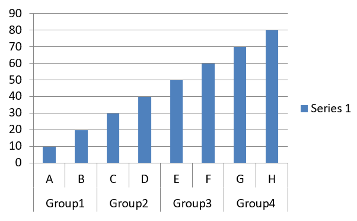

## **Tổng quan**

Bài viết này cung cấp hướng dẫn toàn diện về cách tạo và tùy chỉnh biểu đồ bằng Aspose.Slides cho Python qua .NET. Bạn sẽ học cách thêm biểu đồ vào một slide một cách lập trình, đưa dữ liệu vào và áp dụng các tùy chọn định dạng khác nhau để phù hợp với yêu cầu thiết kế của mình. Toàn bộ bài viết chứa các ví dụ mã chi tiết minh họa từng bước, từ khởi tạo bản trình bày và đối tượng biểu đồ tới cấu hình series, trục và chú giải. Bằng cách làm theo hướng dẫn này, bạn sẽ nắm vững cách tích hợp việc tạo biểu đồ động vào các ứng dụng Python, giúp đơn giản hoá quá trình tạo các bản trình bày dựa trên dữ liệu.

## **Tạo biểu đồ**

Biểu đồ giúp người dùng nhanh chóng hình dung dữ liệu và rút ra những hiểu biết có thể không rõ ràng ngay từ bảng hoặc bảng tính.

**Tại sao nên tạo biểu đồ?**

Sử dụng biểu đồ, bạn có thể:

* tổng hợp, cô bức hoặc tóm tắt lượng dữ liệu lớn trên một slide trong bản trình bày;
* phơi bày các mẫu và xu hướng trong dữ liệu;
* suy ra hướng và động lực của dữ liệu theo thời gian hoặc theo một đơn vị đo lường cụ thể;
* phát hiện các ngoại lệ, bất thường, sai lệch, lỗi và dữ liệu vô nghĩa;
* truyền đạt hoặc trình bày dữ liệu phức tạp.

Trong PowerPoint, bạn có thể tạo biểu đồ qua chức năng *Insert*, cung cấp các mẫu để thiết kế nhiều loại biểu đồ. Sử dụng Aspose.Slides, bạn có thể tạo cả biểu đồ thông thường (dựa trên các loại biểu đồ phổ biến) và biểu đồ tuỳ chỉnh.

{}

Sử dụng enumeration [ChartType](https://reference.aspose.com/slides/python-net/aspose.slides.charts/charttype/) trong module [aspose.slides.charts](https://reference.aspose.com/slides/python-net/aspose.slides.charts/). Các giá trị trong enumeration này tương ứng với các loại biểu đồ khác nhau.

{}

### **Tạo biểu đồ Cột Nhóm**

Ví dụ này sử dụng [add_chart](https://reference.aspose.com/slides/python-net/aspose.slides/shapecollection/add_chart/) để tạo một biểu đồ cột nhóm so sánh hai series qua ba danh mục. Các series sử dụng màu nền đỏ và xanh lá, và các nhãn riêng lẻ hiển thị tên danh mục, tên series và giá trị. Chỉ mục worksheet 0 đề cập đến trang tính đầu tiên trong workbook biểu đồ nhúng.

```python
import aspose.pydrawing as draw
import aspose.slides as slides
import aspose.slides.charts as charts

with slides.Presentation() as presentation:
    slide = presentation.slides[0]

    chart = slide.shapes.add_chart(charts.ChartType.CLUSTERED_COLUMN, 20, 20, 500, 300)

    chart.chart_title.add_text_frame_for_overriding("Sample Title")
    chart.chart_title.text_frame_for_overriding.text_frame_format.center_text = slides.NullableBool.TRUE
    chart.chart_title.height = 20
    chart.has_title = True

    workbook = chart.chart_data.chart_data_workbook
    worksheet_index = 0

    chart.chart_data.series.clear()
    chart.chart_data.categories.clear()

    series_name_cell = workbook.get_cell(worksheet_index, 0, 1, "Series 1")
    chart.chart_data.series.add(series_name_cell, chart.type)
    series_name_cell = workbook.get_cell(worksheet_index, 0, 2, "Series 2")
    chart.chart_data.series.add(series_name_cell, chart.type)

    category_cell = workbook.get_cell(worksheet_index, 1, 0, "Category 1")
    chart.chart_data.categories.add(category_cell)
    category_cell = workbook.get_cell(worksheet_index, 2, 0, "Category 2")
    chart.chart_data.categories.add(category_cell)
    category_cell = workbook.get_cell(worksheet_index, 3, 0, "Category 3")
    chart.chart_data.categories.add(category_cell)

    series = chart.chart_data.series[0]

    value_cell = workbook.get_cell(worksheet_index, 1, 1, 20)
    series.data_points.add_data_point_for_bar_series(value_cell)
    value_cell = workbook.get_cell(worksheet_index, 2, 1, 50)
    series.data_points.add_data_point_for_bar_series(value_cell)
    value_cell = workbook.get_cell(worksheet_index, 3, 1, 30)
    series.data_points.add_data_point_for_bar_series(value_cell)

    series.format.fill.fill_type = slides.FillType.SOLID
    series.format.fill.solid_fill_color.color = draw.Color.red

    series = chart.chart_data.series[1]

    value_cell = workbook.get_cell(worksheet_index, 1, 2, 30)
    series.data_points.add_data_point_for_bar_series(value_cell)
    value_cell = workbook.get_cell(worksheet_index, 2, 2, 10)
    series.data_points.add_data_point_for_bar_series(value_cell)
    value_cell = workbook.get_cell(worksheet_index, 3, 2, 60)
    series.data_points.add_data_point_for_bar_series(value_cell)

    series.format.fill.fill_type = slides.FillType.SOLID
    series.format.fill.solid_fill_color.color = draw.Color.green

    label = series.data_points[0].label
    label.data_label_format.show_category_name = True

    label = series.data_points[1].label
    label.data_label_format.show_series_name = True

    label = series.data_points[2].label
    label.data_label_format.show_value = True
    label.data_label_format.show_series_name = True
    label.data_label_format.separator = "/"

    presentation.save("AsposeChart.pptx", slides.export.SaveFormat.PPTX)
```

Kết quả:


### **Tạo biểu đồ Phân tán**

Biểu đồ phân tán (còn gọi là scatter plot hoặc đồ thị x‑y) thường được dùng để kiểm tra các mẫu hoặc mô tả mối tương quan giữa hai biến.

Sử dụng biểu đồ phân tán khi:

* Bạn có dữ liệu số cặp đôi.
* Bạn có hai biến liên quan chặt chẽ với nhau.
* Bạn muốn xác định liệu hai biến có liên quan hay không.
* Bạn có một biến độc lập có nhiều giá trị cho một biến phụ thuộc.

Ví dụ này vẽ hai bộ giá trị x‑y. Series đầu tiên dùng đường thẳng với ký hiệu sao, trong khi series thứ hai dùng đường mượt với ký hiệu vòng tròn; cả hai đều có [size](https://reference.aspose.com/slides/python-net/aspose.slides.charts/marker/size/) là 10. Thuộc tính [symbol](https://reference.aspose.com/slides/python-net/aspose.slides.charts/marker/symbol/) điều khiển dạng ký hiệu.

```python
import aspose.slides as slides
import aspose.slides.charts as charts

with slides.Presentation() as presentation:
    slide = presentation.slides[0]

    chart = slide.shapes.add_chart(charts.ChartType.SCATTER_WITH_SMOOTH_LINES, 20, 20, 500, 300)

    workbook = chart.chart_data.chart_data_workbook
    worksheet_index = 0

    chart.chart_data.series.clear()

    series_name_cell = workbook.get_cell(worksheet_index, 1, 1, "Series 1")
    chart.chart_data.series.add(series_name_cell, chart.type)
    series_name_cell = workbook.get_cell(worksheet_index, 1, 3, "Series 2")
    chart.chart_data.series.add(series_name_cell, chart.type)

    series = chart.chart_data.series[0]

    x_value_cell = workbook.get_cell(worksheet_index, 2, 1, 1)
    y_value_cell = workbook.get_cell(worksheet_index, 2, 2, 3)
    series.data_points.add_data_point_for_scatter_series(x_value_cell, y_value_cell)

    x_value_cell = workbook.get_cell(worksheet_index, 3, 1, 2)
    y_value_cell = workbook.get_cell(worksheet_index, 3, 2, 10)
    series.data_points.add_data_point_for_scatter_series(x_value_cell, y_value_cell)

    series.type = charts.ChartType.SCATTER_WITH_STRAIGHT_LINES_AND_MARKERS

    series.marker.size = 10
    series.marker.symbol = charts.MarkerStyleType.STAR

    series = chart.chart_data.series[1]

    x_value_cell = workbook.get_cell(worksheet_index, 2, 3, 5)
    y_value_cell = workbook.get_cell(worksheet_index, 2, 4, 2)
    series.data_points.add_data_point_for_scatter_series(x_value_cell, y_value_cell)

    x_value_cell = workbook.get_cell(worksheet_index, 3, 3, 3)
    y_value_cell = workbook.get_cell(worksheet_index, 3, 4, 1)
    series.data_points.add_data_point_for_scatter_series(x_value_cell, y_value_cell)

    x_value_cell = workbook.get_cell(worksheet_index, 4, 3, 2)
    y_value_cell = workbook.get_cell(worksheet_index, 4, 4, 2)
    series.data_points.add_data_point_for_scatter_series(x_value_cell, y_value_cell)

    x_value_cell = workbook.get_cell(worksheet_index, 5, 3, 5)
    y_value_cell = workbook.get_cell(worksheet_index, 5, 4, 1)
    series.data_points.add_data_point_for_scatter_series(x_value_cell, y_value_cell)

    series.marker.size = 10
    series.marker.symbol = charts.MarkerStyleType.CIRCLE

    presentation.save("AsposeChart.pptx", slides.export.SaveFormat.PPTX)
```

Kết quả:


### **Tạo biểu đồ Tròn**

Biểu đồ tròn thích hợp để hiển thị mối quan hệ phần‑với‑toàn trong dữ liệu, đặc biệt khi dữ liệu chứa các nhãn danh mục có giá trị số. Tuy nhiên, nếu dữ liệu của bạn có quá nhiều phần hoặc nhãn, bạn có thể cân nhắc sử dụng biểu đồ cột thay thế.

Ví dụ này tạo một biểu đồ tròn với ba giá trị quý. Mỗi lát có màu nền và đường viền tùy chỉnh, và các nhãn hiển thị các kết hợp khác nhau của giá trị, phần trăm và thông tin series. Thuộc tính [first_slice_angle](https://reference.aspose.com/slides/python-net/aspose.slides.charts/chartseriesgroup/first_slice_angle/) đặt lát đầu tiên bắt đầu ở 180 độ.

```python
import aspose.pydrawing as draw
import aspose.slides as slides
import aspose.slides.charts as charts

with slides.Presentation() as presentation:
    slide = presentation.slides[0]

    chart = slide.shapes.add_chart(charts.ChartType.PIE, 20, 20, 500, 300)

    chart.chart_title.add_text_frame_for_overriding("Sample Title")
    chart.chart_title.text_frame_for_overriding.text_frame_format.center_text = slides.NullableBool.TRUE
    chart.chart_title.height = 20
    chart.has_title = True

    chart.chart_data.series[0].labels.default_data_label_format.show_value = True

    workbook = chart.chart_data.chart_data_workbook
    worksheet_index = 0

    chart.chart_data.series.clear()
    chart.chart_data.categories.clear()

    category_cell = workbook.get_cell(0, 1, 0, "1st Qtr")
    chart.chart_data.categories.add(category_cell)
    category_cell = workbook.get_cell(0, 2, 0, "2nd Qtr")
    chart.chart_data.categories.add(category_cell)
    category_cell = workbook.get_cell(0, 3, 0, "3rd Qtr")
    chart.chart_data.categories.add(category_cell)

    series_name_cell = workbook.get_cell(0, 0, 1, "Series 1")
    series = chart.chart_data.series.add(series_name_cell, chart.type)

    value_cell = workbook.get_cell(worksheet_index, 1, 1, 20)
    series.data_points.add_data_point_for_pie_series(value_cell)
    value_cell = workbook.get_cell(worksheet_index, 2, 1, 50)
    series.data_points.add_data_point_for_pie_series(value_cell)
    value_cell = workbook.get_cell(worksheet_index, 3, 1, 30)
    series.data_points.add_data_point_for_pie_series(value_cell)

    chart.chart_data.series_groups[0].is_color_varied = True

    first_slice = series.data_points[0]
    first_slice.format.fill.fill_type = slides.FillType.SOLID
    first_slice.format.fill.solid_fill_color.color = draw.Color.cyan

    first_slice.format.line.fill_format.fill_type = slides.FillType.SOLID
    first_slice.format.line.fill_format.solid_fill_color.color = draw.Color.gray
    first_slice.format.line.width = 3.0
    first_slice.format.line.style = slides.LineStyle.THIN_THICK
    first_slice.format.line.dash_style = slides.LineDashStyle.LARGE_DASH

    second_slice = series.data_points[1]
    second_slice.format.fill.fill_type = slides.FillType.SOLID
    second_slice.format.fill.solid_fill_color.color = draw.Color.brown

    second_slice.format.line.fill_format.fill_type = slides.FillType.SOLID
    second_slice.format.line.fill_format.solid_fill_color.color = draw.Color.blue
    second_slice.format.line.width = 3.0
    second_slice.format.line.style = slides.LineStyle.SINGLE
    second_slice.format.line.dash_style = slides.LineDashStyle.LARGE_DASH_DOT

    third_slice = series.data_points[2]
    third_slice.format.fill.fill_type = slides.FillType.SOLID
    third_slice.format.fill.solid_fill_color.color = draw.Color.coral

    third_slice.format.line.fill_format.fill_type = slides.FillType.SOLID
    third_slice.format.line.fill_format.solid_fill_color.color = draw.Color.red
    third_slice.format.line.width = 2.0
    third_slice.format.line.style = slides.LineStyle.THIN_THIN
    third_slice.format.line.dash_style = slides.LineDashStyle.LARGE_DASH_DOT_DOT

    first_label = series.data_points[0].label
    first_label.data_label_format.show_value = True

    second_label = series.data_points[1].label
    second_label.data_label_format.show_value = True
    second_label.data_label_format.show_legend_key = True
    second_label.data_label_format.show_percentage = True

    third_label = series.data_points[2].label
    third_label.data_label_format.show_series_name = True
    third_label.data_label_format.show_percentage = True

    series.labels.default_data_label_format.show_leader_lines = True

    chart.chart_data.series_groups[0].first_slice_angle = 180

    presentation.save("PieChart.pptx", slides.export.SaveFormat.PPTX)
```

Kết quả:


Để cải thiện khả năng đọc các nhãn ngoài tròn, xem phần [Format Leader Lines](/slides/vi/python-net/chart-data-label/#format-leader-lines) để biết ví dụ về cách định vị nhãn và tùy chỉnh màu, độ rộng, độ trong suốt và kiểu gạch của các đường dẫn.

### **Tạo biểu đồ Đường**

Biểu đồ đường (còn gọi là line graph) thích hợp trong các tình huống bạn muốn mô tả sự thay đổi giá trị theo thời gian. Sử dụng biểu đồ đường, bạn có thể so sánh lượng dữ liệu lớn cùng lúc, theo dõi các thay đổi và xu hướng theo thời gian, làm nổi bật các bất thường trong series dữ liệu, và hơn thế nữa.

Ví dụ này sử dụng [add_chart](https://reference.aspose.com/slides/python-net/aspose.slides/shapecollection/add_chart/) để tạo một biểu đồ đường với series và danh mục mặc định, sau đó lưu bản trình bày dưới dạng PPTX.

```python
import aspose.slides as slides
import aspose.slides.charts as charts

with slides.Presentation() as presentation:
    slide = presentation.slides[0]

    line_chart = slide.shapes.add_chart(charts.ChartType.LINE, 20, 20, 500, 300)

    presentation.save("lineChart.pptx", slides.export.SaveFormat.PPTX)
```

Theo mặc định, các điểm trên biểu đồ đường được nối bằng các đoạn thẳng liên tục. Nếu bạn muốn các điểm được nối bằng các đoạn gạch, đặt [dash_style](https://reference.aspose.com/slides/python-net/aspose.slides/lineformat/dash_style/) thành một giá trị từ [LineDashStyle](https://reference.aspose.com/slides/python-net/aspose.slides/linedashstyle/):

```python
import aspose.slides as slides
import aspose.slides.charts as charts

with slides.Presentation() as presentation:
    slide = presentation.slides[0]

    line_chart = slide.shapes.add_chart(charts.ChartType.LINE, 20, 20, 500, 300)

    for series in line_chart.chart_data.series:
        series.format.line.dash_style = slides.LineDashStyle.DASH
```

Kết quả:


### **Tạo biểu đồ Cây (Tree Map)**

Biểu đồ cây thích hợp cho dữ liệu bán hàng khi bạn muốn hiển thị kích thước tương đối của các danh mục dữ liệu và nhanh chóng thu hút sự chú ý đến những mục đóng góp lớn trong mỗi danh mục.

Ví dụ này tạo một biểu đồ cây với tám lá được nhóm thành bốn nhánh và hai cành. Phương thức [set_grouping_item](https://reference.aspose.com/slides/python-net/aspose.slides.charts/chartcategorylevelsmanager/set_grouping_item/) gán các nhánh ở mức nhóm 1 và các cành ở mức 2. Các giá trị xác định kích thước hình chữ nhật tương đối, trong khi các nhãn danh mục và nhãn cha chồng lên nhau xác định thứ bậc.

```python
import aspose.slides as slides
import aspose.slides.charts as charts

with slides.Presentation() as presentation:
    slide = presentation.slides[0]

    chart = slide.shapes.add_chart(charts.ChartType.TREEMAP, 20, 20, 500, 300)

    chart.chart_data.categories.clear()
    chart.chart_data.series.clear()

    workbook = chart.chart_data.chart_data_workbook
    workbook.clear(0)

    # Nhánh 1
    category_cell = workbook.get_cell(0, "C1", "Leaf1")
    leaf = chart.chart_data.categories.add(category_cell)
    leaf.grouping_levels.set_grouping_item(1, "Stem1")
    leaf.grouping_levels.set_grouping_item(2, "Branch1")

    category_cell = workbook.get_cell(0, "C2", "Leaf2")
    chart.chart_data.categories.add(category_cell)

    category_cell = workbook.get_cell(0, "C3", "Leaf3")
    leaf = chart.chart_data.categories.add(category_cell)
    leaf.grouping_levels.set_grouping_item(1, "Stem2")

    category_cell = workbook.get_cell(0, "C4", "Leaf4")
    chart.chart_data.categories.add(category_cell)

    # Nhánh 2
    category_cell = workbook.get_cell(0, "C5", "Leaf5")
    leaf = chart.chart_data.categories.add(category_cell)
    leaf.grouping_levels.set_grouping_item(1, "Stem3")
    leaf.grouping_levels.set_grouping_item(2, "Branch2")

    category_cell = workbook.get_cell(0, "C6", "Leaf6")
    chart.chart_data.categories.add(category_cell)

    category_cell = workbook.get_cell(0, "C7", "Leaf7")
    leaf = chart.chart_data.categories.add(category_cell)
    leaf.grouping_levels.set_grouping_item(1, "Stem4")

    category_cell = workbook.get_cell(0, "C8", "Leaf8")
    chart.chart_data.categories.add(category_cell)

    series = chart.chart_data.series.add(charts.ChartType.TREEMAP)
    series.labels.default_data_label_format.show_category_name = True
    value_cell = workbook.get_cell(0, "D1", 4)
    series.data_points.add_data_point_for_treemap_series(value_cell)
    value_cell = workbook.get_cell(0, "D2", 5)
    series.data_points.add_data_point_for_treemap_series(value_cell)
    value_cell = workbook.get_cell(0, "D3", 3)
    series.data_points.add_data_point_for_treemap_series(value_cell)
    value_cell = workbook.get_cell(0, "D4", 6)
    series.data_points.add_data_point_for_treemap_series(value_cell)
    value_cell = workbook.get_cell(0, "D5", 9)
    series.data_points.add_data_point_for_treemap_series(value_cell)
    value_cell = workbook.get_cell(0, "D6", 9)
    series.data_points.add_data_point_for_treemap_series(value_cell)
    value_cell = workbook.get_cell(0, "D7", 4)
    series.data_points.add_data_point_for_treemap_series(value_cell)
    value_cell = workbook.get_cell(0, "D8", 3)
    series.data_points.add_data_point_for_treemap_series(value_cell)

    series.parent_label_layout = charts.ParentLabelLayoutType.OVERLAPPING

    presentation.save("Treemap.pptx", slides.export.SaveFormat.PPTX)
```

Kết quả:


### **Tạo biểu đồ Thác (Waterfall)**

Biểu đồ thác cho thấy cách các thay đổi dương và âm đóng góp vào giá trị cuối cùng. Ví dụ, một bảng phân tích lợi nhuận có thể bắt đầu bằng doanh thu, trừ chi phí, và cộng thu nhập khác. Các cột thay đổi nổi giữa giá trị chạy trước và sau, trong khi các cột tổng mở rộng từ zero đến giá trị tích lũy.

Ví dụ dưới đây sử dụng các mức bằng nghìn đô la Mỹ:

| Category | Workbook value | Column type |
| --- | ---: | --- |
| Revenue | 1000 | Increase |
| Cost of sales | -400 | Decrease |
| Gross profit | 600 | Intermediate total |
| Operating expenses | -200 | Decrease |
| Other income | 50 | Increase |
| Net profit | 450 | Final total |

Để đánh dấu một điểm là tổng trung gian hoặc tổng cuối cùng, đặt thuộc tính [set_as_total](https://reference.aspose.com/slides/python-net/aspose.slides.charts/chartdatapoint/set_as_total/) của nó thành `True`. Cung cấp số tiền tích lũy thực tế trong ô workbook của điểm đó: `600` cho lợi nhuận gộp (`1000 - 400`) và `450` cho lợi nhuận ròng (`600 - 200 + 50`). Thuộc tính này đánh dấu cột là tổng; nó không tính toán hoặc điền giá trị ô. Không sử dụng zero làm chỗ giữ chỗ hay cung cấp một thay đổi khác cho điểm tổng. Một cột tổng hiển thị giá trị tích lũy mà không cộng thêm vào giá trị chạy.

Ví dụ C# đầy đủ này tạo một biểu đồ bằng thành viên `Waterfall` của [ChartType](https://reference.aspose.com/slides/python-net/aspose.slides.charts/charttype/), xóa dữ liệu mặc định và điền workbook nhúng. Chỉ mục worksheet `0` chọn worksheet đầu tiên; cột A chứa tên danh mục và cột B chứa giá trị. Mỗi ô giá trị được thêm bằng [add_data_point_for_waterfall_series](https://reference.aspose.com/slides/python-net/aspose.slides.charts/chartdatapointcollection/add_data_point_for_waterfall_series/). Các chỉ số điểm không‑đếm `2` và `5` xác định các tổng trung gian và cuối cùng. Bật [show_value](https://reference.aspose.com/slides/python-net/aspose.slides.charts/datalabelformat/show_value/) hiển thị số tiền trên các cột. Không cần bản trình bày hoặc workbook đầu vào.

```python
import aspose.slides as slides
import aspose.slides.charts as charts

with slides.Presentation() as presentation:
    slide = presentation.slides[0]

    chart = slide.shapes.add_chart(charts.ChartType.WATERFALL, 20, 20, 680, 200)

    chart.has_title = True
    chart.chart_title.add_text_frame_for_overriding("Profit breakdown (USD thousands)")
    chart.chart_title.overlay = False
    chart.has_legend = False

    chart.chart_data.series.clear()
    chart.chart_data.categories.clear()

    workbook = chart.chart_data.chart_data_workbook
    worksheet_index = 0

    workbook.clear(worksheet_index)

    series_name_cell = workbook.get_cell(worksheet_index, 0, 1, "Profit")
    series = chart.chart_data.series.add(series_name_cell, charts.ChartType.WATERFALL)
    categories = ["Revenue", "Cost of sales", "Gross profit", "Operating expenses", "Other income", "Net profit"]
    values = [1000, -400, 600, -200, 50, 450]

    for i in range(len(categories)):
        category_cell = workbook.get_cell(worksheet_index, i + 1, 0, categories[i])
        chart.chart_data.categories.add(category_cell)
        value_cell = workbook.get_cell(worksheet_index, i + 1, 1, values[i])
        series.data_points.add_data_point_for_wat

    # Các điểm thứ ba và thứ sáu đại diện cho tổng, không phải các thay đổi bổ sung.
    series.data_points[2].set_as_total = True
    series.data_points[5].set_as_total = True
    series.show_connector_lines = True
    series.labels.default_data_label_format.show_value = True

    presentation.save("WaterfallChart.pptx", slides.export.SaveFormat.PPTX)
```

Đặt thuộc tính cấp series [show_connector_lines](https://reference.aspose.com/slides/python-net/aspose.slides.charts/chartseries/show_connector_lines/) thành `True` để hiển thị các đường nối các cột liên tiếp và giúp theo dõi giá trị chạy dễ hơn. Để ẩn các đường này, thay thế câu lệnh trong ví dụ bằng `series.show_connector_lines = False` trước khi lưu. Thao tác này chỉ thay đổi hiển thị đường, không ảnh hưởng tới dữ liệu hay tổng.

Bản trình bày đã lưu hiển thị lợi nhuận gộp 600 và lợi nhuận ròng 450, cả hai tổng đều bắt đầu từ zero:


### **Tạo biểu đồ Cổ phiếu (Stock)**

Biểu đồ cổ phiếu dùng để hiển thị dữ liệu tài chính như giá mở cửa, cao, thấp và đóng cửa, giúp phân tích xu hướng thị trường và độ biến động. Chúng cung cấp những hiểu biết quan trọng về hiệu suất cổ phiếu, hỗ trợ nhà đầu tư và nhà phân tích đưa ra quyết định thông minh.

Ví dụ này tạo một biểu đồ open‑high‑low‑close với bốn series theo thứ tự đó và ba danh mục. Thuộc tính [has_up_down_bars](https://reference.aspose.com/slides/python-net/aspose.slides.charts/updownbarsmanager/has_up_down_bars/) bật thanh lên/xuống, và [hi_low_lines_format](https://reference.aspose.com/slides/python-net/aspose.slides.charts/chartseriesgroup/hi_low_lines_format/) điều khiển các đường cao‑thấp hiển thị phạm vi giá, trong khi các đường series riêng lẻ và các đường lưới ngang phụ được ẩn.

Trình quản lý [up_down_bars](https://reference.aspose.com/slides/python-net/aspose.slides.charts/chartseriesgroup/up_down_bars/) cung cấp các đối tượng riêng biệt [up_bars_format](https://reference.aspose.com/slides/python-net/aspose.slides.charts/updownbarsmanager/up_bars_format/) và [down_bars_format](https://reference.aspose.com/slides/python-net/aspose.slides.charts/updownbarsmanager/down_bars_format/). Sử dụng thuộc tính [fill](https://reference.aspose.com/slides/python-net/aspose.slides.charts/format/fill/) và [line](https://reference.aspose.com/slides/python-net/aspose.slides.charts/format/line/) của mỗi đối tượng để đặt màu nền và viền một cách độc lập. Ví dụ này dùng thanh xanh lá với viền xanh đậm cho các khoảng tăng và thanh cam‑đỏ với viền đỏ đậm cho các khoảng giảm.

Cung cấp giá trị số cho cả bốn series ở mỗi danh mục, với High và Low bao quanh Open và Close. Các thanh so sánh Close với Open **trong cùng một danh mục**, không phải so sánh với danh mục trước: A giảm từ 72 xuống 25, trong khi B tăng từ 25 lên 38 và C tăng từ 38 lên 50. Khi Open và Close bằng nhau, không có khoảng màu hiển thị. Các thanh lên/xuống bao phủ Open‑Close; các đường cao‑thấp bao phủ Low‑High. Các thanh này thuộc nhóm series và không phải là các series biểu đồ cột thông thường.

Định dạng này cũng hoạt động với các biểu đồ [LINE and LINE_WITH_MARKERS](https://reference.aspose.com/slides/python-net/aspose.slides.charts/charttype/) có ít nhất hai series trong cùng một nhóm và giá trị số tương ứng cho mỗi danh mục. Đối với các biểu đồ đường không chồng, thanh lên/xuống so sánh series đầu và cuối: giá trị cuối cao hơn tạo thanh lên, giá trị cuối thấp hơn tạo thanh xuống. Đảo ngược các series sẽ đổi phân loại. Ví dụ dưới đây sử dụng [OPEN_HIGH_LOW_CLOSE](https://reference.aspose.com/slides/python-net/aspose.slides.charts/charttype/); không giả định rằng các biến thể cổ phiếu, line‑stacked hoặc 3D khác sử dụng cùng cách sắp xếp dữ liệu hoặc cách diễn giải khoảng.

```python
import aspose.pydrawing as draw
import aspose.slides as slides
import aspose.slides.charts as charts

with slides.Presentation() as presentation:
    slide = presentation.slides[0]

    chart = slide.shapes.add_chart(charts.ChartType.OPEN_HIGH_LOW_CLOSE, 20, 20, 500, 150, False)

    workbook = chart.chart_data.chart_data_workbook

    category_cell = workbook.get_cell(0, 1, 0, "A")
    chart.chart_data.categories.add(category_cell)
    category_cell = workbook.get_cell(0, 2, 0, "B")
    chart.chart_data.categories.add(category_cell)
    category_cell = workbook.get_cell(0, 3, 0, "C")
    chart.chart_data.categories.add(category_cell)

    series_name_cell = workbook.get_cell(0, 0, 1, "Open")
    chart.chart_data.series.add(series_name_cell, charts.ChartType.OPEN_HIGH_LOW_CLOSE)
    series_name_cell = workbook.get_cell(0, 0, 2, "High")
    chart.chart_data.series.add(series_name_cell, charts.ChartType.OPEN_HIGH_LOW_CLOSE)
    series_name_cell = workbook.get_cell(0, 0, 3, "Low")
    chart.chart_data.series.add(series_name_cell, charts.ChartType.OPEN_HIGH_LOW_CLOSE)
    series_name_cell = workbook.get_cell(0, 0, 4, "Close")
    chart.chart_data.series.add(series_name_cell, charts.ChartType.OPEN_HIGH_LOW_CLOSE)

    series = chart.chart_data.series[0]
    value_cell = workbook.get_cell(0, 1, 1, 72)
    series.data_points.add_data_point_for_stock_series(value_cell)
    value_cell = workbook.get_cell(0, 2, 1, 25)
    series.data_points.add_data_point_for_stock_series(value_cell)
    value_cell = workbook.get_cell(0, 3, 1, 38)
    series.data_points.add_data_point_for_stock_series(value_cell)

    series = chart.chart_data.series[1]
    value_cell = workbook.get_cell(0, 1, 2, 172)
    series.data_points.add_data_point_for_stock_series(value_cell)
    value_cell = workbook.get_cell(0, 2, 2, 57)
    series.data_points.add_data_point_for_stock_series(value_cell)
    value_cell = workbook.get_cell(0, 3, 2, 57)
    series.data_points.add_data_point_for_stock_series(value_cell)

    series = chart.chart_data.series[2]
    value_cell = workbook.get_cell(0, 1, 3, 12)
    series.data_points.add_data_point_for_stock_series(value_cell)
    value_cell = workbook.get_cell(0, 2, 3, 12)
    series.data_points.add_data_point_for_stock_series(value_cell)
    value_cell = workbook.get_cell(0, 3, 3, 13)
    series.data_points.add_data_point_for_stock_series(value_cell)

    series = chart.chart_data.series[3]
    value_cell = workbook.get_cell(0, 1, 4, 25)
    series.data_points.add_data_point_for_stock_series(value_cell)
    value_cell = workbook.get_cell(0, 2, 4, 38)
    series.data_points.add_data_point_for_stock_series(value_cell)
    value_cell = workbook.get_cell(0, 3, 4, 50)
    series.data_points.add_data_point_for_stock_series(value_cell)

    up_down_bars = chart.chart_data.series_groups[0].up_down_bars
    up_down_bars.has_up_down_bars = True

    up_down_bars.up_bars_format.fill.fill_type = slides.FillType.SOLID
    up_down_bars.up_bars_format.fill.solid_fill_color.color = draw.Color.lime_green
    up_down_bars.up_bars_format.line.fill_format.fill_type = slides.FillType.SOLID
    up_down_bars.up_bars_format.line.fill_format.solid_fill_color.color = draw.Color.dark_green
    up_down_bars.up_bars_format.line.width = 2

    up_down_bars.down_bars_format.fill.fill_type = slides.FillType.SOLID
    up_down_bars.down_bars_format.fill.solid_fill_color.color = draw.Color.orange_red
    up_down_bars.down_bars_format.line.fill_format.fill_type = slides.FillType.SOLID
    up_down_bars.down_bars_format.line.fill_format.solid_fill_color.color = draw.Color.dark_red
    up_down_bars.down_bars_format.line.width = 2
    chart.chart_data.series_groups[0].hi_low_lines_format.line.fill_format.fill_type = slides.FillType.SOLID

    for stock_series in chart.chart_data.series:
        stock_series.format.line.fill_format.fill_type = slides.FillType.NO_FILL

    chart.axes.vertical_axis.minor_grid_lines_format.line.fill_format.fill_type = slides.FillType.NO_FILL

    presentation.save("Stock-chart.pptx", slides.export.SaveFormat.PPTX)
```

Kết quả, xuất từ PowerPoint:


### **Tạo biểu đồ Hộp và Râu (Box and Whisker)**

Biểu đồ hộp và râu dùng để hiển thị phân bố dữ liệu bằng cách tóm tắt các chỉ số thống kê chính, như trung vị, các phần tư và các ngoại lệ tiềm năng. Chúng đặc biệt hữu ích trong phân tích khám phá dữ liệu và các nghiên cứu thống kê để nhanh chóng hiểu biến động dữ liệu và xác định bất thường.

Ví dụ này tạo một biểu đồ hộp và râu từ sáu giá trị. Thuộc tính [quartile_method](https://reference.aspose.com/slides/python-net/aspose.slides.charts/chartseries/quartile_method/) chọn cách tính phần tư exclusive. Ví dụ cũng bật các đường trung bình, ký hiệu trung bình, điểm nội bộ và điểm ngoại lệ.

```python
import aspose.slides as slides
import aspose.slides.charts as charts

with slides.Presentation() as presentation:
    slide = presentation.slides[0]

    chart = slide.shapes.add_chart(charts.ChartType.BOX_AND_WHISKER, 20, 20, 500, 300)

    chart.chart_data.categories.clear()
    chart.chart_data.series.clear()

    workbook = chart.chart_data.chart_data_workbook
    workbook.clear(0)

    category_cell = workbook.get_cell(0, "A1", "Category 1")
    chart.chart_data.categories.add(category_cell)
    category_cell = workbook.get_cell(0, "A2", "Category 2")
    chart.chart_data.categories.add(category_cell)
    category_cell = workbook.get_cell(0, "A3", "Category 3")
    chart.chart_data.categories.add(category_cell)
    category_cell = workbook.get_cell(0, "A4", "Category 4")
    chart.chart_data.categories.add(category_cell)
    category_cell = workbook.get_cell(0, "A5", "Category 5")
    chart.chart_data.categories.add(category_cell)
    category_cell = workbook.get_cell(0, "A6", "Category 6")
    chart.chart_data.categories.add(category_cell)

    series = chart.chart_data.series.add(charts.ChartType.BOX_AND_WHISKER)

    series.quartile_method = charts.QuartileMethodType.EXCLUSIVE
    series.show_mean_line = True
    series.show_mean_markers = True
    series.show_inner_points = True
    series.show_outlier_points = True

    value_cell = workbook.get_cell(0, "B1", 15)
    series.data_points.add_data_point_for_box_and_whisker_series(value_cell)
    value_cell = workbook.get_cell(0, "B2", 41)
    series.data_points.add_data_point_for_box_and_whisker_series(value_cell)
    value_cell = workbook.get_cell(0, "B3", 16)
    series.data_points.add_data_point_for_box_and_whisker_series(value_cell)
    value_cell = workbook.get_cell(0, "B4", 10)
    series.data_points.add_data_point_for_box_and_whisker_series(value_cell)
    value_cell = workbook.get_cell(0, "B5", 23)
    series.data_points.add_data_point_for_box_and_whisker_series(value_cell)
    value_cell = workbook.get_cell(0, "B6", 16)
    series.data_points.add_data_point_for_box_and_whisker_series(value_cell)

    presentation.save("BoxAndWhisker.pptx", slides.export.SaveFormat.PPTX)
```

### **Tạo biểu đồ Phễu (Funnel)**

Biểu đồ phễu dùng để trực quan hoá các quy trình có các giai đoạn tuần tự, trong đó khối lượng dữ liệu giảm dần khi tiến từ bước này sang bước tiếp theo. Chúng đặc biệt hữu ích để phân tích tỷ lệ chuyển đổi, xác định các nút thắt và theo dõi hiệu quả của các quy trình bán hàng hoặc marketing.

Ví dụ này sử dụng [add_chart](https://reference.aspose.com/slides/python-net/aspose.slides/shapecollection/add_chart/) để thêm một biểu đồ phễu vào slide đầu tiên của một bản trình bày hiện có. Nó thay thế dữ liệu mặc định bằng sáu danh mục và các giá trị từ 50 tới 500, sau đó lưu bản trình bày đã cập nhật. Bản trình bày đầu vào phải chứa ít nhất một slide.

```python
import aspose.slides as slides
import aspose.slides.charts as charts

with slides.Presentation("test.pptx") as presentation:
    slide = presentation.slides[0]

    chart = slide.shapes.add_chart(charts.ChartType.FUNNEL, 50, 50, 500, 400)

    chart.chart_data.categories.clear()
    chart.chart_data.series.clear()

    workbook = chart.chart_data.chart_data_workbook
    workbook.clear(0)

    category_cell = workbook.get_cell(0, "A1", "Category 1")
    chart.chart_data.categories.add(category_cell)
    category_cell = workbook.get_cell(0, "A2", "Category 2")
    chart.chart_data.categories.add(category_cell)
    category_cell = workbook.get_cell(0, "A3", "Category 3")
    chart.chart_data.categories.add(category_cell)
    category_cell = workbook.get_cell(0, "A4", "Category 4")
    chart.chart_data.categories.add(category_cell)
    category_cell = workbook.get_cell(0, "A5", "Category 5")
    chart.chart_data.categories.add(category_cell)
    category_cell = workbook.get_cell(0, "A6", "Category 6")
    chart.chart_data.categories.add(category_cell)

    series = chart.chart_data.series.add(charts.ChartType.FUNNEL)

    value_cell = workbook.get_cell(0, "B1", 50)
    series.data_points.add_data_point_for_funnel_series(value_cell)
    value_cell = workbook.get_cell(0, "B2", 100)
    series.data_points.add_data_point_for_funnel_series(value_cell)
    value_cell = workbook.get_cell(0, "B3", 200)
    series.data_points.add_data_point_for_funnel_series(value_cell)
    value_cell = workbook.get_cell(0, "B4", 300)
    series.data_points.add_data_point_for_funnel_series(value_cell)
    value_cell = workbook.get_cell(0, "B5", 400)
    series.data_points.add_data_point_for_funnel_series(value_cell)
    value_cell = workbook.get_cell(0, "B6", 500)
    series.data_points.add_data_point_for_funnel_series(value_cell)

    presentation.save("Funnel.pptx", slides.export.SaveFormat.PPTX)
```

Kết quả:


### **Tạo biểu đồ Mặt trời (Sunburst)**

Biểu đồ mặt trời dùng để trực quan hoá dữ liệu phân cấp, hiển thị các cấp độ dưới dạng các vòng đồng tâm. Chúng giúp minh hoạ các mối quan hệ phần‑với‑toàn và rất phù hợp để biểu diễn các danh mục lồng nhau trong một định dạng rõ ràng, gọn gàng.

Ví dụ này tạo một biểu đồ mặt trời với tám lá được nhóm thành bốn nhánh và hai cành. Phương thức [set_grouping_item](https://reference.aspose.com/slides/python-net/aspose.slides.charts/chartcategorylevelsmanager/set_grouping_item/) gán các nhánh ở mức nhóm 1 và các cành ở mức 2. Các nhãn danh mục xác định các phân đoạn, và các giá trị quyết định kích thước tương đối của chúng.

```python
import aspose.slides as slides
import aspose.slides.charts as charts

with slides.Presentation() as presentation:
    slide = presentation.slides[0]

    chart = slide.shapes.add_chart(charts.ChartType.SUNBURST, 20, 20, 500, 300)

    chart.chart_data.categories.clear()
    chart.chart_data.series.clear()

    workbook = chart.chart_data.chart_data_workbook
    workbook.clear(0)

    # Nhánh 1
    category_cell = workbook.get_cell(0, "C1", "Leaf1")
    leaf = chart.chart_data.categories.add(category_cell)
    leaf.grouping_levels.set_grouping_item(1, "Stem1")
    leaf.grouping_levels.set_grouping_item(2, "Branch1")

    category_cell = workbook.get_cell(0, "C2", "Leaf2")
    chart.chart_data.categories.add(category_cell)

    category_cell = workbook.get_cell(0, "C3", "Leaf3")
    leaf = chart.chart_data.categories.add(category_cell)
    leaf.grouping_levels.set_grouping_item(1, "Stem2")

    category_cell = workbook.get_cell(0, "C4", "Leaf4")
    chart.chart_data.categories.add(category_cell)

    # Nhánh 2
    category_cell = workbook.get_cell(0, "C5", "Leaf5")
    leaf = chart.chart_data.categories.add(category_cell)
    leaf.grouping_levels.set_grouping_item(1, "Stem3")
    leaf.grouping_levels.set_grouping_item(2, "Branch2")

    category_cell = workbook.get_cell(0, "C6", "Leaf6")
    chart.chart_data.categories.add(category_cell)

    category_cell = workbook.get_cell(0, "C7", "Leaf7")
    leaf = chart.chart_data.categories.add(category_cell)
    leaf.grouping_levels.set_grouping_item(1, "Stem4")

    category_cell = workbook.get_cell(0, "C8", "Leaf8")
    chart.chart_data.categories.add(category_cell)

    series = chart.chart_data.series.add(charts.ChartType.SUNBURST)
    series.labels.default_data_label_format.show_category_name = True
    value_cell = workbook.get_cell(0, "D1", 4)
    series.data_points.add_data_point_for_sunburst_series(value_cell)
    value_cell = workbook.get_cell(0, "D2", 5)
    series.data_points.add_data_point_for_sunburst_series(value_cell)
    value_cell = workbook.get_cell(0, "D3", 3)
    series.data_points.add_data_point_for_sunburst_series(value_cell)
    value_cell = workbook.get_cell(0, "D4", 6)
    series.data_points.add_data_point_for_sunburst_series(value_cell)
    value_cell = workbook.get_cell(0, "D5", 9)
    series.data_points.add_data_point_for_sunburst_series(value_cell)
    value_cell = workbook.get_cell(0, "D6", 9)
    series.data_points.add_data_point_for_sunburst_series(value_cell)
    value_cell = workbook.get_cell(0, "D7", 4)
    series.data_points.add_data_point_for_sunburst_series(value_cell)
    value_cell = workbook.get_cell(0, "D8", 3)
    series.data_points.add_data_point_for_sunburst_series(value_cell)

    presentation.save("Sunburst.pptx", slides.export.SaveFormat.PPTX)
```

Kết quả:


### **Tạo biểu đồ Histogram**

Biểu đồ histogram cho thấy cách các giá trị số được phân bố qua các khoảng (bins). Đối với các báo cáo hàng tháng về thời gian xử lý đơn hàng, hãy sử dụng cùng độ rộng bin và ngưỡng để duy trì khoảng nhất quán và dễ so sánh các phân bố.

Đặt trục hoành [aggregation_type](https://reference.aspose.com/slides/python-net/aspose.slides.charts/axis/aggregation_type/) thành một chế độ từ [AxisAggregationType](https://reference.aspose.com/slides/python-net/aspose.slides.charts/axisaggregationtype/). Thuộc tính [bin_width](https://reference.aspose.com/slides/python-net/aspose.slides.charts/axis/bin_width/) chỉ áp dụng cho `BY_BIN_WIDTH`; [number_of_bins](https://reference.aspose.com/slides/python-net/aspose.slides.charts/axis/number_of_bins/) chỉ áp dụng cho `BY_NUMBER_OF_BINS`. Sử dụng `AUTOMATIC` để cho phép biểu đồ tự chọn các bin.

#### **Sử dụng độ rộng bin cố định**

Ví dụ này nhóm thời gian xử lý thành các khoảng 10 phút, với các bin riêng cho thời gian ≤10 phút và >40 phút. Kích hoạt các bin này bằng [is_underflow_bin](https://reference.aspose.com/slides/python-net/aspose.slides.charts/axis/is_underflow_bin/) và [is_overflow_bin](https://reference.aspose.com/slides/python-net/aspose.slides.charts/axis/is_overflow_bin/). Khi cung cấp ngưỡng [underflow_bin](https://reference.aspose.com/slides/python-net/aspose.slides.charts/axis/underflow_bin/) và [overflow_bin](https://reference.aspose.com/slides/python-net/aspose.slides.charts/axis/overflow_bin/) một cách rõ ràng, đặt [is_automatic_underflow_bin](https://reference.aspose.com/slides/python-net/aspose.slides.charts/axis/is_automatic_underflow_bin/) và [is_automatic_overflow_bin](https://reference.aspose.com/slides/python-net/aspose.slides.charts/axis/is_automatic_overflow_bin/) thành `False`.

```python
import aspose.slides as slides
import aspose.slides.charts as charts

with slides.Presentation() as presentation:
    slide = presentation.slides[0]

    chart = slide.shapes.add_chart(charts.ChartType.HISTOGRAM, 20, 20, 680, 200)

    chart.has_legend = False
    chart.has_title = False

    chart.chart_data.categories.clear()
    chart.chart_data.series.clear()

    workbook = chart.chart_data.chart_data_workbook
    workbook.clear(0)

    series = chart.chart_data.series.add(charts.ChartType.HISTOGRAM)
    values = [5, 10, 10, 11, 15, 20, 20, 21, 25, 30, 30, 31, 35, 40, 40, 41, 50]
    for i, value in enumerate(values):
        value_cell = workbook.get_cell(0, i, 0, value)
        series.data_points.add_data_point_for_histogram_series(value_cell)

    axis = chart.axes.horizontal_axis
    axis.aggregation_type = charts.AxisAggregationType.BY_BIN_WIDTH
    axis.bin_width = 10
    axis.is_underflow_bin = True
    axis.is_automatic_underflow_bin = False
    axis.underflow_bin = 10
    axis.is_overflow_bin = True
    axis.is_automatic_overflow_bin = False
    axis.overflow_bin = 40

    presentation.save("Histogram-bin-width.pptx", slides.export.SaveFormat.PPTX)
```

Bản trình bày hiển thị trong PowerPoint cho thấy số lượng bin là **3, 4, 4, 4, và 2**. Bin dưới (underflow) bao gồm `5, 10, 10`, vì vậy ngưỡng của nó bao gồm giá trị giới hạn. Bin trên (overflow) chỉ bao gồm `41, 50`, vì vậy ngưỡng của nó loại trừ giá trị giới hạn; cả hai giá trị bằng `40` vẫn nằm trong khoảng trước. Các bin trung gian chứa các giá trị lớn hơn ranh giới dưới và nhỏ hơn hoặc bằng ranh giới trên.


#### **Xác định số lượng bin**

Để có mức chi tiết cố định thay vì các khoảng cố định, yêu cầu năm bin cho cùng dữ liệu. Ví dụ này để các bin underflow và overflow bị tắt. Biểu đồ tính độ rộng dựa trên phạm vi dữ liệu, vì vậy các ranh giới có thể thay đổi giữa các báo cáo.

```python
import aspose.slides as slides
import aspose.slides.charts as charts

with slides.Presentation() as presentation:
    slide = presentation.slides[0]

    chart = slide.shapes.add_chart(charts.ChartType.HISTOGRAM, 20, 20, 680, 200)

    chart.has_legend = False
    chart.has_title = False

    chart.chart_data.categories.clear()
    chart.chart_data.series.clear()

    workbook = chart.chart_data.chart_data_workbook
    workbook.clear(0)

    series = chart.chart_data.series.add(charts.ChartType.HISTOGRAM)
    values = [5, 10, 10, 11, 15, 20, 20, 21, 25, 30, 30, 31, 35, 40, 40, 41, 50]
    for i, value in enumerate(values):
        value_cell = workbook.get_cell(0, i, 0, value)
        series.data_points.add_data_point_for_histogram_series(value_cell)

    axis = chart.axes.horizontal_axis
    axis.aggregation_type = charts.AxisAggregationType.BY_NUMBER_OF_BINS
    axis.number_of_bins = 5

    presentation.save("Histogram-bin-count.pptx", slides.export.SaveFormat.PPTX)
```

Năm bin có số lượng là **4, 4, 4, 4, và 1**. So sánh phân bố này với kết quả độ rộng cố định ở trên: các giá trị đầu vào giống nhau, nhưng các ranh giới khác nhau.


### **Tạo biểu đồ Radar**

Biểu đồ radar dùng để hiển thị dữ liệu đa biến trong một định dạng hai chiều, cho phép so sánh dễ dàng nhiều biến cùng lúc. Chúng đặc biệt hữu ích để xác định các mẫu, điểm mạnh và điểm yếu trên nhiều chỉ số hoặc thuộc tính hiệu suất.

Ví dụ này sử dụng [add_chart](https://reference.aspose.com/slides/python-net/aspose.slides/shapecollection/add_chart/) để tạo một biểu đồ radar với series và danh mục mặc định, sau đó lưu bản trình bày dưới dạng PPTX.

```python
import aspose.slides as slides
import aspose.slides.charts as charts

with slides.Presentation() as presentation:
    slide = presentation.slides[0]

    slide.shapes.add_chart(charts.ChartType.RADAR, 20, 20, 500, 300)

    presentation.save("Radar-chart.pptx", slides.export.SaveFormat.PPTX)
```

Kết quả:


### **Tạo biểu đồ Nhiều Danh Mục**

Biểu đồ nhiều danh mục dùng để hiển thị dữ liệu gồm hơn một nhóm danh mục, cho phép bạn so sánh giá trị qua nhiều chiều đồng thời. Chúng đặc biệt hữu ích khi bạn cần phân tích xu hướng và quan hệ trong các bộ dữ liệu phức tạp, đa lớp.

Ví dụ này tạo một biểu đồ cột nhóm với tám danh mục được sắp xếp thành bốn cặp. Phương thức [set_grouping_item](https://reference.aspose.com/slides/python-net/aspose.slides.charts/chartcategorylevelsmanager/set_grouping_item/) gán mỗi cặp một nhãn chung ở mức nhóm 1, tạo trục danh mục có cả nhãn riêng lẻ và nhãn nhóm.

```python
import aspose.slides as slides
import aspose.slides.charts as charts

with slides.Presentation() as presentation:
    slide = presentation.slides[0]

    chart = slide.shapes.add_chart(charts.ChartType.CLUSTERED_COLUMN, 20, 20, 500, 300)

    chart.chart_data.series.clear()
    chart.chart_data.categories.clear()

    workbook = chart.chart_data.chart_data_workbook
    workbook.clear(0)

    worksheet_index = 0

    category_cell = workbook.get_cell(0, "c2", "A")
    category = chart.chart_data.categories.add(category_cell)
    category.grouping_levels.set_grouping_item(1, "Group1")
    category_cell = workbook.get_cell(0, "c3", "B")
    category = chart.chart_data.categories.add(category_cell)

    category_cell = workbook.get_cell(0, "c4", "C")
    category = chart.chart_data.categories.add(category_cell)
    category.grouping_levels.set_grouping_item(1, "Group2")
    category_cell = workbook.get_cell(0, "c5", "D")
    category = chart.chart_data.categories.add(category_cell)

    category_cell = workbook.get_cell(0, "c6", "E")
    category = chart.chart_data.categories.add(category_cell)
    category.grouping_levels.set_grouping_item(1, "Group3")
    category_cell = workbook.get_cell(0, "c7", "F")
    category = chart.chart_data.categories.add(category_cell)

    category_cell = workbook.get_cell(0, "c8", "G")
    category = chart.chart_data.categories.add(category_cell)
    category.grouping_levels.set_grouping_item(1, "Group4")
    category_cell = workbook.get_cell(0, "c9", "H")
    category = chart.chart_data.categories.add(category_cell)

    series_name_cell = workbook.get_cell(0, "D1", "Series 1")
    series = chart.chart_data.series.add(series_name_cell, charts.ChartType.CLUSTERED_COLUMN)

    value_cell = workbook.get_cell(worksheet_index, "D2", 10)
    series.data_points.add_data_point_for_bar_series(value_cell)
    value_cell = workbook.get_cell(worksheet_index, "D3", 20)
    series.data_points.add_data_point_for_bar_series(value_cell)
    value_cell = workbook.get_cell(worksheet_index, "D4", 30)
    series.data_points.add_data_point_for_bar_series(value_cell)
    value_cell = workbook.get_cell(worksheet_index, "D5", 40)
    series.data_points.add_data_point_for_bar_series(value_cell)
    value_cell = workbook.get_cell(worksheet_index, "D6", 50)
    series.data_points.add_data_point_for_bar_series(value_cell)
    value_cell = workbook.get_cell(worksheet_index, "D7", 60)
    series.data_points.add_data_point_for_bar_series(value_cell)
    value_cell = workbook.get_cell(worksheet_index, "D8", 70)
    series.data_points.add_data_point_for_bar_series(value_cell)
    value_cell = workbook.get_cell(worksheet_index, "D9", 80)
    series.data_points.add_data_point_for_bar_series(value_cell)

    presentation.save("AsposeChart.pptx", slides.export.SaveFormat.PPTX)
```

Kết quả:



#### **Xóa nhãn Quý**

Tải xuống [quarters.pptx](quarters.pptx) và đặt nó trong thư mục làm việc. Biểu đồ của nó hiển thị chín tháng và một series bán hàng với giá trị từ 10 tới 18. Trục danh mục có ba nhãn quý: Q1 bao gồm Jan–Mar, Q2 bao gồm Apr–Jun, và Q3 bao gồm Jul–Sep.

Tháng April là danh mục thứ bốn và là nơi Q2 được thiết lập rõ ràng. Gọi [delete_grouping_item](https://reference.aspose.com/slides/python-net/aspose.slides.charts/chartcategorylevelsmanager/delete_grouping_item/) trên collection [grouping_levels](https://reference.aspose.com/slides/python-net/aspose.slides.charts/chartcategory/grouping_levels/) của April. Mức này tương đối với April: mức 1 là quý của nó, mức 0 là tháng tự nó. Phương thức không thể xóa danh mục lá ở mức 0.

```python
import aspose.slides as slides

with slides.Presentation("quarters.pptx") as presentation:
    chart = presentation.slides[0].shapes[0]
    april = chart.chart_data.categories[3]
    april.grouping_levels.delete_grouping_item(1)
    
    presentation.save("quarters-updated.pptx", slides.export.SaveFormat.PPTX)

with slides.Presentation("quarters-updated.pptx") as reopened:
    data = reopened.slides[0].shapes[0].chart_data
    print(", ".join(str(month.as_cell.value) for month in data.categories))
    print(", ".join(str(point.value.data) for point in data.series[0].data_points))
```

Biểu đồ mở lại in ra các tháng gốc (`Jan, Feb, Mar, Apr, May, Jun, Jul, Aug, Sep`) và giá trị bán hàng (`10, 11, 12, 13, 14, 15, 16, 17, 18`) theo cùng thứ tự. Mở `quarters-updated.pptx` trong PowerPoint để so sánh các nhãn trục. Nhãn Q2 và ranh giới nhóm trước April biến mất, vì vậy Q1 mở rộng từ January tới June. Q3 vẫn bắt đầu từ July.


### **Tạo biểu đồ Bản Đồ (Map)**

Biểu đồ bản đồ dùng để trực quan hoá dữ liệu địa lý bằng cách gán thông tin cho các vị trí cụ thể như quốc gia, tiểu bang hoặc thành phố. Chúng đặc biệt hữu ích cho việc phân tích xu hướng khu vực, dữ liệu dân số và phân bố không gian một cách rõ ràng, hấp dẫn.

Ví dụ này sử dụng [add_chart](https://reference.aspose.com/slides/python-net/aspose.slides/shapecollection/add_chart/) để tạo một biểu đồ bản đồ với dữ liệu địa lý mặc định và lưu nó để xem trong PowerPoint.

```python
import aspose.slides as slides
import aspose.slides.charts as charts

with slides.Presentation() as presentation:
    slide = presentation.slides[0]

    chart = slide.shapes.add_chart(charts.ChartType.MAP, 20, 20, 500, 300)

    presentation.save("mapChart.pptx", slides.export.SaveFormat.PPTX)
```

Kết quả:


{}

Hình trên cho thấy bản trình bày đã lưu được mở trong PowerPoint. Aspose.Slides ghi đúng biểu đồ bản đồ và dữ liệu của nó, nhưng nó không tự vẽ biểu đồ bản đồ: khi một slide chứa biểu đồ này được render thành hình ảnh hoặc chuyển đổi sang PDF hoặc SVG, khu vực biểu đồ sẽ bị để trống. Các hình dạng khác trên cùng slide không bị ảnh hưởng.

{}

### **Tạo biểu đồ Kết Hợp (Combination)**

Biểu đồ kết hợp (hoặc combo chart) kết hợp hai hoặc hơn các loại biểu đồ trong một đồ thị. Biểu đồ này cho phép bạn làm nổi bật, so sánh hoặc kiểm tra sự khác nhau giữa hai hoặc nhiều bộ dữ liệu, giúp xác định mối quan hệ giữa chúng.


Ví dụ này kết hợp hai series cột nhóm với một series đường qua bốn danh mục. Các cột dùng trục đứng chính, trong khi [plot_on_second_axis](https://reference.aspose.com/slides/python-net/aspose.slides.charts/chartseries/plot_on_second_axis/) đặt đường trên trục đứng phụ ở phía phải. Các hàm trợ giúp cấu hình tiêu đề, chú giải, nhãn trục và các đường lưới.

```python
import aspose.pydrawing as draw
import aspose.slides as slides
import aspose.slides.charts as charts

def create_combo_chart():
    with slides.Presentation() as presentation:
        chart = create_chart_with_first_series(presentation.slides[0])

        add_second_series_to_chart(chart)
        add_third_series_to_chart(chart)

        set_primary_axes_format(chart)
        set_secondary_axes_format(chart)

        presentation.save("combo-chart.pptx", slides.export.SaveFormat.PPTX)

def create_chart_with_first_series(slide):
    chart = slide.shapes.add_chart(charts.ChartType.CLUSTERED_COLUMN, 50, 50, 600, 400)

    chart.has_title = True
    chart.chart_title.add_text_frame_for_overriding("Chart Title")
    chart.chart_title.overlay = False
    portion_format = chart.chart_title.text_frame_for_overriding.paragraphs[0].paragraph_format.default_portion_format
    portion_format.font_bold = slides.NullableBool.FALSE
    portion_format.font_height = 18

    chart.legend.position = charts.LegendPositionType.BOTTOM
    chart.legend.text_format.portion_format.font_height = 12

    chart.chart_data.series.clear()
    chart.chart_data.categories.clear()

    workbook = chart.chart_data.chart_data_workbook
    worksheet_index = 0

    category_cell = workbook.get_cell(worksheet_index, 1, 0, "Category 1")
    chart.chart_data.categories.add(category_cell)
    category_cell = workbook.get_cell(worksheet_index, 2, 0, "Category 2")
    chart.chart_data.categories.add(category_cell)
    category_cell = workbook.get_cell(worksheet_index, 3, 0, "Category 3")
    chart.chart_data.categories.add(category_cell)
    category_cell = workbook.get_cell(worksheet_index, 4, 0, "Category 4")
    chart.chart_data.categories.add(category_cell)

    series_name_cell = workbook.get_cell(worksheet_index, 0, 1, "Series 1")
    series = chart.chart_data.series.add(series_name_cell, chart.type)

    series.parent_series_group.overlap = -25
    series.parent_series_group.gap_width = 220

    value_cell = workbook.get_cell(worksheet_index, 1, 1, 4.3)
    series.data_points.add_data_point_for_bar_series(value_cell)
    value_cell = workbook.get_cell(worksheet_index, 2, 1, 2.5)
    series.data_points.add_data_point_for_bar_series(value_cell)
    value_cell = workbook.get_cell(worksheet_index, 3, 1, 3.5)
    series.data_points.add_data_point_for_bar_series(value_cell)
    value_cell = workbook.get_cell(worksheet_index, 4, 1, 4.5)
    series.data_points.add_data_point_for_bar_series(value_cell)

    return chart

def add_second_series_to_chart(chart):
    workbook = chart.chart_data.chart_data_workbook
    worksheet_index = 0

    series_name_cell = workbook.get_cell(worksheet_index, 0, 2, "Series 2")
    series = chart.chart_data.series.add(series_name_cell, charts.ChartType.CLUSTERED_COLUMN)

    series.parent_series_group.overlap = -25
    series.parent_series_group.gap_width = 220

    value_cell = workbook.get_cell(worksheet_index, 1, 2, 2.4)
    series.data_points.add_data_point_for_bar_series(value_cell)
    value_cell = workbook.get_cell(worksheet_index, 2, 2, 4.4)
    series.data_points.add_data_point_for_bar_series(value_cell)
    value_cell = workbook.get_cell(worksheet_index, 3, 2, 1.8)
    series.data_points.add_data_point_for_bar_series(value_cell)
    value_cell = workbook.get_cell(worksheet_index, 4, 2, 2.8)
    series.data_points.add_data_point_for_bar_series(value_cell)

def add_third_series_to_chart(chart):
    workbook = chart.chart_data.chart_data_workbook
    worksheet_index = 0

    series_name_cell = workbook.get_cell(worksheet_index, 0, 3, "Series 3")
    series = chart.chart_data.series.add(series_name_cell, charts.ChartType.LINE)

    value_cell = workbook.get_cell(worksheet_index, 1, 3, 2.0)
    series.data_points.add_data_point_for_line_series(value_cell)
    value_cell = workbook.get_cell(worksheet_index, 2, 3, 2.0)
    series.data_points.add_data_point_for_line_series(value_cell)
    value_cell = workbook.get_cell(worksheet_index, 3, 3, 3.0)
    series.data_points.add_data_point_for_line_series(value_cell)
    value_cell = workbook.get_cell(worksheet_index, 4, 3, 5.0)
    series.data_points.add_data_point_for_line_series(value_cell)

    series.plot_on_second_axis = True

def set_primary_axes_format(chart):
    horizontal_axis = chart.axes.horizontal_axis
    horizontal_axis.text_format.portion_format.font_height = 12
    horizontal_axis.format.line.fill_format.fill_type = slides.FillType.NO_FILL

    set_axis_title(horizontal_axis, "X Axis")

    vertical_axis = chart.axes.vertical_axis
    vertical_axis.text_format.portion_format.font_height = 12
    vertical_axis.format.line.fill_format.fill_type = slides.FillType.NO_FILL

    set_axis_title(vertical_axis, "Y Axis 1")

    major_grid_lines_format = vertical_axis.major_grid_lines_format.line.fill_format
    major_grid_lines_format.fill_type = slides.FillType.SOLID
    major_grid_lines_format.solid_fill_color.color = draw.Color.from_argb(217, 217, 217)

def set_secondary_axes_format(chart):
    secondary_horizontal_axis = chart.axes.secondary_horizontal_axis
    secondary_horizontal_axis.position = charts.AxisPositionType.BOTTOM
    secondary_horizontal_axis.cross_type = charts.CrossesType.MAXIMUM
    secondary_horizontal_axis.is_visible = False
    secondary_horizontal_axis.major_grid_lines_format.line.fill_format.fill_type = slides.FillType.NO_FILL
    secondary_horizontal_axis.minor_grid_lines_format.line.fill_format.fill_type = slides.FillType.NO_FILL

    secondary_vertical_axis = chart.axes.secondary_vertical_axis
    secondary_vertical_axis.position = charts.AxisPositionType.RIGHT
    secondary_vertical_axis.text_format.portion_format.font_height = 12
    secondary_vertical_axis.format.line.fill_format.fill_type = slides.FillType.NO_FILL
    secondary_vertical_axis.major_grid_lines_format.line.fill_format.fill_type = slides.FillType.NO_FILL
    secondary_vertical_axis.minor_grid_lines_format.line.fill_format.fill_type = slides.FillType.NO_FILL

    set_axis_title(secondary_vertical_axis, "Y Axis 2")

def set_axis_title(axis, axis_title):
    axis.has_title = True
    axis.title.overlay = False
    title_portion_format = axis.title.add_text_frame_for_overriding(axis_title).paragraphs[0].paragraph_format.default_portion_format
    title_portion_format.font_bold = slides.NullableBool.FALSE
    title_portion_format.font_height = 12


create_combo_chart()
```

## **Cập nhật biểu đồ**

Aspose.Slides cho Python qua .NET cho phép bạn cập nhật các biểu đồ PowerPoint bằng cách sửa đổi dữ liệu, định dạng và phong cách biểu đồ. Tính năng này đơn giản hoá quá trình giữ cho các bản trình bày luôn cập nhật với nội dung động và đảm bảo biểu đồ phản ánh chính xác dữ liệu hiện tại và tiêu chuẩn hình ảnh.

Ví dụ này cập nhật biểu đồ có tên "My chart" trên slide đầu tiên của một bản trình bày hiện có. Nó yêu cầu hai series cột với ba điểm dữ liệu mỗi series, với nhãn danh mục ở cột A và tên series ở hàng đầu của worksheet đầu tiên. Ví dụ sử dụng [get_cell](https://reference.aspose.com/slides/python-net/aspose.slides.charts/chartdataworkbook/get_cell/) để thay đổi các ô workbook, cập nhật giá trị series, thêm một series thứ ba, và thay đổi loại biểu đồ thành clustered cylinders thông qua [type](https://reference.aspose.com/slides/python-net/aspose.slides.charts/chart/type/).

```python
import aspose.slides as slides
import aspose.slides.charts as charts

chart_name = "My chart"

with slides.Presentation("ExistingChart.pptx") as presentation:
    slide = presentation.slides[0]

    for shape in slide.shapes:
        if isinstance(shape, charts.Chart) and shape.name == chart_name:
            chart = shape
            worksheet_index = 0

            workbook = chart.chart_data.chart_data_workbook

            workbook.get_cell(worksheet_index, 1, 0, "Modified Category 1")
            workbook.get_cell(worksheet_index, 2, 0, "Modified Category 2")

            series = chart.chart_data.series[0]

            workbook.get_cell(worksheet_index, 0, 1, "New_Series 1")
            series.data_points[0].value.data = 90
            series.data_points[1].value.data = 123
            series.data_points[2].value.data = 44

            series = chart.chart_data.series[1]

            workbook.get_cell(worksheet_index, 0, 2, "New_Series 2")
            series.data_points[0].value.data = 23
            series.data_points[1].value.data = 67
            series.data_points[2].value.data = 99

            series_name_cell = workbook.get_cell(worksheet_index, 0, 3, "Series 3")
            series = chart.chart_data.series.add(series_name_cell, chart.type)

            value_cell = workbook.get_cell(worksheet_index, 1, 3, 20)
            series.data_points.add_data_point_for_bar_series(value_cell)
            value_cell = workbook.get_cell(worksheet_index, 2, 3, 50)
            series.data_points.add_data_point_for_bar_series(value_cell)
            value_cell = workbook.get_cell(worksheet_index, 3, 3, 30)
            series.data_points.add_data_point_for_bar_series(value_cell)

            chart.type = charts.ChartType.CLUSTERED_CYLINDER

    presentation.save("AsposeChartModified.pptx", slides.export.SaveFormat.PPTX)
```

## **Đặt phạm vi dữ liệu cho biểu đồ**

Để kiểm tra phạm vi đã được biểu đồ hiện có sử dụng, xem [Retrieve a Chart's Data Range](/slides/vi/python-net/chart-workbook/#retrieve-a-charts-data-range).

Aspose.Slides cho Python qua .NET cung cấp khả năng linh hoạt để xác định một phạm vi dữ liệu cụ thể từ worksheet làm nguồn cho dữ liệu biểu đồ của bạn. Điều này có nghĩa là bạn có thể ánh xạ trực tiếp một phần của worksheet vào biểu đồ, cho phép bạn kiểm soát các ô nào đóng góp vào series và danh mục của biểu đồ. Nhờ vậy, bạn có thể dễ dàng cập nhật và đồng bộ hóa các biểu đồ với các thay đổi dữ liệu mới nhất trong worksheet, đảm bảo các bản trình bày PowerPoint của bạn phản ánh thông tin hiện tại và chính xác.

Ví dụ này sử dụng [set_range](https://reference.aspose.com/slides/python-net/aspose.slides.charts/chartdata/set_range/) để đặt nguồn dữ liệu của biểu đồ có tên "My chart" trên slide đầu tiên của một bản trình bày hiện có thành `Sheet1!A1:B4`. Workbook của biểu đồ phải chứa worksheet đó và một phạm vi đã được điền với tiêu đề series ở hàng đầu, nhãn danh mục ở cột A, và ba giá trị ở cột B.

```python
import aspose.slides as slides
import aspose.slides.charts as charts

chart_name = "My chart"

with slides.Presentation("ExistingChart.pptx") as presentation:
    slide = presentation.slides[0]

    for shape in slide.shapes:
        if isinstance(shape, charts.Chart) and shape.name == chart_name:
            chart = shape
            chart.chart_data.set_range("Sheet1!A1:B4")

    presentation.save("SetDataRange.pptx", slides.export.SaveFormat.PPTX)
```

## **Sử dụng ký hiệu mặc định trong biểu đồ**

Khi bạn sử dụng ký hiệu mặc định trong biểu đồ, mỗi series sẽ tự động nhận một ký hiệu mặc định khác nhau.

Ví dụ này sử dụng [add_chart](https://reference.aspose.com/slides/python-net/aspose.slides/shapecollection/add_chart/) để tạo một biểu đồ với hai series đường và một chú giải. Cài đặt [marker](https://reference.aspose.com/slides/python-net/aspose.slides.charts/chartseries/marker/) giữ lại các ký hiệu ký hiệu được gán tự động. Series đầu tiên bao gồm một giá trị âm và một giá trị thiếu, được biểu diễn bằng `None`, trong khi series thứ hai có giá trị cho mọi danh mục.

```python
import aspose.slides as slides
import aspose.slides.charts as charts

with slides.Presentation() as presentation:
    slide = presentation.slides[0]

    chart = slide.shapes.add_chart(charts.ChartType.LINE_WITH_MARKERS, 10, 10, 400, 400)

    chart.chart_data.series.clear()
    chart.chart_data.categories.clear()

    workbook = chart.chart_data.chart_data_workbook

    series_name_cell = workbook.get_cell(0, 0, 1, "Series 1")
    series = chart.chart_data.series.add(series_name_cell, chart.type)

    category_cell = workbook.get_cell(0, 1, 0, "C1")
    chart.chart_data.categories.add(category_cell)
    value_cell = workbook.get_cell(0, 1, 1, 24)
    series.data_points.add_data_point_for_line_series(value_cell)

    category_cell = workbook.get_cell(0, 2, 0, "C2")
    chart.chart_data.categories.add(category_cell)
    value_cell = workbook.get_cell(0, 2, 1, 23)
    series.data_points.add_data_point_for_line_series(value_cell)

    category_cell = workbook.get_cell(0, 3, 0, "C3")
    chart.chart_data.categories.add(category_cell)
    value_cell = workbook.get_cell(0, 3, 1, -10)
    series.data_points.add_data_point_for_line_series(value_cell)

    category_cell = workbook.get_cell(0, 4, 0, "C4")
    chart.chart_data.categories.add(category_cell)
    value_cell = workbook.get_cell(0, 4, 1, None)
    series.data_points.add_data_point_for_line_series(value_cell)

    series_name_cell = workbook.get_cell(0, 0, 2, "Series 2")
    second_series = chart.chart_data.series.add(series_name_cell, chart.type)

    value_cell = workbook.get_cell(0, 1, 2, 30)
    second_series.data_points.add_data_point_for_line_series(value_cell)
    value_cell = workbook.get_cell(0, 2, 2, 10)
    second_series.data_points.add_data_point_for_line_series(value_cell)
    value_cell = workbook.get_cell(0, 3, 2, 60)
    second_series.data_points.add_data_point_for_line_series(value_cell)
    value_cell = workbook.get_cell(0, 4, 2, 40)
    second_series.data_points.add_data_point_for_line_series(value_cell)

    chart.has_legend = True
    chart.legend.overlay = False

    presentation.save("DefaultMarkersInChart.pptx", slides.export.SaveFormat.PPTX)
```

## **FAQ**

**Các loại biểu đồ nào được Aspose.Slides cho Python qua .NET hỗ trợ?**

Aspose.Slides cho Python qua .NET hỗ trợ nhiều loại biểu đồ, bao gồm bar, line, pie, area, scatter, histogram, radar và nhiều hơn nữa. Sự linh hoạt này cho phép bạn chọn loại biểu đồ phù hợp nhất cho nhu cầu trực quan hoá dữ liệu của mình.

**Làm sao để thêm một biểu đồ mới vào slide?**

Để thêm một biểu đồ, trước tiên bạn tạo một thể hiện của lớp [Presentation](https://reference.aspose.com/slides/python-net/aspose.slides/presentation/), lấy slide mong muốn bằng chỉ mục, sau đó gọi phương thức để thêm biểu đồ, chỉ định loại biểu đồ và dữ liệu ban đầu. Quy trình này tích hợp biểu đồ trực tiếp vào bản trình bày của bạn.

**Làm sao tôi có thể cập nhật dữ liệu hiển thị trong biểu đồ?**

Bạn có thể cập nhật dữ liệu của biểu đồ bằng cách truy cập workbook dữ liệu của nó ([ChartDataWorkbook](https://reference.aspose.com/slides/python-net/aspose.slides.charts/chartdataworkbook/)), xóa bất kỳ series và danh mục mặc định nào, rồi thêm dữ liệu tùy chỉnh của bạn. Điều này cho phép bạn làm mới biểu đồ một cách lập trình để phản ánh dữ liệu mới nhất.

**Có thể tùy chỉnh giao diện của biểu đồ không?**

Có, Aspose.Slides cho Python qua .NET cung cấp các tùy chọn tùy chỉnh rộng rãi. Bạn có thể chỉnh sửa màu sắc, phông chữ, nhãn, chú giải và các yếu tố định dạng khác để điều chỉnh giao diện biểu đồ phù hợp với yêu cầu thiết kế cụ thể của mình.

Related feature: [Create editable charts](/slides/vi/features/create-charts/).