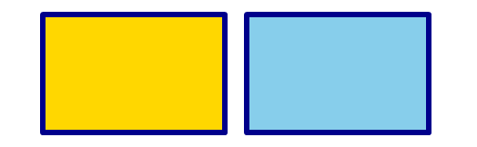

## **Giới thiệu**

Một chủ đề bản trình chiếu định nghĩa một tập hợp phối hợp các màu, phông chữ, kiểu nền, tô màu, đường nét và hiệu ứng. Các đối tượng nhận thức chủ đề tham chiếu tới các định nghĩa chung này thay vì lưu trữ mỗi thuộc tính trực quan dưới dạng giá trị cố định, vì vậy việc thay đổi chủ đề có thể cập nhật nhiều đối tượng cùng lúc.

Trong Aspose.Slides, chủ đề cấp bản trình chiếu có sẵn thông qua thuộc tính [Presentation.master_theme](https://reference.aspose.com/slides/python-net/aspose.slides/presentation/master_theme/). Một bản trình chiếu cũng có thể chứa các ghi đè chủ đề ở các cấp thấp hơn. Một master có thể ghi đè chủ đề bản trình chiếu thông qua [MasterThemeManager.override_theme](https://reference.aspose.com/slides/python-net/aspose.slides.theme/masterthememanager/override_theme/), một bố cục có thể ghi đè chủ đề kế thừa của nó thông qua [BaseOverrideThemeManager.override_theme](https://reference.aspose.com/slides/python-net/aspose.slides.theme/baseoverridethememanager/override_theme/), và một slide riêng lẻ cũng có thể làm tương tự. Trong thực tế, chủ đề thực tế cho một slide được xác định qua chuỗi kế thừa này: chủ đề bản trình chiếu, ghi đè master, ghi đè bố cục và ghi đè slide.


Các phần dưới đây trình bày các quy trình làm việc với chủ đề phổ biến nhất: kiểm tra một chủ đề, thay đổi màu và phông chữ, sao chép hoặc áp dụng một chủ đề, cập nhật kiểu nền và hiệu ứng, và đọc các giá trị thực tế sau khi kế thừa và ghi đè đã được giải quyết.

## **Kiểm tra một Chủ đề**

Đối tượng [MasterTheme](https://reference.aspose.com/slides/python-net/aspose.slides.theme/mastertheme/) cung cấp các thuộc tính [color_scheme](https://reference.aspose.com/slides/python-net/aspose.slides.theme/mastertheme/color_scheme/), [font_scheme](https://reference.aspose.com/slides/python-net/aspose.slides.theme/mastertheme/font_scheme/), và [format_scheme](https://reference.aspose.com/slides/python-net/aspose.slides.theme/mastertheme/format_scheme/). Kiểm tra các bộ sưu tập này trước khi thay đổi chúng đặc biệt hữu ích khi một bản trình chiếu đến từ nguồn bên ngoài vì số lượng và nội dung của các mục kiểu có thể thay đổi.

Ví dụ sau đọc các thuộc tính chủ đề chính và báo cáo số lượng kiểu nền, tô, đường và hiệu ứng được lưu trong chủ đề:

```python
import aspose.slides as slides

with slides.Presentation("input.pptx") as presentation:
    theme = presentation.master_theme

    print(f"Theme name: {theme.name}")
    print(f"Accent 1: {theme.color_scheme.accent1.color}")
    print(f"Major Latin font: {theme.font_scheme.major.latin_font.font_name}")
    print(f"Minor Latin font: {theme.font_scheme.minor.latin_font.font_name}")
    print(f"Background fill styles: {len(theme.format_scheme.background_fill_styles)}")
    print(f"Fill styles: {len(theme.format_scheme.fill_styles)}")
    print(f"Line styles: {len(theme.format_scheme.line_styles)}")
    print(f"Effect styles: {len(theme.format_scheme.effect_styles)}")
```

Nếu một tệp sử dụng nhiều master, không nên giả định rằng mọi slide đều có cùng một chủ đề thực tế. Kiểm tra master liên kết với slide, và sử dụng quy trình làm việc chủ đề‑hiệu quả được trình bày sau trong bài viết khi có thể có ghi đè bố cục hoặc slide.

## **Thay đổi Màu Chủ đề**

Các tô, đường và văn bản nhận thức chủ đề có thể tham chiếu tới một màu logic từ enumeration [SchemeColor](https://reference.aspose.com/slides/python-net/aspose.slides/schemecolor/). Khi bạn thay đổi mục tương ứng trong [ColorScheme](https://reference.aspose.com/slides/python-net/aspose.slides.theme/colorscheme/) của chủ đề, mọi đối tượng vẫn tham chiếu tới màu chủ đề đó sẽ được giải quyết dựa trên giá trị mới. Các đối tượng sử dụng màu RGB trực tiếp sẽ không bị thay đổi bởi việc cập nhật màu chủ đề.

Ví dụ toàn diện sau tạo một hình dạng sử dụng `ACCENT4`, thay đổi màu `accent4` của chủ đề thành màu đỏ, lưu bản trình chiếu, mở lại và in màu tô hiệu quả:

```python
import aspose.pydrawing as draw
import aspose.slides as slides

with slides.Presentation() as presentation:
    slide = presentation.slides[0]

    shape = slide.shapes.add_auto_shape(slides.ShapeType.RECTANGLE, 10, 10, 100, 100)
    shape.fill_format.fill_type = slides.FillType.SOLID
    shape.fill_format.solid_fill_color.scheme_color = slides.SchemeColor.ACCENT4

    presentation.master_theme.color_scheme.accent4.color = draw.Color.red

    presentation.save("theme-color.pptx", slides.export.SaveFormat.PPTX)

with slides.Presentation("theme-color.pptx") as saved_presentation:
    saved_slide = saved_presentation.slides[0]
    saved_shape = saved_slide.shapes[0]
    effective_fill = saved_shape.fill_format.get_effective()
    print(f"Effective fill color: {effective_fill.solid_fill_color}")
```

Vì hình chữ nhật vẫn liên kết với `ACCENT4`, màu hiển thị của nó sẽ trở thành màu đỏ sau khi chủ đề được thay đổi. Nếu bạn thay thế màu lược đồ bằng màu trực tiếp trên hình dạng, các thay đổi sau này đối với `accent4` sẽ không còn ảnh hưởng tới tô màu đó.

### **Sử dụng Màu từ Bảng màu Bổ sung**

PowerPoint tạo ra các biến thể nhạt hơn và đậm hơn từ một màu chủ đề bằng cách áp dụng các chuyển đổi màu. Aspose.Slides cung cấp các chuyển đổi này qua enumeration [ColorTransformOperation](https://reference.aspose.com/slides/python-net/aspose.slides/colortransformoperation/).


**1** – Màu chủ đề chính.

**2** – Các biến thể nhạt hơn và đậm hơn được tạo từ các màu chủ đề chính.

Ví dụ sau tạo sáu hình chữ nhật dựa trên `ACCENT4`, áp dụng các chuyển đổi độ sáng cho năm hình trong số chúng, và lưu kết quả:

```python
import aspose.slides as slides

with slides.Presentation() as presentation:
    slide = presentation.slides[0]

    shape1 = slide.shapes.add_auto_shape(slides.ShapeType.RECTANGLE, 10, 10, 50, 50)
    shape1.fill_format.fill_type = slides.FillType.SOLID
    shape1.fill_format.solid_fill_color.scheme_color = slides.SchemeColor.ACCENT4

    shape2 = slide.shapes.add_auto_shape(slides.ShapeType.RECTANGLE, 10, 70, 50, 50)
    shape2.fill_format.fill_type = slides.FillType.SOLID
    shape2.fill_format.solid_fill_color.scheme_color = slides.SchemeColor.ACCENT4
    shape2.fill_format.solid_fill_color.color_transform.add(slides.ColorTransformOperation.MULTIPLY_LUMINANCE, 0.2)
    shape2.fill_format.solid_fill_color.color_transform.add(slides.ColorTransformOperation.ADD_LUMINANCE, 0.8)

    shape3 = slide.shapes.add_auto_shape(slides.ShapeType.RECTANGLE, 10, 130, 50, 50)
    shape3.fill_format.fill_type = slides.FillType.SOLID
    shape3.fill_format.solid_fill_color.scheme_color = slides.SchemeColor.ACCENT4
    shape3.fill_format.solid_fill_color.color_transform.add(slides.ColorTransformOperation.MULTIPLY_LUMINANCE, 0.4)
    shape3.fill_format.solid_fill_color.color_transform.add(slides.ColorTransformOperation.ADD_LUMINANCE, 0.6)

    shape4 = slide.shapes.add_auto_shape(slides.ShapeType.RECTANGLE, 10, 190, 50, 50)
    shape4.fill_format.fill_type = slides.FillType.SOLID
    shape4.fill_format.solid_fill_color.scheme_color = slides.SchemeColor.ACCENT4
    shape4.fill_format.solid_fill_color.color_transform.add(slides.ColorTransformOperation.MULTIPLY_LUMINANCE, 0.6)
    shape4.fill_format.solid_fill_color.color_transform.add(slides.ColorTransformOperation.ADD_LUMINANCE, 0.4)

    shape5 = slide.shapes.add_auto_shape(slides.ShapeType.RECTANGLE, 10, 250, 50, 50)
    shape5.fill_format.fill_type = slides.FillType.SOLID
    shape5.fill_format.solid_fill_color.scheme_color = slides.SchemeColor.ACCENT4
    shape5.fill_format.solid_fill_color.color_transform.add(slides.ColorTransformOperation.MULTIPLY_LUMINANCE, 0.75)

    shape6 = slide.shapes.add_auto_shape(slides.ShapeType.RECTANGLE, 10, 310, 50, 50)
    shape6.fill_format.fill_type = slides.FillType.SOLID
    shape6.fill_format.solid_fill_color.scheme_color = slides.SchemeColor.ACCENT4
    shape6.fill_format.solid_fill_color.color_transform.add(slides.ColorTransformOperation.MULTIPLY_LUMINANCE, 0.5)

    presentation.save("theme-color-palette.pptx", slides.export.SaveFormat.PPTX)
```

Các biến thể này vẫn dựa trên màu chủ đề. Nếu `accent4` thay đổi sau này, các màu đã chuyển đổi sẽ được tính lại từ giá trị `accent4` mới.

### **Ánh xạ Giá trị `SchemeColor` tới Các vị trí `ColorScheme`**

Enumeration [SchemeColor](https://reference.aspose.com/slides/python-net/aspose.slides/schemecolor/) sử dụng `TEXT1`, `BACKGROUND1`, `TEXT2`, và `BACKGROUND2`, trong khi [ColorScheme](https://reference.aspose.com/slides/python-net/aspose.slides.theme/colorscheme/) cung cấp cùng các vị trí chủ đề dưới dạng `dark1`, `light1`, `dark2`, và `light2`. Ánh xạ này cố định:

* `TEXT1` = `dark1`
* `BACKGROUND1` = `light1`
* `TEXT2` = `dark2`
* `BACKGROUND2` = `light2`

Đây là các tên thay thế cho cùng một vị trí chủ đề; chúng không phải là các giá trị được chuyển đổi động từ dạng này sang dạng khác.

## **Thay đổi Phông chữ Chủ đề**

Một lược đồ phông chữ chủ đề chứa một bộ phông chữ chính cho tiêu đề và một bộ phụ cho nội dung văn bản. Các thuộc tính [FontScheme.major](https://reference.aspose.com/slides/python-net/aspose.slides.theme/fontscheme/major/) và [FontScheme.minor](https://reference.aspose.com/slides/python-net/aspose.slides.theme/fontscheme/minor/) công khai các bộ này.

Các định danh phông chữ chủ đề tương thích PowerPoint có thể được dùng trong định dạng văn bản:

* `+mn‑lt` – Phông chữ nội dung Latin (Phông chữ Latin phụ)
* `+mj‑lt` – Phông chữ tiêu đề Latin (Phông chữ Latin chính)
* `+mn‑ea` – Phông chữ nội dung Đông Á (Phông chữ Đông Á phụ)
* `+mj‑ea` – Phông chữ tiêu đề Đông Á (Phông chữ Đông Á chính)
* `+mn‑cs` – Phông chữ nội dung Kịch bản phức hợp (Phông chữ Kịch bản phức hợp phụ)
* `+mj‑cs` – Phông chữ tiêu đề Kịch bản phức hợp (Phông chữ Kịch bản phức hợp chính)

Ví dụ sau tạo một tiêu đề sử dụng phông chữ Latin chính và một dòng nội dung sử dụng phông chữ Latin phụ. Sau đó thay đổi phông chữ chủ đề và lưu kết quả:

```python
import aspose.slides as slides

with slides.Presentation() as presentation:
    slide = presentation.slides[0]

    heading = slide.shapes.add_auto_shape(slides.ShapeType.RECTANGLE, 40, 40, 500, 60)
    heading.text_frame.text = "Theme heading"
    heading.text_frame.paragraphs[0].portions[0].portion_format.latin_font = slides.FontData("+mj-lt")

    body = slide.shapes.add_auto_shape(slides.ShapeType.RECTANGLE, 40, 120, 500, 60)
    body.text_frame.text = "Theme body text"
    body.text_frame.paragraphs[0].portions[0].portion_format.latin_font = slides.FontData("+mn-lt")

    presentation.master_theme.font_scheme.major.latin_font = slides.FontData("Aptos Display")
    presentation.master_theme.font_scheme.minor.latin_font = slides.FontData("Arial")

    presentation.save("theme-fonts.pptx", slides.export.SaveFormat.PPTX)
```

Tiêu đề tuân theo phông chữ chính và nội dung tuân theo phông chữ phụ. Văn bản có tên phông chữ cụ thể thay vì định danh chủ đề sẽ không tự động chuyển đổi khi lược đồ phông chữ chủ đề thay đổi.

Các bộ sưu tập phông chữ chính và phụ cũng có thể chứa các ánh xạ phông chữ cho các hệ thống viết riêng lẻ, chẳng hạn Cyrillic, Arabic, Japanese, Georgian và Thaana. Để kiểm tra, thêm, thay thế hoặc xóa các ánh xạ này, xem [Script‑Specific Theme Fonts](/slides/vi/python-net/script-specific-font-mappings/).

{}

Để biết thêm thông tin về phông chữ trong bản trình chiếu, xem [PowerPoint Fonts](/slides/vi/python-net/powerpoint-fonts/).

{}

### **Giải quyết Tham chiếu Phông chữ Chủ đề**

Khi kiểm tra văn bản, [FontData.font_name](https://reference.aspose.com/slides/python-net/aspose.slides/fontdata/font_name/) có thể chứa một tham chiếu chủ đề như `+mn‑lt` thay vì tên họ phông chữ. Gọi [FontData.get_font_name](https://reference.aspose.com/slides/python-net/aspose.slides/fontdata/get_font_name/) cùng với [IThemeEffectiveData](https://reference.aspose.com/slides/python-net/aspose.slides.theme/ithemeeffectivedata/) thích hợp để giải quyết tham chiếu đó. Các tiền tố `+mj` và `+mn` chọn bộ phông chữ chính và phụ; các hậu tố `-lt`, `-ea` và `-cs` chọn phông chữ Latin, Đông Á và Kịch bản phức hợp tương ứng.

Lấy chủ đề thực tế thông qua [Slide.create_theme_effective](https://reference.aspose.com/slides/python-net/aspose.slides/slide/create_theme_effective/) trên đối tượng mà chủ đề áp dụng cho văn bản được kiểm tra. Đối với văn bản thông thường trên một slide, sử dụng `slide.create_theme_effective` để ngữ cảnh bao gồm chủ đề kế thừa của slide và các ghi đè cục bộ. Khi kiểm tra một layout hoặc master, dùng chủ đề thực tế của chúng. Đừng giả định rằng chủ đề của master đầu tiên áp dụng cho mọi slide.

Ví dụ sau tạo một đoạn văn bản tham chiếu rõ ràng tới phông chữ Latin phụ. Nó khởi tạo lược đồ phông chữ slide thông qua [OverrideTheme.init_font_scheme_from_inherited](https://reference.aspose.com/slides/python-net/aspose.slides.theme/overridetheme/init_font_scheme_from_inherited/) và đặt họ phông chữ Latin chính và phụ thành `Arial` và `Calibri`, làm cho kết quả có thể tái tạo mà không cần tệp đầu vào.

```python
import aspose.slides as slides

with slides.Presentation() as presentation:
    slide = presentation.slides[0]

    theme = slide.theme_manager.override_theme
    theme.init_font_scheme_from_inherited()
    theme.font_scheme.major.latin_font = slides.FontData("Arial")
    theme.font_scheme.minor.latin_font = slides.FontData("Calibri")

    shape = slide.shapes.add_auto_shape(slides.ShapeType.RECTANGLE, 20, 20, 400, 60)
    shape.text_frame.text = "Text using the minor theme font"

    portion = shape.text_frame.paragraphs[0].portions[0]
    portion.portion_format.latin_font = slides.FontData("+mn-lt")

    font = portion.portion_format.latin_font
    effective_theme = slide.create_theme_effective()
    print(f"{font.font_name} -> {font.get_font_name(effective_theme)}")

    explicit_font = slides.FontData("Verdana")
    print(f"{explicit_font.font_name} -> {explicit_font.get_font_name(effective_theme)}")
```

Kết quả là `+mn‑lt -> Calibri` rồi `Verdana -> Verdana`. Tham chiếu đã lưu vẫn không thay đổi, trong khi tên họ phông chữ rõ ràng được trả về nguyên vẹn. Nếu đoạn văn bản dùng `+mj‑lt`, nó sẽ giải quyết thành `Arial` trong chủ đề này.

Giải quyết một tham chiếu chủ đề xác định họ phông chữ do chủ đề chỉ định. Nó không kiểm tra tính khả dụng của phông chữ hay xác định tệp phông chữ cuối cùng được dùng sau khi thay thế hoặc dự trữ glyph trong quá trình render. Xem [Font Selection Sequence](/slides/vi/python-net/font-selection-sequence/) và [Font Substitution](/slides/vi/python-net/font-substitution/) cho các bước riêng biệt đó.

## **Sao chép hoặc Áp dụng một Chủ đề**

Các quy trình làm việc dưới đây giải quyết các vấn đề liên quan tới chủ đề khác nhau.

### **Áp dụng Chủ đề Bên ngoài cho Các Slide Phụ Thuộc của Master**

Sử dụng [MasterSlide.apply_external_theme_to_depending_slides](https://reference.aspose.com/slides/python-net/aspose.slides/masterslide/apply_external_theme_to_depending_slides/) khi bạn có một tệp chủ đề PowerPoint (`.thmx`) và muốn thay đổi kiểu dáng của mọi slide phụ thuộc vào một master cụ thể. Chọn master từ bộ sưu tập [Presentation.masters](https://reference.aspose.com/slides/python-net/aspose.slides/presentation/masters/) ([MasterSlideCollection](https://reference.aspose.com/slides/python-net/aspose.slides/masterslidecollection/)), và truyền đường dẫn tệp chủ đề cho phương thức.

Phương thức thực hiện các thao tác sau:

1. Tạo một master slide mới dựa trên master đã chọn.
1. Áp dụng chủ đề bên ngoài cho master mới.
1. Gán master mới cho tất cả các slide trước đây phụ thuộc vào master đã chọn.
1. Trả về đối tượng [MasterSlide](https://reference.aspose.com/slides/python-net/aspose.slides/masterslide/) mới được tạo.

Ví dụ sau áp dụng một chủ đề bên ngoài cho các slide phụ thuộc vào master đầu tiên và lưu bản trình chiếu:

```python
import aspose.slides as slides

with slides.Presentation("presentation.pptx") as presentation:
    selected_master = presentation.masters[0]

    themed_master = selected_master.apply_external_theme_to_depending_slides("corporate-theme.thmx")
    print(f"Created master: {themed_master.name}")

    presentation.save("presentation-with-external-theme.pptx", slides.export.SaveFormat.PPTX)
```

Một chủ đề không hợp lệ, bị hỏng hoặc không hỗ trợ có thể gây ra [PptxException](https://reference.aspose.com/slides/python-net/aspose.slides/pptxexception/) hoặc một trong các lớp con liên quan tới định dạng. Hãy xác thực các đường dẫn do người dùng cung cấp, xử lý lỗi truy cập hệ thống tệp, và chỉ lưu bản trình chiếu sau khi chủ đề đã được áp dụng thành công.

Chỉ các slide phụ thuộc vào master đã chọn mới được gán lại. Các slide liên kết với các master khác vẫn giữ nguyên master và chủ đề hiện có. Các màu, phông chữ, tô, đường, nền và hiệu ứng nhận thức chủ đề sẽ được giải quyết dựa trên chủ đề bên ngoài. Các màu, phông chữ, tô và các định dạng rõ ràng khác được gán trực tiếp có thể vẫn giữ nguyên. Các ghi đè ở mức layout và slide cũng có thể có ưu tiên hơn các giá trị kế thừa từ master mới.

Chủ đề có thể tham chiếu tới các phông chữ không có sẵn trong môi trường runtime. Để đảm bảo render và xuất khẩu nhất quán, hãy cài đặt các phông chữ cần thiết, cung cấp chúng qua [custom font sources](/slides/vi/python-net/custom-font/), hoặc cấu hình [font substitution](/slides/vi/python-net/font-substitution/).

Đây là một quy trình làm việc trực tiếp ở cấp master: phương thức nhận một đường dẫn tới tệp `.thmx` và không yêu cầu tạo thủ công các ghi đè chủ đề ở cấp slide hay layout.

### **Áp dụng Các Chủ đề Bên ngoài Khác nhau trong Một Bản Trình Chiếu Đa‑Master**

Khi master liên quan không được biết trước, lấy nó từ một slide đại diện qua [Slide.layout_slide](https://reference.aspose.com/slides/python-net/aspose.slides/slide/layout_slide/) và [LayoutSlide.master_slide](https://reference.aspose.com/slides/python-net/aspose.slides/layoutslide/master_slide/). Lưu các tham chiếu master gốc trước khi áp dụng bất kỳ chủ đề nào vì mỗi lần gọi sẽ tạo một master mới trong bản trình chiếu.

Ví dụ sau sử dụng các slide từ hai phần để xác định master của chúng và áp dụng một chủ đề bên ngoài khác nhau cho mỗi nhóm:

```python
import aspose.slides as slides

with slides.Presentation("multi-master-presentation.pptx") as presentation:
    if len(presentation.slides) < 5:
        print("The presentation does not contain the expected representative slides.")
    else:
        first_group_master = presentation.slides[0].layout_slide.master_slide
        second_group_master = presentation.slides[4].layout_slide.master_slide

        if first_group_master.slide_id == second_group_master.slide_id:
            print("The representative slides use the same master.")
        else:
            first_themed_master = first_group_master.apply_external_theme_to_depending_slides("blue-theme.thmx")
            second_themed_master = second_group_master.apply_external_theme_to_depending_slides("green-theme.thmx")

            print(f"First themed master: {first_themed_master.name}")
            print(f"Second themed master: {second_themed_master.name}")

            presentation.save("multi-master-with-external-themes.pptx", slides.export.SaveFormat.PPTX)
```

Lời gọi đầu tiên chỉ ảnh hưởng tới các slide phụ thuộc vào `first_group_master`, và lời gọi thứ hai chỉ ảnh hưởng tới các slide phụ thuộc vào `second_group_master`. Các slide thuộc bất kỳ master nào khác sẽ không được thay đổi kiểu dáng.

### **Bảo tồn Chủ đề Nguồn Khi Di chuyển Slides**

Nếu bạn muốn di chuyển một slide sang bản trình chiếu khác và bảo tồn thiết kế gốc, hãy sao chép master nguồn vào bản trình chiếu đích bằng [MasterSlideCollection.add_clone](https://reference.aspose.com/slides/python-net/aspose.slides/masterslidecollection/add_clone/), sau đó sao chép slide bằng [SlideCollection.add_clone](https://reference.aspose.com/slides/python-net/aspose.slides/slidecollection/add_clone/) và master đã sao chép. Điều này mang theo master, các layout và chủ đề liên quan cùng nhau.

```python
import aspose.slides as slides

with slides.Presentation("source-theme.pptx") as source:
    with slides.Presentation("target.pptx") as target:
        source_slide = source.slides[0]

        source_master = source_slide.layout_slide.master_slide
        cloned_master = target.masters.add_clone(source_master)
        target.slides.add_clone(source_slide, cloned_master, True)

        target.save("theme-preserved.pptx", slides.export.SaveFormat.PPTX)
```

Đây là quy trình làm việc ưu tiên khi slide nguồn phải trông giống hệt ở đích. Chỉ sao chép nội dung lên một master đích không liên quan có thể thay đổi các màu, phông chữ, nền và hiệu ứng dựa trên chủ đề.

### **Áp dụng Giá trị Chủ đề cho Một Slide Đã Tồn tại**

Nếu slide đích phải ở lại master và layout hiện tại, khởi tạo một ghi đè cấp slide từ chủ đề nguồn. Các phương thức [OverrideTheme.init_color_scheme_from](https://reference.aspose.com/slides/python-net/aspose.slides.theme/overridetheme/init_color_scheme_from/), [OverrideTheme.init_font_scheme_from](https://reference.aspose.com/slides/python-net/aspose.slides.theme/overridetheme/init_font_scheme_from/), và [OverrideTheme.init_format_scheme_from](https://reference.aspose.com/slides/python-net/aspose.slides.theme/overridetheme/init_format_scheme_from/) sao chép ba thành phần chính của chủ đề vào ghi đè.

```python
import aspose.slides as slides

with slides.Presentation("source-theme.pptx") as source:
    with slides.Presentation("target.pptx") as target:
        target_slide = target.slides[0]

        override_theme = target_slide.theme_manager.override_theme
        override_theme.init_color_scheme_from(source.master_theme.color_scheme)
        override_theme.init_font_scheme_from(source.master_theme.font_scheme)
        override_theme.init_format_scheme_from(source.master_theme.format_scheme)

        target.save("theme-applied-to-slide.pptx", slides.export.SaveFormat.PPTX)
```

Điều này thay đổi chủ đề được slide đó sử dụng mà không thay đổi chủ đề mà các slide khác kế thừa. Để xóa ghi đè cục bộ và quay lại giá trị kế thừa, gọi [OverrideTheme.clear](https://reference.aspose.com/slides/python-net/aspose.slides.theme/overridetheme/clear/).

### **Áp dụng Ghi đè Chủ đề cho Một Layout**

Một ghi đè cấp layout áp dụng cho các slide sử dụng layout đó, trừ khi một slide cụ thể có ghi đè riêng. Các phương thức khởi tạo tương tự có thể được dùng qua [LayoutSlideThemeManager](https://reference.aspose.com/slides/python-net/aspose.slides.theme/layoutslidethememanager/) của layout:

```python
import aspose.slides as slides

with slides.Presentation("source-theme.pptx") as source:
    with slides.Presentation("target.pptx") as target:
        target_slide = target.slides[0]
        
        override_theme = target_slide.layout_slide.theme_manager.override_theme
        override_theme.init_color_scheme_from(source.master_theme.color_scheme)
        override_theme.init_font_scheme_from(source.master_theme.font_scheme)
        override_theme.init_format_scheme_from(source.master_theme.format_scheme)

        target.save("theme-applied-to-layout.pptx", slides.export.SaveFormat.PPTX)
```

Sử dụng một chủ đề cấp master hoặc cấp bản trình chiếu khi nhiều layout và slide nên chia sẻ cùng một thiết kế cơ bản, một ghi đè layout khi một nhóm layout cần kiểu dáng khác, và một ghi đè slide chỉ cho những ngoại lệ thực sự. Quá nhiều ghi đè cấp slide sẽ làm cho các thay đổi chủ đề toàn cục sau này khó dự đoán.

## **Cập nhật Kiểu nền Chủ đề**

Các tô nền của chủ đề được lưu trong [FormatScheme.background_fill_styles](https://reference.aspose.com/slides/python-net/aspose.slides.theme/formatscheme/background_fill_styles/). PowerPoint có thể hiển thị nhiều lựa chọn nền hơn trong giao diện người dùng so với số lượng định nghĩa tô thực tế trong bộ sưu tập này vì giao diện có thể kết hợp các tô chủ đề với màu chủ đề và các tham chiếu kiểu khác.


Trước khi sử dụng một kiểu nền, kiểm tra bộ sưu tập đã lưu và [Background.style_index](https://reference.aspose.com/slides/python-net/aspose.slides/background/style_index/) hiện tại. `style_index` dùng `0` để chỉ không có tô chủ đề; các giá trị dương là các tham chiếu kiểu nền chủ đề. Điều này khác với việc chỉ mục một bộ sưu tập Python trực tiếp, trong đó `[0]` nghĩa là mục lưu đầu tiên. Đừng giả định rằng mọi bản trình chiếu đều có cùng số lượng kiểu tô nền.

Ví dụ sau báo cáo số lượng tô nền khả dụng, gán một tham chiếu nền chủ đề cho master đầu tiên, và lưu bản trình chiếu:

```python
import aspose.slides as slides

with slides.Presentation("input.pptx") as presentation:

    background_styles = presentation.master_theme.format_scheme.background_fill_styles
    print(f"Background fill styles: {len(background_styles)}")

    if len(background_styles) == 0:
        raise RuntimeError("The presentation theme does not contain background fill styles.")

    master_slide = presentation.masters[0]
    master_slide.background.type = slides.BackgroundType.THEMED
    master_slide.background.style_index = 1

    presentation.save("theme-background.pptx", slides.export.SaveFormat.PPTX)
```

Kết quả hiển thị phụ thuộc vào mục nhập chủ đề mà master tham chiếu và bất kỳ ghi đè nền nào ở cấp layout hoặc slide. Nếu một slide sử dụng nền riêng, việc chỉ thay đổi nền master có thể không làm thay đổi slide đó. Sử dụng [Background.get_effective](https://reference.aspose.com/slides/python-net/aspose.slides/background/get_effective/) khi bạn cần biết nền cuối cùng sau khi kế thừa đã được áp dụng.

{}

Đừng coi `style_index` như một chỉ mục bộ sưu tập bắt đầu từ 0. Cũng tránh việc mã hóa cứng một số kiểu từ một tệp và cho rằng nó sẽ có cùng giao diện trong tệp khác; các định nghĩa kiểu chủ đề là riêng biệt cho mỗi bản trình chiếu.

{}

{}

Đối với định dạng nền trực tiếp và kế thừa nền, xem [Presentation Background](/slides/vi/python-net/presentation-background/).

{}

## **Cập nhật Hiệu ứng Chủ đề**

Một lược đồ định dạng chủ đề chứa các bộ sưu tập riêng biệt [FormatScheme.fill_styles](https://reference.aspose.com/slides/python-net/aspose.slides.theme/formatscheme/fill_styles/), [FormatScheme.line_styles](https://reference.aspose.com/slides/python-net/aspose.slides.theme/formatscheme/line_styles/), và [FormatScheme.effect_styles](https://reference.aspose.com/slides/python-net/aspose.slides.theme/formatscheme/effect_styles/). Các chủ đề Office thường chứa ba mục kiểu chính tương ứng với định dạng nhẹ, vừa và mạnh, nhưng mã nên kiểm tra từng bộ sưu tập thay vì giả định một số lượng cố định.


Khi bạn truy cập các bộ sưu tập này trong Python, chỉ mục bộ sưu tập bắt đầu từ 0: `[0]` là kiểu lưu đầu tiên và `[2]` là kiểu thứ ba. Các chỉ mục tham chiếu kiểu của hình dạng là một khái niệm riêng, được công khai qua [ShapeStyle](https://reference.aspose.com/slides/python-net/aspose.slides/shapestyle/). Thay đổi một kiểu chủ đề ảnh hưởng tới các hình dạng tham chiếu tới kiểu đó; các hình dạng có định dạng trực tiếp có thể không thay đổi.

Ví dụ sau kiểm tra các mục kiểu cần thiết tồn tại, thay đổi kiểu đường đầu tiên, thay đổi kiểu tô thứ ba, bật bóng đổ bên ngoài trong kiểu hiệu ứng thứ ba, và lưu kết quả:

```python
import aspose.pydrawing as draw
import aspose.slides as slides

with slides.Presentation("Subtle_Moderate_Intense.pptx") as presentation:
    format_scheme = presentation.master_theme.format_scheme
    if len(format_scheme.line_styles) < 1 or len(format_scheme.fill_styles) < 3 or len(format_scheme.effect_styles) < 3:
        raise RuntimeError("The theme does not contain the style entries required by this example.")

    format_scheme.line_styles[0].fill_format.fill_type = slides.FillType.SOLID
    format_scheme.line_styles[0].fill_format.solid_fill_color.color = draw.Color.red
    format_scheme.fill_styles[2].fill_type = slides.FillType.SOLID
    format_scheme.fill_styles[2].solid_fill_color.color = draw.Color.forest_green
    format_scheme.effect_styles[2].effect_format.enable_outer_shadow_effect()
    format_scheme.effect_styles[2].effect_format.outer_shadow_effect.distance = 10

    presentation.save("theme-effects.pptx", slides.export.SaveFormat.PPTX)
```

Đối với các hình dạng tham chiếu các vị trí này, kiểu đường chủ đề đầu tiên sẽ trở thành màu đỏ, kiểu tô chủ đề thứ ba sẽ trở thành màu xanh rừng đặc, và kiểu hiệu ứng thứ ba sẽ có một bóng đổ bên ngoài với khoảng cách 10 điểm. Kết quả trực quan cuối cùng vẫn phụ thuộc vào mỗi hình dạng tham chiếu vị trí nào và liệu định dạng trực tiếp có ghi đè chủ đề hay không.


## **Chọn Kiểu Tô và Đường cho Một Hình dạng**

Một hình dạng có thể chọn tô và viền một cách độc lập qua [ShapeStyle.fill_style_index](https://reference.aspose.com/slides/python-net/aspose.slides/shapestyle/fill_style_index/) và [ShapeStyle.line_style_index](https://reference.aspose.com/slides/python-net/aspose.slides/shapestyle/line_style_index/). Đối với cả hai thuộc tính, chỉ mục `1` chọn mục đầu tiên trong bộ sưu tập chủ đề tương ứng (`fill_styles[0]` hoặc `line_styles[0]`), và chỉ mục `2` chọn mục thứ hai.

Ví dụ sau định nghĩa hai màu tô (vàng và xanh trời) và hai viền (xanh đậm 6 pt và đỏ đậm 12 pt) trong chủ đề mặc định của một bản trình chiếu mới. Nó lưu slide ở ba giai đoạn để bạn có thể so sánh kết quả trong PowerPoint.

```python
import aspose.slides as slides

with slides.Presentation() as presentation:
    styles = presentation.master_theme.format_scheme

    gold_fill = styles.fill_styles[0]
    gold_fill.fill_type = slides.FillType.SOLID
    gold_fill.solid_fill_color.preset_color = slides.PresetColor.GOLD
    blue_fill = styles.fill_styles[1]
    blue_fill.fill_type = slides.FillType.SOLID
    blue_fill.solid_fill_color.preset_color = slides.PresetColor.SKY_BLUE

    thin_line = styles.line_styles[0]
    thin_line.fill_format.fill_type = slides.FillType.SOLID
    thin_line.fill_format.solid_fill_color.preset_color = slides.PresetColor.DARK_BLUE
    thin_line.width = 6
    thick_line = styles.line_styles[1]
    thick_line.fill_format.fill_type = slides.FillType.SOLID
    thick_line.fill_format.solid_fill_color.preset_color = slides.PresetColor.DARK_RED
    thick_line.width = 12

    shapes = presentation.slides[0].shapes
    left = shapes.add_auto_shape(slides.ShapeType.RECTANGLE, 100, 205, 200, 130)
    right = shapes.add_auto_shape(slides.ShapeType.RECTANGLE, 420, 205, 200, 130)
    left.shape_style.fill_style_index = 1
    right.shape_style.fill_style_index = 2
    left.shape_style.line_style_index = 1
    right.shape_style.line_style_index = 1
    presentation.save("01-initial.pptx", slides.export.SaveFormat.PPTX)

    right.shape_style.line_style_index = 2
    presentation.save("02-line-changed.pptx", slides.export.SaveFormat.PPTX)

    gold_fill.solid_fill_color.preset_color = slides.PresetColor.SEA_GREEN
    presentation.save("03-theme-changed.pptx", slides.export.SaveFormat.PPTX)
```

| Kiểu ban đầu | Thay đổi viền bên phải | Chỉnh sửa tô chủ đề đầu tiên |
|:---:|:---:|:---:|
|  |  |  |

Chọn một kiểu đường khác chỉ thay đổi viền của hình chữ nhật bên phải. Chỉnh sửa tô chủ đề đầu tiên cập nhật mọi hình dạng sử dụng nó. Ở đây, chỉ hình chữ nhật bên trái chuyển sang màu xanh lá.

Trên một hình dạng đã tồn tại, một màu tô cục bộ, màu đường hoặc độ dày đường có thể ghi đè phần đó của kiểu chủ đề. Nếu việc thay đổi chỉ mục kiểu không có hiệu ứng nhìn thấy, kiểm tra [direct formatting](/slides/vi/python-net/shape-formatting/) của hình dạng.

## **Xác định Liệu Tô Đặc Rắn Hiệu quả Có Sử dụng Màu Chủ đề Hay Không**

Một tô có thể được lưu trực tiếp trên đối tượng hoặc kế thừa từ đoạn văn, layout, master, kiểu chủ đề, hoặc một cấp định dạng khác. Gọi [FillFormat.get_effective](https://reference.aspose.com/slides/python-net/aspose.slides/fillformat/get_effective/) để giải quyết chuỗi phân cấp đó thành một đối tượng [IFillFormatEffectiveData](https://reference.aspose.com/slides/python-net/aspose.slides/ifillformateffectivedata/) bất biến. Đầu tiên kiểm tra [IFillFormatEffectiveData.fill_type](https://reference.aspose.com/slides/python-net/aspose.slides/ifillformateffectivedata/fill_type/). Chỉ khi nó là `FillType.SOLID` bạn mới đọc các thuộc tính tô đặc.

Đối với một tô đặc, [IFillFormatEffectiveData.solid_fill_color](https://reference.aspose.com/slides/python-net/aspose.slides/ifillformateffectivedata/solid_fill_color/) trả về giá trị RGB cuối cùng sau khi kế thừa, tra cứu chủ đề và áp dụng các chuyển đổi màu. [IFillFormatEffectiveData.solid_fill_scheme_color](https://reference.aspose.com/slides/python-net/aspose.slides/ifillformateffectivedata/solid_fill_scheme_color/) trả về vị trí [SchemeColor](https://reference.aspose.com/slides/python-net/aspose.slides/schemecolor/) logic tương ứng, chẳng hạn `TEXT1` hoặc `ACCENT6`. Giá trị `SchemeColor.NOT_DEFINED` có nghĩa là tô đặc hiệu quả không dựa trên màu lược đồ. Trong một quy trình làm việc mà các tô chỉ là màu chủ đề hoặc màu RGB trực tiếp, giá trị này xác định một tô RGB trực tiếp.

Đừng chỉ dựa vào giá trị [ColorFormat.scheme_color](https://reference.aspose.com/slides/python-net/aspose.slides/colorformat/scheme_color/) cục bộ để phân loại một tô. Ví dụ, một đoạn văn bản có thể không có màu lược đồ được định nghĩa cục bộ, vì vậy giá trị cục bộ là `NOT_DEFINED`, trong khi tô hiệu quả của nó kế thừa một màu chủ đề và giải quyết thành `TEXT1` hoặc `ACCENT6`. Ngược lại, `solid_fill_scheme_color` cho bạn biết vị trí lược đồ logic nào đã tạo ra màu hiệu quả, nhưng không cho biết vị trí đó đến từ đối tượng, đoạn văn, layout, master, hay cấp định dạng nào khác.

Ví dụ sau tải một bản trình chiếu, kiểm tra cả tô hình và tô đoạn văn bản, in mỗi giá trị RGB cuối cùng và màu lược đồ tương ứng, và đánh dấu các tô đặc sẽ không theo dõi thay đổi màu chủ đề:

```python
import aspose.slides as slides


def audit_fill(object_name, local_fill):
    effective_fill = local_fill.get_effective()

    if effective_fill.fill_type != slides.FillType.SOLID:
        print(f"{object_name}: fill type = {effective_fill.fill_type}; not a solid fill.")
        return

    rgb = effective_fill.solid_fill_color
    effective_scheme_color = effective_fill.solid_fill_scheme_color
    local_scheme_color = local_fill.solid_fill_color.scheme_color

    print(f"{object_name}: RGB = #{rgb.r:02X}{rgb.g:02X}{rgb.b:02X}")
    print(f"{object_name}: local scheme = {local_scheme_color}, effective scheme = {effective_scheme_color}")

    if effective_scheme_color == slides.SchemeColor.NOT_DEFINED:
        print(f"{object_name}: direct RGB or another non-scheme fill; audit as theme-independent.")
    else:
        print(f"{object_name}: theme-dependent through {effective_scheme_color}.")


with slides.Presentation("input.pptx") as presentation:
    for slide_index, slide in enumerate(presentation.slides):
        for shape_index, shape in enumerate(slide.shapes):
            shape_name = f"Slide {slide_index + 1}, shape {shape_index + 1}"
            audit_fill(shape_name, shape.fill_format)

            if isinstance(shape, slides.AutoShape):
                for paragraph_index, paragraph in enumerate(shape.text_frame.paragraphs):
                    for portion_index, portion in enumerate(paragraph.portions):
                        portion_name = f"{shape_name}, paragraph {paragraph_index + 1}, portion {portion_index + 1}"
                        audit_fill(portion_name, portion.portion_format.fill_format)
```

Nhánh `NOT_DEFINED` cung cấp danh sách kiểm tra các tô đặc sẽ không phản hồi với thay đổi trong các vị trí màu chủ đề. Xem lại các đối tượng này khi một bản trình chiếu phải tuân theo bảng màu thương hiệu mới. Giá trị RGB được báo vẫn hiển thị ngoại hình hiện tại, trong khi giá trị lược đồ giải thích liệu ngoại hình đó có liên kết với chủ đề hay không.

Các đối tượng định dạng‑hiệu quả là ảnh chụp nhanh. Sau khi thay đổi chủ đề bản trình chiếu, một ghi đè chủ đề, hoặc bất kỳ định dạng kế thừa nào, gọi `get_effective` lại và đọc một đối tượng `IFillFormatEffectiveData` mới trước khi so sánh hoặc báo cáo màu.

## **Đọc Các Giá trị Chủ đề Hiệu quả**

Các đối tượng chủ đề thô cho bạn biết những gì được định nghĩa ở một cấp độ cụ thể. Các giá trị hiệu quả cho bạn biết một slide hoặc hình dạng thực tế sử dụng gì sau khi kế thừa và ghi đè cục bộ đã được giải quyết. Đối với một slide, gọi [BaseOverrideThemeManager.create_theme_effective](https://reference.aspose.com/slides/python-net/aspose.slides.theme/baseoverridethememanager/create_theme_effective/). Đối với nền, dùng [Background.get_effective](https://reference.aspose.com/slides/python-net/aspose.slides/background/get_effective/), và đối với tô, dùng [FillFormat.get_effective](https://reference.aspose.com/slides/python-net/aspose.slides/fillformat/get_effective/).

Ví dụ sau đọc chủ đề hiệu quả, nền, và tô hình dạng đầu tiên từ một slide:

```python
import aspose.slides as slides

with slides.Presentation("input.pptx") as presentation:
    slide = presentation.slides[0]

    effective_theme = slide.theme_manager.create_theme_effective()
    effective_background = slide.background.get_effective()

    print(f"Effective major Latin font: {effective_theme.font_scheme.major.latin_font.font_name}")
    print(f"Effective minor Latin font: {effective_theme.font_scheme.minor.latin_font.font_name}")
    print(f"Effective background fill type: {effective_background.fill_format.fill_type}")

    if len(slide.shapes) > 0:
        effective_fill = slide.shapes[0].fill_format.get_effective()
        print(f"First shape effective fill type: {effective_fill.fill_type}")
        if effective_fill.fill_type == slides.FillType.SOLID:
            print(f"First shape effective fill color: {effective_fill.solid_fill_color}")
```

Sử dụng dữ liệu hiệu quả để chẩn đoán render, xác thực và so sánh. Nếu bạn chỉ kiểm tra [Presentation.master_theme](https://reference.aspose.com/slides/python-net/aspose.slides/presentation/master_theme/), bạn có thể bỏ lỡ một master, layout, slide, hoặc ghi đè hình dạng thay đổi ngoại hình cuối cùng.

## **Câu hỏi Thường gặp**

**Áp dụng một chủ đề bên ngoài có ảnh hưởng tới mọi slide trong bản trình chiếu không?**

Không. [MasterSlide.apply_external_theme_to_depending_slides](https://reference.aspose.com/slides/python-net/aspose.slides/masterslide/apply_external_theme_to_depending_slides/) chỉ gán lại các slide phụ thuộc vào master đã chọn. Các slide dùng các master khác vẫn giữ chủ đề hiện có.

**Tôi có thể áp dụng một chủ đề cho một slide duy nhất mà không thay đổi master không?**

Có. Sử dụng [SlideThemeManager](https://reference.aspose.com/slides/python-net/aspose.slides.theme/slidethememanager/) của slide và khởi tạo ghi đè chủ đề của nó. Thay đổi sẽ chỉ ảnh hưởng cục bộ tới slide đó; các slide khác vẫn kế thừa chủ đề hiện tại.

**Cách an toàn nhất để mang một chủ đề từ một bản trình chiếu sang bản khác là gì?**

Khi di chuyển một slide và bảo tồn ngoại hình nguồn, sao chép master nguồn vào bản đích và sao chép slide cùng master đó bằng [MasterSlideCollection.add_clone](https://reference.aspose.com/slides/python-net/aspose.slides/masterslidecollection/add_clone/) và [SlideCollection.add_clone](https://reference.aspose.com/slides/python-net/aspose.slides/slidecollection/add_clone/). Điều này giữ nguyên master, layout và chủ đề cùng nhau.

**Làm sao tôi có thể xem các giá trị hiệu quả sau khi kế thừa và ghi đè?**

Sử dụng [BaseOverrideThemeManager.create_theme_effective](https://reference.aspose.com/slides/python-net/aspose.slides.theme/baseoverridethememanager/create_theme_effective/) cho một slide hoặc chủ đề layout và các phương pháp dữ liệu‑hiệu quả tương ứng cho các đối tượng định dạng như [Background.get_effective](https://reference.aspose.com/slides/python-net/aspose.slides/background/get_effective/) và [FillFormat.get_effective](https://reference.aspose.com/slides/python-net/aspose.slides/fillformat/get_effective/). Các API này trả về các giá trị đã được giải quyết sau khi kế thừa và ghi đè được áp dụng.