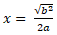

## **概覽**

PowerPoint 將方程式儲存為 Office Math Markup Language (OMML)。使用 Aspose.Slides for Android via Java，您可以以程式方式建立相同類型的數學內容：分數、根號、函數、極限、N 進制運算子、矩陣、陣列以及格式化的數學區塊。

在 PowerPoint 中，使用者通常從 **插入 > 方程式** 加入方程式：


結果是投影片上可編輯的數學文字：



Aspose.Slides 透過三個主要物件建立該數學文字：

- 數學形狀，使用 [addMathShape](https://reference.aspose.com/slides/androidjava/com.aspose.slides/ishapecollection/) 建立，是包含方程式的形狀。
- [MathPortion](https://reference.aspose.com/slides/androidjava/com.aspose.slides/mathportion/) 用於在形狀的文字框內儲存數學內容。
- [MathParagraph](https://reference.aspose.com/slides/androidjava/com.aspose.slides/mathparagraph/) 包含一個或多個 [MathBlock](https://reference.aspose.com/slides/androidjava/com.aspose.slides/mathblock/) 物件。

以下大多範例使用 [MathematicalText](https://reference.aspose.com/slides/androidjava/com.aspose.slides/mathematicaltext/) 以及來自 [IMathElement](https://reference.aspose.com/slides/androidjava/com.aspose.slides/imathelement/) 的串流方法，以保持程式碼簡潔易讀。

如需 MathML 匯出情境，請參考 [Export Math Equations from Presentations on Android](/slides/zh-hant/androidjava/exporting-math-equations/)。

## **建立方程式**

此範例使用 [addMathShape](https://reference.aspose.com/slides/androidjava/com.aspose.slides/ishapecollection/#addMathShape-float-float-float-float-) 建立數學形狀，並加入畢氏定理：


```java
import com.aspose.slides.*;

Presentation presentation = new Presentation();
try {
    ISlide slide = presentation.getSlides().get_Item(0);

    IAutoShape mathShape = slide.getShapes().addMathShape(20, 20, 700, 120);
    IMathParagraph mathParagraph = ((MathPortion) mathShape.getTextFrame().getParagraphs()
            .get_Item(0).getPortions().get_Item(0)).getMathParagraph();

    IMathBlock equation = new MathematicalText("c")
            .setSuperscript("2")
            .join("=")
            .join(new MathematicalText("a").setSuperscript("2"))
            .join("+")
            .join(new MathematicalText("b").setSuperscript("2"));

    mathParagraph.add(equation);

    presentation.save("pythagorean-theorem.pptx", SaveFormat.Pptx);
} finally {
    presentation.dispose();
}
```

{}
[addMathShape](https://reference.aspose.com/slides/androidjava/com.aspose.slides/ishapecollection/#addMathShape-float-float-float-float-) 會建立已包含數學段落的形狀。存取第一個 [MathPortion](https://reference.aspose.com/slides/androidjava/com.aspose.slides/mathportion/)，呼叫 [getMathParagraph](https://reference.aspose.com/slides/androidjava/com.aspose.slides/imathportion/#getMathParagraph--)，並將數學區塊或數學元素加入其中。
{}

### **合併數學區塊**

當方程式的部份以 [IMathBlock](https://reference.aspose.com/slides/androidjava/com.aspose.slides/imathblock/) 物件分別建構時，使用 [joinBlock](https://reference.aspose.com/slides/androidjava/com.aspose.slides/imathblock/#joinBlock-com.aspose.slides.IMathBlock-) 進行合併。範例在左側區塊建構 `c² =`，右側區塊建構 `a² + b²`。[setSuperscript](https://reference.aspose.com/slides/androidjava/com.aspose.slides/imathelement/#setSuperscript-java.lang.String-) 為三個冪次建立可編輯的上標。

```java
import com.aspose.slides.*;

Presentation presentation = new Presentation();
try {
    ISlide slide = presentation.getSlides().get_Item(0);

    IAutoShape shape = slide.getShapes().addMathShape(20, 20, 600, 100);
    IMathPortion mathPortion = (IMathPortion) shape.getTextFrame().getParagraphs().get_Item(0).getPortions().get_Item(0);
    IMathParagraph mathParagraph = mathPortion.getMathParagraph();

    MathBlock leftBlock = new MathBlock();
    leftBlock.add(new MathematicalText("c").setSuperscript("2"));
    leftBlock.add(new MathematicalText("="));

    MathBlock rightBlock = new MathBlock();
    rightBlock.add(new MathematicalText("a").setSuperscript("2"));
    rightBlock.add(new MathematicalText("+"));
    rightBlock.add(new MathematicalText("b").setSuperscript("2"));

    IMathBlock combinedBlock = leftBlock.joinBlock(rightBlock);
    mathParagraph.add(combinedBlock);

    presentation.save("equation.pptx", SaveFormat.Pptx);
} finally {
    presentation.dispose();
}
```

[joinBlock](https://reference.aspose.com/slides/androidjava/com.aspose.slides/imathblock/#joinBlock-com.aspose.slides.IMathBlock-) 會回傳 `leftBlock` 本身，現在依順序包含兩個部份，並使 `rightBlock` 為空。僅將合併後的區塊一次加入 [IMathParagraph](https://reference.aspose.com/slides/androidjava/com.aspose.slides/imathparagraph/)。重新開啟 `equation.pptx` 後，段落僅包含一個代表 `c² = a² + b²` 的區塊，且三個冪次仍以數學上標方式保留。

若以 `leftBlock.add(rightBlock)` 呼叫 [add](https://reference.aspose.com/slides/androidjava/com.aspose.slides/imathelementcollection/#add-com.aspose.slides.IMathElement-)，則會嘗試直接將一個區塊嵌入另一個區塊，並拋出 `InvalidOperationException`。

## **新增分數**

使用 [divide](https://reference.aspose.com/slides/androidjava/com.aspose.slides/imathelement/#divide-com.aspose.slides.IMathElement-) 建立分數。您可以使用 [MathFractionTypes](https://reference.aspose.com/slides/androidjava/com.aspose.slides/mathfractiontypes/) 來選擇分數樣式。


```java
import com.aspose.slides.*;

Presentation presentation = new Presentation();
try {
    ISlide slide = presentation.getSlides().get_Item(0);

    IAutoShape mathShape = slide.getShapes().addMathShape(20, 20, 700, 100);
    IMathParagraph mathParagraph = ((MathPortion) mathShape.getTextFrame().getParagraphs()
            .get_Item(0).getPortions().get_Item(0)).getMathParagraph();

    IMathFraction fraction = new MathematicalText("1")
            .divide("x", MathFractionTypes.Skewed);

    mathParagraph.add(new MathBlock(fraction));

    presentation.save("fraction.pptx", SaveFormat.Pptx);
} finally {
    presentation.dispose();
}
```

若需堆疊式分數，使用 [MathFractionTypes.Bar](https://reference.aspose.com/slides/androidjava/com.aspose.slides/mathfractiontypes/#Bar)：

```java
import com.aspose.slides.*;

IMathFraction stackedFraction = new MathematicalText("x + 1").divide("y - 1", MathFractionTypes.Bar);
```

## **新增根號**

使用 [radical](https://reference.aspose.com/slides/androidjava/com.aspose.slides/imathelement/#radical-com.aspose.slides.IMathElement-) 建立平方根、立方根或其他次根。當前元素成為根號的底數，參數則為指數。


```java
import com.aspose.slides.*;

Presentation presentation = new Presentation();
try {
    ISlide slide = presentation.getSlides().get_Item(0);

    IAutoShape mathShape = slide.getShapes().addMathShape(20, 20, 700, 100);
    IMathParagraph mathParagraph = ((MathPortion) mathShape.getTextFrame().getParagraphs()
            .get_Item(0).getPortions().get_Item(0)).getMathParagraph();

    IMathRadical radical = new MathematicalText("x")
            .radical("n");

    mathParagraph.add(new MathBlock(radical));

    presentation.save("radical.pptx", SaveFormat.Pptx);
} finally {
    presentation.dispose();
}
```

### **顯示或隱藏平方根的指數**

平方根可以顯示明確的 2，或使用傳統的 √x 記號。[IMathRadical](https://reference.aspose.com/slides/androidjava/com.aspose.slides/imathradical/) 的 [setHideDegree](https://reference.aspose.com/slides/androidjava/com.aspose.slides/imathradical/#setHideDegree-boolean-) 方法控制顯示哪種形式。兩種形式皆保留指數 2 及根數 x 在可編輯的方程式中。


範例將相同的平方根儲存兩次。`visible-degree.pptx` 中指數可見；`hidden-degree.pptx` 中指數隱藏。

```java
import com.aspose.slides.*;

Presentation presentation = new Presentation();
try {
    ISlide slide = presentation.getSlides().get_Item(0);

    IMathRadical radical = new MathematicalText("x").radical("2");

    IAutoShape shape = slide.getShapes().addMathShape(20, 20, 200, 100);
    IMathPortion portion = (IMathPortion) shape.getTextFrame().getParagraphs().get_Item(0).getPortions().get_Item(0);
    portion.getMathParagraph().add(new MathBlock(radical));

    radical.setHideDegree(false);
    presentation.save("visible-degree.pptx", SaveFormat.Pptx);

    radical.setHideDegree(true);
    presentation.save("hidden-degree.pptx", SaveFormat.Pptx);
} finally {
    presentation.dispose();
}
```

## **新增函數與極限**

使用 [asArgumentOfFunction](https://reference.aspose.com/slides/androidjava/com.aspose.slides/imathelement/#asArgumentOfFunction-com.aspose.slides.IMathElement-) 或 [function](https://reference.aspose.com/slides/androidjava/com.aspose.slides/imathelement/#function-com.aspose.slides.IMathElement-) 來建立 `sin(x)`、`log(x)` 或自訂函數名稱等函數。對於極限，將 `lim` 放入 [MathLimit](https://reference.aspose.com/slides/androidjava/com.aspose.slides/mathlimit/) 或使用 [setLowerLimit](https://reference.aspose.com/slides/androidjava/com.aspose.slides/imathelement/#setLowerLimit-com.aspose.slides.IMathElement-)。


```java
import com.aspose.slides.*;

Presentation presentation = new Presentation();
try {
    ISlide slide = presentation.getSlides().get_Item(0);

    IAutoShape mathShape = slide.getShapes().addMathShape(20, 20, 700, 100);
    IMathParagraph mathParagraph = ((MathPortion) mathShape.getTextFrame().getParagraphs()
            .get_Item(0).getPortions().get_Item(0)).getMathParagraph();

    IMathFunction limit = new MathematicalText("lim")
            .setLowerLimit("x→∞")
            .function("x");

    mathParagraph.add(new MathBlock(limit));

    presentation.save("functions-and-limits.pptx", SaveFormat.Pptx);
} finally {
    presentation.dispose();
}
```

若要使用自訂函數名稱，將函數名稱設為當前元素，然後以其參數呼叫 [function](https://reference.aspose.com/slides/androidjava/com.aspose.slides/imathelement/#function-com.aspose.slides.IMathElement-)：

```java
import com.aspose.slides.*;

IMathFunction customFunction = new MathematicalText("f").function("x + 1");
```

## **新增 N 進制運算子與積分符號**

使用 [nary](https://reference.aspose.com/slides/androidjava/com.aspose.slides/imathelement/#nary-int-com.aspose.slides.IMathElement-com.aspose.slides.IMathElement-) 建立求和、聯集、交集以及其他大型運算子。使用 [integral](https://reference.aspose.com/slides/androidjava/com.aspose.slides/imathelement/#integral-int-com.aspose.slides.IMathElement-com.aspose.slides.IMathElement-) 建立積分符號。兩個方法皆可設定上下限。


```java
import com.aspose.slides.*;

Presentation presentation = new Presentation();
try {
    ISlide slide = presentation.getSlides().get_Item(0);

    IAutoShape mathShape = slide.getShapes().addMathShape(20, 20, 700, 120);
    IMathParagraph mathParagraph = ((MathPortion) mathShape.getTextFrame().getParagraphs()
            .get_Item(0).getPortions().get_Item(0)).getMathParagraph();

    IMathBlock summationBase = new MathematicalText("x")
            .setSuperscript("k")
            .join(new MathematicalText("a").setSuperscript("n-k"));

    IMathNaryOperator summation = summationBase.nary(MathNaryOperatorTypes.Summation, "k=0", "n");

    mathParagraph.add(new MathBlock(summation));

    presentation.save("nary-operators.pptx", SaveFormat.Pptx);
} finally {
    presentation.dispose();
}
```

N 進制運算子用於帶有可選上下限的大型運算子。像 `+`、`-`、`=` 這類簡單運算子通常使用 [MathematicalText](https://reference.aspose.com/slides/androidjava/com.aspose.slides/mathematicaltext/) 並加入表達式中。

欲建立積分，使用 [integral](https://reference.aspose.com/slides/androidjava/com.aspose.slides/imathelement/#integral-int-com.aspose.slides.IMathElement-com.aspose.slides.IMathElement-)：

```java
import com.aspose.slides.*;

IMathBlock integralBase = new MathematicalText("x").join(new MathematicalText("dx").toBox());
IMathNaryOperator integral = integralBase.integral(MathIntegralTypes.Simple, "0", "1");
```

## **新增矩陣**

使用 [MathMatrix](https://reference.aspose.com/slides/androidjava/com.aspose.slides/mathmatrix/) 來建立列與欄。預設情況下矩陣不包含括號，若需要括弧、方括號或大括號，請自行將矩陣包起來。


```java
import com.aspose.slides.*;

Presentation presentation = new Presentation();
try {
    ISlide slide = presentation.getSlides().get_Item(0);

    IAutoShape mathShape = slide.getShapes().addMathShape(20, 20, 700, 120);
    IMathParagraph mathParagraph = ((MathPortion) mathShape.getTextFrame().getParagraphs()
            .get_Item(0).getPortions().get_Item(0)).getMathParagraph();

    MathMatrix matrix = new MathMatrix(2, 3);
    matrix.set_Item(0, 0, new MathematicalText("1"));
    matrix.set_Item(0, 1, new MathematicalText("x"));
    matrix.set_Item(1, 0, new MathematicalText("x"));
    matrix.set_Item(1, 1, new MathematicalText("2"));
    matrix.set_Item(1, 2, new MathematicalText("y"));

    mathParagraph.add(new MathBlock(matrix));

    presentation.save("matrix.pptx", SaveFormat.Pptx);
} finally {
    presentation.dispose();
}
```

### **編輯既有矩陣**

假設線性代數課程從 `matrix.pptx`（前一範例儲存的係數矩陣）開始。接下來的練習要保留第一個方程式、以兩個新方程式取代第二個，並調整變數集合。透過 [IMathMatrix](https://reference.aspose.com/slides/androidjava/com.aspose.slides/imathmatrix/) 開啟既有矩陣，以保留仍適用的係數。


列與欄的索引從零開始，且在每次呼叫時皆參照當時的矩陣狀態。於索引 1 前插入新列會將原本的第二列移至索引 2。於索引 2 後插入則會在末端新增一列。刪除第 2 列會移除原第二個方程式，並使新增的列上移一格。欄位的移動方式相同。

```java
import com.aspose.slides.*;

Presentation presentation = new Presentation("matrix.pptx");
try {
    IAutoShape shape = (IAutoShape) presentation.getSlides().get_Item(0).getShapes().get_Item(0);
    IMathPortion portion = (IMathPortion) shape.getTextFrame().getParagraphs().get_Item(0).getPortions().get_Item(0);
    IMathMatrix matrix = (IMathMatrix) portion.getMathParagraph().get_Item(0).get_Item(0);

    matrix.insertRowBefore(1);
    matrix.insertRowAfter(2);
    matrix.deleteRow(2);

    matrix.insertColumnBefore(1);
    matrix.insertColumnAfter(3);
    matrix.deleteColumn(3);

    // 新儲存格最初為 null。先設定非零係數。
    matrix.set_Item(1, 0, new MathematicalText("12"));
    matrix.set_Item(1, 1, new MathematicalText("1"));
    matrix.set_Item(2, 2, new MathematicalText("10"));
    matrix.set_Item(2, 3, new MathematicalText("1"));
    for (int row = 0; row < matrix.getRowCount(); row++) {
        for (int column = 0; column < matrix.getColumnCount(); column++) {
            if (matrix.get_Item(row, column) == null) {
                matrix.set_Item(row, column, new MathematicalText("0"));
            }
        }
    }

    matrix.setColumnAlignment(0, MathHorizontalAlignment.Left);
    matrix.setColumnsAlignment(1, 3, MathHorizontalAlignment.Right);

    presentation.save("updated-matrix.pptx", SaveFormat.Pptx);
} finally {
    presentation.dispose();
}
```

[setColumnAlignment](https://reference.aspose.com/slides/androidjava/com.aspose.slides/imathmatrix/#setColumnAlignment-int-int-) 將第一欄對齊左側。[setColumnsAlignment](https://reference.aspose.com/slides/androidjava/com.aspose.slides/imathmatrix/#setColumnsAlignment-int-long-int-) 將從索引 1 開始的連續三欄對齊右側。在 `updated-matrix.pptx` 中，矩陣包含三個方程式與四個變數。原本第一列的係數 `1` 與 `x` 現在分別出現在第一與第三欄。


## **新增方程式陣列**

當需要對齊的方程式或垂直堆疊的表達式時，使用 [toMathArray](https://reference.aspose.com/slides/androidjava/com.aspose.slides/imathelement/#toMathArray--)。


```java
import com.aspose.slides.*;

Presentation presentation = new Presentation();
try {
    ISlide slide = presentation.getSlides().get_Item(0);

    IAutoShape mathShape = slide.getShapes().addMathShape(20, 20, 700, 140);
    IMathParagraph mathParagraph = ((MathPortion) mathShape.getTextFrame().getParagraphs()
            .get_Item(0).getPortions().get_Item(0)).getMathParagraph();

    IMathArray equationArray = new MathematicalText("x")
            .join("y")
            .toMathArray();

    mathParagraph.add(new MathBlock(equationArray));

    presentation.save("equation-array.pptx", SaveFormat.Pptx);
} finally {
    presentation.dispose();
}
```

### **將陣列與周圍元素對齊**

[setBaseJustification](https://reference.aspose.com/slides/androidjava/com.aspose.slides/imatharray/#setBaseJustification-int-) 控制陣列相對於旁邊數學元素的垂直對齊方式。下例比較第一列、陣列中心與最後一列的對齊效果。

此範例建立三個相同的陣列，每個都有三列，且在兩側分別放置 `A=` 與 `=B`。所有數學文字均使用 Cambria Math，字型大小 24 點。唯獨變更陣列的對齊方式。

```java
import com.aspose.slides.*;
import android.graphics.Color;

class MathTextFactory {
    MathematicalText createText(String value) {
        MathematicalText text = new MathematicalText(value);
        text.getFormat().setFontHeight(24);
        text.getFormat().setLatinFont(new FontData("Cambria Math"));
        return text;
    }
}

MathTextFactory factory = new MathTextFactory();
Presentation presentation = new Presentation();
try {
    presentation.getSlideSize().setSize(780, 200, SlideSizeScaleType.DoNotScale);
    ISlide slide = presentation.getSlides().get_Item(0);

    int[] alignments = { MathVerticalAlignment.Top, MathVerticalAlignment.Center, MathVerticalAlignment.Bottom };
    String[] alignmentNames = { "Top", "Center", "Bottom" };

    for (int i = 0; i < alignments.length; i++) {
        IAutoShape label = slide.getShapes().addAutoShape(ShapeType.Rectangle, 20 + i * 260, 10, 240, 30);
        label.getFillFormat().setFillType(FillType.NoFill);
        label.getLineFormat().getFillFormat().setFillType(FillType.NoFill);
        label.getTextFrame().setText(alignmentNames[i]);
        IPortionFormat labelFormat = label.getTextFrame().getParagraphs().get_Item(0).getPortions().get_Item(0).getPortionFormat();
        labelFormat.setFontHeight(16);
        labelFormat.getFillFormat().setFillType(FillType.Solid);
        labelFormat.getFillFormat().getSolidFillColor().setColor(Color.BLACK);

        IAutoShape mathShape = slide.getShapes().addMathShape(20 + i * 260, 60, 240, 130);
        mathShape.getTextFrame().getTextFrameFormat().setAnchoringType(TextAnchorType.Top);
        IMathParagraph mathParagraph = ((IMathPortion) mathShape.getTextFrame().getParagraphs().get_Item(0).getPortions().get_Item(0)).getMathParagraph();
        mathParagraph.setJustification(MathJustification.LeftJustified);

        IMathElement[] rows = { factory.createText("x+y=3"), factory.createText("x-y=1"), factory.createText("x=2") };
        MathArray equationArray = new MathArray(rows[0]);
        equationArray.getArguments().add(rows[1]);
        equationArray.getArguments().add(rows[2]);
        equationArray.setBaseJustification(alignments[i]);
        MathematicalText leftText = factory.createText("A=");
        MathematicalText rightText = factory.createText("=B");
        IMathBlock equation = new MathBlock(leftText).join(equationArray).join(rightText);
        mathParagraph.add(equation);
    }

    presentation.save("equation-array-alignment.pptx", SaveFormat.Pptx);
} finally {
    presentation.dispose();
}
```

下圖顯示在 PowerPoint 中儲存的簡報。請留意每個陣列旁的 `A=` 與 `=B` 位置。


### **設定列間距規則**

[setRowSpacingRule](https://reference.aspose.com/slides/androidjava/com.aspose.slides/imatharray/#setRowSpacingRule-int-) 用於選擇陣列內列的間距規則。[setRowSpacing](https://reference.aspose.com/slides/androidjava/com.aspose.slides/imatharray/#setRowSpacing-long-) 可提供具體的數值，會在使用預設規則時被忽略。

若使用具體間距，數值以點為單位。若使用比例間距，則以半行為單位：範例中的 `3` 代表 1.5 行。設定具體間距時需同時設定兩個屬性；僅變更數值不會選取間距規則。

以下範例儲存五個簡報，內容、對齊與字型設定相同。前三個使用預設規則，最後兩個使用具體數值。

```java
import com.aspose.slides.*;

class MathTextFactory {
    MathematicalText createText(String value) {
        MathematicalText text = new MathematicalText(value);
        text.getFormat().setFontHeight(24);
        text.getFormat().setLatinFont(new FontData("Cambria Math"));
        return text;
    }
}

MathTextFactory factory = new MathTextFactory();
int[] rules = { MathRowSpacingRule.SingleLineGap, MathRowSpacingRule.OneAndAHalfLineGap, MathRowSpacingRule.TwoLineGap, MathRowSpacingRule.Exactly, MathRowSpacingRule.Multiple };
int[] spacingValues = { 0, 0, 0, 20, 3 };
String[] ruleNames = { "SingleLineGap", "OneAndAHalfLineGap", "TwoLineGap", "Exactly", "Multiple" };

for (int i = 0; i < rules.length; i++) {
    String fileName = "equation-array-" + ruleNames[i] + ".pptx";
    Presentation presentation = new Presentation();
    try {
        IAutoShape mathShape = presentation.getSlides().get_Item(0).getShapes().addMathShape(20, 20, 600, 300);
        IParagraph paragraph = mathShape.getTextFrame().getParagraphs().get_Item(0);
        paragraph.getParagraphFormat().setSpaceBefore(0);
        paragraph.getParagraphFormat().setSpaceAfter(0);
        IMathParagraph mathParagraph = ((IMathPortion) paragraph.getPortions().get_Item(0)).getMathParagraph();
        mathParagraph.setJustification(MathJustification.LeftJustified);

        IMathElement[] rows = { factory.createText("x+y=3"), factory.createText("x-y=1"), factory.createText("x=2") };
        MathArray equationArray = new MathArray(rows[0]);
        equationArray.getArguments().add(rows[1]);
        equationArray.getArguments().add(rows[2]);
        equationArray.setBaseJustification(MathVerticalAlignment.Center);
        equationArray.setRowSpacingRule(rules[i]);
        equationArray.setRowSpacing(spacingValues[i]);
        MathematicalText leftText = factory.createText("A=");
        MathematicalText rightText = factory.createText("=B");
        IMathBlock equation = new MathBlock(leftText).join(equationArray).join(rightText);
        mathParagraph.add(equation);

        presentation.save(fileName, SaveFormat.Pptx);
    } finally {
        presentation.dispose();
    }
}
```

陣列的列間距與段落間距是分開的。[setSpaceBefore](https://reference.aspose.com/slides/androidjava/com.aspose.slides/iparagraphformat/#setSpaceBefore-float-) 與 [setSpaceAfter](https://reference.aspose.com/slides/androidjava/com.aspose.slides/iparagraphformat/#setSpaceAfter-float-) 會在整個段落四周加入空白，而非在陣列列之間。同理，[IMathParagraph.setJustification](https://reference.aspose.com/slides/androidjava/com.aspose.slides/imathparagraph/#setJustification-int-) 只會水平定位整個數學段落，並不會取代陣列的垂直對齊設定。

## **新增三角函數**

當參數是當前元素且已知函數名稱時，使用 [asArgumentOfFunction](https://reference.aspose.com/slides/androidjava/com.aspose.slides/imathelement/#asArgumentOfFunction-com.aspose.slides.IMathElement-)。


```java
import com.aspose.slides.*;

Presentation presentation = new Presentation();
try {
    ISlide slide = presentation.getSlides().get_Item(0);

    IAutoShape mathShape = slide.getShapes().addMathShape(20, 20, 700, 100);
    IMathParagraph mathParagraph = ((MathPortion) mathShape.getTextFrame().getParagraphs()
            .get_Item(0).getPortions().get_Item(0)).getMathParagraph();

    IMathFunction cosine = new MathematicalText("2x")
            .asArgumentOfFunction(MathFunctionsOfOneArgument.Cos);

    mathParagraph.add(new MathBlock(cosine));

    presentation.save("trigonometric-function.pptx", SaveFormat.Pptx);
} finally {
    presentation.dispose();
}
```

## **新增下標與上標**

使用下標與上標輔助函式處理索引與冪次。若索引需顯示在基底的左側，使用 [setSubSuperscriptOnTheLeft](https://reference.aspose.com/slides/androidjava/com.aspose.slides/imathelement/#setSubSuperscriptOnTheLeft-com.aspose.slides.IMathElement-com.aspose.slides.IMathElement-)。


```java
import com.aspose.slides.*;

Presentation presentation = new Presentation();
try {
    ISlide slide = presentation.getSlides().get_Item(0);

    IAutoShape mathShape = slide.getShapes().addMathShape(20, 20, 700, 100);
    IMathParagraph mathParagraph = ((MathPortion) mathShape.getTextFrame().getParagraphs()
            .get_Item(0).getPortions().get_Item(0)).getMathParagraph();

    IMathLeftSubSuperscriptElement scripts = new MathematicalText("Y")
            .setSubSuperscriptOnTheLeft("1", "n");

    mathParagraph.add(new MathBlock(scripts));

    presentation.save("subscript-superscript.pptx", SaveFormat.Pptx);
} finally {
    presentation.dispose();
}
```

## **新增分界符號**

使用 [enclose](https://reference.aspose.com/slides/androidjava/com.aspose.slides/imathelement/#enclose-char-char-) 將表達式包在分界符內。亦可為包含多個元素的分界符表達式設定分隔字元。


```java
import com.aspose.slides.*;

Presentation presentation = new Presentation();
try {
    ISlide slide = presentation.getSlides().get_Item(0);

    IAutoShape mathShape = slide.getShapes().addMathShape(20, 20, 700, 100);
    IMathParagraph mathParagraph = ((MathPortion) mathShape.getTextFrame().getParagraphs()
            .get_Item(0).getPortions().get_Item(0)).getMathParagraph();

    IMathDelimiter delimiter = new MathematicalText("x")
            .join("y")
            .join("z")
            .enclose('<', '>');
    delimiter.setSeparatorCharacter('|');

    mathParagraph.add(new MathBlock(delimiter));

    presentation.save("delimiters.pptx", SaveFormat.Pptx);
} finally {
    presentation.dispose();
}
```

### **調整分界符大小與對齊方式**

將 `true` 傳遞給 [setGrowToMatchOperandHeight](https://reference.aspose.com/slides/androidjava/com.aspose.slides/imathdelimiter/#setGrowToMatchOperandHeight-boolean-)，可讓括號隨較高的運算元自動伸長；傳入 `false` 則保持正常大小。使用 [setDelimiterShape](https://reference.aspose.com/slides/androidjava/com.aspose.slides/imathdelimiter/#setDelimiterShape-int-) 搭配 [MathDelimiterShape](https://reference.aspose.com/slides/androidjava/com.aspose.slides/mathdelimitershape/) 之一的值。`Centered` 會將括號置於數學軸的中心（即等號的中間），`Match` 則與所包圍的內容對齊。兩者僅影響分界符本身，內部表達式保持不變。

範例在 `x` 的指數位置放置分數，使表達式在基線上方的延伸較下方更長。四個方程式均使用相同的括號與字型設定。

```java
import com.aspose.slides.*;

Presentation presentation = new Presentation();
try {
    ISlide slide = presentation.getSlides().get_Item(0);
    for (int row = 0; row < 2; row++) {
        for (int column = 0; column < 2; column++) {
            IMathFraction fraction = new MathematicalText("a + b").divide("c + d");
            IMathSuperscriptElement power = new MathematicalText("x").setSuperscript(fraction);
            IMathDelimiter delimiter = power.enclose('(', ')');
            delimiter.setGrowToMatchOperandHeight(row == 0);
            delimiter.setDelimiterShape(column == 0 ? MathDelimiterShape.Centered : MathDelimiterShape.Match);

            IAutoShape mathShape = slide.getShapes().addMathShape(20 + 330 * column, 20 + 120 * row, 300, 100);
            MathPortion portion = (MathPortion) mathShape.getTextFrame().getParagraphs().get_Item(0).getPortions().get_Item(0);
            portion.getPortionFormat().setFontHeight(32);
            IMathBlock equation = new MathematicalText("y = ").join(delimiter);
            portion.getMathParagraph().add(equation);
        }
    }
    presentation.save("delimiter-sizing.pptx", SaveFormat.Pptx);
} finally {
    presentation.dispose();
}
```

在 PowerPoint 中比較各列，可見成長效果。上列的括號會隨指數伸長，且兩種形狀看起來相同；下列則未啟用成長。左側的較小括號（`Centered`）與等號對齊，而右側的（`Match`）則在表達式上方稍高。


## **新增邊框盒子**

在分數上呼叫 [toBorderBox](https://reference.aspose.com/slides/androidjava/com.aspose.slides/imathelement/#toBorderBox--) 即可為整個表達式加上框線。回傳的 [IMathBorderBox](https://reference.aspose.com/slides/androidjava/com.aspose.slides/imathborderbox/) 預設顯示四條邊。使用 [setHideTop](https://reference.aspose.com/slides/androidjava/com.aspose.slides/imathborderbox/#setHideTop-boolean-)、[setHideBottom](https://reference.aspose.com/slides/androidjava/com.aspose.slides/imathborderbox/#setHideBottom-boolean-)、[setHideLeft](https://reference.aspose.com/slides/androidjava/com.aspose.slides/imathborderbox/#setHideLeft-boolean-)、[setHideRight](https://reference.aspose.com/slides/androidjava/com.aspose.slides/imathborderbox/#setHideRight-boolean-) 來移除個別邊線。

範例在同一張投影片上放置六個相同的分數。為顯示抵消效果，隱藏全部四條邊，並將 `true` 傳給 [setStrikethroughBottomLeftToTopRight](https://reference.aspose.com/slides/androidjava/com.aspose.slides/imathborderbox/#setStrikethroughBottomLeftToTopRight-boolean-) 產生向上斜線 (↗)；或傳給 [setStrikethroughTopLeftToBottomRight](https://reference.aspose.com/slides/androidjava/com.aspose.slides/imathborderbox/#setStrikethroughTopLeftToBottomRight-boolean-) 產生向下斜線 (↘)。亦可結合 [setStrikethroughHorizontal](https://reference.aspose.com/slides/androidjava/com.aspose.slides/imathborderbox/#setStrikethroughHorizontal-boolean-) 或 [setStrikethroughVertical](https://reference.aspose.com/slides/androidjava/com.aspose.slides/imathborderbox/#setStrikethroughVertical-boolean-) 以及任意可見的邊線。

```java
import com.aspose.slides.*;

Presentation presentation = new Presentation();
try {
    presentation.getSlideSize().setSize(540, 220, SlideSizeScaleType.DoNotScale);
    ISlide slide = presentation.getSlides().get_Item(0);

    class FractionBuilder {
        IMathBorderBox addFraction(float x, float y, boolean hideBorder) {
            IMathFraction fraction = new MathematicalText("x+1").divide("y+2");
            IMathBorderBox box = fraction.toBorderBox();
            box.setHideTop(hideBorder);
            box.setHideBottom(hideBorder);
            box.setHideLeft(hideBorder);
            box.setHideRight(hideBorder);

            IAutoShape shape = slide.getShapes().addMathShape(x, y, 160, 90);
            MathPortion portion = (MathPortion) shape.getTextFrame().getParagraphs().get_Item(0).getPortions().get_Item(0);
            portion.getPortionFormat().setFontHeight(28);
            portion.getMathParagraph().add(new MathBlock(box));
            return box;
        }
    }

    FractionBuilder builder = new FractionBuilder();
    builder.addFraction(10, 10, false);

    IMathBorderBox partial = builder.addFraction(190, 10, false);
    partial.setHideTop(true);
    partial.setHideRight(true);

    builder.addFraction(370, 10, true).setStrikethroughBottomLeftToTopRight(true);
    builder.addFraction(10, 120, true).setStrikethroughTopLeftToBottomRight(true);
    builder.addFraction(190, 120, true).setStrikethroughHorizontal(true);
    builder.addFraction(370, 120, false).setStrikethroughVertical(true);

    presentation.save("border-box.pptx", SaveFormat.Pptx);
} finally {
    presentation.dispose();
}
```


在此分數上，水平刪除線會與分數線重疊。垂直刪除線會同時穿過分子與分母，而周圍框線仍保持可見。這些線條裝飾整個表達式。普通文字的刪除線僅作用於文字跑。重新於 PowerPoint 開啟簡報後，仍可獨立編輯分子與分母。

## **使用幻影元素控制可見性與版面配置**

將表達式包在 [MathPhantom](https://reference.aspose.com/slides/androidjava/com.aspose.slides/mathphantom/) 中，可獨立控制其可見性與在方程式中佔用的空間。以下 [IMathPhantom](https://reference.aspose.com/slides/androidjava/com.aspose.slides/imathphantom/) 方法可調整相應屬性：

| 方法 | 效果 |
| --- | --- |
| [setShow](https://reference.aspose.com/slides/androidjava/com.aspose.slides/imathphantom/#setShow-boolean-) | 設為 `false` 可隱藏表達式；其尺寸仍會影響版面配置，除非下列方法同時設為 `true`。 |
| [setZeroWidth](https://reference.aspose.com/slides/androidjava/com.aspose.slides/imathphantom/#setZeroWidth-boolean-) | 將表達式的水平寬度視為零，讓相鄰元素可更貼近。 |
| [setZeroAsc](https://reference.aspose.com/slides/androidjava/com.aspose.slides/imathphantom/#setZeroAsc-boolean-) | 將其上升部（基線上方的高度）視為零，可減少相鄰元素上方預留的空間。 |
| [setZeroDesc](https://reference.aspose.com/slides/androidjava/com.aspose.slides/imathphantom/#setZeroDesc-boolean-) | 將其下降部（基線下方的深度）視為零，可使分數線或其他內容更貼近下方相鄰元素。 |

基線是普通數學字母對齊的參考線。隱藏內容不會移除其尺寸，將尺寸視為零亦不會刪除表達式。可透過 [getBase](https://reference.aspose.com/slides/androidjava/com.aspose.slides/imathphantom/#getBase--) 取得底層表達式。將 `true` 傳給 [setShow](https://reference.aspose.com/slides/androidjava/com.aspose.slides/imathphantom/#setShow-boolean-) 可再次顯示；先前的尺寸設定仍會保留。

下例建立五個並排變體：一個可見分數、一個保留空間的隱藏分數，以及三個以不同維度為零的隱藏分數。每個變體皆使用相同的環繞表達式與 Cambria Math，字型大小 24 點。所有方程式形狀的上方位置相同，以灰色參考線標示。將幻影放在外層分數的分子中，可更明顯觀察垂直版面配置的變化。

```java
import com.aspose.slides.*;
import android.graphics.Color;

class MathTextFactory {
    MathematicalText createText(String value) {
        MathematicalText text = new MathematicalText(value);
        text.getFormat().setFontHeight(24);
        text.getFormat().setLatinFont(new FontData("Cambria Math"));
        return text;
    }
}

MathTextFactory factory = new MathTextFactory();
Presentation presentation = new Presentation();
try {
    presentation.getSlideSize().setSize(1000, 180, SlideSizeScaleType.DoNotScale);
    ISlide slide = presentation.getSlides().get_Item(0);

    String[] labels = { "Visible", "Hidden: reserves space", "Hidden: ZeroWidth", "Hidden: ZeroAsc", "Hidden: ZeroDesc" };

    IAutoShape guide = slide.getShapes().addAutoShape(ShapeType.Line, 10, 60, 980, 0);
    guide.getLineFormat().getFillFormat().setFillType(FillType.Solid);
    guide.getLineFormat().getFillFormat().getSolidFillColor().setColor(Color.LTGRAY);

    for (int i = 0; i < labels.length; i++) {
        int left = 10 + i * 200;

        IAutoShape label = slide.getShapes().addAutoShape(ShapeType.Rectangle, left, 10, 190, 30);
        label.getFillFormat().setFillType(FillType.NoFill);
        label.getLineFormat().getFillFormat().setFillType(FillType.NoFill);
        label.getTextFrame().setText(labels[i]);

        IPortionFormat labelFormat = label.getTextFrame().getParagraphs().get_Item(0).getPortions().get_Item(0).getPortionFormat();
        labelFormat.setFontHeight(14);
        labelFormat.getFillFormat().setFillType(FillType.Solid);
        labelFormat.getFillFormat().getSolidFillColor().setColor(Color.BLACK);

        MathematicalText fractionNumerator = factory.createText("a+b");
        MathematicalText fractionDenominator = factory.createText("c+d");
        MathFraction fraction = new MathFraction(fractionNumerator, fractionDenominator);
        MathPhantom phantom = new MathPhantom(fraction);
        phantom.setShow(i == 0);
        phantom.setZeroWidth(i == 2);
        phantom.setZeroAsc(i == 3);
        phantom.setZeroDesc(i == 4);

        MathematicalText leftText = factory.createText("x+");
        MathematicalText rightText = factory.createText("+y");
        IMathBlock numerator = new MathBlock(leftText).join(phantom).join(rightText);
        MathematicalText denominator = factory.createText("z");
        MathFraction equation = new MathFraction(numerator, denominator);

        IAutoShape shape = slide.getShapes().addMathShape(left, 60, 190, 100);
        shape.getTextFrame().getTextFrameFormat().setAnchoringType(TextAnchorType.Top);

        IMathPortion mathPortion = (IMathPortion) shape.getTextFrame().getParagraphs().get_Item(0).getPortions().get_Item(0);
        IMathParagraph mathParagraph = mathPortion.getMathParagraph();
        mathParagraph.add(new MathBlock(equation));
    }

    presentation.save("math-phantom.pptx", SaveFormat.Pptx);
} finally {
    presentation.dispose();
}
```


## **分組項目**

使用 [group](https://reference.aspose.com/slides/androidjava/com.aspose.slides/imathelement/#group-char-int-int-) 可在表達式上方或下方放置分組字元，並可加入上下限標示分組項目。


```java
import com.aspose.slides.*;

Presentation presentation = new Presentation();
try {
    ISlide slide = presentation.getSlides().get_Item(0);

    IAutoShape mathShape = slide.getShapes().addMathShape(20, 20, 700, 120);
    IMathParagraph mathParagraph = ((MathPortion) mathShape.getTextFrame().getParagraphs()
            .get_Item(0).getPortions().get_Item(0)).getMathParagraph();

    IMathLimit grouped = new MathematicalText("x + y")
            .group('\u23DF', MathTopBotPositions.Bottom, MathTopBotPositions.Top)
            .setLowerLimit("any text");

    mathParagraph.add(new MathBlock(grouped));

    presentation.save("grouped-terms.pptx", SaveFormat.Pptx);
} finally {
    presentation.dispose();
}
```

## **格式化數學元素**

僅在能提升公式可讀性的情況下使用格式化輔助函式。例如，[overbar](https://reference.aspose.com/slides/androidjava/com.aspose.slides/imathelement/#overbar--) 可在數學元素上方加上橫線。


```java
import com.aspose.slides.*;

Presentation presentation = new Presentation();
try {
    ISlide slide = presentation.getSlides().get_Item(0);

    IAutoShape mathShape = slide.getShapes().addMathShape(20, 20, 700, 100);
    IMathParagraph mathParagraph = ((MathPortion) mathShape.getTextFrame().getParagraphs()
            .get_Item(0).getPortions().get_Item(0)).getMathParagraph();

    IMathBar overbar = new MathematicalText("ABC").overbar();

    mathParagraph.add(new MathBlock(overbar));

    presentation.save("overbar.pptx", SaveFormat.Pptx);
} finally {
    presentation.dispose();
}
```

### **格式化既有方程式中的文字**

若要在既有方程式中格式化文字，必須遍歷每個數學區塊的元素樹。[IMathElement.getChildren](https://reference.aspose.com/slides/androidjava/com.aspose.slides/imathelement/#getChildren--) 只會回傳直屬子項，需遞迴呼叫才能取得分數、上下標、根號及其他巢狀結構內的文字。也要檢查當前元素本身，以確保包含 [MathematicalText](https://reference.aspose.com/slides/androidjava/com.aspose.slides/mathematicaltext/) 時不會遺漏。

此範例假設 `input.pptx` 內含如 `z = xᵢ / ∛y` 的方程式，其中分數的分子有下標，分母有根號。若僅處理區塊的頂層元素，將會錯過分數內的文字。範例會找出投影片文字框中的數學片段，透過 [IMathPortion.getMathParagraph](https://reference.aspose.com/slides/androidjava/com.aspose.slides/imathportion/#getMathParagraph--) 取得區塊，並使用 [setFontHeight](https://reference.aspose.com/slides/androidjava/com.aspose.slides/baseportionformat/#setFontHeight-float-) 透過每個文字元素的 [getFormat](https://reference.aspose.com/slides/androidjava/com.aspose.slides/mathematicaltext/#getFormat--) 方法將字型大小設定為 28 點。

```java
import com.aspose.slides.*;

class MathTextFormatter {
    void formatMathText(IMathElement element) {
        if (element instanceof MathematicalText) {
            MathematicalText text = (MathematicalText) element;
            text.getFormat().setFontHeight(28);
        }

        for (IMathElement child : element.getChildren()) {
            formatMathText(child);
        }
    }
}

MathTextFormatter formatter = new MathTextFormatter();
Presentation presentation = new Presentation("input.pptx");
try {
    for (ISlide slide : presentation.getSlides()) {
        for (IShape shape : slide.getShapes()) {
            if (!(shape instanceof IAutoShape)) {
                continue;
            }

            IAutoShape autoShape = (IAutoShape) shape;
            if (autoShape.getTextFrame() == null) {
                continue;
            }

            for (IParagraph paragraph : autoShape.getTextFrame().getParagraphs()) {
                for (IPortion portion : paragraph.getPortions()) {
                    if (portion instanceof IMathPortion) {
                        IMathPortion mathPortion = (IMathPortion) portion;
                        for (IMathBlock block : mathPortion.getMathParagraph()) {
                            formatter.formatMathText(block);
                        }
                    }
                }
            }
        }
    }

    presentation.save("formatted-equations.pptx", SaveFormat.Pptx);
} finally {
    presentation.dispose();
}
```

儲存的簡報會在每個已處理方程式的所有層級保留更新後的文字格式，同時保留原有的文字內容與數學結構。

## **快速參考**

| 任務 | 主要 API |
| --- | --- |
| 建立數學文字 | [MathematicalText](https://reference.aspose.com/slides/androidjava/com.aspose.slides/mathematicaltext/) |
| 合併元素 | [IMathElement.join](https://reference.aspose.com/slides/androidjava/com.aspose.slides/imathelement/) |
| 建立分數 | [IMathElement.divide](https://reference.aspose.com/slides/androidjava/com.aspose.slides/imathelement/) |
| 新增上標或下標 | [setSuperscript](https://reference.aspose.com/slides/androidjava/com.aspose.slides/imathelement/), [setSubscript](https://reference.aspose.com/slides/androidjava/com.aspose.slides/imathelement/) |
| 新增函數 | [function](https://reference.aspose.com/slides/androidjava/com.aspose.slides/imathelement/), [asArgumentOfFunction](https://reference.aspose.com/slides/androidjava/com.aspose.slides/imathelement/) |
| 新增根號 | [IMathElement.radical](https://reference.aspose.com/slides/androidjava/com.aspose.slides/imathelement/) |
| 新增極限 | [setLowerLimit](https://reference.aspose.com/slides/androidjava/com.aspose.slides/imathelement/), [setUpperLimit](https://reference.aspose.com/slides/androidjava/com.aspose.slides/imathelement/) |
| 新增左側上下標 | [setSubSuperscriptOnTheLeft](https://reference.aspose.com/slides/androidjava/com.aspose.slides/imathelement/) |
| 新增求和與積分 | [nary](https://reference.aspose.com/slides/androidjava/com.aspose.slides/imathelement/), [integral](https://reference.aspose.com/slides/androidjava/com.aspose.slides/imathelement/) |
| 新增矩陣 | [MathMatrix](https://reference.aspose.com/slides/androidjava/com.aspose.slides/mathmatrix/) |
| 新增方程式陣列 | [toMathArray](https://reference.aspose.com/slides/androidjava/com.aspose.slides/imathelement/) |
| 新增分界符 | [enclose](https://reference.aspose.com/slides/androidjava/com.aspose.slides/imathelement/) |
| 新增橫條與框線 | [overbar](https://reference.aspose.com/slides/androidjava/com.aspose.slides/imathelement/), [toBorderBox](https://reference.aspose.com/slides/androidjava/com.aspose.slides/imathelement/) |
| 分組項目 | [group](https://reference.aspose.com/slides/androidjava/com.aspose.slides/imathelement/) |

## **常見問題**

**我可以編輯既有的 PowerPoint 方程式嗎？**

可以。開啟簡報後，找到包含 [MathPortion](https://reference.aspose.com/slides/androidjava/com.aspose.slides/mathportion/) 的形狀，呼叫 [getMathParagraph](https://reference.aspose.com/slides/androidjava/com.aspose.slides/imathportion/#getMathParagraph--)，並更新該段落中的數學區塊。

**方程式會以可編輯的 PowerPoint 數學形式儲存嗎？**

會。將簡報儲存為 PPTX 時，Aspose.Slides 會將方程式寫入可編輯的 Office 數學內容。

**我可以將方程式匯出為 LaTeX 嗎？**

可以。從其 [IMathPortion](https://reference.aspose.com/slides/androidjava/com.aspose.slides/imathportion/) 取得 [IMathParagraph](https://reference.aspose.com/slides/androidjava/com.aspose.slides/imathparagraph/)，呼叫 [IMathParagraph.toLatex](https://reference.aspose.com/slides/androidjava/com.aspose.slides/imathparagraph/#toLatex--) 即可直接匯出。完整範例請參考 [Export Math Equations from Presentations in Android via Java](/slides/zh-hant/androidjava/exporting-math-equations/#export-math-equations-to-latex)。