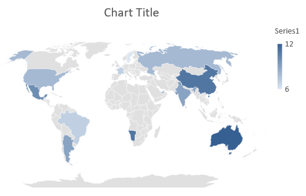

## **概觀**

本文提供了如何使用 Aspose.Slides for C++ 建立和自訂圖表的完整指南。您將學習如何以程式方式將圖表新增至投影片、填入資料，並套用各種格式化選項以符合特定設計需求。文章中包含詳細的程式碼範例，說明從初始化簡報與圖表物件到設定系列、座標軸與圖例的每一步。遵循本指南，可幫助您在 C++ 應用程式中整合動態圖表產生，簡化建立以資料驅動的簡報的流程。

## **建立圖表**

圖表可協助人們快速將資料視覺化，並洞悉表格或試算表中不易直接看出的資訊。

**為何要建立圖表？**

使用圖表，您可以：

* 在單一投影片上彙總、濃縮或摘要大量資料；
* 顯示資料中的模式與趨勢；
* 推斷資料隨時間或特定度量單位的變化方向與勢頭；
* 發現異常值、偏差、錯誤與不合理資料；
* 傳達或呈現複雜資料。

在 PowerPoint 中，您可以透過 *Insert* 功能建立圖表，該功能提供多種圖表範本以設計各類圖表。使用 Aspose.Slides，您可以建立一般圖表（基於常見圖表類型）以及自訂圖表。

{}

使用位於 [Aspose::Slides::Charts](https://reference.aspose.com/slides/cpp/aspose.slides.charts/) 命名空間下的 [ChartType](https://reference.aspose.com/slides/cpp/aspose.slides.charts/charttype/) 列舉。此列舉的值對應不同的圖表類型。

{}

### **建立叢集柱狀圖**

此範例使用 [AddChart](https://reference.aspose.com/slides/cpp/aspose.slides/ishapecollection/addchart/) 建立一個叢集柱狀圖，以比較兩個系列在三個類別上的數據。系列使用紅色與綠色填色，個別標籤顯示類別名稱、系列名稱與數值。工作表索引 0 代表嵌入式圖表活頁簿的第一張工作表。

```cpp
#include <system/shared_ptr.h>
#include <system/object_ext.h>
#include <system/string.h>
#include <drawing/color.h>
#include <DOM/Chart/ChartType.h>
#include <DOM/Chart/IChartCategoryCollection.h>
#include <DOM/Chart/IChartData.h>
#include <DOM/Chart/IChartDataCell.h>
#include <DOM/Chart/IChartDataPoint.h>
#include <DOM/Chart/IChartDataPointCollection.h>
#include <DOM/Chart/IChartDataWorkbook.h>
#include <DOM/Chart/IChartSeries.h>
#include <DOM/Chart/IChartSeriesCollection.h>
#include <DOM/Chart/IChartTitle.h>
#include <DOM/Chart/IDataLabel.h>
#include <DOM/Chart/IDataLabelCollection.h>
#include <DOM/Chart/IDataLabelFormat.h>
#include <DOM/Chart/IDoubleChartValue.h>
#include <DOM/Chart/IFormat.h>
#include <DOM/FillType.h>
#include <DOM/IChart.h>
#include <DOM/IColorFormat.h>
#include <DOM/IFillFormat.h>
#include <DOM/ILineFillFormat.h>
#include <DOM/ILineFormat.h>
#include <DOM/IShapeCollection.h>
#include <DOM/ISlide.h>
#include <DOM/ITextFrame.h>
#include <DOM/ITextFrameFormat.h>
#include <DOM/NullableBool.h>
#include <DOM/Presentation.h>
#include <Export/SaveFormat.h>

using namespace System;
using namespace System::Drawing;
using namespace Aspose::Slides;
using namespace Aspose::Slides::Charts;
using namespace Aspose::Slides::Export;

auto presentation = MakeObject<Presentation>();
auto slide = presentation->get_Slide(0);

auto chart = slide->get_Shapes()->AddChart(ChartType::ClusteredColumn, 20, 20, 500, 300);

chart->get_ChartTitle()->AddTextFrameForOverriding(u"Sample Title");
chart->get_ChartTitle()->get_TextFrameForOverriding()->get_TextFrameFormat()->set_CenterText(NullableBool::True);
chart->get_ChartTitle()->set_Height(20);
chart->set_HasTitle(true);

auto workbook = chart->get_ChartData()->get_ChartDataWorkbook();
auto worksheetIndex = 0;

chart->get_ChartData()->get_Series()->Clear();
chart->get_ChartData()->get_Categories()->Clear();

auto seriesNameCell = workbook->GetCell(worksheetIndex, 0, 1, ObjectExt::Box(String(u"Series 1")));
chart->get_ChartData()->get_Series()->Add(seriesNameCell, chart->get_Type());
seriesNameCell = workbook->GetCell(worksheetIndex, 0, 2, ObjectExt::Box(String(u"Series 2")));
chart->get_ChartData()->get_Series()->Add(seriesNameCell, chart->get_Type());

auto categoryCell = workbook->GetCell(worksheetIndex, 1, 0, ObjectExt::Box(String(u"Category 1")));
chart->get_ChartData()->get_Categories()->Add(categoryCell);
categoryCell = workbook->GetCell(worksheetIndex, 2, 0, ObjectExt::Box(String(u"Category 2")));
chart->get_ChartData()->get_Categories()->Add(categoryCell);
categoryCell = workbook->GetCell(worksheetIndex, 3, 0, ObjectExt::Box(String(u"Category 3")));
chart->get_ChartData()->get_Categories()->Add(categoryCell);

auto series = chart->get_ChartData()->get_Series()->idx_get(0);

auto valueCell = workbook->GetCell(worksheetIndex, 1, 1, ObjectExt::Box(20));
series->get_DataPoints()->AddDataPointForBarSeries(valueCell);
valueCell = workbook->GetCell(worksheetIndex, 2, 1, ObjectExt::Box(50));
series->get_DataPoints()->AddDataPointForBarSeries(valueCell);
valueCell = workbook->GetCell(worksheetIndex, 3, 1, ObjectExt::Box(30));
series->get_DataPoints()->AddDataPointForBarSeries(valueCell);

series->get_Format()->get_Fill()->set_FillType(FillType::Solid);
series->get_Format()->get_Fill()->get_SolidFillColor()->set_Color(Color::get_Red());

series = chart->get_ChartData()->get_Series()->idx_get(1);

valueCell = workbook->GetCell(worksheetIndex, 1, 2, ObjectExt::Box(30));
series->get_DataPoints()->AddDataPointForBarSeries(valueCell);
valueCell = workbook->GetCell(worksheetIndex, 2, 2, ObjectExt::Box(10));
series->get_DataPoints()->AddDataPointForBarSeries(valueCell);
valueCell = workbook->GetCell(worksheetIndex, 3, 2, ObjectExt::Box(60));
series->get_DataPoints()->AddDataPointForBarSeries(valueCell);

series->get_Format()->get_Fill()->set_FillType(FillType::Solid);
series->get_Format()->get_Fill()->get_SolidFillColor()->set_Color(Color::get_Green());

auto label = series->get_DataPoints()->idx_get(0)->get_Label();
label->get_DataLabelFormat()->set_ShowCategoryName(true);

label = series->get_DataPoints()->idx_get(1)->get_Label();
label->get_DataLabelFormat()->set_ShowSeriesName(true);

label = series->get_DataPoints()->idx_get(2)->get_Label();
label->get_DataLabelFormat()->set_ShowValue(true);
label->get_DataLabelFormat()->set_ShowSeriesName(true);
label->get_DataLabelFormat()->set_Separator(u"/");

presentation->Save(u"AsposeChart.pptx", SaveFormat::Pptx);
```

結果：


### **建立散佈圖**

散佈圖（亦稱散點圖或 x‑y 圖）常用於檢查模式或展示兩變數之間的相關性。

在以下情況使用散佈圖：

* 您有成對的數值資料。
* 您有兩個彼此關聯的變數。
* 您想判斷兩個變數是否相關。
* 您有一個獨立變數，其對應的因變數有多個值。

此範例繪製兩組 x‑y 值。第一系列使用直線加星形標記，第二系列使用平滑線加圓形標記；兩者的標記大小皆設定為 10，使用 [set_Size](https://reference.aspose.com/slides/cpp/aspose.slides.charts/imarker/set_size/)。[set_Symbol](https://reference.aspose.com/slides/cpp/aspose.slides.charts/imarker/set_symbol/) 方法控制標記形狀。

```cpp
#include <system/shared_ptr.h>
#include <system/object_ext.h>
#include <system/string.h>
#include <DOM/Chart/ChartType.h>
#include <DOM/Chart/IChartCategoryCollection.h>
#include <DOM/Chart/IChartData.h>
#include <DOM/Chart/IChartDataCell.h>
#include <DOM/Chart/IChartDataPoint.h>
#include <DOM/Chart/IChartDataPointCollection.h>
#include <DOM/Chart/IChartDataWorkbook.h>
#include <DOM/Chart/IChartSeries.h>
#include <DOM/Chart/IChartSeriesCollection.h>
#include <DOM/Chart/IDoubleChartValue.h>
#include <DOM/Chart/IFormat.h>
#include <DOM/Chart/IMarker.h>
#include <DOM/Chart/MarkerStyleType.h>
#include <DOM/IChart.h>
#include <DOM/IColorFormat.h>
#include <DOM/IFillFormat.h>
#include <DOM/ILineFillFormat.h>
#include <DOM/ILineFormat.h>
#include <DOM/IShapeCollection.h>
#include <DOM/ISlide.h>
#include <DOM/Presentation.h>
#include <Export/SaveFormat.h>

using namespace System;
using namespace Aspose::Slides;
using namespace Aspose::Slides::Charts;
using namespace Aspose::Slides::Export;

auto presentation = MakeObject<Presentation>();
auto slide = presentation->get_Slide(0);

auto chart = slide->get_Shapes()->AddChart(ChartType::ScatterWithSmoothLines, 20, 20, 500, 300);

auto workbook = chart->get_ChartData()->get_ChartDataWorkbook();
auto worksheetIndex = 0;

chart->get_ChartData()->get_Series()->Clear();

auto seriesNameCell = workbook->GetCell(worksheetIndex, 1, 1, ObjectExt::Box(String(u"Series 1")));
chart->get_ChartData()->get_Series()->Add(seriesNameCell, chart->get_Type());
seriesNameCell = workbook->GetCell(worksheetIndex, 1, 3, ObjectExt::Box(String(u"Series 2")));
chart->get_ChartData()->get_Series()->Add(seriesNameCell, chart->get_Type());

auto series = chart->get_ChartData()->get_Series()->idx_get(0);

auto xValueCell = workbook->GetCell(worksheetIndex, 2, 1, ObjectExt::Box(1));
auto yValueCell = workbook->GetCell(worksheetIndex, 2, 2, ObjectExt::Box(3));
series->get_DataPoints()->AddDataPointForScatterSeries(xValueCell, yValueCell);

xValueCell = workbook->GetCell(worksheetIndex, 3, 1, ObjectExt::Box(2));
yValueCell = workbook->GetCell(worksheetIndex, 3, 2, ObjectExt::Box(10));
series->get_DataPoints()->AddDataPointForScatterSeries(xValueCell, yValueCell);

series->set_Type(ChartType::ScatterWithStraightLinesAndMarkers);

series->get_Marker()->set_Size(10);
series->get_Marker()->set_Symbol(MarkerStyleType::Star);

series = chart->get_ChartData()->get_Series()->idx_get(1);

xValueCell = workbook->GetCell(worksheetIndex, 2, 3, ObjectExt::Box(5));
yValueCell = workbook->GetCell(worksheetIndex, 2, 4, ObjectExt::Box(2));
series->get_DataPoints()->AddDataPointForScatterSeries(xValueCell, yValueCell);

xValueCell = workbook->GetCell(worksheetIndex, 3, 3, ObjectExt::Box(3));
yValueCell = workbook->GetCell(worksheetIndex, 3, 4, ObjectExt::Box(1));
series->get_DataPoints()->AddDataPointForScatterSeries(xValueCell, yValueCell);

xValueCell = workbook->GetCell(worksheetIndex, 4, 3, ObjectExt::Box(2));
yValueCell = workbook->GetCell(worksheetIndex, 4, 4, ObjectExt::Box(2));
series->get_DataPoints()->AddDataPointForScatterSeries(xValueCell, yValueCell);

xValueCell = workbook->GetCell(worksheetIndex, 5, 3, ObjectExt::Box(5));
yValueCell = workbook->GetCell(worksheetIndex, 5, 4, ObjectExt::Box(1));
series->get_DataPoints()->AddDataPointForScatterSeries(xValueCell, yValueCell);

series->get_Marker()->set_Size(10);
series->get_Marker()->set_Symbol(MarkerStyleType::Circle);

presentation->Save(u"AsposeChart.pptx", SaveFormat::Pptx);
```

結果：


### **建立圓餅圖**

圓餅圖最適合用來顯示資料的部分與整體關係，特別是當資料包含具有數值的類別標籤時。然而，若資料包含大量部份或標籤，建議改用長條圖。

此範例建立一個包含三個季度值的圓餅圖。每個切片皆有自訂的填色與邊框，標籤顯示不同組合的數值、百分比與系列資訊。[set_FirstSliceAngle](https://reference.aspose.com/slides/cpp/aspose.slides.charts/ichartseriesgroup/set_firstsliceangle/) 方法將第一切片的起始角度設為 180 度。

```cpp
#include <system/shared_ptr.h>
#include <system/object_ext.h>
#include <system/string.h>
#include <drawing/color.h>
#include <DOM/Chart/ChartType.h>
#include <DOM/Chart/IChartCategoryCollection.h>
#include <DOM/Chart/IChartData.h>
#include <DOM/Chart/IChartDataCell.h>
#include <DOM/Chart/IChartDataPoint.h>
#include <DOM/Chart/IChartDataPointCollection.h>
#include <DOM/Chart/IChartDataWorkbook.h>
#include <DOM/Chart/IChartSeries.h>
#include <DOM/Chart/IChartSeriesCollection.h>
#include <DOM/Chart/IChartSeriesGroup.h>
#include <DOM/Chart/IChartSeriesGroupCollection.h>
#include <DOM/Chart/IChartTextFormat.h>
#include <DOM/Chart/IChartTitle.h>
#include <DOM/Chart/IDataLabel.h>
#include <DOM/Chart/IDataLabelCollection.h>
#include <DOM/Chart/IDataLabelFormat.h>
#include <DOM/Chart/IDoubleChartValue.h>
#include <DOM/Chart/IFormat.h>
#include <DOM/Chart/ILegend.h>
#include <DOM/FillType.h>
#include <DOM/IChart.h>
#include <DOM/IColorFormat.h>
#include <DOM/IFillFormat.h>
#include <DOM/ILineFillFormat.h>
#include <DOM/ILineFormat.h>
#include <DOM/IPortionFormat.h>
#include <DOM/IShapeCollection.h>
#include <DOM/ISlide.h>
#include <DOM/ITextFrame.h>
#include <DOM/ITextFrameFormat.h>
#include <DOM/LineDashStyle.h>
#include <DOM/LineStyle.h>
#include <DOM/NullableBool.h>
#include <DOM/Presentation.h>
#include <Export/SaveFormat.h>

using namespace System;
using namespace System::Drawing;
using namespace Aspose::Slides;
using namespace Aspose::Slides::Charts;
using namespace Aspose::Slides::Export;

auto presentation = MakeObject<Presentation>();
auto slide = presentation->get_Slide(0);

auto chart = slide->get_Shapes()->AddChart(ChartType::Pie, 20, 20, 500, 300);

chart->get_ChartTitle()->AddTextFrameForOverriding(u"Sample Title");
chart->get_ChartTitle()->get_TextFrameForOverriding()->get_TextFrameFormat()->set_CenterText(NullableBool::True);
chart->get_ChartTitle()->set_Height(20);
chart->set_HasTitle(true);

chart->get_ChartData()->get_Series()->idx_get(0)->get_Labels()->get_DefaultDataLabelFormat()->set_ShowValue(true);

auto workbook = chart->get_ChartData()->get_ChartDataWorkbook();
auto worksheetIndex = 0;

chart->get_ChartData()->get_Series()->Clear();
chart->get_ChartData()->get_Categories()->Clear();

auto categoryCell = workbook->GetCell(0, 1, 0, ObjectExt::Box(String(u"1st Qtr")));
chart->get_ChartData()->get_Categories()->Add(categoryCell);
categoryCell = workbook->GetCell(0, 2, 0, ObjectExt::Box(String(u"2nd Qtr")));
chart->get_ChartData()->get_Categories()->Add(categoryCell);
categoryCell = workbook->GetCell(0, 3, 0, ObjectExt::Box(String(u"3rd Qtr")));
chart->get_ChartData()->get_Categories()->Add(categoryCell);

auto seriesNameCell = workbook->GetCell(0, 0, 1, ObjectExt::Box(String(u"Series 1")));
auto series = chart->get_ChartData()->get_Series()->Add(seriesNameCell, chart->get_Type());

auto valueCell = workbook->GetCell(worksheetIndex, 1, 1, ObjectExt::Box(20));
series->get_DataPoints()->AddDataPointForPieSeries(valueCell);
valueCell = workbook->GetCell(worksheetIndex, 2, 1, ObjectExt::Box(50));
series->get_DataPoints()->AddDataPointForPieSeries(valueCell);
valueCell = workbook->GetCell(worksheetIndex, 3, 1, ObjectExt::Box(30));
series->get_DataPoints()->AddDataPointForPieSeries(valueCell);

chart->get_ChartData()->get_SeriesGroups()->idx_get(0)->set_IsColorVaried(true);

auto firstSlice = series->get_DataPoints()->idx_get(0);
firstSlice->get_Format()->get_Fill()->set_FillType(FillType::Solid);
firstSlice->get_Format()->get_Fill()->get_SolidFillColor()->set_Color(Color::get_Cyan());

firstSlice->get_Format()->get_Line()->get_FillFormat()->set_FillType(FillType::Solid);
firstSlice->get_Format()->get_Line()->get_FillFormat()->get_SolidFillColor()->set_Color(Color::get_Gray());
firstSlice->get_Format()->get_Line()->set_Width(3.0);
firstSlice->get_Format()->get_Line()->set_Style(LineStyle::ThinThick);
firstSlice->get_Format()->get_Line()->set_DashStyle(LineDashStyle::LargeDash);

auto secondSlice = series->get_DataPoints()->idx_get(1);
secondSlice->get_Format()->get_Fill()->set_FillType(FillType::Solid);
secondSlice->get_Format()->get_Fill()->get_SolidFillColor()->set_Color(Color::get_Brown());

secondSlice->get_Format()->get_Line()->get_FillFormat()->set_FillType(FillType::Solid);
secondSlice->get_Format()->get_Line()->get_FillFormat()->get_SolidFillColor()->set_Color(Color::get_Blue());
secondSlice->get_Format()->get_Line()->set_Width(3.0);
secondSlice->get_Format()->get_Line()->set_Style(LineStyle::Single);
secondSlice->get_Format()->get_Line()->set_DashStyle(LineDashStyle::LargeDashDot);

auto thirdSlice = series->get_DataPoints()->idx_get(2);
thirdSlice->get_Format()->get_Fill()->set_FillType(FillType::Solid);
thirdSlice->get_Format()->get_Fill()->get_SolidFillColor()->set_Color(Color::get_Coral());

thirdSlice->get_Format()->get_Line()->get_FillFormat()->set_FillType(FillType::Solid);
thirdSlice->get_Format()->get_Line()->get_FillFormat()->get_SolidFillColor()->set_Color(Color::get_Red());
thirdSlice->get_Format()->get_Line()->set_Width(2.0);
thirdSlice->get_Format()->get_Line()->set_Style(LineStyle::ThinThin);
thirdSlice->get_Format()->get_Line()->set_DashStyle(LineDashStyle::LargeDashDotDot);

auto firstLabel = series->get_DataPoints()->idx_get(0)->get_Label();
firstLabel->get_DataLabelFormat()->set_ShowValue(true);

auto secondLabel = series->get_DataPoints()->idx_get(1)->get_Label();
secondLabel->get_DataLabelFormat()->set_ShowValue(true);
secondLabel->get_DataLabelFormat()->set_ShowLegendKey(true);
secondLabel->get_DataLabelFormat()->set_ShowPercentage(true);

auto thirdLabel = series->get_DataPoints()->idx_get(2)->get_Label();
thirdLabel->get_DataLabelFormat()->set_ShowSeriesName(true);
thirdLabel->get_DataLabelFormat()->set_ShowPercentage(true);

series->get_Labels()->get_DefaultDataLabelFormat()->set_ShowLeaderLines(true);

chart->get_ChartData()->get_SeriesGroups()->idx_get(0)->set_FirstSliceAngle(180);

presentation->Save(u"PieChart.pptx", SaveFormat::Pptx);
```

結果：


### **建立折線圖**

折線圖（亦稱折線圖）最適合用於展示隨時間變化的數值。使用折線圖，您可以一次比較大量資料、追蹤時間趨勢、突顯資料系列中的異常等。

此範例使用 [AddChart](https://reference.aspose.com/slides/cpp/aspose.slides/ishapecollection/addchart/) 建立一個使用預設系列與類別的折線圖，然後將簡報儲存為 PPTX。

```cpp
#include <system/shared_ptr.h>
#include <DOM/Chart/ChartType.h>
#include <DOM/Chart/IChartCategoryCollection.h>
#include <DOM/Chart/IChartData.h>
#include <DOM/Chart/IChartSeriesCollection.h>
#include <DOM/Chart/IFormat.h>
#include <DOM/IChart.h>
#include <DOM/IColorFormat.h>
#include <DOM/IFillFormat.h>
#include <DOM/ILineFillFormat.h>
#include <DOM/ILineFormat.h>
#include <DOM/IShapeCollection.h>
#include <DOM/ISlide.h>
#include <DOM/Presentation.h>
#include <Export/SaveFormat.h>

using namespace System;
using namespace Aspose::Slides;
using namespace Aspose::Slides::Charts;
using namespace Aspose::Slides::Export;

auto presentation = MakeObject<Presentation>();
auto slide = presentation->get_Slide(0);

auto lineChart = slide->get_Shapes()->AddChart(ChartType::Line, 20, 20, 500, 300);

presentation->Save(u"lineChart.pptx", SaveFormat::Pptx);
```

預設情況下，折線圖的資料點以直線相連。如果希望以虛線相連，請呼叫 [set_DashStyle](https://reference.aspose.com/slides/cpp/aspose.slides/ilineformat/set_dashstyle/) 並傳入 [LineDashStyle](https://reference.aspose.com/slides/cpp/aspose.slides/linedashstyle/) 的值：

```cpp
#include <system/shared_ptr.h>
#include <DOM/Chart/ChartType.h>
#include <DOM/Chart/IChartCategoryCollection.h>
#include <DOM/Chart/IChartData.h>
#include <DOM/Chart/IChartSeries.h>
#include <DOM/Chart/IChartSeriesCollection.h>
#include <DOM/Chart/IFormat.h>
#include <DOM/IChart.h>
#include <DOM/IColorFormat.h>
#include <DOM/IFillFormat.h>
#include <DOM/ILineFillFormat.h>
#include <DOM/ILineFormat.h>
#include <DOM/IShapeCollection.h>
#include <DOM/ISlide.h>
#include <DOM/LineDashStyle.h>
#include <DOM/Presentation.h>

using namespace System;
using namespace Aspose::Slides;
using namespace Aspose::Slides::Charts;

auto presentation = MakeObject<Presentation>();
auto slide = presentation->get_Slide(0);

auto lineChart = slide->get_Shapes()->AddChart(ChartType::Line, 20, 20, 500, 300);

for (auto series : lineChart->get_ChartData()->get_Series())
{
    series->get_Format()->get_Line()->set_DashStyle(LineDashStyle::Dash);
}
```

結果：


### **建立樹狀圖**

樹狀圖最適合用於銷售資料，能顯示資料類別的相對大小，並快速突顯每個類別中貢獻較大的項目。

此範例建立一個包含八個葉節點、分為四個樹幹與兩個分支的樹狀圖。[SetGroupingItem](https://reference.aspose.com/slides/cpp/aspose.slides.charts/ichartcategorylevelsmanager/setgroupingitem/) 方法於分組層級 1 指定樹幹，於層級 2 指定分支。值決定矩形的相對大小，類別標籤與重疊的父標籤說明層級結構。

```cpp
#include <system/shared_ptr.h>
#include <system/object_ext.h>
#include <system/string.h>
#include <DOM/Chart/ChartType.h>
#include <DOM/Chart/IChartCategory.h>
#include <DOM/Chart/IChartCategoryCollection.h>
#include <DOM/Chart/IChartCategoryLevelsManager.h>
#include <DOM/Chart/IChartData.h>
#include <DOM/Chart/IChartDataCell.h>
#include <DOM/Chart/IChartDataPoint.h>
#include <DOM/Chart/IChartDataPointCollection.h>
#include <DOM/Chart/IChartDataWorkbook.h>
#include <DOM/Chart/IChartSeries.h>
#include <DOM/Chart/IChartSeriesCollection.h>
#include <DOM/Chart/IDataLabel.h>
#include <DOM/Chart/IDataLabelCollection.h>
#include <DOM/Chart/IDataLabelFormat.h>
#include <DOM/Chart/IFormat.h>
#include <DOM/Chart/ParentLabelLayoutType.h>
#include <DOM/IChart.h>
#include <DOM/IColorFormat.h>
#include <DOM/IFillFormat.h>
#include <DOM/ILineFillFormat.h>
#include <DOM/ILineFormat.h>
#include <DOM/IShapeCollection.h>
#include <DOM/ISlide.h>
#include <DOM/Presentation.h>
#include <Export/SaveFormat.h>

using namespace System;
using namespace Aspose::Slides;
using namespace Aspose::Slides::Charts;
using namespace Aspose::Slides::Export;

auto presentation = MakeObject<Presentation>();
auto slide = presentation->get_Slide(0);

auto chart = slide->get_Shapes()->AddChart(ChartType::Treemap, 20, 20, 500, 300);

chart->get_ChartData()->get_Categories()->Clear();
chart->get_ChartData()->get_Series()->Clear();

auto workbook = chart->get_ChartData()->get_ChartDataWorkbook();
workbook->Clear(0);

// 分支 1
auto categoryCell = workbook->GetCell(0, u"C1", ObjectExt::Box(String(u"Leaf1")));
auto leaf = chart->get_ChartData()->get_Categories()->Add(categoryCell);
leaf->get_GroupingLevels()->SetGroupingItem(1, ObjectExt::Box(String(u"Stem1")));
leaf->get_GroupingLevels()->SetGroupingItem(2, ObjectExt::Box(String(u"Branch1")));

categoryCell = workbook->GetCell(0, u"C2", ObjectExt::Box(String(u"Leaf2")));
chart->get_ChartData()->get_Categories()->Add(categoryCell);

categoryCell = workbook->GetCell(0, u"C3", ObjectExt::Box(String(u"Leaf3")));
leaf = chart->get_ChartData()->get_Categories()->Add(categoryCell);
leaf->get_GroupingLevels()->SetGroupingItem(1, ObjectExt::Box(String(u"Stem2")));

categoryCell = workbook->GetCell(0, u"C4", ObjectExt::Box(String(u"Leaf4")));
chart->get_ChartData()->get_Categories()->Add(categoryCell);

// 分支 2
categoryCell = workbook->GetCell(0, u"C5", ObjectExt::Box(String(u"Leaf5")));
leaf = chart->get_ChartData()->get_Categories()->Add(categoryCell);
leaf->get_GroupingLevels()->SetGroupingItem(1, ObjectExt::Box(String(u"Stem3")));
leaf->get_GroupingLevels()->SetGroupingItem(2, ObjectExt::Box(String(u"Branch2")));

categoryCell = workbook->GetCell(0, u"C6", ObjectExt::Box(String(u"Leaf6")));
chart->get_ChartData()->get_Categories()->Add(categoryCell);

categoryCell = workbook->GetCell(0, u"C7", ObjectExt::Box(String(u"Leaf7")));
leaf = chart->get_ChartData()->get_Categories()->Add(categoryCell);
leaf->get_GroupingLevels()->SetGroupingItem(1, ObjectExt::Box(String(u"Stem4")));

categoryCell = workbook->GetCell(0, u"C8", ObjectExt::Box(String(u"Leaf8")));
chart->get_ChartData()->get_Categories()->Add(categoryCell);

auto series = chart->get_ChartData()->get_Series()->Add(ChartType::Treemap);
series->get_Labels()->get_DefaultDataLabelFormat()->set_ShowCategoryName(true);
auto valueCell = workbook->GetCell(0, u"D1", ObjectExt::Box(4));
series->get_DataPoints()->AddDataPointForTreemapSeries(valueCell);
valueCell = workbook->GetCell(0, u"D2", ObjectExt::Box(5));
series->get_DataPoints()->AddDataPointForTreemapSeries(valueCell);
valueCell = workbook->GetCell(0, u"D3", ObjectExt::Box(3));
series->get_DataPoints()->AddDataPointForTreemapSeries(valueCell);
valueCell = workbook->GetCell(0, u"D4", ObjectExt::Box(6));
series->get_DataPoints()->AddDataPointForTreemapSeries(valueCell);
valueCell = workbook->GetCell(0, u"D5", ObjectExt::Box(9));
series->get_DataPoints()->AddDataPointForTreemapSeries(valueCell);
valueCell = workbook->GetCell(0, u"D6", ObjectExt::Box(9));
series->get_DataPoints()->AddDataPointForTreemapSeries(valueCell);
valueCell = workbook->GetCell(0, u"D7", ObjectExt::Box(4));
series->get_DataPoints()->AddDataPointForTreemapSeries(valueCell);
valueCell = workbook->GetCell(0, u"D8", ObjectExt::Box(3));
series->get_DataPoints()->AddDataPointForTreemapSeries(valueCell);

series->set_ParentLabelLayout(ParentLabelLayoutType::Overlapping);

presentation->Save(u"Treemap.pptx", SaveFormat::Pptx);
```

結果：


### **建立瀑布圖**

瀑布圖顯示正向與負向變化如何累積成最終值。例如，利潤分析可從營收開始，減去成本，再加上其他收入。變化欄位在前後累計值之間浮動，而總計欄位則從零延伸至累積值。

以下範例使用千美元為單位：

| Category | Workbook value | Column type |
| --- | ---: | --- |
| Revenue | 1000 | Increase |
| Cost of sales | -400 | Decrease |
| Gross profit | 600 | Intermediate total |
| Operating expenses | -200 | Decrease |
| Other income | 50 | Increase |
| Net profit | 450 | Final total |

若要將資料點標記為中間或最終總計，請對其呼叫 [set_SetAsTotal](https://reference.aspose.com/slides/cpp/aspose.slides.charts/chartdatapoint/set_setastotal/) 方法並傳入 `true`。同時在該資料點的活頁簿儲存格中提供實際累計金額：毛利為 `600`（`1000 - 400`），淨利為 `450`（`600 - 200 + 50`）。此方法僅將欄位標記為總計，**不會**自行計算或填入儲存格值。請勿使用零作為佔位符，亦不要為總計點提供其他變化值。總計欄位會顯示累積值，但不會再次將其加回累計值。

此完整 C++ 範例使用 [ChartType](https://reference.aspose.com/slides/cpp/aspose.slides.charts/charttype/) 的 `Waterfall` 成員建立圖表，清除預設資料，並填入嵌入式活頁簿。工作表索引 `0` 表示第一張工作表；A 欄放置類別名稱，B 欄放置數值。每個數值儲存格皆透過 [AddDataPointForWaterfallSeries](https://reference.aspose.com/slides/cpp/aspose.slides.charts/ichartdatapointcollection/adddatapointforwaterfallseries/) 新增。零基點索引 `2` 與 `5` 分別標示中間與最終總計。將 [set_ShowValue](https://reference.aspose.com/slides/cpp/aspose.slides.charts/idatalabelformat/set_showvalue/) 設為 `true` 後，金額會顯示在欄位上。此範例不需要輸入簡報或活頁簿。

```cpp
#include <system/shared_ptr.h>
#include <system/object_ext.h>
#include <system/string.h>
#include <system/array.h>
#include <DOM/Chart/ChartType.h>
#include <DOM/Chart/IChartCategoryCollection.h>
#include <DOM/Chart/IChartData.h>
#include <DOM/Chart/IChartDataCell.h>
#include <DOM/Chart/IChartDataPoint.h>
#include <DOM/Chart/IChartDataPointCollection.h>
#include <DOM/Chart/IChartDataWorkbook.h>
#include <DOM/Chart/IChartSeries.h>
#include <DOM/Chart/IChartSeriesCollection.h>
#include <DOM/Chart/IChartTextFormat.h>
#include <DOM/Chart/IChartTitle.h>
#include <DOM/Chart/IDataLabel.h>
#include <DOM/Chart/IDataLabelCollection.h>
#include <DOM/Chart/IDataLabelFormat.h>
#include <DOM/Chart/IDoubleChartValue.h>
#include <DOM/Chart/IFormat.h>
#include <DOM/Chart/ILegend.h>
#include <DOM/IChart.h>
#include <DOM/IColorFormat.h>
#include <DOM/IFillFormat.h>
#include <DOM/ILineFillFormat.h>
#include <DOM/ILineFormat.h>
#include <DOM/IPortionFormat.h>
#include <DOM/IShapeCollection.h>
#include <DOM/ISlide.h>
#include <DOM/ITextFrame.h>
#include <DOM/ITextFrameFormat.h>
#include <DOM/NullableBool.h>
#include <DOM/Presentation.h>
#include <Export/SaveFormat.h>

using namespace System;
using namespace Aspose::Slides;
using namespace Aspose::Slides::Charts;
using namespace Aspose::Slides::Export;

auto presentation = MakeObject<Presentation>();
auto slide = presentation->get_Slide(0);

auto chart = slide->get_Shapes()->AddChart(ChartType::Waterfall, 20, 20, 680, 200);

chart->set_HasTitle(true);
chart->get_ChartTitle()->AddTextFrameForOverriding(u"Profit breakdown (USD thousands)");
chart->get_ChartTitle()->set_Overlay(false);
chart->set_HasLegend(false);

chart->get_ChartData()->get_Series()->Clear();
chart->get_ChartData()->get_Categories()->Clear();

auto workbook = chart->get_ChartData()->get_ChartDataWorkbook();
auto worksheetIndex = 0;

workbook->Clear(worksheetIndex);

auto seriesNameCell = workbook->GetCell(worksheetIndex, 0, 1, ObjectExt::Box(String(u"Profit")));
auto series = chart->get_ChartData()->get_Series()->Add(seriesNameCell, ChartType::Waterfall);
auto categories = MakeArray<String>({ u"Revenue", u"Cost of sales", u"Gross profit", u"Operating expenses", u"Other income", u"Net profit" });
auto values = MakeArray<double>({ 1000, -400, 600, -200, 50, 450 });

for (auto i = 0; i < categories->get_Length(); i++)
{
    auto categoryCell = workbook->GetCell(worksheetIndex, i + 1, 0, ObjectExt::Box(categories->idx_get(i)));
    chart->get_ChartData()->get_Categories()->Add(categoryCell);
    auto valueCell = workbook->GetCell(worksheetIndex, i + 1, 1, ObjectExt::Box(values->idx_get(i)));
    series->get_DataPoints()->AddDataPointForWaterfallSeries(valueCell);
}

// 第三與第六個點表示總計，而非額外變化。
series->get_DataPoints()->idx_get(2)->set_SetAsTotal(true);
series->get_DataPoints()->idx_get(5)->set_SetAsTotal(true);
series->set_ShowConnectorLines(true);
series->get_Labels()->get_DefaultDataLabelFormat()->set_ShowValue(true);

presentation->Save(u"WaterfallChart.pptx", SaveFormat::Pptx);
```

在系列層級呼叫 [set_ShowConnectorLines](https://reference.aspose.com/slides/cpp/aspose.slides.charts/chartseries/set_showconnectorlines/) 並傳入 `true`，即可顯示連接相連欄位的線條，使累計值更易追蹤。若要隱藏這些線條，請在儲存前將範例中的指派改為 `series->set_ShowConnectorLines(false);`。此變更僅影響線條可見性，不會改變資料或總計。

儲存後的簡報顯示毛利 600、淨利 450，兩個總計皆由零開始：


### **建立股票圖表**

股票圖表用於顯示開盤價、最高價、最低價與收盤價等金融資料，協助分析市場走勢與波動性。它提供對股票表現的關鍵洞見，幫助投資人與分析師做出明智的決策。

此範例建立一個依序包含四個系列（開盤、最高、最低、收盤）的 OHLC 圖表，並設定三個類別。[set_HasUpDownBars](https://reference.aspose.com/slides/cpp/aspose.slides.charts/iupdownbarsmanager/set_hasupdownbars/) 方法啟用上/下棒；[get_HiLowLinesFormat](https://reference.aspose.com/slides/cpp/aspose.slides.charts/ichartseriesgroup/get_hilowlinesformat/) 控制顯示價格區間的高低線，個別系列線條與次要水平格線則隱藏。

```cpp
#include <DOM/Chart/IChartLinesFormat.h>
#include <system/shared_ptr.h>
#include <system/object_ext.h>
#include <system/string.h>
#include <DOM/Chart/ChartType.h>
#include <DOM/Chart/IAxesManager.h>
#include <DOM/Chart/IAxis.h>
#include <DOM/Chart/IChartCategoryCollection.h>
#include <DOM/Chart/IChartData.h>
#include <DOM/Chart/IChartDataCell.h>
#include <DOM/Chart/IChartDataPoint.h>
#include <DOM/Chart/IChartDataPointCollection.h>
#include <DOM/Chart/IChartDataWorkbook.h>
#include <DOM/Chart/IChartSeries.h>
#include <DOM/Chart/IChartSeriesCollection.h>
#include <DOM/Chart/IChartSeriesGroup.h>
#include <DOM/Chart/IChartSeriesGroupCollection.h>
#include <DOM/Chart/IFormat.h>
#include <DOM/Chart/IUpDownBarsManager.h>
#include <DOM/FillType.h>
#include <DOM/IChart.h>
#include <DOM/IColorFormat.h>
#include <DOM/IFillFormat.h>
#include <DOM/ILineFillFormat.h>
#include <DOM/ILineFormat.h>
#include <DOM/IShapeCollection.h>
#include <DOM/ISlide.h>
#include <DOM/Presentation.h>
#include <Export/SaveFormat.h>

using namespace System;
using namespace Aspose::Slides;
using namespace Aspose::Slides::Charts;
using namespace Aspose::Slides::Export;

auto presentation = MakeObject<Presentation>();
auto slide = presentation->get_Slide(0);

auto chart = slide->get_Shapes()->AddChart(ChartType::OpenHighLowClose, 20, 20, 500, 300, false);

auto workbook = chart->get_ChartData()->get_ChartDataWorkbook();

auto categoryCell = workbook->GetCell(0, 1, 0, ObjectExt::Box(String(u"A")));
chart->get_ChartData()->get_Categories()->Add(categoryCell);
categoryCell = workbook->GetCell(0, 2, 0, ObjectExt::Box(String(u"B")));
chart->get_ChartData()->get_Categories()->Add(categoryCell);
categoryCell = workbook->GetCell(0, 3, 0, ObjectExt::Box(String(u"C")));
chart->get_ChartData()->get_Categories()->Add(categoryCell);

auto seriesNameCell = workbook->GetCell(0, 0, 1, ObjectExt::Box(String(u"Open")));
chart->get_ChartData()->get_Series()->Add(seriesNameCell, ChartType::OpenHighLowClose);
seriesNameCell = workbook->GetCell(0, 0, 2, ObjectExt::Box(String(u"High")));
chart->get_ChartData()->get_Series()->Add(seriesNameCell, ChartType::OpenHighLowClose);
seriesNameCell = workbook->GetCell(0, 0, 3, ObjectExt::Box(String(u"Low")));
chart->get_ChartData()->get_Series()->Add(seriesNameCell, ChartType::OpenHighLowClose);
seriesNameCell = workbook->GetCell(0, 0, 4, ObjectExt::Box(String(u"Close")));
chart->get_ChartData()->get_Series()->Add(seriesNameCell, ChartType::OpenHighLowClose);

auto series = chart->get_ChartData()->get_Series()->idx_get(0);
auto valueCell = workbook->GetCell(0, 1, 1, ObjectExt::Box(72));
series->get_DataPoints()->AddDataPointForStockSeries(valueCell);
valueCell = workbook->GetCell(0, 2, 1, ObjectExt::Box(25));
series->get_DataPoints()->AddDataPointForStockSeries(valueCell);
valueCell = workbook->GetCell(0, 3, 1, ObjectExt::Box(38));
series->get_DataPoints()->AddDataPointForStockSeries(valueCell);

series = chart->get_ChartData()->get_Series()->idx_get(1);
valueCell = workbook->GetCell(0, 1, 2, ObjectExt::Box(172));
series->get_DataPoints()->AddDataPointForStockSeries(valueCell);
valueCell = workbook->GetCell(0, 2, 2, ObjectExt::Box(57));
series->get_DataPoints()->AddDataPointForStockSeries(valueCell);
valueCell = workbook->GetCell(0, 3, 2, ObjectExt::Box(57));
series->get_DataPoints()->AddDataPointForStockSeries(valueCell);

series = chart->get_ChartData()->get_Series()->idx_get(2);
valueCell = workbook->GetCell(0, 1, 3, ObjectExt::Box(12));
series->get_DataPoints()->AddDataPointForStockSeries(valueCell);
valueCell = workbook->GetCell(0, 2, 3, ObjectExt::Box(12));
series->get_DataPoints()->AddDataPointForStockSeries(valueCell);
valueCell = workbook->GetCell(0, 3, 3, ObjectExt::Box(13));
series->get_DataPoints()->AddDataPointForStockSeries(valueCell);

series = chart->get_ChartData()->get_Series()->idx_get(3);
valueCell = workbook->GetCell(0, 1, 4, ObjectExt::Box(25));
series->get_DataPoints()->AddDataPointForStockSeries(valueCell);
valueCell = workbook->GetCell(0, 2, 4, ObjectExt::Box(38));
series->get_DataPoints()->AddDataPointForStockSeries(valueCell);
valueCell = workbook->GetCell(0, 3, 4, ObjectExt::Box(50));
series->get_DataPoints()->AddDataPointForStockSeries(valueCell);

chart->get_ChartData()->get_SeriesGroups()->idx_get(0)->get_UpDownBars()->set_HasUpDownBars(true);
chart->get_ChartData()->get_SeriesGroups()->idx_get(0)->get_HiLowLinesFormat()->get_Line()->get_FillFormat()->set_FillType(FillType::Solid);

for (auto stockSeries : chart->get_ChartData()->get_Series())
{
    stockSeries->get_Format()->get_Line()->get_FillFormat()->set_FillType(FillType::NoFill);
}

chart->get_Axes()->get_VerticalAxis()->get_MinorGridLinesFormat()->get_Line()->get_FillFormat()->set_FillType(FillType::NoFill);

presentation->Save(u"Stock-chart.pptx", SaveFormat::Pptx);
```

結果：


### **建立箱形圖與鬍鬚圖**

箱形圖與鬍鬚圖用於透過統計摘要（如中位數、四分位數、離群值）顯示資料分布。它們在探索性資料分析與統計研究中相當實用，能快速了解資料變異性並辨識異常。

此範例以六個數值建立箱形圖與鬍鬚圖。[set_QuartileMethod](https://reference.aspose.com/slides/cpp/aspose.slides.charts/ichartseries/set_quartilemethod/) 方法選擇「排除式」四分位計算。範例同時啟用平均線、平均標記、內部點與離群點。

```cpp
#include <system/shared_ptr.h>
#include <system/object_ext.h>
#include <system/string.h>
#include <DOM/Chart/ChartType.h>
#include <DOM/Chart/IChartCategoryCollection.h>
#include <DOM/Chart/IChartData.h>
#include <DOM/Chart/IChartDataCell.h>
#include <DOM/Chart/IChartDataPoint.h>
#include <DOM/Chart/IChartDataPointCollection.h>
#include <DOM/Chart/IChartDataWorkbook.h>
#include <DOM/Chart/IChartSeries.h>
#include <DOM/Chart/IChartSeriesCollection.h>
#include <DOM/Chart/IFormat.h>
#include <DOM/Chart/IMarker.h>
#include <DOM/Chart/QuartileMethodType.h>
#include <DOM/IChart.h>
#include <DOM/IColorFormat.h>
#include <DOM/IFillFormat.h>
#include <DOM/ILineFillFormat.h>
#include <DOM/ILineFormat.h>
#include <DOM/IShapeCollection.h>
#include <DOM/ISlide.h>
#include <DOM/Presentation.h>
#include <Export/SaveFormat.h>

using namespace System;
using namespace Aspose::Slides;
using namespace Aspose::Slides::Charts;
using namespace Aspose::Slides::Export;

auto presentation = MakeObject<Presentation>();
auto slide = presentation->get_Slide(0);

auto chart = slide->get_Shapes()->AddChart(ChartType::BoxAndWhisker, 20, 20, 500, 300);

chart->get_ChartData()->get_Categories()->Clear();
chart->get_ChartData()->get_Series()->Clear();

auto workbook = chart->get_ChartData()->get_ChartDataWorkbook();
workbook->Clear(0);

auto categoryCell = workbook->GetCell(0, u"A1", ObjectExt::Box(String(u"Category 1")));
chart->get_ChartData()->get_Categories()->Add(categoryCell);
categoryCell = workbook->GetCell(0, u"A2", ObjectExt::Box(String(u"Category 2")));
chart->get_ChartData()->get_Categories()->Add(categoryCell);
categoryCell = workbook->GetCell(0, u"A3", ObjectExt::Box(String(u"Category 3")));
chart->get_ChartData()->get_Categories()->Add(categoryCell);
categoryCell = workbook->GetCell(0, u"A4", ObjectExt::Box(String(u"Category 4")));
chart->get_ChartData()->get_Categories()->Add(categoryCell);
categoryCell = workbook->GetCell(0, u"A5", ObjectExt::Box(String(u"Category 5")));
chart->get_ChartData()->get_Categories()->Add(categoryCell);
categoryCell = workbook->GetCell(0, u"A6", ObjectExt::Box(String(u"Category 6")));
chart->get_ChartData()->get_Categories()->Add(categoryCell);

auto series = chart->get_ChartData()->get_Series()->Add(ChartType::BoxAndWhisker);

series->set_QuartileMethod(QuartileMethodType::Exclusive);
series->set_ShowMeanLine(true);
series->set_ShowMeanMarkers(true);
series->set_ShowInnerPoints(true);
series->set_ShowOutlierPoints(true);

auto valueCell = workbook->GetCell(0, u"B1", ObjectExt::Box(15));
series->get_DataPoints()->AddDataPointForBoxAndWhiskerSeries(valueCell);
valueCell = workbook->GetCell(0, u"B2", ObjectExt::Box(41));
series->get_DataPoints()->AddDataPointForBoxAndWhiskerSeries(valueCell);
valueCell = workbook->GetCell(0, u"B3", ObjectExt::Box(16));
series->get_DataPoints()->AddDataPointForBoxAndWhiskerSeries(valueCell);
valueCell = workbook->GetCell(0, u"B4", ObjectExt::Box(10));
series->get_DataPoints()->AddDataPointForBoxAndWhiskerSeries(valueCell);
valueCell = workbook->GetCell(0, u"B5", ObjectExt::Box(23));
series->get_DataPoints()->AddDataPointForBoxAndWhiskerSeries(valueCell);
valueCell = workbook->GetCell(0, u"B6", ObjectExt::Box(16));
series->get_DataPoints()->AddDataPointForBoxAndWhiskerSeries(valueCell);

presentation->Save(u"BoxAndWhisker.pptx", SaveFormat::Pptx);
```

### **建立漏斗圖**

漏斗圖用於視覺化包含連續階段的流程，資料量會隨步驟遞減。它特別適合分析轉換率、找出瓶頸，並追蹤銷售或行銷流程的效率。

此範例使用 [AddChart](https://reference.aspose.com/slides/cpp/aspose.slides/ishapecollection/addchart/) 在現有簡報的第一張投影片加入漏斗圖，將預設資料替換為六個類別，值範圍由 50 至 500，然後儲存更新後的簡報。輸入簡報需至少包含一張投影片。

```cpp
#include <system/shared_ptr.h>
#include <system/object_ext.h>
#include <system/string.h>
#include <DOM/Chart/ChartType.h>
#include <DOM/Chart/IChartCategoryCollection.h>
#include <DOM/Chart/IChartData.h>
#include <DOM/Chart/IChartDataCell.h>
#include <DOM/Chart/IChartDataPoint.h>
#include <DOM/Chart/IChartDataPointCollection.h>
#include <DOM/Chart/IChartDataWorkbook.h>
#include <DOM/Chart/IChartSeries.h>
#include <DOM/Chart/IChartSeriesCollection.h>
#include <DOM/Chart/IFormat.h>
#include <DOM/IChart.h>
#include <DOM/IColorFormat.h>
#include <DOM/IFillFormat.h>
#include <DOM/ILineFillFormat.h>
#include <DOM/ILineFormat.h>
#include <DOM/IShapeCollection.h>
#include <DOM/ISlide.h>
#include <DOM/Presentation.h>
#include <Export/SaveFormat.h>

using namespace System;
using namespace Aspose::Slides;
using namespace Aspose::Slides::Charts;
using namespace Aspose::Slides::Export;

auto presentation = MakeObject<Presentation>(u"test.pptx");
auto slide = presentation->get_Slide(0);

auto chart = slide->get_Shapes()->AddChart(ChartType::Funnel, 50, 50, 500, 400);

chart->get_ChartData()->get_Categories()->Clear();
chart->get_ChartData()->get_Series()->Clear();

auto workbook = chart->get_ChartData()->get_ChartDataWorkbook();
workbook->Clear(0);

auto categoryCell = workbook->GetCell(0, u"A1", ObjectExt::Box(String(u"Category 1")));
chart->get_ChartData()->get_Categories()->Add(categoryCell);
categoryCell = workbook->GetCell(0, u"A2", ObjectExt::Box(String(u"Category 2")));
chart->get_ChartData()->get_Categories()->Add(categoryCell);
categoryCell = workbook->GetCell(0, u"A3", ObjectExt::Box(String(u"Category 3")));
chart->get_ChartData()->get_Categories()->Add(categoryCell);
categoryCell = workbook->GetCell(0, u"A4", ObjectExt::Box(String(u"Category 4")));
chart->get_ChartData()->get_Categories()->Add(categoryCell);
categoryCell = workbook->GetCell(0, u"A5", ObjectExt::Box(String(u"Category 5")));
chart->get_ChartData()->get_Categories()->Add(categoryCell);
categoryCell = workbook->GetCell(0, u"A6", ObjectExt::Box(String(u"Category 6")));
chart->get_ChartData()->get_Categories()->Add(categoryCell);

auto series = chart->get_ChartData()->get_Series()->Add(ChartType::Funnel);

auto valueCell = workbook->GetCell(0, u"B1", ObjectExt::Box(50));
series->get_DataPoints()->AddDataPointForFunnelSeries(valueCell);
valueCell = workbook->GetCell(0, u"B2", ObjectExt::Box(100));
series->get_DataPoints()->AddDataPointForFunnelSeries(valueCell);
valueCell = workbook->GetCell(0, u"B3", ObjectExt::Box(200));
series->get_DataPoints()->AddDataPointForFunnelSeries(valueCell);
valueCell = workbook->GetCell(0, u"B4", ObjectExt::Box(300));
series->get_DataPoints()->AddDataPointForFunnelSeries(valueCell);
valueCell = workbook->GetCell(0, u"B5", ObjectExt::Box(400));
series->get_DataPoints()->AddDataPointForFunnelSeries(valueCell);
valueCell = workbook->GetCell(0, u"B6", ObjectExt::Box(500));
series->get_DataPoints()->AddDataPointForFunnelSeries(valueCell);

presentation->Save(u"Funnel.pptx", SaveFormat::Pptx);
```

結果：


### **建立日晷圖**

日晷圖用於視覺化階層資料，將不同層級以同心環方式呈現。它有助於說明部分與整體的關係，特別適合以緊湊、清晰的方式呈現巢狀類別與子類別。

此範例建立一個包含八個葉節點、分為四個樹幹與兩個分支的日晷圖。[SetGroupingItem](https://reference.aspose.com/slides/cpp/aspose.slides.charts/ichartcategorylevelsmanager/setgroupingitem/) 方法於分組層級 1 指定樹幹，於層級 2 指定分支。類別標籤說明各段，數值決定相對大小。

```cpp
#include <system/shared_ptr.h>
#include <system/object_ext.h>
#include <system/string.h>
#include <DOM/Chart/ChartType.h>
#include <DOM/Chart/IChartCategory.h>
#include <DOM/Chart/IChartCategoryCollection.h>
#include <DOM/Chart/IChartCategoryLevelsManager.h>
#include <DOM/Chart/IChartData.h>
#include <DOM/Chart/IChartDataCell.h>
#include <DOM/Chart/IChartDataPoint.h>
#include <DOM/Chart/IChartDataPointCollection.h>
#include <DOM/Chart/IChartDataWorkbook.h>
#include <DOM/Chart/IChartSeries.h>
#include <DOM/Chart/IChartSeriesCollection.h>
#include <DOM/Chart/IDataLabel.h>
#include <DOM/Chart/IDataLabelCollection.h>
#include <DOM/Chart/IDataLabelFormat.h>
#include <DOM/Chart/IFormat.h>
#include <DOM/IChart.h>
#include <DOM/IColorFormat.h>
#include <DOM/IFillFormat.h>
#include <DOM/ILineFillFormat.h>
#include <DOM/ILineFormat.h>
#include <DOM/IShapeCollection.h>
#include <DOM/ISlide.h>
#include <DOM/Presentation.h>
#include <Export/SaveFormat.h>

using namespace System;
using namespace Aspose::Slides;
using namespace Aspose::Slides::Charts;
using namespace Aspose::Slides::Export;

auto presentation = MakeObject<Presentation>();
auto slide = presentation->get_Slide(0);

auto chart = slide->get_Shapes()->AddChart(ChartType::Sunburst, 20, 20, 500, 300);

chart->get_ChartData()->get_Categories()->Clear();
chart->get_ChartData()->get_Series()->Clear();

auto workbook = chart->get_ChartData()->get_ChartDataWorkbook();
workbook->Clear(0);

// 分支 1
auto categoryCell = workbook->GetCell(0, u"C1", ObjectExt::Box(String(u"Leaf1")));
auto leaf = chart->get_ChartData()->get_Categories()->Add(categoryCell);
leaf->get_GroupingLevels()->SetGroupingItem(1, ObjectExt::Box(String(u"Stem1")));
leaf->get_GroupingLevels()->SetGroupingItem(2, ObjectExt::Box(String(u"Branch1")));

categoryCell = workbook->GetCell(0, u"C2", ObjectExt::Box(String(u"Leaf2")));
chart->get_ChartData()->get_Categories()->Add(categoryCell);

categoryCell = workbook->GetCell(0, u"C3", ObjectExt::Box(String(u"Leaf3")));
leaf = chart->get_ChartData()->get_Categories()->Add(categoryCell);
leaf->get_GroupingLevels()->SetGroupingItem(1, ObjectExt::Box(String(u"Stem2")));

categoryCell = workbook->GetCell(0, u"C4", ObjectExt::Box(String(u"Leaf4")));
chart->get_ChartData()->get_Categories()->Add(categoryCell);

// 分支 2
categoryCell = workbook->GetCell(0, u"C5", ObjectExt::Box(String(u"Leaf5")));
leaf = chart->get_ChartData()->get_Categories()->Add(categoryCell);
leaf->get_GroupingLevels()->SetGroupingItem(1, ObjectExt::Box(String(u"Stem3")));
leaf->get_GroupingLevels()->SetGroupingItem(2, ObjectExt::Box(String(u"Branch2")));

categoryCell = workbook->GetCell(0, u"C6", ObjectExt::Box(String(u"Leaf6")));
chart->get_ChartData()->get_Categories()->Add(categoryCell);

categoryCell = workbook->GetCell(0, u"C7", ObjectExt::Box(String(u"Leaf7")));
leaf = chart->get_ChartData()->get_Categories()->Add(categoryCell);
leaf->get_GroupingLevels()->SetGroupingItem(1, ObjectExt::Box(String(u"Stem4")));

categoryCell = workbook->GetCell(0, u"C8", ObjectExt::Box(String(u"Leaf8")));
chart->get_ChartData()->get_Categories()->Add(categoryCell);

auto series = chart->get_ChartData()->get_Series()->Add(ChartType::Sunburst);
series->get_Labels()->get_DefaultDataLabelFormat()->set_ShowCategoryName(true);
auto valueCell = workbook->GetCell(0, u"D1", ObjectExt::Box(4));
series->get_DataPoints()->AddDataPointForSunburstSeries(valueCell);
valueCell = workbook->GetCell(0, u"D2", ObjectExt::Box(5));
series->get_DataPoints()->AddDataPointForSunburstSeries(valueCell);
valueCell = workbook->GetCell(0, u"D3", ObjectExt::Box(3));
series->get_DataPoints()->AddDataPointForSunburstSeries(valueCell);
valueCell = workbook->GetCell(0, u"D4", ObjectExt::Box(6));
series->get_DataPoints()->AddDataPointForSunburstSeries(valueCell);
valueCell = workbook->GetCell(0, u"D5", ObjectExt::Box(9));
series->get_DataPoints()->AddDataPointForSunburstSeries(valueCell);
valueCell = workbook->GetCell(0, u"D6", ObjectExt::Box(9));
series->get_DataPoints()->AddDataPointForSunburstSeries(valueCell);
valueCell = workbook->GetCell(0, u"D7", ObjectExt::Box(4));
series->get_DataPoints()->AddDataPointForSunburstSeries(valueCell);
valueCell = workbook->GetCell(0, u"D8", ObjectExt::Box(3));
series->get_DataPoints()->AddDataPointForSunburstSeries(valueCell);

presentation->Save(u"Sunburst.pptx", SaveFormat::Pptx);
```

結果：


### **建立直方圖**

直方圖顯示數值在區間（箱）內的分布情形。若要在每月訂單處理時間報表中使用，請保持相同的箱寬與門檻，以維持區間一致，讓分布更易比較。

對水平座標軸呼叫 [set_AggregationType](https://reference.aspose.com/slides/cpp/aspose.slides.charts/iaxis/set_aggregationtype/) 並傳入 [AxisAggregationType](https://reference.aspose.com/slides/cpp/aspose.slides.charts/axisaggregationtype/) 的模式。若使用 `ByBinWidth`，請同時設定 [set_BinWidth](https://reference.aspose.com/slides/cpp/aspose.slides.charts/iaxis/set_binwidth/)；若使用 `ByNumberOfBins`，則設定 [set_NumberOfBins](https://reference.aspose.com/slides/cpp/aspose.slides.charts/iaxis/set_numberofbins/)。使用 `Automatic` 可讓圖表自行決定箱子。

#### **使用固定箱寬**

此範例將處理時間分為 10 分鐘的區間，並為 ≤10 分鐘與 >40 分鐘的資料分別設定下溢與上溢箱。使用 [set_IsUnderflowBin](https://reference.aspose.com/slides/cpp/aspose.slides.charts/iaxis/set_isunderflowbin/) 與 [set_IsOverflowBin](https://reference.aspose.com/slides/cpp/aspose.slides.charts/iaxis/set_isoverflowbin/) 啟用這兩個箱子。若透過 [set_UnderflowBin](https://reference.aspose.com/slides/cpp/aspose.slides.charts/iaxis/set_underflowbin/) 與 [set_OverflowBin](https://reference.aspose.com/slides/cpp/aspose.slides.charts/iaxis/set_overflowbin/) 明確設定門檻，請同時將 [set_IsAutomaticUnderflowBin](https://reference.aspose.com/slides/cpp/aspose.slides.charts/iaxis/set_isautomaticunderflowbin/) 與 [set_IsAutomaticOverflowBin](https://reference.aspose.com/slides/cpp/aspose.slides.charts/iaxis/set_isautomaticoverflowbin/) 設為 `false`。

```cpp
#include <system/array.h>
#include <system/shared_ptr.h>
#include <system/object_ext.h>
#include <system/string.h>
#include <DOM/Chart/AxisAggregationType.h>
#include <DOM/Chart/ChartType.h>
#include <DOM/Chart/IAxesManager.h>
#include <DOM/Chart/IAxis.h>
#include <DOM/Chart/IChartCategoryCollection.h>
#include <DOM/Chart/IChartData.h>
#include <DOM/Chart/IChartDataCell.h>
#include <DOM/Chart/IChartDataPoint.h>
#include <DOM/Chart/IChartDataPointCollection.h>
#include <DOM/Chart/IChartDataWorkbook.h>
#include <DOM/Chart/IChartSeries.h>
#include <DOM/Chart/IChartSeriesCollection.h>
#include <DOM/Chart/IFormat.h>
#include <DOM/IChart.h>
#include <DOM/IColorFormat.h>
#include <DOM/IFillFormat.h>
#include <DOM/ILineFillFormat.h>
#include <DOM/ILineFormat.h>
#include <DOM/IShapeCollection.h>
#include <DOM/ISlide.h>
#include <DOM/Presentation.h>
#include <Export/SaveFormat.h>

using namespace System;
using namespace Aspose::Slides;
using namespace Aspose::Slides::Charts;
using namespace Aspose::Slides::Export;

auto presentation = MakeObject<Presentation>();
auto slide = presentation->get_Slide(0);

auto chart = slide->get_Shapes()->AddChart(ChartType::Histogram, 20, 20, 680, 200);

chart->set_HasLegend(false);
chart->set_HasTitle(false);

chart->get_ChartData()->get_Categories()->Clear();
chart->get_ChartData()->get_Series()->Clear();

auto workbook = chart->get_ChartData()->get_ChartDataWorkbook();
workbook->Clear(0);

auto series = chart->get_ChartData()->get_Series()->Add(ChartType::Histogram);
auto values = MakeArray<double>({ 5, 10, 10, 11, 15, 20, 20, 21, 25, 30, 30, 31, 35, 40, 40, 41, 50 });
for (auto i = 0; i < values->get_Length(); i++)
{
    auto valueCell = workbook->GetCell(0, i, 0, ObjectExt::Box(values[i]));
    series->get_DataPoints()->AddDataPointForHistogramSeries(valueCell);
}

auto axis = chart->get_Axes()->get_HorizontalAxis();
axis->set_AggregationType(AxisAggregationType::ByBinWidth);
axis->set_BinWidth(10);
axis->set_IsUnderflowBin(true);
axis->set_IsAutomaticUnderflowBin(false);
axis->set_UnderflowBin(10);
axis->set_IsOverflowBin(true);
axis->set_IsAutomaticOverflowBin(false);
axis->set_OverflowBin(40);

presentation->Save(u"Histogram-bin-width.pptx", SaveFormat::Pptx);
```

PowerPoint 中的簡報顯示箱子計數為 **3、4、4、4、2**。下溢箱包含 `5、10、10`，其門檻為「含等於」；上溢箱僅包含 `41、50`，其門檻為「不含等於」；值為 `40` 的資料仍屬於前一箱。內部箱子包含「大於下界且小於或等於上界」的值。


#### **指定箱子數量**

若希望以固定的細節層級而非固定間隔，請為相同資料要求五個箱子。此範例停用下溢與上溢箱。圖表會根據資料範圍自動決定箱寬，因而在不同報表間可能產生不同的邊界。

```cpp
#include <system/array.h>
#include <system/shared_ptr.h>
#include <system/object_ext.h>
#include <system/string.h>
#include <DOM/Chart/AxisAggregationType.h>
#include <DOM/Chart/ChartType.h>
#include <DOM/Chart/IAxesManager.h>
#include <DOM/Chart/IAxis.h>
#include <DOM/Chart/IChartCategoryCollection.h>
#include <DOM/Chart/IChartData.h>
#include <DOM/Chart/IChartDataCell.h>
#include <DOM/Chart/IChartDataPoint.h>
#include <DOM/Chart/IChartDataPointCollection.h>
#include <DOM/Chart/IChartDataWorkbook.h>
#include <DOM/Chart/IChartSeries.h>
#include <DOM/Chart/IChartSeriesCollection.h>
#include <DOM/Chart/IFormat.h>
#include <DOM/IChart.h>
#include <DOM/IColorFormat.h>
#include <DOM/IFillFormat.h>
#include <DOM/ILineFillFormat.h>
#include <DOM/ILineFormat.h>
#include <DOM/IShapeCollection.h>
#include <DOM/ISlide.h>
#include <DOM/Presentation.h>
#include <Export/SaveFormat.h>

using namespace System;
using namespace Aspose::Slides;
using namespace Aspose::Slides::Charts;
using namespace Aspose::Slides::Export;

auto presentation = MakeObject<Presentation>();
auto slide = presentation->get_Slide(0);

auto chart = slide->get_Shapes()->AddChart(ChartType::Histogram, 20, 20, 680, 200);

chart->set_HasLegend(false);
chart->set_HasTitle(false);

chart->get_ChartData()->get_Categories()->Clear();
chart->get_ChartData()->get_Series()->Clear();

auto workbook = chart->get_ChartData()->get_ChartDataWorkbook();
workbook->Clear(0);

auto series = chart->get_ChartData()->get_Series()->Add(ChartType::Histogram);
auto values = MakeArray<double>({ 5, 10, 10, 11, 15, 20, 20, 21, 25, 30, 30, 31, 35, 40, 40, 41, 50 });
for (auto i = 0; i < values->get_Length(); i++)
{
    auto valueCell = workbook->GetCell(0, i, 0, ObjectExt::Box(values[i]));
    series->get_DataPoints()->AddDataPointForHistogramSeries(valueCell);
}

auto axis = chart->get_Axes()->get_HorizontalAxis();
axis->set_AggregationType(AxisAggregationType::ByNumberOfBins);
axis->set_NumberOfBins(5);

presentation->Save(u"Histogram-bin-count.pptx", SaveFormat::Pptx);
```

五個箱子的計數分別為 **4、4、4、4、1**。將此分布與前述固定寬度結果比較：輸入值相同，但邊界不同。


### **建立雷達圖**

雷達圖用於在二維平面上顯示多變量資料，讓多個變數可同時比較。它特別適合辨識多項績效指標或屬性之間的模式、強項與弱項。

此範例使用 [AddChart](https://reference.aspose.com/slides/cpp/aspose.slides/ishapecollection/addchart/) 建立預設系列與類別的雷達圖，然後儲存為 PPTX。

```cpp
#include <system/shared_ptr.h>
#include <DOM/Chart/ChartType.h>
#include <DOM/Chart/IChartCategoryCollection.h>
#include <DOM/Chart/IChartData.h>
#include <DOM/Chart/IChartSeriesCollection.h>
#include <DOM/Chart/IFormat.h>
#include <DOM/IChart.h>
#include <DOM/IColorFormat.h>
#include <DOM/IFillFormat.h>
#include <DOM/ILineFillFormat.h>
#include <DOM/ILineFormat.h>
#include <DOM/IShapeCollection.h>
#include <DOM/ISlide.h>
#include <DOM/Presentation.h>
#include <Export/SaveFormat.h>

using namespace System;
using namespace Aspose::Slides;
using namespace Aspose::Slides::Charts;
using namespace Aspose::Slides::Export;

auto presentation = MakeObject<Presentation>();
auto slide = presentation->get_Slide(0);

slide->get_Shapes()->AddChart(ChartType::Radar, 20, 20, 500, 300);

presentation->Save(u"Radar-chart.pptx", SaveFormat::Pptx);
```

結果：


### **建立多類別圖表**

多類別圖表用於呈現涉及多個類別分組的資料，讓您能同時在多維度上比較數值。當需要分析複雜多層次資料集的趨勢與關聯時，它特別有幫助。

此範例建立一個叢集柱狀圖，包含四對八個類別。[SetGroupingItem](https://reference.aspose.com/slides/cpp/aspose.slides.charts/ichartcategorylevelsmanager/setgroupingitem/) 方法於分組層級 1 為每對類別設定共同標籤，產生同時顯示個別與群組標籤的類別軸。

```cpp
#include <system/shared_ptr.h>
#include <system/object_ext.h>
#include <system/string.h>
#include <DOM/Chart/ChartType.h>
#include <DOM/Chart/IChartCategory.h>
#include <DOM/Chart/IChartCategoryCollection.h>
#include <DOM/Chart/IChartCategoryLevelsManager.h>
#include <DOM/Chart/IChartData.h>
#include <DOM/Chart/IChartDataCell.h>
#include <DOM/Chart/IChartDataPoint.h>
#include <DOM/Chart/IChartDataPointCollection.h>
#include <DOM/Chart/IChartDataWorkbook.h>
#include <DOM/Chart/IChartSeries.h>
#include <DOM/Chart/IChartSeriesCollection.h>
#include <DOM/Chart/IFormat.h>
#include <DOM/IChart.h>
#include <DOM/IColorFormat.h>
#include <DOM/IFillFormat.h>
#include <DOM/ILineFillFormat.h>
#include <DOM/ILineFormat.h>
#include <DOM/IShapeCollection.h>
#include <DOM/ISlide.h>
#include <DOM/Presentation.h>
#include <Export/SaveFormat.h>

using namespace System;
using namespace Aspose::Slides;
using namespace Aspose::Slides::Charts;
using namespace Aspose::Slides::Export;

auto presentation = MakeObject<Presentation>();
auto slide = presentation->get_Slide(0);

auto chart = slide->get_Shapes()->AddChart(ChartType::ClusteredColumn, 20, 20, 500, 300);

chart->get_ChartData()->get_Series()->Clear();
chart->get_ChartData()->get_Categories()->Clear();

auto workbook = chart->get_ChartData()->get_ChartDataWorkbook();
workbook->Clear(0);

auto worksheetIndex = 0;

auto categoryCell = workbook->GetCell(0, u"c2", ObjectExt::Box(String(u"A")));
auto category = chart->get_ChartData()->get_Categories()->Add(categoryCell);
category->get_GroupingLevels()->SetGroupingItem(1, ObjectExt::Box(String(u"Group1")));
categoryCell = workbook->GetCell(0, u"c3", ObjectExt::Box(String(u"B")));
category = chart->get_ChartData()->get_Categories()->Add(categoryCell);

categoryCell = workbook->GetCell(0, u"c4", ObjectExt::Box(String(u"C")));
category = chart->get_ChartData()->get_Categories()->Add(categoryCell);
category->get_GroupingLevels()->SetGroupingItem(1, ObjectExt::Box(String(u"Group2")));
categoryCell = workbook->GetCell(0, u"c5", ObjectExt::Box(String(u"D")));
category = chart->get_ChartData()->get_Categories()->Add(categoryCell);

categoryCell = workbook->GetCell(0, u"c6", ObjectExt::Box(String(u"E")));
category = chart->get_ChartData()->get_Categories()->Add(categoryCell);
category->get_GroupingLevels()->SetGroupingItem(1, ObjectExt::Box(String(u"Group3")));
categoryCell = workbook->GetCell(0, u"c7", ObjectExt::Box(String(u"F")));
category = chart->get_ChartData()->get_Categories()->Add(categoryCell);

categoryCell = workbook->GetCell(0, u"c8", ObjectExt::Box(String(u"G")));
category = chart->get_ChartData()->get_Categories()->Add(categoryCell);
category->get_GroupingLevels()->SetGroupingItem(1, ObjectExt::Box(String(u"Group4")));
categoryCell = workbook->GetCell(0, u"c9", ObjectExt::Box(String(u"H")));
category = chart->get_ChartData()->get_Categories()->Add(categoryCell);

auto seriesNameCell = workbook->GetCell(0, u"D1", ObjectExt::Box(String(u"Series 1")));
auto series = chart->get_ChartData()->get_Series()->Add(seriesNameCell, ChartType::ClusteredColumn);

auto valueCell = workbook->GetCell(worksheetIndex, u"D2", ObjectExt::Box(10));
series->get_DataPoints()->AddDataPointForBarSeries(valueCell);
valueCell = workbook->GetCell(worksheetIndex, u"D3", ObjectExt::Box(20));
series->get_DataPoints()->AddDataPointForBarSeries(valueCell);
valueCell = workbook->GetCell(worksheetIndex, u"D4", ObjectExt::Box(30));
series->get_DataPoints()->AddDataPointForBarSeries(valueCell);
valueCell = workbook->GetCell(worksheetIndex, u"D5", ObjectExt::Box(40));
series->get_DataPoints()->AddDataPointForBarSeries(valueCell);
valueCell = workbook->GetCell(worksheetIndex, u"D6", ObjectExt::Box(50));
series->get_DataPoints()->AddDataPointForBarSeries(valueCell);
valueCell = workbook->GetCell(worksheetIndex, u"D7", ObjectExt::Box(60));
series->get_DataPoints()->AddDataPointForBarSeries(valueCell);
valueCell = workbook->GetCell(worksheetIndex, u"D8", ObjectExt::Box(70));
series->get_DataPoints()->AddDataPointForBarSeries(valueCell);
valueCell = workbook->GetCell(worksheetIndex, u"D9", ObjectExt::Box(80));
series->get_DataPoints()->AddDataPointForBarSeries(valueCell);

presentation->Save(u"AsposeChart.pptx", SaveFormat::Pptx);
```

結果：


### **建立地圖圖表**

地圖圖表用於將資訊映射至特定位置（如國家、州或城市），以視覺化地理資料。它們對於分析區域趨勢、人口統計與空間分布特別有用，且能以清晰且具吸引力的方式呈現。

此範例使用 [AddChart](https://reference.aspose.com/slides/cpp/aspose.slides/ishapecollection/addchart/) 建立預設地理資料的地圖圖表，並儲存以供 PowerPoint 檢視。

```cpp
#include <system/shared_ptr.h>
#include <DOM/Chart/ChartType.h>
#include <DOM/Chart/IChartCategoryCollection.h>
#include <DOM/Chart/IChartData.h>
#include <DOM/Chart/IChartSeriesCollection.h>
#include <DOM/Chart/IFormat.h>
#include <DOM/IChart.h>
#include <DOM/IColorFormat.h>
#include <DOM/IFillFormat.h>
#include <DOM/ILineFillFormat.h>
#include <DOM/ILineFormat.h>
#include <DOM/IShapeCollection.h>
#include <DOM/ISlide.h>
#include <DOM/Presentation.h>
#include <Export/SaveFormat.h>

using namespace System;
using namespace Aspose::Slides;
using namespace Aspose::Slides::Charts;
using namespace Aspose::Slides::Export;

auto presentation = MakeObject<Presentation>();
auto slide = presentation->get_Slide(0);

auto chart = slide->get_Shapes()->AddChart(ChartType::Map, 20, 20, 500, 300);

presentation->Save(u"mapChart.pptx", SaveFormat::Pptx);
```

結果：



{}

上圖顯示於 PowerPoint 中開啟的已儲存簡報。Aspose.Slides 會正確寫入地圖圖表及其資料，但不會自行繪製地圖圖表：當包含地圖圖表的投影片渲染成影像或轉換為 PDF、SVG 時，圖表區域會是空白。該投影片上的其他形狀不受影響。

{}

### **建立組合圖表**

組合圖表（或稱 combo 圖表）在同一張圖中結合兩種或多種圖表類型。此圖表讓您突顯、比較或檢視多組資料之間的差異，協助辨識它們之間的關聯。


此範例將兩個叢集柱狀系列與一條折線系列結合於四個類別。柱狀使用主要垂直座標軸，而 [set_PlotOnSecondAxis](https://reference.aspose.com/slides/cpp/aspose.slides.charts/ichartseries/set_plotonsecondaxis/) 則將折線放置於右側的次要垂直座標軸。輔助函式負責設定標題、圖例、座標軸標籤與格線。

```cpp
#include <DOM/Chart/IChartLinesFormat.h>
#include <DOM/Chart/IChartPortionFormat.h>
#include <DOM/Chart/IAxisFormat.h>
#include <system/shared_ptr.h>
#include <system/object_ext.h>
#include <system/string.h>
#include <drawing/color.h>
#include <DOM/Chart/AxisPositionType.h>
#include <DOM/Chart/ChartType.h>
#include <DOM/Chart/CrossesType.h>
#include <DOM/Chart/IAxesManager.h>
#include <DOM/Chart/IAxis.h>
#include <DOM/Chart/IChartCategoryCollection.h>
#include <DOM/Chart/IChartData.h>
#include <DOM/Chart/IChartDataCell.h>
#include <DOM/Chart/IChartDataPoint.h>
#include <DOM/Chart/IChartDataPointCollection.h>
#include <DOM/Chart/IChartDataWorkbook.h>
#include <DOM/Chart/IChartSeries.h>
#include <DOM/Chart/IChartSeriesCollection.h>
#include <DOM/Chart/IChartSeriesGroup.h>
#include <DOM/Chart/IChartSeriesGroupCollection.h>
#include <DOM/Chart/IChartTextFormat.h>
#include <DOM/Chart/IChartTitle.h>
#include <DOM/Chart/IFormat.h>
#include <DOM/Chart/ILegend.h>
#include <DOM/Chart/LegendPositionType.h>
#include <DOM/FillType.h>
#include <DOM/IChart.h>
#include <DOM/IColorFormat.h>
#include <DOM/IFillFormat.h>
#include <DOM/ILineFillFormat.h>
#include <DOM/ILineFormat.h>
#include <DOM/IParagraph.h>
#include <DOM/IParagraphCollection.h>
#include <DOM/IParagraphFormat.h>
#include <DOM/IPortionFormat.h>
#include <DOM/IShapeCollection.h>
#include <DOM/ISlide.h>
#include <DOM/ITextFrame.h>
#include <DOM/ITextFrameFormat.h>
#include <DOM/NullableBool.h>
#include <DOM/Presentation.h>
#include <Export/SaveFormat.h>

using namespace System;
using namespace System::Drawing;
using namespace Aspose::Slides;
using namespace Aspose::Slides::Charts;
using namespace Aspose::Slides::Export;

struct ComboChartExample
{
    static void CreateComboChart()
    {
        auto presentation = MakeObject<Presentation>();
        auto chart = CreateChartWithFirstSeries(presentation->get_Slide(0));

        AddSecondSeriesToChart(chart);
        AddThirdSeriesToChart(chart);

        SetPrimaryAxesFormat(chart);
        SetSecondaryAxesFormat(chart);

        presentation->Save(u"combo-chart.pptx", SaveFormat::Pptx);
    }

    static SharedPtr<IChart> CreateChartWithFirstSeries(SharedPtr<ISlide> slide)
    {
        auto chart = slide->get_Shapes()->AddChart(ChartType::ClusteredColumn, 50, 50, 600, 400);

        chart->set_HasTitle(true);
        chart->get_ChartTitle()->AddTextFrameForOverriding(u"Chart Title");
        chart->get_ChartTitle()->set_Overlay(false);
        auto portionFormat = chart->get_ChartTitle()->get_TextFrameForOverriding()->get_Paragraphs()->idx_get(0)->get_ParagraphFormat()->get_DefaultPortionFormat();
        portionFormat->set_FontBold(NullableBool::False);
        portionFormat->set_FontHeight(18.0f);

        chart->get_Legend()->set_Position(LegendPositionType::Bottom);
        chart->get_Legend()->get_TextFormat()->get_PortionFormat()->set_FontHeight(12.0f);

        chart->get_ChartData()->get_Series()->Clear();
        chart->get_ChartData()->get_Categories()->Clear();

        auto workbook = chart->get_ChartData()->get_ChartDataWorkbook();
        auto worksheetIndex = 0;

        auto categoryCell = workbook->GetCell(worksheetIndex, 1, 0, ObjectExt::Box(String(u"Category 1")));
        chart->get_ChartData()->get_Categories()->Add(categoryCell);
        categoryCell = workbook->GetCell(worksheetIndex, 2, 0, ObjectExt::Box(String(u"Category 2")));
        chart->get_ChartData()->get_Categories()->Add(categoryCell);
        categoryCell = workbook->GetCell(worksheetIndex, 3, 0, ObjectExt::Box(String(u"Category 3")));
        chart->get_ChartData()->get_Categories()->Add(categoryCell);
        categoryCell = workbook->GetCell(worksheetIndex, 4, 0, ObjectExt::Box(String(u"Category 4")));
        chart->get_ChartData()->get_Categories()->Add(categoryCell);

        auto seriesNameCell = workbook->GetCell(worksheetIndex, 0, 1, ObjectExt::Box(String(u"Series 1")));
        auto series = chart->get_ChartData()->get_Series()->Add(seriesNameCell, chart->get_Type());

        series->get_ParentSeriesGroup()->set_Overlap(-25);
        series->get_ParentSeriesGroup()->set_GapWidth(220);

        auto valueCell = workbook->GetCell(worksheetIndex, 1, 1, ObjectExt::Box(4.3));
        series->get_DataPoints()->AddDataPointForBarSeries(valueCell);
        valueCell = workbook->GetCell(worksheetIndex, 2, 1, ObjectExt::Box(2.5));
        series->get_DataPoints()->AddDataPointForBarSeries(valueCell);
        valueCell = workbook->GetCell(worksheetIndex, 3, 1, ObjectExt::Box(3.5));
        series->get_DataPoints()->AddDataPointForBarSeries(valueCell);
        valueCell = workbook->GetCell(worksheetIndex, 4, 1, ObjectExt::Box(4.5));
        series->get_DataPoints()->AddDataPointForBarSeries(valueCell);

        return chart;
    }

    static void AddSecondSeriesToChart(SharedPtr<IChart> chart)
    {
        auto workbook = chart->get_ChartData()->get_ChartDataWorkbook();
        const int worksheetIndex = 0;

        auto seriesNameCell = workbook->GetCell(worksheetIndex, 0, 2, ObjectExt::Box(String(u"Series 2")));
        auto series = chart->get_ChartData()->get_Series()->Add(seriesNameCell, ChartType::ClusteredColumn);

        series->get_ParentSeriesGroup()->set_Overlap(-25);
        series->get_ParentSeriesGroup()->set_GapWidth(220);

        auto valueCell = workbook->GetCell(worksheetIndex, 1, 2, ObjectExt::Box(2.4));
        series->get_DataPoints()->AddDataPointForBarSeries(valueCell);
        valueCell = workbook->GetCell(worksheetIndex, 2, 2, ObjectExt::Box(4.4));
        series->get_DataPoints()->AddDataPointForBarSeries(valueCell);
        valueCell = workbook->GetCell(worksheetIndex, 3, 2, ObjectExt::Box(1.8));
        series->get_DataPoints()->AddDataPointForBarSeries(valueCell);
        valueCell = workbook->GetCell(worksheetIndex, 4, 2, ObjectExt::Box(2.8));
        series->get_DataPoints()->AddDataPointForBarSeries(valueCell);
    }

    static void AddThirdSeriesToChart(SharedPtr<IChart> chart)
    {
        auto workbook = chart->get_ChartData()->get_ChartDataWorkbook();
        const int worksheetIndex = 0;

        auto seriesNameCell = workbook->GetCell(worksheetIndex, 0, 3, ObjectExt::Box(String(u"Series 3")));
        auto series = chart->get_ChartData()->get_Series()->Add(seriesNameCell, ChartType::Line);

        auto valueCell = workbook->GetCell(worksheetIndex, 1, 3, ObjectExt::Box(2.0));
        series->get_DataPoints()->AddDataPointForLineSeries(valueCell);
        valueCell = workbook->GetCell(worksheetIndex, 2, 3, ObjectExt::Box(2.0));
        series->get_DataPoints()->AddDataPointForLineSeries(valueCell);
        valueCell = workbook->GetCell(worksheetIndex, 3, 3, ObjectExt::Box(3.0));
        series->get_DataPoints()->AddDataPointForLineSeries(valueCell);
        valueCell = workbook->GetCell(worksheetIndex, 4, 3, ObjectExt::Box(5.0));
        series->get_DataPoints()->AddDataPointForLineSeries(valueCell);

        series->set_PlotOnSecondAxis(true);
    }

    static void SetPrimaryAxesFormat(SharedPtr<IChart> chart)
    {
        auto horizontalAxis = chart->get_Axes()->get_HorizontalAxis();
        horizontalAxis->get_TextFormat()->get_PortionFormat()->set_FontHeight(12.0f);
        horizontalAxis->get_Format()->get_Line()->get_FillFormat()->set_FillType(FillType::NoFill);

        SetAxisTitle(horizontalAxis, u"X Axis");

        auto verticalAxis = chart->get_Axes()->get_VerticalAxis();
        verticalAxis->get_TextFormat()->get_PortionFormat()->set_FontHeight(12.0f);
        verticalAxis->get_Format()->get_Line()->get_FillFormat()->set_FillType(FillType::NoFill);

        SetAxisTitle(verticalAxis, u"Y Axis 1");

        auto majorGridLinesFormat = verticalAxis->get_MajorGridLinesFormat()->get_Line()->get_FillFormat();
        majorGridLinesFormat->set_FillType(FillType::Solid);
        majorGridLinesFormat->get_SolidFillColor()->set_Color(Color::FromArgb(217, 217, 217));
    }

    static void SetSecondaryAxesFormat(SharedPtr<IChart> chart)
    {
        auto secondaryHorizontalAxis = chart->get_Axes()->get_SecondaryHorizontalAxis();
        secondaryHorizontalAxis->set_Position(AxisPositionType::Bottom);
        secondaryHorizontalAxis->set_CrossType(CrossesType::Maximum);
        secondaryHorizontalAxis->set_IsVisible(false);
        secondaryHorizontalAxis->get_MajorGridLinesFormat()->get_Line()->get_FillFormat()->set_FillType(FillType::NoFill);
        secondaryHorizontalAxis->get_MinorGridLinesFormat()->get_Line()->get_FillFormat()->set_FillType(FillType::NoFill);

        auto secondaryVerticalAxis = chart->get_Axes()->get_SecondaryVerticalAxis();
        secondaryVerticalAxis->set_Position(AxisPositionType::Right);
        secondaryVerticalAxis->get_TextFormat()->get_PortionFormat()->set_FontHeight(12.0f);
        secondaryVerticalAxis->get_Format()->get_Line()->get_FillFormat()->set_FillType(FillType::NoFill);
        secondaryVerticalAxis->get_MajorGridLinesFormat()->get_Line()->get_FillFormat()->set_FillType(FillType::NoFill);
        secondaryVerticalAxis->get_MinorGridLinesFormat()->get_Line()->get_FillFormat()->set_FillType(FillType::NoFill);

        SetAxisTitle(secondaryVerticalAxis, u"Y Axis 2");
    }

    static void SetAxisTitle(SharedPtr<IAxis> axis, String axisTitle)
    {
        axis->set_HasTitle(true);
        axis->get_Title()->set_Overlay(false);
        auto titlePortionFormat = axis->get_Title()->AddTextFrameForOverriding(axisTitle)->get_Paragraphs()->idx_get(0)->get_ParagraphFormat()->get_DefaultPortionFormat();
        titlePortionFormat->set_FontBold(NullableBool::False);
        titlePortionFormat->set_FontHeight(12.0f);
    }
};

ComboChartExample::CreateComboChart();
```

## **更新圖表**

Aspose.Slides for C++ 讓您透過修改圖表資料、格式與樣式來更新 PowerPoint 圖表。此功能簡化了讓簡報隨動態內容保持最新的程序，確保圖表準確反映目前的資料與視覺標準。

此範例更新現有簡報第一張投影片中名為「My chart」的圖表。它需要兩個系列、每個系列三個資料點，類別標籤放於 A 欄，系列名稱放於第一張工作表的第一列。範例使用 [GetCell](https://reference.aspose.com/slides/cpp/aspose.slides.charts/ichartdataworkbook/getcell/) 變更活頁簿儲存格、更新系列值、加入第三個系列，並透過 [set_Type](https://reference.aspose.com/slides/cpp/aspose.slides.charts/ichart/set_type/) 將圖表類型改為叢集圓柱體。

```cpp
#include <system/shared_ptr.h>
#include <system/object_ext.h>
#include <system/string.h>
#include <DOM/Chart/ChartType.h>
#include <DOM/Chart/IChartCategoryCollection.h>
#include <DOM/Chart/IChartData.h>
#include <DOM/Chart/IChartDataCell.h>
#include <DOM/Chart/IChartDataPoint.h>
#include <DOM/Chart/IChartDataPointCollection.h>
#include <DOM/Chart/IChartDataWorkbook.h>
#include <DOM/Chart/IChartSeries.h>
#include <DOM/Chart/IChartSeriesCollection.h>
#include <DOM/Chart/IDoubleChartValue.h>
#include <DOM/Chart/IFormat.h>
#include <DOM/IChart.h>
#include <DOM/IColorFormat.h>
#include <DOM/IFillFormat.h>
#include <DOM/ILineFillFormat.h>
#include <DOM/ILineFormat.h>
#include <DOM/IShape.h>
#include <DOM/IShapeCollection.h>
#include <DOM/ISlide.h>
#include <DOM/Presentation.h>
#include <Export/SaveFormat.h>

using namespace System;
using namespace Aspose::Slides;
using namespace Aspose::Slides::Charts;
using namespace Aspose::Slides::Export;

const String chartName = u"My chart";

auto presentation = MakeObject<Presentation>(u"ExistingChart.pptx");
auto slide = presentation->get_Slide(0);

for (auto shape : slide->get_Shapes())
{
    auto chart = System::DynamicCast<IChart>(shape);
    if (chart != nullptr && chart->get_Name() == chartName)
    {
        auto worksheetIndex = 0;

        auto workbook = chart->get_ChartData()->get_ChartDataWorkbook();

        workbook->GetCell(worksheetIndex, 1, 0, ObjectExt::Box(String(u"Modified Category 1")));
        workbook->GetCell(worksheetIndex, 2, 0, ObjectExt::Box(String(u"Modified Category 2")));

        auto series = chart->get_ChartData()->get_Series()->idx_get(0);

        workbook->GetCell(worksheetIndex, 0, 1, ObjectExt::Box(String(u"New_Series 1")));
        series->get_DataPoints()->idx_get(0)->get_Value()->set_Data(ObjectExt::Box(90));
        series->get_DataPoints()->idx_get(1)->get_Value()->set_Data(ObjectExt::Box(123));
        series->get_DataPoints()->idx_get(2)->get_Value()->set_Data(ObjectExt::Box(44));

        series = chart->get_ChartData()->get_Series()->idx_get(1);

        workbook->GetCell(worksheetIndex, 0, 2, ObjectExt::Box(String(u"New_Series 2")));
        series->get_DataPoints()->idx_get(0)->get_Value()->set_Data(ObjectExt::Box(23));
        series->get_DataPoints()->idx_get(1)->get_Value()->set_Data(ObjectExt::Box(67));
        series->get_DataPoints()->idx_get(2)->get_Value()->set_Data(ObjectExt::Box(99));

        auto seriesNameCell = workbook->GetCell(worksheetIndex, 0, 3, ObjectExt::Box(String(u"Series 3")));
        series = chart->get_ChartData()->get_Series()->Add(seriesNameCell, chart->get_Type());

        auto valueCell = workbook->GetCell(worksheetIndex, 1, 3, ObjectExt::Box(20));
        series->get_DataPoints()->AddDataPointForBarSeries(valueCell);
        valueCell = workbook->GetCell(worksheetIndex, 2, 3, ObjectExt::Box(50));
        series->get_DataPoints()->AddDataPointForBarSeries(valueCell);
        valueCell = workbook->GetCell(worksheetIndex, 3, 3, ObjectExt::Box(30));
        series->get_DataPoints()->AddDataPointForBarSeries(valueCell);

        chart->set_Type(ChartType::ClusteredCylinder);
    }
}

presentation->Save(u"AsposeChartModified.pptx", SaveFormat::Pptx);
```

## **為圖表設定資料範圍**

若要檢視現有圖表已使用的範圍，請參閱 [Retrieve a Chart's Data Range](/slides/zh-hant/cpp/chart-workbook/#retrieve-a-charts-data-range)。

Aspose.Slides for C++ 提供彈性，讓您可從工作表中指定特定資料範圍作為圖表資料來源。這表示您可以直接對應工作表的一部份至圖表，控制哪些儲存格會貢獻給圖表的系列與類別。如此一來，您能輕鬆根據工作表的最新變更更新與同步圖表，確保 PowerPoint 簡報呈現即時且正確的資訊。

此範例使用 [SetRange](https://reference.aspose.com/slides/cpp/aspose.slides.charts/ichartdata/setrange/) 將現有簡報第一張投影片中名為「My chart」的圖表資料來源設定為 `Sheet1!A1:B4`。圖表活頁簿必須包含該工作表，且範圍內需有第一列的系列標題、A 欄的類別標籤，以及 B 欄的三個數值。

```cpp
#include <system/shared_ptr.h>
#include <DOM/Chart/ChartType.h>
#include <DOM/Chart/IChartCategoryCollection.h>
#include <DOM/Chart/IChartData.h>
#include <DOM/Chart/IChartSeriesCollection.h>
#include <DOM/Chart/IFormat.h>
#include <DOM/IChart.h>
#include <DOM/IColorFormat.h>
#include <DOM/IFillFormat.h>
#include <DOM/ILineFillFormat.h>
#include <DOM/ILineFormat.h>
#include <DOM/IShape.h>
#include <DOM/IShapeCollection.h>
#include <DOM/ISlide.h>
#include <DOM/Presentation.h>
#include <Export/SaveFormat.h>

using namespace System;
using namespace Aspose::Slides;
using namespace Aspose::Slides::Charts;
using namespace Aspose::Slides::Export;

const String chartName = u"My chart";

auto presentation = MakeObject<Presentation>(u"ExistingChart.pptx");
auto slide = presentation->get_Slide(0);

for (auto shape : slide->get_Shapes())
{
    auto chart = System::DynamicCast<IChart>(shape);
    if (chart != nullptr && chart->get_Name() == chartName)
    {
        chart->get_ChartData()->SetRange(u"Sheet1!A1:B4");
    }
}

presentation->Save(u"SetDataRange.pptx", SaveFormat::Pptx);
```

## **在圖表中使用預設標記**

使用預設標記時，每個圖表系列會自動取得不同的預設標記符號。

此範例使用 [AddChart](https://reference.aspose.com/slides/cpp/aspose.slides/ishapecollection/addchart/) 建立一個含兩條折線系列與圖例的圖表。[get_Marker](https://reference.aspose.com/slides/cpp/aspose.slides.charts/ichartseries/get_marker/) 設定保留自動指派的標記符號。第一系列包含負值與缺值（以 `nullptr` 表示），第二系列則為每個類別都有值。

```cpp
#include <system/shared_ptr.h>
#include <system/object_ext.h>
#include <system/string.h>
#include <DOM/Chart/ChartType.h>
#include <DOM/Chart/IChartCategoryCollection.h>
#include <DOM/Chart/IChartData.h>
#include <DOM/Chart/IChartDataCell.h>
#include <DOM/Chart/IChartDataPoint.h>
#include <DOM/Chart/IChartDataPointCollection.h>
#include <DOM/Chart/IChartDataWorkbook.h>
#include <DOM/Chart/IChartSeries.h>
#include <DOM/Chart/IChartSeriesCollection.h>
#include <DOM/Chart/IChartTextFormat.h>
#include <DOM/Chart/IFormat.h>
#include <DOM/Chart/ILegend.h>
#include <DOM/Chart/IMarker.h>
#include <DOM/IChart.h>
#include <DOM/IColorFormat.h>
#include <DOM/IFillFormat.h>
#include <DOM/ILineFillFormat.h>
#include <DOM/ILineFormat.h>
#include <DOM/IPortionFormat.h>
#include <DOM/IShapeCollection.h>
#include <DOM/ISlide.h>
#include <DOM/Presentation.h>
#include <Export/SaveFormat.h>

using namespace System;
using namespace Aspose::Slides;
using namespace Aspose::Slides::Charts;
using namespace Aspose::Slides::Export;

auto presentation = MakeObject<Presentation>();
auto slide = presentation->get_Slide(0);

auto chart = slide->get_Shapes()->AddChart(ChartType::LineWithMarkers, 10, 10, 400, 400);

chart->get_ChartData()->get_Series()->Clear();
chart->get_ChartData()->get_Categories()->Clear();

auto workbook = chart->get_ChartData()->get_ChartDataWorkbook();

auto seriesNameCell = workbook->GetCell(0, 0, 1, ObjectExt::Box(String(u"Series 1")));
auto series = chart->get_ChartData()->get_Series()->Add(seriesNameCell, chart->get_Type());

auto categoryCell = workbook->GetCell(0, 1, 0, ObjectExt::Box(String(u"C1")));
chart->get_ChartData()->get_Categories()->Add(categoryCell);
auto valueCell = workbook->GetCell(0, 1, 1, ObjectExt::Box(24));
series->get_DataPoints()->AddDataPointForLineSeries(valueCell);

categoryCell = workbook->GetCell(0, 2, 0, ObjectExt::Box(String(u"C2")));
chart->get_ChartData()->get_Categories()->Add(categoryCell);
valueCell = workbook->GetCell(0, 2, 1, ObjectExt::Box(23));
series->get_DataPoints()->AddDataPointForLineSeries(valueCell);

categoryCell = workbook->GetCell(0, 3, 0, ObjectExt::Box(String(u"C3")));
chart->get_ChartData()->get_Categories()->Add(categoryCell);
valueCell = workbook->GetCell(0, 3, 1, ObjectExt::Box(-10));
series->get_DataPoints()->AddDataPointForLineSeries(valueCell);

categoryCell = workbook->GetCell(0, 4, 0, ObjectExt::Box(String(u"C4")));
chart->get_ChartData()->get_Categories()->Add(categoryCell);
valueCell = workbook->GetCell(0, 4, 1, nullptr);
series->get_DataPoints()->AddDataPointForLineSeries(valueCell);

seriesNameCell = workbook->GetCell(0, 0, 2, ObjectExt::Box(String(u"Series 2")));
auto secondSeries = chart->get_ChartData()->get_Series()->Add(seriesNameCell, chart->get_Type());

valueCell = workbook->GetCell(0, 1, 2, ObjectExt::Box(30));
secondSeries->get_DataPoints()->AddDataPointForLineSeries(valueCell);
valueCell = workbook->GetCell(0, 2, 2, ObjectExt::Box(10));
secondSeries->get_DataPoints()->AddDataPointForLineSeries(valueCell);
valueCell = workbook->GetCell(0, 3, 2, ObjectExt::Box(60));
secondSeries->get_DataPoints()->AddDataPointForLineSeries(valueCell);
valueCell = workbook->GetCell(0, 4, 2, ObjectExt::Box(40));
secondSeries->get_DataPoints()->AddDataPointForLineSeries(valueCell);

chart->set_HasLegend(true);
chart->get_Legend()->set_Overlay(false);

presentation->Save(u"DefaultMarkersInChart.pptx", SaveFormat::Pptx);
```

## **FAQ**

**Aspose.Slides for C++ 支援哪些圖表類型？**

Aspose.Slides for C++ 支援廣泛的圖表類型，包括長條圖、折線圖、圓餅圖、區域圖、散佈圖、直方圖、雷達圖等。此彈性讓您能依資料視覺化需求選擇最適合的圖表類型。

**如何在投影片上新增圖表？**

新增圖表時，先建立 [Presentation](https://reference.aspose.com/slides/cpp/aspose.slides/presentation) 類別的實例，使用索引取得目標投影片，然後呼叫新增圖表的方法，指定圖表類型與初始資料。此流程會將圖表直接嵌入簡報中。

**如何更新圖表中顯示的資料？**

可透過存取圖表的資料活頁簿（[IChartDataWorkbook](https://reference.aspose.com/slides/cpp/aspose.slides.charts/ichartdataworkbook/)），清除預設系列與類別，接著加入自訂資料。如此即可以程式方式重新整理圖表，反映最新資料。

**是否可以自訂圖表的外觀？**

可以，Aspose.Slides for C++ 提供豐富的自訂選項。您能修改顏色、字型、標籤、圖例與其他格式化元素，以符合特定設計需求。