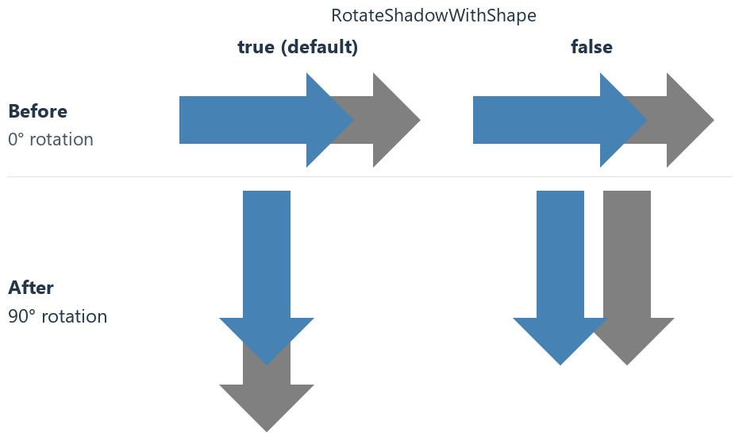

## **簡介**

雖然 PowerPoint 中的效果可用於使形狀脫穎而出，但它們不同於 [填色](/slides/zh-hant/cpp/shape-formatting/#gradient-fill) 或輪廓。使用 PowerPoint 效果，您可以在形狀上創建逼真的反射、擴散形狀的發光等。


PowerPoint 提供六種可套用於形狀的效果。您可以對形狀套用一種或多種效果。

某些效果組合比其他組合更好看。基於此，PowerPoint 在 **Preset** 下提供選項。Preset 選項本質上是已知彼此搭配良好的兩種或更多效果的組合。這樣，透過選取預設，您無需浪費時間測試或組合不同的效果以尋找好看的組合。

Aspose.Slides 在 [EffectFormat](https://reference.aspose.com/slides/cpp/aspose.slides/effectformat/) 類別下提供屬性與方法，讓您能在 PowerPoint 簡報的形狀上套用相同的效果。

## **套用陰影效果**

Aspose.Slides for C++ 支援形狀的外部與內部陰影。您可以自訂其顏色、方向、距離與模糊半徑，以符合簡報設計。

### **套用外部陰影**

使用外部陰影可使卡片或面板在投影片背景中更突出。陰影超出形狀邊緣，營造形狀高於投影片的感覺。調整其顏色、方向、距離與模糊半徑，以符合模板的光線與樣式。

以下 C++ 程式碼示範如何將 [外部陰影效果](https://reference.aspose.com/slides/cpp/aspose.slides/effectformat/get_outershadoweffect/) 套用至矩形：

```cpp
#include <DOM/Effects/IOuterShadow.h>
#include <DOM/IAutoShape.h>
#include <DOM/IColorFormat.h>
#include <DOM/IEffectFormat.h>
#include <DOM/IShapeCollection.h>
#include <DOM/ISlide.h>
#include <DOM/Presentation.h>
#include <DOM/ShapeType.h>
#include <Export/SaveFormat.h>
#include <drawing/color.h>

using namespace Aspose::Slides;
using namespace Aspose::Slides::Export;
using namespace System::Drawing;

auto presentation = System::MakeObject<Presentation>();
auto slide = presentation->get_Slide(0);

auto shape = slide->get_Shapes()->AddAutoShape(ShapeType::RoundCornerRectangle, 20.0f, 20.0f, 200.0f, 100.0f);
auto effectFormat = shape->get_EffectFormat();
effectFormat->EnableOuterShadowEffect();
auto outerShadowEffect = effectFormat->get_OuterShadowEffect();
outerShadowEffect->get_ShadowColor()->set_Color(Color::get_DarkGray());
outerShadowEffect->set_Distance(10);
outerShadowEffect->set_Direction(45.0f);

presentation->Save(u"shadow_effect.pptx", SaveFormat::Pptx);
```


#### **控制形狀旋轉時的陰影方向**

預設情況下，外部陰影會隨形狀一起旋轉。若要使不同旋轉角度的形狀看起來受到相同方向的光照，請以 `false` 呼叫 [set_RotateShadowWithShape](https://reference.aspose.com/slides/cpp/aspose.slides.effects/ioutershadow/set_rotateshadowwithshape/) 並使用 [set_Direction](https://reference.aspose.com/slides/cpp/aspose.slides.effects/ioutershadow/set_direction/) 為它們的陰影設定相同角度。

此範例建立兩個箭頭，灰色陰影向右偏移 (0°)。接著複製投影片並將兩個箭頭順時針旋轉 90°。

```cpp
#include <DOM/Effects/IOuterShadow.h>
#include <DOM/FillType.h>
#include <DOM/IAutoShape.h>
#include <DOM/IColorFormat.h>
#include <DOM/IEffectFormat.h>
#include <DOM/IFillFormat.h>
#include <DOM/ILineFormat.h>
#include <DOM/IShapeCollection.h>
#include <DOM/ISlide.h>
#include <DOM/ISlideCollection.h>
#include <DOM/Presentation.h>
#include <DOM/ShapeType.h>
#include <Export/SaveFormat.h>
#include <drawing/color.h>

using namespace Aspose::Slides;
using namespace Aspose::Slides::Export;
using namespace System::Drawing;

auto presentation = System::MakeObject<Presentation>();
auto before = presentation->get_Slide(0);

auto left = before->get_Shapes()->AddAutoShape(ShapeType::RightArrow, 55, 130, 110, 60);
left->get_FillFormat()->set_FillType(FillType::Solid);
left->get_FillFormat()->get_SolidFillColor()->set_Color(Color::get_SteelBlue());
left->get_LineFormat()->get_FillFormat()->set_FillType(FillType::NoFill);

left->get_EffectFormat()->EnableOuterShadowEffect();
auto shadow = left->get_EffectFormat()->get_OuterShadowEffect();
shadow->get_ShadowColor()->set_Color(Color::get_Gray());
shadow->set_Direction(0);
shadow->set_Distance(42);
shadow->set_BlurRadius(0);
shadow->set_RotateShadowWithShape(true);

auto right = before->get_Shapes()->AddClone(left);
right->set_X(395);
right->get_EffectFormat()->get_OuterShadowEffect()->set_RotateShadowWithShape(false);

auto after = presentation->get_Slides()->AddClone(before);
for (auto i = 0; i < after->get_Shapes()->get_Count(); ++i)
{
    after->get_Shape(i)->set_Rotation(90);
}

presentation->Save(u"arrow_shadows.pptx", SaveFormat::Pptx);
```

在第二張投影片中，左側箭頭的陰影向下投射，而右側箭頭的陰影仍向右。兩個陰影的設定方向皆保持 0°。



### **套用內部陰影**

在重現模板的視覺樣式時，使用內部陰影可為卡片或面板增添凹陷的外觀。外部陰影延伸至形狀外部，使其看起來凸起；而內部陰影則為其邊緣內部著色。

呼叫 [EnableInnerShadowEffect](https://reference.aspose.com/slides/cpp/aspose.slides/effectformat/enableinnershadoweffect/)，然後設定 [InnerShadowEffect](https://reference.aspose.com/slides/cpp/aspose.slides/effectformat/get_innershadoweffect/)。較大的模糊半徑值會產生較柔和的邊緣。

以下 C++ 範例建立一個淡藍色卡片，帶有深灰色內部陰影，並將其保存為 PPTX 檔案：

```cpp
#include <DOM/Effects/IInnerShadow.h>
#include <DOM/IAutoShape.h>
#include <DOM/IColorFormat.h>
#include <DOM/IEffectFormat.h>
#include <DOM/IFillFormat.h>
#include <DOM/ILineFormat.h>
#include <DOM/IShapeCollection.h>
#include <DOM/ISlide.h>
#include <DOM/Presentation.h>
#include <DOM/FillType.h>
#include <DOM/ShapeType.h>
#include <Export/SaveFormat.h>
#include <drawing/color.h>

using namespace Aspose::Slides;
using namespace Aspose::Slides::Export;
using namespace System::Drawing;

auto presentation = System::MakeObject<Presentation>();
auto slide = presentation->get_Slide(0);

auto shape = slide->get_Shapes()->AddAutoShape(ShapeType::Rectangle, 20.0f, 20.0f, 200.0f, 100.0f);
shape->get_FillFormat()->set_FillType(FillType::Solid);
shape->get_FillFormat()->get_SolidFillColor()->set_Color(Color::get_LightBlue());
shape->get_LineFormat()->get_FillFormat()->set_FillType(FillType::NoFill);

shape->get_EffectFormat()->EnableInnerShadowEffect();
auto shadow = shape->get_EffectFormat()->get_InnerShadowEffect();
shadow->get_ShadowColor()->set_Color(Color::get_DimGray());
shadow->set_Direction(225);
shadow->set_Distance(7);
shadow->set_BlurRadius(6);

presentation->Save(u"inner_shadow_effect.pptx", SaveFormat::Pptx);
```


若要移除內部陰影，請在形狀的 EffectFormat 上呼叫 [DisableInnerShadowEffect](https://reference.aspose.com/slides/cpp/aspose.slides/effectformat/disableinnershadoweffect/)。

### **套用、變更與移除預設陰影**

呼叫 [EnablePresetShadowEffect](https://reference.aspose.com/slides/cpp/aspose.slides/ieffectformat/enablepresetshadoweffect/) 並使用 [set_Preset](https://reference.aspose.com/slides/cpp/aspose.slides.effects/ipresetshadow/set_preset/) 以選取 [PresetShadowType](https://reference.aspose.com/slides/cpp/aspose.slides/presetshadowtype/)。若要切換樣式，可在同一形狀上變更預設。呼叫 [DisablePresetShadowEffect](https://reference.aspose.com/slides/cpp/aspose.slides/ieffectformat/disablepresetshadoweffect/) 可在保留填色與輪廓的同時移除陰影。

此範例在每個階段保留矩形的副本。兩個陰影皆偏移 10 點。225° 的方向將第一個陰影置於矩形的左上方，45° 的方向則將第二個陰影置於右下方。

```cpp
#include <DOM/Effects/IPresetShadow.h>
#include <DOM/FillType.h>
#include <DOM/IAutoShape.h>
#include <DOM/IColorFormat.h>
#include <DOM/IEffectFormat.h>
#include <DOM/IFillFormat.h>
#include <DOM/ILineFormat.h>
#include <DOM/IParagraph.h>
#include <DOM/IParagraphFormat.h>
#include <DOM/IPortionFormat.h>
#include <DOM/IShapeCollection.h>
#include <DOM/ISlide.h>
#include <DOM/ISlideSize.h>
#include <DOM/ITextFrame.h>
#include <DOM/Presentation.h>
#include <DOM/PresetShadowType.h>
#include <DOM/ShapeType.h>
#include <DOM/SlideSizeScaleType.h>
#include <Export/SaveFormat.h>
#include <drawing/color.h>
#include <system/enum.h>

using namespace Aspose::Slides;
using namespace Aspose::Slides::Export;
using namespace System::Drawing;

auto presentation = System::MakeObject<Presentation>();
presentation->get_SlideSize()->SetSize(800, 120, SlideSizeScaleType::DoNotScale);
auto shapes = presentation->get_Slide(0)->get_Shapes();

auto shape = shapes->AddAutoShape(ShapeType::Rectangle, 15, 30, 170, 60);
shape->get_FillFormat()->set_FillType(FillType::Solid);
shape->get_FillFormat()->get_SolidFillColor()->set_Color(Color::get_SteelBlue());
auto outline = shape->get_LineFormat()->get_FillFormat();
outline->set_FillType(FillType::Solid);
outline->get_SolidFillColor()->set_Color(Color::get_DarkBlue());
auto textFrame = shape->get_TextFrame();
textFrame->set_Text(u"No shadow");
textFrame->get_Paragraph(0)->get_ParagraphFormat()->get_DefaultPortionFormat()->set_FontHeight(14);
shapes->AddClone(shape);

shape->set_X(shape->get_X() + 200);
auto effectFormat = shape->get_EffectFormat();
effectFormat->EnablePresetShadowEffect();
auto shadow = effectFormat->get_PresetShadowEffect();
shadow->set_Preset(PresetShadowType::TopLeftDropShadow);
shadow->set_Distance(10);
shadow->set_Direction(225);
textFrame->set_Text(System::Enum<PresetShadowType>::GetName(shadow->get_Preset()));
shapes->AddClone(shape);

shape->set_X(shape->get_X() + 200);
shadow->set_Preset(PresetShadowType::BottomRightDropShadow);
shadow->set_Direction(45);
textFrame->set_Text(System::Enum<PresetShadowType>::GetName(shadow->get_Preset()));
shapes->AddClone(shape);

shape->set_X(shape->get_X() + 200);
effectFormat->DisablePresetShadowEffect();
textFrame->set_Text(u"No shadow");

presentation->Save(u"preset_shadows.pptx", SaveFormat::Pptx);
```

| 原始 | 第一個預設 | 第二個預設 | 移除後 |
| :---: | :---: | :---: | :---: |
|  |  |  |  |

## **套用反射效果**

在 Aspose.Slides for C++ 中套用反射效果時，您可以為形狀加入鏡像般的反射，並調整距離、透明度與大小等參數。此效果提升簡報的美感，使形狀更具精緻與高級感。只需簡單程式碼即可輕鬆實作，快速在多個元素上套用以維持設計一致性。

以下 C++ 程式碼示範如何將 [反射效果](https://reference.aspose.com/slides/cpp/aspose.slides/effectformat/get_reflectioneffect/) 套用至形狀：

```cpp
#include <DOM/Effects/IReflection.h>
#include <DOM/IAutoShape.h>
#include <DOM/IEffectFormat.h>
#include <DOM/IShapeCollection.h>
#include <DOM/ISlide.h>
#include <DOM/Presentation.h>
#include <DOM/RectangleAlignment.h>
#include <DOM/ShapeType.h>
#include <Export/SaveFormat.h>

using namespace Aspose::Slides;
using namespace Aspose::Slides::Export;

auto presentation = System::MakeObject<Presentation>();
auto slide = presentation->get_Slide(0);

auto shape = slide->get_Shapes()->AddAutoShape(ShapeType::RoundCornerRectangle, 20.0f, 20.0f, 200.0f, 100.0f);
auto effectFormat = shape->get_EffectFormat();
effectFormat->EnableReflectionEffect();
auto reflectionEffect = effectFormat->get_ReflectionEffect();
reflectionEffect->set_RectangleAlign(RectangleAlignment::Bottom);
reflectionEffect->set_Direction(90.0f);
reflectionEffect->set_Distance(40);
reflectionEffect->set_BlurRadius(2);

presentation->Save(u"reflection_effect.pptx", SaveFormat::Pptx);
```


## **套用發光效果**

在 Aspose.Slides for C++ 中為形狀套用發光效果時，您可以在形狀周圍加入柔和的光暈，調整顏色與大小等屬性。此效果協助形狀突出，為簡報增添吸引人且醒目的視覺元素。只需少量程式碼即可輕鬆實作，提升投影片的整體外觀。

以下 C++ 程式碼示範如何將 [發光效果](https://reference.aspose.com/slides/cpp/aspose.slides/effectformat/get_gloweffect/) 套用至形狀：

```cpp
#include <DOM/Effects/IGlow.h>
#include <DOM/IAutoShape.h>
#include <DOM/IColorFormat.h>
#include <DOM/IEffectFormat.h>
#include <DOM/IShapeCollection.h>
#include <DOM/ISlide.h>
#include <DOM/Presentation.h>
#include <DOM/ShapeType.h>
#include <Export/SaveFormat.h>
#include <drawing/color.h>

using namespace Aspose::Slides;
using namespace Aspose::Slides::Export;
using namespace System::Drawing;

auto presentation = System::MakeObject<Presentation>();
auto slide = presentation->get_Slide(0);

auto shape = slide->get_Shapes()->AddAutoShape(ShapeType::RoundCornerRectangle, 20.0f, 20.0f, 200.0f, 100.0f);
auto effectFormat = shape->get_EffectFormat();
effectFormat->EnableGlowEffect();
auto glowEffect = effectFormat->get_GlowEffect();
glowEffect->get_Color()->set_Color(Color::get_Magenta());
glowEffect->set_Radius(15);

presentation->Save(u"glow_effect.pptx", SaveFormat::Pptx);
```


## **套用柔化邊緣效果**

在 Aspose.Slides for C++ 中套用柔化邊緣效果時，您可以在形狀的邊緣創建平滑、模糊的過渡。此效果增添更細緻且精緻的外觀，適用於需要柔和外觀的設計。您可輕鬆調整半徑等參數，以在簡報中多種形狀上達成理想效果。

以下 C++ 程式碼示範如何將 [柔化邊緣](https://reference.aspose.com/slides/cpp/aspose.slides/effectformat/get_softedgeeffect/) 套用至形狀：

```cpp
#include <DOM/Effects/ISoftEdge.h>
#include <DOM/IAutoShape.h>
#include <DOM/IEffectFormat.h>
#include <DOM/IShapeCollection.h>
#include <DOM/ISlide.h>
#include <DOM/Presentation.h>
#include <DOM/ShapeType.h>
#include <Export/SaveFormat.h>

using namespace Aspose::Slides;
using namespace Aspose::Slides::Export;

auto presentation = System::MakeObject<Presentation>();
auto slide = presentation->get_Slide(0);

auto shape = slide->get_Shapes()->AddAutoShape(ShapeType::RoundCornerRectangle, 20.0f, 20.0f, 200.0f, 150.0f);
auto effectFormat = shape->get_EffectFormat();
effectFormat->EnableSoftEdgeEffect();
auto softEdgeEffect = effectFormat->get_SoftEdgeEffect();
softEdgeEffect->set_Radius(8);

presentation->Save(u"soft_edges_effect.pptx", SaveFormat::Pptx);
```


## **套用模糊效果**

使用形狀模糊可柔化形狀的填色與輪廓，同時保持形狀可編輯。於形狀的 EffectFormat 上呼叫 [SetBlurEffect](https://reference.aspose.com/slides/cpp/aspose.slides/ieffectformat/setblureffect/)。半徑以點 (1/72 吋) 為單位：使用非負值，值越大模糊程度越強。半徑為零則外觀不變。

[Grow](https://reference.aspose.com/slides/cpp/aspose.slides.effects/iblur/get_grow/) 設定控制效果的可見範圍。設為 `false` 時，模糊會被裁剪至原始繪製範圍（包括輪廓）。設為 `true` 時，模糊可延伸超出該範圍。此設定不會更改形狀的位置或尺寸。

下方比較使用相同的填色、輪廓與形狀尺寸。上排使用 `grow = false`；下排使用 `grow = true`。


此 C++ 範例建立一個橙色矩形，帶有深藍色輪廓，套用 5 點模糊，然後再次呼叫 [SetBlurEffect](https://reference.aspose.com/slides/cpp/aspose.slides/ieffectformat/setblureffect/) 更新為 15 點模糊。它會將兩種模糊狀態皆保存，之後呼叫 [DisableBlurEffect](https://reference.aspose.com/slides/cpp/aspose.slides/ieffectformat/disableblureffect/) 並保存未模糊的形狀。

```cpp
#include <DOM/IAutoShape.h>
#include <DOM/IColorFormat.h>
#include <DOM/IEffectFormat.h>
#include <DOM/IFillFormat.h>
#include <DOM/ILineFormat.h>
#include <DOM/IShapeCollection.h>
#include <DOM/ISlide.h>
#include <DOM/Presentation.h>
#include <DOM/FillType.h>
#include <DOM/ShapeType.h>
#include <Export/SaveFormat.h>
#include <drawing/color.h>

using namespace Aspose::Slides;
using namespace Aspose::Slides::Export;
using namespace System::Drawing;

auto presentation = System::MakeObject<Presentation>();
auto slide = presentation->get_Slide(0);

auto shape = slide->get_Shapes()->AddAutoShape(ShapeType::Rectangle, 100.0f, 80.0f, 160.0f, 100.0f);
shape->get_FillFormat()->set_FillType(FillType::Solid);
shape->get_FillFormat()->get_SolidFillColor()->set_Color(Color::get_Orange());
shape->get_LineFormat()->get_FillFormat()->set_FillType(FillType::Solid);
shape->get_LineFormat()->get_FillFormat()->get_SolidFillColor()->set_Color(Color::get_DarkBlue());
shape->get_LineFormat()->set_Width(8);

shape->get_EffectFormat()->SetBlurEffect(5, false);
presentation->Save(u"shape_blur_5.pptx", SaveFormat::Pptx);

shape->get_EffectFormat()->SetBlurEffect(15, true);
presentation->Save(u"shape_blur_15.pptx", SaveFormat::Pptx);

shape->get_EffectFormat()->DisableBlurEffect();
presentation->Save(u"shape_blur_removed.pptx", SaveFormat::Pptx);
```

形狀模糊同時影響填色與輪廓。柔化邊緣效果僅淡化形狀的邊緣，而陰影模糊僅柔化陰影。影像轉換效果作用於圖像內容；本範例直接對形狀的 EffectFormat 套用模糊，未將形狀轉換為圖像。

## **常見問題**

**我可以在同一個形狀上套用多個效果嗎？**

可以，您可以在單一形狀上結合不同的效果，如陰影、反射與發光，以產生更具動感的外觀。

**我可以對哪些形狀套用效果？**

您可以對各種形狀套用效果，包括自動圖案、圖表、表格、圖片、SmartArt 物件、OLE 物件等。

**我可以對群組形狀套用效果嗎？**

可以，您可以對群組形狀套用效果。效果會套用於整個群組。