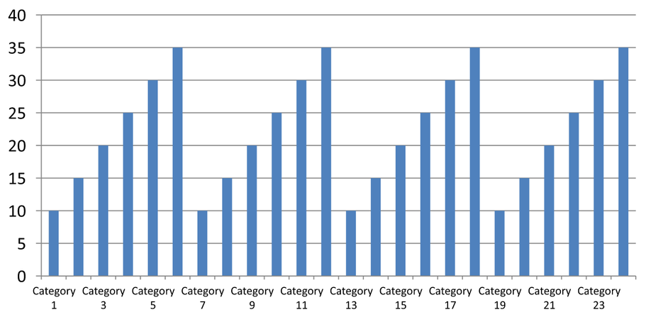

## **概覽**

本文說明如何使用 Aspose.Slides for Java 自訂圖表軸。內容涵蓋計算軸值、切換圖表列與欄、軸可見性、類別標籤與刻度間隔、日期類別與格式、標題旋轉、軸位置、顯示單位以及對數縮放。

## **取得圖表垂直軸的最大值**

建立一個 [簡報](https://reference.aspose.com/slides/java/com.aspose.slides/presentation/)，並以預設資料新增區域圖表。於讀取計算軸值前呼叫 [validateChartLayout](https://reference.aspose.com/slides/java/com.aspose.slides/chart/#validateChartLayout--)，使圖表版面保持最新。

讀取 [getActualMaxValue](https://reference.aspose.com/slides/java/com.aspose.slides/axis/#getActualMaxValue--) 與 [getActualMinValue](https://reference.aspose.com/slides/java/com.aspose.slides/axis/#getActualMinValue--) 以取得軸限制，並使用 [getActualMajorUnit](https://reference.aspose.com/slides/java/com.aspose.slides/axis/#getActualMajorUnit--) 與 [getActualMinorUnit](https://reference.aspose.com/slides/java/com.aspose.slides/axis/#getActualMinorUnit--) 取得刻度間隔。 [getActualMajorUnitScale](https://reference.aspose.com/slides/java/com.aspose.slides/axis/#getActualMajorUnitScale--) 與 [getActualMinorUnitScale](https://reference.aspose.com/slides/java/com.aspose.slides/axis/#getActualMinorUnitScale--) 提供時間單位比例，對日期軸尤為相關。範例將這些值存入本機變數，並儲存圖表。

```java
import com.aspose.slides.*;

Presentation presentation = new Presentation();
try {
    ISlide slide = presentation.getSlides().get_Item(0);

    IChart chart = slide.getShapes().addChart(ChartType.Area, 100, 100, 500, 350);
    chart.validateChartLayout();

    double maxValue = chart.getAxes().getVerticalAxis().getActualMaxValue();
    double minValue = chart.getAxes().getVerticalAxis().getActualMinValue();

    double majorUnit = chart.getAxes().getVerticalAxis().getActualMajorUnit();
    double minorUnit = chart.getAxes().getVerticalAxis().getActualMinorUnit();

    int majorUnitScale = chart.getAxes().getVerticalAxis().getActualMajorUnitScale();
    int minorUnitScale = chart.getAxes().getVerticalAxis().getActualMinorUnitScale();

    presentation.save("AxisValues_out.pptx", SaveFormat.Pptx);
} finally {
    presentation.dispose();
}
```

## **交換軸之間的資料**

使用 [switchRowColumn](https://reference.aspose.com/slides/java/com.aspose.slides/chartdata/#switchRowColumn--) 交換圖表資料中系列與類別的角色。先前的每個類別會變成系列，先前的每個系列會變成類別。這會改變資料的分組方式，並不會交換水平與垂直軸。範例使用 [setRange](https://reference.aspose.com/slides/java/com.aspose.slides/chartdata/#setRange-java.lang.String-) 將預設資料繫結至 `Sheet1!A1:D5`（包含表頭列與類別欄），再切換列與欄，最後產生包含四個系列與三個類別的圖表。

```java
import com.aspose.slides.*;

Presentation presentation = new Presentation();
try {
    ISlide slide = presentation.getSlides().get_Item(0);

    IChart chart = slide.getShapes().addChart(ChartType.ClusteredColumn, 100, 100, 400, 300);
    chart.getChartData().setRange("Sheet1!A1:D5");
    chart.getChartData().switchRowColumn();

    presentation.save("SwitchChartRowColumns_out.pptx", SaveFormat.Pptx);
} finally {
    presentation.dispose();
}
```

## **為折線圖停用垂直軸**

在垂直軸上呼叫 [setVisible](https://reference.aspose.com/slides/java/com.aspose.slides/axis/#setVisible-boolean-) 並傳入 `false` 以隱藏軸。範例建立一個預設資料的折線圖，並以隱藏垂直軸的方式儲存。

```java
import com.aspose.slides.*;

Presentation presentation = new Presentation();
try {
    ISlide slide = presentation.getSlides().get_Item(0);

    IChart chart = slide.getShapes().addChart(ChartType.Line, 100, 100, 400, 300);
    chart.getAxes().getVerticalAxis().setVisible(false);

    presentation.save("HiddenVerticalAxis.pptx", SaveFormat.Pptx);
} finally {
    presentation.dispose();
}
```

## **為折線圖停用水平軸**

在水平軸上呼叫 [setVisible](https://reference.aspose.com/slides/java/com.aspose.slides/axis/#setVisible-boolean-) 並傳入 `false` 以隱藏軸。範例建立一個預設資料的折線圖，並以隱藏水平軸的方式儲存。

```java
import com.aspose.slides.*;

Presentation presentation = new Presentation();
try {
    ISlide slide = presentation.getSlides().get_Item(0);

    IChart chart = slide.getShapes().addChart(ChartType.Line, 100, 100, 400, 300);
    chart.getAxes().getHorizontalAxis().setVisible(false);

    presentation.save("HiddenHorizontalAxis.pptx", SaveFormat.Pptx);
} finally {
    presentation.dispose();
}
```

## **變更類別軸**

使用 [setCategoryAxisType](https://reference.aspose.com/slides/java/com.aspose.slides/axis/#setCategoryAxisType-int-) 來選擇日期或文字類別軸。本範例需要 `ExistingChart.pptx`，其中第一張投影片的第一個圖形為圖表，且類別儲存格含有 Excel 數值日期。它將水平軸變更為日期軸。呼叫 [setAutomaticMajorUnit](https://reference.aspose.com/slides/java/com.aspose.slides/axis/#setAutomaticMajorUnit-boolean-) 並傳入 `false`，[setMajorUnit](https://reference.aspose.com/slides/java/com.aspose.slides/axis/#setMajorUnit-double-) 傳入 `1`，以及 [setMajorUnitScale](https://reference.aspose.com/slides/java/com.aspose.slides/axis/#setMajorUnitScale-int-) 傳入 `TimeUnitType.Months`，即可使主要刻度間隔為一個月。

```java
import com.aspose.slides.*;

Presentation presentation = new Presentation("ExistingChart.pptx");
try {
    ISlide slide = presentation.getSlides().get_Item(0);

    IChart chart = (IChart) slide.getShapes().get_Item(0);
    chart.getAxes().getHorizontalAxis().setCategoryAxisType(CategoryAxisType.Date);
    chart.getAxes().getHorizontalAxis().setAutomaticMajorUnit(false);
    chart.getAxes().getHorizontalAxis().setMajorUnit(1);
    chart.getAxes().getHorizontalAxis().setMajorUnitScale(TimeUnitType.Months);

    presentation.save("ChangeChartCategoryAxis_out.pptx", SaveFormat.Pptx);
} finally {
    presentation.dispose();
}
```

## **控制類別軸標籤間隔**

當圖表有許多類別時，可在不移除類別或資料點的前提下減少可見軸標籤的數量。呼叫 [setAutomaticTickLabelSpacing](https://reference.aspose.com/slides/java/com.aspose.slides/iaxis/#setAutomaticTickLabelSpacing-boolean-) 並傳入 `false`，再將想要的類別間隔傳給 [setTickLabelSpacing](https://reference.aspose.com/slides/java/com.aspose.slides/iaxis/#setTickLabelSpacing-long-)。對於文字類別且維持正常排序時，計數從第一個類別開始：

| 間隔 | 示例中顯示的標籤 |
| --- | --- |
| `1` | Category 1, Category 2, Category 3, ... Category 24 |
| `2` | Category 1, Category 3, Category 5, ... Category 23 |
| `3` | Category 1, Category 4, Category 7, ... Category 22 |

間隔 `3` 會每三個標籤顯示一次，兩個標籤會被隱藏，且不會移除相對應的欄位。自動間隔會根據可用空間選擇間隔，未必會顯示每個標籤。

刻度線有獨立的控制。呼叫 [setAutomaticTickMarksSpacing](https://reference.aspose.com/slides/java/com.aspose.slides/iaxis/#setAutomaticTickMarksSpacing-boolean-) 並傳入 `false`，再使用 [setTickMarksSpacing](https://reference.aspose.com/slides/java/com.aspose.slides/iaxis/#setTickMarksSpacing-long-) 設定其間隔。例如 `1` 會在每個類別間隔保留刻度線，而標籤僅每三個類別顯示一次。搭配可見的樣式使用 [setMajorTickMark](https://reference.aspose.com/slides/java/com.aspose.slides/iaxis/#setMajorTickMark-int-) 以觀察結果。再次將任一自動間隔設定為 `true`，圖表會重新使用自動間隔。

以下自足範例建立 24 個類別與一個系列，然後在 `CategoryAxisIntervals.pptx` 中儲存三張投影片：自動間隔、手動標籤間隔（刻度線獨立）以及恢復自動間隔。兩個副本保留原始圖表資料，無需輸入簡報。水平標籤文字使密度差異一目了然。

```java
import com.aspose.slides.*;

Presentation presentation = new Presentation();
try {
    ISlide slide = presentation.getSlides().get_Item(0);

    IChart chart = slide.getShapes().addChart(ChartType.ClusteredColumn, 30, 40, 660, 320);

    chart.setLegend(false);
    chart.getChartData().getCategories().clear();
    chart.getChartData().getSeries().clear();

    IChartDataWorkbook workbook = chart.getChartData().getChartDataWorkbook();
    workbook.clear(0);

    IChartSeries series = chart.getChartData().getSeries().add(ChartType.ClusteredColumn);
    for (int i = 0; i < 24; i++) {
        IChartDataCell categoryCell = workbook.getCell(0, i + 1, 0, "Category " + (i + 1));
        chart.getChartData().getCategories().add(categoryCell);
        IChartDataCell valueCell = workbook.getCell(0, i + 1, 1, 10 + i % 6 * 5);
        series.getDataPoints().addDataPointForBarSeries(valueCell);
    }

    IAxis axis = chart.getAxes().getHorizontalAxis();
    axis.setCategoryAxisType(CategoryAxisType.Text);
    axis.getTextFormat().getTextBlockFormat().setRotationAngle(0);
    axis.getTextFormat().getPortionFormat().setFontHeight(12);
    axis.setMajorTickMark(TickMarkType.Outside);
    axis.setAutomaticTickLabelSpacing(true);
    axis.setAutomaticTickMarksSpacing(true);

    // 投影片 2：顯示每三個標籤，但為每個類別保留刻度線。
    ISlide manualSlide = presentation.getSlides().addClone(slide);
    IChart manualChart = (IChart)manualSlide.getShapes().get_Item(0);
    IAxis manualAxis = manualChart.getAxes().getHorizontalAxis();
    manualAxis.setAutomaticTickLabelSpacing(false);
    manualAxis.setTickLabelSpacing(3);
    manualAxis.setAutomaticTickMarksSpacing(false);
    manualAxis.setTickMarksSpacing(1);

    // 投影片 3：讓圖表再次自行選擇兩種間隔。
    ISlide restoredSlide = presentation.getSlides().addClone(manualSlide);
    IChart restoredChart = (IChart)restoredSlide.getShapes().get_Item(0);
    restoredChart.getAxes().getHorizontalAxis().setAutomaticTickLabelSpacing(true);
    restoredChart.getAxes().getHorizontalAxis().setAutomaticTickMarksSpacing(true);

    presentation.save("CategoryAxisIntervals.pptx", SaveFormat.Pptx);
} finally {
    presentation.dispose();
}
```

**自動間隔（幻燈片 1）：** 在此呈現中，每第二個類別標籤會顯示，且會換行成兩行。自動結果會因圖表尺寸、字型與渲染器不同而有所變化。



**手動間隔（幻燈片 2）：** 每第三個標籤會顯示在單行，且刻度線仍保留在每個類別間隔。所有 24 欄（包括未顯示標籤的欄）皆保持可見且值相同。幻燈片 3 恢復上述自動外觀。


### **選擇正確的軸與間隔**

對於文字類別軸（例如柱狀圖、折線圖、區域圖或條形圖的類別軸）使用此類別計數間隔。在柱狀圖中，它是水平軸；在水平條形圖中，類別軸是垂直的，請對由 [getVerticalAxis](https://reference.aspose.com/slides/java/com.aspose.slides/iaxesmanager/#getVerticalAxis--) 取得的軸套用本設定。刻度線間隔亦適用於具有系列軸的圖表。

請勿使用類別標籤間隔來設定值軸的數值比例。在值軸上，[setMajorUnit](https://reference.aspose.com/slides/java/com.aspose.slides/iaxis/#setMajorUnit-double-) 會指定數值差距；例如，`10` 的主要單位會在 0、10、20 … 等位置產生刻度，而類別標籤間隔 `3` 則僅計算類別位置，與實際資料值無關。散佈圖與氣泡圖使用值軸而非文字類別軸。對於日期軸，請參照 [變更類別軸](#變更類別軸) 使用基於時間的主要單位與比例。

## **為類別軸值設定日期格式**

範例以四個年度值取代預設圖表資料。日期以 OLE Automation 序號儲存在第一個工作表（索引 `0`）中，計算方式為自 1899 年 12 月 30 日起的天數。使用 [setCategoryAxisType](https://reference.aspose.com/slides/java/com.aspose.slides/axis/#setCategoryAxisType-int-) 並傳入 `CategoryAxisType.Date`，呼叫 [setNumberFormatLinkedToSource](https://reference.aspose.com/slides/java/com.aspose.slides/axis/#setNumberFormatLinkedToSource-boolean-) 傳入 `false`，再將 `yyyy` 傳給 [setNumberFormat](https://reference.aspose.com/slides/java/com.aspose.slides/axis/#setNumberFormat-java.lang.String-)，使類別標籤顯示四位數年份，且不受儲存格格式影響。

```java
import com.aspose.slides.*;
import java.time.LocalDate;

Presentation presentation = new Presentation();
try {
    ISlide slide = presentation.getSlides().get_Item(0);

    IChart chart = slide.getShapes().addChart(ChartType.Line, 50, 50, 450, 300);

    chart.getChartData().getCategories().clear();
    chart.getChartData().getSeries().clear();

    IChartDataWorkbook workbook = chart.getChartData().getChartDataWorkbook();
    workbook.clear(0);

    LocalDate baseDate = LocalDate.of(1899, 12, 30);

    IChartSeries series = chart.getChartData().getSeries().add(ChartType.Line);
    for (int i = 0; i < 4; i++) {
        LocalDate date = LocalDate.of(2015 + i, 1, 1);
        IChartDataCell categoryCell = workbook.getCell(0, i + 1, 0, date.toEpochDay() - baseDate.toEpochDay());
        chart.getChartData().getCategories().add(categoryCell);

        IChartDataCell valueCell = workbook.getCell(0, i + 1, 1, i + 1);
        series.getDataPoints().addDataPointForLineSeries(valueCell);
    }

    chart.getAxes().getHorizontalAxis().setCategoryAxisType(CategoryAxisType.Date);
    chart.getAxes().getHorizontalAxis().setNumberFormatLinkedToSource(false);
    chart.getAxes().getHorizontalAxis().setNumberFormat("yyyy");

    presentation.save("DateAxisFormat.pptx", SaveFormat.Pptx);
} finally {
    presentation.dispose();
}
```

## **為圖表軸標題設定旋轉角度**

在垂直軸上呼叫 [setTitle](https://reference.aspose.com/slides/java/com.aspose.slides/axis/#setTitle-boolean-) 並傳入 `true`，提供標題文字，並使用 [setRotationAngle](https://reference.aspose.com/slides/java/com.aspose.slides/icharttextblockformat/#setRotationAngle-float-) 旋轉標題。角度以度為單位；此範例將欄狀圖的值軸標題旋轉 90 度後儲存。

```java
import com.aspose.slides.*;

Presentation presentation = new Presentation();
try {
    ISlide slide = presentation.getSlides().get_Item(0);

    IChart chart = slide.getShapes().addChart(ChartType.ClusteredColumn, 50, 50, 450, 300);
    chart.getAxes().getVerticalAxis().setTitle(true);
    chart.getAxes().getVerticalAxis().getTitle().addTextFrameForOverriding("Value");
    chart.getAxes().getVerticalAxis().getTitle().getTextFormat().getTextBlockFormat().setRotationAngle(90);

    presentation.save("RotatedAxisTitle.pptx", SaveFormat.Pptx);
} finally {
    presentation.dispose();
}
```

## **設定類別軸或值軸的軸位置**

使用 [setAxisBetweenCategories](https://reference.aspose.com/slides/java/com.aspose.slides/axis/#setAxisBetweenCategories-boolean-) 來控制值軸是穿過類別軸的類別之間，還是穿過類別刻度。此設定僅適用於類別軸。範例在柱狀圖的水平類別軸上設定 `true`，並儲存結果。

```java
import com.aspose.slides.*;

Presentation presentation = new Presentation();
try {
    ISlide slide = presentation.getSlides().get_Item(0);

    IChart chart = slide.getShapes().addChart(ChartType.ClusteredColumn, 50, 50, 450, 300);
    chart.getAxes().getHorizontalAxis().setAxisBetweenCategories(true);

    presentation.save("AxisBetweenCategories.pptx", SaveFormat.Pptx);
} finally {
    presentation.dispose();
}
```

## **為圖表值軸設定顯示單位**

使用 [setDisplayUnit](https://reference.aspose.com/slides/java/com.aspose.slides/axis/#setDisplayUnit-int-) 可在不更改底層資料的情況下縮放值軸標籤。將 [DisplayUnitType](https://reference.aspose.com/slides/java/com.aspose.slides/displayunittype/) 設為 `Millions`，則 60,000,000 會顯示為 60。範例建立柱狀圖，並將其垂直軸的顯示單位設定為百萬。

```java
import com.aspose.slides.*;

Presentation presentation = new Presentation();
try {
    ISlide slide = presentation.getSlides().get_Item(0);

    IChart chart = slide.getShapes().addChart(ChartType.ClusteredColumn, 50, 50, 450, 300);
    chart.getAxes().getVerticalAxis().setDisplayUnit(DisplayUnitType.Millions);

    presentation.save("Result.pptx", SaveFormat.Pptx);
} finally {
    presentation.dispose();
}
```

## **設定對數值軸**

當正值的量級跨越多個階段時，對數值軸相當有用。例如，服務可能在五個時段分別收到 10、100、1,000、10,000 與 100,000 個請求。於線性比例下，較小的值會聚集在接近零的位置。對數比例則使相對成長較易比較：相等的距離代表相等的比例，而非相等的差值。

在值軸上呼叫 [setLogarithmic](https://reference.aspose.com/slides/java/com.aspose.slides/axis/#setLogarithmic-boolean-) 並傳入 `true`，再使用 [setLogBase](https://reference.aspose.com/slides/java/com.aspose.slides/axis/#setLogBase-double-) 來選擇底數。這會變更現有值的顯示方式，但不會修改資料或加入對數趨勢線。趨勢線屬於另一項功能，代表對資料的擬合關係。

### **選擇值軸與底數**

對於折線圖或柱狀圖，值軸由 [getVerticalAxis](https://reference.aspose.com/slides/java/com.aspose.slides/iaxesmanager/#getVerticalAxis--) 取得。對於水平條形圖，則由 [getHorizontalAxis](https://reference.aspose.com/slides/java/com.aspose.slides/iaxesmanager/#getHorizontalAxis--) 取得。散佈圖與氣泡圖有兩個值軸，請於 X 值使用水平軸、Y 值使用垂直軸，或同時使用兩者。不要將對數縮放套用於類別軸。

預設的對數底數為 `10`。對於 PPTX 圖表，底數可介於 `2` 至 `1000`（含）之間，亦支援 `2.5` 等分數底數。以底數 `10` 為例，10、100、1,000、10,000 等次方會等距排列。

### **比較線性與對數縮放**

以下自足範例在第一張投影片建立包含五筆請求數的折線圖，然後複製該投影片並在第二張啟用底數 10 的對數值軸。兩張投影片保留相同資料。

```java
import com.aspose.slides.*;

Presentation presentation = new Presentation();
try {
    ISlide slide = presentation.getSlides().get_Item(0);

    IChart chart = slide.getShapes().addChart(ChartType.Line, 30, 40, 660, 200);

    chart.setLegend(false);

    chart.getChartData().getCategories().clear();
    chart.getChartData().getSeries().clear();

    IChartDataWorkbook workbook = chart.getChartData().getChartDataWorkbook();
    workbook.clear(0);

    IChartSeries series = chart.getChartData().getSeries().add(ChartType.Line);
    double[] values = { 10, 100, 1000, 10000, 100000 };

    for (int i = 0; i < values.length; i++) {
        IChartDataCell categoryCell = workbook.getCell(0, i + 1, 0, "Period " + (i + 1));
        chart.getChartData().getCategories().add(categoryCell);

        IChartDataCell valueCell = workbook.getCell(0, i + 1, 1, values[i]);
        series.getDataPoints().addDataPointForLineSeries(valueCell);
    }

    // 保持第一張投影片為線性，僅變更副本的值軸比例。
    ISlide logarithmicSlide = presentation.getSlides().addClone(slide);
    IChart logarithmicChart = (IChart)logarithmicSlide.getShapes().get_Item(0);
    IAxis valueAxis = logarithmicChart.getAxes().getVerticalAxis();
    valueAxis.setLogarithmic(true);
    valueAxis.setLogBase(10);

    presentation.save("LogarithmicAxis.pptx", SaveFormat.Pptx);
} finally {
    presentation.dispose();
}
```

**線性比例（幻燈片 1）：** 等距的垂直距離代表請求數的等差。最大值主導圖表，使較小的值難以辨識。


**對數比例（幻燈片 2）：** 等距的垂直距離代表等比例。每個時段的請求數是前一時段的十倍，於底數 10 的比例下形成直線上升。軸標籤仍顯示原始請求數。


### **處理零與負值**

對數比例只能顯示嚴格正值。啟用前請先檢查資料。若零或負值具有意義，請保留線性比例或另行顯示。若排除這些值符合分析需求，請說明省略原因。切勿悄悄將它們替換為小的正值，因會改變資料意義。任何手動設定的對數軸最小值或最大值亦必須為正值。

## **常見問題**

**如何設定軸交叉的數值（軸交叉點）？**

使用 [setCrossType](https://reference.aspose.com/slides/java/com.aspose.slides/axis/#setCrossType-int-) 來選擇交叉行為。若要指定數值交叉點，使用 [setCrossAt](https://reference.aspose.com/slides/java/com.aspose.slides/axis/#setCrossAt-float-)。這些設定可將軸交叉移至合適的基線。

**如何相對於軸定位刻度標籤？**

呼叫 [setTickLabelPosition](https://reference.aspose.com/slides/java/com.aspose.slides/axis/#setTickLabelPosition-int-) 並使用 [TickLabelPositionType](https://reference.aspose.com/slides/java/com.aspose.slides/ticklabelpositiontype/) 之 `Low`、`High`、`NextTo` 或 `None`。若要控制刻度線本身，請使用 [setMajorTickMark](https://reference.aspose.com/slides/java/com.aspose.slides/axis/#setMajorTickMark-int-) 或 [setMinorTickMark](https://reference.aspose.com/slides/java/com.aspose.slides/axis/#setMinorTickMark-int-)，這與標籤位置是分開的。