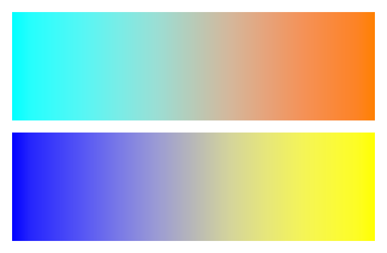

## **概述**

本文說明如何使用 Aspose.Slides for Node.js via Java 將簡報投影片轉換為 PNG 圖像。您可以載入 PPT、PPTX、ODP 等格式的簡報，將每張投影片渲染後保存為單獨的 PNG 圖片。

以下範例示範了使用預設比例渲染、放大比例、以像素指定輸出尺寸，以及選擇漸層渲染樣式。

## **將 PowerPoint 轉換為 PNG**

使用 [Presentation](https://reference.aspose.com/slides/nodejs-java/aspose.slides/presentation/) 類別載入簡報，並透過 [Presentation.getSlides](https://reference.aspose.com/slides/nodejs-java/aspose.slides/presentation/#getSlides) 集合存取其投影片。範例使用不帶參數的 [Slide.getImage](https://reference.aspose.com/slides/nodejs-java/aspose.slides/slide/#getImage) 來渲染每張投影片，以建立縮圖。然後呼叫 [IImage.save](https://reference.aspose.com/slides/nodejs-java/aspose.slides/iimage/#save) 搭配 [ImageFormat.Png](https://reference.aspose.com/slides/nodejs-java/aspose.slides/imageformat/#Png) 將每張渲染後的投影片儲存為 PNG 圖像。

```javascript
var aspose = aspose || {};
aspose.slides = require("aspose.slides.via.java");

let presentation = new aspose.slides.Presentation("presentation.pptx");
try {
    let slideCount = presentation.getSlides().size();
    for (let index = 0; index < slideCount; index++) {
        let slide = presentation.getSlides().get_Item(index);
        let image = slide.getImage();
        try {
            image.save("slide_" + index + ".png", aspose.slides.ImageFormat.Png);
        } finally {
            image.dispose();
        }
    }
} finally {
    presentation.dispose();
}
```

{}
不帶參數的 [Slide.getImage](https://reference.aspose.com/slides/nodejs-java/aspose.slides/slide/#getImage) 之重載以 0.2 的比例渲染。例如，尺寸為 720 × 540 點的投影片會產生 144 × 108 像素的縮圖。若要控制輸出尺寸，請使用帶比例因子或明確影像大小的重載，如下所示。
{}

## **將 PowerPoint 轉換為 PNG（自訂尺寸）**

將水平與垂直比例因子傳遞給 [Slide.getImage](https://reference.aspose.com/slides/nodejs-java/aspose.slides/slide/#getImage) 以控制渲染尺寸。在此範例中，兩個因子皆為 2，因此尺寸為 720 × 540 點的投影片會產生 1440 × 1080 像素的影像。相等的比例因子會保留投影片的長寬比。每張影像皆使用 [IImage.save](https://reference.aspose.com/slides/nodejs-java/aspose.slides/iimage/#save) 以 PNG 格式儲存。

```javascript
var aspose = aspose || {};
aspose.slides = require("aspose.slides.via.java");

let presentation = new aspose.slides.Presentation("presentation.pptx");
try {
    let scaleX = 2.0;
    let scaleY = scaleX;

    let slideCount = presentation.getSlides().size();
    for (let index = 0; index < slideCount; index++) {
        let slide = presentation.getSlides().get_Item(index);
        let image = slide.getImage(scaleX, scaleY);
        try {
            image.save("slide_" + index + ".png", aspose.slides.ImageFormat.Png);
        } finally {
            image.dispose();
        }
    }
} finally {
    presentation.dispose();
}
```

## **將 PowerPoint 轉換為 PNG（自訂大小）**

若要以像素指定輸出尺寸，請傳遞尺寸給 [Slide.getImage](https://reference.aspose.com/slides/nodejs-java/aspose.slides/slide/#getImage) 而非比例因子。此範例將每張投影片渲染為 960 × 720 像素，並使用 [IImage.save](https://reference.aspose.com/slides/nodejs-java/aspose.slides/iimage/#save) 儲存結果。選擇與投影片長寬比相符的尺寸，以避免影像被拉伸。

```javascript
var aspose = aspose || {};
aspose.slides = require("aspose.slides.via.java");
const java = require("java");

let presentation = new aspose.slides.Presentation("presentation.pptx");
try {
    let imageSize = java.newInstanceSync("java.awt.Dimension", 960, 720);

    let slideCount = presentation.getSlides().size();
    for (let index = 0; index < slideCount; index++) {
        let slide = presentation.getSlides().get_Item(index);
        let image = slide.getImage(imageSize);
        try {
            image.save("slide_" + index + ".png", aspose.slides.ImageFormat.Png);
        } finally {
            image.dispose();
        }
    }
} finally {
    presentation.dispose();
}
```

## **選擇漸層渲染樣式**

假設投影片包含漸層填充，但匯出的 PNG 中的過渡色較淡或與 PowerPoint 中的顯示不同。您可以使用 [RenderingOptions](https://reference.aspose.com/slides/nodejs-java/aspose.slides/renderingoptions/) 繼承的 [SaveOptions.setGradientStyle](https://reference.aspose.com/slides/nodejs-java/aspose.slides/saveoptions/#setGradientStyle) 方法來選擇漸層的渲染方式。

下載 [gradient-styles.pptx](gradient-styles.pptx) 並將其放置於應用程式的工作目錄中。其第一張投影片包含兩個線性漸層：上方由青色過渡至橙色，下方由藍色過渡至黃色。每個漸層都有兩個停止點，分別位於 0% 與 100%。

以下範例載入此簡報，並使用 [Slide.getImage](https://reference.aspose.com/slides/nodejs-java/aspose.slides/slide/#getImage) 以兩種模式渲染相同的第一張投影片。

```javascript
var aspose = aspose || {};
aspose.slides = require("aspose.slides.via.java");

let presentation = new aspose.slides.Presentation("gradient-styles.pptx");
try {
    let slide = presentation.getSlides().get_Item(0);

    let gradientStyles = [aspose.slides.GradientStyle.Default, aspose.slides.GradientStyle.PowerPointUI];
    for (let style of gradientStyles) {
        let options = new aspose.slides.RenderingOptions();
        options.setGradientStyle(style);

        let styleName = style == aspose.slides.GradientStyle.Default ? "Default" : "PowerPointUI";
        let image = slide.getImage(options, 1.0, 1.0);
        try {
            image.save("gradient-" + styleName + ".png", aspose.slides.ImageFormat.Png);
        } finally {
            image.dispose();
        }
    }
} finally {
    presentation.dispose();
}
```

| 預設 | PowerPointUI |
| --- | --- |
|  |  |

在此範例中，`Default` 產生較淡的中間色，而 `PowerPointUI` 產生較深的中間色。差異取決於漸層的顏色與停止點。

若標準的 Aspose.Slides 輸出符合需求，請選擇 `Default`。若您的首要目標是與 PowerPoint 的外觀相符，請嘗試 `PowerPointUI`。將兩種輸出與您的預期結果比較；兩種模式皆無絕對的優劣。

## **常見問題**

**如何匯出特定形狀（例如圖表或圖片），而不是整張投影片？**

Aspose.Slides 支援 [為單一形狀產生縮圖](/slides/zh-hant/nodejs-java/create-shape-thumbnails/)，讓您可以將形狀渲染為 PNG 圖像。

**伺服器上是否支援平行轉換？**

是的。每個執行緒或行程請使用獨立的簡報實例；[不要在執行緒之間共用單一實例](/slides/zh-hant/nodejs-java/multithreading/)。

**匯出為 PNG 時，評估模式有哪些限制？**

評估模式會在輸出影像上加上浮水印，並套用 [其他限制](/slides/zh-hant/nodejs-java/licensing/)，直至套用授權為止。