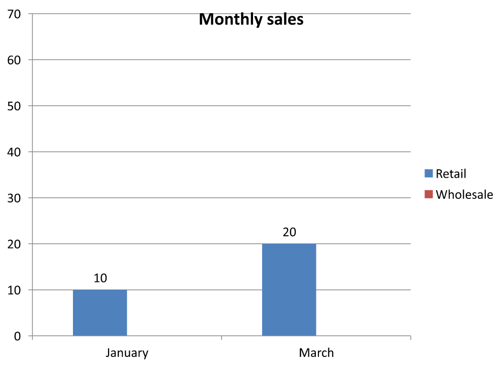

## **概觀**

本文說明如何在 Aspose.Slides 中使用圖表工作簿。它展示了如何透過工作簿串流讀寫圖表資料、將工作簿儲存格作為圖表資料標籤、存取工作表集合，以及為圖表值指定資料來源類型。

它同時說明如何將外部工作簿作為圖表資料來源。範例示範了如何建立與指派外部工作簿、取得連結至圖表的外部工作簿路徑，及在工作簿可用時編輯圖表資料。

若工作簿儲存格代表缺失資料，請參閱[控制空儲存格的顯示](/slides/zh-hant/nodejs-java/chart-series/)了解空儲存格與零的差異，以及不同顯示模式的折線圖比較。

## **包括隱藏列和欄位的資料**

使用[Chart.setPlotVisibleCellsOnly](https://reference.aspose.com/slides/nodejs-java/aspose.slides/chart/setplotvisiblecellsonly/)來控制圖表是否繪製隱藏工作表列與欄位的資料。將其設為 `true` 以僅繪製可見儲存格，或設為 `false` 以同時包含可見與隱藏儲存格。此設定僅影響圖表繪製，並不會隱藏或顯示工作表的列或欄位。

[範例簡報](hidden-source-data.pptx) 在第一張投影片的第一個圖形中包含一個直條圖。內嵌工作表 `Sheet1` 含有以下來源範圍 `A1:C4`。第 3 列與 C 欄被隱藏，但其儲存格仍含有數值。

| 工作表列 | A: 月份 | B: 零售 | C: 批發（隱藏欄） |
| --- | --- | --- | --- |
| 2 | 一月 | 10 | 30 |
| 3（隱藏列） | 二月 | 40 | 60 |
| 4 | 三月 | 20 | 50 |

透過[ChartData.getChartDataWorkbook](https://reference.aspose.com/slides/nodejs-java/aspose.slides/chartdata/getchartdataworkbook/)存取來源儲存格，並讀取[ChartDataCell.isHidden](https://reference.aspose.com/slides/nodejs-java/aspose.slides/chartdatacell/ishidden/)以檢查其隱藏狀態。此方法僅回報隱藏狀態，不會變更它。在此檔案中，B2 為可見，B3 屬於隱藏列，C2 屬於隱藏欄；範例分別印出 `false`、`true`、`true`。

對於此範例，在變更繪圖設定後須重新整理圖表資料：使用[readWorkbookStream](https://reference.aspose.com/slides/nodejs-java/aspose.slides/chartdata/readworkbookstream/)保留內嵌工作簿，並使用[writeWorkbookStream](https://reference.aspose.com/slides/nodejs-java/aspose.slides/chartdata/writeworkbookstream/)重新載入。若要包含所有儲存格，亦須使用[setRange](https://reference.aspose.com/slides/nodejs-java/aspose.slides/chartdata/setrange/)還原完整範圍，包含隱藏的二月類別。僅變更旗標不足以刷新此範例的快取圖表資料與類別標籤。範例在傳遞給寫入方法前，將返回的 Node.js 緩衝區轉換為 Java 位元組陣列。

```javascript
const aspose = { slides: require("aspose.slides.via.java") };
const java = require("java");

const presentation = new aspose.slides.Presentation("hidden-source-data.pptx");
try {
    const slide = presentation.getSlides().get_Item(0);

    const shapeCount = slide.getShapes().size();
    if (shapeCount > 0 && java.instanceOf(slide.getShapes().get_Item(0), "com.aspose.slides.IChart")) {
        const chart = slide.getShapes().get_Item(0);
        const workbook = chart.getChartData().getChartDataWorkbook();
        console.log("B2 hidden: " + workbook.getCell(0, "B2").isHidden());
        console.log("B3 hidden: " + workbook.getCell(0, "B3").isHidden());
        console.log("C2 hidden: " + workbook.getCell(0, "C2").isHidden());

        const workbookBuffer = chart.getChartData().readWorkbookStream();
        const workbookBytes = Array.from(workbookBuffer);
        const workbookData = java.newArray("byte", workbookBytes);
        for (const visibleOnly of [true, false]) {
            chart.setPlotVisibleCellsOnly(visibleOnly);

            // 從內嵌工作簿重新整理圖表資料。
            chart.getChartData().writeWorkbookStream(workbookData);
            if (!visibleOnly) {
                // 還原完整的來源範圍，包含隱藏的類別。
                chart.getChartData().setRange("Sheet1!$A$1:$C$4");
            }

            presentation.save("hidden_cells_" + visibleOnly + ".pptx", aspose.slides.SaveFormat.Pptx);
        }
    } else {
        console.log("The first shape is not a chart.");
    }
} finally {
    presentation.dispose();
}
```

此範例會將簡報儲存為兩個版本：一個僅含可見的零售數值 (10 與 20)，另一個則包含全部六個數值。下方圖片說明了這兩種繪圖模式。第 3 列與 C 欄在兩個內嵌工作簿中皆保持隱藏。

| 僅可見儲存格 (`true`) | 全部儲存格 (`false`) |
| --- | --- |
|  |  |

包含數值的隱藏儲存格不同於空儲存格。[Chart.setDisplayBlanksAs](https://reference.aspose.com/slides/nodejs-java/aspose.slides/chart/setdisplayblanksas/) 控制缺失值的顯示方式；它不會包含或排除隱藏的來源資料。請參閱[控制空儲存格的顯示](/slides/zh-hant/nodejs-java/chart-series/#control-the-display-of-empty-cells)取得範例。

## **取得圖表的資料範圍**

在更新現有簡報中的工作簿資料之前，請檢查來源範圍以確定每個圖表使用哪些工作表儲存格。[ChartData.getRange](https://reference.aspose.com/slides/nodejs-java/aspose.slides/chartdata/getrange/) 方法會回傳目前的資料範圍，形式為工作表限定的公式，例如 `Sheet1!$A$1:$D$5`。此處 `Sheet1` 為工作表名稱，`!` 用於分隔工作表與儲存格範圍，而 `$A$1:$D$5` 表示從 A1 到 D5（含）的儲存格。美元符號表示絕對的列與欄參照。

此方法在不變更圖表或其工作簿的情況下讀取目前範圍。如果圖表未使用工作簿作為資料來源，會拋出 `InvalidOperationException`。更多資訊請參閱[ChartData API 參考](https://reference.aspose.com/slides/nodejs-java/aspose.slides/chartdata/)。

此範例開啟簡報，直接在每張投影片上檢查圖形是否為圖表。它會列印每個圖表的名稱與來源範圍。若圖表未使用工作簿，則列印訊息並繼續處理下一個圖表。

```javascript
const aspose = { slides: require("aspose.slides.via.java") };
const java = require("java");

const presentation = new aspose.slides.Presentation("presentation.pptx");
try {
    for (let slideIndex = 0; slideIndex < presentation.getSlides().size(); slideIndex++) {
        const slide = presentation.getSlides().get_Item(slideIndex);
        for (let shapeIndex = 0; shapeIndex < slide.getShapes().size(); shapeIndex++) {
            const shape = slide.getShapes().get_Item(shapeIndex);
            if (java.instanceOf(shape, "com.aspose.slides.IChart")) {
                const chart = shape;
                try {
                    const range = chart.getChartData().getRange();
                    console.log(chart.getName() + ": " + range);
                } catch (exception) {
                    if (exception.cause && java.instanceOf(exception.cause, "com.aspose.slides.exceptions.InvalidOperationException")) {
                        console.log(chart.getName() + ": The chart does not use a workbook as its data source.");
                    } else {
                        console.log(chart.getName() + ": Could not retrieve the data range: " + exception.message);
                    }
                }
            }
        }
    }
} finally {
    presentation.dispose();
}
```

## **從工作簿讀寫圖表資料**

Aspose.Slides for Node.js via Java 提供[readWorkbookStream](https://reference.aspose.com/slides/nodejs-java/aspose.slides/chartdata/readworkbookstream/)與[writeWorkbookStream](https://reference.aspose.com/slides/nodejs-java/aspose.slides/chartdata/writeworkbookstream/) 方法，使您能讀寫圖表資料工作簿（其中包含使用 Aspose.Cells 編輯的圖表資料）。**注意** 圖表資料必須以相同方式組織，或具有類似來源的結構。

此範例使用的簡報在第一張投影片的第一個圖形為圖表。它將內嵌工作簿讀入位元組陣列，清除現有的系列與類別，並將相同的工作簿寫回。變更僅保留於記憶體中；範例不會儲存簡報。

```javascript
const aspose = { slides: require("aspose.slides.via.java") };
const java = require("java");

const presentation = new aspose.slides.Presentation("chart.pptx");
try {
    const slide = presentation.getSlides().get_Item(0);

    const shapeCount = slide.getShapes().size();
    if (shapeCount > 0 && java.instanceOf(slide.getShapes().get_Item(0), "com.aspose.slides.IChart")) {
        const chart = slide.getShapes().get_Item(0);
        const chartData = chart.getChartData();
        const workbookBuffer = chartData.readWorkbookStream();
        const workbookBytes = Array.from(workbookBuffer);
        const workbookData = java.newArray("byte", workbookBytes);

        chartData.getSeries().clear();
        chartData.getCategories().clear();

        chartData.writeWorkbookStream(workbookData);
    } else {
        console.log("The first shape is not a chart.");
    }
} finally {
    presentation.dispose();
}
```

### **在工作簿修改後驗證圖表版面配置**

當您以修改過的工作簿取代內嵌工作簿時，圖表仍保留原本的系列與類別集合。此不匹配可能導致[Chart.validateChartLayout](https://reference.aspose.com/slides/nodejs-java/aspose.slides/chart/validatechartlayout/) 因索引超出範圍而失敗。請在將更新的工作簿寫回圖表之前清除現有系列與類別。此範例使用第一張投影片的第一個圖形作為圖表。註解標示了工作簿編輯的位置；可執行範例將原始工作簿寫回並在記憶體中驗證版面配置。

```javascript
const aspose = { slides: require("aspose.slides.via.java") };
const java = require("java");

const presentation = new aspose.slides.Presentation("chart.pptx");
try {
    const slide = presentation.getSlides().get_Item(0);

    const shapeCount = slide.getShapes().size();
    if (shapeCount > 0 && java.instanceOf(slide.getShapes().get_Item(0), "com.aspose.slides.IChart")) {
        const chart = slide.getShapes().get_Item(0);
        const chartData = chart.getChartData();
        const workbookBuffer = chartData.readWorkbookStream();
        const workbookBytes = Array.from(workbookBuffer);
        const workbookData = java.newArray("byte", workbookBytes);

        // 在此修改工作簿位元組，例如，使用 Aspose.Cells.

        chartData.getSeries().clear();
        chartData.getCategories().clear();

        chartData.writeWorkbookStream(workbookData);
        chart.validateChartLayout();
    } else {
        console.log("The first shape is not a chart.");
    }
} finally {
    presentation.dispose();
}
```

清除集合會在工作簿寫回之前移除過時的資料參照。於使用圖表前，重新建立更新後工作簿所需的系列與類別映射。

## **選擇類別標籤的儲存方式**

在新增標籤之前，先於空的類別集合呼叫[ChartCategoryCollection.setUseCells](https://reference.aspose.com/slides/nodejs-java/aspose.slides/chartcategorycollection/setusecells/)。對於需要參照工作簿資料或形成階層（例如依年份分組的季）之標籤，使用工作表儲存格。對於不需要儲存格參照的單層標籤，使用字串文字。此設定僅套用於類別。範例中的兩個圖表皆使用工作表儲存格作為數值系列的來源。

此範例建立兩個直條圖，並印出每個圖表的儲存模式，接著列印 `Q1 Q2 Q3 Q4`。對於以工作表為基礎的標籤，[ChartCategory.getAsCell](https://reference.aspose.com/slides/nodejs-java/aspose.slides/chartcategory/getascell/) 會回傳底層儲存格，而[ChartDataCell.getValue](https://reference.aspose.com/slides/nodejs-java/aspose.slides/chartdatacell/getvalue/) 會回傳其標籤。對於文字標籤，則直接使用[ChartCategory.getValue](https://reference.aspose.com/slides/nodejs-java/aspose.slides/chartcategory/getvalue/) 讀取字串。範例將兩個圖表儲存為 `category-labels.pptx`。

```javascript
const aspose = { slides: require("aspose.slides.via.java") };

const presentation = new aspose.slides.Presentation();
try {
    const shapes = presentation.getSlides().get_Item(0).getShapes();

    for (const useCells of [true, false]) {
        const x = useCells ? 20 : 360;
        const chart = shapes.addChart(aspose.slides.ChartType.ClusteredColumn, x, 20, 320, 250);
        const data = chart.getChartData();
        data.getSeries().clear();
        const categories = data.getCategories();
        categories.clear();
        categories.setUseCells(useCells);

        const workbook = data.getChartDataWorkbook();
        const seriesName = workbook.getCell(0, 0, 1, "Sales");
        const series = data.getSeries().add(seriesName, chart.getType());
        for (let row = 1; row <= 4; row++) {
            const label = "Q" + row;
            if (useCells) {
                const labelCell = workbook.getCell(0, row, 0, label);
                categories.add(labelCell);
            } else {
                categories.add(label);
            }

            const valueCell = workbook.getCell(0, row, 1, row * 10);
            series.getDataPoints().addDataPointForBarSeries(valueCell);
        }

        const storedInCells = categories.getUseCells();
        const labels = [];
        for (let i = 0; i < categories.size(); i++) {
            const category = categories.get_Item(i);
            labels.push(storedInCells ? category.getAsCell().getValue() : category.getValue());
        }
        console.log("UseCells = " + storedInCells + ": " + labels.join(" "));
    }

    presentation.save("category-labels.pptx", aspose.slides.SaveFormat.Pptx);
} finally {
    presentation.dispose();
}
```

## **為工作簿儲存格設定自訂數字格式**

使用[ChartDataCell.setCustomNumberFormat](https://reference.aspose.com/slides/nodejs-java/aspose.slides/chartdatacell/setcustomnumberformat/) 來控制數值在圖表內嵌工作簿中的顯示方式。例如，報告可能需要將轉換率以四位小數的百分比顯示，且將係數以五位小數的形式呈現。請保留兩個值為數值型別，以便於計算與圖表繪製。

數字格式僅改變顯示方式，而非儲存的值。格式 `0.0000%` 會將 `0.125` 顯示為 `12.5000%`；它不會將儲存的數字取代為 `12.5`。同樣地，`0.00000` 會將 `0.1234567` 顯示為 `0.12346`，但不會四捨五入儲存值。若自訂格式為空字串 (`""`)，則會改用[getPresetNumberFormat](https://reference.aspose.com/slides/nodejs-java/aspose.slides/chartdatacell/getpresetnumberformat/) 回傳的格式。

以下範例建立一個直條圖，並透過[getChartDataWorkbook](https://reference.aspose.com/slides/nodejs-java/aspose.slides/chartdata/getchartdataworkbook/) 存取其儲存格。於工作表 0 中，B2 包含轉換率，C2 包含係數。兩個儲存格皆提供圖表數值。範例同時啟用與來源格式連結的數值標籤。

```javascript
const aspose = { slides: require("aspose.slides.via.java") };

const presentation = new aspose.slides.Presentation();
try {
    presentation.getSlideSize().setSize(720, 270, aspose.slides.SlideSizeScaleType.DoNotScale);
    const slide = presentation.getSlides().get_Item(0);

    const chart = slide.getShapes().addChart(aspose.slides.ChartType.ClusteredColumn, 50, 20, 620, 210);
    chart.setTitle(false);

    chart.getAxes().getVerticalAxis().setNumberFormatLinkedToSource(false);
    chart.getAxes().getVerticalAxis().setNumberFormat("0.00");
    chart.getAxes().getVerticalAxis().setAutomaticMinValue(false);
    chart.getAxes().getVerticalAxis().setMinValue(0);

    chart.getChartData().getSeries().clear();
    chart.getChartData().getCategories().clear();

    const workbook = chart.getChartData().getChartDataWorkbook();
    workbook.clear(0);

    const categoryCell = workbook.getCell(0, "A2", "Sample");
    chart.getChartData().getCategories().add(categoryCell);

    const percentageCell = workbook.getCell(0, "B2", 0.125);
    percentageCell.setCustomNumberFormat("0.0000%");
    const percentageName = workbook.getCell(0, "B1", "Conversion rate");
    const percentageSeries = chart.getChartData().getSeries().add(percentageName, chart.getType());
    percentageSeries.getDataPoints().addDataPointForBarSeries(percentageCell);

    const precisionCell = workbook.getCell(0, "C2", 0.1234567);
    precisionCell.setCustomNumberFormat("0.00000");
    const precisionName = workbook.getCell(0, "C1", "Coefficient");
    const precisionSeries = chart.getChartData().getSeries().add(precisionName, chart.getType());
    precisionSeries.getDataPoints().addDataPointForBarSeries(precisionCell);

    for (let seriesIndex = 0; seriesIndex < chart.getChartData().getSeries().size(); seriesIndex++) {
        const series = chart.getChartData().getSeries().get_Item(seriesIndex);
        const labelFormat = series.getDataPoints().get_Item(0).getLabel().getDataLabelFormat();
        labelFormat.setShowValue(true);
        labelFormat.setNumberFormatLinkedToSource(true);
    }

    presentation.save("CustomCellFormats.pptx", aspose.slides.SaveFormat.Pptx);
} finally {
    presentation.dispose();
}
```

工作簿儲存格的格式獨立於直接設定於圖表座標軸或資料標籤的格式。在此範例中，每個標籤會顯示其來源儲存格的值，因為[setShowValue](https://reference.aspose.com/slides/nodejs-java/aspose.slides/datalabelformat/setshowvalue/) 設為 `true`，且因[setNumberFormatLinkedToSource](https://reference.aspose.com/slides/nodejs-java/aspose.slides/datalabelformat/setnumberformatlinkedtosource/) 亦設為 `true` 而遵循來源的數字格式。儲存並重新開啟簡報後，標籤顯示 `12.5000%` 與 `0.12346`，如下所示。垂直座標軸使用自己的數字格式，透過[setNumberFormat](https://reference.aspose.com/slides/nodejs-java/aspose.slides/axis/setnumberformat/) 設為 `0.00`，且[setNumberFormatLinkedToSource](https://reference.aspose.com/slides/nodejs-java/aspose.slides/axis/setnumberformatlinkedtosource/) 設為 `false`。

若要獨立格式化資料標籤，將其來源連結旗標設為 `false`，並使用[setNumberFormat](https://reference.aspose.com/slides/nodejs-java/aspose.slides/datalabelformat/setnumberformat/) 指定格式。這不會變更工作簿儲存格的格式。例如，獨立的標籤格式 `0.00` 會將第一個數值顯示為 `0.13`，而 B2 仍顯示 `12.5000%`。請參閱[Chart Data Labels](/slides/zh-hant/nodejs-java/chart-data-label/#set-percentage-sign-with-chart-data-labels) 以直接格式化標籤。

下圖是重新開啟已儲存的簡報後所渲染的圖像：


## **將工作簿儲存格設定為圖表資料標籤**

您可以使用工作簿儲存格中的文字作為圖表資料標籤。

此範例在現有簡報的第一張投影片加入一個預設資料的氣泡圖。它使用工作表 0 的儲存格 A10:A12 作為第一系列的前三個標籤，啟用來自儲存格的標籤，並儲存更新後的簡報。

```javascript
const aspose = { slides: require("aspose.slides.via.java") };

const presentation = new aspose.slides.Presentation("chart2.pptx");
try {
    const slide = presentation.getSlides().get_Item(0);

    const chart = slide.getShapes().addChart(aspose.slides.ChartType.Bubble, 50, 50, 600, 400, true);
    const series = chart.getChartData().getSeries().get_Item(0);
    const workbook = chart.getChartData().getChartDataWorkbook();

    series.getLabels().getDefaultDataLabelFormat().setShowLabelValueFromCell(true);
    series.getLabels().get_Item(0).setValueFromCell(workbook.getCell(0, "A10", "Label 0 cell value"));
    series.getLabels().get_Item(1).setValueFromCell(workbook.getCell(0, "A11", "Label 1 cell value"));
    series.getLabels().get_Item(2).setValueFromCell(workbook.getCell(0, "A12", "Label 2 cell value"));

    presentation.save("resultchart.pptx", aspose.slides.SaveFormat.Pptx);
} finally {
    presentation.dispose();
}
```

## **管理工作表**

[ChartDataWorkbook.getWorksheets](https://reference.aspose.com/slides/nodejs-java/aspose.slides/chartdataworkbook/getworksheets/) 方法提供對圖表工作簿中工作表的存取。此範例建立一個預設資料的圓餅圖，並將每個工作表名稱列印到主控台。

```javascript
const aspose = { slides: require("aspose.slides.via.java") };

const presentation = new aspose.slides.Presentation();
try {
    const slide = presentation.getSlides().get_Item(0);

    const chart = slide.getShapes().addChart(aspose.slides.ChartType.Pie, 50, 50, 400, 500);
    const workbook = chart.getChartData().getChartDataWorkbook();

    for (let i = 0; i < workbook.getWorksheets().size(); i++) {
        console.log(workbook.getWorksheets().get_Item(i).getName());
    }
} finally {
    presentation.dispose();
}
```

## **指定資料來源類型**

系列點的數值也可以直接以數值文字儲存。請參閱[使用數值文字設定系列值](/slides/zh-hant/nodejs-java/chart-series/#set-series-values-using-numeric-literals)取得完整範例，示範如何儲存與讀取。點值的來源類型與圖表的內部或外部工作簿設定是分離的；使用數值文字本身不會移除內嵌工作簿。

此範例建立一個預設資料的 3D 直條圖，並使用不同的資料來源設定兩個系列名稱。第一個名稱使用字串文字；第二個名稱使用工作表 0 的儲存格 C1。[DataSourceType](https://reference.aspose.com/slides/nodejs-java/aspose.slides/datasourcetype/) 列舉可選擇每個名稱的來源。範例將簡報儲存，已更新系列名稱。

```javascript
const aspose = { slides: require("aspose.slides.via.java") };

const presentation = new aspose.slides.Presentation();
try {
    const slide = presentation.getSlides().get_Item(0);

    const chart = slide.getShapes().addChart(aspose.slides.ChartType.Column3D, 50, 50, 600, 400, true);
    const literalName = chart.getChartData().getSeries().get_Item(0).getName();

    literalName.setDataSourceType(aspose.slides.DataSourceType.StringLiterals);
    literalName.setData("LiteralString");

    const cellName = chart.getChartData().getSeries().get_Item(1).getName();
    const nameCell = chart.getChartData().getChartDataWorkbook().getCell(0, "C1", "NewCell");
    cellName.setDataSourceType(aspose.slides.DataSourceType.Worksheet);
    cellName.setData(nameCell);

    presentation.save("pres.pptx", aspose.slides.SaveFormat.Pptx);
} finally {
    presentation.dispose();
}
```

## **偵測不支援的內嵌工作簿格式**

Aspose.Slides 不支援可嵌入於某些圖表的 Excel 二進位工作簿（.xlsb）格式。您可以在[ChartData](https://reference.aspose.com/slides/nodejs-java/aspose.slides/chartdata/) 上使用 `getEmbeddedWorkbookType` 方法，結合[WorkbookType](https://reference.aspose.com/slides/nodejs-java/aspose.slides/workbooktype/) 列舉來偵測不支援的格式並略過該等圖表。此範例檢查現有簡報第一張投影片的圖形，跳過非圖表圖形，並為每個含有內嵌 .xlsb 工作簿的圖表列印診斷訊息。

```javascript
const aspose = { slides: require("aspose.slides.via.java") };
const java = require("java");

const presentation = new aspose.slides.Presentation("sample.pptx");
try {
    const slide = presentation.getSlides().get_Item(0);

    for (let shapeIndex = 0; shapeIndex < slide.getShapes().size(); shapeIndex++) {
        const shape = slide.getShapes().get_Item(shapeIndex);
        if (!(java.instanceOf(shape, "com.aspose.slides.IChart"))) {
            continue;
        }

        const chart = shape;
        const chartData = chart.getChartData();
        const isInternalWorkbook = chartData.getDataSourceType() == aspose.slides.ChartDataSourceType.InternalWorkbook;
        const isBinaryMacro = chartData.getEmbeddedWorkbookType() == aspose.slides.WorkbookType.WorkbookBinaryMacro;

        if (isInternalWorkbook && isBinaryMacro) {
            console.log("Skipping a chart with an unsupported .xlsb workbook.");
            continue;
        }

        // 在此讀取或修改支援的圖表工作簿資料。
    }
} finally {
    presentation.dispose();
}
```

## **外部工作簿**

Aspose.Slides 支援將外部工作簿作為圖表的資料來源。

### **建立外部工作簿**

使用[readWorkbookStream](https://reference.aspose.com/slides/nodejs-java/aspose.slides/chartdata/readworkbookstream/) 與[setExternalWorkbook](https://reference.aspose.com/slides/nodejs-java/aspose.slides/chartdata/setexternalworkbook/) 可將內嵌圖表工作簿匯出為檔案，並將圖表連結至該外部工作簿。

此範例建立一個預設資料的圓餅圖，並匯出其工作簿。它在指派外部工作簿為圖表資料來源之前完成檔案寫入，然後儲存已連結的簡報。

```javascript
const aspose = { slides: require("aspose.slides.via.java") };
const path = require("path");
const fileSystem = require("fs");

const presentation = new aspose.slides.Presentation();
try {
    const slide = presentation.getSlides().get_Item(0);

    const chart = slide.getShapes().addChart(aspose.slides.ChartType.Pie, 50, 50, 400, 600);
    const workbookPath = path.resolve("externalWorkbook1.xlsx");
    const workbookData = chart.getChartData().readWorkbookStream();
    try {
        fileSystem.writeFileSync(workbookPath, Buffer.from(workbookData));
        chart.getChartData().setExternalWorkbook(workbookPath);
        
        presentation.save("externalWorkbook.pptx", aspose.slides.SaveFormat.Pptx);
    } catch (exception) {
        console.log("Could not write the external workbook: " + exception.message);
    }
} finally {
    presentation.dispose();
}
```

### **設定外部工作簿**

使用[setExternalWorkbook](https://reference.aspose.com/slides/nodejs-java/aspose.slides/chartdata/setexternalworkbook/) 方法，您可以將外部工作簿指派給圖表作為其資料來源。若外部工作簿已移動，也可利用此方法更新其路徑。

雖然您無法編輯存放於遠端位置或資源的工作簿資料，但仍可將此類工作簿作為外部資料來源。若提供外部工作簿的相對路徑，系統會自動將其轉換為完整路徑。

此範例使用的外部工作簿，其工作表 `Sheet1` 在 B1 含有系列名稱，A2:A4 含有類別名稱，B2:B4 含有數值。範例建立一個圓餅圖，連結該工作簿，並使用[setRange](https://reference.aspose.com/slides/nodejs-java/aspose.slides/chartdata/setrange/) 將 A1:B4 映射為一個系列與三個類別。它將簡報儲存，圖表已連結。

```javascript
const aspose = { slides: require("aspose.slides.via.java") };
const path = require("path");

const presentation = new aspose.slides.Presentation();
try {
    const slide = presentation.getSlides().get_Item(0);

    const chart = slide.getShapes().addChart(aspose.slides.ChartType.Pie, 50, 50, 400, 600, true);
    const chartData = chart.getChartData();
    const workbookPath = path.resolve("externalWorkbook.xlsx");

    chartData.setExternalWorkbook(workbookPath);
    chartData.setRange("Sheet1!$A$1:$B$4");

    presentation.save("Presentation_with_externalWorkbook.pptx", aspose.slides.SaveFormat.Pptx);
} finally {
    presentation.dispose();
}
```

[setExternalWorkbook](https://reference.aspose.com/slides/nodejs-java/aspose.slides/chartdata/setexternalworkbook/) 的 `updateChartData` 參數控制是否載入工作簿。

* 當 `updateChartData` 為 `false` 時，僅更新工作簿路徑。圖表資料不會從目標工作簿載入或更新，因而工作簿可以不存在。
* 當 `updateChartData` 為 `true` 時，圖表資料會從目標工作簿更新。

以下範例以 `false` 設定 `updateChartData`，指派一個佔位符 URL。它保留圓餅圖的預設資料，並在未載入不可用的工作簿情況下儲存簡報。

```javascript
const aspose = { slides: require("aspose.slides.via.java") };

const presentation = new aspose.slides.Presentation();
try {
    const slide = presentation.getSlides().get_Item(0);

    const chart = slide.getShapes().addChart(aspose.slides.ChartType.Pie, 50, 50, 400, 600, true);
    chart.getChartData().setExternalWorkbook("https://example.com/unavailable-workbook.xlsx", false);

    presentation.save("SetExternalWorkbookWithUpdateChartData.pptx", aspose.slides.SaveFormat.Pptx);
} finally {
    presentation.dispose();
}
```

### **取得圖表的外部資料來源工作簿路徑**

若要識別連結至圖表的工作簿，請檢查圖表是否使用外部資料來源並取得其工作簿路徑。

此範例檢查具有已連結外部工作簿之簡報的第一張投影片的第一個圖形。若該圖形為連結至外部工作簿的圖表，範例會將[getExternalWorkbookPath](https://reference.aspose.com/slides/nodejs-java/aspose.slides/chartdata/getexternalworkbookpath/) 列印到主控台。然後儲存簡報的副本。

```javascript
const aspose = { slides: require("aspose.slides.via.java") };
const java = require("java");

const presentation = new aspose.slides.Presentation("externalWorkbook.pptx");
try {
    const slide = presentation.getSlides().get_Item(0);

    if (slide.getShapes().size() > 0 && java.instanceOf(slide.getShapes().get_Item(0), "com.aspose.slides.IChart")) {
        const chart = slide.getShapes().get_Item(0);
        const chartData = chart.getChartData();
        if (chartData.getDataSourceType() == aspose.slides.ChartDataSourceType.ExternalWorkbook) {
            console.log(chartData.getExternalWorkbookPath());
        } else {
            console.log("The chart does not use an external workbook.");
        }
    } else {
        console.log("The first shape is not a chart.");
    }

    presentation.save("Result.pptx", aspose.slides.SaveFormat.Pptx);
} finally {
    presentation.dispose();
}
```

### **編輯圖表資料**

您可以以與編輯內部工作簿相同的方式編輯外部工作簿的資料。若無法載入外部工作簿，會拋出例外。

此範例使用第一張投影片的第一個圖形，且該圖表連結至可存取的外部工作簿。它將第一系列第一個資料點的儲存格值設定為 100，並儲存更新後的簡報。編輯儲存格值會更新連結的外部 XLSX 檔案，若需保留原始工作簿，請使用副本。

```javascript
const aspose = { slides: require("aspose.slides.via.java") };
const java = require("java");

const presentation = new aspose.slides.Presentation("presentation.pptx");
try {
    const slide = presentation.getSlides().get_Item(0);

    const shapeCount = slide.getShapes().size();
    if (shapeCount > 0 && java.instanceOf(slide.getShapes().get_Item(0), "com.aspose.slides.IChart")) {
        const chart = slide.getShapes().get_Item(0);
        const series = chart.getChartData().getSeries();
        if (series.size() > 0 && series.get_Item(0).getDataPoints().size() > 0) {
            const valueCell = series.get_Item(0).getDataPoints().get_Item(0).getValue().getAsCell();
            if (valueCell != null) {
                valueCell.setValue(100);
                presentation.save("presentation_out.pptx", aspose.slides.SaveFormat.Pptx);
            } else {
                console.log("The first data point is not linked to a workbook cell.");
            }
        } else {
            console.log("The chart has no data points to edit.");
        }
    } else {
        console.log("The first shape is not a chart.");
    }
} finally {
    presentation.dispose();
}
```

### **從圖表快取還原工作簿**

如果圖表使用的外部工作簿遺失或無法取得，Aspose.Slides 能從簡報快取的資料重建圖表工作簿。於開啟簡報前，建立[LoadOptions](https://reference.aspose.com/slides/nodejs-java/aspose.slides/loadoptions/)，呼叫[LoadOptions.setSpreadsheetOptions](https://reference.aspose.com/slides/nodejs-java/aspose.slides/loadoptions/setspreadsheetoptions/)，並將[SpreadsheetOptions.setRecoverWorkbookFromChartCache](https://reference.aspose.com/slides/nodejs-java/aspose.slides/spreadsheetoptions/setrecoverworkbookfromchartcache/) 設為 `true`。

以下 JavaScript 範例會為第一張投影片的第一個圖形（參考不可用的外部工作簿）還原工作簿資料。它透過[Chart.getChartData](https://reference.aspose.com/slides/nodejs-java/aspose.slides/chart/getchartdata/) 與[ChartData.getChartDataWorkbook](https://reference.aspose.com/slides/nodejs-java/aspose.slides/chartdata/getchartdataworkbook/) 取得還原的資料：

```javascript
const aspose = { slides: require("aspose.slides.via.java") };
const java = require("java");

const spreadsheetOptions = new aspose.slides.SpreadsheetOptions();
spreadsheetOptions.setRecoverWorkbookFromChartCache(true);

const loadOptions = new aspose.slides.LoadOptions();
loadOptions.setSpreadsheetOptions(spreadsheetOptions);

const presentation = new aspose.slides.Presentation("presentation.pptx", loadOptions);
try {
    const slide = presentation.getSlides().get_Item(0);

    const shapeCount = slide.getShapes().size();
    if (shapeCount > 0 && java.instanceOf(slide.getShapes().get_Item(0), "com.aspose.slides.IChart")) {
        const chart = slide.getShapes().get_Item(0);
        const recoveredWorkbook = chart.getChartData().getChartDataWorkbook();

        // 在此讀取或修改已復原的工作簿資料。
    } else {
        console.log("The first shape is not a chart.");
    }
} finally {
    presentation.dispose();
}
```

若外部工作簿不可用且未啟用還原，Aspose.Slides 會拋出例外。僅在使用快取圖表資料作為可接受的備援時才啟用還原，因為快取可能不包含簡報最後更新後對外部工作簿所做的變更。

## **FAQ**

**我可以判斷特定圖表是連結到外部工作簿還是內嵌工作簿嗎？**

是的。圖表具有[資料來源類型](https://reference.aspose.com/slides/nodejs-java/aspose.slides/chartdata/getdatasourcetype/) 以及[外部工作簿的路徑](https://reference.aspose.com/slides/nodejs-java/aspose.slides/chartdata/getexternalworkbookpath/)；若來源為外部工作簿，您可以讀取完整路徑以確認使用了外部檔案。

**是否支援外部工作簿的相對路徑，且它們如何儲存？**

支援。若指定相對路徑，系統會自動轉換為絕對路徑。簡報會在 PPTX 檔中儲存絕對路徑，因此搬移工作簿可能需更新連結。

**我可以使用位於網路資源或共享資料夾的工作簿嗎？**

可以，這類工作簿可作為外部資料來源使用。但 Aspose.Slides 不支援直接編輯遠端工作簿——它們只能作為資料來源。

**Aspose.Slides 在儲存簡報時會覆寫外部 XLSX 檔案嗎？**

簡報會在 PPTX 檔中儲存指向外部檔案的[連結](https://reference.aspose.com/slides/nodejs-java/aspose.slides/chartdata/getexternalworkbookpath/)。編輯儲存格背後的圖表資料也可能更新連結的本機 XLSX 檔案。若必須保留原始工作簿，請使用副本。

**如果外部檔案受密碼保護，我該怎麼辦？**

Aspose.Slides 在連結時不接受密碼。常見做法是事先移除保護或備妥已解密的副本（例如使用[Aspose.Cells](https://reference.aspose.com/cells/java/)），再連結至該副本。

**多個圖表可以參照同一個外部工作簿嗎？**

可以。每個圖表皆儲存自己的連結。如果它們指向相同檔案，更新該檔案後在下次載入資料時，所有圖表都會反映變更。