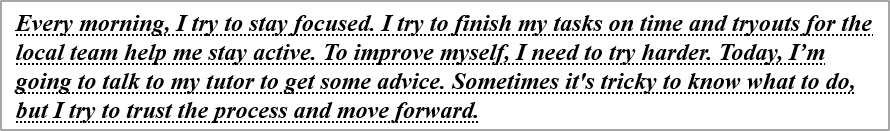

## **概觀**

本文說明如何使用 Aspose.Slides for Python via Java 於 PowerPoint 與 OpenDocument 簡報中格式化文字。內容涵蓋背景顏色、透明度、字元間距、字型屬性、旋轉、段落間距、自動調整行為、文字錨點、定位點與語言設定。

除非另有說明，範例皆使用 [sample.pptx](sample.pptx)。第一張投影片的第一個形狀是一個文字方塊，其第一段文字如以下所示。投影片與形狀的索引皆從 0 開始。選取粗體部份的範例使用有效的格式設定，包含繼承的粗體格式：


要查找並突顯純文字或正規表達式匹配項目，請參閱 [搜尋與取代文字](/slides/zh-hant/python-java/search-and-replace-text/)。

## **設定文字背景色彩**

使用 [ParagraphFormat.getDefaultPortionFormat](https://reference.aspose.com/slides/python-java/aspose.slides/paragraphformat/#getDefaultPortionFormat) 來設定段落的預設醒目顏色，或使用 [BasePortionFormat.getHighlightColor](https://reference.aspose.com/slides/python-java/aspose.slides/baseportionformat/#getHighlightColor) 為單一文字部份設定。

以下範例將淺灰色醒目設定為第一段的預設值。個別部份的明確醒目顏色會優先於此預設值：

```python
import jpype
import asposeslides

if not jpype.isJVMStarted():
    jpype.startJVM()

from asposeslides.api import Presentation, SaveFormat
from java.awt import Color

presentation = Presentation("sample.pptx")
try:
    slide = presentation.getSlides().get_Item(0)

    auto_shape = slide.getShapes().get_Item(0)
    paragraph = auto_shape.getTextFrame().getParagraphs().get_Item(0)

    # 設定整段文字的醒目顏色。
    paragraph.getParagraphFormat().getDefaultPortionFormat().getHighlightColor().setColor(Color.LIGHT_GRAY)

    presentation.save("gray_paragraph.pptx", SaveFormat.Pptx)
finally:
    presentation.dispose()
```

結果：


以下程式碼範例示範如何為 **粗體字型的文字部份** 設定背景色彩：

```python
import jpype
import asposeslides

if not jpype.isJVMStarted():
    jpype.startJVM()

from asposeslides.api import Presentation, SaveFormat
from java.awt import Color

presentation = Presentation("sample.pptx")
try:
    slide = presentation.getSlides().get_Item(0)

    auto_shape = slide.getShapes().get_Item(0)
    paragraph = auto_shape.getTextFrame().getParagraphs().get_Item(0)

    for portion in paragraph.getPortions():
        if portion.getPortionFormat().getEffective().getFontBold():
            # 設定文字部份的醒目顏色。
            portion.getPortionFormat().getHighlightColor().setColor(Color.LIGHT_GRAY)

    presentation.save("gray_text_portions.pptx", SaveFormat.Pptx)
finally:
    presentation.dispose()
```

結果：


## **對齊文字段落**

使用 [ParagraphFormat.setAlignment](https://reference.aspose.com/slides/python-java/aspose.slides/paragraphformat/#setAlignment) 設定文字框內段落的對齊方式。可設定為置中、左對齊、右對齊、兩端對齊等。

以下程式碼範例示範如何將段落對齊至 **置中**：

```python
import jpype
import asposeslides

if not jpype.isJVMStarted():
    jpype.startJVM()

from asposeslides.api import Presentation, SaveFormat, TextAlignment

presentation = Presentation("sample.pptx")
try:
    slide = presentation.getSlides().get_Item(0)

    auto_shape = slide.getShapes().get_Item(0)
    paragraph = auto_shape.getTextFrame().getParagraphs().get_Item(0)

    # 設定段落的對齊方式為置中。
    paragraph.getParagraphFormat().setAlignment(TextAlignment.Center)

    presentation.save("aligned_paragraph.pptx", SaveFormat.Pptx)
finally:
    presentation.dispose()
```

結果：


## **對齊行內字型**

使用 [ParagraphFormat.setFontAlignment](https://reference.aspose.com/slides/python-java/aspose.slides/paragraphformat/#setFontAlignment) 於同一行內垂直對齊不同字型大小的文字部份。此設定套用於整個段落，並控制每一行內的對齊。

以下獨立範例在單一投影片上建立四個標示文字方塊。每個段落以 18、36、54 點相同文字顯示，且使用不同的字型對齊方式。範例使用 Arial，停用自動調整與換列，且讓文字框足夠容納單行文字。

```python
import jpype
import asposeslides

if not jpype.isJVMStarted():
    jpype.startJVM()

from asposeslides.api import FillType, FontAlignment, FontData, NullableBool, Paragraph, Portion, Presentation, SaveFormat, ShapeType, TextAlignment, TextAnchorType, TextAutofitType
from java.awt import Color

presentation = Presentation()
try:
    slide = presentation.getSlides().get_Item(0)

    alignments = [FontAlignment.Baseline, FontAlignment.Top, FontAlignment.Center, FontAlignment.Bottom]
    alignment_names = ["Baseline", "Top", "Center", "Bottom"]
    font_sizes = [18.0, 36.0, 54.0]
    font = FontData("Arial")

    for i, alignment in enumerate(alignments):
        shape = slide.getShapes().addAutoShape(ShapeType.Rectangle, 30, 20 + i * 130, 660, 120)
        shape.getFillFormat().setFillType(FillType.NoFill)
        shape.getLineFormat().getFillFormat().setFillType(FillType.NoFill)

        text_frame = shape.getTextFrame()
        text_frame.getTextFrameFormat().setAnchoringType(TextAnchorType.Top)
        text_frame.getTextFrameFormat().setAutofitType(TextAutofitType.None_)
        text_frame.getTextFrameFormat().setWrapText(NullableBool.False_)

        label = text_frame.getParagraphs().get_Item(0)
        label.setText(alignment_names[i])
        label.getParagraphFormat().setAlignment(TextAlignment.Left)
        label.getParagraphFormat().getDefaultPortionFormat().setFontHeight(14)
        label.getParagraphFormat().getDefaultPortionFormat().setLatinFont(font)
        label.getParagraphFormat().getDefaultPortionFormat().getFillFormat().setFillType(FillType.Solid)
        label.getParagraphFormat().getDefaultPortionFormat().getFillFormat().getSolidFillColor().setColor(Color.GRAY)

        paragraph = Paragraph()
        paragraph.getParagraphFormat().setFontAlignment(alignment)
        paragraph.getParagraphFormat().setAlignment(TextAlignment.Left)
        paragraph.getParagraphFormat().getDefaultPortionFormat().setLatinFont(font)
        paragraph.getParagraphFormat().getDefaultPortionFormat().getFillFormat().setFillType(FillType.Solid)
        paragraph.getParagraphFormat().getDefaultPortionFormat().getFillFormat().getSolidFillColor().setColor(Color.BLACK)

        for font_size in font_sizes:
            portion = Portion("Ag ")
            portion.getPortionFormat().setFontHeight(font_size)
            paragraph.getPortions().add(portion)

        text_frame.getParagraphs().add(paragraph)

    presentation.save("font_alignment.pptx", SaveFormat.Pptx)
finally:
    presentation.dispose()
```

結果：


字型對齊使用字型度量，因此個別字母的可見邊緣未必完全對齊。範例同時包含大寫字母與下緣字元，以說明基線與底部對齊的差異。字型的可用性與替代、所使用的字元以及字型大小的差異皆會影響結果。框架尺寸、邊距、行距、換列與自動調整亦會影響版面；比較模式時請使用相同的字型與版面設定。

此設定與 [ParagraphFormat.setAlignment](https://reference.aspose.com/slides/python-java/aspose.slides/paragraphformat/#setAlignment) 不同，後者控制段落的水平對齊；亦不同於 [TextFrameFormat.setAnchoringType](https://reference.aspose.com/slides/python-java/aspose.slides/textframeformat/#setAnchoringType)，後者將文字區塊在形狀內垂直定位。透過 [BasePortionFormat.setEscapement](https://reference.aspose.com/slides/python-java/aspose.slides/baseportionformat/#setEscapement) 進行上標與下標格式設定時，會相對於基線移動個別部份，而非設定段落行的字型對齊。

## **設定文字透明度**

文字透明度透過指派給 [BasePortionFormat.getFillFormat](https://reference.aspose.com/slides/python-java/aspose.slides/baseportionformat/#getFillFormat) 的顏色之 alpha 元件來控制。在以下範例中，`alpha = 50` 是 0–255 範圍的 ARGB alpha 通道值，並非透明度百分比。

以下程式碼範例示範如何對 **整段文字** 套用透明度：

```python
import jpype
import asposeslides

if not jpype.isJVMStarted():
    jpype.startJVM()

from asposeslides.api import FillType, Presentation, SaveFormat
from java.awt import Color

alpha = 50
text_color = Color(0, 0, 0, alpha)

presentation = Presentation("sample.pptx")
try:
    slide = presentation.getSlides().get_Item(0)

    auto_shape = slide.getShapes().get_Item(0)
    paragraph = auto_shape.getTextFrame().getParagraphs().get_Item(0)

    # 設定文字的填充顏色為透明顏色。
    paragraph.getParagraphFormat().getDefaultPortionFormat().getFillFormat().setFillType(FillType.Solid)
    paragraph.getParagraphFormat().getDefaultPortionFormat().getFillFormat().getSolidFillColor().setColor(text_color)

    presentation.save("transparent_paragraph.pptx", SaveFormat.Pptx)
finally:
    presentation.dispose()
```

結果：


以下程式碼範例示範如何對 **粗體字型的文字部份** 套用透明度：

```python
import jpype
import asposeslides

if not jpype.isJVMStarted():
    jpype.startJVM()

from asposeslides.api import FillType, Presentation, SaveFormat
from java.awt import Color

alpha = 50
text_color = Color(0, 0, 0, alpha)

presentation = Presentation("sample.pptx")
try:
    slide = presentation.getSlides().get_Item(0)

    auto_shape = slide.getShapes().get_Item(0)
    paragraph = auto_shape.getTextFrame().getParagraphs().get_Item(0)

    for portion in paragraph.getPortions():
        if portion.getPortionFormat().getEffective().getFontBold():
            # 設定文字部份的透明度。
            portion.getPortionFormat().getFillFormat().setFillType(FillType.Solid)
            portion.getPortionFormat().getFillFormat().getSolidFillColor().setColor(text_color)

    presentation.save("transparent_text_portions.pptx", SaveFormat.Pptx)
finally:
    presentation.dispose()
```

結果：


## **設定文字字元間距**

使用 [BasePortionFormat.setSpacing](https://reference.aspose.com/slides/python-java/aspose.slides/baseportionformat/#setSpacing) 以擴大或縮小文字方塊內字元之間的間距。範例加入 3 點間距；負值則會收縮文字。

以下 Python 程式碼示範如何在 **整段文字** 中展開字元間距：

```python
import jpype
import asposeslides

if not jpype.isJVMStarted():
    jpype.startJVM()

from asposeslides.api import Presentation, SaveFormat

presentation = Presentation("sample.pptx")
try:
    slide = presentation.getSlides().get_Item(0)

    auto_shape = slide.getShapes().get_Item(0)
    paragraph = auto_shape.getTextFrame().getParagraphs().get_Item(0)

    # 注意：使用負值可壓縮字元間距。
    paragraph.getParagraphFormat().getDefaultPortionFormat().setSpacing(3) # 擴展字元間距。

    presentation.save("character_spacing_in_paragraph.pptx", SaveFormat.Pptx)
finally:
    presentation.dispose()
```

結果：


以下程式碼範例示範如何在 **粗體字型的文字部份** 中展開字元間距：

```python
import jpype
import asposeslides

if not jpype.isJVMStarted():
    jpype.startJVM()

from asposeslides.api import Presentation, SaveFormat

presentation = Presentation("sample.pptx")
try:
    slide = presentation.getSlides().get_Item(0)

    auto_shape = slide.getShapes().get_Item(0)
    paragraph = auto_shape.getTextFrame().getParagraphs().get_Item(0)

    for portion in paragraph.getPortions():
        if portion.getPortionFormat().getEffective().getFontBold():
            # 注意：使用負值可壓縮字元間距。
            portion.getPortionFormat().setSpacing(3) # 擴展字元間距。

    presentation.save("character_spacing_in_text_portions.pptx", SaveFormat.Pptx)
finally:
    presentation.dispose()
```

結果：


### **停用特定字型的字距微調**

在某些情況下，由 Aspose.Slides 呈現的文字可能比 PowerPoint 中顯示的相同文字稍為緊密。這可能是因為 PowerPoint 會忽略某些字型的字距微調資料，即使該字型具備有效的字距微調資訊且 PowerPoint 設定中已啟用字距微調。

為了使此類情況下的呈現結果更接近 PowerPoint，您可以對使用受影響字型的文字部份停用字距微調。將 [BasePortionFormat.setKerningMinimalSize](https://reference.aspose.com/slides/python-java/aspose.slides/baseportionformat/#setKerningMinimalSize) 設定為大於實際字型大小的數值。本範例需要在第一張投影片的第一個形狀為文字方塊的 "presentation.pptx"。它會檢查有效的字型名稱（包含繼承的字型），並對使用 Roboto 的部份設定 100 點的門檻。這會對字型大小低於 100 點的符合部份停用字距微調：

```python
import jpype
import asposeslides

if not jpype.isJVMStarted():
    jpype.startJVM()

from asposeslides.api import Presentation, SaveFormat

presentation = Presentation("presentation.pptx")
try:
    slide = presentation.getSlides().get_Item(0)

    auto_shape = slide.getShapes().get_Item(0)
    target_font = "Roboto"

    for paragraph in auto_shape.getTextFrame().getParagraphs():
        for portion in paragraph.getPortions():
            portion_format = portion.getPortionFormat().getEffective()
            fonts = (portion_format.getLatinFont(), portion_format.getEastAsianFont(), portion_format.getComplexScriptFont())
            if any(font is not None and font.getFontName() == target_font for font in fonts):
                portion.getPortionFormat().setKerningMinimalSize(100)

    presentation.save("output.pptx", SaveFormat.Pptx)
finally:
    presentation.dispose()
```

對於低於門檻的符合文字，此設定會阻止字距微調，並有助於使 Aspose.Slides 的呈現與受此 PowerPoint 特定行為影響的字型在視覺上更為一致。

## **管理文字字型屬性**

字型屬性可透過 [ParagraphFormat.getDefaultPortionFormat](https://reference.aspose.com/slides/python-java/aspose.slides/paragraphformat/#getDefaultPortionFormat) 在段落層級設定，或透過 [PortionFormat](https://reference.aspose.com/slides/python-java/aspose.slides/portionformat/) 在單一部份設定。

以下範例將第一段的預設字型設定為 12 點 Times New Roman，並套用粗體、斜體與點狀底線。單一部份的明確格式會優先於這些預設值。

```python
import jpade
import asposeslides

if not jpype.isJVMStarted():
    jpype.startJVM()

from asposeslides.api import FontData, NullableBool, Presentation, SaveFormat, TextUnderlineType

presentation = Presentation("sample.pptx")
try:
    slide = presentation.getSlides().get_Item(0)

    auto_shape = slide.getShapes().get_Item(0)
    paragraph = auto_shape.getTextFrame().getParagraphs().get_Item(0)

    # 設定段落的字型屬性。
    paragraph.getParagraphFormat().getDefaultPortionFormat().setFontHeight(12)
    paragraph.getParagraphFormat().getDefaultPortionFormat().setFontBold(NullableBool.True_)
    paragraph.getParagraphFormat().getDefaultPortionFormat().setFontItalic(NullableBool.True_)
    paragraph.getParagraphFormat().getDefaultPortionFormat().setFontUnderline(TextUnderlineType.Dotted)
    font = FontData("Times New Roman")
    paragraph.getParagraphFormat().getDefaultPortionFormat().setLatinFont(font)

    presentation.save("font_properties_for_paragraph.pptx", SaveFormat.Pptx)
finally:
    presentation.dispose()
```

結果：



以下範例對有效格式為粗體的部份套用 13 點 Times New Roman、斜體以及點狀底線：

```python
import jpype
import asposeslides

if not jpype.isJVMStarted():
    jpype.startJVM()

from asposeslides.api import FontData, NullableBool, Presentation, SaveFormat, TextUnderlineType

presentation = Presentation("sample.pptx")
try:
    slide = presentation.getSlides().get_Item(0)

    auto_shape = slide.getShapes().get_Item(0)
    paragraph = auto_shape.getTextFrame().getParagraphs().get_Item(0)

    for portion in paragraph.getPortions():
        if portion.getPortionFormat().getEffective().getFontBold():
            # 設定文字部份的字型屬性。
            portion.getPortionFormat().setFontHeight(13)
            portion.getPortionFormat().setFontItalic(NullableBool.True_)
            portion.getPortionFormat().setFontUnderline(TextUnderlineType.Dotted)
            font = FontData("Times New Roman")
            portion.getPortionFormat().setLatinFont(font)

    presentation.save("font_properties_for_text_portions.pptx", SaveFormat.Pptx)
finally:
    presentation.dispose()
```

結果：


## **控制文字高度正規化**

在重製範本排版或研究字元高度差異時，使用 [BasePortionFormat.setNormaliseHeight](https://reference.aspose.com/slides/python-java/aspose.slides/baseportionformat/#setNormaliseHeight)。在 PowerPoint 中，啟用正規化會垂直拉伸或壓縮個別字元，使其在文字部份內具有統一的可見高度。但它不保證不同字型之間的文字高度相等。

將屬性設定為 [NullableBool.True_ or False_](https://reference.aspose.com/slides/python-java/aspose.slides/nullablebool/) 以明確啟用或停用正規化。`NullableBool.NotDefined` 會讓本地設定保持未定義，讓部份繼承其值，例如來自段落的 [getDefaultPortionFormat](https://reference.aspose.com/slides/python-java/aspose.slides/paragraphformat/#getDefaultPortionFormat)。它不等同於 `False`。使用 [PortionFormat.getEffective](https://reference.aspose.com/slides/python-java/aspose.slides/portionformat/#getEffective) 並讀取返回的有效格式之 `getNormaliseHeight`，即可取得解析後的布林值。

以下獨立範例需要安裝 **Arial**。它建立兩個文字區塊，分別包含相同的大寫字母、小寫字母、下緣字元與重音字元，字型大小為 54 點。兩段落預設皆啟用正規化。上方部份明確停用，下方部份則繼承。框架大小、邊距與段落間距相同，且停用換列與自動調整，以保持比較的一致性。範例會印出 `False: False` 和 `NotDefined: True`，然後儲存為 "text_height_normalization.pptx"。

```python
import jpype
import asposeslides

if not jpype.isJVMStarted():
    jpype.startJVM()

from asposeslides.api import FillType, FontData, NullableBool, Presentation, SaveFormat, ShapeType, TextAlignment, TextAnchorType, TextAutofitType
from java.awt import Color

presentation = Presentation()
try:
    slide = presentation.getSlides().get_Item(0)

    settings = [NullableBool.False_, NullableBool.NotDefined]
    setting_names = ["False", "NotDefined"]

    for i, setting in enumerate(settings):
        shape = slide.getShapes().addAutoShape(ShapeType.Rectangle, 30, 60 + i * 200, 660, 150)
        shape.getFillFormat().setFillType(FillType.NoFill)
        shape.getLineFormat().getFillFormat().setFillType(FillType.NoFill)

        text_frame = shape.getTextFrame()
        text_frame.setText("Hxgjpq ÅÉ 0123")
        text_frame.getTextFrameFormat().setAutofitType(TextAutofitType.None_)
        text_frame.getTextFrameFormat().setWrapText(NullableBool.False_)
        text_frame.getTextFrameFormat().setAnchoringType(TextAnchorType.Top)
        text_frame.getTextFrameFormat().setMarginTop(0)
        text_frame.getTextFrameFormat().setMarginLeft(0)

        paragraph = text_frame.getParagraphs().get_Item(0)
        paragraph.getParagraphFormat().setAlignment(TextAlignment.Left)
        paragraph.getParagraphFormat().setSpaceBefore(0)
        paragraph.getParagraphFormat().setSpaceAfter(0)
        paragraph.getParagraphFormat().setSpaceWithin(100)
        paragraph.getParagraphFormat().getDefaultPortionFormat().setNormaliseHeight(NullableBool.True_)

        portion = paragraph.getPortions().get_Item(0)
        font = FontData("Arial")
        portion.getPortionFormat().setLatinFont(font)
        portion.getPortionFormat().setFontHeight(54)
        portion.getPortionFormat().getFillFormat().setFillType(FillType.Solid)
        portion.getPortionFormat().getFillFormat().getSolidFillColor().setColor(Color.BLACK)
        portion.getPortionFormat().setNormaliseHeight(setting)

        print(f"{setting_names[i]}: {bool(portion.getPortionFormat().getEffective().getNormaliseHeight())}")

    presentation.save("text_height_normalization.pptx", SaveFormat.Pptx)
finally:
    presentation.dispose()
```

比較如下，上排正規化停用、下排繼承正規化啟用的比較：


正規化會改變字元高度，但不會變更指派的 [getFontHeight](https://reference.aspose.com/slides/python-java/aspose.slides/baseportionformat/#getFontHeight) 數值，該數值指定字型大小（單位：點）。段落的 [setSpaceWithin](https://reference.aspose.com/slides/python-java/aspose.slides/paragraphformat/#setSpaceWithin) 控制行距，而文字框的 [setAutofitType](https://reference.aspose.com/slides/python-java/aspose.slides/textframeformat/#setAutofitType) 控制文字或容器的自動調整方式。這些設定各有用途，且可獨立影響整體版面配置。欲了解更多段落格式與繼承，請參閱 [管理段落](/slides/zh-hant/python-java/manage-paragraph/)。

## **套用與移除刪除線**

在文字部份上使用 [BasePortionFormat.setStrikethroughType](https://reference.aspose.com/slides/python-java/aspose.slides/baseportionformat/#setStrikethroughType) 可顯示更正、取消的詞彙或先前價格，而不會刪除原始文字。將其設定為 [TextStrikethroughType.Single or Double](https://reference.aspose.com/slides/python-java/aspose.slides/textstrikethroughtype/) 以在文字上加上一條或兩條刪除線。

若要移除刪除線，傳入 [TextStrikethroughType.None_](https://reference.aspose.com/slides/python-java/aspose.slides/textstrikethroughtype/#None)。相較之下，[TextStrikethroughType.NotDefined](https://reference.aspose.com/slides/python-java/aspose.slides/textstrikethroughtype/#NotDefined) 會保持本地設定未定義，讓部份繼承格式，例如從段落取得。它不保證刪除線會被移除。使用 [PortionFormat.getEffective](https://reference.aspose.com/slides/python-java/aspose.slides/portionformat/#getEffective) 讀取最終格式（包括繼承值）。

以下獨立範例建立三個價格比較。每段落都有標籤、先前價格與目前價格的獨立部份，因此僅先前價格受到影響。第一列先套用再移除刪除線；其餘列保留單線與雙線刪除線。變更此設定會保留文字及其他格式，包括粗體的先前價格。

```python
import jpype
import asposeslides

if not jpype.isJVMStarted():
    jpype.startJVM()

from asposeslides.api import FillType, FontData, NullableBool, Paragraph, Portion, Presentation, SaveFormat, ShapeType, TextAlignment, TextStrikethroughType
from java.awt import Color

presentation = Presentation()
try:
    slide = presentation.getSlides().get_Item(0)

    shape = slide.getShapes().addAutoShape(ShapeType.Rectangle, 50, 50, 620, 220)
    shape.getFillFormat().setFillType(FillType.NoFill)
    shape.getLineFormat().getFillFormat().setFillType(FillType.NoFill)
    shape.getTextFrame().getParagraphs().clear()

    labels = ["None: ", "Single: ", "Double: "]

    for label in labels:
        paragraph = Paragraph()
        paragraph.getParagraphFormat().setAlignment(TextAlignment.Left)
        paragraph.getParagraphFormat().setSpaceAfter(20)

        portion_format = paragraph.getParagraphFormat().getDefaultPortionFormat()
        portion_format.setFontHeight(28)
        font = FontData("Arial")
        portion_format.setLatinFont(font)
        portion_format.getFillFormat().setFillType(FillType.Solid)
        portion_format.getFillFormat().getSolidFillColor().setColor(Color.BLACK)

        label_portion = Portion(label)
        paragraph.getPortions().add(label_portion)

        previous_price = Portion("$100")
        previous_price.getPortionFormat().setFontBold(NullableBool.True_)
        paragraph.getPortions().add(previous_price)
        current_price = Portion(" → $80")
        paragraph.getPortions().add(current_price)

        shape.getTextFrame().getParagraphs().add(paragraph)

    paragraphs = shape.getTextFrame().getParagraphs()

    # 套用刪除線，然後明確從第一個先前價格中移除。
    paragraphs.get_Item(0).getPortions().get_Item(1).getPortionFormat().setStrikethroughType(TextStrikethroughType.Single)
    paragraphs.get_Item(0).getPortions().get_Item(1).getPortionFormat().setStrikethroughType(TextStrikethroughType.None_)

    paragraphs.get_Item(1).getPortions().get_Item(1).getPortionFormat().setStrikethroughType(TextStrikethroughType.Single)
    paragraphs.get_Item(2).getPortions().get_Item(1).getPortionFormat().setStrikethroughType(TextStrikethroughType.Double)

    presentation.save("strikethrough.pptx", SaveFormat.Pptx)
finally:
    presentation.dispose()
```

結果（由上至下）：無刪除線、單線刪除線、雙線刪除線。


## **設定文字旋轉**

使用 [TextFrameFormat.setTextVerticalType](https://reference.aspose.com/slides/python-java/aspose.slides/textframeformat/#setTextVerticalType) 於形狀內設定預定義的文字方向。

以下程式碼範例將形狀內的文字方向設定為 [TextVerticalType.Vertical270](https://reference.aspose.com/slides/python-java/aspose.slides/textverticaltype/)，即將文字逆時針旋轉 **90 度**：

```python
import jpype
import asposeslides

if not jpype.isJVMStarted():
    jpype.startJVM()

from asposeslides.api import Presentation, SaveFormat, TextVerticalType

presentation = Presentation("sample.pptx")
try:
    slide = presentation.getSlides().get_Item(0)

    auto_shape = slide.getShapes().get_Item(0)
    auto_shape.getTextFrame().getTextFrameFormat().setTextVerticalType(TextVerticalType.Vertical270)

    presentation.save("text_rotation.pptx", SaveFormat.Pptx)
finally:
    presentation.dispose()
```

結果：


## **設定文字框的自訂旋轉**

使用 [TextFrameFormat.setRotationAngle](https://reference.aspose.com/slides/python-java/aspose.slides/textframeformat/#setRotationAngle) 為 [TextFrame](https://reference.aspose.com/slides/python-java/aspose.slides/textframe/) 設定自訂旋轉角度。

以下程式碼範例在形狀內將文字框順時針旋轉 3 度：

```python
import jpype
import asposeslides

if not jpype.isJVMStarted():
    jpype.startJVM()

from asposeslides.api import Presentation, SaveFormat

presentation = Presentation("sample.pptx")
try:
    slide = presentation.getSlides().get_Item(0)

    auto_shape = slide.getShapes().get_Item(0)
    auto_shape.getTextFrame().getTextFrameFormat().setRotationAngle(3)

    presentation.save("custom_text_rotation.pptx", SaveFormat.Pptx)
finally:
    presentation.dispose()
```

結果：


## **設定段落行距**

Aspose.Slides 提供 [ParagraphFormat.setSpaceAfter](https://reference.aspose.com/slides/python-java/aspose.slides/paragraphformat/#setSpaceAfter)、[ParagraphFormat.setSpaceBefore](https://reference.aspose.com/slides/python-java/aspose.slides/paragraphformat/#setSpaceBefore) 與 [ParagraphFormat.setSpaceWithin](https://reference.aspose.com/slides/python-java/aspose.slides/paragraphformat/#setSpaceWithin) 以控制段落間距。這些屬性的使用方式如下：

* 使用正值指定行距為行高的百分比。
* 使用負值指定行距（單位：點）。

以下範例將第一段內的行距設定為行高的 200%（雙倍行距）：

```python
import jpype
import asposeslides

if not jpype.isJVMStarted():
    jpype.startJVM()

from asposeslides.api import Presentation, SaveFormat

presentation = Presentation("sample.pptx")
try:
    slide = presentation.getSlides().get_Item(0)

    auto_shape = slide.getShapes().get_Item(0)

    paragraph = auto_shape.getTextFrame().getParagraphs().get_Item(0)
    paragraph.getParagraphFormat().setSpaceWithin(200)

    presentation.save("line_spacing.pptx", SaveFormat.Pptx)
finally:
    presentation.dispose()
```

結果：


## **控制斷行**

段落斷行規則在狹窄文字區塊以及混合拉丁文與東亞文字的簡報中很有用。以下方法屬於 [ParagraphFormat](https://reference.aspose.com/slides/python-java/aspose.slides/paragraphformat/)，因此套用於整段文字：

- [setLatinLineBreak](https://reference.aspose.com/slides/python-java/aspose.slides/paragraphformat/#setLatinLineBreak) 控制拉丁文字的斷行規則。在混合文字中，變更此設定也可能影響相鄰東亞文字與標點的換列位置。
- [setEastAsianLineBreak](https://reference.aspose.com/slides/python-java/aspose.slides/paragraphformat/#setEastAsianLineBreak) 控制東亞文字的斷行規則，包含行首與行尾字元的限制。

這些規則不會取代 [TextFrameFormat.setWrapText](https://reference.aspose.com/slides/python-java/aspose.slides/textframeformat/#setWrapText)，後者在文字框內啟用自動換列。它們在換列發生時影響版面配置，但不會插入斷行字元。明確的斷行會在段落內強制換行，且不受可用寬度限制。

以下獨立範例建立包含中文與拉丁文字的窄文字區塊。它會明確設定兩項斷行選項，並儲存為 "line_breaking.pptx"。若要測試任一規則，只需變更相對應的值，同時保持其他設定不變。範例使用 24 點 Arial 與 SimSun，框寬 160 點，水平文字框邊距為 0。呼叫 [TextFrameFormat.setAutofitType](https://reference.aspose.com/slides/python-java/aspose.slides/textframeformat/#setAutofitType) 並使用 [TextAutofitType.None_](https://reference.aspose.com/slides/python-java/aspose.slides/textautofittype/)，使文字大小與框架尺寸保持不變。

```python
import jpype
import asposeslides

if not jpype.isJVMStarted():
    jpype.startJVM()

from asposeslides.api import FillType, FontData, NullableBool, Presentation, SaveFormat, ShapeType, TextAlignment, TextAutofitType
from java.awt import Color

presentation = Presentation()
try:
    slide = presentation.getSlides().get_Item(0)

    shape = slide.getShapes().addAutoShape(ShapeType.Rectangle, 50, 50, 160, 300)
    shape.getFillFormat().setFillType(FillType.NoFill)

    text_frame = shape.getTextFrame()
    text_frame.getTextFrameFormat().setWrapText(NullableBool.True_)
    text_frame.getTextFrameFormat().setAutofitType(TextAutofitType.None_)
    text_frame.getTextFrameFormat().setMarginLeft(0)
    text_frame.getTextFrameFormat().setMarginRight(0)

    paragraph = text_frame.getParagraphs().get_Item(0)
    paragraph.setText("中文排版测试，PowerPoint 中文演示。")

    paragraph_format = paragraph.getParagraphFormat()
    paragraph_format.setAlignment(TextAlignment.Left)
    paragraph_format.getDefaultPortionFormat().setFontHeight(24)
    latin_font = FontData("Arial")
    paragraph_format.getDefaultPortionFormat().setLatinFont(latin_font)
    east_asian_font = FontData("SimSun")
    paragraph_format.getDefaultPortionFormat().setEastAsianFont(east_asian_font)
    paragraph_format.getDefaultPortionFormat().getFillFormat().setFillType(FillType.Solid)
    paragraph_format.getDefaultPortionFormat().getFillFormat().getSolidFillColor().setColor(Color.BLACK)
    paragraph_format.setLatinLineBreak(NullableBool.False_)
    paragraph_format.setEastAsianLineBreak(NullableBool.True_)

    presentation.save("line_breaking.pptx", SaveFormat.Pptx)
finally:
    presentation.dispose()
```

## **控制懸掛標點**

[ParagraphFormat.setHangingPunctuation](https://reference.aspose.com/slides/python-java/aspose.slides/paragraphformat/#setHangingPunctuation) 允許符合條件的標點超出文字行的右邊緣，而不是佔據下一行。此設定套用於整段文字，且與懸掛縮排不同。

以下獨立範例在寬度 100 點的文字框中啟用懸掛標點，並儲存為 "hanging_punctuation.pptx"。使用 24 點 Arial 與水平文字框邊距為 0 時，句末的句點仍留在 "sentence" 後方，並延伸至右側文字邊緣。將屬性設定為 [NullableBool.False_](https://reference.aspose.com/slides/python-java/aspose.slides/nullablebool/) 以作比較：此設定下，句點會佔據獨立一行。啟用換列且停用自動調整，以固定可用寬度。

```python
import jpype
import asposeslides

if not jpype.isJVMStarted():
    jpype.startJVM()

from asposeslides.api import FillType, FontData, NullableBool, Presentation, SaveFormat, ShapeType, TextAlignment, TextAutofitType
from java.awt import Color

presentation = Presentation()
try:
    slide = presentation.getSlides().get_Item(0)

    shape = slide.getShapes().addAutoShape(ShapeType.Rectangle, 50, 50, 100, 200)
    shape.getFillFormat().setFillType(FillType.NoFill)

    text_frame = shape.getTextFrame()
    text_frame.getTextFrameFormat().setWrapText(NullableBool.True_)
    text_frame.getTextFrameFormat().setAutofitType(TextAutofitType.None_)
    text_frame.getTextFrameFormat().setMarginLeft(0)
    text_frame.getTextFrameFormat().setMarginRight(0)

    paragraph = text_frame.getParagraphs().get_Item(0)
    paragraph.setText("Simple text, next sentence.")

    paragraph_format = paragraph.getParagraphFormat()
    paragraph_format.setAlignment(TextAlignment.Left)
    paragraph_format.getDefaultPortionFormat().setFontHeight(24)
    latin_font = FontData("Arial")
    paragraph_format.getDefaultPortionFormat().setLatinFont(latin_font)
    paragraph_format.getDefaultPortionFormat().getFillFormat().setFillType(FillType.Solid)
    paragraph_format.getDefaultPortionFormat().getFillFormat().getSolidFillColor().setColor(Color.BLACK)
    paragraph_format.setHangingPunctuation(NullableBool.True_)

    presentation.save("hanging_punctuation.pptx", SaveFormat.Pptx)
finally:
    presentation.dispose()
```

並非所有標點都能懸掛。上述的 [字型與版面條件](#control-line-breaking) 亦適用於此比較：變更字型、可用寬度、邊距或自動調整設定，都可能消除可見差異。

## **設定文字框的自動調整類型**

[TextFrameFormat.setAutofitType](https://reference.aspose.com/slides/python-java/aspose.slides/textframeformat/#setAutofitType) 決定文字超出容器邊界時的行為。可用於控制文字是否收縮、溢出，或自動調整形狀大小以容納文字。以下範例將形狀設定為依文字自動調整大小，並儲存為 "autofit_type.pptx"。

```python
import jpype
import asposeslides

if not jpype.isJVMStarted():
    jpype.startJVM()

from asposeslides.api import Presentation, SaveFormat, TextAutofitType

presentation = Presentation("sample.pptx")
try:
    slide = presentation.getSlides().get_Item(0)

    auto_shape = slide.getShapes().get_Item(0)
    auto_shape.getTextFrame().getTextFrameFormat().setAutofitType(TextAutofitType.Shape)

    presentation.save("autofit_type.pptx", SaveFormat.Pptx)
finally:
    presentation.dispose()
```

若要在自動換列後計算行數、並觀察文字或形狀寬度變化的結果，請參閱 [計算已呈現行數](/slides/zh-hant/python-java/manage-paragraph/)。僅以行數無法判斷文字是否溢出容器。

## **設定文字框的錨點**

[TextFrameFormat.setAnchoringType](https://reference.aspose.com/slides/python-java/aspose.slides/textframeformat/#setAnchoringType) 定義文字在形狀內的垂直定位方式，例如置於頂部、中央或底部。以下範例將文字錨定於第一個形狀的底部，並儲存為 "text_anchor.pptx"。

```python
import jpype
import asposeslides

if not jpype.isJVMStarted():
    jpype.startJVM()

from asposeslides.api import Presentation, SaveFormat, TextAnchorType

presentation = Presentation("sample.pptx")
try:
    slide = presentation.getSlides().get_Item(0)

    auto_shape = slide.getShapes().get_Item(0)
    auto_shape.getTextFrame().getTextFrameFormat().setAnchoringType(TextAnchorType.Bottom)

    presentation.save("text_anchor.pptx", SaveFormat.Pptx)
finally:
    presentation.dispose()
```

## **設定文字定位點**

使用 [ParagraphFormat.setDefaultTabSize](https://reference.aspose.com/slides/python-java/aspose.slides/paragraphformat/#setDefaultTabSize) 與 [ParagraphFormat.getTabs](https://reference.aspose.com/slides/python-java/aspose.slides/paragraphformat/#getTabs) 來設定段落的定位點。以下範例將預設定位間距設定為 100 點，並在 30 點處加入左對齊的定位點。這些設定會影響包含定位字元的文字。

```python
import jpype
import asposeslides

if not jpype.isJVMStarted():
    jpype.startJVM()

from asposeslides.api import Presentation, SaveFormat, TabAlignment

presentation = Presentation("sample.pptx")
try:
    slide = presentation.getSlides().get_Item(0)

    auto_shape = slide.getShapes().get_Item(0)

    paragraph = auto_shape.getTextFrame().getParagraphs().get_Item(0)
    paragraph.getParagraphFormat().setDefaultTabSize(100)
    paragraph.getParagraphFormat().getTabs().add(30, TabAlignment.Left)

    presentation.save("paragraph_tabs.pptx", SaveFormat.Pptx)
finally:
    presentation.dispose()
```

結果：


## **設定校對語言**

Aspose.Slides 提供 [BasePortionFormat.setLanguageId](https://reference.aspose.com/slides/python-java/aspose.slides/baseportionformat/#setLanguageId)，可為文字部份設定校對語言。校對語言決定 PowerPoint 執行拼寫與文法檢查時所使用的語言。

以下範例需要在第一張投影片的第一個形狀為文字方塊，且至少有一個段落的 "presentation.pptx"。它將第一段的內容替換為 "1。"，將字型設定為 SimSun，並指派簡體中文校對語言（`zh-CN`）。最後儲存為 "proofing_language.pptx"：

```python
import jpace
import asposeslides

if not jpype.isJVMStarted():
    jpype.startJVM()

from asposeslides.api import FontData, Portion, Presentation, SaveFormat

presentation = Presentation("presentation.pptx")
try:
    slide = presentation.getSlides().get_Item(0)

    auto_shape = slide.getShapes().get_Item(0)

    paragraph = auto_shape.getTextFrame().getParagraphs().get_Item(0)
    paragraph.getPortions().clear()

    font = FontData("SimSun")

    text_portion = Portion()
    text_portion.getPortionFormat().setComplexScriptFont(font)
    text_portion.getPortionFormat().setEastAsianFont(font)
    text_portion.getPortionFormat().setLatinFont(font)

    # 設定校對語言的 Id。
    text_portion.getPortionFormat().setLanguageId("zh-CN")

    text_portion.setText("1。")
    paragraph.getPortions().add(text_portion)

    presentation.save("proofing_language.pptx", SaveFormat.Pptx)
finally:
    presentation.dispose()
```

### **複製語言中繼資料**

從範本複製多語言文字時，請同時保留 [BasePortionFormat.getLanguageId](https://reference.aspose.com/slides/python-java/aspose.slides/baseportionformat/#getLanguageId) 與 [BasePortionFormat.getAlternativeLanguageId](https://reference.aspose.com/slides/python-java/aspose.slides/baseportionformat/#getAlternativeLanguageId)。以下獨立範例建立一個來源部份，以美式英語作為語言、法語作為備用語言，並將文字與識別碼複製至新簡報中的部份。

```python
import jpype
import asposeslides

if not jpype.isJVMStarted():
    jpype.startJVM()

from asposeslides.api import Portion, Presentation, SaveFormat, ShapeType

source = Portion("Hello! Bonjour!")
source.getPortionFormat().setLanguageId("en-US")
source.getPortionFormat().setAlternativeLanguageId("fr-FR")

presentation = Presentation()
try:
    slide = presentation.getSlides().get_Item(0)

    shape = slide.getShapes().addAutoShape(ShapeType.Rectangle, 20, 20, 400, 80)
    paragraph = shape.getTextFrame().getParagraphs().get_Item(0)
    paragraph.getPortions().clear()

    destination = Portion()
    destination.setText(source.getText())
    destination.getPortionFormat().setLanguageId(source.getPortionFormat().getLanguageId())
    # 如果來源沒有備用語言，None 會清除目的端的值。
    destination.getPortionFormat().setAlternativeLanguageId(source.getPortionFormat().getAlternativeLanguageId())
    paragraph.getPortions().add(destination)

    presentation.save("copied_language_metadata.pptx", SaveFormat.Pptx)
finally:
    presentation.dispose()
```

若要測試沒有備用語言的來源，請省略對 "fr-FR" 的指派。此時備用識別碼為 `None`，相同的複製敘述會保留其缺失，且不會引入預設值，即使目標先前已指定備用語言。

這些識別碼屬於語言中繼資料。保留它們並不會決定 PowerPoint 會選取哪個字典進行拼寫或文法檢查。

## **設定預設語言**

使用 [LoadOptions.setDefaultTextLanguage](https://reference.aspose.com/slides/python-java/aspose.slides/loadoptions/#setDefaultTextLanguage) 可定義載入或建立簡報時建立文字的預設語言。以下範例建立一個預設文字語言為美式英語的簡報，新增文字方塊，並列印其第一文字部份的 `en-US`。

```python
import jpape
import asposeslides

if not jpype.isJVMStarted():
    jpype.startJVM()

from asposeslides.api import LoadOptions, Presentation, ShapeType

load_options = LoadOptions()
load_options.setDefaultTextLanguage("en-US")

presentation = Presentation(load_options)
try:
    slide = presentation.getSlides().get_Item(0)

    # 新增一個包含文字的矩形形狀。
    shape = slide.getShapes().addAutoShape(ShapeType.Rectangle, 20, 20, 150, 50)
    shape.getTextFrame().setText("Sample text")

    # 檢查第一個文字部份的語言。
    portion = shape.getTextFrame().getParagraphs().get_Item(0).getPortions().get_Item(0)
    print(portion.getPortionFormat().getLanguageId())
finally:
    presentation.dispose()
```

## **設定預設文字樣式**

若要在簡報層級套用預設文字格式，請使用 [Presentation.getDefaultTextStyle](https://reference.aspose.com/slides/python-java/aspose.slides/presentation/#getDefaultTextStyle)。以下範例將 14 點粗體字型設定為新簡報中頂層段落的預設，並儲存為 "default_text_style.pptx"。文字會繼承這些預設值，除非有更具體的格式覆寫。

```python
import jpype
import asposeslides

if not jpype.isJVMStarted():
    jpype.startJVM()

from asposeslides.api import NullableBool, Presentation, SaveFormat

presentation = Presentation()
try:
    # 取得頂層段落格式。
    paragraph_format = presentation.getDefaultTextStyle().getLevel(0)

    if paragraph_format is not None:
        paragraph_format.getDefaultPortionFormat().setFontHeight(14)
        paragraph_format.getDefaultPortionFormat().setFontBold(NullableBool.True_)

    presentation.save("default_text_style.pptx", SaveFormat.Pptx)
finally:
    presentation.dispose()
```

## **擷取全部大寫效果的文字**

在 PowerPoint 中，套用 **All Caps**（全大寫）字型效果會使文字在投影片上以大寫顯示，即使原先是小寫。使用 Aspose.Slides 取得此類文字部份時，函式庫會回傳原始輸入的文字。若要符合顯示的文字，請檢查 [TextCapType](https://reference.aspose.com/slides/python-java/aspose.slides/textcaptype/)，當其值為 `All` 時，將回傳的字串轉為大寫。

此範例需要在第一張投影片的第一個形狀為文字方塊的 "sample2.pptx"。其第一段第一部份包含套用 All Caps 效果的 "Hello, Aspose!"，如下圖所示。


以下程式碼範例示範如何擷取套用 **All Caps** 效果的文字：

```python
import jpype
import asposeslides

if not jpype.isJVMStarted():
    jpype.startJVM()

from asposeslides.api import Presentation, TextCapType

presentation = Presentation("sample2.pptx")
try:
    slide = presentation.getSlides().get_Item(0)
    
    auto_shape = slide.getShapes().get_Item(0)
    text_portion = auto_shape.getTextFrame().getParagraphs().get_Item(0).getPortions().get_Item(0)

    print("Original text: " + str(text_portion.getText()))

    text_format = text_portion.getPortionFormat().getEffective()
    if text_format.getTextCapType() == TextCapType.All:
        text = str(text_portion.getText()).upper()
        print("All-Caps effect: " + text)
finally:
    presentation.dispose()
```

輸出：

```text
Original text: Hello, Aspose!
All-Caps effect: HELLO, ASPOSE!
```

## **常見問題**

**How do I modify text in a table on a slide?**

要在投影片的表格中修改文字，請使用 [Table](https://reference.aspose.com/slides/python-java/aspose.slides/table/)。遍歷儲存格，並透過 [Cell.getTextFrame](https://reference.aspose.com/slides/python-java/aspose.slides/cell/#getTextFrame) 更新每個儲存格，使用 [Paragraph.getParagraphFormat](https://reference.aspose.com/slides/python-java/aspose.slides/paragraph/#getParagraphFormat) 進行段落格式設定。

**How do I apply a gradient color to text on a PowerPoint slide?**

若要對文字套用漸層色彩，請使用 [BasePortionFormat.getFillFormat](https://reference.aspose.com/slides/python-java/aspose.slides/baseportionformat/#getFillFormat)。將 [FillFormat.setFillType](https://reference.aspose.com/slides/python-java/aspose.slides/fillformat/#setFillType) 設為 [FillType.Gradient](https://reference.aspose.com/slides/python-java/aspose.slides/filltype/)，並配置漸層停點、方向與透明度。