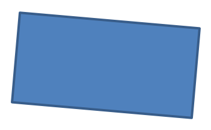

## **介紹**

在 PowerPoint 中，您可以在投影片上加入圖形。由於圖形是由線條組成，您可以透過修改或套用效果來設定其輪廓。除此之外，您也可以指定內部填色的設定，以控制圖形的填充方式。


Aspose.Slides for Python via Java 提供了類別與方法，讓您使用 PowerPoint 中相同的選項來格式化圖形。

## **格式線條**

使用 Aspose.Slides，您可以為圖形指定自訂的線條樣式。以下步驟說明如何操作：

1. 建立一個 [簡報](https://reference.aspose.com/slides/python-java/aspose.slides/presentation/) 物件的實例。
1. 依索引取得投影片參考。
1. 將一個 [AutoShape](https://reference.aspose.com/slides/python-java/aspose.slides/autoshape/) 新增至投影片。
1. 設定圖形的 [線條樣式](https://reference.aspose.com/slides/python-java/aspose.slides/linestyle/)。
1. 設定線條寬度。
1. 設定線條的 [虛線樣式](https://reference.aspose.com/slides/python-java/aspose.slides/linedashstyle/)。
1. 設定圖形的線條顏色。
1. 將已修改的簡報儲存為 PPTX 檔案。

以下程式碼示範如何格式化一個矩形 [AutoShape](https://reference.aspose.com/slides/python-java/aspose.slides/autoshape/)：

```python
import jpype
import asposeslides

if not jpype.isJVMStarted():
    jpype.startJVM()

from asposeslides.api import FillType, LineDashStyle, LineStyle, Presentation, SaveFormat, ShapeType
from java.awt import Color

# 建立代表簡報檔案的 Presentation 類別實例。
presentation = Presentation()
try:
    # 取得第一張投影片。
    slide = presentation.getSlides().get_Item(0)

    # 新增一個矩形類型的自動圖形。
    shape = slide.getShapes().addAutoShape(ShapeType.Rectangle, 50, 150, 150, 75)

    # 設定矩形圖形的填色。
    shape.getFillFormat().setFillType(FillType.NoFill)

    # 為矩形的線條套用格式設定。
    shape.getLineFormat().setStyle(LineStyle.ThickThin)
    shape.getLineFormat().setWidth(7)
    shape.getLineFormat().setDashStyle(LineDashStyle.Dash)

    # 設定矩形線條的顏色。
    shape.getLineFormat().getFillFormat().setFillType(FillType.Solid)
    shape.getLineFormat().getFillFormat().getSolidFillColor().setColor(Color.BLUE)

    # 將 PPTX 檔案儲存至磁碟。
    presentation.save("formatted_lines.pptx", SaveFormat.Pptx)
finally:
    presentation.dispose()
```

結果：


## **套用草圖效果於圖形線條**

草圖效果會讓圖形線條看起來像手繪。使用 [Shape.getLineFormat](https://reference.aspose.com/slides/python-java/aspose.slides/shape/#getLineFormat) 取得線條設定，使用 [LineFormat.getSketchFormat](https://reference.aspose.com/slides/python-java/aspose.slides/lineformat/#getSketchFormat) 取得草圖設定，並使用 [SketchFormat.setSketchType](https://reference.aspose.com/slides/python-java/aspose.slides/sketchformat/#setSketchType) 從 [LineSketchType](https://reference.aspose.com/slides/python-java/aspose.slides/linesketchtype/) 列舉中選取值。

以下 Python 程式碼示範如何套用 [LineSketchType.Curved](https://reference.aspose.com/slides/python-java/aspose.slides/linesketchtype/#Curved) 效果、讀取明確指定的值，以及使用 [LineSketchType.None_](https://reference.aspose.com/slides/python-java/aspose.slides/linesketchtype/#None) 移除效果：

```python
import jpype
import asposeslides

if not jpype.isJVMStarted():
    jpype.startJVM()

from asposeslides.api import LineSketchType, Presentation, ShapeType

presentation = Presentation()
try:
    slide = presentation.getSlides().get_Item(0)
    shape = slide.getShapes().addAutoShape(ShapeType.Rectangle, 50, 50, 200, 100)

    # 存取圖形的線條格式及其草圖格式。
    sketch_format = shape.getLineFormat().getSketchFormat()

    # 套用草圖效果。
    sketch_format.setSketchType(LineSketchType.Curved)

    # 讀取直接指派給圖形的草圖效果。
    explicit_sketch_type = sketch_format.getSketchType()
    print(f"Explicit sketch type: {explicit_sketch_type}")

    # 移除草圖效果。
    sketch_format.setSketchType(LineSketchType.None_)
finally:
    presentation.dispose()
```

[SketchFormat.getSketchType](https://reference.aspose.com/slides/python-java/aspose.slides/sketchformat/#getSketchType) 回傳的值代表直接指派給圖形的設定。如果線條格式可以從佈景主題、母片或版面投影片繼承，請使用 [LineFormat.getEffective](https://reference.aspose.com/slides/python-java/aspose.slides/lineformat/#getEffective)，存取 `LineFormatEffectiveData.getSketchFormat`，並讀取 `SketchFormatEffectiveData.getSketchType`。有效值會反映繼承解析後實際套用的格式：

```python
import jpype
import asposeslides

if not jpype.isJVMStarted():
    jpype.startJVM()

from asposeslides.api import Presentation

presentation = Presentation("presentation.pptx")
try:
    shape = presentation.getSlides().get_Item(0).getShapes().get_Item(0)
    line_format = shape.getLineFormat()

    explicit_sketch_type = line_format.getSketchFormat().getSketchType()
    effective_line_format = line_format.getEffective()
    effective_sketch_type = effective_line_format.getSketchFormat().getSketchType()

    print(f"Explicit sketch type: {explicit_sketch_type}")
    print(f"Effective sketch type: {effective_sketch_type}")
finally:
    presentation.dispose()
```

## **格式接合樣式**

以下是三種接合類型的選項：

* 圓形
* 斜角
* 倒角

預設情況下，PowerPoint 在角度處（例如圖形的角落）連接兩條線時會使用 **圓形** 設定。但如果您繪製的是銳角圖形，可能會較偏好 **斜角** 選項。


以下 Python 程式碼示範如何使用斜角、倒角與圓形接合設定建立三個矩形（如上圖所示）：

```python
import jpype
import asposeslides

if not jpype.isJVMStarted():
    jpype.startJVM()

from asposeslides.api import FillType, LineJoinStyle, Presentation, SaveFormat, ShapeType
from java.awt import Color

# 建立代表簡報檔案的 Presentation 類別實例。
presentation = Presentation()
try:
    # 取得第一張投影片。
    slide = presentation.getSlides().get_Item(0)

    # 新增三個矩形類型的自動圖形。
    miter_shape = slide.getShapes().addAutoShape(ShapeType.Rectangle, 20, 20, 150, 75)
    bevel_shape = slide.getShapes().addAutoShape(ShapeType.Rectangle, 210, 20, 150, 75)
    round_shape = slide.getShapes().addAutoShape(ShapeType.Rectangle, 20, 135, 150, 75)

    # 設定每個矩形圖形的填色。
    miter_shape.getFillFormat().setFillType(FillType.Solid)
    miter_shape.getFillFormat().getSolidFillColor().setColor(Color.BLACK)
    bevel_shape.getFillFormat().setFillType(FillType.Solid)
    bevel_shape.getFillFormat().getSolidFillColor().setColor(Color.BLACK)
    round_shape.getFillFormat().setFillType(FillType.Solid)
    round_shape.getFillFormat().getSolidFillColor().setColor(Color.BLACK)

    # 設定線條寬度。
    miter_shape.getLineFormat().setWidth(15)
    bevel_shape.getLineFormat().setWidth(15)
    round_shape.getLineFormat().setWidth(15)

    # 設定每個矩形線條的顏色。
    miter_shape.getLineFormat().getFillFormat().setFillType(FillType.Solid)
    miter_shape.getLineFormat().getFillFormat().getSolidFillColor().setColor(Color.BLUE)
    bevel_shape.getLineFormat().getFillFormat().setFillType(FillType.Solid)
    bevel_shape.getLineFormat().getFillFormat().getSolidFillColor().setColor(Color.BLUE)
    round_shape.getLineFormat().getFillFormat().setFillType(FillType.Solid)
    round_shape.getLineFormat().getFillFormat().getSolidFillColor().setColor(Color.BLUE)

    # 設定接合樣式。
    miter_shape.getLineFormat().setJoinStyle(LineJoinStyle.Miter)
    bevel_shape.getLineFormat().setJoinStyle(LineJoinStyle.Bevel)
    round_shape.getLineFormat().setJoinStyle(LineJoinStyle.Round)

    # 為每個矩形加入文字。
    miter_shape.getTextFrame().setText("Miter Join Style")
    bevel_shape.getTextFrame().setText("Bevel Join Style")
    round_shape.getTextFrame().setText("Round Join Style")

    # 將 PPTX 檔案儲存至磁碟。
    presentation.save("join_styles.pptx", SaveFormat.Pptx)
finally:
    presentation.dispose()
```

## **漸層填色**

在 PowerPoint 中，漸層填色是一種格式化選項，允許您對圖形套用連續的顏色混合。例如，您可以以逐漸淡出方式將兩種或多種顏色混合在一起。

以下說明如何使用 Aspose.Slides 為圖形套用漸層填色：

1. 建立一個 [簡報](https://reference.aspose.com/slides/python-java/aspose.slides/presentation/) 物件的實例。
1. 依索引取得投影片參考。
1. 將一個 [AutoShape](https://reference.aspose.com/slides/python-java/aspose.slides/autoshape/) 新增至投影片。
1. 將圖形的 [FillType](https://reference.aspose.com/slides/python-java/aspose.slides/filltype/) 設為 `Gradient`。
1. 使用由 [GradientFormat](https://reference.aspose.com/slides/python-java/aspose.slides/gradientformat/) 類別所公開的漸層停止集合的 [addPresetColor](https://reference.aspose.com/slides/python-java/aspose.slides/gradientstopcollection/#addPresetColor) 方法，依定義的位置加入兩個喜好的顏色。
1. 將已修改的簡報儲存為 PPTX 檔案。

以下 Python 程式碼示範如何為橢圓套用漸層填色效果：

```python
import jpype
import asposeslides

if not jpype.isJVMStarted():
    jpype.startJVM()

from asposeslides.api import FillType, GradientDirection, GradientShape, Presentation, PresetColor, SaveFormat, ShapeType
from java.awt import Color

# 建立代表簡報檔案的 Presentation 類別實例。
presentation = Presentation()
try:
    # 取得第一張投影片。
    slide = presentation.getSlides().get_Item(0)

    # 新增一個橢圓類型的自動圖形。
    shape = slide.getShapes().addAutoShape(ShapeType.Ellipse, 50, 50, 150, 75)

    # 為橢圓套用漸層格式化。
    shape.getFillFormat().setFillType(FillType.Gradient)
    shape.getFillFormat().getGradientFormat().setGradientShape(GradientShape.Linear)

    # 設定漸層的方向。
    shape.getFillFormat().getGradientFormat().setGradientDirection(GradientDirection.FromCorner2)

    # 新增兩個漸層停止點。
    shape.getFillFormat().getGradientFormat().getGradientStops().addPresetColor(1.0, PresetColor.Purple)
    shape.getFillFormat().getGradientFormat().getGradientStops().addPresetColor(0.0, PresetColor.Red)

    # 將 PPTX 檔案儲存至磁碟。
    presentation.save("gradient_fill.pptx", SaveFormat.Pptx)
finally:
    presentation.dispose()
```

結果：


如果在匯出影像時漸層的顯示與 PowerPoint 中不同，請參閱 [Choose a Gradient Rendering Style](/slides/zh-hant/python-java/convert-powerpoint-to-png/#choose-a-gradient-rendering-style)。您可以在不更改簡報中儲存的漸層填色的前提下，選擇不同的渲染樣式。

## **圖案填色**

在 PowerPoint 中，圖案填色是一種格式化選項，可讓您將兩色圖案（如點狀、條紋、交叉或格子）套用至圖形。您可以為圖案的前景色與背景色自訂顏色。

Aspose.Slides 提供超過 45 種預定義圖案樣式，您可將其套用至圖形，以提升簡報的視覺效果。即使選取了預定義圖案，仍可自行指定確切的顏色。

以下說明如何使用 Aspose.Slides 為圖形套用圖案填色：

1. 建立一個 [簡報](https://reference.aspose.com/slides/python-java/aspose.slides/presentation/) 物件的實例。
1. 依索引取得投影片參考。
1. 將一個 [AutoShape](https://reference.aspose.com/slides/python-java/aspose.slides/autoshape/) 新增至投影片。
1. 將圖形的 [FillType](https://reference.aspose.com/slides/python-java/aspose.slides/filltype/) 設為 `Pattern`。
1. 從預定義選項中選取圖案樣式。
1. 設定圖案的 [Background Color](https://reference.aspose.com/slides/python-java/aspose.slides/patternformat/#getBackColor)。
1. 設定圖案的 [Foreground Color](https://reference.aspose.com/slides/python-java/aspose.slides/patternformat/#getForeColor)。
1. 將已修改的簡報儲存為 PPTX 檔案。

以下 Python 程式碼示範如何為矩形套用圖案填色：

```python
import jpype
import asposeslides

if not jpype.isJVMStarted():
    jpype.startJVM()

from asposeslides.api import FillType, PatternStyle, Presentation, SaveFormat, ShapeType
from java.awt import Color

# 建立代表簡報檔案的 Presentation 類別實例。
presentation = Presentation()
try:
    # 取得第一張投影片。
    slide = presentation.getSlides().get_Item(0)

    # 新增一個矩形類型的自動圖形。
    shape = slide.getShapes().addAutoShape(ShapeType.Rectangle, 50, 50, 150, 75)

    # 設定填充類型為圖案。
    shape.getFillFormat().setFillType(FillType.Pattern)

    # 設定圖案樣式。
    shape.getFillFormat().getPatternFormat().setPatternStyle(PatternStyle.Trellis)

    # 設定圖案的背景色與前景色。
    shape.getFillFormat().getPatternFormat().getBackColor().setColor(Color.LIGHT_GRAY)
    shape.getFillFormat().getPatternFormat().getForeColor().setColor(Color.YELLOW)

    # 將 PPTX 檔案儲存至磁碟。
    presentation.save("pattern_fill.pptx", SaveFormat.Pptx)
finally:
    presentation.dispose()
```

結果：


## **圖片填色**

在 PowerPoint 中，圖片填色是一種格式化選項，允許您在圖形內插入影像，實質上將影像作為圖形的背景。

以下說明如何使用 Aspose.Slides 為圖形套用圖片填色：

1. 建立一個 [簡報](https://reference.aspose.com/slides/python-java/aspose.slides/presentation/) 物件的實例。
1. 依索引取得投影片參考。
1. 將一個 [AutoShape](https://reference.aspose.com/slides/python-java/aspose.slides/autoshape/) 新增至投影片。
1. 將圖形的 [FillType](https://reference.aspose.com/slides/python-java/aspose.slides/filltype/) 設為 `Picture`。
1. 將圖片填色模式設為 `Tile`（或其他首選模式）。
1. 從欲使用的影像建立一個 [PPImage](https://reference.aspose.com/slides/python-java/aspose.slides/ppimage/) 物件。
1. 將影像傳遞給 `SlidesPicture.setImage` 方法。
1. 將已修改的簡報儲存為 PPTX 檔案。

假設我們有一個名為「lotus.png」的檔案，其內容如下：


以下 Python 程式碼示範如何以圖片填滿圖形：

```python
import jpage
import asposeslides

if not jpype.isJVMStarted():
    jpype.startJVM()

from asposeslides.api import FillType, Images, PictureFillMode, Presentation, SaveFormat, ShapeType

# 建立代表簡報檔案的 Presentation 類別實例。
presentation = Presentation()
try:
    # 取得第一張投影片。
    slide = presentation.getSlides().get_Item(0)

    # 新增一個矩形類型的自動圖形。
    shape = slide.getShapes().addAutoShape(ShapeType.Rectangle, 50, 50, 255, 130)
    
    # 設定填充類型為圖片。
    shape.getFillFormat().setFillType(FillType.Picture)

    # 設定圖片填充模式。
    shape.getFillFormat().getPictureFillFormat().setPictureFillMode(PictureFillMode.Tile)

    # 載入影像並將其加入簡報資源。
    image = Images.fromFile("lotus.png")
    picture = presentation.getImages().addImage(image)
    image.dispose()

    # 設定圖片。
    shape.getFillFormat().getPictureFillFormat().getPicture().setImage(picture)

    # 將 PPTX 檔案儲存至磁碟。
    presentation.save("picture_fill.pptx", SaveFormat.Pptx)
finally:
    presentation.dispose()
```

結果：


### **將圖片平鋪為紋理**

若您想將平鋪的圖片作為紋理並自訂平鋪行為，可使用 [PictureFillFormat](https://reference.aspose.com/slides/python-java/aspose.slides/picturefillformat/) 類別的以下方法：

- [setPictureFillMode](https://reference.aspose.com/slides/python-java/aspose.slides/picturefillformat/#setPictureFillMode)：設定圖片填色模式—`Tile` 或 `Stretch`。
- [setTileAlignment](https://reference.aspose.com/slides/python-java/aspose.slides/picturefillformat/#setTileAlignment)：指定平鋪在圖形內的對齊方式。
- [setTileFlip](https://reference.aspose.com/slides/python-java/aspose.slides/picturefillformat/#setTileFlip)：控制平鋪是否水平、垂直或同時翻轉。
- [setTileOffsetX](https://reference.aspose.com/slides/python-java/aspose.slides/picturefillformat/#setTileOffsetX)：設定平鋪相對於圖形原點的水平偏移（點數）。
- [setTileOffsetY](https://reference.aspose.com/slides/python-java/aspose.slides/picturefillformat/#setTileOffsetY)：設定平鋪相對於圖形原點的垂直偏移（點數）。
- [setTileScaleX](https://reference.aspose.com/slides/python-java/aspose.slides/picturefillformat/#setTileScaleX)：以百分比定義水平縮放比例。
- [setTileScaleY](https://reference.aspose.com/slides/python-java/aspose.slides/picturefillformat/#setTileScaleY)：以百分比定義垂直縮放比例。

以下程式碼範例示範如何新增一個具有平鋪圖片填色的矩形，並設定平鋪選項：

```python
import jpype
import asposeslides

if not jpype.isJVMStarted():
    jpype.startJVM()

from asposeslides.api import FillType, Images, PictureFillMode, Presentation, RectangleAlignment, SaveFormat, ShapeType, TileFlip

# 建立代表簡報檔案的 Presentation 類別實例。
presentation = Presentation()
try:
    # 取得第一張投影片。
    first_slide = presentation.getSlides().get_Item(0)

    # 新增一個矩形自動圖形。
    shape = first_slide.getShapes().addAutoShape(ShapeType.Rectangle, 50, 50, 190, 95)

    # 設定圖形的填充類型為圖片。
    shape.getFillFormat().setFillType(FillType.Picture)

    # 載入影像並將其加入簡報資源。
    source_image = Images.fromFile("lotus.png")
    presentation_image = presentation.getImages().addImage(source_image)
    source_image.dispose()

    # 指派影像給圖形。
    picture_fill_format = shape.getFillFormat().getPictureFillFormat()
    picture_fill_format.getPicture().setImage(presentation_image)

    # 設定圖片填充模式與平鋪屬性。
    picture_fill_format.setPictureFillMode(PictureFillMode.Tile)
    picture_fill_format.setTileOffsetX(-32)
    picture_fill_format.setTileOffsetY(-32)
    picture_fill_format.setTileScaleX(50)
    picture_fill_format.setTileScaleY(50)
    picture_fill_format.setTileAlignment(RectangleAlignment.BottomRight)
    picture_fill_format.setTileFlip(TileFlip.FlipBoth)

    # 将 PPTX 檔案儲存至磁碟。
    presentation.save("tile.pptx", SaveFormat.Pptx)
finally:
    presentation.dispose()
```

結果：


## **實色填色**

在 PowerPoint 中，實色填色是一種格式化選項，會以單一、均勻的顏色填滿圖形。此純色背景不包含任何漸層、紋理或圖案。

使用 Aspose.Slides 為圖形套用實色填色的步驟如下：

1. 建立一個 [簡報](https://reference.aspose.com/slides/python-java/aspose.slides/presentation/) 物件的實例。
1. 依索引取得投影片參考。
1. 將一個 [AutoShape](https://reference.aspose.com/slides/python-java/aspose.slides/autoshape/) 新增至投影片。
1. 將圖形的 [FillType](https://reference.aspose.com/slides/python-java/aspose.slides/filltype/) 設為 `Solid`。
1. 為圖形指派您偏好的填色。
1. 將已修改的簡報儲存為 PPTX 檔案。

以下 Python 程式碼示範如何在 PowerPoint 投影片的矩形上套用實色填色：

```python
import jpype
import asposeslides

if not jpype.isJVMStarted():
    jpype.startJVM()

from asposeslides.api import FillType, Presentation, SaveFormat, ShapeType
from java.awt import Color

# 建立代表簡報檔案的 Presentation 類別實例。
presentation = Presentation()
try:
    # 取得第一張投影片。
    slide = presentation.getSlides().get_Item(0)

    # 新增一個矩形類型的自動圖形。
    shape = slide.getShapes().addAutoShape(ShapeType.Rectangle, 50, 50, 150, 75)

    # 設定填充類型為純色。
    shape.getFillFormat().setFillType(FillType.Solid)

    # 設定填充顏色。
    shape.getFillFormat().getSolidFillColor().setColor(Color.YELLOW)

    # 將 PPTX 檔案儲存至磁碟。
    presentation.save("solid_color_fill.pptx", SaveFormat.Pptx)
finally:
    presentation.dispose()
```

結果：


## **設定透明度**

在 PowerPoint 中，當您為圖形套用實色、漸層、圖片或紋理填色時，也可以設定透明度，以控制填色的不透明程度。較高的透明度會使圖形更為半透明，讓背景或下層物件部分可見。

Aspose.Slides 允許您透過調整填色使用的顏色之 alpha 值來設定透明度。操作步驟如下：

1. 建立一個 [簡報](https://reference.aspose.com/slides/python-java/aspose.slides/presentation/) 物件的實例。
1. 依索引取得投影片參考。
1. 將一個 [AutoShape](https://reference.aspose.com/slides/python-java/aspose.slides/autoshape/) 新增至投影片。
1. 將 [FillType](https://reference.aspose.com/slides/python-java/aspose.slides/filltype/) 設為 `Solid`。
1. 使用 [Color](https://docs.oracle.com/en/java/javase/17/docs/api/java.desktop/java/awt/Color.html) 定義具有透明度的顏色（alpha 元件控制透明度）。
1. 儲存簡報。

以下 Python 程式碼示範如何為矩形套用透明填色：

```python
import jpype
import asposeslides

if not jpype.isJVMStarted():
    jpype.startJVM()

from asposeslides.api import FillType, Presentation, SaveFormat, ShapeType
from java.awt import Color

# 建立代表簡報檔案的 Presentation 類別實例。
presentation = Presentation()
try:
    # 取得第一張投影片。
    slide = presentation.getSlides().get_Item(0)

    # 新增一個實心矩形自動圖形。
    solid_shape = slide.getShapes().addAutoShape(ShapeType.Rectangle, 50, 50, 150, 75)

    # 在實心圖形上方新增一個透明矩形自動圖形。
    transparent_shape = slide.getShapes().addAutoShape(ShapeType.Rectangle, 80, 80, 150, 75)
    transparent_shape.getFillFormat().setFillType(FillType.Solid)
    transparent_color = Color(255, 255, 0, 204)
    transparent_shape.getFillFormat().getSolidFillColor().setColor(transparent_color)

    # 將 PPTX 檔案儲存至磁碟。
    presentation.save("shape_transparency.pptx", SaveFormat.Pptx)
finally:
    presentation.dispose()
```

結果：


## **旋轉圖形**

Aspose.Slides 讓您在 PowerPoint 簡報中旋轉圖形。這在需要特定對齊或設計需求時相當有用。

要在投影片上旋轉圖形，請依以下步驟：

1. 建立一個 [簡報](https://reference.aspose.com/slides/python-java/aspose.slides/presentation/) 物件的實例。
1. 依索引取得投影片參考。
1. 將一個 [AutoShape](https://reference.aspose.com/slides/python-java/aspose.slides/autoshape/) 新增至投影片。
1. 設定圖形的旋轉屬性為所需的角度。
1. 儲存簡報。

以下 Python 程式碼示範如何將圖形旋轉 5 度：

```python
import jpype
import asposeslides

if not jpype.isJVMStarted():
    jpype.startJVM()

from asposeslides.api import Presentation, SaveFormat, ShapeType

# 建立代表簡報檔案的 Presentation 類別實例。
presentation = Presentation()
try:
    # 取得第一張投影片。
    slide = presentation.getSlides().get_Item(0)

    # 新增一個矩形類型的自動圖形。
    shape = slide.getShapes().addAutoShape(ShapeType.Rectangle, 50, 50, 150, 75)

    # 將圖形旋轉 5 度。
    shape.setRotation(5)

    # 將 PPTX 檔案儲存至磁碟。
    presentation.save("shape_rotation.pptx", SaveFormat.Pptx)
finally:
    presentation.dispose()
```

結果：



## **新增 3D 斜角效果**

Aspose.Slides 允許您透過設定圖形的 [ThreeDFormat](https://reference.aspose.com/slides/python-java/aspose.slides/threedformat/) 屬性，為圖形加入 3D 斜角效果。

要為圖形新增 3D 斜角效果，請依以下步驟：

1. 建立 [Presentation](https://reference.aspose.com/slides/python-java/aspose.slides/presentation/) 物件的實例。
1. 依索引取得投影片參考。
1. 將一個 [AutoShape](https://reference.aspose.com/slides/python-java/aspose.slides/autoshape/) 新增至投影片。
1. 設定圖形的 [ThreeDFormat](https://reference.aspose.com/slides/python-java/aspose.slides/threedformat/) 以定義斜角設定。
1. 儲存簡報。

以下 Python 程式碼示範如何為圖形套用 3D 斜角效果：

```python
import jpype
import asposeslides

if not jpype.isJVMStarted():
    jpype.startJVM()

from asposeslides.api import BevelPresetType, CameraPresetType, FillType, LightRigPresetType, LightingDirection, Presentation, SaveFormat, ShapeType
from java.awt import Color

# 建立 Presentation 類別的實例。
presentation = Presentation()
try:
    slide = presentation.getSlides().get_Item(0)

    # 在投影片上新增圖形。
    shape = slide.getShapes().addAutoShape(ShapeType.Ellipse, 50, 50, 100, 100)
    shape.getFillFormat().setFillType(FillType.Solid)
    shape.getFillFormat().getSolidFillColor().setColor(Color.GREEN)
    shape.getLineFormat().getFillFormat().setFillType(FillType.Solid)
    shape.getLineFormat().getFillFormat().getSolidFillColor().setColor(Color.ORANGE)
    shape.getLineFormat().setWidth(2.0)

    # 設定圖形的 ThreeDFormat 屬性。
    shape.getThreeDFormat().setDepth(4)
    shape.getThreeDFormat().getBevelTop().setBevelType(BevelPresetType.Circle)
    shape.getThreeDFormat().getBevelTop().setHeight(6)
    shape.getThreeDFormat().getBevelTop().setWidth(6)
    shape.getThreeDFormat().getCamera().setCameraType(CameraPresetType.OrthographicFront)
    shape.getThreeDFormat().getLightRig().setLightType(LightRigPresetType.ThreePt)
    shape.getThreeDFormat().getLightRig().setDirection(LightingDirection.Top)

    # 將簡報儲存為 PPTX 檔案。
    presentation.save("3D_bevel_effect.pptx", SaveFormat.Pptx)
finally:
    presentation.dispose()
```

結果：


## **新增 3D 旋轉效果**

Aspose.Slides 允許您透過設定圖形的 [ThreeDFormat](https://reference.aspose.com/slides/python-java/aspose.slides/threedformat/) 屬性，為圖形加入 3D 旋轉效果。

要為圖形套用 3D 旋轉：

1. 建立一個 [簡報](https://reference.aspose.com/slides/python-java/aspose.slides/presentation/) 物件的實例。
1. 依索引取得投影片參考。
1. 將一個 [AutoShape](https://reference.aspose.com/slides/python-java/aspose.slides/autoshape/) 新增至投影片。
1. 使用 [setCameraType](https://reference.aspose.com/slides/python-java/aspose.slides/camera/#setCameraType) 與 [setLightType](https://reference.aspose.com/slides/python-java/aspose.slides/lightrig/#setLightType) 方法定義 3D 旋轉。
1. 儲存簡報。

以下 Python 程式碼示範如何為圖形套用 3D 旋轉效果：

```python
import jpype
import asposeslides

if not jpype.isJVMStarted():
    jpype.startJVM()

from asposeslides.api import CameraPresetType, LightRigPresetType, Presentation, SaveFormat, ShapeType

# 建立 Presentation 類別的實例。
presentation = Presentation()
try:
    slide = presentation.getSlides().get_Item(0)

    auto_shape = slide.getShapes().addAutoShape(ShapeType.Rectangle, 50, 50, 150, 75)
    auto_shape.getTextFrame().setText("Hello, Aspose!")

    auto_shape.getThreeDFormat().setDepth(6)
    auto_shape.getThreeDFormat().getCamera().setRotation(40, 35, 20)
    auto_shape.getThreeDFormat().getCamera().setCameraType(CameraPresetType.IsometricLeftUp)
    auto_shape.getThreeDFormat().getLightRig().setLightType(LightRigPresetType.Balanced)

    # 將簡報儲存為 PPTX 檔案。
    presentation.save("3D_rotation_effect.pptx", SaveFormat.Pptx)
finally:
    presentation.dispose()
```

結果：


## **控制圖形的黑白顯示模式**

[Shape.setBlackWhiteMode](https://reference.aspose.com/slides/python-java/aspose.slides/shape/#setBlackWhiteMode) 方法指定當簡報以黑白模式檢視或處理時，個別圖形的呈現方式。它本身不會啟用黑白顯示，也不會改變圖形在一般彩色模式下的填色、線條或其他格式設定。

使用 [BlackWhiteMode](https://reference.aspose.com/slides/python-java/aspose.slides/blackwhitemode/) 類別中的值來選擇所需行為。例如，`Automatic` 讓呈現應用程式自行決定轉換方式，`Gray` 與 `LightGray` 使用灰階，`BlackWhite` 只使用黑白，`Black` 與 `White` 強制單一顏色，`Color` 保留正常彩色，`Hidden` 在黑白模式下隱藏圖形，`NotDefined` 表示未指定圖形層級模式。

以下 Python 程式碼建立一個彩色圖形，並在黑白顯示模式下使其呈現為灰色：

```python
import jpype
import asposeslides

if not jpype.isJVMStarted():
    jpype.startJVM()

from asposeslides.api import BlackWhiteMode, FillType, Presentation, SaveFormat, ShapeType
from java.awt import Color

presentation = Presentation()
try:
    slide = presentation.getSlides().get_Item(0)

    shape = slide.getShapes().addAutoShape(ShapeType.Rectangle, 50, 50, 200, 100)
    shape.getFillFormat().setFillType(FillType.Solid)
    shape.getFillFormat().getSolidFillColor().setColor(Color.ORANGE)

    # 在彩色模式下保留橙色填色，但在黑白模式下以灰色呈現圖形。
    shape.setBlackWhiteMode(BlackWhiteMode.Gray)

    presentation.save("shape_black_white_mode.pptx", SaveFormat.Pptx)
finally:
    presentation.dispose()
```

在一般彩色模式下，矩形仍保有橙色填色；在黑白顯示工作流程中，因其模式設定為 `Gray`，因此會以灰色呈現。這讓您在保留完整彩色投影片的同時，為列印、預覽或其他遵循黑白顯示設定的工作流程定義不同的外觀。

## **重設格式設定**

以下 Python 程式碼示範如何重設投影片的格式，並將 [LayoutSlide](https://reference.aspose.com/slides/python-java/aspose.slides/layoutslide/) 上所有具佔位符的圖形的定位、大小與格式還原為預設設定：

```python
import jpype
import asposeslides

if not jpype.isJVMStarted():
    jpype.startJVM()

from asposeslides.api import Presentation, SaveFormat

presentation = Presentation("sample.pptx")
try:
    for slide in presentation.getSlides():
        # 重設投影片上具有版面佔位符的每個圖形。
        slide.reset()

    presentation.save("reset_formatting.pptx", SaveFormat.Pptx)
finally:
    presentation.dispose()
```

## **常見問答**

**圖形格式化會影響最終簡報檔案大小嗎？**

影響極小。嵌入的影像與媒體佔用大部分檔案空間，而顏色、效果與漸層等圖形參數僅以中繼資料儲存，幾乎不會增加額外大小。

**如何偵測投影片中具有相同格式的圖形以便將它們分組？**

比較每個圖形的關鍵格式屬性—填色、線條與效果設定。若所有對應的值皆相符，即可視為相同樣式，並在邏輯上將這些圖形分組，從而簡化後續的樣式管理。

**我可以將一組自訂圖形樣式存成獨立檔案，以便在其他簡報中重複使用嗎？**

可以。將帶有所需樣式的範例圖形存於範本投影片或 .POTX 範本檔案中。建立新簡報時，開啟該範本、複製所需的樣式圖形，並在需要的地方重新套用其格式設定。