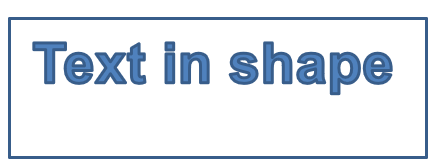

## **概述**

本篇說明如何透過編輯點與幾何路徑來自訂 Aspose.Slides 中的圖形外觀。示範如何使用 [GeometryPath](https://reference.aspose.com/slides/python-java/aspose.slides/geometrypath/) 變更既有圖形、執行基本的路徑編輯操作、加入或移除點，並將更新後的幾何套用回圖形。

同時展示如何建立自訂與複合圖形、建構帶有圓角的圖形、判斷圖形幾何是否閉合、檢查圖形元素，並將 Java AWT 文字輪廓轉換為幾何路徑。

## **使用編輯點變更圖形**

在 PowerPoint 中，您可以使用 **Edit Points** 來修改正方形：

* 向內或向外移動角落。
* 調整點的曲率。
* 新增點。

編輯點可讓您修改圖形的輪廓，或以既有圖形為基礎建立新圖形。

## **圖形編輯技巧**


編輯 PowerPoint 圖形時，請記住以下概念：

* 圖形（或其路徑）可以是閉合或開放的。
* 圖形的路徑由錨點（anchor points）以及連接的線段組成。
* 線段可以是直線或曲線。錨點與控制手柄決定其形狀。
* 錨點可分為角點、直線點或平滑點：
  * 在角點，相鄰的線段可以形成角度。
  * 在平滑點，兩個控制手柄保持對齊且與錨點等距。
  * 在直線點，兩個控制手柄保持對齊，但與錨點的距離可不同。
* 移動錨點或調整其手柄會改變圖形的輪廓。

為了透過編輯點編輯 PowerPoint 圖形，**Aspose.Slides** 提供了 [GeometryPath](https://reference.aspose.com/slides/python-java/aspose.slides/geometrypath/) 類別。

* 一個 [GeometryPath](https://reference.aspose.com/slides/python-java/aspose.slides/geometrypath/) 實例代表 [GeometryShape](https://reference.aspose.com/slides/python-java/aspose.slides/geometryshape/) 物件的幾何路徑。
* 若要從 [GeometryShape](https://reference.aspose.com/slides/python-java/aspose.slides/geometryshape/) 取得 [GeometryPath](https://reference.aspose.com/slides/python-java/aspose.slides/geometrypath/)，可以使用 [GeometryShape.getGeometryPaths](https://reference.aspose.com/slides/python-java/aspose.slides/geometryshape/#getGeometryPaths) 方法。
* 若要為圖形設定 [GeometryPath](https://reference.aspose.com/slides/python-java/aspose.slides/geometrypath/)，可使用以下方法：單一路徑圖形使用 [GeometryShape.setGeometryPath](https://reference.aspose.com/slides/python-java/aspose.slides/geometryshape/#setGeometryPath)；多路徑圖形使用 [GeometryShape.setGeometryPaths](https://reference.aspose.com/slides/python-java/aspose.slides/geometryshape/#setGeometryPaths)。
* 若要加入線段，可使用屬於 [GeometryPath](https://reference.aspose.com/slides/python-java/aspose.slides/geometrypath/) 的各種方法。
* 使用 [GeometryPath.setStroke](https://reference.aspose.com/slides/python-java/aspose.slides/geometrypath/#setStroke) 與 [GeometryPath.setFillMode](https://reference.aspose.com/slides/python-java/aspose.slides/geometrypath/#setFillMode) 方法，可設定幾何路徑的外觀。
* 透過 [GeometryPath.getPathData](https://reference.aspose.com/slides/python-java/aspose.slides/geometrypath/#getPathData) 方法，可取得 [GeometryShape](https://reference.aspose.com/slides/python-java/aspose.slides/geometryshape/) 的幾何路徑，回傳為路徑線段陣列。
* 若要存取其他圖形幾何自訂選項，可透過 [java.awt.Shape](https://docs.oracle.com/javase/8/docs/api/java/awt/Shape.html) 的 [PathIterator](https://docs.oracle.com/javase/8/docs/api/java/awt/geom/PathIterator.html) 讀取，並將線段重放至 [GeometryPath](https://reference.aspose.com/slides/python-java/aspose.slides/geometrypath/)。

## **簡易編輯操作**

使用下列方法編輯幾何路徑。接受索引的重載會在路徑的線段陣列中以零基索引插入線段。

| 操作 | 方法 |
| --- | --- |
| 附加或插入直線。 | [GeometryPath.lineTo](https://reference.aspose.com/slides/python-java/aspose.slides/geometrypath/#lineTo) |
| 附加或插入具有兩個控制點與終點的三次貝茲曲線。 | [GeometryPath.cubicBezierTo](https://reference.aspose.com/slides/python-java/aspose.slides/geometrypath/#cubicBezierTo) |
| 附加或插入具有一個控制點與終點的二次貝茲曲線。 | [GeometryPath.quadraticBezierTo](https://reference.aspose.com/slides/python-java/aspose.slides/geometrypath/#quadraticBezierTo) |
| 附加具有指定尺寸與角度（以度為單位）的橢圓弧段。 | [GeometryPath.arcTo](https://reference.aspose.com/slides/python-java/aspose.slides/geometrypath/#arcTo) |
| 以將端點連回起點的方式閉合目前圖形。 | [GeometryPath.closeFigure](https://reference.aspose.com/slides/python-java/aspose.slides/geometrypath/#closeFigure) |
| 設定圖形的起始點。 | [GeometryPath.moveTo](https://reference.aspose.com/slides/python-java/aspose.slides/geometrypath/#moveTo) |
| 移除指定零基索引的線段。 | [GeometryPath.removeAt](https://reference.aspose.com/slides/python-java/aspose.slides/geometrypath/#removeAt) |

## **為圖形加入自訂點**

此範例使用 [GeometryPath.lineTo](https://reference.aspose.com/slides/python-java/aspose.slides/geometrypath/#lineTo) 在矩形圖形中插入兩個點，並以 [GeometryShape.setGeometryPath](https://reference.aspose.com/slides/python-java/aspose.slides/geometryshape/#setGeometryPath) 套用編輯後的路徑。座標為相對於圖形的本機座標：兩個新點位於圖形中心，左側距離 100 點、上方距離 50 點。線段索引 1 與 4 分別將點放在上、下邊緣，令這兩條邊向內收縮。

```python
import jpype
import asposeslides

if not jpype.isJVMStarted():
    jpype.startJVM()

from asposeslides.api import Presentation, ShapeType

presentation = Presentation()
try:
    slide = presentation.getSlides().get_Item(0)

    shape = slide.getShapes().addAutoShape(ShapeType.Rectangle, 100, 100, 200, 100)

    geometry_path = shape.getGeometryPaths()[0]
    geometry_path.lineTo(100, 50, 1)
    geometry_path.lineTo(100, 50, 4)

    shape.setGeometryPath(geometry_path)
finally:
    presentation.dispose()
```


## **從圖形移除點**

此範例透過 [GeometryPath.removeAt](https://reference.aspose.com/slides/python-java/aspose.slides/geometrypath/#removeAt) 移除零基索引 2 的線段，變更心形輪廓。使用 [GeometryShape.setGeometryPath](https://reference.aspose.com/slides/python-java/aspose.slides/geometryshape/#setGeometryPath) 套用修改後的路徑，即可更新圖形輪廓。

```python
import jpype
import asposeslides

if not jpype.isJVMStarted():
    jpype.startJVM()

from asposeslides.api import Presentation, ShapeType

presentation = Presentation()
try:
    slide = presentation.getSlides().get_Item(0)

    shape = slide.getShapes().addAutoShape(ShapeType.Heart, 100, 100, 300, 300)

    geometry_path = shape.getGeometryPaths()[0]
    geometry_path.removeAt(2)

    shape.setGeometryPath(geometry_path)
finally:
    presentation.dispose()
```


## **建立自訂圖形**

此範例利用 [GeometryPath](https://reference.aspose.com/slides/python-java/aspose.slides/geometrypath/) 建立一個五角星。外徑與內徑分別為 100 與 50 點，交錯形成星角；每 72 度一步將五個星角均勻分佈。最後以 [GeometryPath.closeFigure](https://reference.aspose.com/slides/python-java/aspose.slides/geometrypath/#closeFigure) 閉合路徑，並使用 [GeometryShape.setGeometryPath](https://reference.aspose.com/slides/python-java/aspose.slides/geometryshape/#setGeometryPath) 套用至矩形圖形，取代其原有輪廓。

```python
import jpype
import asposeslides

if not jpype.isJVMStarted():
    jpype.startJVM()

from asposeslides.api import Presentation, ShapeType, GeometryPath

import math

points = []
outer_radius = 100
inner_radius = 50
angle_step = 72

for angle in range(-90, 270, angle_step):
    radians = math.radians(angle)
    x = outer_radius * math.cos(radians)
    y = outer_radius * math.sin(radians)
    points.append((x + outer_radius, y + outer_radius))

    radians = math.radians(angle + angle_step / 2)
    x = inner_radius * math.cos(radians)
    y = inner_radius * math.sin(radians)
    points.append((x + outer_radius, y + outer_radius))

star_path = GeometryPath()
star_path.moveTo(*points[0])
for point in points[1:]:
    star_path.lineTo(*point)
star_path.closeFigure()

presentation = Presentation()
try:
    slide = presentation.getSlides().get_Item(0)

    shape = slide.getShapes().addAutoShape(ShapeType.Rectangle, 100, 100, outer_radius * 2, outer_radius * 2)
    shape.setGeometryPath(star_path)
finally:
    presentation.dispose()
```


## **建立複合自訂圖形**

此範例為圖形的上、下三分之一各定義一個閉合的 [GeometryPath](https://reference.aspose.com/slides/python-java/aspose.slides/geometrypath/) 物件。透過 [GeometryShape.setGeometryPaths](https://reference.aspose.com/slides/python-java/aspose.slides/geometryshape/#setGeometryPaths) 同時套用兩條路徑，即可產生一個中間三分之一有間隙的單一複合圖形。

```python
import jpype
import asposeslides

if not jpype.isJVMStarted():
    jpype.startJVM()

from asposeslides.api import Presentation, ShapeType, GeometryPath

presentation = Presentation()
try:
    slide = presentation.getSlides().get_Item(0)

    shape = slide.getShapes().addAutoShape(ShapeType.Rectangle, 100, 100, 200, 100)

    top_path = GeometryPath()
    top_path.moveTo(0, 0)
    top_path.lineTo(shape.getWidth(), 0)
    top_path.lineTo(shape.getWidth(), shape.getHeight() / 3)
    top_path.lineTo(0, shape.getHeight() / 3)
    top_path.closeFigure()

    bottom_path = GeometryPath()
    bottom_path.moveTo(0, shape.getHeight() / 3 * 2)
    bottom_path.lineTo(shape.getWidth(), shape.getHeight() / 3 * 2)
    bottom_path.lineTo(shape.getWidth(), shape.getHeight())
    bottom_path.lineTo(0, shape.getHeight())
    bottom_path.closeFigure()

    shape.setGeometryPaths([top_path, bottom_path])
finally:
    presentation.dispose()
```


## **建立帶有圓角的自訂圖形**

此範例將直線線段與 [GeometryPath.arcTo](https://reference.aspose.com/slides/python-java/aspose.slides/geometrypath/#arcTo) 結合，產生具有向內彎曲角的圖形。每個角的大小決定弧的寬度與高度（以點為單位），-90 度的掃描角度繪製逆時針四分之一橢圓。完成的路徑以 [GeometryShape.setGeometryPath](https://reference.aspose.com/slides/python-java/aspose.slides/geometryshape/#setGeometryPath) 套用，最後將簡報儲存為 PPTX 格式。

```python
import jpype
import asposeslides

if not jpype.isJVMStarted():
    jpype.startJVM()

from asposeslides.api import Presentation, ShapeType, GeometryPath, SaveFormat

shape_x = 20
shape_y = 20
shape_width = 300
shape_height = 200

left_top_size = 50
right_top_size = 20
right_bottom_size = 40
left_bottom_size = 10

presentation = Presentation()
try:
    slide = presentation.getSlides().get_Item(0)

    shape = slide.getShapes().addAutoShape(ShapeType.Custom, shape_x, shape_y, shape_width, shape_height)

    geometry_path = GeometryPath()
    geometry_path.moveTo(left_top_size, 0)
    geometry_path.lineTo(shape_width - right_top_size, 0)
    geometry_path.arcTo(right_top_size, right_top_size, 180, -90)
    geometry_path.lineTo(shape_width, shape_height - right_bottom_size)
    geometry_path.arcTo(right_bottom_size, right_bottom_size, -90, -90)
    geometry_path.lineTo(left_bottom_size, shape_height)
    geometry_path.arcTo(left_bottom_size, left_bottom_size, 0, -90)
    geometry_path.lineTo(0, left_top_size)
    geometry_path.arcTo(left_top_size, left_top_size, 90, -90)
    geometry_path.closeFigure()
    
    shape.setGeometryPath(geometry_path)

    presentation.save("output.pptx", SaveFormat.Pptx)
finally:
    presentation.dispose()
```

## **判斷圖形幾何是否閉合**

以下輔助函式會檢查每個非空幾何路徑是否以閉合線段結尾。它會讀取 [GeometryPath.getPathData](https://reference.aspose.com/slides/python-java/aspose.slides/geometrypath/#getPathData)，並將最後一條線段的 [PathSegment.getPathCommand](https://reference.aspose.com/slides/python-java/aspose.slides/pathsegment/#getPathCommand) 與 [PathCommandType.Close](https://reference.aspose.com/slides/python-java/aspose.slides/pathcommandtype/) 進行比較。若不存在非空路徑，則回傳 `False`。此檢查僅比較每條路徑的最後指令，並不會檢查路徑內的每個子圖形。範例會對矩形輸出 `True`。

```python
import jpype
import asposeslides

if not jpype.isJVMStarted():
    jpype.startJVM()

from asposeslides.api import Presentation, ShapeType, PathCommandType

def is_geometry_closed(geometry_shape):
    has_nonempty_path = False
    for geometry_path in geometry_shape.getGeometryPaths():
        path_data = geometry_path.getPathData()
        if len(path_data) == 0:
            continue
        last_segment = path_data[-1]
        has_nonempty_path = True
        if last_segment.getPathCommand() != PathCommandType.Close:
            return False
    return has_nonempty_path

presentation = Presentation()
try:
    slide = presentation.getSlides().get_Item(0)
    shape = slide.getShapes().addAutoShape(ShapeType.Rectangle, 100, 100, 200, 100)
    closed = is_geometry_closed(shape)
    print(closed)
finally:
    presentation.dispose()
```

## **擷取與檢查圖形元素**

使用 [GeometryShape.createShapeElements](https://reference.aspose.com/slides/python-java/aspose.slides/geometryshape/#createShapeElements) 可將現有圖形以包含路徑點與點類型的元素形式檢查。將每個返回的元素以 `jpype.JObject` 轉型為 [ShapeElement](https://reference.aspose.com/slides/python-java/aspose.slides/shapeelement/)，即可透過 [getPathPoints](https://reference.aspose.com/slides/python-java/aspose.slides/shapeelement/#getPathPoints) 與 [getPathTypes](https://reference.aspose.com/slides/python-java/aspose.slides/shapeelement/#getPathTypes) 取得點與類型陣列。此表示方式適合輪廓分析或將幾何傳遞給自訂繪圖工具。

範例會開啟 `input.pptx`，在第一張投影片上直接尋找第一個幾何圖形，並列印其路徑線段。請使用包含直線與曲線線段的投影片以觀察兩種輸出。此程式不會搜尋群組內的圖形。

```python
import jpype
import asposeslides

if not jpype.isJVMStarted():
    jpype.startJVM()

from asposeslides.api import Presentation, GeometryShape, ShapeElement

presentation = Presentation("input.pptx")
try:
    slide = presentation.getSlides().get_Item(0)

    shape = None
    for candidate in slide.getShapes():
        if isinstance(candidate, GeometryShape):
            shape = candidate
            break

    if shape is None:
        print("No geometry shape found on the first slide.")
    else:
        for element in shape.createShapeElements():
            shape_element = jpype.JObject(element, ShapeElement)
            points = shape_element.getPathPoints()
            types = shape_element.getPathTypes()
            print("Shape element:")

            i = 0
            while i < len(points):
                point_type = types[i] & 0x07  # Keep the segment type, excluding flags.
                if point_type == 0:
                    print(f"Start figure at {points[i]}")
                elif point_type == 1:
                    print(f"Line to {points[i]}")
                elif point_type == 3:
                    print(f"Cubic Bezier: controls {points[i]}, {points[i + 1]}; end {points[i + 2]}")
                    i += 2  # Consume both control points and the endpoint.

                if types[i] & 0x80:
                    print("Close subpath back to its starting point.")
                i += 1
finally:
    presentation.dispose()
```

陣列以索引對應：`points[i]` 為座標點，`types[i]` 描述其角色。類型 `0` 表示開始圖形，類型 `1` 表示從前一點畫直線至目前點。三次貝茲線段起始於前一端點，使用連續三個類型 `3` 的條目：兩個控制點與新的端點。迴圈會一次消耗這三個條目，並檢查端點是否閉合。

點類型同時包含旗標。使用 `0x07` 遮罩可辨識線段類型，另以 `0x80` 判斷是否為閉合子路徑。例如，`129`（`0x81`）表示一條閉合的直線端點，`131`（`0x83`）表示一條閉合的貝茲端點。Java 以有號位元組儲存這些旗標，遮罩可保留正確的位元值。僅以 `1` 或 `3` 直接比較會遺漏這些情況。其他旗標（如虛線 `0x10`、標記 `0x20`）不會改變基礎線段類型。

**座標與變換。** 點的單位為 points（1/72 吋），X 向右增加，Y 向下增加。對於未群組的圖形，擷取的座標已包含由 [getX](https://reference.aspose.com/slides/python-java/aspose.slides/shape/#getX) 與 [getY](https://reference.aspose.com/slides/python-java/aspose.slides/shape/#getY) 返回的位置，且反映當前寬高。例如，未旋轉的矩形位於 `(100, 200)`，大小 `120 × 80`，其輪廓界限為 `(100, 200)`–`(220, 280)`。請勿再次加入圖形的位置。若需相對於未旋轉框架的座標，請減去其 X 與 Y。

擷取的點不會套用圖形的旋轉（由 [getRotation](https://reference.aspose.com/slides/python-java/aspose.slides/shape/#getRotation) 返回）、水平翻轉或垂直翻轉。若要復原顯示的輪廓，需以圖形中心為基點套用上述變換。對於群組圖形，亦須考慮群組座標映射與變換；不要假設擷取的點已是最終投影片座標，或重複套用平移與縮放。

**檢查與編輯的差異。** 擷取的陣列僅描述輪廓，修改它們不會更新原始圖形。當您的分析或繪圖程式需要點/類型陣列時，可選擇此方式。若需要在圖形本地座標系統中取得幾何指令或編輯幾何，請使用 [getGeometryPaths](https://reference.aspose.com/slides/python-java/aspose.slides/geometryshape/#getGeometryPaths)。編輯後的路徑請透過 [setGeometryPath](https://reference.aspose.com/slides/python-java/aspose.slides/geometryshape/#setGeometryPath) 或 [setGeometryPaths](https://reference.aspose.com/slides/python-java/aspose.slides/geometryshape/#setGeometryPaths) 套用。

## **將 Java AWT Shape 轉換為 GeometryPath**

此範例將矩形輪廓與文字輪廓結合。矩形的 [setFillMode](https://reference.aspose.com/slides/python-java/aspose.slides/geometrypath/#setFillMode) 方法關閉填充。透過 [GlyphVector](https://docs.oracle.com/javase/8/docs/api/java/awt/font/GlyphVector.html) 產生文字輪廓（[java.awt.Shape](https://docs.oracle.com/javase/8/docs/api/java/awt/Shape.html)），其 [PathIterator](https://docs.oracle.com/javase/8/docs/api/java/awt/geom/PathIterator.html) 會提供移動、直線、二次、三次與閉合線段，範例將這些線段重放至 [GeometryPath](https://reference.aspose.com/slides/python-java/aspose.slides/geometrypath/)。

文字使用 40 點 Arial 字型。輪廓水平偏移 20 點，且其視覺上緣位於圖形上緣下方 10 點。文字路徑被填充，而原始矩形則保留為輪廓。最後以 [GeometryShape.setGeometryPaths](https://reference.aspose.com/slides/python-java/aspose.slides/geometryshape/#setGeometryPaths) 同時套用兩條路徑，產生包含矩形與文字的單一圖形。

```python
import jpype
import asposeslides

if not jpype.isJVMStarted():
    jpype.startJVM()

from asposeslides.api import Presentation, ShapeType, GeometryPath, PathFillModeType

from java.awt import Font
from java.awt.geom import PathIterator
from java.awt.image import BufferedImage

presentation = Presentation()
try:
    slide = presentation.getSlides().get_Item(0)

    shape = slide.getShapes().addAutoShape(ShapeType.Rectangle, 100, 100, 300, 100)

    # 取得圖形的幾何路徑。
    original_path = shape.getGeometryPaths()[0]
    original_path.setFillMode(PathFillModeType.None_)

    # 建立包含文字的新圖形路徑。
    font = Font("Arial", Font.PLAIN, 40)
    text = "Text in shape"
    image = BufferedImage(100, 100, BufferedImage.TYPE_INT_ARGB)
    graphics = image.createGraphics()
    try:
        font_context = graphics.getFontRenderContext()
        glyph_vector = font.createGlyphVector(font_context, text)
        text_bounds = glyph_vector.getVisualBounds()
        baseline = -text_bounds.getY() + 10
        graphics_path = glyph_vector.getOutline(20.0, baseline)
    finally:
        graphics.dispose()

    # 將圖形路徑轉換為幾何路徑。
    text_path = GeometryPath()
    path_iterator = graphics_path.getPathIterator(None)
    points = jpype.JArray(jpype.JFloat)(6)
    while not path_iterator.isDone():
        segment_type = path_iterator.currentSegment(points)
        if segment_type == PathIterator.SEG_MOVETO:
            text_path.moveTo(points[0], points[1])
        elif segment_type == PathIterator.SEG_LINETO:
            text_path.lineTo(points[0], points[1])
        elif segment_type == PathIterator.SEG_QUADTO:
            text_path.quadraticBezierTo(points[0], points[1], points[2], points[3])
        elif segment_type == PathIterator.SEG_CUBICTO:
            text_path.cubicBezierTo(points[0], points[1], points[2], points[3], points[4], points[5])
        elif segment_type == PathIterator.SEG_CLOSE:
            text_path.closeFigure()
        path_iterator.next()
    text_path.setFillMode(PathFillModeType.Normal)

    # 同時套用文字路徑與原始幾何路徑。
    shape.setGeometryPaths([original_path, text_path])
finally:
    presentation.dispose()
```


## **常見問題**

**取代幾何後，填充與輪廓會發生什麼變化？**

樣式仍屬於圖形本身，僅輪廓會改變。填充與輪廓會自動套用至新幾何。

**如何正確地同時旋轉自訂圖形與其幾何？**

使用圖形的 [setRotation](https://reference.aspose.com/slides/python-java/aspose.slides/shape/#setRotation) 方法；幾何會隨圖形一起旋轉，因為它繫結於圖形的座標系統。

**我可以將自訂圖形轉換為影像以「鎖定」結果嗎？**

可以。將所需的 [slide](/slides/zh-hant/python-java/convert-powerpoint-to-png/) 區域或 [shape](/slides/zh-hant/python-java/create-shape-thumbnails/) 本身匯出為點陣圖格式，這樣可簡化後續對複雜幾何的處理。