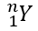

## **概觀**

PowerPoint 將方程式儲存為 Office Math Markup Language（OMML）。使用 Aspose.Slides for Python via .NET，您可以以程式方式建立相同類型的數學內容：分數、根號、函數、極限、N 元運算子、矩陣、陣列以及格式化的數學區塊。

在 PowerPoint 中，使用者通常透過 **Insert > Equation** 新增方程式：


結果是投影片上的可編輯數學文字：


Aspose.Slides 透過三個主要物件建立此數學文字：

- 數學形狀，使用 [add_math_shape](https://reference.aspose.com/slides/python-net/aspose.slides/shapecollection/add_math_shape/) 建立，用於包含方程式的形狀。
- [MathPortion](https://reference.aspose.com/slides/python-net/aspose.slides.mathtext/mathportion/) 在形狀的文字框中儲存數學內容。
- [MathParagraph](https://reference.aspose.com/slides/python-net/aspose.slides.mathtext/mathparagraph/) 包含一個或多個 [MathBlock](https://reference.aspose.com/slides/python-net/aspose.slides.mathtext/mathblock/) 物件。

以下大多範例使用 [MathematicalText](https://reference.aspose.com/slides/python-net/aspose.slides.mathtext/mathematicaltext/) 以及 [IMathElement](https://reference.aspose.com/slides/python-net/aspose.slides.mathtext/imathelement/) 的串流方法，以保持程式碼簡潔易讀。

[從 Python via .NET 匯出簡報中的數學方程式](/slides/zh-hant/python-net/exporting-math-equations/).

## **建立方程式**

此範例使用 [add_math_shape](https://reference.aspose.com/slides/python-net/aspose.slides/shapecollection/add_math_shape/) 建立數學形狀，並加入畢氏定理：


```py
import aspose.slides as slides
import aspose.slides.mathtext as math

with slides.Presentation() as presentation:
    slide = presentation.slides[0]

    math_shape = slide.shapes.add_math_shape(20, 20, 700, 120)
    math_paragraph = math_shape.text_frame.paragraphs[0].portions[0].math_paragraph

    equation = (
        math.MathematicalText("c")
        .set_superscript("2")
        .join("=")
        .join(math.MathematicalText("a").set_superscript("2"))
        .join("+")
        .join(math.MathematicalText("b").set_superscript("2"))
    )

    math_paragraph.add(equation)

    presentation.save("pythagorean-theorem.pptx", slides.export.SaveFormat.PPTX)
```

{}
[add_math_shape](https://reference.aspose.com/slides/python-net/aspose.slides/shapecollection/add_math_shape/) 建立的形狀已包含數學段落。存取第一個 [MathPortion](https://reference.aspose.com/slides/python-net/aspose.slides.mathtext/mathportion/)，取得其 [math_paragraph](https://reference.aspose.com/slides/python-net/aspose.slides.mathtext/mathportion/math_paragraph/)，並向其中加入數學區塊或數學元素。
{}

## **加入分數**

使用 [divide](https://reference.aspose.com/slides/python-net/aspose.slides.mathtext/imathelement/divide/) 建立分數。您可以使用 [MathFractionTypes](https://reference.aspose.com/slides/python-net/aspose.slides.mathtext/mathfractiontypes/) 來選擇分數樣式。


```py
import aspose.slides as slides
import aspose.slides.mathtext as math

with slides.Presentation() as presentation:
    slide = presentation.slides[0]

    math_shape = slide.shapes.add_math_shape(20, 20, 700, 100)
    math_paragraph = math_shape.text_frame.paragraphs[0].portions[0].math_paragraph

    fraction = math.MathematicalText("1").divide("x", math.MathFractionTypes.SKEWED)

    math_paragraph.add(math.MathBlock(fraction))

    presentation.save("fraction.pptx", slides.export.SaveFormat.PPTX)
```

若要使用堆疊式分數，請使用 [MathFractionTypes.BAR](https://reference.aspose.com/slides/python-net/aspose.slides.mathtext/mathfractiontypes/)：

```py
import aspose.slides.mathtext as math

stacked_fraction = math.MathematicalText("x + 1").divide("y - 1", math.MathFractionTypes.BAR)
```

## **加入根號**

使用 [radical](https://reference.aspose.com/slides/python-net/aspose.slides.mathtext/imathelement/radical/) 建立平方根、立方根或其他根號。當前元素成為底數，而參數則為指數。


```py
import aspose.slides as slides
import aspose.slides.mathtext as math

with slides.Presentation() as presentation:
    slide = presentation.slides[0]

    math_shape = slide.shapes.add_math_shape(20, 20, 700, 100)
    math_paragraph = math_shape.text_frame.paragraphs[0].portions[0].math_paragraph

    radical = math.MathematicalText("x").radical("n")

    math_paragraph.add(math.MathBlock(radical))

    presentation.save("radical.pptx", slides.export.SaveFormat.PPTX)
```

## **加入函數與極限**

使用 [as_argument_of_function](https://reference.aspose.com/slides/python-net/aspose.slides.mathtext/imathelement/as_argument_of_function/) 或 [function](https://reference.aspose.com/slides/python-net/aspose.slides.mathtext/imathelement/function/) 來建立函數，例如 `sin(x)`、`log(x)`，或自訂函數名稱。對於極限，將 `lim` 放入 [MathLimit](https://reference.aspose.com/slides/python-net/aspose.slides.mathtext/mathlimit/) 或使用 [set_lower_limit](https://reference.aspose.com/slides/python-net/aspose.slides.mathtext/imathelement/set_lower_limit/)。


```py
import aspose.slides as slides
import aspose.slides.mathtext as math

with slides.Presentation() as presentation:
    slide = presentation.slides[0]

    math_shape = slide.shapes.add_math_shape(20, 20, 700, 100)
    math_paragraph = math_shape.text_frame.paragraphs[0].portions[0].math_paragraph

    limit = (
        math.MathematicalText("lim")
        .set_lower_limit("x\u2192\u221E")
        .function("x")
    )

    math_paragraph.add(math.MathBlock(limit))

    presentation.save("functions-and-limits.pptx", slides.export.SaveFormat.PPTX)
```

若使用自訂函數名稱，將函數名稱設為當前元素，然後以其參數呼叫 [function](https://reference.aspose.com/slides/python-net/aspose.slides.mathtext/imathelement/function/)：

```py
import aspose.slides.mathtext as math

custom_function = math.MathematicalText("f").function("x + 1")
```

## **加入 N 元運算子與積分**

使用 [nary](https://reference.aspose.com/slides/python-net/aspose.slides.mathtext/imathelement/nary/) 來建立總和、聯集、交集及其他大型運算子。使用 [integral](https://reference.aspose.com/slides/python-net/aspose.slides.mathtext/imathelement/integral/) 來建立積分。兩者皆可設定上、下限。


```py
import aspose.slides as slides
import aspose.slides.mathtext as math

with slides.Presentation() as presentation:
    slide = presentation.slides[0]

    math_shape = slide.shapes.add_math_shape(20, 20, 700, 120)
    math_paragraph = math_shape.text_frame.paragraphs[0].portions[0].math_paragraph

    summation_base = (
        math.MathematicalText("x")
        .set_superscript("k")
        .join(math.MathematicalText("a").set_superscript("n-k"))
    )

    summation = summation_base.nary(math.MathNaryOperatorTypes.SUMMATION, "k=0", "n")

    math_paragraph.add(math.MathBlock(summation))

    presentation.save("nary-operators.pptx", slides.export.SaveFormat.PPTX)
```

N 元運算子用於可選上下限的大型運算子。像 `+`、`-`、`=` 之類的簡單運算子通常以 [MathematicalText](https://reference.aspose.com/slides/python-net/aspose.slides.mathtext/mathematicaltext/) 加入，並串接至表達式中。

若建立積分，請使用 [integral](https://reference.aspose.com/slides/python-net/aspose.slides.mathtext/imathelement/integral/)：

```py
import aspose.slides.mathtext as math

integral_base = math.MathematicalText("x").join(math.MathematicalText("dx").to_box())
integral = integral_base.integral(math.MathIntegralTypes.SIMPLE, "0", "1")
```

## **加入矩陣**

使用 [MathMatrix](https://reference.aspose.com/slides/python-net/aspose.slides.mathtext/mathmatrix/) 來建立列與欄。矩陣預設不包含括號，若需要圓括號、方括號或大括號，請自行將矩陣包住。


```py
import aspose.slides as slides
import aspose.slides.mathtext as math

with slides.Presentation() as presentation:
    slide = presentation.slides[0]

    math_shape = slide.shapes.add_math_shape(20, 20, 700, 120)
    math_paragraph = math_shape.text_frame.paragraphs[0].portions[0].math_paragraph

    matrix = math.MathMatrix(2, 3)

    # 矩陣本身沒有括號，因此將其包在圓括號內。
    math_paragraph.add(math.MathBlock(matrix.enclose("(", ")")))

    presentation.save("matrix.pptx", slides.export.SaveFormat.PPTX)
```

{}
`MathMatrix` 建立列與欄的格線、設定其間距並對齊欄寬，但 Aspose.Slides for Python via .NET 並未提供個別矩陣儲存格的存取器。因此，以程式碼建立的矩陣會保留空儲存格；若矩陣來源於現有簡報，則可使用 `get_children` 讀取其儲存格。若需以程式碼填寫列，請使用方程式陣列。
{}

## **加入方程式陣列**

當需要對齊的方程式或垂直堆疊的表達式時，使用 [to_math_array](https://reference.aspose.com/slides/python-net/aspose.slides.mathtext/imathelement/to_math_array/)。


```py
import aspose.slides as slides
import aspose.slides.mathtext as math

with slides.Presentation() as presentation:
    slide = presentation.slides[0]

    math_shape = slide.shapes.add_math_shape(20, 20, 700, 140)
    math_paragraph = math_shape.text_frame.paragraphs[0].portions[0].math_paragraph

    equation_array = (
        math.MathematicalText("x")
        .join("y")
        .to_math_array()
    )

    math_paragraph.add(math.MathBlock(equation_array))

    presentation.save("equation-array.pptx", slides.export.SaveFormat.PPTX)
```

## **加入三角函數**

當參數為當前元素且函數名稱已知時，使用 [as_argument_of_function](https://reference.aspose.com/slides/python-net/aspose.slides.mathtext/imathelement/as_argument_of_function/)。


```py
import aspose.slides as slides
import aspose.slides.mathtext as math

with slides.Presentation() as presentation:
    slide = presentation.slides[0]

    math_shape = slide.shapes.add_math_shape(20, 20, 700, 100)
    math_paragraph = math_shape.text_frame.paragraphs[0].portions[0].math_paragraph

    cosine = math.MathematicalText("2x").as_argument_of_function(
        math.MathFunctionsOfOneArgument.COS
    )

    math_paragraph.add(math.MathBlock(cosine))

    presentation.save("trigonometric-function.pptx", slides.export.SaveFormat.PPTX)
```

## **加入下標與上標**

使用下標與上標輔助函式來處理索引與次方。若索引必須顯示在基底的左側，請使用 [set_sub_superscript_on_the_left](https://reference.aspose.com/slides/python-net/aspose.slides.mathtext/imathelement/set_sub_superscript_on_the_left/)。



```py
import aspose.slides as slides
import aspose.slides.mathtext as math

with slides.Presentation() as presentation:
    slide = presentation.slides[0]

    math_shape = slide.shapes.add_math_shape(20, 20, 700, 100)
    math_paragraph = math_shape.text_frame.paragraphs[0].portions[0].math_paragraph

    scripts = math.MathematicalText("Y").set_sub_superscript_on_the_left("1", "n")

    math_paragraph.add(math.MathBlock(scripts))

    presentation.save("subscript-superscript.pptx", slides.export.SaveFormat.PPTX)
```

## **加入分界符**

使用 [enclose](https://reference.aspose.com/slides/python-net/aspose.slides.mathtext/imathelement/enclose/) 將表達式包在分界符內。對於包含多個元素的分界符表達式，亦可設定分隔字元。


```py
import aspose.slides as slides
import aspose.slides.mathtext as math

with slides.Presentation() as presentation:
    slide = presentation.slides[0]

    math_shape = slide.shapes.add_math_shape(20, 20, 700, 100)
    math_paragraph = math_shape.text_frame.paragraphs[0].portions[0].math_paragraph

    delimiter = (
        math.MathematicalText("x")
        .join("y")
        .join("z")
        .enclose("<", ">")
    )
    delimiter.separator_character = "|"

    math_paragraph.add(math.MathBlock(delimiter))

    presentation.save("delimiters.pptx", slides.export.SaveFormat.PPTX)
```

### **大小與對齊分界符**

將 [grow_to_match_operand_height](https://reference.aspose.com/slides/python-net/aspose.slides.mathtext/imathdelimiter/grow_to_match_operand_height/) 設為 `True`，可讓括號依較高的運算元自動伸長；設為 `False` 則保持原始大小。[delimiter_shape](https://reference.aspose.com/slides/python-net/aspose.slides.mathtext/imathdelimiter/delimiter_shape/) 取以下兩個 [MathDelimiterShape](https://reference.aspose.com/slides/python-net/aspose.slides.mathtext/mathdelimitershape/) 之一。`CENTERED` 使括號以數學軸為中心（該軸通過等號的中間），`MATCH` 則使其與所包圍的內容對齊。這兩種設定僅影響分界符，內部的表達式保持不變。

將分數放置於 `x` 的指數中，使得表達式在基線上方的延伸比下方更高。四個方程式皆使用相同的括號與字型設定。

```python
import aspose.slides as slides
import aspose.slides.mathtext as math


def add_expression(slide, left, top, grow, shape):
    fraction = math.MathematicalText("a + b").divide("c + d")
    power = math.MathematicalText("x").set_superscript(fraction)
    delimiter = power.enclose("(", ")")
    delimiter.grow_to_match_operand_height = grow
    delimiter.delimiter_shape = shape

    math_shape = slide.shapes.add_math_shape(left, top, 300, 100)
    portion = math_shape.text_frame.paragraphs[0].portions[0]
    portion.portion_format.font_height = 32
    equation = math.MathematicalText("y = ").join(delimiter)
    portion.math_paragraph.add(equation)


with slides.Presentation() as presentation:
    slide = presentation.slides[0]
    add_expression(slide, 20, 20, True, math.MathDelimiterShape.CENTERED)
    add_expression(slide, 350, 20, True, math.MathDelimiterShape.MATCH)
    add_expression(slide, 20, 140, False, math.MathDelimiterShape.CENTERED)
    add_expression(slide, 350, 140, False, math.MathDelimiterShape.MATCH)

    presentation.save("delimiter-sizing.pptx", slides.export.SaveFormat.PPTX)
```

在 PowerPoint 中，請比較各列以觀察伸長效果。上列的括號會伸長以包住指數，兩個形狀看起來相同。下列則未啟用伸長。左側較小的括號（`CENTERED`）與等號對齊，而右側（`MATCH`）則在表達式上方較高。


## **加入邊框盒**

對分數呼叫 [to_border_box](https://reference.aspose.com/slides/python-net/aspose.slides.mathtext/imathelement/to_border_box/) 以為整個表達式加上框線。回傳的 [IMathBorderBox](https://reference.aspose.com/slides/python-net/aspose.slides.mathtext/imathborderbox/) 預設顯示四側。可使用 [hide_top](https://reference.aspose.com/slides/python-net/aspose.slides.mathtext/imathborderbox/hide_top/)、[hide_bottom](https://reference.aspose.com/slides/python-net/aspose.slides.mathtext/imathborderbox/hide_bottom/)、[hide_left](https://reference.aspose.com/slides/python-net/aspose.slides.mathtext/imathborderbox/hide_left/) 與 [hide_right](https://reference.aspose.com/slides/python-net/aspose.slides.mathtext/imathborderbox/hide_right/) 移除個別側邊。

此範例將相同的分數複製六次置於同一投影片上。若要顯示抵消，先隱藏四側，並設定 [strikethrough_bottom_left_to_top_right](https://reference.aspose.com/slides/python-net/aspose.slides.mathtext/imathborderbox/strikethrough_bottom_left_to_top_right/) 產生向上對角線 (↗) 或使用 [strikethrough_top_left_to_bottom_right](https://reference.aspose.com/slides/python-net/aspose.slides.mathtext/imathborderbox/strikethrough_top_left_to_bottom_right/) 產生向下對角線 (↘)。亦可使用 [strikethrough_horizontal](https://reference.aspose.com/slides/python-net/aspose.slides.mathtext/imathborderbox/strikethrough_horizontal/) 或 [strikethrough_vertical](https://reference.aspose.com/slides/python-net/aspose.slides.mathtext/imathborderbox/strikethrough_vertical/) 並搭配任意可見的側邊。

```py
import aspose.slides as slides
import aspose.slides.mathtext as math


def add_fraction(slide, x, y, hide_border=False):
    fraction = math.MathematicalText("x+1").divide("y+2")
    box = fraction.to_border_box()
    box.hide_top = box.hide_bottom = box.hide_left = box.hide_right = hide_border

    shape = slide.shapes.add_math_shape(x, y, 160, 90)
    portion = shape.text_frame.paragraphs[0].portions[0]
    portion.portion_format.font_height = 28
    portion.math_paragraph.add(math.MathBlock(box))
    return box


with slides.Presentation() as presentation:
    presentation.slide_size.set_size(540, 220, slides.SlideSizeScaleType.DO_NOT_SCALE)
    slide = presentation.slides[0]

    add_fraction(slide, 10, 10)

    partial = add_fraction(slide, 190, 10)
    partial.hide_top = True
    partial.hide_right = True

    add_fraction(slide, 370, 10, hide_border=True).strikethrough_bottom_left_to_top_right = True
    add_fraction(slide, 10, 120, hide_border=True).strikethrough_top_left_to_bottom_right = True
    add_fraction(slide, 190, 120, hide_border=True).strikethrough_horizontal = True
    add_fraction(slide, 370, 120).strikethrough_vertical = True

    presentation.save("border-box.pptx", slides.export.SaveFormat.PPTX)
```


在此分數中，水平刪除線會覆蓋分數線。垂直刪除線則穿過分子與分母，而外圍框線仍保持可見。這些線條裝飾整個表達式。普通文字的刪除線僅套用於文字執行中的字元。重新以 PowerPoint 開啟簡報後，仍可分別編輯分子與分母。

## **分組項目**

使用 [group](https://reference.aspose.com/slides/python-net/aspose.slides.mathtext/imathelement/group/) 在表達式上方或下方放置分組符號。可加入上下限以標記分組的項目。


```py
import aspose.slides as slides
import aspose.slides.mathtext as math

with slides.Presentation() as presentation:
    slide = presentation.slides[0]

    math_shape = slide.shapes.add_math_shape(20, 20, 700, 120)
    math_paragraph = math_shape.text_frame.paragraphs[0].portions[0].math_paragraph

    grouped = (
        math.MathematicalText("x + y")
        .group(chr(0x23DF), math.MathTopBotPositions.BOTTOM, math.MathTopBotPositions.TOP)
        .set_lower_limit("any text")
    )

    math_paragraph.add(math.MathBlock(grouped))

    presentation.save("grouped-terms.pptx", slides.export.SaveFormat.PPTX)
```

## **格式化數學元素**

僅在需讓公式更清晰時才使用格式化輔助函式。例如，[overbar](https://reference.aspose.com/slides/python-net/aspose.slides.mathtext/imathelement/overbar/) 會在數學元素上方加上一條橫線。


```py
import aspose.slides as slides
import aspose.slides.mathtext as math

with slides.Presentation() as presentation:
    slide = presentation.slides[0]

    math_shape = slide.shapes.add_math_shape(20, 20, 700, 100)
    math_paragraph = math_shape.text_frame.paragraphs[0].portions[0].math_paragraph

    overbar = math.MathematicalText("ABC").overbar()

    math_paragraph.add(math.MathBlock(overbar))

    presentation.save("overbar.pptx", slides.export.SaveFormat.PPTX)
```

### **格式化現有方程式中的文字**

若要在現有方程式中格式化文字，需遍歷每個數學區塊的元素樹。[IMathElement.get_children](https://reference.aspose.com/slides/python-net/aspose.slides.mathtext/imathelement/get_children/) 僅回傳直接子項，須遞迴呼叫以取得分數、上下標、根號等巢狀結構中的文字。也要檢查當前元素及其子項，以在起始元素為 [MathematicalText](https://reference.aspose.com/slides/python-net/aspose.slides.mathtext/mathematicaltext/) 時將其納入。

此範例假設 `input.pptx` 含有類似 `z = xᵢ / ∛y` 的方程式，其中分數的分子含有下標、分母含有根號。若僅處理區塊的最上層元素，會遺漏分數內的文字。範例在投影片文字框中尋找數學區段，透過 [MathPortion.math_paragraph](https://reference.aspose.com/slides/python-net/aspose.slides.mathtext/mathportion/math_paragraph/) 取得其區塊，並將每個文字元素的 [format](https://reference.aspose.com/slides/python-net/aspose.slides.mathtext/mathematicaltext/format/) 屬性中的 [font_height](https://reference.aspose.com/slides/python-net/aspose.slides/baseportionformat/font_height/) 設為 28 點。

```py
import aspose.slides as slides
import aspose.slides.mathtext as math


def format_math_text(element):
    if isinstance(element, math.MathematicalText):
        element.format.font_height = 28

    for child in element.get_children():
        format_math_text(child)


with slides.Presentation("input.pptx") as presentation:
    for slide in presentation.slides:
        for shape in slide.shapes:
            if not isinstance(shape, slides.AutoShape) or shape.text_frame is None:
                continue

            for paragraph in shape.text_frame.paragraphs:
                for portion in paragraph.portions:
                    if isinstance(portion, math.MathPortion):
                        for block in portion.math_paragraph:
                            format_math_text(block)

    presentation.save("formatted-equations.pptx", slides.export.SaveFormat.PPTX)
```

儲存後的簡報在每個處理過的方程式的所有層級都保留了更新後的文字格式，同時維持其文字內容與數學結構。

## **快速參考**

| 任務 | 主要 API |
| --- | --- |
| 建立數學文字 | [MathematicalText](https://reference.aspose.com/slides/python-net/aspose.slides.mathtext/mathematicaltext/) |
| 結合元素 | [IMathElement.join](https://reference.aspose.com/slides/python-net/aspose.slides.mathtext/imathelement/join/) |
| 建立分數 | [IMathElement.divide](https://reference.aspose.com/slides/python-net/aspose.slides.mathtext/imathelement/divide/) |
| 加入上標或下標 | [set_superscript](https://reference.aspose.com/slides/python-net/aspose.slides.mathtext/imathelement/set_superscript/), [set_subscript](https://reference.aspose.com/slides/python-net/aspose.slides.mathtext/imathelement/set_subscript/) |
| 加入函數 | [function](https://reference.aspose.com/slides/python-net/aspose.slides.mathtext/imathelement/function/), [as_argument_of_function](https://reference.aspose.com/slides/python-net/aspose.slides.mathtext/imathelement/as_argument_of_function/) |
| 加入根號 | [radical](https://reference.aspose.com/slides/python-net/aspose.slides.mathtext/imathelement/radical/) |
| 加入極限 | [set_lower_limit](https://reference.aspose.com/slides/python-net/aspose.slides.mathtext/imathelement/set_lower_limit/), [set_upper_limit](https://reference.aspose.com/slides/python-net/aspose.slides.mathtext/imathelement/set_upper_limit/) |
| 加入左側腳本 | [set_sub_superscript_on_the_left](https://reference.aspose.com/slides/python-net/aspose.slides.mathtext/imathelement/set_sub_superscript_on_the_left/) |
| 加入總和與積分 | [nary](https://reference.aspose.com/slides/python-net/aspose.slides.mathtext/imathelement/nary/), [integral](https://reference.aspose.com/slides/python-net/aspose.slides.mathtext/imathelement/integral/) |
| 加入矩陣 | [MathMatrix](https://reference.aspose.com/slides/python-net/aspose.slides.mathtext/mathmatrix/) |
| 加入方程式陣列 | [to_math_array](https://reference.aspose.com/slides/python-net/aspose.slides.mathtext/imathelement/to_math_array/) |
| 加入分界符 | [enclose](https://reference.aspose.com/slides/python-net/aspose.slides.mathtext/imathelement/enclose/) |
| 加入上橫線與邊框 | [overbar](https://reference.aspose.com/slides/python-net/aspose.slides.mathtext/imathelement/overbar/), [to_border_box](https://reference.aspose.com/slides/python-net/aspose.slides.mathtext/imathelement/to_border_box/) |
| 分組項目 | [group](https://reference.aspose.com/slides/python-net/aspose.slides.mathtext/imathelement/group/) |

## **常見問題**

**我可以編輯現有的 PowerPoint 方程式嗎？**

是。開啟簡報，找到包含 [MathPortion](https://reference.aspose.com/slides/python-net/aspose.slides.mathtext/mathportion/) 的形狀，取得其 [math_paragraph](https://reference.aspose.com/slides/python-net/aspose.slides.mathtext/mathportion/math_paragraph/)，並更新該段落中的數學區塊。

**方程式是否以可編輯的 PowerPoint 數學格式儲存？**

是。將檔案儲存為 PPTX 時，Aspose.Slides 會將方程式寫入為可編輯的 Office 數學內容。

**我可以將方程式匯出為 LaTeX 嗎？**

是。取得方程式的 [MathParagraph](https://reference.aspose.com/slides/python-net/aspose.slides.mathtext/mathparagraph/)（透過其 [MathPortion](https://reference.aspose.com/slides/python-net/aspose.slides.mathtext/mathportion/)），然後呼叫 [MathParagraph.to_latex](https://reference.aspose.com/slides/python-net/aspose.slides.mathtext/mathparagraph/to_latex/) 直接匯出。完整範例請參考 [從 Python via .NET 匯出簡報中的數學方程式](/slides/zh-hant/python-net/exporting-math-equations/#export-math-equations-to-latex)。