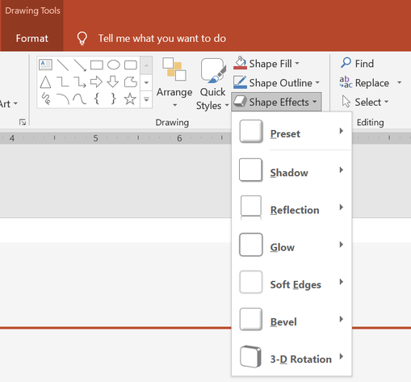

## **介绍**

虽然 PowerPoint 中的效果可用于使形状突出，但它们不同于 [填充](/slides/zh/cpp/shape-formatting/#gradient-fill) 或轮廓。使用 PowerPoint 效果，您可以在形状上创建逼真的反射、扩展形状的发光等。



PowerPoint 提供六种可应用于形状的效果。您可以对一个形状应用一个或多个效果。

某些效果组合比其他组合更好看。为此，PowerPoint 在 **预设** 下提供了选项。预设 选项本质上是已知能够相互搭配的两种或多种效果的组合。这样，选择预设后，您无需浪费时间测试或组合不同的效果来找到合适的组合。

Aspose.Slides 在 [EffectFormat](https://reference.aspose.com/slides/cpp/aspose.slides/effectformat/) 类下提供属性和方法，使您能够在 PowerPoint 演示文稿中对形状应用相同的效果。

## **应用阴影效果**

Aspose.Slides for C++ 支持形状的外部和内部阴影。您可以自定义其颜色、方向、距离和模糊半径，以匹配演示文稿的设计。

### **应用外部阴影**

使用外部阴影可以使卡片或面板在幻灯片背景上突出。阴影延伸到形状边缘之外，产生形状在幻灯片上方凸起的印象。调整其颜色、方向、距离和模糊半径，以匹配模板的光照和样式。

下面的 C++ 代码演示了如何对矩形应用 [外部阴影效果](https://reference.aspose.com/slides/cpp/aspose.slides/effectformat/get_outershadoweffect/)：

```cpp
#include <DOM/Effects/IOuterShadow.h>
#include <DOM/IAutoShape.h>
#include <DOM/IColorFormat.h>
#include <DOM/IEffectFormat.h>
#include <DOM/IShapeCollection.h>
#include <DOM/ISlide.h>
#include <DOM/Presentation.h>
#include <DOM/ShapeType.h>
#include <Export/SaveFormat.h>
#include <drawing/color.h>

using namespace Aspose::Slides;
using namespace Aspose::Slides::Export;
using namespace System::Drawing;

auto presentation = System::MakeObject<Presentation>();
auto slide = presentation->get_Slide(0);

auto shape = slide->get_Shapes()->AddAutoShape(ShapeType::RoundCornerRectangle, 20.0f, 20.0f, 200.0f, 100.0f);
auto effectFormat = shape->get_EffectFormat();
effectFormat->EnableOuterShadowEffect();
auto outerShadowEffect = effectFormat->get_OuterShadowEffect();
outerShadowEffect->get_ShadowColor()->set_Color(Color::get_DarkGray());
outerShadowEffect->set_Distance(10);
outerShadowEffect->set_Direction(45.0f);

presentation->Save(u"shadow_effect.pptx", SaveFormat::Pptx);
```


#### **控制形状旋转时的阴影方向**

默认情况下，外部阴影会随形状一起旋转。为了使具有不同旋转角度的形状看起来来自相同方向的光照，请将 [set_RotateShadowWithShape](https://reference.aspose.com/slides/cpp/aspose.slides.effects/ioutershadow/set_rotateshadowwithshape/) 的参数设为 `false`，并使用 [set_Direction](https://reference.aspose.com/slides/cpp/aspose.slides.effects/ioutershadow/set_direction/) 为它们的阴影设置相同的角度。

示例创建了两个带有向右偏移（0°）灰色阴影的箭头。随后复制幻灯片并将两个箭头顺时针旋转 90°。

```cpp
#include <DOM/Effects/IOuterShadow.h>
#include <DOM/FillType.h>
#include <DOM/IAutoShape.h>
#include <DOM/IColorFormat.h>
#include <DOM/IEffectFormat.h>
#include <DOM/IFillFormat.h>
#include <DOM/ILineFormat.h>
#include <DOM/IShapeCollection.h>
#include <DOM/ISlide.h>
#include <DOM/ISlideCollection.h>
#include <DOM/Presentation.h>
#include <DOM/ShapeType.h>
#include <Export/SaveFormat.h>
#include <drawing/color.h>

using namespace Aspose::Slides;
using namespace Aspose::Slides::Export;
using namespace System::Drawing;

auto presentation = System::MakeObject<Presentation>();
auto before = presentation->get_Slide(0);

auto left = before->get_Shapes()->AddAutoShape(ShapeType::RightArrow, 55, 130, 110, 60);
left->get_FillFormat()->set_FillType(FillType::Solid);
left->get_FillFormat()->get_SolidFillColor()->set_Color(Color::get_SteelBlue());
left->get_LineFormat()->get_FillFormat()->set_FillType(FillType::NoFill);

left->get_EffectFormat()->EnableOuterShadowEffect();
auto shadow = left->get_EffectFormat()->get_OuterShadowEffect();
shadow->get_ShadowColor()->set_Color(Color::get_Gray());
shadow->set_Direction(0);
shadow->set_Distance(42);
shadow->set_BlurRadius(0);
shadow->set_RotateShadowWithShape(true);

auto right = before->get_Shapes()->AddClone(left);
right->set_X(395);
right->get_EffectFormat()->get_OuterShadowEffect()->set_RotateShadowWithShape(false);

auto after = presentation->get_Slides()->AddClone(before);
for (auto i = 0; i < after->get_Shapes()->get_Count(); ++i)
{
    after->get_Shape(i)->set_Rotation(90);
}

presentation->Save(u"arrow_shadows.pptx", SaveFormat::Pptx);
```

在第二张幻灯片上，左侧箭头的阴影向下投射，而右侧箭头的阴影仍向右投射。两者配置的方向均保持为 0°。


### **应用内部阴影**

在复制模板的视觉样式时，使用内部阴影可为卡片或面板提供凹陷的外观。外部阴影向形状外部延伸，使其看起来凸起，而内部阴影则在其边缘内部着色。

调用 [EnableInnerShadowEffect](https://reference.aspose.com/slides/cpp/aspose.slides/effectformat/enableinnershadoweffect/)，然后配置 [InnerShadowEffect](https://reference.aspose.com/slides/cpp/aspose.slides/effectformat/get_innershadoweffect/)。更大的模糊半径值会产生更柔和的边缘。

下面的 C++ 示例创建了一个带有深灰色内部阴影的浅蓝色卡片，并将其保存为 PPTX 文件：

```cpp
#include <DOM/Effects/IInnerShadow.h>
#include <DOM/IAutoShape.h>
#include <DOM/IColorFormat.h>
#include <DOM/IEffectFormat.h>
#include <DOM/IFillFormat.h>
#include <DOM/ILineFormat.h>
#include <DOM/IShapeCollection.h>
#include <DOM/ISlide.h>
#include <DOM/Presentation.h>
#include <DOM/FillType.h>
#include <DOM/ShapeType.h>
#include <Export/SaveFormat.h>
#include <drawing/color.h>

using namespace Aspose::Slides;
using namespace Aspose::Slides::Export;
using namespace System::Drawing;

auto presentation = System::MakeObject<Presentation>();
auto slide = presentation->get_Slide(0);

auto shape = slide->get_Shapes()->AddAutoShape(ShapeType::Rectangle, 20.0f, 20.0f, 200.0f, 100.0f);
shape->get_FillFormat()->set_FillType(FillType::Solid);
shape->get_FillFormat()->get_SolidFillColor()->set_Color(Color::get_LightBlue());
shape->get_LineFormat()->get_FillFormat()->set_FillType(FillType::NoFill);

shape->get_EffectFormat()->EnableInnerShadowEffect();
auto shadow = shape->get_EffectFormat()->get_InnerShadowEffect();
shadow->get_ShadowColor()->set_Color(Color::get_DimGray());
shadow->set_Direction(225);
shadow->set_Distance(7);
shadow->set_BlurRadius(6);

presentation->Save(u"inner_shadow_effect.pptx", SaveFormat::Pptx);
```


要移除内部阴影，请对形状的 effect format 调用 [DisableInnerShadowEffect](https://reference.aspose.com/slides/cpp/aspose.slides/effectformat/disableinnershadoweffect/)。

### **应用、修改和移除预设阴影**

调用 [EnablePresetShadowEffect](https://reference.aspose.com/slides/cpp/aspose.slides/ieffectformat/enablepresetshadoweffect/) 并使用 [set_Preset](https://reference.aspose.com/slides/cpp/aspose.slides.effects/ipresetshadow/set_preset/) 选择一个 [PresetShadowType](https://reference.aspose.com/slides/cpp/aspose.slides/presetshadowtype/)。要切换样式，可在同一形状上更改预设。调用 [DisablePresetShadowEffect](https://reference.aspose.com/slides/cpp/aspose.slides/ieffectformat/disablepresetshadoweffect/) 可在保留填充和轮廓的情况下移除阴影。

此示例在每个阶段保留矩形的副本。两个阴影的偏移均为 10 点。方向为 225° 时，首个阴影位于矩形的左上方；方向为 45° 时，第二个阴影位于右下方。

```cpp
#include <DOM/Effects/IPresetShadow.h>
#include <DOM/FillType.h>
#include <DOM/IAutoShape.h>
#include <DOM/IColorFormat.h>
#include <DOM/IEffectFormat.h>
#include <DOM/IFillFormat.h>
#include <DOM/ILineFormat.h>
#include <DOM/IParagraph.h>
#include <DOM/IParagraphFormat.h>
#include <DOM/IPortionFormat.h>
#include <DOM/IShapeCollection.h>
#include <DOM/ISlide.h>
#include <DOM/ISlideSize.h>
#include <DOM/ITextFrame.h>
#include <DOM/Presentation.h>
#include <DOM/PresetShadowType.h>
#include <DOM/ShapeType.h>
#include <DOM/SlideSizeScaleType.h>
#include <Export/SaveFormat.h>
#include <drawing/color.h>
#include <system/enum.h>

using namespace Aspose::Slides;
using namespace Aspose::Slides::Export;
using namespace System::Drawing;

auto presentation = System::MakeObject<Presentation>();
presentation->get_SlideSize()->SetSize(800, 120, SlideSizeScaleType::DoNotScale);
auto shapes = presentation->get_Slide(0)->get_Shapes();

auto shape = shapes->AddAutoShape(ShapeType::Rectangle, 15, 30, 170, 60);
shape->get_FillFormat()->set_FillType(FillType::Solid);
shape->get_FillFormat()->get_SolidFillColor()->set_Color(Color::get_SteelBlue());
auto outline = shape->get_LineFormat()->get_FillFormat();
outline->set_FillType(FillType::Solid);
outline->get_SolidFillColor()->set_Color(Color::get_DarkBlue());
auto textFrame = shape->get_TextFrame();
textFrame->set_Text(u"No shadow");
textFrame->get_Paragraph(0)->get_ParagraphFormat()->get_DefaultPortionFormat()->set_FontHeight(14);
shapes->AddClone(shape);

shape->set_X(shape->get_X() + 200);
auto effectFormat = shape->get_EffectFormat();
effectFormat->EnablePresetShadowEffect();
auto shadow = effectFormat->get_PresetShadowEffect();
shadow->set_Preset(PresetShadowType::TopLeftDropShadow);
shadow->set_Distance(10);
shadow->set_Direction(225);
textFrame->set_Text(System::Enum<PresetShadowType>::GetName(shadow->get_Preset()));
shapes->AddClone(shape);

shape->set_X(shape->get_X() + 200);
shadow->set_Preset(PresetShadowType::BottomRightDropShadow);
shadow->set_Direction(45);
textFrame->set_Text(System::Enum<PresetShadowType>::GetName(shadow->get_Preset()));
shapes->AddClone(shape);

shape->set_X(shape->get_X() + 200);
effectFormat->DisablePresetShadowEffect();
textFrame->set_Text(u"No shadow");

presentation->Save(u"preset_shadows.pptx", SaveFormat::Pptx);
```

| 原始 | 第一个预设 | 第二个预设 | 移除后 |
| :---: | :---: | :---: | :---: |
|  |  |  |  |

## **应用反射效果**

在 Aspose.Slides for C++ 中应用反射效果，您可以为形状添加镜面反射，并调整距离、透明度和大小等参数。此效果通过为形状提供更精致、专业的外观来提升演示文稿的美感。使用简洁的代码即可轻松实现，能够在多个元素之间快速应用，实现统一的设计。

下面的 C++ 代码演示了如何对形状应用 [反射效果](https://reference.aspose.com/slides/cpp/aspose.slides/effectformat/get_reflectioneffect/)：

```cpp
#include <DOM/Effects/IReflection.h>
#include <DOM/IAutoShape.h>
#include <DOM/IEffectFormat.h>
#include <DOM/IShapeCollection.h>
#include <DOM/ISlide.h>
#include <DOM/Presentation.h>
#include <DOM/RectangleAlignment.h>
#include <DOM/ShapeType.h>
#include <Export/SaveFormat.h>

using namespace Aspose::Slides;
using namespace Aspose::Slides::Export;

auto presentation = System::MakeObject<Presentation>();
auto slide = presentation->get_Slide(0);

auto shape = slide->get_Shapes()->AddAutoShape(ShapeType::RoundCornerRectangle, 20.0f, 20.0f, 200.0f, 100.0f);
auto effectFormat = shape->get_EffectFormat();
effectFormat->EnableReflectionEffect();
auto reflectionEffect = effectFormat->get_ReflectionEffect();
reflectionEffect->set_RectangleAlign(RectangleAlignment::Bottom);
reflectionEffect->set_Direction(90.0f);
reflectionEffect->set_Distance(40);
reflectionEffect->set_BlurRadius(2);

presentation->Save(u"reflection_effect.pptx", SaveFormat::Pptx);
```


## **应用发光效果**

在 Aspose.Slides for C++ 中对形状应用发光效果，您可以在形状周围添加柔和的光晕，并调整颜色和大小等属性。此效果有助于使形状突出，添加吸引人、醒目的视觉元素。实现简便，只需少量代码，即可在多个元素上快速应用，实现一致的设计。

下面的 C++ 代码演示了如何对形状应用 [发光效果](https://reference.aspose.com/slides/cpp/aspose.slides/effectformat/get_gloweffect/)：

```cpp
#include <DOM/Effects/IGlow.h>
#include <DOM/IAutoShape.h>
#include <DOM/IColorFormat.h>
#include <DOM/IEffectFormat.h>
#include <DOM/IShapeCollection.h>
#include <DOM/ISlide.h>
#include <DOM/Presentation.h>
#include <DOM/ShapeType.h>
#include <Export/SaveFormat.h>
#include <drawing/color.h>

using namespace Aspose::Slides;
using namespace Aspose::Slides::Export;
using namespace System::Drawing;

auto presentation = System::MakeObject<Presentation>();
auto slide = presentation->get_Slide(0);

auto shape = slide->get_Shapes()->AddAutoShape(ShapeType::RoundCornerRectangle, 20.0f, 20.0f, 200.0f, 100.0f);
auto effectFormat = shape->get_EffectFormat();
effectFormat->EnableGlowEffect();
auto glowEffect = effectFormat->get_GlowEffect();
glowEffect->get_Color()->set_Color(Color::get_Magenta());
glowEffect->set_Radius(15);

presentation->Save(u"glow_effect.pptx", SaveFormat::Pptx);
```


## **应用柔和边缘效果**

在 Aspose.Slides for C++ 中应用柔和边缘效果，您可以在形状的边缘创建平滑、模糊的过渡。此效果为设计增添更细腻、精致的外观，非常适合需要柔和外观的设计。您可以轻松调节半径等参数，以在演示文稿的各种形状上实现所需效果。

下面的 C++ 代码演示了如何对形状应用 [柔和边缘](https://reference.aspose.com/slides/cpp/aspose.slides/effectformat/get_softedgeeffect/)：

```cpp
#include <DOM/Effects/ISoftEdge.h>
#include <DOM/IAutoShape.h>
#include <DOM/IEffectFormat.h>
#include <DOM/IShapeCollection.h>
#include <DOM/ISlide.h>
#include <DOM/Presentation.h>
#include <DOM/ShapeType.h>
#include <Export/SaveFormat.h>

using namespace Aspose::Slides;
using namespace Aspose::Slides::Export;

auto presentation = System::MakeObject<Presentation>();
auto slide = presentation->get_Slide(0);

auto shape = slide->get_Shapes()->AddAutoShape(ShapeType::RoundCornerRectangle, 20.0f, 20.0f, 200.0f, 150.0f);
auto effectFormat = shape->get_EffectFormat();
effectFormat->EnableSoftEdgeEffect();
auto softEdgeEffect = effectFormat->get_SoftEdgeEffect();
softEdgeEffect->set_Radius(8);

presentation->Save(u"soft_edges_effect.pptx", SaveFormat::Pptx);
```


## **应用模糊效果**

使用形状模糊可在保持形状可编辑的情况下软化其填充和轮廓。对形状的 effect format 调用 [SetBlurEffect](https://reference.aspose.com/slides/cpp/aspose.slides/ieffectformat/setblureffect/)。半径以点为单位（1/72 英寸）：使用非负值，值越大模糊程度越强。半径为零时外观保持不变。

[Grow](https://reference.aspose.com/slides/cpp/aspose.slides.effects/iblur/get_grow/) 设置控制效果的可见范围。设为 `false` 时，模糊被限制在原始绘制范围内（包括轮廓）。设为 `true` 时，模糊可以超出该范围。两者都不会改变形状的位置或尺寸。

下面的比较在整个过程中使用相同的填充、轮廓和形状尺寸。顶部行使用 `grow = false`；底部行使用 `grow = true`。


下面的 C++ 示例创建了一个带深蓝色轮廓的橙色矩形，应用 5 点模糊，然后再次调用 [SetBlurEffect](https://reference.aspose.com/slides/cpp/aspose.slides/ieffectformat/setblureffect/) 将其更新为 15 点模糊。它保存了两种模糊状态，然后调用 [DisableBlurEffect](https://reference.aspose.com/slides/cpp/aspose.slides/ieffectformat/disableblureffect/) 保存未模糊的形状。

```cpp
#include <DOM/IAutoShape.h>
#include <DOM/IColorFormat.h>
#include <DOM/IEffectFormat.h>
#include <DOM/IFillFormat.h>
#include <DOM/ILineFormat.h>
#include <DOM/IShapeCollection.h>
#include <DOM/ISlide.h>
#include <DOM/Presentation.h>
#include <DOM/FillType.h>
#include <DOM/ShapeType.h>
#include <Export/SaveFormat.h>
#include <drawing/color.h>

using namespace Aspose::Slides;
using namespace Aspose::Slides::Export;
using namespace System::Drawing;

auto presentation = System::MakeObject<Presentation>();
auto slide = presentation->get_Slide(0);

auto shape = slide->get_Shapes()->AddAutoShape(ShapeType::Rectangle, 100.0f, 80.0f, 160.0f, 100.0f);
shape->get_FillFormat()->set_FillType(FillType::Solid);
shape->get_FillFormat()->get_SolidFillColor()->set_Color(Color::get_Orange());
shape->get_LineFormat()->get_FillFormat()->set_FillType(FillType::Solid);
shape->get_LineFormat()->get_FillFormat()->get_SolidFillColor()->set_Color(Color::get_DarkBlue());
shape->get_LineFormat()->set_Width(8);

shape->get_EffectFormat()->SetBlurEffect(5, false);
presentation->Save(u"shape_blur_5.pptx", SaveFormat::Pptx);

shape->get_EffectFormat()->SetBlurEffect(15, true);
presentation->Save(u"shape_blur_15.pptx", SaveFormat::Pptx);

shape->get_EffectFormat()->DisableBlurEffect();
presentation->Save(u"shape_blur_removed.pptx", SaveFormat::Pptx);
```

形状模糊同时影响填充和轮廓。柔和边缘效果使形状的边缘淡化，而阴影模糊仅软化阴影。图像变换效果作用于图像内容；本示例直接在形状的 effect format 上应用模糊，而不将形状转换为图像。

## **常见问题**

**我可以对同一形状应用多个效果吗？**

是的，您可以在同一个形状上组合不同的效果，例如阴影、反射和发光，以实现更具动感的外观。

**我可以对哪些形状应用效果？**

您可以对各种形状应用效果，包括自动形状、图表、表格、图片、SmartArt 对象、OLE 对象等。

**我可以对组合形状应用效果吗？**

是的，您可以对组合形状应用效果。该效果将作用于整个组合。