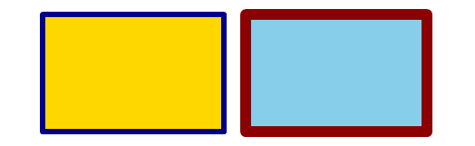

## **介绍**

演示文稿主题定义了一组协调的颜色、字体、背景样式、填充、线条和效果。主题感知对象引用这些共享定义，而不是将每个视觉属性存储为固定值，因此更改主题可以一次性更新许多对象。

在 Aspose.Slides 中，演示文稿级别的主题可通过 [Presentation::get_MasterTheme](https://reference.aspose.com/slides/cpp/aspose.slides/presentation/get_mastertheme/) 访问。演示文稿还可以在更低级别包含主题覆盖。通过 [MasterThemeManager::get_OverrideTheme](https://reference.aspose.com/slides/cpp/aspose.slides.theme/masterthememanager/get_overridetheme/)，母版可以覆盖演示文稿主题，而布局或单个幻灯片可以使用 [IOverrideThemeManager::get_OverrideTheme](https://reference.aspose.com/slides/cpp/aspose.slides.theme/ioverridethememanager/get_overridetheme/)。在实际使用中，幻灯片的有效主题通过以下继承链解析：演示文稿主题、母版覆盖、布局覆盖和幻灯片覆盖。


下面的各节展示了最常见的主题工作流：检查主题、更改颜色和字体、复制或应用主题、更新背景和效果样式，以及在继承和覆盖解析后读取有效值。

## **检查主题**

[MasterTheme](https://reference.aspose.com/slides/cpp/aspose.slides.theme/mastertheme/) 对象公开主题的 [get_ColorScheme](https://reference.aspose.com/slides/cpp/aspose.slides.theme/mastertheme/get_colorscheme/)、[get_FontScheme](https://reference.aspose.com/slides/cpp/aspose.slides.theme/mastertheme/get_fontscheme/) 和 [get_FormatScheme](https://reference.aspose.com/slides/cpp/aspose.slides.theme/mastertheme/get_formatscheme/) 方法。在更改之前检查这些集合尤为有用，因为当演示文稿来自外部来源时，样式条目的数量和内容可能会变化。

以下示例读取主要主题属性，并报告主题中存储了多少背景、填充、线条和效果样式：

```cpp
#include <DOM/IColorFormat.h>
#include <DOM/IFonts.h>
#include <DOM/Presentation.h>
#include <DOM/Theme/IColorScheme.h>
#include <DOM/Theme/IEffectStyleCollection.h>
#include <DOM/Theme/IFillFormatCollection.h>
#include <DOM/Theme/IFontScheme.h>
#include <DOM/Theme/IFormatScheme.h>
#include <DOM/Theme/ILineFormatCollection.h>
#include <DOM/Theme/IMasterTheme.h>
#include <system/console.h>

using namespace Aspose::Slides;
using namespace System;

auto presentation = MakeObject<Presentation>(u"input.pptx");

auto theme = presentation->get_MasterTheme();
auto formatScheme = theme->get_FormatScheme();

Console::WriteLine(u"Theme name: {0}", theme->get_Name());
Console::WriteLine(u"Accent 1: {0}", theme->get_ColorScheme()->get_Accent1()->get_Color());
Console::WriteLine(u"Major Latin font: {0}", theme->get_FontScheme()->get_Major()->get_LatinFont()->get_FontName());
Console::WriteLine(u"Minor Latin font: {0}", theme->get_FontScheme()->get_Minor()->get_LatinFont()->get_FontName());
Console::WriteLine(u"Background fill styles: {0}", formatScheme->get_BackgroundFillStyles()->get_Count());
Console::WriteLine(u"Fill styles: {0}", formatScheme->get_FillStyles()->get_Count());
Console::WriteLine(u"Line styles: {0}", formatScheme->get_LineStyles()->get_Count());
Console::WriteLine(u"Effect styles: {0}", formatScheme->get_EffectStyles()->get_Count());
```

如果文件使用多个母版，不要假设每张幻灯片具有相同的有效主题。检查与幻灯片关联的母版，并在可能存在布局或幻灯片覆盖时使用本文后面展示的有效主题工作流。

## **更改主题颜色**

主题感知的填充、线条和文本可以引用 [SchemeColor](https://reference.aspose.com/slides/cpp/aspose.slides/schemecolor/) 枚举中的逻辑颜色。当您更改主题的 [IColorScheme](https://reference.aspose.com/slides/cpp/aspose.slides.theme/icolorscheme/) 中相应的条目时，所有仍然引用该主题颜色的对象都会使用新值进行解析。使用直接 RGB 颜色的对象不会因主题颜色更新而改变。

以下完整示例创建一个使用 `Accent4` 的形状，将主题的 `Accent4` 颜色更改为红色，保存演示文稿，重新打开它，并打印有效的填充颜色：

```cpp
#include <DOM/FillType.h>
#include <DOM/IAutoShape.h>
#include <DOM/IColorFormat.h>
#include <DOM/IFillFormat.h>
#include <DOM/IFillFormatEffectiveData.h>
#include <DOM/IShapeCollection.h>
#include <DOM/ISlide.h>
#include <DOM/Presentation.h>
#include <DOM/SchemeColor.h>
#include <DOM/ShapeType.h>
#include <DOM/Theme/IColorScheme.h>
#include <DOM/Theme/IMasterTheme.h>
#include <Export/SaveFormat.h>
#include <drawing/color.h>
#include <system/console.h>

using namespace Aspose::Slides;
using namespace Aspose::Slides::Export;
using namespace System;
using namespace System::Drawing;

auto presentation = MakeObject<Presentation>();
auto slide = presentation->get_Slide(0);

auto shape = slide->get_Shapes()->AddAutoShape(ShapeType::Rectangle, 10.0f, 10.0f, 100.0f, 100.0f);
shape->get_FillFormat()->set_FillType(FillType::Solid);
shape->get_FillFormat()->get_SolidFillColor()->set_SchemeColor(SchemeColor::Accent4);

presentation->get_MasterTheme()->get_ColorScheme()->get_Accent4()->set_Color(Color::get_Red());
presentation->Save(u"theme-color.pptx", SaveFormat::Pptx);

auto savedPresentation = MakeObject<Presentation>(u"theme-color.pptx");
auto savedSlide = savedPresentation->get_Slide(0);
auto savedShape = savedSlide->get_Shape(0);
auto effectiveFill = savedShape->get_FillFormat()->GetEffective();
Console::WriteLine(u"Effective fill color: {0}", effectiveFill->get_SolidFillColor());
```

因为矩形仍然链接到 `Accent4`，主题更改后其可见颜色变为红色。如果在形状上用直接颜色替换了方案颜色，则后续对 `Accent4` 的更改将不再影响该填充。

### **使用附加调色板中的颜色**

PowerPoint 通过应用颜色转换从主题颜色派生出更浅和更深的变体。Aspose.Slides 通过 [ColorTransformOperation](https://reference.aspose.com/slides/cpp/aspose.slides/colortransformoperation/) 公开这些转换。


**1** - 主题主颜色。

**2** - 从主题主颜色生成的更浅和更深的变体。

以下示例基于 `Accent4` 创建六个矩形，对其中五个应用亮度转换，并保存结果：

```cpp
#include <DOM/ColorTransformOperation.h>
#include <DOM/FillType.h>
#include <DOM/IAutoShape.h>
#include <DOM/IColorFormat.h>
#include <DOM/IColorOperationCollection.h>
#include <DOM/IFillFormat.h>
#include <DOM/IShapeCollection.h>
#include <DOM/ISlide.h>
#include <DOM/Presentation.h>
#include <DOM/SchemeColor.h>
#include <DOM/ShapeType.h>
#include <Export/SaveFormat.h>

using namespace Aspose::Slides;
using namespace Aspose::Slides::Export;
using namespace System;

auto presentation = MakeObject<Presentation>();
auto shapes = presentation->get_Slide(0)->get_Shapes();

auto shape1 = shapes->AddAutoShape(ShapeType::Rectangle, 10.0f, 10.0f, 50.0f, 50.0f);
auto fillFormat1 = shape1->get_FillFormat();
fillFormat1->set_FillType(FillType::Solid);
fillFormat1->get_SolidFillColor()->set_SchemeColor(SchemeColor::Accent4);

auto shape2 = shapes->AddAutoShape(ShapeType::Rectangle, 10.0f, 70.0f, 50.0f, 50.0f);
auto fillFormat2 = shape2->get_FillFormat();
auto solidFillColor2 = fillFormat2->get_SolidFillColor();
fillFormat2->set_FillType(FillType::Solid);
solidFillColor2->set_SchemeColor(SchemeColor::Accent4);
solidFillColor2->get_ColorTransform()->Add(ColorTransformOperation::MultiplyLuminance, 0.2f);
solidFillColor2->get_ColorTransform()->Add(ColorTransformOperation::AddLuminance, 0.8f);

auto shape3 = shapes->AddAutoShape(ShapeType::Rectangle, 10.0f, 130.0f, 50.0f, 50.0f);
auto fillFormat3 = shape3->get_FillFormat();
auto solidFillColor3 = fillFormat3->get_SolidFillColor();
fillFormat3->set_FillType(FillType::Solid);
solidFillColor3->set_SchemeColor(SchemeColor::Accent4);
solidFillColor3->get_ColorTransform()->Add(ColorTransformOperation::MultiplyLuminance, 0.4f);
solidFillColor3->get_ColorTransform()->Add(ColorTransformOperation::AddLuminance, 0.6f);

auto shape4 = shapes->AddAutoShape(ShapeType::Rectangle, 10.0f, 190.0f, 50.0f, 50.0f);
auto fillFormat4 = shape4->get_FillFormat();
auto solidFillColor4 = fillFormat4->get_SolidFillColor();
fillFormat4->set_FillType(FillType::Solid);
solidFillColor4->set_SchemeColor(SchemeColor::Accent4);
solidFillColor4->get_ColorTransform()->Add(ColorTransformOperation::MultiplyLuminance, 0.6f);
solidFillColor4->get_ColorTransform()->Add(ColorTransformOperation::AddLuminance, 0.4f);

auto shape5 = shapes->AddAutoShape(ShapeType::Rectangle, 10.0f, 250.0f, 50.0f, 50.0f);
auto fillFormat5 = shape5->get_FillFormat();
auto solidFillColor5 = fillFormat5->get_SolidFillColor();
fillFormat5->set_FillType(FillType::Solid);
solidFillColor5->set_SchemeColor(SchemeColor::Accent4);
solidFillColor5->get_ColorTransform()->Add(ColorTransformOperation::MultiplyLuminance, 0.75f);

auto shape6 = shapes->AddAutoShape(ShapeType::Rectangle, 10.0f, 310.0f, 50.0f, 50.0f);
auto fillFormat6 = shape6->get_FillFormat();
auto solidFillColor6 = fillFormat6->get_SolidFillColor();
fillFormat6->set_FillType(FillType::Solid);
solidFillColor6->set_SchemeColor(SchemeColor::Accent4);
solidFillColor6->get_ColorTransform()->Add(ColorTransformOperation::MultiplyLuminance, 0.5f);

presentation->Save(u"theme-color-palette.pptx", SaveFormat::Pptx);
```

这些变体仍基于主题颜色。如果以后更改 `Accent4`，转换后的颜色将根据新的 `Accent4` 值重新计算。

### **将 `SchemeColor` 值映射到 `IColorScheme` 槽位**

[SchemeColor](https://reference.aspose.com/slides/cpp/aspose.slides/schemecolor/) 枚举使用 `Text1`、`Background1`、`Text2` 和 `Background2`，而 [IColorScheme](https://reference.aspose.com/slides/cpp/aspose.slides.theme/icolorscheme/) 将相同的主题槽位显示为 `Dark1`、`Light1`、`Dark2` 和 `Light2`。映射是固定的：

* `Text1` = `Dark1`
* `Background1` = `Light1`
* `Text2` = `Dark2`
* `Background2` = `Light2`

这些是相同主题槽位的别名；它们不是从一种形式动态转换得到的值。

## **更改主题字体**

主题字体方案包含用于标题的主要字体集和用于正文的次要字体集。[FontScheme::get_Major](https://reference.aspose.com/slides/cpp/aspose.slides.theme/fontscheme/get_major/) 和 [FontScheme::get_Minor](https://reference.aspose.com/slides/cpp/aspose.slides.theme/fontscheme/get_minor/) 方法公开这些集合。

可以在文本格式化中使用与 PowerPoint 兼容的主题字体标识符：

* `+mn-lt` - 正文字体拉丁文（次要拉丁字体）
* `+mj-lt` - 标题字体拉丁文（主要拉丁字体）
* `+mn-ea` - 正文字体东亚文（次要东亚字体）
* `+mj-ea` - 标题字体东亚文（主要东亚字体）
* `+mn-cs` - 正文字体复杂脚本（次要复杂脚本字体）
* `+mj-cs` - 标题字体复杂脚本（主要复杂脚本字体）

以下示例创建一个使用主要拉丁主题字体的标题和一个使用次要拉丁主题字体的正文行。随后更改主题字体并保存结果：

```cpp
#include <DOM/Fonts/FontData.h>
#include <DOM/IAutoShape.h>
#include <DOM/IFonts.h>
#include <DOM/IParagraph.h>
#include <DOM/IParagraphCollection.h>
#include <DOM/IPortion.h>
#include <DOM/IPortionCollection.h>
#include <DOM/IPortionFormat.h>
#include <DOM/IShapeCollection.h>
#include <DOM/ISlide.h>
#include <DOM/ITextFrame.h>
#include <DOM/Presentation.h>
#include <DOM/ShapeType.h>
#include <DOM/Theme/IFontScheme.h>
#include <DOM/Theme/IMasterTheme.h>
#include <Export/SaveFormat.h>

using namespace Aspose::Slides;
using namespace Aspose::Slides::Export;
using namespace System;

auto presentation = MakeObject<Presentation>();
auto slide = presentation->get_Slide(0);

auto heading = slide->get_Shapes()->AddAutoShape(ShapeType::Rectangle, 40.0f, 40.0f, 500.0f, 60.0f);
heading->get_TextFrame()->set_Text(u"Theme heading");
heading->get_TextFrame()->get_Paragraph(0)->get_Portion(0)->get_PortionFormat()->set_LatinFont(MakeObject<FontData>(u"+mj-lt"));

auto body = slide->get_Shapes()->AddAutoShape(ShapeType::Rectangle, 40.0f, 120.0f, 500.0f, 60.0f);
body->get_TextFrame()->set_Text(u"Theme body text");
body->get_TextFrame()->get_Paragraph(0)->get_Portion(0)->get_PortionFormat()->set_LatinFont(MakeObject<FontData>(u"+mn-lt"));

presentation->get_MasterTheme()->get_FontScheme()->get_Major()->set_LatinFont(MakeObject<FontData>(u"Aptos Display"));
presentation->get_MasterTheme()->get_FontScheme()->get_Minor()->set_LatinFont(MakeObject<FontData>(u"Arial"));
presentation->Save(u"theme-fonts.pptx", SaveFormat::Pptx);
```

标题使用主要字体，正文使用次要字体。使用显式字体名称而非主题标识符的文本在主题字体方案更改时不会自动切换。

主要和次要字体集合还可以包含针对各个书写系统的字体映射，例如西里尔文、阿拉伯文、日文、格鲁吉亚文和塔纳文。要检查、添加、替换或移除这些映射，请参阅 [Script-Specific Theme Fonts](/slides/zh/cpp/script-specific-font-mappings/).

{}
如需有关演示文稿字体的更多信息，请参阅 [PowerPoint Fonts](/slides/zh/cpp/powerpoint-fonts/)。
{}

### **解析主题字体引用**

在检查文本时，[IFontData::get_FontName](https://reference.aspose.com/slides/cpp/aspose.slides/ifontdata/get_fontname/) 可能包含主题引用（例如 `+mn-lt`），而不是字体族名称。使用适当的 [IThemeEffectiveData](https://reference.aspose.com/slides/cpp/aspose.slides.theme/ithemeeffectivedata/) 调用 [IFontData::GetFontName](https://reference.aspose.com/slides/cpp/aspose.slides/ifontdata/getfontname/) 来解析该引用。`+mj` 和 `+mn` 前缀选择主要和次要字体集；`-lt`、`-ea` 和 `-cs` 后缀分别选择它们的拉丁、东亚和复杂脚本字体。

通过在适用于检查文本的对象上调用 [IThemeable::CreateThemeEffective](https://reference.aspose.com/slides/cpp/aspose.slides.theme/ithemeable/createthemeeffective/) 获取有效主题。对于幻灯片上的普通文本，使用 `slide->CreateThemeEffective()`，这样上下文包括该幻灯片的继承主题和本地覆盖。检查布局或母版本身时，使用其自身的有效主题。不要假设第一个母版的主题适用于每张幻灯片。

以下示例创建一个显式引用次要拉丁字体的文本段落。它通过 [IOverrideTheme::InitFontSchemeFromInherited](https://reference.aspose.com/slides/cpp/aspose.slides.theme/ioverridetheme/initfontschemefrominherited/) 初始化幻灯片字体方案，并将主要和次要拉丁族设置为 `Arial` 和 `Calibri`，使结果在没有输入文件的情况下可复现。

```cpp
#include <DOM/Fonts/FontData.h>
#include <DOM/IAutoShape.h>
#include <DOM/IFonts.h>
#include <DOM/IParagraph.h>
#include <DOM/IPortion.h>
#include <DOM/IPortionFormat.h>
#include <DOM/IShapeCollection.h>
#include <DOM/ISlide.h>
#include <DOM/ITextFrame.h>
#include <DOM/Presentation.h>
#include <DOM/ShapeType.h>
#include <DOM/Theme/IFontScheme.h>
#include <DOM/Theme/IOverrideTheme.h>
#include <DOM/Theme/IOverrideThemeManager.h>
#include <DOM/Theme/IThemeEffectiveData.h>
#include <system/console.h>

using namespace Aspose::Slides;
using namespace System;

auto presentation = MakeObject<Presentation>();
auto slide = presentation->get_Slide(0);

auto theme = slide->get_ThemeManager()->get_OverrideTheme();
theme->InitFontSchemeFromInherited();
theme->get_FontScheme()->get_Major()->set_LatinFont(MakeObject<FontData>(u"Arial"));
theme->get_FontScheme()->get_Minor()->set_LatinFont(MakeObject<FontData>(u"Calibri"));

auto shape = slide->get_Shapes()->AddAutoShape(ShapeType::Rectangle, 20.0f, 20.0f, 400.0f, 60.0f);
shape->get_TextFrame()->set_Text(u"Text using the minor theme font");

auto portion = shape->get_TextFrame()->get_Paragraph(0)->get_Portion(0);
portion->get_PortionFormat()->set_LatinFont(MakeObject<FontData>(u"+mn-lt"));

auto font = portion->get_PortionFormat()->get_LatinFont();
auto effectiveTheme = slide->CreateThemeEffective();
auto resolvedFontName = font->GetFontName(effectiveTheme);
Console::WriteLine(u"{0} -> {1}", font->get_FontName(), resolvedFontName);

auto explicitFont = MakeObject<FontData>(u"Verdana");
auto explicitFontName = explicitFont->GetFontName(effectiveTheme);
Console::WriteLine(u"{0} -> {1}", explicitFont->get_FontName(), explicitFontName);
```

输出为 `+mn-lt -> Calibri`，随后是 `Verdana -> Verdana`。存储的引用保持不变，而显式的族名称原样返回。如果该段落使用 `+mj-lt`，则在此主题中解析为 `Arial`。

解析主题引用可识别主题指定的字体族。它不检查字体可用性，也不确定在渲染期间替换或字形回退后最终使用的字体文件。有关这些独立步骤，请参阅 [Font Selection Sequence](/slides/zh/cpp/font-selection-sequence/) 和 [Font Substitution](/slides/zh/cpp/font-substitution/).

## **复制或应用主题**

以下工作流解决不同的主题相关问题。

### **将外部主题应用于母版依赖的幻灯片**

当您拥有 PowerPoint 主题文件（`.thmx`）并希望重新样式化依赖特定母版的每张幻灯片时，使用 [IMasterSlide::ApplyExternalThemeToDependingSlides](https://reference.aspose.com/slides/cpp/aspose.slides/imasterslide/applyexternalthemetodependingslides/)。从 [Presentation::get_Masters](https://reference.aspose.com/slides/cpp/aspose.slides/presentation/get_masters/) 集合中选择母版，该集合实现了 [IMasterSlideCollection](https://reference.aspose.com/slides/cpp/aspose.slides/imasterslidecollection/)，并将主题文件路径传递给该方法。

该方法执行以下操作：

1. 基于选定的母版创建一个新的母版幻灯片。
2. 将外部主题应用于新母版。
3. 将新母版分配给所有之前依赖选定母版的幻灯片。
4. 返回新创建的 [IMasterSlide](https://reference.aspose.com/slides/cpp/aspose.slides/imasterslide/)。

以下示例将外部主题应用于依赖第一个母版的幻灯片，并保存演示文稿：

```cpp
#include <DOM/IMasterSlide.h>
#include <DOM/Presentation.h>
#include <Export/SaveFormat.h>
#include <iostream>

using namespace Aspose::Slides;
using namespace Aspose::Slides::Export;
using namespace System;

auto presentation = MakeObject<Presentation>(u"presentation.pptx");
auto selectedMaster = presentation->get_Master(0);

auto themedMaster = selectedMaster->ApplyExternalThemeToDependingSlides(u"corporate-theme.thmx");
Console::WriteLine(u"Created master: {0}", themedMaster->get_Name());

presentation->Save(u"presentation-with-external-theme.pptx", SaveFormat::Pptx);
```

无效、损坏或不受支持的主题可能导致 [PptxException](https://reference.aspose.com/slides/cpp/aspose.slides/pptxexception/) 或其格式相关的子类。请验证用户提供的路径，处理文件系统访问失败，并仅在主题成功应用后保存演示文稿。

仅重新分配依赖所选母版的幻灯片。与其他母版关联的幻灯片保留其现有的母版和主题。主题感知的颜色、字体、填充、线条、背景和效果会根据外部主题进行解析。直接分配的颜色、字体、填充和其他显式格式可能保持不变。布局级和幻灯片级的覆盖也可能优先于从新母版继承的值。

主题可能引用运行环境中不可用的字体。为确保渲染和导出的一致性，请安装所需字体，通过 [custom font sources](/slides/zh/cpp/custom-font/) 提供，或配置 [font substitution](/slides/zh/cpp/font-substitution/)。

这是一种直接的母版级工作流：该方法接受 `.thmx` 文件的路径，无需手动创建幻灯片级或布局级的主题覆盖。

### **在多母版演示文稿中应用不同的外部主题**

当相关母版事先未知时，可通过 [ISlide::get_LayoutSlide](https://reference.aspose.com/slides/cpp/aspose.slides/islide/get_layoutslide/) 和 [ILayoutSlide::get_MasterSlide](https://reference.aspose.com/slides/cpp/aspose.slides/ilayoutslide/get_masterslide/) 从代表性幻灯片获取。 在应用任何主题之前存储原始母版引用，因为每次调用都会在演示文稿中创建另一个母版。

以下示例使用来自两个章节的幻灯片定位它们的母版，并为每组应用不同的外部主题：

```cpp
#include <DOM/ILayoutSlide.h>
#include <DOM/IMasterSlide.h>
#include <DOM/Presentation.h>
#include <Export/SaveFormat.h>
#include <iostream>

using namespace Aspose::Slides;
using namespace Aspose::Slides::Export;
using namespace System;

auto presentation = MakeObject<Presentation>(u"multi-master-presentation.pptx");

if (presentation->get_Slides()->get_Count() < 5)
{
    std::cout << "The presentation does not contain the expected representative slides." << std::endl;
}
else
{
    auto firstGroupMaster = presentation->get_Slide(0)->get_LayoutSlide()->get_MasterSlide();
    auto secondGroupMaster = presentation->get_Slide(4)->get_LayoutSlide()->get_MasterSlide();

    if (firstGroupMaster->get_SlideId() == secondGroupMaster->get_SlideId())
    {
        std::cout << "The representative slides use the same master." << std::endl;
    }
    else
    {
        auto firstThemedMaster = firstGroupMaster->ApplyExternalThemeToDependingSlides(u"blue-theme.thmx");
        auto secondThemedMaster = secondGroupMaster->ApplyExternalThemeToDependingSlides(u"green-theme.thmx");

        Console::WriteLine(u"First themed master: {0}", firstThemedMaster->get_Name());
        Console::WriteLine(u"Second themed master: {0}", secondThemedMaster->get_Name());

        presentation->Save(u"multi-master-with-external-themes.pptx", SaveFormat::Pptx);
    }
}
```

第一次调用仅影响依赖 `firstGroupMaster` 的幻灯片，第二次调用仅影响依赖 `secondGroupMaster` 的幻灯片。属于其他母版的幻灯片不会被重新样式化。

### **在移动幻灯片时保留源主题**

如果您想将幻灯片移动到另一个演示文稿并保留其原始设计，请使用 [IMasterSlideCollection::AddClone](https://reference.aspose.com/slides/cpp/aspose.slides/imasterslidecollection/addclone/) 将源母版克隆到目标演示文稿中，然后使用 [ISlideCollection::AddClone](https://reference.aspose.com/slides/cpp/aspose.slides/islidecollection/addclone/) 以及克隆的母版克隆幻灯片。这会一起携带母版、其布局以及关联的主题。

```cpp
#include <DOM/ILayoutSlide.h>
#include <DOM/IMasterSlide.h>
#include <DOM/IMasterSlideCollection.h>
#include <DOM/ISlide.h>
#include <DOM/ISlideCollection.h>
#include <DOM/Presentation.h>
#include <Export/SaveFormat.h>

using namespace Aspose::Slides;
using namespace Aspose::Slides::Export;
using namespace System;

auto source = MakeObject<Presentation>(u"source-theme.pptx");
auto target = MakeObject<Presentation>(u"target.pptx");

auto sourceSlide = source->get_Slide(0);

auto sourceMaster = sourceSlide->get_LayoutSlide()->get_MasterSlide();
auto clonedMaster = target->get_Masters()->AddClone(sourceMaster);
target->get_Slides()->AddClone(sourceSlide, clonedMaster, true);

target->Save(u"theme-preserved.pptx", SaveFormat::Pptx);
```

当源幻灯片必须在目标中保持相同外观时，这是首选工作流。仅将内容克隆到无关的目标母版上可能会更改主题驱动的颜色、字体、背景和效果。

### **将主题值应用于现有幻灯片**

如果目标幻灯片必须保持其当前的母版和布局，请从源主题初始化幻灯片级覆盖。[OverrideTheme::InitColorSchemeFrom](https://reference.aspose.com/slides/cpp/aspose.slides.theme/overridetheme/initcolorschemefrom/)、[OverrideTheme::InitFontSchemeFrom](https://reference.aspose.com/slides/cpp/aspose.slides.theme/overridetheme/initfontschemefrom/) 和 [OverrideTheme::InitFormatSchemeFrom](https://reference.aspose.com/slides/cpp/aspose.slides.theme/overridetheme/initformatschemefrom/) 方法将三个主要主题组件复制到覆盖中。

```cpp
#include <DOM/ISlide.h>
#include <DOM/Presentation.h>
#include <DOM/Theme/IOverrideTheme.h>
#include <DOM/Theme/IOverrideThemeManager.h>
#include <DOM/Theme/IMasterTheme.h>
#include <Export/SaveFormat.h>

using namespace Aspose::Slides;
using namespace Aspose::Slides::Export;
using namespace System;

auto source = MakeObject<Presentation>(u"source-theme.pptx");
auto target = MakeObject<Presentation>(u"target.pptx");
auto targetSlide = target->get_Slide(0);

auto overrideTheme = targetSlide->get_ThemeManager()->get_OverrideTheme();
overrideTheme->InitColorSchemeFrom(source->get_MasterTheme()->get_ColorScheme());
overrideTheme->InitFontSchemeFrom(source->get_MasterTheme()->get_FontScheme());
overrideTheme->InitFormatSchemeFrom(source->get_MasterTheme()->get_FormatScheme());

target->Save(u"theme-applied-to-slide.pptx", SaveFormat::Pptx);
```

这会更改该幻灯片使用的主题，而不更改其他幻灯片继承的主题。若要移除本地覆盖并返回继承值，请调用 [OverrideTheme::Clear](https://reference.aspose.com/slides/cpp/aspose.slides.theme/overridetheme/clear/)。

### **将主题覆盖应用于布局**

布局级覆盖适用于使用该布局的幻灯片，除非特定幻灯片有其自己的覆盖。相同的初始化方法可通过布局的 [IOverrideThemeManager](https://reference.aspose.com/slides/cpp/aspose.slides.theme/ioverridethememanager/) 使用：

```cpp
#include <DOM/ILayoutSlide.h>
#include <DOM/ISlide.h>
#include <DOM/Presentation.h>
#include <DOM/Theme/IOverrideTheme.h>
#include <DOM/Theme/IOverrideThemeManager.h>
#include <DOM/Theme/IMasterTheme.h>
#include <Export/SaveFormat.h>

using namespace Aspose::Slides;
using namespace Aspose::Slides::Export;
using namespace System;

auto source = MakeObject<Presentation>(u"source-theme.pptx");
auto target = MakeObject<Presentation>(u"target.pptx");
auto targetSlide = target->get_Slide(0);

auto targetLayout = targetSlide->get_LayoutSlide();
auto overrideTheme = targetLayout->get_ThemeManager()->get_OverrideTheme();
overrideTheme->InitColorSchemeFrom(source->get_MasterTheme()->get_ColorScheme());
overrideTheme->InitFontSchemeFrom(source->get_MasterTheme()->get_FontScheme());
overrideTheme->InitFormatSchemeFrom(source->get_MasterTheme()->get_FormatScheme());

target->Save(u"theme-applied-to-layout.pptx", SaveFormat::Pptx);
```

当许多布局和幻灯片应共享相同的基础设计时，使用母版或演示文稿级主题；当一个布局族需要不同的样式时使用布局覆盖；仅在真正的例外情况下使用幻灯片覆盖。过多的幻灯片级覆盖会使后续全局主题更改更难预测。

## **更新主题背景样式**

主题的背景填充存储在 [FormatScheme::get_BackgroundFillStyles](https://reference.aspose.com/slides/cpp/aspose.slides.theme/formatscheme/get_backgroundfillstyles/) 中。PowerPoint 在其 UI 中可以呈现比此集合实际存储的填充定义更多的背景选项，因为 UI 可以将主题填充与主题颜色和其他样式引用组合使用。


在使用背景样式之前，检查已存储的集合以及当前的 [Background::get_StyleIndex](https://reference.aspose.com/slides/cpp/aspose.slides/background/get_styleindex/)。`StyleIndex` 使用 `0` 表示无主题填充；正值表示主题背景样式引用。这不同于直接使用 `idx_get(0)` 对 C++ 集合进行索引，其中 `0` 表示第一个存储的项。不要假设每个演示文稿都包含相同数量的背景填充样式。

以下示例报告可用的背景填充计数，为第一个母版分配一个主题背景引用，并保存演示文稿：

```cpp
#include <DOM/BackgroundType.h>
#include <DOM/IBackground.h>
#include <DOM/IMasterSlide.h>
#include <DOM/Presentation.h>
#include <DOM/Theme/IFillFormatCollection.h>
#include <DOM/Theme/IFormatScheme.h>
#include <DOM/Theme/IMasterTheme.h>
#include <Export/SaveFormat.h>
#include <system/console.h>

using namespace Aspose::Slides;
using namespace Aspose::Slides::Export;
using namespace System;

auto presentation = MakeObject<Presentation>(u"input.pptx");

auto backgroundStyles = presentation->get_MasterTheme()->get_FormatScheme()->get_BackgroundFillStyles();
Console::WriteLine(u"Background fill styles: {0}", backgroundStyles->get_Count());

if (backgroundStyles->get_Count() > 0)
{
    auto masterSlide = presentation->get_Master(0);
    masterSlide->get_Background()->set_Type(BackgroundType::Themed);
    masterSlide->get_Background()->set_StyleIndex(1);

    presentation->Save(u"theme-background.pptx", SaveFormat::Pptx);
}
```

可见结果取决于母版引用的主题条目以及布局或幻灯片级的任何背景覆盖。如果幻灯片使用了自己的背景，仅更改母版背景可能不会更改该幻灯片。需要了解应用继承后的最终背景时，请使用 [Background::GetEffective](https://reference.aspose.com/slides/cpp/aspose.slides/background/geteffective/)。

{}
不要将 `StyleIndex` 视为零基集合索引。同样，避免从一个文件硬编码样式编号并假设在另一个文件中具有相同外观；主题样式定义是特定于演示文稿的。
{}

{}
有关直接背景格式化和背景继承，请参阅 [Presentation Background](/slides/zh/cpp/presentation-background/)。
{}

## **更新主题效果**

主题格式方案包含独立的 [FormatScheme::get_FillStyles](https://reference.aspose.com/slides/cpp/aspose.slides.theme/formatscheme/get_fillstyles/)、[FormatScheme::get_LineStyles](https://reference.aspose.com/slides/cpp/aspose.slides.theme/formatscheme/get_linestyles/) 和 [FormatScheme::get_EffectStyles](https://reference.aspose.com/slides/cpp/aspose.slides.theme/formatscheme/get_effectstyles/) 集合。典型的 Office 主题通常包含三个主要样式条目，对应于视觉上柔和、适度和强烈的格式，但代码应检查每个集合，而不是假设固定数量。


在 C++ 中访问这些集合时，集合索引为零基：`idx_get(0)` 是第一个存储的样式，`idx_get(2)` 是第三个。形状的样式引用索引是另一概念，通过 [IShapeStyle](https://reference.aspose.com/slides/cpp/aspose.slides/ishapestyle/) 暴露。修改主题样式会影响引用该主题样式的形状；直接格式化的形状可能保持不变。

以下示例检查所需的样式条目是否存在，修改第一条线条样式，修改第三条填充样式，在第三条效果样式中启用外部阴影，距离为 10 磅，并保存结果：

```cpp
#include <DOM/Effects/IOuterShadow.h>
#include <DOM/FillType.h>
#include <DOM/IColorFormat.h>
#include <DOM/IEffectFormat.h>
#include <DOM/IFillFormat.h>
#include <DOM/ILineFormat.h>
#include <DOM/Presentation.h>
#include <DOM/Theme/IEffectStyle.h>
#include <DOM/Theme/IEffectStyleCollection.h>
#include <DOM/Theme/IFillFormatCollection.h>
#include <DOM/Theme/IFormatScheme.h>
#include <DOM/Theme/ILineFormatCollection.h>
#include <DOM/Theme/IMasterTheme.h>
#include <Export/SaveFormat.h>
#include <drawing/color.h>
#include <system/console.h>

using namespace Aspose::Slides;
using namespace Aspose::Slides::Export;
using namespace System;
using namespace System::Drawing;

auto presentation = MakeObject<Presentation>(u"Subtle_Moderate_Intense.pptx");
auto formatScheme = presentation->get_MasterTheme()->get_FormatScheme();
auto lineStyles = formatScheme->get_LineStyles();
auto fillStyles = formatScheme->get_FillStyles();
auto effectStyles = formatScheme->get_EffectStyles();

if (lineStyles->get_Count() < 1 || fillStyles->get_Count() < 3 || effectStyles->get_Count() < 3)
{
    Console::WriteLine(u"The theme does not contain the style entries required by this example.");
}
else
{
    auto lineStyle = lineStyles->idx_get(0);
    lineStyle->get_FillFormat()->set_FillType(FillType::Solid);
    lineStyle->get_FillFormat()->get_SolidFillColor()->set_Color(Color::get_Red());

    auto fillStyle = fillStyles->idx_get(2);
    fillStyle->set_FillType(FillType::Solid);
    fillStyle->get_SolidFillColor()->set_Color(Color::get_ForestGreen());

    auto effectFormat = effectStyles->idx_get(2)->get_EffectFormat();
    effectFormat->EnableOuterShadowEffect();
    effectFormat->get_OuterShadowEffect()->set_Distance(10.0f);

    presentation->Save(u"theme-effects.pptx", SaveFormat::Pptx);
}
```

对于引用这些槽位的形状，第一条主题线条样式变为红色，第三条主题填充样式变为实心森林绿色，第三条效果样式获得外部阴影，距离为 10 磅。确切的视觉结果仍取决于每个形状引用的样式槽位以及直接格式化是否覆盖主题。


## **为形状选择主题填充和线条样式**

形状可以通过 [IShapeStyle::set_FillStyleIndex](https://reference.aspose.com/slides/cpp/aspose.slides/ishapestyle/set_fillstyleindex/) 和 [IShapeStyle::set_LineStyleIndex](https://reference.aspose.com/slides/cpp/aspose.slides/ishapestyle/set_linestyleindex/) 独立选择其填充和轮廓。对于这两个设置器，索引 `1` 选择相应主题集合中的第一项（`idx_get(0)`），索引 `2` 选择第二项。

以下示例在新演示文稿的默认主题中设置两种填充样式（金色和天蓝色）和两种线条样式（6 磅深蓝色和 12 磅深红色）。它在三个阶段保存幻灯片，以便您在 PowerPoint 中比较结果。

```cpp
#include <DOM/FillType.h>
#include <DOM/IAutoShape.h>
#include <DOM/IColorFormat.h>
#include <DOM/IFillFormat.h>
#include <DOM/ILineFormat.h>
#include <DOM/IShapeCollection.h>
#include <DOM/IShapeStyle.h>
#include <DOM/ISlide.h>
#include <DOM/Presentation.h>
#include <DOM/ShapeType.h>
#include <DOM/Theme/IFillFormatCollection.h>
#include <DOM/Theme/IFormatScheme.h>
#include <DOM/Theme/ILineFormatCollection.h>
#include <DOM/Theme/IMasterTheme.h>
#include <Export/SaveFormat.h>
#include <drawing/color.h>

using namespace Aspose::Slides;
using namespace Aspose::Slides::Export;
using namespace System;
using namespace System::Drawing;

auto presentation = MakeObject<Presentation>();
auto styles = presentation->get_MasterTheme()->get_FormatScheme();

auto goldFill = styles->get_FillStyles()->idx_get(0);
goldFill->set_FillType(FillType::Solid);
goldFill->get_SolidFillColor()->set_Color(Color::get_Gold());
auto blueFill = styles->get_FillStyles()->idx_get(1);
blueFill->set_FillType(FillType::Solid);
blueFill->get_SolidFillColor()->set_Color(Color::get_SkyBlue());

auto thinLine = styles->get_LineStyles()->idx_get(0);
thinLine->get_FillFormat()->set_FillType(FillType::Solid);
thinLine->get_FillFormat()->get_SolidFillColor()->set_Color(Color::get_DarkBlue());
thinLine->set_Width(6.0);
auto thickLine = styles->get_LineStyles()->idx_get(1);
thickLine->get_FillFormat()->set_FillType(FillType::Solid);
thickLine->get_FillFormat()->get_SolidFillColor()->set_Color(Color::get_DarkRed());
thickLine->set_Width(12.0);

auto shapes = presentation->get_Slide(0)->get_Shapes();
auto left = shapes->AddAutoShape(ShapeType::Rectangle, 100, 205, 200, 130);
auto right = shapes->AddAutoShape(ShapeType::Rectangle, 420, 205, 200, 130);
auto leftStyle = left->get_ShapeStyle();
auto rightStyle = right->get_ShapeStyle();
leftStyle->set_FillStyleIndex(1);
rightStyle->set_FillStyleIndex(2);
leftStyle->set_LineStyleIndex(1);
rightStyle->set_LineStyleIndex(1);
presentation->Save(u"01-initial.pptx", SaveFormat::Pptx);

rightStyle->set_LineStyleIndex(2);
presentation->Save(u"02-line-changed.pptx", SaveFormat::Pptx);

goldFill->get_SolidFillColor()->set_Color(Color::get_SeaGreen());
presentation->Save(u"03-theme-changed.pptx", SaveFormat::Pptx);
```

| 初始样式 | 更改右侧轮廓 | 编辑第一主题填充 |
|:---:|:---:|:---:|
|  |  |  |

选择不同的线条样式仅更改右侧矩形的轮廓。编辑第一主题填充会更新使用它的所有形状。在此示例中，仅左侧矩形变为绿色。

对于已有形状，本地填充颜色、线条颜色或线宽可以覆盖主题样式的相应部分。如果更改样式索引没有可见效果，请检查形状的 [direct formatting](/slides/zh/cpp/shape-formatting/)。

## **确定有效实心填充是否使用主题颜色**

填充可以直接存储在对象上，或从段落、布局、母版、主题样式或其他格式层级继承。调用 [IFillFormat::GetEffective](https://reference.aspose.com/slides/cpp/aspose.slides/ifillformat/geteffective/) 将该层级解析为不可变的 [IFillFormatEffectiveData](https://reference.aspose.com/slides/cpp/aspose.slides/ifillformateffectivedata/)。首先检查 [IFillFormatEffectiveData::get_FillType](https://reference.aspose.com/slides/cpp/aspose.slides/ifillformateffectivedata/get_filltype/)。仅当其为 `FillType::Solid` 时才读取实心填充属性。

对于实心填充，[IFillFormatEffectiveData::get_SolidFillColor](https://reference.aspose.com/slides/cpp/aspose.slides/ifillformateffectivedata/get_solidfillcolor/) 在继承、主题查找和颜色转换后返回最终渲染的 RGB 值。[IFillFormatEffectiveData::get_SolidFillSchemeColor](https://reference.aspose.com/slides/cpp/aspose.slides/ifillformateffectivedata/get_solidfillschemecolor/) 返回相应的逻辑 [SchemeColor](https://reference.aspose.com/slides/cpp/aspose.slides/schemecolor/) 槽位，例如 `Text1` 或 `Accent6`。`SchemeColor::NotDefined` 的值表示有效的实心填充并非基于方案颜色。在填充为主题颜色或直接 RGB 颜色的工作流中，此值标识直接 RGB 填充。

不要仅使用本地的 [IColorFormat::get_SchemeColor](https://reference.aspose.com/slides/cpp/aspose.slides/icolorformat/get_schemecolor/) 值来对填充进行分类。例如，文本段落可能没有本地定义的方案颜色，其本地值为 `NotDefined`，但其有效填充继承了主题颜色并解析为 `Text1` 或 `Accent6`。相反，`get_SolidFillSchemeColor` 告诉您是哪一个逻辑主题槽生成了有效颜色，但它并未说明该槽来自对象、段落、布局、母版或格式层级的哪个层次。

以下示例加载演示文稿，审计形状填充和文本段落填充，打印每个最终的 RGB 值及其关联的方案颜色，并标记不会随主题颜色更改而跟踪的实心填充：

```cpp
#include <DOM/FillType.h>
#include <DOM/IAutoShape.h>
#include <DOM/IColorFormat.h>
#include <DOM/IFillFormat.h>
#include <DOM/IFillFormatEffectiveData.h>
#include <DOM/IParagraph.h>
#include <DOM/IParagraphCollection.h>
#include <DOM/IPortion.h>
#include <DOM/IPortionCollection.h>
#include <DOM/IShape.h>
#include <DOM/ITextFrame.h>
#include <DOM/Presentation.h>
#include <DOM/SchemeColor.h>
#include <system/console.h>
#include <system/object_ext.h>
#include <system/string.h>

using namespace Aspose::Slides;
using namespace System;

auto auditFill = [](const String& objectName, const SharedPtr<IFillFormat>& localFill)
{
    auto effectiveFill = localFill->GetEffective();

    if (effectiveFill->get_FillType() != FillType::Solid)
    {
        Console::WriteLine(u"{0}: fill type = {1}; not a solid fill.", objectName, effectiveFill->get_FillType());
        return;
    }

    auto rgb = effectiveFill->get_SolidFillColor();
    auto effectiveSchemeColor = effectiveFill->get_SolidFillSchemeColor();
    auto localSchemeColor = localFill->get_SolidFillColor()->get_SchemeColor();

    Console::WriteLine(u"{0}: RGB = #{1:X2}{2:X2}{3:X2}", objectName, rgb.get_R(), rgb.get_G(), rgb.get_B());
    Console::WriteLine(u"{0}: local scheme = {1}, effective scheme = {2}", objectName, localSchemeColor, effectiveSchemeColor);

    if (effectiveSchemeColor == SchemeColor::NotDefined)
    {
        Console::WriteLine(u"{0}: direct RGB or another non-scheme fill; audit as theme-independent.", objectName);
    }
    else
    {
        Console::WriteLine(u"{0}: theme-dependent through {1}.", objectName, effectiveSchemeColor);
    }
};

auto presentation = MakeObject<Presentation>(u"input.pptx");

auto slideCount = presentation->get_Slides()->get_Count();
for (int32_t slideIndex = 0; slideIndex < slideCount; slideIndex++)
{
    auto slide = presentation->get_Slide(slideIndex);

    auto shapeCount = slide->get_Shapes()->get_Count();
    for (int32_t shapeIndex = 0; shapeIndex < shapeCount; shapeIndex++)
    {
        auto shape = slide->get_Shape(shapeIndex);
        auto shapeName = String::Format(u"Slide {0}, shape {1}", slideIndex + 1, shapeIndex + 1);
        auditFill(shapeName, shape->get_FillFormat());

        if (ObjectExt::Is<IAutoShape>(shape))
        {
            auto autoShape = ExplicitCast<IAutoShape>(shape);
            auto textFrame = autoShape->get_TextFrame();
            auto paragraphCount = textFrame->get_Paragraphs()->get_Count();
            for (int32_t paragraphIndex = 0; paragraphIndex < paragraphCount; paragraphIndex++)
            {
                auto paragraph = textFrame->get_Paragraph(paragraphIndex);

                auto portionCount = paragraph->get_Portions()->get_Count();
                for (int32_t portionIndex = 0; portionIndex < portionCount; portionIndex++)
                {
                    auto portion = paragraph->get_Portion(portionIndex);
                    auto portionName = String::Format(u"{0}, paragraph {1}, portion {2}", shapeName, paragraphIndex + 1, portionIndex + 1);
                    auditFill(portionName, portion->get_PortionFormat()->get_FillFormat());
                }
            }
        }
    }
}
```

`NotDefined` 分支提供了一个实心填充的审计列表，这些填充不会响应主题颜色槽的更改。当演示文稿必须符合新的品牌调色板时，请检查这些对象。报告的 RGB 值仍显示当前外观，而方案值解释了该外观是否与主题关联。

有效格式对象是快照。更改演示文稿主题、主题覆盖或任何继承的格式后，请再次调用 `GetEffective` 并读取新的 `IFillFormatEffectiveData` 对象，然后再比较或报告颜色。

## **读取有效主题值**

原始主题对象告诉您在特定层级定义了什么。有效值告诉您在继承和本地覆盖解析后，幻灯片或形状实际使用的内容。对于幻灯片，调用 [IThemeable::CreateThemeEffective](https://reference.aspose.com/slides/cpp/aspose.slides.theme/ithemeable/createthemeeffective/)。对于背景，使用 [Background::GetEffective](https://reference.aspose.com/slides/cpp/aspose.slides/background/geteffective/)，对于填充，使用 [FillFormat::GetEffective](https://reference.aspose.com/slides/cpp/aspose.slides/fillformat/geteffective/)。

以下示例读取幻灯片的有效主题、背景和第一个形状填充：

```cpp
#include <DOM/FillType.h>
#include <DOM/IBackground.h>
#include <DOM/IBackgroundEffectiveData.h>
#include <DOM/IFillFormat.h>
#include <DOM/IFillFormatEffectiveData.h>
#include <DOM/IFontsEffectiveData.h>
#include <DOM/IShape.h>
#include <DOM/IShapeCollection.h>
#include <DOM/ISlide.h>
#include <DOM/Presentation.h>
#include <DOM/Theme/IFontSchemeEffectiveData.h>
#include <DOM/Theme/IThemeEffectiveData.h>
#include <system/console.h>

using namespace Aspose::Slides;
using namespace System;

auto presentation = MakeObject<Presentation>(u"input.pptx");
auto slide = presentation->get_Slide(0);

auto effectiveTheme = slide->CreateThemeEffective();
auto effectiveBackground = slide->get_Background()->GetEffective();

Console::WriteLine(u"Effective major Latin font: {0}", effectiveTheme->get_FontScheme()->get_Major()->get_LatinFont()->get_FontName());
Console::WriteLine(u"Effective minor Latin font: {0}", effectiveTheme->get_FontScheme()->get_Minor()->get_LatinFont()->get_FontName());
Console::WriteLine(u"Effective background fill type: {0}", effectiveBackground->get_FillFormat()->get_FillType());

if (slide->get_Shapes()->get_Count() > 0)
{
    auto effectiveFill = slide->get_Shape(0)->get_FillFormat()->GetEffective();
    Console::WriteLine(u"First shape effective fill type: {0}", effectiveFill->get_FillType());
    if (effectiveFill->get_FillType() == FillType::Solid)
    {
        Console::WriteLine(u"First shape effective fill color: {0}", effectiveFill->get_SolidFillColor());
    }
}
```

使用有效数据进行渲染诊断、验证和比较。如果仅检查 [Presentation::get_MasterTheme](https://reference.aspose.com/slides/cpp/aspose.slides/presentation/get_mastertheme/)，可能会错过改变最终外观的母版、布局、幻灯片或形状覆盖。

## **FAQ**

**将外部主题应用于演示文稿会影响每张幻灯片吗？**

不会。 [IMasterSlide::ApplyExternalThemeToDependingSlides](https://reference.aspose.com/slides/cpp/aspose.slides/imasterslide/applyexternalthemetodependingslides/) 只重新分配依赖所选母版的幻灯片。使用其他母版的幻灯片保留其现有主题。

**我可以在不更改母版的情况下将主题应用于单个幻灯片吗？**

可以。使用幻灯片的 [IOverrideThemeManager](https://reference.aspose.com/slides/cpp/aspose.slides.theme/ioverridethememanager/) 并初始化其覆盖主题。更改仅局限于该幻灯片；其他幻灯片继续继承其现有主题。

**将主题从一个演示文稿传递到另一个演示文稿的最安全方法是什么？**

在移动幻灯片并保留其源外观时，将源母版克隆到目标演示文稿，并使用 [IMasterSlideCollection::AddClone](https://reference.aspose.com/slides/cpp/aspose.slides/imasterslidecollection/addclone/) 和 [ISlideCollection::AddClone](https://reference.aspose.com/slides/cpp/aspose.slides/islidecollection/addclone/) 将幻灯片与该母版一起克隆。这样可保持母版、布局和主题一起。

**如何查看继承和覆盖后的有效值？**

对幻灯片或布局主题使用 [IThemeable::CreateThemeEffective](https://reference.aspose.com/slides/cpp/aspose.slides.theme/ithemeable/createthemeeffective/)，并对格式对象（如 [Background::GetEffective](https://reference.aspose.com/slides/cpp/aspose.slides/background/geteffective/) 和 [FillFormat::GetEffective](https://reference.aspose.com/slides/cpp/aspose.slides/fillformat/geteffective/)）使用相应的有效数据方法。这些 API 在应用继承和覆盖后返回解析后的值。