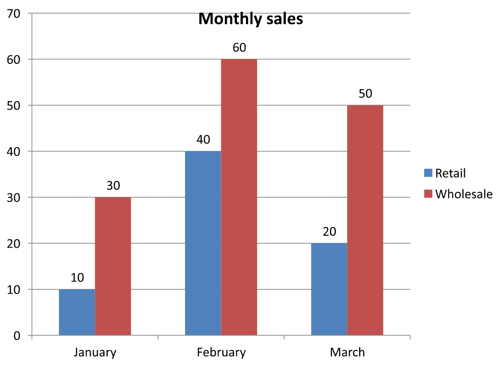

## **概述**

本文说明如何在 Aspose.Slides 中处理图表工作簿。它展示了如何通过工作簿流读取和写入图表数据、使用工作簿单元格作为图表数据标签、访问工作表集合以及为图表值指定数据源类型。

它还涵盖了使用外部工作簿作为图表数据源的操作。示例演示了如何创建并分配外部工作簿、检索链接到图表的外部工作簿路径，以及在工作簿可用时编辑图表数据。

有关表示缺失数据的工作簿单元格，请参阅 [Control the Display of Empty Cells](/slides/zh/python-java/chart-series/) 了解空单元格与零的区别，以及可用显示模式的折线图比较。

## **包含隐藏行和列中的数据**

使用 [Chart.setPlotVisibleCellsOnly](https://reference.aspose.com/slides/python-java/aspose.slides/chart/#setPlotVisibleCellsOnly) 控制图表是否仅绘制可见工作表行列中的数据。将其设为 `True` 只绘制可见单元格，设为 `False` 则同时包含可见和隐藏单元格。此设置仅影响图表绘制，不会隐藏或显示工作表的行列。

[示例演示文稿](hidden-source-data.pptx) 的第一张幻灯片的第一个形状是一个柱形图。嵌入的工作表 `Sheet1` 包含源范围 `A1:C4`。第 3 行和 C 列被隐藏，但其单元格仍包含数值。

| 工作表行 | A: 月份 | B: 零售 | C: 批发（隐藏列） |
| --- | --- | --- | --- |
| 2 | January | 10 | 30 |
| 3（隐藏行） | February | 40 | 60 |
| 4 | March | 20 | 50 |

通过 [ChartData.getChartDataWorkbook](https://reference.aspose.com/slides/python-java/aspose.slides/chartdata/#getChartDataWorkbook) 访问源单元格，并读取 [ChartDataCell.isHidden](https://reference.aspose.com/slides/python-java/aspose.slides/chartdatacell/#isHidden) 检查其隐藏状态。此方法报告隐藏状态而不更改它。在本示例中，B2 可见，B3 属于隐藏行，C2 属于隐藏列；示例分别打印 `False`、`True` 和 `True`。

对于本示例，在更改绘制设置后刷新图表数据：使用 [readWorkbookStream](https://reference.aspose.com/slides/python-java/aspose.slides/chartdata/#readWorkbookStream) 保留嵌入工作簿，并使用 [writeWorkbookStream](https://reference.aspose.com/slides/python-java/aspose.slides/chartdata/#writeWorkbookStream) 重新加载。当包含所有单元格时，还需使用 [setRange](https://reference.aspose.com/slides/python-java/aspose.slides/chartdata/#setRange) 恢复完整范围，包括隐藏的 February 类别。仅更改标志不足以刷新此示例的缓存图表数据和类别标签。

```python
import jpype
import asposeslides

if not jpype.isJVMStarted():
    jpile.startJVM()

from asposeslides.api import Chart, Presentation, SaveFormat

presentation = Presentation("hidden-source-data.pptx")
try:
    slide = presentation.getSlides().get_Item(0)

    shape_count = slide.getShapes().size()
    if shape_count > 0 and isinstance(slide.getShapes().get_Item(0), Chart):
        chart = slide.getShapes().get_Item(0)
        workbook = chart.getChartData().getChartDataWorkbook()
        print("B2 hidden:", workbook.getCell(0, "B2").isHidden())
        print("B3 hidden:", workbook.getCell(0, "B3").isHidden())
        print("C2 hidden:", workbook.getCell(0, "C2").isHidden())

        workbook_data = chart.getChartData().readWorkbookStream()
        for visible_only in (True, False):
            chart.setPlotVisibleCellsOnly(visible_only)

            # 刷新嵌入工作簿中的图表数据。
            chart.getChartData().writeWorkbookStream(workbook_data)
            if not visible_only:
                # 恢复完整的源范围，包括隐藏的类别。
                chart.getChartData().setRange("Sheet1!$A$1:$C$4")

            presentation.save(f"hidden_cells_{visible_only}.pptx", SaveFormat.Pptx)
    else:
        print("The first shape is not a chart.")
finally:
    presentation.dispose()
```

示例保存了两个版本的演示文稿：一个仅包含可见的零售值（10 和 20），另一个包含全部六个值。下图显示了两种绘制模式。第 3 行和 C 列在两个嵌入工作簿中均保持隐藏。

| 仅可见单元格（`True`） | 所有单元格（`False`） |
| --- | --- |
|  |  |

包含数值的隐藏单元格不同于空单元格。[Chart.setDisplayBlanksAs](https://reference.aspose.com/slides/python-java/aspose.slides/chart/#setDisplayBlanksAs) 控制缺失值的显示方式；它不包括或排除隐藏的源数据。请参阅 [Control the Display of Empty Cells](/slides/zh/python-java/chart-series/#control-the-display-of-empty-cells) 获取示例。

## **检索图表的数据范围**

在对现有演示文稿中的工作簿数据进行更新之前，先检查源范围以确定每个图表使用的工作表单元格。 [ChartData.getRange](https://reference.aspose.com/slides/python-java/aspose.slides/chartdata/#getRange) 方法返回当前数据范围的工作表限定公式，例如 `Sheet1!$A$1:$D$5`。其中 `Sheet1` 是工作表名称，`!` 将其与单元格范围分隔，`$A$1:$D$5` 标识从 A1 到 D5（含）的单元格。美元符号表示绝对行列引用。

该方法在不更改图表或其工作簿的情况下读取当前范围。如果图表未使用工作簿作为数据源，会抛出 `InvalidOperationException`。更多信息，请参阅 [ChartData API Reference](https://reference.aspose.com/slides/python-java/aspose.slides/chartdata/)。

此示例打开一个演示文稿，直接检查每张幻灯片上的形状是否为图表。它打印每个图表的名称和源范围。如果图表未使用工作簿，它会输出提示信息并继续检查下一个图表。

```python
import jpype
import asposeslides

if not jpype.isJVMStarted():
    jpype.startJVM()

from asposeslides.api import Chart, Presentation

InvalidOperationException = jpype.JClass("com.aspose.slides.exceptions.InvalidOperationException")

presentation = Presentation("presentation.pptx")
try:
    for slide in presentation.getSlides():
        for shape in slide.getShapes():
            if isinstance(shape, Chart):
                try:
                    data_range = shape.getChartData().getRange()
                    print(f"{shape.getName()}: {data_range}")
                except InvalidOperationException:
                    print(f"{shape.getName()}: The chart does not use a workbook as its data source.")
finally:
    presentation.dispose()
```

## **从工作簿读取和写入图表数据**

Aspose.Slides for Python via Java 提供了 [readWorkbookStream](https://reference.aspose.com/slides/python-java/aspose.slides/chartdata/#readWorkbookStream) 和 [writeWorkbookStream](https://reference.aspose.com/slides/python-java/aspose.slides/chartdata/#writeWorkbookStream) 方法，允许读取和写入图表数据工作簿（包含使用 Aspose.Cells 编辑的图表数据）。**注意** 图表数据必须以相同方式组织，或结构与源相似。

此示例使用第一张幻灯片第一张形状的图表的演示文稿。它将嵌入的工作簿读取为字节数组，清除现有系列和类别，然后将相同的工作簿写回。更改保留在内存中，示例并未保存演示文稿。

```python
import jpype
import asposeslides

if not jpype.isJVMStarted():
    jpype.startJVM()

from asposeslides.api import Chart, Presentation

presentation = Presentation("chart.pptx")
try:
    slide = presentation.getSlides().get_Item(0)
    
    shape_count = slide.getShapes().size()
    if shape_count > 0 and isinstance(slide.getShapes().get_Item(0), Chart):
        chart = slide.getShapes().get_Item(0)
        chart_data = chart.getChartData()
        workbook_data = chart_data.readWorkbookStream()

        chart_data.getSeries().clear()
        chart_data.getCategories().clear()

        chart_data.writeWorkbookStream(workbook_data)
    else:
        print("The first shape is not a chart.")
finally:
    presentation.dispose()
```

### **在修改工作簿后验证图表布局**

当用修改后的工作簿替换嵌入工作簿时，图表仍保留原来的系列和类别集合。此不匹配可能导致 [Chart.validateChartLayout](https://reference.aspose.com/slides/python-java/aspose.slides/chart/#validateChartLayout) 因索引超出范围而失败。写回更新的工作簿之前，请先清除现有系列和类别。此示例使用第一张幻灯片第一张形状的图表。注释标记了工作簿编辑的位置；可运行的示例将原始工作簿写回并在内存中验证布局。

```python
import jpype
import asposeslides

if not jpype.isJVMStarted():
    jpype.startJVM()

from asposeslides.api import Chart, Presentation

presentation = Presentation("chart.pptx")
try:
    slide = presentation.getSlides().get_Item(0)

    shape_count = slide.getShapes().size()
    if shape_count > 0 and isinstance(slide.getShapes().get_Item(0), Chart):
        chart = slide.getShapes().get_Item(0)
        chart_data = chart.getChartData()
        workbook_data = chart_data.readWorkbookStream()

        # 修改此处的工作簿字节，例如使用 Aspose.Cells。

        chart_data.getSeries().clear()
        chart_data.getCategories().clear()

        chart_data.writeWorkbookStream(workbook_data)
        chart.validateChartLayout()
    else:
        print("The first shape is not a chart.")
finally:
    presentation.dispose()
```

清除集合可在写回工作簿之前移除陈旧的数据引用。对更新后的工作簿在使用图表前，请重新构建任何必需的系列和类别映射。

## **选择类别标签的存储方式**

在向空的类别集合添加标签之前，调用 [ChartCategoryCollection.setUseCells](https://reference.aspose.com/slides/python-java/aspose.slides/chartcategorycollection/#setUseCells)。当标签引用工作簿数据或形成层次结构（例如按年划分的季度）时使用工作表单元格；当标签仅为单层且不需要单元格引用时使用字符串文字。此设置仅适用于类别。下面的两个图表均使用工作表单元格作为其数值系列。

示例创建两个柱形图，并分别打印存储模式以及 `Q1 Q2 Q3 Q4`。对于基于工作表的标签， [ChartCategory.getAsCell](https://reference.aspose.com/slides/python-java/aspose.slides/chartcategory/#getAsCell) 返回底层单元格， [ChartDataCell.getValue](https://reference.aspose.com/slides/python-java/aspose.slides/chartdatacell/#getValue) 读取其标签。对于文字标签， [ChartCategory.getValue](https://reference.aspose.com/slides/python-java/aspose.slides/chartcategory/#getValue) 直接返回字符串。

```python
import jpype
import asposeslides

if not jpype.isJVMStarted():
    jpype.startJVM()

from asposeslides.api import ChartType, Presentation, SaveFormat

presentation = Presentation()
try:
    shapes = presentation.getSlides().get_Item(0).getShapes()
    
    for use_cells in (True, False):
        x = 20 if use_cells else 360
        chart = shapes.addChart(ChartType.ClusteredColumn, x, 20, 320, 250)
        chart_data = chart.getChartData()
        chart_data.getSeries().clear()
        categories = chart_data.getCategories()
        categories.clear()
        categories.setUseCells(use_cells)

        workbook = chart_data.getChartDataWorkbook()
        series_name = workbook.getCell(0, 0, 1, "Sales")
        series = chart_data.getSeries().add(series_name, chart.getType())
        for row in range(1, 5):
            label = f"Q{row}"
            if use_cells:
                label_cell = workbook.getCell(0, row, 0, label)
                categories.add(label_cell)
            else:
                categories.add(label)

            value_cell = workbook.getCell(0, row, 1, jpype.JInt(row * 10))
            series.getDataPoints().addDataPointForBarSeries(value_cell)

        stored_in_cells = categories.getUseCells()
        labels = []
        for category in categories:
            value = category.getAsCell().getValue() if stored_in_cells else category.getValue()
            labels.append(str(value))
        print(f"UseCells = {stored_in_cells}:", *labels)

    presentation.save("category-labels.pptx", SaveFormat.Pptx)
finally:
    presentation.dispose()
```

## **为工作簿单元格设置自定义数字格式**

使用 [ChartDataCell.setCustomNumberFormat](https://reference.aspose.com/slides/python-java/aspose.slides/chartdatacell/#setCustomNumberFormat) 控制数值在图表嵌入工作簿中的显示方式。例如，报告可能需要将转换率显示为带四位小数的百分比，将系数显示为带五位小数的数值。保持两者为数值，以便仍可用于计算和图表绘制。

数字格式仅更改显示，不会更改存储的数值。格式 `0.0000%` 会将 `0.125` 显示为 `12.5000%`，但不会把存储的数值改为 `12.5`。同理，`0.00000` 会将 `0.1234567` 显示为 `0.12346`，而不对存储值进行四舍五入。如果自定义格式为空字符串（`""`），则使用 [getPresetNumberFormat](https://reference.aspose.com/slides/python-java/aspose.slides/chartdatacell/#getPresetNumberFormat) 返回的格式。

下面的示例创建一个柱形图，并通过 [getChartDataWorkbook](https://reference.aspose.com/slides/python-java/aspose.slides/chartdata/#getChartDataWorkbook) 访问其单元格。在工作表 0 中，B2 包含转换率，C2 包含系数。两个单元格均提供图表数值。示例还启用了链接到源格式的数值标签。

```python
import jpype
import asposeslides

if not jpype.isJVMStarted():
    jpype.startJVM()

from asposeslides.api import ChartType, Presentation, SaveFormat, SlideSizeScaleType

presentation = Presentation()
try:
    presentation.getSlideSize().setSize(720, 270, SlideSizeScaleType.DoNotScale)
    slide = presentation.getSlides().get_Item(0)

    chart = slide.getShapes().addChart(ChartType.ClusteredColumn, 50, 20, 620, 210)
    chart.setTitle(False)

    chart.getAxes().getVerticalAxis().setNumberFormatLinkedToSource(False)
    chart.getAxes().getVerticalAxis().setNumberFormat("0.00")
    chart.getAxes().getVerticalAxis().setAutomaticMinValue(False)
    chart.getAxes().getVerticalAxis().setMinValue(0)

    chart.getChartData().getSeries().clear()
    chart.getChartData().getCategories().clear()

    workbook = chart.getChartData().getChartDataWorkbook()
    workbook.clear(0)

    category_cell = workbook.getCell(0, "A2", "Sample")
    chart.getChartData().getCategories().add(category_cell)

    percentage_cell = workbook.getCell(0, "B2", jpype.JDouble(0.125))
    percentage_cell.setCustomNumberFormat("0.0000%")
    percentage_name = workbook.getCell(0, "B1", "Conversion rate")
    percentage_series = chart.getChartData().getSeries().add(percentage_name, chart.getType())
    percentage_series.getDataPoints().addDataPointForBarSeries(percentage_cell)

    precision_cell = workbook.getCell(0, "C2", jpype.JDouble(0.1234567))
    precision_cell.setCustomNumberFormat("0.00000")
    precision_name = workbook.getCell(0, "C1", "Coefficient")
    precision_series = chart.getChartData().getSeries().add(precision_name, chart.getType())
    precision_series.getDataPoints().addDataPointForBarSeries(precision_cell)

    for series in chart.getChartData().getSeries():
        label_format = series.getDataPoints().get_Item(0).getLabel().getDataLabelFormat()
        label_format.setShowValue(True)
        label_format.setNumberFormatLinkedToSource(True)

    presentation.save("CustomCellFormats.pptx", SaveFormat.Pptx)
finally:
    presentation.dispose()
```

工作簿单元格的格式独立于直接在图表坐标轴或数据标签上设置的格式。在本例中，由于 [setShowValue](https://reference.aspose.com/slides/python-java/aspose.slides/datalabelformat/#setShowValue) 为 `True`，并且 [setNumberFormatLinkedToSource](https://reference.aspose.com/slides/python-java/aspose.slides/datalabelformat/#setNumberFormatLinkedToSource) 为 `True`，每个标签显示其源单元格的值并遵循源数字格式。保存并重新打开演示文稿后，标签显示 `12.5000%` 和 `0.12346`，如下所示。垂直坐标轴使用自身的数字格式，通过 [setNumberFormat](https://reference.aspose.com/slides/python-java/aspose.slides/axis/#setNumberFormat) 设置为 `0.00`，且 [setNumberFormatLinkedToSource](https://reference.aspose.com/slides/python-java/aspose.slides/axis/#setNumberFormatLinkedToSource) 为 `False`。

若要独立格式化数据标签，请将其 source‑link 标志设为 `False` 并使用 [setNumberFormat](https://reference.aspose.com/slides/python-java/aspose.slides/datalabelformat/#setNumberFormat) 分配格式。这不会更改工作簿单元格的格式。例如，独立标签格式 `0.00` 会将第一个值显示为 `0.13`，而 B2 仍显示 `12.5000%`。请参阅 [Chart Data Labels](/slides/zh/python-java/chart-data-label/#set-percentage-sign-with-chart-data-labels) 了解直接标签格式化。

以下图片是重新打开保存的演示文稿后渲染的结果：


## **将工作簿单元格设为图表数据标签**

可以使用工作簿单元格中的文本作为图表数据标签。

此示例在现有演示文稿的第一张幻灯片添加一个默认数据的气泡图。它使用工作表 0 中的单元格 A10:A12 作为第一系列前三个标签，启用来自单元格的标签，并保存更新后的演示文稿。

```python
import jpype
import asposeslides

if not jpype.isJVMStarted():
    jpype.startJVM()

from asposeslides.api import ChartType, Presentation, SaveFormat

presentation = Presentation("chart2.pptx")
try:
    slide = presentation.getSlides().get_Item(0)
    label_values = ["Label 0 cell value", "Label 1 cell value", "Label 2 cell value"]
    
    chart = slide.getShapes().addChart(ChartType.Bubble, 50, 50, 600, 400, True)
    series = chart.getChartData().getSeries()
    data_labels = series.get_Item(0).getLabels()
    data_labels.getDefaultDataLabelFormat().setShowLabelValueFromCell(True)
    workbook = chart.getChartData().getChartDataWorkbook()
    for i in range(3):
        label_cell = workbook.getCell(0, f"A{10 + i}", label_values[i])
        data_labels.get_Item(i).setValueFromCell(label_cell)

    presentation.save("resultchart.pptx", SaveFormat.Pptx)
finally:
    presentation.dispose()
```

## **管理工作表**

[ChartDataWorkbook.getWorksheets](https://reference.aspose.com/slides/python-java/aspose.slides/chartdataworkbook/#getWorksheets) 方法提供对图表工作簿中工作表的访问。此示例创建一个默认数据的饼图，并将每个工作表名称打印到控制台。

```python
import jpype
import asposeslides

if not jpype.isJVMStarted():
    jpype.startJVM()

from asposeslides.api import ChartType, Presentation

presentation = Presentation()
try:
    slide = presentation.getSlides().get_Item(0)

    chart = slide.getShapes().addChart(ChartType.Pie, 50, 50, 400, 500)
    workbook = chart.getChartData().getChartDataWorkbook()
    for i in range(workbook.getWorksheets().size()):
        print(workbook.getWorksheets().get_Item(i).getName())
finally:
    presentation.dispose()
```

## **指定数据源类型**

系列点的数值也可以直接存储为数值文字。请参阅 [Set Series Values Using Numeric Literals](/slides/zh/python-java/chart-series/#set-series-values-using-numeric-literals) 获取完整示例，包括保存和读取。点值的数据源类型独立于图表的内部或外部工作簿配置；使用数值文字本身并不会移除嵌入的工作簿。

此示例创建一个默认数据的 3D 柱形图，并使用不同的数据源为两个系列名称赋值。第一个名称使用字符串文字；第二个名称使用工作表 0 中的单元格 C1。通过 [DataSourceType](https://reference.aspose.com/slides/python-java/aspose.slides/datasourcetype/) 枚举为每个名称选择来源。示例保存了包含更新后系列名称的演示文稿。

```python
import jpype
import asposeslides

if not jpype.isJVMStarted():
    jpype.startJVM()

from asposeslides.api import ChartType, DataSourceType, Presentation, SaveFormat

presentation = Presentation()
try:
    slide = presentation.getSlides().get_Item(0)

    chart = slide.getShapes().addChart(ChartType.Column3D, 50, 50, 600, 400, True)
    literal_name = chart.getChartData().getSeries().get_Item(0).getName()
    literal_name.setDataSourceType(DataSourceType.StringLiterals)
    literal_name.setData("LiteralString")
    cell_name = chart.getChartData().getSeries().get_Item(1).getName()
    name_cell = chart.getChartData().getChartDataWorkbook().getCell(0, "C1", "NewCell")
    cell_name.setDataSourceType(DataSourceType.Worksheet)
    cell_name.setData(name_cell)
    
    presentation.save("pres.pptx", SaveFormat.Pptx)
finally:
    presentation.dispose()
```

## **检测不受支持的嵌入工作簿格式**

Aspose.Slides 不支持某些图表中嵌入的 Excel 二进制工作簿（.xlsb）格式。可以在 [ChartData](https://reference.aspose.com/slides/python-java/aspose.slides/chartdata/) 上使用 [getEmbeddedWorkbookType](https://reference.aspose.com/slides/python-java/aspose.slides/chartdata/#getEmbeddedWorkbookType) 方法，并结合 [WorkbookType](https://reference.aspose.com/slides/python-java/aspose.slides/workbooktype/) 枚举检测不受支持的格式并跳过这些图表。此示例检查现有演示文稿第一张幻灯片上的形状，跳过非图表形状，并为每个包含嵌入 .xlsb 工作簿的图表打印诊断信息。

```python
import jpype
import asposeslides

if not jpype.isJVMStarted():
    jpype.startJVM()

from asposeslides.api import Chart, ChartDataSourceType, Presentation, WorkbookType

presentation = Presentation("sample.pptx")
try:
    slide = presentation.getSlides().get_Item(0)

    for shape in slide.getShapes():
        if not isinstance(shape, Chart):
            continue

        chart_data = shape.getChartData()

        is_internal_workbook = chart_data.getDataSourceType() == ChartDataSourceType.InternalWorkbook
        is_binary_macro = chart_data.getEmbeddedWorkbookType() == WorkbookType.WorkbookBinaryMacro

        if is_internal_workbook and is_binary_macro:
            print("Skipping a chart with an unsupported .xlsb workbook.")
            continue
        # 在此读取或修改受支持的图表工作簿数据。
finally:
    presentation.dispose()
```

## **外部工作簿**

Aspose.Slides 支持使用外部工作簿作为图表的数据源。

### **创建外部工作簿**

使用 [readWorkbookStream](https://reference.aspose.com/slides/python-java/aspose.slides/chartdata/#readWorkbookStream) 和 [setExternalWorkbook](https://reference.aspose.com/slides/python-java/aspose.slides/chartdata/#setExternalWorkbook) 将嵌入的图表工作簿导出为文件，并将图表链接到该外部工作簿。

此示例创建一个默认数据的饼图并导出其工作簿。文件写入完成后，将外部工作簿设为图表数据源，随后保存链接后的演示文稿。

```python
import jpype
import asposeslides

if not jpype.isJVMStarted():
    jpile.startJVM()

from asposeslides.api import ChartType, Presentation, SaveFormat

from pathlib import Path

presentation = Presentation()
try:
    slide = presentation.getSlides().get_Item(0)

    chart = slide.getShapes().addChart(ChartType.Pie, 50, 50, 400, 600)
    workbook_path = Path("externalWorkbook1.xlsx").resolve()
    workbook_data = chart.getChartData().readWorkbookStream()
    Path(workbook_path).write_bytes(bytes(workbook_data))
    chart.getChartData().setExternalWorkbook(str(workbook_path))

    presentation.save("externalWorkbook.pptx", SaveFormat.Pptx)
finally:
    presentation.dispose()
```

### **设置外部工作簿**

使用 [setExternalWorkbook](https://reference.aspose.com/slides/python-java/aspose.slides/chartdata/#setExternalWorkbook) 方法，可为图表分配外部工作簿作为数据源。该方法还可用于更新外部工作簿的路径（如果工作簿已移动）。

虽然无法编辑存放在远程位置或资源中的工作簿数据，但仍可将此类工作簿用作外部数据源。如果提供相对路径，系统会自动转换为完整路径。

此示例使用一个外部工作簿，其工作表 `Sheet1` 在 B1 中包含系列名称，在 A2:A4 中包含类别名称，在 B2:B4 中包含数值。示例创建饼图，链接工作簿，并使用 [setRange](https://reference.aspose.com/slides/python-java/aspose.slides/chartdata/#setRange) 将 A1:B4 映射为一个系列和三个类别。随后保存带链接的演示文稿。

```python
import jpype
import asposeslides

if not jpype.isJVMStarted():
    jpype.startJVM()

from asposeslides.api import ChartType, Presentation, SaveFormat

from pathlib import Path

presentation = Presentation()
try:
    slide = presentation.getSlides().get_Item(0)

    chart = slide.getShapes().addChart(ChartType.Pie, 50, 50, 400, 600, True)
    chart_data = chart.getChartData()
    workbook_path = str(Path("externalWorkbook.xlsx").resolve())
    chart_data.setExternalWorkbook(workbook_path)
    chart_data.setRange("Sheet1!$A$1:$B$4")

    presentation.save("Presentation_with_externalWorkbook.pptx", SaveFormat.Pptx)
finally:
    presentation.dispose()
```

[setExternalWorkbook](https://reference.aspose.com/slides/python-java/aspose.slides/chartdata/#setExternalWorkbook) 的 `updateChartData` 参数决定是否加载工作簿。

* 当 `updateChartData` 为 `False` 时，仅更新工作簿路径。图表数据不会从目标工作簿加载或更新，因此工作簿可以不可用。
* 当 `updateChartData` 为 `True` 时，图表数据会从目标工作簿更新。

下面的示例将占位符 URL 与 `updateChartData` 设置为 `False`。它保留饼图的默认数据并在未加载不可用工作簿的情况下保存演示文稿。

```python
import jpype
import asposeslides

if not jpype.isJVMStarted():
    jpype.startJVM()

from asposeslides.api import ChartType, Presentation, SaveFormat

presentation = Presentation()
try:
    slide = presentation.getSlides().get_Item(0)

    chart = slide.getShapes().addChart(ChartType.Pie, 50, 50, 400, 600, True)
    chart_data = chart.getChartData()
    chart_data.setExternalWorkbook("https://example.com/unavailable-workbook.xlsx", False)

    presentation.save("SetExternalWorkbookWithUpdateChartData.pptx", SaveFormat.Pptx)
finally:
    presentation.dispose()
```

### **获取图表的外部数据源工作簿路径**

要识别链接到图表的工作簿，检查图表是否使用外部数据源并检索其工作簿路径。

此示例检查演示文稿第一张幻灯片第一张形状。如果它是链接到外部工作簿的图表，示例会将 [getExternalWorkbookPath](https://reference.aspose.com/slides/python-java/aspose.slides/chartdata/#getExternalWorkbookPath) 打印到控制台。随后保存演示文稿的副本。

```python
import jpype
import asposeslides

if not jpype.isJVMStarted():
    jpype.startJVM()

from asposeslides.api import Chart, ChartDataSourceType, Presentation, SaveFormat

presentation = Presentation("externalWorkbook.pptx")
try:
    slide = presentation.getSlides().get_Item(0)

    shape_count = slide.getShapes().size()
    if shape_count > 0 and isinstance(slide.getShapes().get_Item(0), Chart):
        chart = slide.getShapes().get_Item(0)
        chart_data = chart.getChartData()
        if chart_data.getDataSourceType() == ChartDataSourceType.ExternalWorkbook:
            print(chart_data.getExternalWorkbookPath())
        else:
            print("The chart does not use an external workbook.")
    else:
        print("The first shape is not a chart.")

    presentation.save("Result.pptx", SaveFormat.Pptx)
finally:
    presentation.dispose()
```

### **编辑图表数据**

可以像编辑内部工作簿一样编辑外部工作簿中的数据。如果外部工作簿无法加载，会抛出异常。

此示例使用第一张幻灯片第一张形状的图表，该图表链接到可访问的外部工作簿。它将第一系列第一个数据点的单元格值设为 100 并保存更新后的演示文稿。编辑单元格值会更新链接的外部 XLSX 文件，若需保留原始工作簿，请使用副本。

```python
import jpype
import asposeslides

if not jpype.isJVMStarted():
    jpype.startJVM()

from asposeslides.api import Chart, Presentation, SaveFormat

presentation = Presentation("presentation.pptx")
try:
    slide = presentation.getSlides().get_Item(0)

    shape_count = slide.getShapes().size()
    if shape_count > 0 and isinstance(slide.getShapes().get_Item(0), Chart):
        chart = slide.getShapes().get_Item(0)
        series = chart.getChartData().getSeries()
        if series.size() > 0 and series.get_Item(0).getDataPoints().size() > 0:
            value_cell = series.get_Item(0).getDataPoints().get_Item(0).getValue().getAsCell()
            if value_cell is not None:
                value_cell.setValue(jpype.JInt(100))
                presentation.save("presentation_out.pptx", SaveFormat.Pptx)
            else:
                print("The first data point is not linked to a workbook cell.")
        else:
            print("The chart has no data points to edit.")
    else:
        print("The first shape is not a chart.")
finally:
    presentation.dispose()
```

### **从图表缓存恢复工作簿**

如果图表使用的外部工作簿缺失或不可用，Aspose.Slides 可以从演示文稿缓存的数据重建图表工作簿。创建 [LoadOptions](https://reference.aspose.com/slides/python-java/aspose.slides/loadoptions/)，调用 [LoadOptions.setSpreadsheetOptions](https://reference.aspose.com/slides/python-java/aspose.slides/loadoptions/#setSpreadsheetOptions)，并在打开演示文稿前将 [SpreadsheetOptions.setRecoverWorkbookFromChartCache](https://reference.aspose.com/slides/python-java/aspose.slides/spreadsheetoptions/#setRecoverWorkbookFromChartCache) 设置为 `True`.

下面的 Python 示例恢复了第一张幻灯片第一张形状的图表的工作簿数据，该图表引用了不可用的外部工作簿。它通过 [Chart.getChartData](https://reference.aspose.com/slides/python-java/aspose.slides/chart/#getChartData) 和 [ChartData.getChartDataWorkbook](https://reference.aspose.com/slides/python-java/aspose.slides/chartdata/#getChartDataWorkbook) 访问恢复的数据：

```python
import jpype
import asposeslides

if not jpype.isJVMStarted():
    jpype.startJVM()

from asposeslides.api import Chart, LoadOptions, Presentation, SpreadsheetOptions

spreadsheet_options = SpreadsheetOptions()
spreadsheet_options.setRecoverWorkbookFromChartCache(True)

load_options = LoadOptions()
load_options.setSpreadsheetOptions(spreadsheet_options)

presentation = Presentation("presentation.pptx", load_options)
try:
    slide = presentation.getSlides().get_Item(0)

    shape_count = slide.getShapes().size()
    if shape_count > 0 and isinstance(slide.getShapes().get_Item(0), Chart):
        chart = slide.getShapes().get_Item(0)
        recovered_workbook = chart.getChartData().getChartDataWorkbook()

        # 在此读取或修改恢复的工作簿数据。
    else:
        print("The first shape is not a chart.")
finally:
    presentation.dispose()
```

如果外部工作簿不可用且未启用恢复，Aspose.Slides 将抛出异常。仅在接受使用缓存图表数据作为可接受的回退时才启用恢复，因为缓存可能不包含对外部工作簿在上次更新演示文稿后所做的更改。

## **常见问题**

**我能否判断特定图表是链接到外部工作簿还是嵌入工作簿？**

可以。图表具有 [data source type](https://reference.aspose.com/slides/python-java/aspose.slides/chartdata/#getDataSourceType) 和 [path to an external workbook](https://reference.aspose.com/slides/python-java/aspose.slides/chartdata/#getExternalWorkbookPath)；如果来源是外部工作簿，可读取完整路径以确认使用了外部文件。

**是否支持外部工作簿的相对路径，如何存储？**

支持。若指定相对路径，系统会自动转换为绝对路径。演示文稿在 PPTX 文件中存储绝对路径，因此移动工作簿可能需要更新链接。

**我可以使用位于网络资源/共享上的工作簿吗？**

可以，这类工作簿可以作为外部数据源使用。但 Aspose.Slides 不支持直接编辑远程工作簿——它们只能用作数据源。

**保存演示文稿时，Aspose.Slides 会覆盖外部 XLSX 吗？**

演示文稿存储了指向外部文件的 [link to the external file](https://reference.aspose.com/slides/python-java/aspose.slides/chartdata/#getExternalWorkbookPath)。编辑基于单元格的图表数据也可能更新链接的本地 XLSX 文件。若原始文件必须保持不变，请使用工作簿的副本。

**如果外部文件受密码保护怎么办？**

Aspose.Slides 在链接时不接受密码。常见做法是事先移除保护或准备已解密的副本（例如使用 [Aspose.Cells](https://reference.aspose.com/cells/python-java/)），并链接到该副本。

**多个图表可以引用同一个外部工作簿吗？**

可以。每个图表单独存储其链接。如果它们指向同一文件，更新该文件将在下次加载数据时反映到所有图表中。