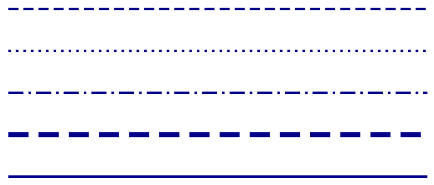

## **简介**

通过调整轮廓、填充和效果来格式化 PowerPoint 中的形状。Aspose.Slides for Python via Java 允许您以编程方式控制这些设置，包括透明度、旋转和 3D 格式化。


Aspose.Slides for Python via Java 提供了类和方法，允许您使用 PowerPoint 中相同的选项来格式化形状。

## **格式线条**

使用 [Shape.getLineFormat](https://reference.aspose.com/slides/python-java/aspose.slides/shape/#getLineFormat) 来控制形状的轮廓。此示例创建一个无填充、蓝色虚线轮廓的矩形。[LineFormat.setStyle](https://reference.aspose.com/slides/python-java/aspose.slides/lineformat/#setStyle) 选择一种粗‑细组合线，而 [LineFormat.setWidth](https://reference.aspose.com/slides/python-java/aspose.slides/lineformat/#setWidth) 将其宽度设置为 7 磅，且 [LineFormat.setDashStyle](https://reference.aspose.com/slides/python-java/aspose.slides/lineformat/#setDashStyle) 选择虚线模式。

```python
import jpype
import asposeslides

if not jpype.isJVMStarted():
    jpype.startJVM()

from asposeslides.api import FillType, LineDashStyle, LineStyle, Presentation, SaveFormat, ShapeType
from java.awt import Color

presentation = Presentation()
try:
    slide = presentation.getSlides().get_Item(0)

    shape = slide.getShapes().addAutoShape(ShapeType.Rectangle, 50, 50, 150, 75)
    shape.getFillFormat().setFillType(FillType.NoFill)
    shape.getLineFormat().setStyle(LineStyle.ThickThin)
    shape.getLineFormat().setWidth(7)
    shape.getLineFormat().setDashStyle(LineDashStyle.Dash)
    shape.getLineFormat().getFillFormat().setFillType(FillType.Solid)
    shape.getLineFormat().getFillFormat().getSolidFillColor().setColor(Color.BLUE)

    presentation.save("formatted_lines.pptx", SaveFormat.Pptx)
finally:
    presentation.dispose()
```

结果如下：


### **设置自定义线条虚线模式**

当预定义的线条样式不能提供所需的虚线长度和间隙时（例如品牌轮廓或技术图表），使用 [LineFormat.setCustomDashPattern](https://reference.aspose.com/slides/python-java/aspose.slides/lineformat/#setCustomDashPattern)。分配模式会自动将线条虚线样式更改为 [LineDashStyle.Custom](https://reference.aspose.com/slides/python-java/aspose.slides/linedashstyle/)。

数组条目在虚线和间隙长度之间交替，以虚线开始。每个值都是线宽的倍数：在宽度为 3 磅时，`[4, 2]` 产生 12 磅的虚线后跟 6 磅的间隙。使用成对的有限、非负值来定义完整的虚线‑间隙段。示例使用正值以保持每段虚线和间隙均可见。

此示例创建了五条相同长度、平头的蓝色线条。前三条在 3 磅宽度下比较不同模式。第四条以两倍宽度重复第一种模式，使虚线和间隙长度均加倍。第五条将自定义模式切换为实线。

```python
import jpype
import asposeslides

if not jpype.isJVMStarted():
    jpapi.startJVM()

from asposeslides.api import FillType, LineArrowheadStyle, LineCapStyle, LineDashStyle, Presentation, SaveFormat, ShapeType, SlideSizeScaleType
from java.awt import Color

presentation = Presentation()
try:
    presentation.getSlideSize().setSize(600, 300, SlideSizeScaleType.DoNotScale)
    slide = presentation.getSlides().get_Item(0)

    patterns = [
        [4, 2],
        [1, 2],
        [6, 2, 1, 2],
        [4, 2],
        [4, 2]
    ]

    for i, pattern in enumerate(patterns):
        line = slide.getShapes().addAutoShape(ShapeType.Line, 50, 50 + i * 50, 500, 0)
        line.getLineFormat().setWidth(6 if i == 3 else 3)
        line.getLineFormat().getFillFormat().setFillType(FillType.Solid)
        color = Color(0, 0, 139)
        line.getLineFormat().getFillFormat().getSolidFillColor().setColor(color)
        line.getLineFormat().setCapStyle(LineCapStyle.Flat)
        line.getLineFormat().setBeginArrowheadStyle(LineArrowheadStyle.None_)
        line.getLineFormat().setEndArrowheadStyle(LineArrowheadStyle.None_)
        line.getLineFormat().setCustomDashPattern(jpype.JArray(jpype.JFloat)(pattern))

    # 将最后一条线恢复为实线样式。
    slide.getShapes().get_Item(4).getLineFormat().setDashStyle(LineDashStyle.Solid)

    presentation.save("custom_dash_patterns.pptx", SaveFormat.Pptx)
finally:
    presentation.dispose()
```

如果要改回预定义的虚线样式，可将 [LineDashStyle.Dash](https://reference.aspose.com/slides/python-java/aspose.slides/linedashstyle/) 传递给 [LineFormat.setDashStyle](https://reference.aspose.com/slides/python-java/aspose.slides/lineformat/#setDashStyle)。所选样式控制线条的外观。

PowerPoint 中的结果，自上而下分别为：**{4, 2}, 3 pt**；**{1, 2}, 3 pt**；**{6, 2, 1, 2}, 3 pt**；**{4, 2}, 6 pt**；以及 **Solid, 3 pt**。



### **设置线端帽**

使用 [LineFormat.setCapStyle](https://reference.aspose.com/slides/python-java/aspose.slides/lineformat/#setCapStyle) 设置开放线条的端点。[LineCapStyle](https://reference.aspose.com/slides/python-java/aspose.slides/linecapstyle/) 类提供三种显式的端帽样式：

- `Flat`：笔划在端点处停止。
- `Round`：半圆形端帽超出端点半个线宽。
- `Square`：方形端帽超出端点半个线宽。

该类还包括 `NotDefined`，表示未显式分配端帽样式。

端帽不同于箭头（在线端添加符号）和接合（控制线段之间的拐角）。此示例通过 [LineFormat.setBeginArrowheadStyle](https://reference.aspose.com/slides/python-java/aspose.slides/lineformat/#setBeginArrowheadStyle) 和 [LineFormat.setEndArrowheadStyle](https://reference.aspose.com/slides/python-java/aspose.slides/lineformat/#setEndArrowheadStyle) 禁用箭头，以便仅比较端帽形状。

以下示例创建三条除端帽外完全相同的水平线，宽度为 20 磅。自上而下分别使用平帽、圆帽和方帽。它们的端点具有相同的水平坐标；圆帽和方帽在每个端点超出 10 磅。

```python
import jpype
import asposeslides

if not jpype.isJVMStarted():
    jpype.startJVM()

from asposeslides.api import FillType, LineArrowheadStyle, LineCapStyle, LineDashStyle, Presentation, SaveFormat, ShapeType, SlideSizeScaleType
from java.awt import Color

presentation = Presentation()
try:
    presentation.getSlideSize().setSize(500, 240, SlideSizeScaleType.DoNotScale)
    slide = presentation.getSlides().get_Item(0)

    cap_styles = [LineCapStyle.Flat, LineCapStyle.Round, LineCapStyle.Square]

    for i, cap_style in enumerate(cap_styles):
        line = slide.getShapes().addAutoShape(ShapeType.Line, 100, 50 + i * 70, 300, 0)
        line.getLineFormat().setWidth(20)
        line.getLineFormat().getFillFormat().setFillType(FillType.Solid)
        color = Color(0, 0, 139)
        line.getLineFormat().getFillFormat().getSolidFillColor().setColor(color)
        line.getLineFormat().setDashStyle(LineDashStyle.Solid)
        line.getLineFormat().setCapStyle(cap_style)
        line.getLineFormat().setBeginArrowheadStyle(LineArrowheadStyle.None_)
        line.getLineFormat().setEndArrowheadStyle(LineArrowheadStyle.None_)

    presentation.save("line_caps.pptx", SaveFormat.Pptx)
finally:
    presentation.dispose()
```

PowerPoint 中的结果，自上而下为：**Flat**、**Round** 和 **Square**。


## **为形状线条应用素描效果**

素描效果使形状线条看起来像手绘。使用 [Shape.getLineFormat](https://reference.aspose.com/slides/python-java/aspose.slides/shape/#getLineFormat) 访问线条设置，使用 [LineFormat.getSketchFormat](https://reference.aspose.com/slides/python-java/aspose.slides/lineformat/#getSketchFormat) 访问素描设置，并使用 [SketchFormat.setSketchType](https://reference.aspose.com/slides/python-java/aspose.slides/sketchformat/#setSketchType) 从 [LineSketchType](https://reference.aspose.com/slides/python-java/aspose.slides/linesketchtype/) 类中选择一个值。

以下 Python 代码演示如何应用 [LineSketchType.Curved](https://reference.aspose.com/slides/python-java/aspose.slides/linesketchtype/) 效果，读取显式分配的值，以及使用 [LineSketchType.None_](https://reference.aspose.com/slides/python-java/aspose.slides/linesketchtype/) 移除该效果。

```python
import jpype
import asposeslides

if not jpype.isJVMStarted():
    jpype.startJVM()

from asposeslides.api import LineSketchType, Presentation, ShapeType

presentation = Presentation()
try:
    slide = presentation.getSlides().get_Item(0)

    shape = slide.getShapes().addAutoShape(ShapeType.Rectangle, 50, 50, 200, 100)

    sketch_format = shape.getLineFormat().getSketchFormat()
    sketch_format.setSketchType(LineSketchType.Curved)
    explicit_sketch_type = sketch_format.getSketchType()
    print("Explicit sketch type:", explicit_sketch_type)
    sketch_format.setSketchType(LineSketchType.None_)
finally:
    presentation.dispose()
```

[SketchFormat.getSketchType](https://reference.aspose.com/slides/python-java/aspose.slides/sketchformat/#getSketchType) 返回的值表示直接分配给形状的设置。如果线条格式可以从主题、母版幻灯片或版式幻灯片继承，请使用 [LineFormat.getEffective](https://reference.aspose.com/slides/python-java/aspose.slides/lineformat/#getEffective) 并从返回的有效线条格式中读取素描类型，如下所示。有效值反映在继承解析后实际应用的格式。此示例需要一个已有的演示文稿，其第一张幻灯片上至少有一个形状，并打印两个值：

```python
import jpype
import asposeslides

if not jpype.isJVMStarted():
    jpype.startJVM()

from asposeslides.api import Presentation

presentation = Presentation("presentation.pptx")
try:
    shape = presentation.getSlides().get_Item(0).getShapes().get_Item(0)

    line_format = shape.getLineFormat()
    explicit_sketch_type = line_format.getSketchFormat().getSketchType()
    effective_line_format = line_format.getEffective()
    effective_sketch_type = effective_line_format.getSketchFormat().getSketchType()

    print("Explicit sketch type:", explicit_sketch_type)
    print("Effective sketch type:", effective_sketch_type)
finally:
    presentation.dispose()
```

## **格式连接样式**

以下是三种连接类型选项：

* Round
* Miter
* Bevel

连接样式控制两个轮廓段在拐角处的相接方式。使用 **Round** 来获得圆角，使用 **Miter** 来获得锐角，或使用 **Bevel** 来获得平角。


此示例创建三个黑色矩形，蓝色轮廓宽度为 15 磅。它使用 [LineFormat.setJoinStyle](https://reference.aspose.com/slides/python-java/aspose.slides/lineformat/#setJoinStyle) 分别将 [LineJoinStyle](https://reference.aspose.com/slides/python-java/aspose.slides/linejoinstyle/) 的 miter、bevel 和 round 值设定，以比较拐角的绘制方式。

```python
import jpype
import asposeslides

if not jpype.isJVMStarted():
    jpype.startJVM()

from asposeslides.api import FillType, LineJoinStyle, Presentation, SaveFormat, ShapeType
from java.awt import Color

presentation = Presentation()
try:
    slide = presentation.getSlides().get_Item(0)

    miter_shape = slide.getShapes().addAutoShape(ShapeType.Rectangle, 20, 20, 150, 75)
    bevel_shape = slide.getShapes().addAutoShape(ShapeType.Rectangle, 210, 20, 150, 75)
    round_shape = slide.getShapes().addAutoShape(ShapeType.Rectangle, 20, 135, 150, 75)

    miter_shape.getFillFormat().setFillType(FillType.Solid)
    miter_shape.getFillFormat().getSolidFillColor().setColor(Color.BLACK)
    bevel_shape.getFillFormat().setFillType(FillType.Solid)
    bevel_shape.getFillFormat().getSolidFillColor().setColor(Color.BLACK)
    round_shape.getFillFormat().setFillType(FillType.Solid)
    round_shape.getFillFormat().getSolidFillColor().setColor(Color.BLACK)

    miter_shape.getLineFormat().setWidth(15)
    bevel_shape.getLineFormat().setWidth(15)
    round_shape.getLineFormat().setWidth(15)

    miter_shape.getLineFormat().getFillFormat().setFillType(FillType.Solid)
    miter_shape.getLineFormat().getFillFormat().getSolidFillColor().setColor(Color.BLUE)
    bevel_shape.getLineFormat().getFillFormat().setFillType(FillType.Solid)
    bevel_shape.getLineFormat().getFillFormat().getSolidFillColor().setColor(Color.BLUE)
    round_shape.getLineFormat().getFillFormat().setFillType(FillType.Solid)
    round_shape.getLineFormat().getFillFormat().getSolidFillColor().setColor(Color.BLUE)

    miter_shape.getLineFormat().setJoinStyle(LineJoinStyle.Miter)
    bevel_shape.getLineFormat().setJoinStyle(LineJoinStyle.Bevel)
    round_shape.getLineFormat().setJoinStyle(LineJoinStyle.Round)

    miter_shape.getTextFrame().setText("Miter Join Style")
    bevel_shape.getTextFrame().setText("Bevel Join Style")
    round_shape.getTextFrame().setText("Round Join Style")

    presentation.save("join_styles.pptx", SaveFormat.Pptx)
finally:
    presentation.dispose()
```

### **在锐角处限制斜接连接**

使用 [LineFormat.setMiterLimit](https://reference.aspose.com/slides/python-java/aspose.slides/lineformat/#setMiterLimit) 并将 [LineFormat.setJoinStyle](https://reference.aspose.com/slides/python-java/aspose.slides/lineformat/#setJoinStyle) 设置为 [LineJoinStyle.Miter](https://reference.aspose.com/slides/python-java/aspose.slides/linejoinstyle/)，以限制锐角的延伸距离。

该限制是连接内部和外部角之间的距离与线宽的比率。例如，值为 `8` 时，斜接长度最多可达线宽的八倍；这不是以磅为单位的测量。如果拐角超过该限制，PowerPoint 将在该拐角使用斜面连接。更大的限制允许更尖锐的点。此设置仅影响斜接连接，当拐角仍在限制范围内时，修改它不会产生可见效果。

此示例创建两个相同的无填充三角形，轮廓宽度为 20 磅。左侧三角形使用 `2` 的限制，右侧使用 `8`。每个三角形宽 80 磅，高 160 磅，使其顶部拐角的斜接长度与线宽比约为 `4.12`。因此，PowerPoint 对左侧顶点使用斜面处理，而保留右侧顶点。

```python
import jpype
import asposeslides

if not jpype.isJVMStarted():
    jpype.startJVM()

from asposeslides.api import FillType, LineJoinStyle, Presentation, SaveFormat, ShapeType, SlideSizeScaleType
from java.awt import Color

presentation = Presentation()
try:
    presentation.getSlideSize().setSize(500, 320, SlideSizeScaleType.DoNotScale)
    slide = presentation.getSlides().get_Item(0)

    miter_limits = [2.0, 8.0]

    for i, miter_limit in enumerate(miter_limits):
        triangle = slide.getShapes().addAutoShape(ShapeType.Triangle, 90 + i * 240, 110, 80, 160)
        triangle.getFillFormat().setFillType(FillType.NoFill)
        triangle.getLineFormat().setWidth(20)
        triangle.getLineFormat().getFillFormat().setFillType(FillType.Solid)
        color = Color(0, 0, 139)
        triangle.getLineFormat().getFillFormat().getSolidFillColor().setColor(color)
        triangle.getLineFormat().setJoinStyle(LineJoinStyle.Miter)
        triangle.getLineFormat().setMiterLimit(miter_limit)

    presentation.save("miter_limits.pptx", SaveFormat.Pptx)
finally:
    presentation.dispose()
```

PowerPoint 中的结果：左侧为 **Miter limit 2**，右侧为 **miter limit 8**。


## **渐变填充**

渐变填充在形状上混合颜色。此示例使用 [FillFormat.getGradientFormat](https://reference.aspose.com/slides/python-java/aspose.slides/fillformat/#getGradientFormat) 以 45 度角从红色到紫色为椭圆填充线性渐变。[GradientStopCollection.addPresetColor](https://reference.aspose.com/slides/python-java/aspose.slides/gradientstopcollection/#addPresetColor) 方法将颜色点放置在 0 和 1 位置，即渐变的起始和结束。清除现有的颜色点可确保仅使用这两种颜色。

```python
import jpype
import asposeslides

if not jpype.isJVMStarted():
    jpype.startJVM()

from asposeslides.api import FillType, GradientShape, Presentation, PresetColor, SaveFormat, ShapeType
from java.awt import Color

presentation = Presentation()
try:
    slide = presentation.getSlides().get_Item(0)

    shape = slide.getShapes().addAutoShape(ShapeType.Ellipse, 50, 50, 150, 75)
    shape.getFillFormat().setFillType(FillType.Gradient)
    shape.getFillFormat().getGradientFormat().setGradientShape(GradientShape.Linear)
    shape.getFillFormat().getGradientFormat().setLinearGradientAngle(45)
    shape.getFillFormat().getGradientFormat().getGradientStops().clear()
    shape.getFillFormat().getGradientFormat().getGradientStops().addPresetColor(1.0, PresetColor.Purple)
    shape.getFillFormat().getGradientFormat().getGradientStops().addPresetColor(0.0, PresetColor.Red)

    presentation.save("gradient_fill.pptx", SaveFormat.Pptx)
finally:
    presentation.dispose()
```

结果如下：


如果导出图像中的渐变与 PowerPoint 中显示的不同，请参阅 [Choose a Gradient Rendering Style](/slides/zh/python-java/convert-powerpoint-to-png/#choose-a-gradient-rendering-style)。您可以在不更改演示文稿中存储的渐变填充的情况下选择渲染样式。

### **设置线性渐变角度**

使用 [GradientFormat.setLinearGradientAngle](https://reference.aspose.com/slides/python-java/aspose.slides/gradientformat/#setLinearGradientAngle) 来控制 [GradientShape.Linear](https://reference.aspose.com/slides/python-java/aspose.slides/gradientshape/) 填充的方向。角度以度为单位，顺时针递增：`0` 为左到右，`90` 为上到下，`180` 为右到左，`270` 为下到上。支持小数角度。超出 `[0, 360)` 的有限角度会归一化为一次完整旋转；例如，`-45` 变为 `315`，`360` 变为 `0`。

此示例创建六个矩形，在位置 `0`、`0.5` 和 `1` 处设置相同的红、绿、蓝颜色点。禁用缩放，以便可以独立于矩形比例比较角度。角度从左到右分别为第一行的 `0`、`45`、`90`，第二行的 `135`、`180`、`270`。

```python
import jpype
import asposeslides

if not jpype.isJVMStarted():
    jpype.startJVM()

from asposeslides.api import FillType, GradientShape, NullableBool, Presentation, SaveFormat, ShapeType, SlideSizeScaleType
from java.awt import Color

presentation = Presentation()
try:
    presentation.getSlideSize().setSize(720, 400, SlideSizeScaleType.DoNotScale)
    slide = presentation.getSlides().get_Item(0)

    angles = [0, 45, 90, 135, 180, 270]

    for i, angle in enumerate(angles):
        x = 30 + (i % 3) * 230
        y = 30 + (i // 3) * 190

        shape = slide.getShapes().addAutoShape(ShapeType.Rectangle, x, y, 200, 150)
        shape.getLineFormat().getFillFormat().setFillType(FillType.NoFill)
        shape.getFillFormat().setFillType(FillType.Gradient)

        gradient = shape.getFillFormat().getGradientFormat()
        gradient.setGradientShape(GradientShape.Linear)
        gradient.getGradientStops().clear()
        gradient.getGradientStops().add(0, Color.RED)
        gradient.getGradientStops().add(0.5, Color.GREEN)
        gradient.getGradientStops().add(1, Color.BLUE)
        gradient.setLinearGradientScaled(NullableBool.False_)
        gradient.setLinearGradientAngle(angle)

    presentation.save("linear_gradient_angles.pptx", SaveFormat.Pptx)
finally:
    presentation.dispose()
```

PowerPoint 中的结果如下：


### **随形状缩放线性渐变**

[GradientFormat.setLinearGradientScaled](https://reference.aspose.com/slides/python-java/aspose.slides/gradientformat/#setLinearGradientScaled) 接受一个 [NullableBool](https://reference.aspose.com/slides/python-java/aspose.slides/nullablebool/) 值。显式设为 `False_` 可在形状比例变化时保持几何渐变角度不变，设为 `True_` 则随形状的宽高缩放渐变。启用缩放后，在非正方形形状上可见角度可能与分配的角度不同。

以下示例使用 `45` 度角度和与角度比较相同的颜色点。左列使用 `False_`，右列使用 `True_`。每列包含一个宽矩形在上方、一个高矩形在下方。两者起始宽度相同；更改第二个矩形的宽高演示填充在调整大小时如何响应而不更改渐变设置。

```python
import jpype
import asposeslides

if not jpype.isJVMStarted():
    jpype.startJVM()

from asposeslides.api import FillType, GradientShape, NullableBool, Presentation, SaveFormat, ShapeType, SlideSizeScaleType
from java.awt import Color

presentation = Presentation()
try:
    presentation.getSlideSize().setSize(720, 460, SlideSizeScaleType.DoNotScale)
    slide = presentation.getSlides().get_Item(0)

    scaling_options = [NullableBool.False_, NullableBool.True_]

    for column, scaled in enumerate(scaling_options):
        for row in range(2):
            x = 30 + column * 360
            y = 30 if row == 0 else 150

            shape = slide.getShapes().addAutoShape(ShapeType.Rectangle, x, y, 300, 90)
            shape.getLineFormat().getFillFormat().setFillType(FillType.NoFill)
            shape.getFillFormat().setFillType(FillType.Gradient)

            gradient = shape.getFillFormat().getGradientFormat()
            gradient.setGradientShape(GradientShape.Linear)
            gradient.getGradientStops().clear()
            gradient.getGradientStops().add(0, Color.RED)
            gradient.getGradientStops().add(0.5, Color.GREEN)
            gradient.getGradientStops().add(1, Color.BLUE)
            gradient.setLinearGradientAngle(45)
            gradient.setLinearGradientScaled(scaled)

            if row == 1:
                shape.setWidth(90)
                shape.setHeight(280)

    presentation.save("linear_gradient_scaling.pptx", SaveFormat.Pptx)
finally:
    presentation.dispose()
```

PowerPoint 中的结果，左侧禁用缩放，右侧启用缩放：


禁用缩放时，斜向色带在两个矩形中保持相同方向。启用缩放时，色带随形状比例拉伸。这有助于在将形状调整为不同尺寸时复制模板的渐变。对于正方形，启用缩放不会改变此 `45` 度渐变的外观。

角度和缩放设置均适用于线性渐变。它们不控制 [GradientShape.Radial or GradientShape.Rectangle](https://reference.aspose.com/slides/python-java/aspose.slides/gradientshape/) 填充。

### **将角度与渐变方向组合**

[GradientFormat.setGradientDirection](https://reference.aspose.com/slides/python-java/aspose.slides/gradientformat/#setGradientDirection) 从 [GradientDirection](https://reference.aspose.com/slides/python-java/aspose.slides/gradientdirection/) 类中选择渐变样式；它不是数值角度的替代品。对于线性渐变，拐角样式可以改变颜色分布的区域，而不改变通过 [setLinearGradientAngle](https://reference.aspose.com/slides/python-java/aspose.slides/gradientformat/#setLinearGradientAngle) 分配的角度。在比较角度或缩放时保持方向不变。

以下示例以相反顺序应用相同设置。两个矩形的外观相同：先后设置方向或角度都不会改变结果。

```python
import jpype
import asposeslides

if not jpype.isJVMStarted():
    jpype.startJVM()

from asposeslides.api import FillType, GradientDirection, GradientShape, NullableBool, Presentation, SaveFormat, ShapeType
from java.awt import Color

presentation = Presentation()
try:
    slide = presentation.getSlides().get_Item(0)

    for i in range(2):
        shape = slide.getShapes().addAutoShape(ShapeType.Rectangle, 30, 30 + i * 140, 320, 100)
        shape.getLineFormat().getFillFormat().setFillType(FillType.NoFill)
        shape.getFillFormat().setFillType(FillType.Gradient)

        gradient = shape.getFillFormat().getGradientFormat()
        gradient.setGradientShape(GradientShape.Linear)
        gradient.getGradientStops().clear()
        gradient.getGradientStops().add(0, Color.RED)
        gradient.getGradientStops().add(0.5, Color.GREEN)
        gradient.getGradientStops().add(1, Color.BLUE)
        gradient.setLinearGradientScaled(NullableBool.True_)

        if i == 0:
            gradient.setGradientDirection(GradientDirection.FromCorner1)
            gradient.setLinearGradientAngle(30)
        else:
            gradient.setLinearGradientAngle(30)
            gradient.setGradientDirection(GradientDirection.FromCorner1)

    presentation.save("linear_gradient_direction.pptx", SaveFormat.Pptx)
finally:
    presentation.dispose()
```

## **图案填充**

图案填充应用两色设计，如点、条纹或格子。此示例使用 [PatternFormat.setPatternStyle](https://reference.aspose.com/slides/python-java/aspose.slides/patternformat/#setPatternStyle) 选择格子图案。[PatternFormat.getBackColor](https://reference.aspose.com/slides/python-java/aspose.slides/patternformat/#getBackColor) 提供浅灰色背景，[PatternFormat.getForeColor](https://reference.aspose.com/slides/python-java/aspose.slides/patternformat/#getForeColor) 提供黄色图案颜色。

```python
import jpype
import asposeslides

if not jpype.isJVMStarted():
    jpype.startJVM()

from asposeslides.api import FillType, PatternStyle, Presentation, SaveFormat, ShapeType
from java.awt import Color

presentation = Presentation()
try:
    slide = presentation.getSlides().get_Item(0)

    shape = slide.getShapes().addAutoShape(ShapeType.Rectangle, 50, 50, 150, 75)
    shape.getFillFormat().setFillType(FillType.Pattern)
    shape.getFillFormat().getPatternFormat().setPatternStyle(PatternStyle.Trellis)
    shape.getFillFormat().getPatternFormat().getBackColor().setColor(Color.LIGHT_GRAY)
    shape.getFillFormat().getPatternFormat().getForeColor().setColor(Color.YELLOW)

    presentation.save("pattern_fill.pptx", SaveFormat.Pptx)
finally:
    presentation.dispose()
```

结果如下：


## **图片填充**

图片填充在形状内部使用图像。此示例需要本地图像，并使用 [Images.fromFile](https://reference.aspose.com/slides/python-java/aspose.slides/images/#fromFile) 将其加载到演示文稿的图像集合中。将 [PictureFillFormat.setPictureFillMode](https://reference.aspose.com/slides/python-java/aspose.slides/picturefillformat/#setPictureFillMode) 设置为平铺模式可在矩形内重复图像。下面显示了使用的源图像：


```python
import jpype
import asposeslides

if not jpype.isJVMStarted():
    jpype.startJVM()

from asposeslides.api import FillType, Images, PictureFillMode, Presentation, SaveFormat, ShapeType

presentation = Presentation()
try:
    slide = presentation.getSlides().get_Item(0)

    shape = slide.getShapes().addAutoShape(ShapeType.Rectangle, 50, 50, 255, 130)
    shape.getFillFormat().setFillType(FillType.Picture)
    shape.getFillFormat().getPictureFillFormat().setPictureFillMode(PictureFillMode.Tile)

    image = Images.fromFile("lotus.png")
    try:
        picture = presentation.getImages().addImage(image)
    finally:
        image.dispose()
    shape.getFillFormat().getPictureFillFormat().getPicture().setImage(picture)

    presentation.save("picture_fill.pptx", SaveFormat.Pptx)
finally:
    presentation.dispose()
```

结果如下：


### **将图片平铺为纹理**

如果想将平铺图片设为纹理并自定义平铺行为，可以使用 [PictureFillFormat](https://reference.aspose.com/slides/python-java/aspose.slides/picturefillformat/) 类的以下方法：

- [setPictureFillMode](https://reference.aspose.com/slides/python-java/aspose.slides/picturefillformat/#setPictureFillMode)：设置图片填充模式——`Tile`（平铺）或 `Stretch`（拉伸）。
- [setTileAlignment](https://reference.aspose.com/slides/python-java/aspose.slides/picturefillformat/#setTileAlignment)：指定平铺在形状内部的对齐方式。
- [setTileFlip](https://reference.aspose.com/slides/python-java/aspose.slides/picturefillformat/#setTileFlip)：控制平铺是否水平翻转、垂直翻转或同时翻转。
- [setTileOffsetX](https://reference.aspose.com/slides/python-java/aspose.slides/picturefillformat/#setTileOffsetX)：设置平铺相对于形状原点的水平偏移（单位为磅）。
- [setTileOffsetY](https://reference.aspose.com/slides/python-java/aspose.slides/picturefillformat/#setTileOffsetY)：设置平铺相对于形状原点的垂直偏移（单位为磅）。
- [setTileScaleX](https://reference.aspose.com/slides/python-java/aspose.slides/picturefillformat/#setTileScaleX)：定义平铺的水平缩放比例（百分比）。
- [setTileScaleY](https://reference.aspose.com/slides/python-java/aspose.slides/picturefillformat/#setTileScaleY)：定义平铺的垂直缩放比例（百分比）。

此示例需要本地图像，并将 [PictureFillFormat](https://reference.aspose.com/slides/python-java/aspose.slides/picturefillformat/) 配置为以原始大小的 50% 重复。‑32 磅的偏移量使平铺在水平和垂直方向上移动；右下对齐并在两个方向上翻转决定了重复纹理的排列方式。

```python
import jpype
import asposeslides

if not jpype.isJVMStarted():
    jpype.startJVM()

from asposeslides.api import FillType, Images, PictureFillMode, Presentation, RectangleAlignment, SaveFormat, ShapeType, TileFlip

presentation = Presentation()
try:
    first_slide = presentation.getSlides().get_Item(0)

    shape = first_slide.getShapes().addAutoShape(ShapeType.Rectangle, 50, 50, 190, 95)
    shape.getFillFormat().setFillType(FillType.Picture)

    source_image = Images.fromFile("lotus.png")
    try:
        presentation_image = presentation.getImages().addImage(source_image)
    finally:
        source_image.dispose()

    picture_fill_format = shape.getFillFormat().getPictureFillFormat()
    picture_fill_format.getPicture().setImage(presentation_image)
    picture_fill_format.setPictureFillMode(PictureFillMode.Tile)
    picture_fill_format.setTileOffsetX(-32)
    picture_fill_format.setTileOffsetY(-32)
    picture_fill_format.setTileScaleX(50)
    picture_fill_format.setTileScaleY(50)
    picture_fill_format.setTileAlignment(RectangleAlignment.BottomRight)
    picture_fill_format.setTileFlip(TileFlip.FlipBoth)

    presentation.save("tile.pptx", SaveFormat.Pptx)
finally:
    presentation.dispose()
```

结果如下：


## **纯色填充**

纯色填充为形状提供单一、统一的颜色。此示例使用 [FillFormat.setFillType](https://reference.aspose.com/slides/python-java/aspose.slides/fillformat/#setFillType) 设置纯色填充模式，并通过 [FillFormat.getSolidFillColor](https://reference.aspose.com/slides/python-java/aspose.slides/fillformat/#getSolidFillColor) 指定黄色，然后在演示文稿中保存矩形。

```python
import jpype
import asposeslides

if not jpype.isJVMStarted():
    jpype.startJVM()

from asposeslides.api import FillType, Presentation, SaveFormat, ShapeType
from java.awt import Color

presentation = Presentation()
try:
    slide = presentation.getSlides().get_Item(0)

    shape = slide.getShapes().addAutoShape(ShapeType.Rectangle, 50, 50, 150, 75)
    shape.getFillFormat().setFillType(FillType.Solid)
    shape.getFillFormat().getSolidFillColor().setColor(Color.YELLOW)

    presentation.save("solid_color_fill.pptx", SaveFormat.Pptx)
finally:
    presentation.dispose()
```

结果如下：


## **将幻灯片背景用作形状填充**

当形状应与幻灯片背景匹配时（例如在演示文稿模板中），使用 [AutoShape.setUseBackgroundFill](https://reference.aspose.com/slides/python-java/aspose.slides/autoshape/#setUseBackgroundFill)。首先将 [FillFormat.setFillType](https://reference.aspose.com/slides/python-java/aspose.slides/fillformat/#setFillType) 设置为 [FillType.NotDefined](https://reference.aspose.com/slides/python-java/aspose.slides/filltype/) 以移除任何显式填充。通过此组合，形状使用幻灯片背景而不是其样式填充。仅启用该标志并不会删除已有的显式填充。

这与 [FillType.NoFill](https://reference.aspose.com/slides/python-java/aspose.slides/filltype/) 不同：背景填充用对应的幻灯片背景区域覆盖形状后面的对象，而无填充则保留这些对象可见。渐变保持与幻灯片对齐，而不是在每个形状内部重新开始。

以下示例创建一个被幻灯片继承的母版背景，并在三个矩形后放置一条品红色条带。左侧矩形使用背景填充，中间矩形无填充，右侧矩形则从背景填充切换为显式的橙色填充。

```python
import jpype
import asposeslides

if not jpype.isJVMStarted():
    jpype.startJVM()

from asposeslides.api import BackgroundType, FillType, GradientShape, Presentation, SaveFormat, ShapeType, SlideSizeScaleType
from java.awt import Color

presentation = Presentation()
try:
    presentation.getSlideSize().setSize(720, 400, SlideSizeScaleType.DoNotScale)
    slide = presentation.getSlides().get_Item(0)

    # 从母版继承渐变。
    slide.getBackground().setType(BackgroundType.NotDefined)
    slide.getLayoutSlide().getBackground().setType(BackgroundType.NotDefined)
    background = slide.getLayoutSlide().getMasterSlide().getBackground()
    background.setType(BackgroundType.OwnBackground)
    background.getFillFormat().setFillType(FillType.Gradient)
    gradient = background.getFillFormat().getGradientFormat()
    gradient.setGradientShape(GradientShape.Linear)
    gradient.setLinearGradientAngle(0)
    gradient.getGradientStops().clear()
    color = Color(0, 0, 139)
    gradient.getGradientStops().add(0, color)
    color = Color(135, 206, 250)
    gradient.getGradientStops().add(1, color)

    # 首先添加此对象，使其位于矩形后面。
    band = slide.getShapes().addAutoShape(ShapeType.Rectangle, 25, 150, 670, 100)
    band.getFillFormat().setFillType(FillType.Solid)
    band.getFillFormat().getSolidFillColor().setColor(Color.MAGENTA)
    band.getLineFormat().getFillFormat().setFillType(FillType.NoFill)

    background_shape = slide.getShapes().addAutoShape(ShapeType.Rectangle, 50, 100, 160, 200)
    background_shape.getFillFormat().setFillType(FillType.NotDefined)
    background_shape.setUseBackgroundFill(True)

    no_fill_shape = slide.getShapes().addAutoShape(ShapeType.Rectangle, 280, 100, 160, 200)
    no_fill_shape.getFillFormat().setFillType(FillType.NoFill)

    explicit_shape = slide.getShapes().addAutoShape(ShapeType.Rectangle, 510, 100, 160, 200)
    explicit_shape.getFillFormat().setFillType(FillType.NotDefined)
    explicit_shape.setUseBackgroundFill(True)

    # 在应用显式填充之前禁用背景填充。
    explicit_shape.setUseBackgroundFill(False)
    explicit_shape.getFillFormat().setFillType(FillType.Solid)
    color = Color(255, 165, 0)
    explicit_shape.getFillFormat().getSolidFillColor().setColor(color)

    presentation.save("background_fill.pptx", SaveFormat.Pptx)
finally:
    presentation.dispose()
```

结果，从左至右：**background fill**、**no fill** 和 **explicit fill**。品红色条带被左侧和右侧矩形遮挡，但在中间矩形处仍可见。


相同的行为适用于直接在幻灯片上定义或从版式继承的背景。形状使用解析后的幻灯片背景；示例中幻灯片和版式背景均未定义，以便使用母版提供的背景。

## **设置透明度**

对于纯色填充，颜色的 alpha 分量控制不透明度：0 为完全透明，255 为完全不透明。此示例为黄色矩形使用 alpha 值 128，使其约 50% 透明，从而下面的矩形仍可见。颜色通过 [FillFormat.getSolidFillColor](https://reference.aspose.com/slides/python-java/aspose.slides/fillformat/#getSolidFillColor) 分配。

```python
import jpype
import asposeslides

if not jpype.isJVMStarted():
    jpype.startJVM()

from asposeslides.api import FillType, Presentation, SaveFormat, ShapeType
from java.awt import Color

presentation = Presentation()
try:
    slide = presentation.getSlides().get_Item(0)

    solid_shape = slide.getShapes().addAutoShape(ShapeType.Rectangle, 50, 50, 150, 75)

    transparent_shape = slide.getShapes().addAutoShape(ShapeType.Rectangle, 80, 80, 150, 75)
    transparent_shape.getFillFormat().setFillType(FillType.Solid)
    color = Color(255, 255, 0, 128)
    transparent_shape.getFillFormat().getSolidFillColor().setColor(color)

    presentation.save("shape_transparency.pptx", SaveFormat.Pptx)
finally:
    presentation.dispose()
```

结果如下：


## **旋转形状**

使用 [Shape.setRotation](https://reference.aspose.com/slides/python-java/aspose.slides/shape/#setRotation) 在幻灯片平面上旋转形状。角度以度为单位；此示例将矩形顺时针旋转 5 度并保存演示文稿。

```python
import jpype
import asposeslides

if not jpype.isJVMStarted():
    jpype.startJVM()

from asposeslides.api import Presentation, SaveFormat, ShapeType

presentation = Presentation()
try:
    slide = presentation.getSlides().get_Item(0)

    shape = slide.getShapes().addAutoShape(ShapeType.Rectangle, 50, 50, 150, 75)
    shape.setRotation(5)

    presentation.save("shape_rotation.pptx", SaveFormat.Pptx)
finally:
    presentation.dispose()
```

结果如下：


## **添加 3D 倾斜效果**

使用 [Shape.getThreeDFormat](https://reference.aspose.com/slides/python-java/aspose.slides/shape/#getThreeDFormat) 为形状添加深度和倾斜边缘。此示例创建一个绿色椭圆并加橙色轮廓，使用 [ThreeDFormat.setDepth](https://reference.aspose.com/slides/python-java/aspose.slides/threedformat/#setDepth) 将深度设为 4 磅，并通过 [ThreeDFormat.getBevelTop](https://reference.aspose.com/slides/python-java/aspose.slides/threedformat/#getBevelTop) 以宽高 6 磅的圆形顶部倾斜实现。正面的正射相机和三点光源使倾斜效果可见。

```python
import jpype
import asposeslides

if not jpype.isJVMStarted():
    jpype.startJVM()

from asposeslides.api import BevelPresetType, CameraPresetType, FillType, LightRigPresetType, LightingDirection, Presentation, SaveFormat, ShapeType
from java.awt import Color

presentation = Presentation()
try:
    slide = presentation.getSlides().get_Item(0)

    shape = slide.getShapes().addAutoShape(ShapeType.Ellipse, 50, 50, 100, 100)
    shape.getFillFormat().setFillType(FillType.Solid)
    color = Color(0, 128, 0)
    shape.getFillFormat().getSolidFillColor().setColor(color)
    shape.getLineFormat().getFillFormat().setFillType(FillType.Solid)
    color = Color(255, 165, 0)
    shape.getLineFormat().getFillFormat().getSolidFillColor().setColor(color)
    shape.getLineFormat().setWidth(2.0)
    shape.getThreeDFormat().setDepth(4)
    shape.getThreeDFormat().getBevelTop().setBevelType(BevelPresetType.Circle)
    shape.getThreeDFormat().getBevelTop().setHeight(6)
    shape.getThreeDFormat().getBevelTop().setWidth(6)
    shape.getThreeDFormat().getCamera().setCameraType(CameraPresetType.OrthographicFront)
    shape.getThreeDFormat().getLightRig().setLightType(LightRigPresetType.ThreePt)
    shape.getThreeDFormat().getLightRig().setDirection(LightingDirection.Top)

    presentation.save("3D_bevel_effect.pptx", SaveFormat.Pptx)
finally:
    presentation.dispose()
```

结果如下：


## **添加 3D 旋转效果**

形状的 3D 视图由相机设置控制。此示例使用 [Camera.setRotation](https://reference.aspose.com/slides/python-java/aspose.slides/camera/#setRotation) 将纬度、经度和旋转角度分别设为 40、35、20 度。通过 [Camera.setCameraType](https://reference.aspose.com/slides/python-java/aspose.slides/camera/#setCameraType) 选择等轴测相机，并通过 [LightRig.setLightType](https://reference.aspose.com/slides/python-java/aspose.slides/lightrig/#setLightType) 选择平衡光源，然后保存已格式化的矩形。

```python
import jpype
import asposeslides

if not jpype.isJVMStarted():
    jpype.startJVM()

from asposeslides.api import CameraPresetType, LightRigPresetType, Presentation, SaveFormat, ShapeType

presentation = Presentation()
try:
    slide = presentation.getSlides().get_Item(0)

    auto_shape = slide.getShapes().addAutoShape(ShapeType.Rectangle, 50, 50, 150, 75)
    auto_shape.getTextFrame().setText("Hello, Aspose!")
    auto_shape.getThreeDFormat().getCamera().setCameraType(CameraPresetType.IsometricLeftUp)
    auto_shape.getThreeDFormat().getCamera().setRotation(40, 35, 20)
    auto_shape.getThreeDFormat().getLightRig().setLightType(LightRigPresetType.Balanced)

    presentation.save("3D_rotation_effect.pptx", SaveFormat.Pptx)
finally:
    presentation.dispose()
```

结果如下：


## **控制形状的黑白渲染**

[Shape.setBlackWhiteMode](https://reference.aspose.com/slides/python-java/aspose.slides/shape/#setBlackWhiteMode) 方法指定在以黑白模式查看或处理演示文稿时，单个形状的渲染方式。它本身不会启用黑白显示，也不会在正常彩色模式下更改形状的填充、线条或其他格式。

使用 [BlackWhiteMode](https://reference.aspose.com/slides/python-java/aspose.slides/blackwhitemode/) 类中的值来选择所需行为。例如，`Automatic` 让渲染应用程序自行决定转换方式，`Gray` 和 `LightGray` 使用灰色，`BlackWhite` 仅使用黑白，`Black` 和 `White` 强制单色，`Color` 保持正常着色，`Hidden` 在黑白模式下省略形状。`NotDefined` 表示未分配形状级别的模式。

此示例创建一个橙色矩形，并使用 [Shape.setBlackWhiteMode](https://reference.aspose.com/slides/python-java/aspose.slides/shape/#setBlackWhiteMode) 将模式设为灰色。保存的形状在正常彩色显示时保持橙色填充，并在遵守黑白显示设置的应用程序中请求灰色着色：

```python
import jpype
import asposeslides

if not jpype.isJVMStarted():
    jpype.startJVM()

from asposeslides.api import BlackWhiteMode, FillType, Presentation, SaveFormat, ShapeType
from java.awt import Color

presentation = Presentation()
try:
    slide = presentation.getSlides().get_Item(0)

    shape = slide.getShapes().addAutoShape(ShapeType.Rectangle, 50, 50, 200, 100)
    shape.getFillFormat().setFillType(FillType.Solid)
    color = Color(255, 165, 0)
    shape.getFillFormat().getSolidFillColor().setColor(color)
    shape.setBlackWhiteMode(BlackWhiteMode.Gray)

    presentation.save("shape_black_white_mode.pptx", SaveFormat.Pptx)
finally:
    presentation.dispose()
```

在正常彩色模式下，矩形保持橙色填充。在黑白显示工作流中，由于模式设置为 `Gray`，它会使用灰色着色。这使您在保持全彩幻灯片的同时，为打印、预览或其他遵循演示文稿黑白显示设置的工作流定义不同的外观。

## **重置格式**

使用 [Slide.reset](https://reference.aspose.com/slides/python-java/aspose.slides/slide/#reset) 可从对应的版式占位符恢复幻灯片占位符的位置、大小和格式。此示例需要一个已有的演示文稿，其中占位符链接到版式，并在保存前重置每张幻灯片。没有对应版式占位符的形状不会被重置。

```python
import jpype
import asposeslides

if not jpime.isJVMStarted():
    jpime.startJVM()

from asposeslides.api import Presentation, SaveFormat

presentation = Presentation("sample.pptx")
try:
    for slide in presentation.getSlides():
        slide.reset()

    presentation.save("reset_formatting.pptx", SaveFormat.Pptx)
finally:
    presentation.dispose()
```

## **常见问题**

**形状格式化会影响最终演示文稿的文件大小吗？**

与嵌入的图像和媒体相比，颜色、线条样式和效果设置通常只会增加很少的数据。图片填充可能会增大文件大小，因为其图像会存储在演示文稿中。

**如何检测幻灯片上具有相同格式的形状以便对其进行分组？**

比较每个形状的关键格式属性——填充、线条和效果设置。如果所有对应的值都匹配，则视为相同样式，并在逻辑上将这些形状分组，这有助于后续的样式管理。

**我可以将一组自定义形状样式保存到单独的文件，以便在其他演示文稿中重用吗？**

可以。将带有所需样式的示例形状存放在模板幻灯片或 .POTX 模板文件中。创建新演示文稿时，打开该模板，克隆所需的样式形状，并在需要的地方重新应用其格式。