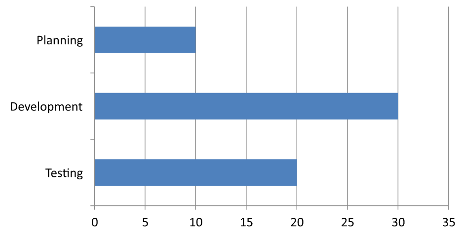

## **概述**

本文说明了如何使用 Aspose.Slides for Python via .NET 自定义图表坐标轴。内容涵盖计算坐标轴值、切换图表行列、坐标轴可见性、类别标签和刻度间隔、日期类别及格式化、标题旋转、坐标轴定位、显示单位以及对数刻度。

## **获取图表垂直坐标轴的最大值**

创建一个 [Presentation](https://reference.aspose.com/slides/python-net/aspose.slides/presentation/) 并添加默认数据的面积图。读取计算坐标轴值之前，请调用 [validate_chart_layout](https://reference.aspose.com/slides/python-net/aspose.slides.charts/chart/validate_chart_layout/) 以确保图表布局已更新。

读取坐标轴范围的 [actual_max_value](https://reference.aspose.com/slides/python-net/aspose.slides.charts/axis/actual_max_value/) 和 [actual_min_value](https://reference.aspose.com/slides/python-net/aspose.slides.charts/axis/actual_min_value/)，以及刻度间隔的 [actual_major_unit](https://reference.aspose.com/slides/python-net/aspose.slides.charts/axis/actual_major_unit/) 和 [actual_minor_unit](https://reference.aspose.com/slides/python-net/aspose.slides.charts/axis/actual_minor_unit/)。[actual_major_unit_scale](https://reference.aspose.com/slides/python-net/aspose.slides.charts/axis/actual_major_unit_scale/) 和 [actual_minor_unit_scale](https://reference.aspose.com/slides/python-net/aspose.slides.charts/axis/actual_minor_unit_scale/) 提供时间单位刻度，适用于日期坐标轴。示例将这些值存入本地变量并保存图表。

```python
import aspose.slides as slides
import aspose.slides.charts as charts

with slides.Presentation() as presentation:
    slide = presentation.slides[0]

    chart = slide.shapes.add_chart(charts.ChartType.AREA, 100, 100, 500, 350)
    chart.validate_chart_layout()

    max_value = chart.axes.vertical_axis.actual_max_value
    min_value = chart.axes.vertical_axis.actual_min_value

    major_unit = chart.axes.vertical_axis.actual_major_unit
    minor_unit = chart.axes.vertical_axis.actual_minor_unit

    major_unit_scale = chart.axes.vertical_axis.actual_major_unit_scale
    minor_unit_scale = chart.axes.vertical_axis.actual_minor_unit_scale

    presentation.save("AxisValues_out.pptx", slides.export.SaveFormat.PPTX)
```

## **交换坐标轴之间的数据**

使用 [switch_row_column](https://reference.aspose.com/slides/python-net/aspose.slides.charts/chartdata/switch_row_column/) 将系列和类别在图表数据中的角色互换。每个原来的类别变为系列，每个原来的系列变为类别。这会改变数据的分组方式，但不会交换水平和垂直坐标轴。示例使用 [set_range](https://reference.aspose.com/slides/python-net/aspose.slides.charts/chartdata/set_range/) 将默认数据绑定到 `Sheet1!A1:D5`（包括标题行和类别列），随后切换行列。它保存了一个包含四个系列和三个类别的图表。

```python
import aspose.slides as slides
import aspose.slides.charts as charts

with slides.Presentation() as presentation:
    slide = presentation.slides[0]

    chart = slide.shapes.add_chart(charts.ChartType.CLUSTERED_COLUMN, 100, 100, 400, 300)

    chart.chart_data.set_range("Sheet1!A1:D5")
    chart.chart_data.switch_row_column()

    presentation.save("SwitchChartRowColumns_out.pptx", slides.export.SaveFormat.PPTX)
```

## **反转坐标轴的绘制顺序**

使用 [is_plot_order_reversed](https://reference.aspose.com/slides/python-net/aspose.slides.charts/axis/is_plot_order_reversed/) 反转类别或数值坐标轴。例如，水平条形图可以按照工作表中的顺序从上到下显示项目阶段：规划、开发、测试。反转坐标轴会改变绘制方向；不会对工作簿数据进行排序或重新排列。相比之下，[switch_row_column](https://reference.aspose.com/slides/python-net/aspose.slides.charts/chartdata/switch_row_column/) 交换系列和类别的角色。

以下示例创建一个包含三个阶段和一个系列的水平条形图，并保存三个幻灯片：正常顺序、类别反转、数值反转。每个副本使用相同的数据集，每张幻灯片只反转一个坐标轴。

```python
import aspose.slides as slides
import aspose.slides.charts as charts

with slides.Presentation() as presentation:
    slide = presentation.slides[0]

    chart = slide.shapes.add_chart(charts.ChartType.CLUSTERED_BAR, 50, 40, 620, 320)
    chart.has_legend = False

    chart.chart_data.categories.clear()
    chart.chart_data.series.clear()

    workbook = chart.chart_data.chart_data_workbook
    workbook.clear(0)

    series = chart.chart_data.series.add(charts.ChartType.CLUSTERED_BAR)
    stages = ["Planning", "Development", "Testing"]
    values = [10, 30, 20]
    for i, stage in enumerate(stages):
        category_cell = workbook.get_cell(0, i + 1, 0, stage)
        chart.chart_data.categories.add(category_cell)
        value_cell = workbook.get_cell(0, i + 1, 1, values[i])
        series.data_points.add_data_point_for_bar_series(value_cell)

    # 幻灯片 2：在顶部显示第一个类别。
    category_slide = presentation.slides.add_clone(slide)
    category_chart = category_slide.shapes[0]
    category_chart.axes.vertical_axis.is_plot_order_reversed = True
    # 保持水平数值坐标轴在底部。
    category_chart.axes.vertical_axis.cross_type = charts.CrossesType.MAXIMUM

    # 幻灯片 3：仅反转水平数值刻度。
    value_slide = presentation.slides.add_clone(slide)
    value_chart = value_slide.shapes[0]
    value_chart.axes.horizontal_axis.is_plot_order_reversed = True

    presentation.save("ReversedAxes.pptx", slides.export.SaveFormat.PPTX)
```

反转坐标轴还可以将垂直坐标轴移动到绘图区域的另一侧。[cross_type](https://reference.aspose.com/slides/python-net/aspose.slides.charts/axis/cross_type/) 控制另一个坐标轴在被配置坐标轴上的交叉位置。在第 2 张幻灯片中，将其设置为 `MAXIMUM` 可使反转的类别坐标轴保持水平数值坐标轴在底部。若需特定的交叉点，请使用 [cross_at](https://reference.aspose.com/slides/python-net/aspose.slides.charts/axis/cross_at/)。在改变方向时请检查交叉设置，尤其是图表已经具有自定义交叉点的情况。将 `is_plot_order_reversed` 设置回 `False` 可恢复正常绘制方向；交叉设置是独立的。

| 正常顺序（幻灯片 1） | 类别反转（幻灯片 2） | 数值反转（幻灯片 3） |
| --- | --- | --- |
|  |  |  |
| 类别从底部到顶部；数值从左向右递增。 | 规划、开发和测试从上到下显示。数值及工作表行顺序保持不变。 | 类别保持正常顺序；数值从右向左递增。类别坐标轴在右侧零点交叉。 |

## **为折线图禁用垂直坐标轴**

将垂直坐标轴的 [is_visible](https://reference.aspose.com/slides/python-net/aspose.slides.charts/axis/is_visible/) 设置为 `False` 即可隐藏它。示例创建一个默认数据的折线图并保存时隐藏垂直坐标轴。

```python
import aspose.slides as slides
import aspose.slides.charts as charts

with slides.Presentation() as presentation:
    slide = presentation.slides[0]

    chart = slide.shapes.add_chart(charts.ChartType.LINE, 100, 100, 400, 300)
    chart.axes.vertical_axis.is_visible = False

    presentation.save("HiddenVerticalAxis.pptx", slides.export.SaveFormat.PPTX)
```

## **为折线图禁用水平坐标轴**

将水平坐标轴的 [is_visible](https://reference.aspose.com/slides/python-net/aspose.slides.charts/axis/is_visible/) 设置为 `False` 即可隐藏它。示例创建一个默认数据的折线图并保存时隐藏水平坐标轴。

```python
import aspose.slides as slides
import aspose.slides.charts as charts

with slides.Presentation() as presentation:
    slide = presentation.slides[0]

    chart = slide.shapes.add_chart(charts.ChartType.LINE, 100, 100, 400, 300)
    chart.axes.horizontal_axis.is_visible = False

    presentation.save("HiddenHorizontalAxis.pptx", slides.export.SaveFormat.PPTX)
```

## **更改类别坐标轴**

将 [category_axis_type](https://reference.aspose.com/slides/python-net/aspose.slides.charts/axis/category_axis_type/) 设置为日期或文本类别坐标轴。本示例需要 `ExistingChart.pptx`，其中第一张幻灯片的第一形状为图表，类别单元格包含 Excel 日期的数值。它将水平坐标轴改为日期坐标轴。将 [is_automatic_major_unit](https://reference.aspose.com/slides/python-net/aspose.slides.charts/axis/is_automatic_major_unit/) 设置为 `False`，[major_unit](https://reference.aspose.com/slides/python-net/aspose.slides.charts/axis/major_unit/) 设置为 `1`，并将 [major_unit_scale](https://reference.aspose.com/slides/python-net/aspose.slides.charts/axis/major_unit_scale/) 设置为月份，以在每月间隔处放置主刻度。

```python
import aspose.slides as slides
import aspose.slides.charts as charts

with slides.Presentation("ExistingChart.pptx") as presentation:
    slide = presentation.slides[0]

    chart = slide.shapes[0]
    chart.axes.horizontal_axis.category_axis_type = charts.CategoryAxisType.DATE
    chart.axes.horizontal_axis.is_automatic_major_unit = False
    chart.axes.horizontal_axis.major_unit = 1
    chart.axes.horizontal_axis.major_unit_scale = charts.TimeUnitType.MONTHS

    presentation.save("ChangeChartCategoryAxis_out.pptx", slides.export.SaveFormat.PPTX)
```

## **控制类别坐标轴标签间隔**

当图表包含大量类别时，可在不删除类别或数据点的前提下降低可见坐标轴标签的数量。将 [is_automatic_tick_label_spacing](https://reference.aspose.com/slides/python-net/aspose.slides.charts/axis/is_automatic_tick_label_spacing/) 设置为 `False`，随后将 [tick_label_spacing](https://reference.aspose.com/slides/python-net/aspose.slides.charts/axis/tick_label_spacing/) 设置为所需的类别间隔。对于正常顺序的文本类别，计数从第一个类别开始：

| 间隔 | 示例中显示的标签 |
| --- | --- |
| `1` | Category 1, Category 2, Category 3, ... Category 24 |
| `2` | Category 1, Category 3, Category 5, ... Category 23 |
| `3` | Category 1, Category 4, Category 7, ... Category 22 |

间隔为 `3` 时每三个标签显示一次，两标签被隐藏。它不会删除对应的列。自动间隔会根据可用空间选择间隔，并不一定显示所有标签。

刻度线有独立的控制方式。将 [is_automatic_tick_marks_spacing](https://reference.aspose.com/slides/python-net/aspose.slides.charts/axis/is_automatic_tick_marks_spacing/) 设置为 `False`，并使用 [tick_marks_spacing](https://reference.aspose.com/slides/python-net/aspose.slides.charts/axis/tick_marks_spacing/) 设置其间隔。例如，`1` 可在每个类别间隔保留刻度线，而标签仅每三个类别显示一次。将 [major_tick_mark](https://reference.aspose.com/slides/python-net/aspose.slides.charts/axis/major_tick_mark/) 设置为可见样式，以便看到效果。将任一自动间隔属性恢复为 `True` 可让图表重新自动选择间隔。

以下独立示例创建 24 个类别和一个系列，并在 `CategoryAxisIntervals.pptx` 中保存三张幻灯片：自动间隔、手动标签间隔（刻度线独立）以及恢复自动间隔。两份复制保留原始图表数据。无需输入演示文稿。横向标签文字使密度差异一目了然。

```python
import aspose.slides as slides
import aspose.slides.charts as charts

with slides.Presentation() as presentation:
    slide = presentation.slides[0]

    chart = slide.shapes.add_chart(charts.ChartType.CLUSTERED_COLUMN, 30, 40, 660, 320)

    chart.has_legend = False
    chart.chart_data.categories.clear()
    chart.chart_data.series.clear()

    workbook = chart.chart_data.chart_data_workbook
    workbook.clear(0)

    series = chart.chart_data.series.add(charts.ChartType.CLUSTERED_COLUMN)
    for i in range(24):
        category_cell = workbook.get_cell(0, i + 1, 0, f"Category {i + 1}")
        chart.chart_data.categories.add(category_cell)
        value_cell = workbook.get_cell(0, i + 1, 1, 10 + i % 6 * 5)
        series.data_points.add_data_point_for_bar_series(value_cell)

    axis = chart.axes.horizontal_axis
    axis.category_axis_type = charts.CategoryAxisType.TEXT
    axis.text_format.text_block_format.rotation_angle = 0
    axis.text_format.portion_format.font_height = 12
    axis.major_tick_mark = charts.TickMarkType.OUTSIDE
    axis.is_automatic_tick_label_spacing = True
    axis.is_automatic_tick_marks_spacing = True

    # 幻灯片 2：显示每三个标签，但为每个类别保留刻度线。
    manual_slide = presentation.slides.add_clone(slide)
    manual_chart = manual_slide.shapes[0]
    manual_axis = manual_chart.axes.horizontal_axis
    manual_axis.is_automatic_tick_label_spacing = False
    manual_axis.tick_label_spacing = 3
    manual_axis.is_automatic_tick_marks_spacing = False
    manual_axis.tick_marks_spacing = 1

    # 幻灯片 3：让图表再次自行选择两个间隔。
    restored_slide = presentation.slides.add_clone(manual_slide)
    restored_chart = restored_slide.shapes[0]
    restored_chart.axes.horizontal_axis.is_automatic_tick_label_spacing = True
    restored_chart.axes.horizontal_axis.is_automatic_tick_marks_spacing = True

    presentation.save("CategoryAxisIntervals.pptx", slides.export.SaveFormat.PPTX)
```

**自动间隔（幻灯片 1）：** 在此渲染中，每隔一个类别标签显示一次，并换行为两行。自动结果会随图表大小、字体和渲染器而变化。


**手动间隔（幻灯片 2）：** 每三个标签显示在一行，且刻度线仍保留在每个类别间隔。所有 24 列（包括未显示标签的列）仍可见且数值保持不变。幻灯片 3 恢复上述自动外观。


### **选择正确的坐标轴和间隔**

对文本类别坐标轴（如柱形图、折线图、面积图或条形图的类别坐标轴）使用此类别计数间隔。在柱形图中，它是水平坐标轴；在水平条形图中，类别坐标轴为垂直坐标轴，需要对 [vertical_axis](https://reference.aspose.com/slides/python-net/aspose.slides.charts/axesmanager/vertical_axis/) 进行相同设置。刻度线间隔同样适用于拥有系列坐标轴的图表。

不要使用类别标签间隔来设置数值坐标轴的数值刻度。在数值坐标轴上，[major_unit](https://reference.aspose.com/slides/python-net/aspose.slides.charts/axis/major_unit/) 指定数值差，例如 `10` 会在 0、10、20 等位置生成刻度。当轴从零开始时，类别标签间隔 `3` 仅计数类别位置，与数据值无关。散点图和气泡图使用数值坐标轴而非文本类别坐标轴。对于日期坐标轴，请参阅 [更改类别坐标轴](#change-a-category-axis) 中的基于时间的主单位和刻度设置。

## **为类别坐标轴值设置日期格式**

示例用四个年度值替换默认图表数据。日期以 OLE 自动化序列号存储在第一个工作表（索引 `0`）中。将 [category_axis_type](https://reference.aspose.com/slides/python-net/aspose.slides.charts/axis/category_axis_type/) 设置为日期坐标轴，禁用 [is_number_format_linked_to_source](https://reference.aspose.com/slides/python-net/aspose.slides.charts/axis/is_number_format_linked_to_source/)，并将 `yyyy` 赋给 [number_format](https://reference.aspose.com/slides/python-net/aspose.slides.charts/axis/number_format/)，使类别标签独立于单元格格式显示四位数年份。

```python
from datetime import date

import aspose.slides as slides
import aspose.slides.charts as charts

with slides.Presentation() as presentation:
    slide = presentation.slides[0]

    chart = slide.shapes.add_chart(charts.ChartType.LINE, 50, 50, 450, 300)

    chart.chart_data.categories.clear()
    chart.chart_data.series.clear()

    workbook = chart.chart_data.chart_data_workbook
    workbook.clear(0)

    series = chart.chart_data.series.add(charts.ChartType.LINE)
    for i in range(4):
        category_date = date(2015 + i, 1, 1)
        serial_date = (category_date - date(1899, 12, 30)).days
        category_cell = workbook.get_cell(0, i + 1, 0, serial_date)
        chart.chart_data.categories.add(category_cell)

        value_cell = workbook.get_cell(0, i + 1, 1, i + 1)
        series.data_points.add_data_point_for_line_series(value_cell)

    chart.axes.horizontal_axis.category_axis_type = charts.CategoryAxisType.DATE
    chart.axes.horizontal_axis.is_number_format_linked_to_source = False
    chart.axes.horizontal_axis.number_format = "yyyy"

    presentation.save("DateAxisFormat.pptx", slides.export.SaveFormat.PPTX)
```

## **为图表坐标轴标题设置旋转角度**

在垂直坐标轴上启用 [has_title](https://reference.aspose.com/slides/python-net/aspose.slides.charts/axis/has_title/)，提供标题文本，并将 [rotation_angle](https://reference.aspose.com/slides/python-net/aspose.slides/textframeformat/rotation_angle/) 设置为所需角度以旋转标题。角度以度为单位；本示例将柱形图的数值轴标题旋转 90 度后保存。

```python
import aspose.slides as slides
import aspose.slides.charts as charts

with slides.Presentation() as presentation:
    slide = presentation.slides[0]

    chart = slide.shapes.add_chart(charts.ChartType.CLUSTERED_COLUMN, 50, 50, 450, 300)
    chart.axes.vertical_axis.has_title = True
    chart.axes.vertical_axis.title.add_text_frame_for_overriding("Value")
    chart.axes.vertical_axis.title.text_format.text_block_format.rotation_angle = 90

    presentation.save("RotatedAxisTitle.pptx", slides.export.SaveFormat.PPTX)
```

## **在类别或数值坐标轴上设置坐标轴位置**

使用 [axis_between_categories](https://reference.aspose.com/slides/python-net/aspose.slides.charts/axis/axis_between_categories/) 控制数值坐标轴是跨越类别之间还是在类别刻度线上交叉。此属性适用于类别坐标轴。示例在柱形图的水平类别坐标轴上将其设为 `True` 并保存结果。

```python
import aspose.slides as slides
import aspose.slides.charts as charts

with slides.Presentation() as presentation:
    slide = presentation.slides[0]

    chart = slide.shapes.add_chart(charts.ChartType.CLUSTERED_COLUMN, 50, 50, 450, 300)
    chart.axes.horizontal_axis.axis_between_categories = True

    presentation.save("AxisBetweenCategories.pptx", slides.export.SaveFormat.PPTX)
```

## **为数值坐标轴设置显示单位**

将 [display_unit](https://reference.aspose.com/slides/python-net/aspose.slides.charts/axis/display_unit/) 设置为在不更改底层数据的前提下缩放数值坐标轴标签。将 [DisplayUnitType](https://reference.aspose.com/slides/python-net/aspose.slides.charts/displayunittype/) 设为 `MILLIONS`，60000000 将显示为 60。示例创建柱形图并将其垂直坐标轴的显示单位设为百万。

```python
import aspose.slides as slides
import aspose.slides.charts as charts

with slides.Presentation() as presentation:
    slide = presentation.slides[0]

    chart = slide.shapes.add_chart(charts.ChartType.CLUSTERED_COLUMN, 50, 50, 450, 300)
    chart.axes.vertical_axis.display_unit = charts.DisplayUnitType.MILLIONS

    presentation.save("Result.pptx", slides.export.SaveFormat.PPTX)
```

## **配置对数数值坐标轴**

当正值跨越多个数量级时，对数数值坐标轴非常有用。例如，某服务在五个周期内可能分别收到 10、100、1 000、10 000、100 000 次请求。在线性尺度下，较小的值会聚集在靠近零的位置。对数尺度使相对增长更易比较：等距代表等比例而非等差。

在数值坐标轴上将 [is_logarithmic](https://reference.aspose.com/slides/python-net/aspose.slides.charts/axis/is_logarithmic/) 设置为 `True`，并使用 [log_base](https://reference.aspose.com/slides/python-net/aspose.slides.charts/axis/log_base/) 选择基数。此操作仅改变现有值的显示方式，不会更改数据或添加对数趋势线。趋势线是对数据进行拟合的独立功能。

### **选择数值坐标轴和基数**

对于折线图或柱形图，数值坐标轴为 [vertical_axis](https://reference.aspose.com/slides/python-net/aspose.slides.charts/axesmanager/vertical_axis/)。对于水平条形图，则为 [horizontal_axis](https://reference.aspose.com/slides/python-net/aspose.slides.charts/axesmanager/horizontal_axis/)。散点图和气泡图拥有两个数值坐标轴，可为 X 值选择水平坐标轴，为 Y 值选择垂直坐标轴，或两者皆用。不要对类别坐标轴应用对数缩放。

默认对数基数为 `10`。对于 PPTX 图表，基数可在 `2` 到 `1000`（含）之间选择；亦支持如 `2.5` 的分数基数。使用基数 `10` 时，10、100、1 000、10 000 等幂次等距分布。

### **对比线性和对数缩放**

以下独立示例在第一张幻灯片上创建一个包含五个请求计数的折线图，然后克隆该幻灯片并在第二张幻灯片上启用基数为 10 的对数数值坐标轴。两张幻灯片均保留相同数据。

```python
import aspose.slides as slides
import aspose.slides.charts as charts

with slides.Presentation() as presentation:
    slide = presentation.slides[0]

    chart = slide.shapes.add_chart(charts.ChartType.LINE, 30, 40, 660, 200)

    chart.has_legend = False

    chart.chart_data.categories.clear()
    chart.chart_data.series.clear()

    workbook = chart.chart_data.chart_data_workbook
    workbook.clear(0)

    series = chart.chart_data.series.add(charts.ChartType.LINE)
    values = [10, 100, 1000, 10000, 100000]

    for i, value in enumerate(values):
        category_cell = workbook.get_cell(0, i + 1, 0, f"Period {i + 1}")
        chart.chart_data.categories.add(category_cell)

        value_cell = workbook.get_cell(0, i + 1, 1, value)
        series.data_points.add_data_point_for_line_series(value_cell)

    # 保持第一张幻灯片为线性，仅更改副本的数值轴刻度。
    logarithmic_slide = presentation.slides.add_clone(slide)
    logarithmic_chart = logarithmic_slide.shapes[0]
    value_axis = logarithmic_chart.axes.vertical_axis
    value_axis.is_logarithmic = True
    value_axis.log_base = 10

    presentation.save("LogarithmicAxis.pptx", slides.export.SaveFormat.PPTX)
```

**线性尺度（幻灯片 1）：** 相等的垂直距离代表请求计数的相等差值。最大值主导图表，使较小值难以辨认。


**对数尺度（幻灯片 2）：** 相等的垂直距离代表相等比例。每个周期的请求量是前一个的十倍，因而在基数为 10 的尺度上形成直线上升线。坐标轴标签仍显示原始请求计数。


### **处理零值和负值**

对数尺度只能显示严格正值。启用前请检查数据。如果零或负值具有意义，请保持线性尺度或单独显示它们。如果在分析中排除这些值，请说明原因。不要悄悄将其替换为小的正数，因为这会改变数据含义。对数坐标轴的手动最小值或最大值也必须为正数。

## **常见问题**

**如何设置一个坐标轴交叉另一个坐标轴的数值（坐标轴交叉）？**

使用 [cross_type](https://reference.aspose.com/slides/python-net/aspose.slides.charts/axis/cross_type/) 选择交叉行为。若需指定数值交叉点，请设置 [cross_at](https://reference.aspose.com/slides/python-net/aspose.slides.charts/axis/cross_at/)。这些设置可将坐标轴交叉移动到合适的基线。

**如何相对于坐标轴定位刻度标签？**

使用 [tick_label_position](https://reference.aspose.com/slides/python-net/aspose.slides.charts/axis/tick_label_position/) 并结合 [TickLabelPositionType](https://reference.aspose.com/slides/python-net/aspose.slides.charts/ticklabelpositiontype/)：`LOW`、`HIGH`、`NEXT_TO` 或 `NONE`。若要控制刻度线本身，请使用 [major_tick_mark](https://reference.aspose.com/slides/python-net/aspose.slides.charts/axis/major_tick_mark/) 或 [minor_tick_mark](https://reference.aspose.com/slides/python-net/aspose.slides.charts/axis/minor_tick_mark/)，这些与标签位置是独立的。